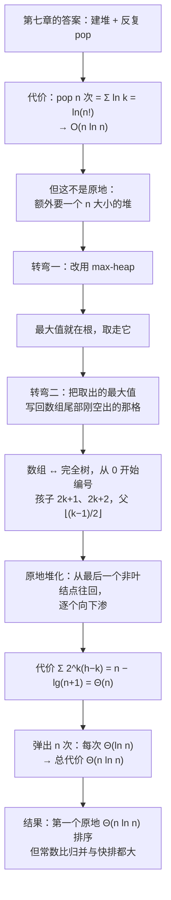

# C8.3 堆排序

> [!abstract] 这一讲的任务
> 第七章结尾留了半张答案：堆能 $O(\ln n)$ 地反复取出最值，那"排序"不就是**建堆 + 反复 pop** 吗？这一讲把这个念头做成算法，中间要转两个弯——**换 max-heap**，以及**把弹出的元素直接写回数组尾部的空位**。转过之后，整个过程只用 $\Theta(1)$ 的额外空间：第一个、也是唯一一个**原地**的 $\Theta(n\ln n)$ 排序。
> 第二件事更重要：把一堆乱序数据**原地**变成堆（heapify）只要 $\Theta(n)$，而不是"插 $n$ 次"的 $\Theta(n\ln n)$。这个反直觉的结论靠一次按层求和得到，它是堆排序能便宜的原因。

> [!info] 怎么读这份讲义
> 全篇一条线：**不原地的想法（一）→ 两个转弯（二）→ 原地堆化（三）→ 完整例子（四）→ 代价收口（五）→ 随堂题（六）**。
> 第三、四两节全是逐帧操作，配了三张完整的状态表和 15 张图。**这一篇的图不要跳过**——堆的形状与数组下标的对应关系是这一步唯一容易错的地方，尤其是**从 0 开始编号**之后父子公式的变化。
> 标 **（补充）** 的是原稿没展开、按教材与通行讲法补的。已知的两处原稿数字问题在第七节点出。

> [!info] 课程信息与来源
> **Ya-Hui Jia（贾雅慧）｜SFT SCUT｜jiayahui@scut.edu.cn｜课程群 309044012**。全课程信息见 [[C1.0 课程信息与C++预备]] 与 [[数据结构 MOC]]。
> 本讲接在 [[C8.2 选择、插入与冒泡排序]] 之后。源材料把它编在 8.4（8.4.1 起 6 个小节），本库按拆篇方案记为 C8.3。
> **本讲无课堂转写稿**，整篇按整理版理解。前置于此的是 [[C7.1 堆与优先队列]]——那一讲的 `push`/`pop`/下滤循环在这里原样复现。

## 目录

| 小节 | 内容 |
| --- | --- |
| [[#零、开场：第七章留下的半张答案]] | 堆排序的原始念头与它的两个麻烦 |
| [[#一、最直白的一版：建堆 + 反复取]] | $\Theta(n\ln n)$ 的来历、$\ln(n!)$ 的渐近 |
| [[#二、两个转弯：max-heap 与尾部空位]] | 为什么要 max、数组与完全树的对应、0 起下标 |
| [[#三、原地堆化：为什么只要 Θ(n)]] | 自底向上、percolating down、按层求和 |
| [[#四、完整堆排序：一个 10 元例子]] | 建堆 7 次交换、弹出 9 次、逐步状态 |
| [[#五、代价收口与它的短板]] | $\Theta(n\ln n)$、没有最坏情况、常数为什么大 |
| [[#六、随堂题：12 个数]] | 黑板题的完整答案 |
| [[#七、原稿勘误与阅读边界]] | 一处文字笔误、一处编号口径混用 |

---

## 零、开场：第七章留下的半张答案

第七章说过一件很诱人的事：堆能在 $O(\ln n)$ 的时间里给出当前的最小值（或最大值）。那"把一个乱序数组排好"这个任务，听起来就有了现成答案——**把所有元素塞进堆，然后一个一个取出来，取出来的自然是从小到大**。

这个念头没错。写成步骤就是：

1. 把 $n$ 个元素插进一个 min-heap；
2. 重复 $n$ 次：取出堆顶（当前最小），追加到输出。

问题是这一段有个代价没算：**那个堆本身要占 $\Theta(n)$ 的空间**。C8.1 立过的规矩在这儿咬人——不是原地，就不算好算法。

所以这一讲真正要解决的是两个麻烦：

- **麻烦一**：堆里的元素怎么放回数组，而不是另起一个输出数组？
- **麻烦二**：给定一段乱序数据，怎么**就在这段数组里**把它变成堆？而且不能慢——如果"建堆"就要 $\Theta(n\ln n)$，那整个算法的账就不好算了。

第一个麻烦的答案很巧：**取出的最大值，正好填进它离开时留下的那个空位**。第二个麻烦的答案更巧：**建堆只需要 $\Theta(n)$**。

## 一、最直白的一版：建堆 + 反复取

### 1.1 代价：为什么是 $\ln(n!)$

取出一个元素要 $O(\ln n)$——这是下滤最多走树高那么多层。取 $n$ 个：

$$\sum_{k=1}^{n}\ln k=\ln(1\cdot2\cdots n)=\ln(n!).$$

这里用到对数的基本性质 $\ln a+\ln b=\ln(ab)$：把 $n$ 个对数的和并成一个对数，里面正好是阶乘。

于是问题变成：**$\ln(n!)$ 长得多快？**

### 1.2 $\ln(n!)$ 的渐近：一个主导项就够了

用斯特林展开（也可以用 Maple 直接算）：

$$\ln(n!)=\Big(\ln n-1\Big)n+\ln\sqrt{2\pi}+\frac{1}{2}\ln n+\frac{1}{12n}-\frac{1}{360n^{3}}+O\!\left(\frac{1}{n^{5}}\right).$$

所有项里，**只有 $(\ln n-1)n$ 是主导项**，它和 $n\ln n$ 同阶；后面的 $\frac12\ln n$ 等相对它趋于零。所以

$$\ln(n!)=\Theta(n\ln n).$$

![[C8-堆排序-阶乘对数与nlnn曲线.png]]

图上红的是 $\ln(n!)$，蓝的是 $n\ln n$。两条线**不重合、但形状一致**，而且差距（就是那个 $-n$ 与 $\frac12\ln n$ 的组合）随 $n$ 增大只以常数速度变化。$n=1000$ 时：$\ln(1000!)\approx 5912$，$1000\ln 1000\approx 6908$——差 1000 左右，占 14%，**这是一个固定比例的常数差距，不是阶的差距**。

> [!tip] 判阶的诀窍
> 判断 $\ln(n!)$ 的阶，别去背展开式，只要想：$\ln(n!)=\sum_{k=1}^{n}\ln k$，被加项从 $0$ 涨到 $\ln n$，平均大约 $\frac{\ln n}{2}$，一共 $n$ 项 → 总量约 $\frac{n\ln n}{2}$。**这就是 $\Theta(n\ln n)$**，系数是多少不重要。

### 1.3 但是：这不是原地

上面那套做法要**另开一个 n 大小的 min-heap**，额外内存 $\Theta(n)$。按 C8.1 的口径，这就出局了。

能不能只用 $\Theta(1)$ 的额外空间（几个临时变量）？**能**——但要先想清楚两件事。

## 二、两个转弯：max-heap 与尾部空位

### 2.1 转弯一：换 max-heap

第七章主谈 min-heap，直觉上"从小到大排"就该用 min-heap：先取最小。但这里要换个方向：

> [!important] 为什么改用 max-heap
> 用 min-heap，取出的最小元素要**追加到输出的开头**——那就得有一块独立的输出空间，或者每次把整个数组往后挪。用 max-heap，取出的最大元素**追加到输出的末尾**——而数组的末尾正好空得出来（堆缩小后尾部就空着）。
> **同一件事，换个方向看，空间问题就没了。**

![[C8-堆排序-乱序数组按层存进数组.png]]

![[C8-堆排序-乱序数组对应的完全树.png]]

这两张是同一个东西的两种画法：左边是数组 `46 52 28 17 3 63 34 81 70 95`，右边是把它按层塞进一棵完全二叉树。看几个具体对应：

- 根 46 在数组下标 0；
- 它的两个孩子 52、28 在下标 1、2；
- 下标 3 的 17 有两个孩子 81、70（下标 7、8）；
- 下标 4 的 **3 只有一个孩子 95**（下标 9）——因为 $n=10$，最后一个结点在下标 9，下标 8 已经是若存在就当叶子的位置。

这棵树既不是 min-heap，也不是 max-heap，更不是 BST——它就是一串数按层摆好而已。堆化要做的，就是**在不改变形状的前提下，把值重新安排**。

### 2.2 转弯二：把最大值写回尾部空位

这一招在第四节才看得到效果，先说清机制：

1. 根的 95 是最大值。把它**取走**，堆顶空出来；
2. 把堆的**最后一个元素**（原来在数组末尾）搬到根，堆的大小减 1——于是数组末尾正好空出一格；
3. 从根向下渗，恢复 max-heap 性质；
4. **把 95 写进刚刚空出来的那一格**。

第 4 步就是全部机关：**取出的元素没有"输出"到别处，而是直接住在自己该待的位置上**。跑完 $n$ 次，数组从后往前一段一段变有序，最后整个数组有序，而额外用的只有几个下标变量。

### 2.3 数组 ↔ 完全树：0 起编号的公式

第七章的父子公式是 1 起编号的：孩子 $2k$、$2k+1$，父 $\lfloor k/2\rfloor$。C++ 的数组从 0 开始，**全部要平移一位**：

![[C8-堆排序-零起下标的父子公式.png]]

$$\text{Children}: 2k+1,\;2k+2 \qquad\qquad \text{Parent}: \left\lfloor\frac{k-1}{2}\right\rfloor$$

> [!warning] 易错点：原稿的父公式要整除
> 材料上印的是 `Parent = (k + 1)/2 - 1`。这个式子**只在整除成立时才等价**：$k=2$ 时 $(2+1)/2=1.5$，减去 1 是 $0.5$，不是下标。
> 正确写法是取整：$\lfloor (k+1)/2\rfloor-1$，它和 $\lfloor (k-1)/2\rfloor$ 对非负整数 $k$ 完全等价（试试 $k=2\to0$、$k=3\to1$、$k=0\to-1$ 表示没有父）。
> **记 $\lfloor(k-1)/2\rfloor$ 更安全**，因为它不需要额外说明"什么时候整除"。

再记两个从 1 起变到 0 起时容易一起错的地方：

| 名称 | 1 起编号（第 7 章） | 0 起编号（本章） |
| --- | --- | --- |
| 根 | 下标 1 | 下标 0 |
| $k$ 的孩子 | $2k$、$2k+1$ | $2k+1$、$2k+2$ |
| $k$ 的父 | $\lfloor k/2\rfloor$ | $\lfloor (k-1)/2\rfloor$ |
| 最后一个非叶结点 | $\lfloor n/2\rfloor$ | $\lfloor n/2\rfloor-1$ |
| 有没有左孩子 | $2k\le n$ | $2k+1<n$ |

最后一行是最容易写出死循环的地方：**判断孩子是否存在，必须和"孩子下标"用同一套编号**。

> [!question] 停一下，先自己想想
> $n=10$ 时，最后一个**非叶**结点是哪个下标？
> 按上表：$\lfloor 10/2\rfloor-1=4$，也就是值为 3 的那个结点。它只有一个孩子（下标 9 的 95）。
> 这个数是堆化的起点——**从它开始往前，每个结点都有孩子可以渗下去；从它往后，全是叶子，天生就是堆**。

## 三、原地堆化：为什么只要 $\Theta(n)$

### 3.1 两条路，该走哪条

要把一棵完全树变成 max-heap，有两种思路：

| 策略 | 做法 | 代价 |
| --- | --- | --- |
| 自顶向下（插入式） | 把第一个元素当地堆，其余元素逐个"插入"并上滤 | $n$ 次上滤，每次 $O(\ln n)$ → 最坏 $\Theta(n\ln n)$ |
| **自底向上（修正式）** | 叶子天生是堆，从最后一个非叶结点往回，逐个向下渗 | 见 3.5：$\Theta(n)$ |

两种都正确，第二种便宜。**为什么便宜？** 因为"上滤"贵的那些结点（在底层）数量多，而"下渗"贵的那些结点（在顶层）数量少——自底向上正好把便宜的活干在数量多的那一头。3.5 节会把这个直觉算成一个和式。

### 3.2 起点：最后一个非叶结点

![[C8-堆排序-堆化-21元素初始数组与完全树.png]]

21 个元素的乱序数组：

`81 13 77 24 35 61 48 3 23 87 92 95 74 57 99 86 28 15 55 7 51`

按层摆成完全树：前 4 层是满的（15 个结点），第 5 层 6 个（86、28、15、55、7、51）。最后一个非叶结点是下标 $\lfloor 21/2\rfloor-1=9$，值是 **87**。它的两个孩子是下标 19、20 的 7 和 51——87 比它们都大，**已经满足堆性质**，这一格可以跳过（实际跳过也是堆化的一部分：它做了 0 次交换）。

### 3.3 向下渗 percolating down

> [!important] 下渗 percolating down
> 对以 $k$ 为根的子树，如果它的左右子树都已经是堆，只要 $a_k$ 比某个孩子小，就把 $a_k$ 与**较大的那个孩子**交换，然后对新的位置继续做同一件事，直到 $a_k$ 不小于两个孩子、或者走到叶子。

两个细节都是必须的：

- **必须换"较大的那个孩子"**。换小的那个，大的仍压在头上，还是违反堆性质。
- **必须继续往下渗**。一次交换只解决当前这一层，换下去之后可能还会比自己新的孩子小——3.4 里 24 那个结点就连续渗了两层。

![[C8-堆排序-堆化-23与55交换.png]]

第一刀：下标 8 的 **23** 与它唯一的孩子、下标 18 的 **55** 交换。23 落到最底层，成了叶子，停。

### 3.4 21 元素堆化的全部 13 次交换

从下标 9 一路往前处理到 0。下表每一步都给出交换与交换后的完整数组，可以逐行核对：

| 步 | 子树根 | 交换 | 数组（下标 0→20） |
| --- | --- | --- | --- |
| 0 | 90 号前的 87 | 无（已是堆） | `81 13 77 24 35 61 48 3 23 87 92 95 74 57 99 86 28 15 55 7 51` |
| 1 | 8 / 23 | 8↔18（23↔55） | `81 13 77 24 35 61 48 3 55 87 92 95 74 57 99 86 28 15 23 7 51` |
| 2 | 7 / 3 | 7↔15（3↔86） | `81 13 77 24 35 61 48 86 55 87 92 95 74 57 99 3 28 15 23 7 51` |
| 3 | 6 / 48 | 6↔14（48↔99） | `81 13 77 24 35 61 99 86 55 87 92 95 74 57 48 3 28 15 23 7 51` |
| 4 | 5 / 61 | 5↔11（61↔95） | `81 13 77 24 35 95 99 86 55 87 92 61 74 57 48 3 28 15 23 7 51` |
| 5 | 4 / 35 | 4↔10（35↔92） | `81 13 77 24 92 95 99 86 55 87 35 61 74 57 48 3 28 15 23 7 51` |
| 6 | 3 / 24 | 3↔7，再 7↔16 | `81 13 77 86 92 95 99 28 55 87 35 61 74 57 48 3 24 15 23 7 51` |
| 7 | 2 / 77 | 2↔6（77↔99） | `81 13 99 86 92 95 77 28 55 87 35 61 74 57 48 3 24 15 23 7 51` |
| 8 | 1 / 13 | 1↔4，4↔9，9↔20 | `81 92 99 86 87 95 77 28 55 51 35 61 74 57 48 3 24 15 23 7 13` |
| 9 | 0 / 81 | 0↔2，2↔5 | `99 92 95 86 87 81 77 28 55 51 35 61 74 57 48 3 24 15 23 7 13` |

第 6、8、9 行是多层渗，单独看图更清楚：

![[C8-堆排序-堆化-24连续渗两层.png]]

24 先被 86 换下去，到了下标 7 又发现自己比 28 小，再换一次——**"渗"这个词就是从这儿来的：一路往下漏，直到漏不动**。

![[C8-堆排序-堆化-13渗到叶子.png]]

13 是最惨的一个：92 换它、87 换它、51 又换它，三次之后落到下标 20，成了叶子。**这就是"最坏情况"的样子**——一个结点从根附近一路掉到底。

![[C8-堆排序-堆化-根81渗两层.png]]

轮到根 81 时只渗了两层：与 99 换、再与 95 换，到下标 5 之后它的孩子 61、74 都比它小，停。

![[C8-堆排序-堆化-完成得到大顶堆.png]]

最终结果：

`99 92 95 86 87 81 77 28 55 51 35 61 74 57 48 3 24 15 23 7 13`

**全程 13 次交换。** 21 个元素、13 次交换——这个比例不是巧合，正是下面这条推导要说明的。

### 3.5 代价：按层求和

把"每个结点最坏要渗几层"加起来。设树高 $h$（根在第 0 层，叶子在第 $h$ 层）：

- 第 $k$ 层有 $2^k$ 个结点；
- 这些结点最多渗 $h-k$ 层（最坏情况下每个都渗到底）；
- 于是总交换次数不超过

$$\sum_{k=0}^{h}2^{k}(h-k).$$

这个和有一个干净的闭式：

$$\sum_{k=0}^{h}2^{k}(h-k)=\bigl(2^{h+1}-1\bigr)-(h+1).$$

> [!tip] 怎么记这个闭式（补充）
> 令 $S_h=\sum_{k=0}^h 2^k(h-k)$。逐个算：$S_0=0,\;S_1=1,\;S_2=4,\;S_3=11,\;S_4=26$。
> 而 $2^{h+1}-1-(h+1)$ 给出：$h=0\to0$，$h=1\to1$，$h=2\to4$，$h=3\to11$，$h=4\to26$——完全吻合。
> 也可以用递推看：$S_h=2S_{h-1}+(2^h-1)$，即"把左右子树各自的和翻倍、再加上本层新多出来的那一层下渗"。

完美树有 $n=2^{h+1}-1$ 个结点，$h+1=\lg(n+1)$，代入：

$$\text{总交换次数}\le n-\lg(n+1).$$

每次交换要 **2 次比较**（先比出哪个孩子大，再和孩子比是否要换），所以比较次数不超过 $2n-2\lg(n+1)$，**是 $\Theta(n)$ 而不是 $\Theta(n\ln n)$**。

一句人话解释这个结果的来历：

> [!important] 为什么堆化只要 $\Theta(n)$
> 完全树里**一半以上的结点是叶子**，它们一层都不用渗；剩下的一半里，绝大多数在倒数第二层，最多渗 1 层。真正要渗很多层的只有根附近那少数几个结点。
> **"要渗得深的结点"与"结点多"这两件事，数量上正好错开**——所以总和是线性的，不是 $n$ 乘上 $\ln n$。
> 反过来说：如果自顶向下用"插入 + 上滤"，最底层那 $n/2$ 个结点每个都要上滤 $\lg n$ 层，代价是 $\Theta(n\ln n)$。**同一种树，反过来做，差一个 $\ln n$。**

原稿把交换次数的上界说成"最多 $2n$"。严格算应该是 $2n-2\lg(n+1)$，比 $2n$ 小一点；作为上界它没错，只是不够紧。

## 四、完整堆排序：一个 10 元例子

### 4.1 建堆：7 次交换

还是刚才那个 10 元数组 `46 52 28 17 3 63 34 81 70 95`。

![[C8-堆排序-例-3与95交换.png]]

第一刀在下标 4 的 3：它只有一个孩子 95，换。

![[C8-堆排序-例-17与81交换.png]]

第二刀在下标 3 的 17：两个孩子 81、70，**换大的那个 81**。

![[C8-堆排序-例-46连续渗三层.png]]

最后一刀在根 46：与 95 换、与 81 换、与 70 换，一路渗到下标 8。**建堆到此结束，共 7 次交换。**

| 步 | 处理 | 交换 | 数组 |
| --- | --- | --- | --- |
| 0 | — | — | `46 52 28 17 3 63 34 81 70 95` |
| 1 | 4 / 3 | 4↔9 | `46 52 28 17 95 63 34 81 70 3` |
| 2 | 3 / 17 | 3↔7 | `46 52 28 81 95 63 34 17 70 3` |
| 3 | 2 / 28 | 2↔5 | `46 52 63 81 95 28 34 17 70 3` |
| 4 | 1 / 52 | 1↔4 | `46 95 63 81 52 28 34 17 70 3` |
| 5 | 0 / 46 | 0↔1，1↔3，3↔8 | `95 81 63 70 52 28 34 17 46 3` |

![[C8-堆排序-例-建成大顶堆.png]]

`95 81 63 70 52 28 34 17 46 3`——这就是 max-heap。注意**它不是有序的**：63 在 52 前面，但 70 在 63 后面。堆只保证父子关系。

### 4.2 弹出 9 次：从后往前填满

![[C8-堆排序-例-弹出95后数组尾部空出一格.png]]

弹出 95 之后：堆区缩到下标 0–8，末尾空出一格。为了恢复堆性质，把原末尾的 3 搬到根，渗下（3↔81、3↔70、3↔46）。

![[C8-堆排序-例-把95填进数组尾部.png]]

**然后把这格空出来的位置填上 95。** 这一步就是 2.2 说的机关：取出的最大值直接住进它该待的地方，不需要任何输出数组。

![[C8-堆排序-例-依次弹出70与63.png]]

![[C8-堆排序-例-依次弹出52与46.png]]

![[C8-堆排序-例-依次弹出34与28.png]]

九次弹出的全部状态：

| 步 | 弹出 | 渗下路径 | 数组（黄格 = 已排好的尾部） |
| --- | --- | --- | --- |
| 1 | 95 | 3: 0↔1、1↔3、3↔8 | `81 70 63 46 52 28 34 17 3 \| 95` |
| 2 | 81 | 3: 0↔1、1↔4 | `70 52 63 46 3 28 34 17 \| 81 95` |
| 3 | 70 | 17: 0↔2、2↔6 | `63 52 34 46 3 28 17 \| 70 81 95` |
| 4 | 63 | 17: 0↔1、1↔3 | `52 46 34 17 3 28 \| 63 70 81 95` |
| 5 | 52 | 28: 0↔1 | `46 28 34 17 3 \| 52 63 70 81 95` |
| 6 | 46 | 3: 0↔2 | `34 28 3 17 \| 46 52 63 70 81 95` |
| 7 | 34 | 17: 0↔1 | `28 17 3 \| 34 46 52 63 70 81 95` |
| 8 | 28 | 3: 0↔1 | `17 3 \| 28 34 46 52 63 70 81 95` |
| 9 | 17 | 无（堆只剩 3） | `3 17 28 34 46 52 63 70 81 95` |

![[C8-堆排序-例-排序完成.png]]

**注意最后一步的细节**：堆里只剩两个元素时，把 17 放到"第 2 个位置"，剩下的 3 自然在第一个位置——不需要再比。这就是"弹出 $n-1$ 次就够了"的原因。

## 五、代价收口与它的短板

### 5.1 总账

| 阶段 | 代价 | 为什么 |
| --- | --- | --- |
| 堆化 | $\Theta(n)$ | 3.5 的按层求和 |
| 弹出 $n-1$ 次 | $\Theta(n\ln n)$ | 每次渗下最多 $\lg n$ 层，每层 2 次比较 |
| **合计** | $\Theta(n\ln n)$ | 低阶项被吸收 |
| 额外空间 | $\Theta(1)$ | 只有几个下标变量 |

### 5.2 「没有最坏情况」是什么意思

材料的说法是：**堆排序没有最坏情况**。这句话的意思是——

- 弹出的代价**与数据分布无关**：不管里面是什么数，每次都是从根往下渗，最坏走满树高；
- 所以最坏 = 平均 = $\Theta(n\ln n)$，不存在"某种输入让它退化成 $\Theta(n^2)$"（这正是它比快速排序稳的地方）；
- 唯一的"最好情况"是**所有元素相等**（或大部分相等）：每次比较都不需要换，渗下立刻停，全算法退化成 $\Theta(n)$。

| 情况 | 运行时间 | 说明 |
| --- | --- | --- |
| 最坏 | $\Theta(n\ln n)$ | 无退化情形 |
| 平均 | $\Theta(n\ln n)$ | |
| 最好 | $\Theta(n)$ | 所有（或绝大多数）元素相同 |

### 5.3 它的短板：常数大、缓存不友好

> [!note]（补充）为什么工程上更爱用快排
> 堆排序的**渐近**是最优的，原地也是加分项，但它的实际速度通常不如快速排序和归并排序，原因有三个：
> 1. **访问模式跳**。下渗是"下标 $k\to2k+1$"，在同一次循环里跨越大段内存，缓存命中率低；归并排序和快速排序访问的都是连续区间。
> 2. **比较次数多**。每次交换要 2 次比较（先选孩子、再和孩子比），而快排的划分一次比较只做一次判断。
> 3. **比较方向不可预测**。下渗到哪边取决于孩子大小，分支预测失败率高。
>
> 所以工业界的用法是：**用堆排序保证最坏情况**（比如 `std::partial_sort`、实时系统的兜底），用快排处理一般情形。C++ 的 `std::make_heap` / `std::sort_heap` 就是把这一节的两步拆成了两个函数。

> [!note]（补充）堆排序不稳定
> 举例：`[3, 2₁, 2₂]`。建堆后仍是 `3 2₁ 2₂`（2₁ 是较大的孩子，但都不如 3）。弹出 3：把末尾的 2₂ 换到根，得到 `2₂ 2₁ | 3`；2₂ 与 2₁ 比较，2₂ 不小于孩子，不换。结果里 **2₂ 跑到了 2₁ 前面**，原序被破坏 → **不稳定**。
> 原因同样是"远距离交换"：堆顶与数组末尾的交换，一次就把一个元素甩过整段。

## 六、随堂题：12 个数

材料给了一道「Black Board Example」，用堆排序排这 12 个数：

$$34,\;15,\;65,\;59,\;79,\;42,\;40,\;80,\;50,\;61,\;23,\;46$$

> [!example] 完整解答（复算值）
> **第一步，建堆。** 最后非叶结点是 $\lfloor12/2\rfloor-1=5$ 的 42，从它往回：
> - 依次对 5、4、3、2、1、0 做下渗，共 **7 次交换**（5↔11、3↔7、1↔3、3↔7、0↔1、1↔4、4↔9）；
> - 建堆结果：
>   $$80\;79\;65\;59\;61\;46\;40\;15\;50\;34\;23\;42.$$
>
> **第二步，弹出 11 次。** 每次把堆顶换到末尾、把末尾搬到根、再渗下：
> $$15\;23\;34\;40\;42\;46\;50\;59\;61\;65\;79\;80.$$

> [!warning] 手算时最常见的三个错
> 1. **起点错**：$n=12$ 时从下标 5 开始，不是 6，也不是 $12/2=6$。
> 2. **换错孩子**：永远换**较大的那个**孩子，不是左边那个。
> 3. **漏了继续渗**：换下去之后要问一句"你现在还比孩子小吗"，像上面 24 和 13 那样可能连走好几层。

## 七、原稿勘误与阅读边界

| 位置 | 原稿 | 更正 | 性质 |
| --- | --- | --- | --- |
| p.125 | "swap it with the maximum child **(70)**" | 最大孩子是 **81**（17 在下标 3，孩子是下标 7、8 的 81 与 70；同页下一帧的数组也显示换的是 81） | **原始笔误**，见下方证据图 |
| p.123 | "the first non-leaf node is in position n/2. Thus we start with position 10/2 = 5" | 0 起编号下最后一个非叶结点是下标 **4**（值为 3）；数字 5 只在 1 起编号下成立，而 p.105 刚把编号改成 0 起 | 两种编号**混用**，画面上第一刀落在下标 4 ✓ |
| p.105 | `Parent = (k + 1)/2 - 1` | 需取整：$\lfloor(k+1)/2\rfloor-1=\lfloor(k-1)/2\rfloor$ | 表示不完整（$k$ 偶时不整除） |
| p.122 | "maximum of $2n$ comparisons" | 严格上界 $2n-2\lg(n+1)$ | 界不够紧，非错误 |

![[C8-堆排序-例-17与81交换.png]]

上图就是 p.125 那一处笔误的证据：数组第二行显示 `46 52 28 81 95 63 34 17 70 3`——**81 升到了下标 3，17 落到下标 7**，换的明显是 81 而不是文字里写的 70。

**阅读边界**：

- 本篇这 20 张裁切图与三张状态表（21 元素堆化、10 元素建堆、10 元素弹出）均已用 Python 从初始数组重跑对照，**逐帧一致**；随堂题的排序结果是复算值。
- 本段材料**没有任何代码页**——没有 `heapify` 函数、没有 `sift_down` 函数，只有动画与公式。想要可编译的参考实现，看 [[C7.1 堆与优先队列]] 第 9.3 节那份。
- 「缓存不友好」「不稳定」两处是（补充），原稿未涉及。
- **本讲没有随堂测验之外的题目**；那道黑板题已按上面全文解出。

**配图清单**（20 张，均为 p.97–140 的印刷图示裁切）：

| 图 | 源页 | 说明 |
| --- | --- | --- |
| `C8-堆排序-阶乘对数与nlnn曲线.png` | p.101 | $\ln(n!)$ 与 $n\ln n$ 两条曲线 |
| `C8-堆排序-乱序数组按层存进数组.png` | p.104 | 10 元乱序数组 |
| `C8-堆排序-乱序数组对应的完全树.png` | p.104 | 同一数组的完全树形状 |
| `C8-堆排序-零起下标的父子公式.png` | p.105 | 0 起编号的父子公式 |
| `C8-堆排序-堆化-21元素初始数组与完全树.png` | p.108 | 21 元数组与它的树 |
| `C8-堆排序-堆化-23与55交换.png` | p.110 | 第一刀：23↔55 |
| `C8-堆排序-堆化-24连续渗两层.png` | p.115 | 24 连渗两层 |
| `C8-堆排序-堆化-13渗到叶子.png` | p.117 | 13 一路渗到下标 20 |
| `C8-堆排序-堆化-根81渗两层.png` | p.118 | 根只渗两层 |
| `C8-堆排序-堆化-完成得到大顶堆.png` | p.119 | 21 元堆化结果 |
| `C8-堆排序-例-3与95交换.png` | p.124 | 10 元建堆第一刀 |
| `C8-堆排序-例-17与81交换.png` | p.125 | 建堆第二刀（兼勘误证据） |
| `C8-堆排序-例-46连续渗三层.png` | p.128 | 根 46 连渗三层 |
| `C8-堆排序-例-建成大顶堆.png` | p.129 | 建堆完成 |
| `C8-堆排序-例-弹出95后数组尾部空出一格.png` | p.130 | 弹出后末尾空一格 |
| `C8-堆排序-例-把95填进数组尾部.png` | p.131 | 95 写回空位 |
| `C8-堆排序-例-依次弹出70与63.png` | p.132 | 第 3、4 次弹出 |
| `C8-堆排序-例-依次弹出52与46.png` | p.133 | 第 5、6 次弹出 |
| `C8-堆排序-例-依次弹出34与28.png` | p.134 | 第 7、8 次弹出 |
| `C8-堆排序-例-排序完成.png` | p.135 | 最终有序数组 |

## 这一讲的三句话

1. **堆排序 = 原地堆化 + 反复把堆顶换到数组尾部并渗下**。用 max-heap 而不是 min-heap，是因为"最大值该去的位置"正好是数组尾部那段已经空出来的地方；取出的元素直接住进去，所以额外空间只有几个下标。
2. **堆化只要 $\Theta(n)$**：从最后一个非叶结点往回下渗，代价是 $\sum_{k}2^k(h-k)=n-\lg(n+1)$。结点多的层不用渗、要渗深的结点少，两头错开，所以是线性而不是 $n\ln n$。**换成"逐个插入"，立刻退化成 $\Theta(n\ln n)$。**
3. **0 起编号是本讲唯一的公式陷阱**：孩子 $2k+1$、$2k+2$，父 $\lfloor(k-1)/2\rfloor$，最后一个非叶结点 $\lfloor n/2\rfloor-1$。堆排序最坏 = 平均 = $\Theta(n\ln n)$，没有退化情形，但不稳定、常数大。

> [!tip] 速查
> | 要问的 | 0 起编号下的答案 |
> | --- | --- |
> | $k$ 的左/右孩子 | $2k+1$ / $2k+2$ |
> | $k$ 的父 | $\lfloor(k-1)/2\rfloor$ |
> | 最后一个非叶结点 | $\lfloor n/2\rfloor-1$ |
> | 有没有孩子 | $2k+1<n$ |
> | 堆化代价 | $\Theta(n)$（交换数 $\le n-\lg(n+1)$） |
> | 全部代价 | $\Theta(n\ln n)$，额外空间 $\Theta(1)$ |

## 下一讲预告

堆排序用"换一种结构"的办法把 $\Theta(n^2)$ 压到了 $\Theta(n\ln n)$。下一讲换成**换一种分法**：把数组劈成两半，两半各自排好，再把两个有序段并起来。

这条路的第一步就有一个漂亮的小问题：**两个有序段怎么并？** 答案只要三个指针。但接着会有两个更麻烦的问题——分到多小才算"够小"（材料里的答案是 6，小于等于 6 就直接用插入排序）、以及那个递推式 $T(n)=2T(n/2)+n$ 为什么解出来就是 $n\ln n$。归并排序还有一个别的好处：**它是稳定的**，这在工程里比 $\lg n$ 的常数更值钱。

---

## 相关笔记 Related Notes

上一讲：[[C8.2 选择、插入与冒泡排序]]
下一讲：[[C8.4 归并排序]]
前置：[[C7.1 堆与优先队列]]、[[C6.5 完美二叉树·完全二叉树与N叉树]]
返回：[[数据结构 MOC]]
