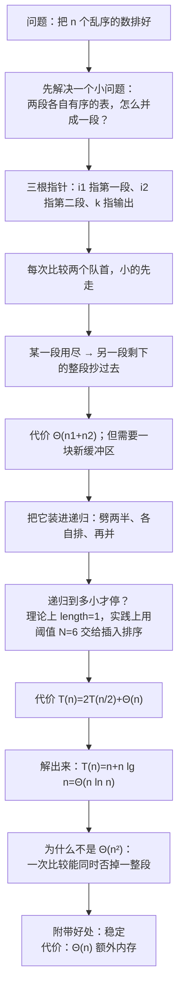

# C8.4 归并排序

> [!abstract] 这一讲的任务
> 上一讲用"换一种结构"（堆）把 $\Theta(n^2)$ 压到了 $\Theta(n\ln n)$，代价是常数大、缓存不友好。这一讲换一条路：**换一种分法**——把表劈成两半，两半各自排好，再把两个有序段并起来。
> 核心只有一个小问题：**两段有序的表，怎么用最少的比较并成一段？** 答案是三根指针，代价 $\Theta(n_1+n_2)$。把这个问题递归地套下去，就得到第一个真正意义上的**分治**（divide-and-conquer）算法：代价 $\Theta(n\ln n)$，而且**稳定**。
> 代价也有：它**不是原地**的，并的过程要一块和原数组一样大的缓冲区。这是它和堆排序的分水岭。

> [!info] 怎么读这份讲义
> 第一节只讲"并"，不涉及递归——先把这个动作练到不用想；第二节才把它装进递归外壳；第三节是 25 个数的完整轨迹（一张调用表 + 一棵调用树，**对不上就回头查前两节**）；第四节把递推式解出来。
> 标 **（补充）** 的是原稿没展开、按教材与通行讲法补的。第七节有**两处印刷代码的硬错**（其中一处会让程序死循环），已经验证并给出改正。
> 本讲的阈值 $N=6$ 是"工程参数"，不是数学结论——第四节会解释为什么它不破坏 $\Theta(n\ln n)$。

> [!info] 课程信息与来源
> **Ya-Hui Jia（贾雅慧）｜SFT SCUT｜jiayahui@scut.edu.cn｜课程群 309044012**。全课程信息见 [[C1.0 课程信息与C++预备]] 与 [[数据结构 MOC]]。
> 本讲接在 [[C8.3 堆排序]] 之后。源材料编号 8.5（含 8.5.1–8.5.6），本库按拆篇方案记为 C8.4。
> **本讲无课堂转写稿**，整篇按整理版理解。



## 目录

| 小节 | 内容 |
| --- | --- |
| [[#零、开场：两份已经排好的名单]] | 归并要解决的真实动作 |
| [[#一、归并：三根指针并成一段]] | 手算、收尾、代码、代价、稳定性 |
| [[#二、分治：把问题劈成两半]] | 三步、递归终点、阈值 6、实现 |
| [[#三、25 个数的完整轨迹]] | 调用表、调用树、三次合并 |
| [[#四、为什么是 Θ(n ln n)]] | 递推式、展开、Maple、为什么不是平方 |
| [[#五、工程评价与来路]] | 与堆排序的取舍、von Neumann |
| [[#六、原稿勘误与阅读边界]] | 两处代码硬错、一处编号错位 |

---

## 零、开场：两份已经排好的名单

开学第一天，学生会给你两份名单：一份是**大一按学号排好的**，一份是**大二按学号排好的**。你要交的是一份**全院按学号排好的**总名单。

最笨的做法是把两份倒在一起重新排一遍——那份工作量是 $O(n\ln n)$。但你已经知道两份各自有序了，这份信息不该浪费。**能不能只走一遍就并好？**

能。而且走法比想象的简单：**每次只看两份名单当前最前面的那个名字，谁小就把谁抄进总名单，然后把那一份的指针往后挪一格。** 某一份抄完了，另一份剩下的直接整段接上。

这个动作叫**归并**（merging），它就一个下午的手工活，但它是整个归并排序的心脏。**先把这一个动作练熟，剩下的全是递归。**

## 一、归并：三根指针并成一段

### 1.1 三根指针

![[C8-归并-三指针初始状态.png]]

三行格子：上面两行是两个已排好序的数组，下面一行是空的输出数组。三根红色箭头：

- `i1` 指着第一段的队首；
- `i2` 指着第二段的队首；
- `k` 指着输出数组的队首（下一个该填的位置）。

每一步只做一件事：**比较两个队首，把小的那个抄到 `out[k]`，然后让它的指针前进一格，`k` 也前进一格。**

> [!warning] 这一帧的数组和后面的动画不是同一组
> 图里的两段是 `3 7 12 18 24` 与 `2 5 16 21 33`，但紧接着的动画（比较 3 和 7、比较 5 和 7……）用的是 `3 5 18 21 24` 与 `2 7 12 16 33`。两组的**并集相同**（都是那 10 个数），所以并出来的结果一样，只是切法不同。
> 这一帧只当"三根指针各管一段"的示意看；**下面的手算用后一组**，因为它和后续每一帧的比较对得上。

### 1.2 手算：10 个数，9 次比较

两段：$A=3,5,18,21,24$，$B=2,7,12,16,33$。逐次比较：

| 步 | 比较 | 抄下 | 输出 | 指针变化 |
| --- | --- | --- | --- | --- |
| 1 | 2 与 3 | 2 | `2` | `i2` 前进（B 到 7） |
| 2 | 3 与 7 | 3 | `2 3` | `i1` 前进（A 到 5） |
| 3 | 5 与 7 | 5 | `2 3 5` | `i1` 前进（A 到 18） |
| 4 | 18 与 7 | 7 | `2 3 5 7` | `i2` 前进（B 到 12） |
| 5 | 18 与 12 | 12 | `2 3 5 7 12` | `i2` 前进（B 到 16） |
| 6 | 18 与 16 | 16 | `2 3 5 7 12 16` | `i2` 前进（B 到 33） |
| 7 | 18 与 33 | 18 | `2 3 5 7 12 16 18` | `i1` 前进（A 到 21） |
| 8 | 21 与 33 | 21 | `2 3 5 7 12 16 18 21` | `i1` 前进（A 到 24） |
| 9 | 24 与 33 | 24 | `2 3 5 7 12 16 18 21 24` | `i1` 前进（A 已用尽） |

第 9 步之后 A 空了，B 里还剩 33，**直接抄下**，输出 10 个数。

![[C8-归并-比较后搬走一个数.png]]

**9 次比较并 10 个数**。这个比例值得记住：**比较次数最多是 $n_1+n_2-1$**，因为每比较一次至少有一个人被抄走，而最后一次抄完之后不需要再比。

### 1.3 收尾：某一段一定会先空

![[C8-归并-收尾与剩余直接复制.png]]

上图是另一组（7 个与 7 个）：A 的箭头已经**越过末尾**（外面的淡圈就是越界位置），说明 A 先空了；B 里剩下的 `33 37 42` 直接整段搬到输出尾部。

所以归并的代码永远是**两段**：

1. 主循环：两段都还有货时，比较队首、抄小的；
2. 收尾：**哪一段还有剩就整段抄过去**。两段都要写一段收尾循环，尽管实际只会执行其中一段——因为写代码时你不知道谁会先空。

### 1.4 代码

```cpp
int i1 = 0, i2 = 0, k = 0;

while ( i1 < n1 && i2 < n2 ) {
    if ( array1[i1] < array2[i2] ) {       // 相等时取右边，见 1.6
        arrayout[k] = array1[i1];
        ++i1;
    } else {
        arrayout[k] = array2[i2];
        ++i2;
    }
    ++k;
}

for ( ; i1 < n1; ++i1, ++k ) {             // 第一段还有剩
    arrayout[k] = array1[i1];
}

for ( ; i2 < n2; ++i2, ++k ) {             // 第二段还有剩
    arrayout[k] = array2[i2];
}
```

三个细节：

- **`while` 的条件是两个都还有货**（`&&`），不是"任意一个"。
- **两个 `for` 的初始化是空的**，用的就是主循环退出时 `i1`、`i2` 的当前值——这正是"接着抄"的意思。
- `k` 从头到尾只增不减，所以 `arrayout` 填满时正好是 `n1+n2`。

### 1.5 代价：$\Theta(n_1+n_2)$，但不原地

> [!important] 归并的代价
> `k` 每次加 1，一共加 $n_1+n_2$ 次，所以主循环与收尾合计正好执行 $n_1+n_2$ 次，每次 $\Theta(1)$：
> $$T_{\text{merge}}=\Theta(n_1+n_2).$$
> 两段大小相近时（$n_1\approx n_2\approx n/2$），并一趟是 $\Theta(n)$。

**问题在同一页的末尾**：这个合并**没法原地做**。要并两段，就必须有一块第三方的空间——不能把结果写回原来那两段的格子里，因为写进去就会覆盖还没抄的元素。所以归并排序的额外空间是 $\Theta(n)$。

这是它和堆排序最大的区别：**堆排序用 $\Theta(1)$ 换来常数大，归并排序用 $\Theta(n)$ 换来常数小、而且稳定。**

### 1.6 稳定性：印刷的代码不稳定

> [!important] 归并的稳定性
> 归并**可以**做到稳定，条件是：**两个队首相等时，先抄左边那一段**。
> 因为左段在原数组里本来就在右段前面——先抄它，相等的元素相对次序就保住了。

而上面印的代码写的是 `if ( array1[i1] < array2[i2] )`。**相等时它会走 `else` 分支，抄右边的**——于是相等的两个元素被交换了相对次序，**不稳定**。

改正很简单：把 `<` 改成 `<=`。

$$\texttt{if ( array1[i1] <= array2[i2] )}\; \Longrightarrow\; \text{稳定}$$

> [!tip] 为什么这一行值得单独讲
> 归并排序在工程里被大量使用，**很大一部分原因就是它稳定**（`std::stable_sort` 就是用归并实现的）。而"稳定"这个性质，在这份材料里只差一个等号。
> 这也是 C8.2 那条判据的又一次验证：**只在严格逆序时才动，就稳定**。这里"动"的意思变成了"先抄谁"。

## 二、分治：把问题劈成两半

### 2.1 三步

> [!important] 归并排序的三个步骤
> 1. **分**（divide）：把无序表切成两个大小相等（或近似相等）的子表；
> 2. **治**（conquer）：两个子表**各自递归地**归并排序；
> 3. **合**（combine）：把两个有序子表归并成一段。

这就是"分治"（divide-and-conquer）的标准三步。归并排序是这门课里**第一个真正的分治算法**——注意它的"分"是按**位置**分的（中间切开），这一点后面讲快速排序时会形成鲜明对照：快排按**值**分。

### 2.2 递归到什么时候停

这里是理论版本与实践版本的分岔：

| 版本 | 基本情形 | 代价 |
| --- | --- | --- |
| 理论 | 子表长度为 1 就返回（长度 1 天然有序） | 标准 $\Theta(n\ln n)$，但常数大 |
| 实践 | 子表长度 $\le N$（材料里取 $N=6$）时，直接调**插入排序** | 少递归几层，常数更小 |

![[C8-归并-二十五元数组与阈值六.png]]

为什么要这么做？因为递归到只有几个元素时，**"分 + 递归调用 + 并"的开销比直接插排还大**。插入排序在极小的数组上是很快的（C8.2 说过：常数极小），所以到了 6 个元素就"就地收尾"。

> [!note]（补充）阈值为什么不破坏复杂度
> 子表小到 6 就不再往下分，相当于把递归树**从下往上砍掉了 $\lg 6$ 层**。每一层的总工作量还是 $\Theta(n)$，只是层数从 $\lg n$ 变成 $\lg n-\lg 6$，仍然 $\Theta(n\ln n)$。
> 所以 $N=6$ 是一个**常数优化**，不改变阶。这也是几乎所有工业级排序的实现方式（`std::sort` 在内层也是用插入排序收尾）。

### 2.3 实现

先约定接口：`merge(array, a, b, c)` 负责把 `array[a..b-1]` 与 `array[b..c-1]` 两段（各自有序）并成 `array[a..c-1]`（有序）。

```cpp
template <typename Type>
void merge( Type *array, int a, int b, int c );
```

主函数：

```cpp
template <typename Type>
void merge_sort( Type *array, int first, int last ) {
    if ( last - first <= N ) {                 // 只剩 N 个以内 → 交给插入排序
        insertion_sort( array, first, last );
    } else {
        int midpoint = (first + last) / 2;

        merge_sort( array, first, midpoint );   // 排左半
        merge_sort( array, midpoint, last );    // 排右半
        merge( array, first, midpoint, last );  // 并起来
    }
}
```

`first` 是闭端点、`last` 是**开端点**，所以 `last - first` 就是元素个数，`midpoint` 就是右半的开头。这个"左闭右开"的约定在 C++ 标准库里到处都是（`begin()`/`end()`），习惯它。

插入排序也要能排一个子区间：

```cpp
template <typename Type>
void insertion_sort( Type *array, int first, int last ) {
    for ( int k = first + 1; k < last; ++k ) {
        Type tmp = array[k];
        for ( int j = k; j > first; --j ) {      // 材料印作 k > first，见勘误
            if ( array[j - 1] > tmp ) {
                array[j] = array[j - 1];
            } else {
                array[j] = tmp;
                break;
            }
        }
        if ( array[first] > tmp ) {              // 材料印作 temp，见勘误
            array[first] = tmp;
        }
    }
}
```

> [!warning] 这两处印刷错误会让程序直接坏掉
> 材料 p.166 印的是 `for ( int j = k; k > first; --j )` 和 `if ( temp < array[first] )`：
> - 前者条件用的是 `k` 而不是 `j`，而 `k` 在循环体里不变——一旦进入"要后移"的分支就**死循环**，并且 `j` 会一路减到 `first - 1` 造成**越界读**；
> - 后者用了从没声明过的 `temp`（函数里只有 `tmp`），**编译不过**。
> 改正后（`j > first`、`tmp`），这五段插入排序的结果与材料后面每一步的数组状态完全一致——说明只是印刷错，算法的意图没问题。

## 三、25 个数的完整轨迹

材料用了 47 页动画播放一个 25 元数组的完整递归过程。把它压缩成一张表：

### 3.1 调用表

数组（下标 0–24）：

`13 77 49 35 61 48 73 23 95 3 89 37 57 99 17 32 94 28 15 55 7 51 88 97 62`

| # | 调用 | 长度 | 判断 | 结果 |
| --- | --- | --- | --- | --- |
| 1 | `merge_sort(0,25)` | 25 | $>6$ → mid $=12$ | 调左半 |
| 2 | `merge_sort(0,12)` | 12 | $>6$ → mid $=6$ | 调左半 |
| 3 | `merge_sort(0,6)` | 6 | $\le 6$ | 插入排序 → `13 35 48 49 61 77` |
| 4 | `merge_sort(6,12)` | 6 | $\le 6$ | 插入排序 → `3 23 37 73 89 95` |
| 5 | `merge(0,6,12)` | 6+6 | — | `3 13 23 35 37 48 49 61 73 77 89 95` |
| 6 | `merge_sort(12,25)` | 13 | $>6$ → mid $=18$ | 调左半 |
| 7 | `merge_sort(12,18)` | 6 | $\le 6$ | 插入排序 → `17 28 32 57 94 99` |
| 8 | `merge_sort(18,25)` | 7 | $>6$ → mid $=21$ | 调左半 |
| 9 | `merge_sort(18,21)` | 3 | $\le 6$ | 插入排序 → `7 15 55` |
| 10 | `merge_sort(21,25)` | 4 | $\le 6$ | 插入排序 → `51 62 88 97` |
| 11 | `merge(18,21,25)` | 3+4 | — | `7 15 51 55 62 88 97` |
| 12 | `merge(12,18,25)` | 6+7 | — | `7 15 17 28 32 51 55 57 62 88 94 97 99` |
| 13 | `merge(0,12,25)` | 12+13 | — | 25 元全部有序 |

调用树（同一件事的另一种画法，竖着看递归深度）：

```
merge_sort(0,25)  25>6  mid=12
├── merge_sort(0,12)   12>6  mid=6
│   ├── merge_sort(0,6)    6≤6 → 插入排序 → 13 35 48 49 61 77
│   ├── merge_sort(6,12)   6≤6 → 插入排序 → 3 23 37 73 89 95
│   └── merge(0,6,12)      → 3 13 23 35 37 48 49 61 73 77 89 95
├── merge_sort(12,25)  13>6 mid=18
│   ├── merge_sort(12,18)  6≤6 → 插入排序 → 17 28 32 57 94 99
│   ├── merge_sort(18,25)  7>6 mid=21
│   │   ├── merge_sort(18,21)  3≤6 → 插入排序 → 7 15 55
│   │   ├── merge_sort(21,25)  4≤6 → 插入排序 → 51 62 88 97
│   │   └── merge(18,21,25)    → 7 15 51 55 62 88 97
│   └── merge(12,18,25)        → 7 15 17 28 32 51 55 57 62 88 94 97 99
└── merge(0,12,25)             → 全部有序
```

**统计**：9 次 `merge_sort` 调用、5 次插入排序、**4 次 merge**、调用栈最深 5 帧。总比较 **93 次**（插入 44 + 合并 49）。作为对照，同样是 25 个数，纯插入排序在随机输入上期望约 156 次，最坏 300 次。

### 3.2 从图上看递归

![[C8-归并-当前区间与基本情形判断.png]]

每帧的读法：**白底的格子是"本次调用负责的区间"，灰底的不归它管**。这一帧正在执行 `merge_sort(0,6)`，判定 `6-0 ≤ 6` 成立，于是转手给插入排序。图上那句 `6 − 0 ≤ 6` 就是"还剩 6 个，够小了"。

![[C8-归并-调用栈的五层.png]]

右下角是调用栈。这一帧栈里有五层：`insertion_sort(18,21)` 压着 `merge_sort(18,21)`、`merge_sort(18,25)`、`merge_sort(12,25)`、`merge_sort(0,25)`。**栈的深度就是递归的深度**，也是后面"归并的额外内存为什么是 $\Theta(n)$ 之外还要算栈"的那一项（栈是 $\Theta(\ln n)$）。

![[C8-归并-左半合并完成.png]]

第一次合并：两个 6 元有序段并成 12 元。`3 13 23 35 37 48 49 61 73 77 89 95`。

![[C8-归并-右半两段合并前.png]]

最小的一个合并例子：3 元段 `7 15 55` 与 4 元段 `51 62 88 97` 正要并。**注意两段各自都已经是升序**——这是归并能工作的唯一前提。

![[C8-归并-右半合并完成.png]]

并完：`7 15 17 28 32 51 55 57 62 88 94 97 99`（13 个）。

![[C8-归并-最终合并前的两半.png]]

最后一步：12 元 + 13 元，整整 25 格。这两段并完，整个数组就排好了。

![[C8-归并-最终有序数组.png]]

最终结果：

$$3\;7\;13\;15\;17\;23\;28\;32\;35\;37\;48\;49\;51\;55\;57\;61\;62\;73\;77\;88\;89\;94\;95\;97\;99$$

## 四、为什么是 $\Theta(n\ln n)$

### 4.1 把代价"数出来"

![[C8-归并-运行时间的递归式.png]]

排 $n$ 个元素的时间 = 排前一半 + 排后一半 + 并这两半：

$$T(n)=\begin{cases}\Theta(1), & n=1\\[2pt] 2T(n/2)+\Theta(n), & n>1\end{cases}$$

那个 $\Theta(n)$ 就是 1.5 节的合并代价。

### 4.2 解出来

![[C8-归并-Maple解递归式.png]]

$T(n)=2T(n/2)+n$、$T(1)=1$ 的解是

$$T(n)=n+n\lg n=\Theta(n\lg n).$$

**自己也能展开出来**（这一步材料跳过了，补上）。设 $n=2^k$：

$$\begin{aligned}
T(n)&=2T(n/2)+n\\
&=2\bigl(2T(n/4)+n/2\bigr)+n=4T(n/4)+2n\\
&=4\bigl(2T(n/8)+n/4\bigr)+2n=8T(n/8)+3n\\
&\;\;\vdots\\
&=2^k\,T(n/2^k)+k\,n .
\end{aligned}$$

递归到 $n/2^k=1$ 时停，即 $k=\lg n$，而 $T(1)=1$：

$$T(n)=n\cdot 1+n\lg n=n+n\lg n .$$

> [!tip] 一句话记住这个推导
> **每一层合并的总量都是 $n$（所有子问题加起来刚好覆盖整个数组），一共有 $\lg n$ 层，所以是 $n\lg n$。**
> 树高 $\lg n$ 的来历：每次劈一半，劈到 1 需要 $\lg n$ 次。25 个数时 $\lg 25\approx4.6$，取整 5 层——正好是 3.1 节调用表里最深的那 5 帧。

### 4.3 三种情况一模一样

| 情况 | 运行时间 | 说明 |
| --- | --- | --- |
| 最坏 | $\Theta(n\ln n)$ | 与数据分布无关 |
| 平均 | $\Theta(n\ln n)$ | 同上 |
| 最好 | $\Theta(n\ln n)$ | 同上 |

材料在这张表里写的是 "No worst case" / "No best case"。**意思不是"没有最坏情况"，而是"最好与最坏没有区别"**——因为它总是劈一半，不管数据长什么样。这和快速排序正好相反（快排的最坏是 $\Theta(n^2)$）。

### 4.4 为什么不是 $O(n^2)$

这是材料里最漂亮的一页。合并时我们比的是两个队首，问：**是什么操作让我们没能做出 $O(n^2)$ 次比较？**

答案是**"两段各自有序"这个前提**。举例：`2` 来自右段，它只和 `3` 比了一次。但就这一次比较，**同时确定了 `2` 比左段剩下的所有元素（3、5、18、21、24）都小**——因为左段是升序的，`2 < 3` 就意味着 `2` 小于后面每一个。

> [!important] 归并为什么快
> 一次比较不只消灭一个逆序，而是**一次消灭一整片**。
> 插入排序一次相邻交换只能消灭一个逆序（C8.1 的结论），所以它必须逐个挪；归并靠"两段有序"这个前提，让一次比较就能否掉一整段候选。
> **这就是"每步动的信息量大"的具体含义。**

## 五、工程评价与来路

### 5.1 与堆排序的取舍

| | 堆排序 | 归并排序 |
| --- | --- | --- |
| 时间 | $\Theta(n\ln n)$ | $\Theta(n\ln n)$ |
| 额外内存 | $\Theta(1)$ | $\Theta(n)$（+ $\Theta(\ln n)$ 栈） |
| 实际速度 | 较慢（缓存不友好） | **较快** |
| 稳定性 | 不稳定 | **只要用 `<=` 就稳定** |

材料的结论是：**实践中归并排序比堆排序快**，尽管两者渐近相同。原因和第 5.3 节（C8.3）说过的一样，只是反过来：归并每次并的都是**连续的两段内存**，从头到尾顺序扫描，缓存命中率极高。

代价也明确：**它需要一块和原数组一样大的缓冲区**。所以在内存吃紧的场合（嵌入式、超大文件的外部排序虽然也用归并，但用的是"分块 + 多路归并"）要单独考虑。

> [!note]（补充）归并的另一个战场：外部排序与链表
> 归并排序有一项别的排序都没有的优势：**它能排不能随机访问的数据**。
> - **外部排序**：几十 GB 的文件装不进内存，就把它切成若干块，每块排好写回磁盘，再做"多路归并"——只需要顺序读，这正是归并的强项。
> - **链表排序**：链表不能像数组那样按下标访问，快速排序的划分在链表上很难写；归并只需要"把两条链并起来"，天然适配。所以 `std::list::sort` 用的是归并。

### 5.2 来路：von Neumann 与 ENIAC

![[C8-归并-vonNeumann与ENIAC首次实现.png]]

归并排序（很可能）最早的实现，是 **1945 年 John von Neumann 在 ENIAC 上**做的。他是"冯·诺依曼体系结构"的提出者——今天所有通用计算机都是那个结构：**指令和数据放在同一个存储器里**（图上红字 *shared instructions and memory*）。

这个细节值得停一秒：**排序算法的第一次程序化实现，和现代计算机的第一次成形，是同一件事。**

## 六、原稿勘误与阅读边界

| 位置 | 原稿 | 更正 | 性质 |
| --- | --- | --- | --- |
| p.166 | `for ( int j = k; k > first; --j )` | `j > first` | **原始笔误（死循环 + 越界读）** |
| p.166 | `if ( temp < array[first] )` | `if ( array[first] > tmp )`（`temp` 未声明） | **原始笔误（编译不过）** |
| p.143 | 首帧两段 `3 7 12 18 24` / `2 5 16 21 33` | 后续动画用的是 `3 5 18 21 24` / `2 7 12 16 33` | 两套数切法不同、并集相同；首帧只能当示意 |
| p.155 | `if ( array1[i1] < array2[i2] )` | 相等时取了右段 → 不稳定；要稳定须写 `<=` | 设计问题，见 1.6 |
| p.163 | 索引标成 9…33 | 与 p.167 的 0…24 逐位对应，只是整体 +9；那页的 `merge(14,20,26)` 换回 0 起应为 `merge(5,11,17)`，而该区间在本例中根本不出现 | 编号错位，不能与轨迹混用 |
| p.157 | `++out` | 代码里是 `++k`，数组名 `arrayout` | 同一变量三种写法 |
| p.217 | "we remove $n$ inversions with one comparison" | 实际一次比较消掉的是**另一段当前剩余的元素个数**（图上是 5 个），不是 $n$ | 表述不准确 |
| p.218 | "faster, on average, than either heap or **quick** sort" | 这一段讲的就是快排，应为 **merge sort** | 原始笔误 |
| p.216 | "No worst case" / "No best case" | 意为"最好与最坏没有区别"（都是 $\Theta(n\ln n)$），不是"不存在最坏情况" | 表述易误读 |
| p.167、p.171 等 | "Consider the following **is of** unsorted array"、"so f**ind** we call insertion sort" | 衍字 | 排版笔误 |

**阅读边界**：

- 25 元例子的 93 次比较、4 次 `merge`、调用栈 5 帧，均为按材料代码复算的结果，与 p.173/178/182/188/194/199/203/207/211/213 的数组状态逐位一致。
- **p.158 没有图**（只有三行文字），所以"分治示意"这张图在材料里并不存在；本讲用 2.1 的三步说明与 3.1 的调用树代替。
- 4.2 的递推展开、5.1 的取舍表、5.2 的补充（外部排序与链表）是（补充）内容，原稿只给了结论式。
- **本讲没有随堂测、没有作业页。**

**配图清单**（14 张，均为 p.141–220 的印刷图示裁切）：

| 图 | 源页 | 说明 |
| --- | --- | --- |
| `C8-归并-三指针初始状态.png` | p.143 | 三根指针各指一段（此帧数组与后续动画不同，仅示意） |
| `C8-归并-比较后搬走一个数.png` | p.146 | 抄走 2、3、5 之后的状态与指针位置 |
| `C8-归并-收尾与剩余直接复制.png` | p.153 | 一段用尽后，另一段整段抄到尾部 |
| `C8-归并-二十五元数组与阈值六.png` | p.167 | 25 元数组与"长度 ≤ 6 转插入排序" |
| `C8-归并-当前区间与基本情形判断.png` | p.171 | 白底 = 本次区间，判定"还剩 6 个" |
| `C8-归并-调用栈的五层.png` | p.193 | 调用栈最深 5 帧 |
| `C8-归并-左半合并完成.png` | p.182 | 两个 6 元段并成 12 元 |
| `C8-归并-右半两段合并前.png` | p.202 | 3 元 + 4 元待并（最小合并例子） |
| `C8-归并-右半合并完成.png` | p.207 | 13 元合并结果 |
| `C8-归并-最终合并前的两半.png` | p.210 | 12 元 + 13 元的最后一次合并 |
| `C8-归并-最终有序数组.png` | p.213 | 25 元有序 |
| `C8-归并-运行时间的递归式.png` | p.214 | $T(n)=2T(n/2)+\Theta(n)$ |
| `C8-归并-Maple解递归式.png` | p.215 | Maple 解出 $n+n\lg n$ |
| `C8-归并-vonNeumann与ENIAC首次实现.png` | p.219 | von Neumann 与冯·诺依曼结构 |

## 这一讲的三句话

1. **归并 = 三根指针**：每次比较两个队首，谁小谁先走；某段用尽，另一段整段抄过去。代价 $\Theta(n_1+n_2)$，但**必须有第三方缓冲区**，所以归并排序不是原地算法。
2. **分治三步走**：劈两半（按位置）→ 各自递归 → 并起来。递归到长度 $\le 6$ 就交给插入排序，这是常数优化、不改变阶。递推式 $T(n)=2T(n/2)+\Theta(n)$ 解出 $T(n)=n+n\lg n=\Theta(n\ln n)$，**三种情况完全一样**。
3. **它比堆排序快、而且稳定，代价是 $\Theta(n)$ 空间**。快的根本原因是"两段各自有序"让**一次比较能否掉一整段**；稳定则只差一个等号——比较相等时先取左段（`<=`）。

> [!tip] 速查
> | 量 | 值 |
> | --- | --- |
> | 并一趟 | $\Theta(n_1+n_2)$，比较次数 $\le n_1+n_2-1$ |
> | 递推式 | $T(n)=2T(n/2)+\Theta(n)$ |
> | 解 | $T(n)=n+n\lg n=\Theta(n\lg n)$ |
> | 额外空间 | $\Theta(n)$ 缓冲 + $\Theta(\ln n)$ 栈 |
> | 稳定 | 用 `<=` 时是；用印刷的 `<` 不是 |
> | 最好/最坏 | 都是 $\Theta(n\ln n)$ |

## 下一讲预告

归并的"分"是**按位置**切的：不管数据长什么样，一律中间劈开，切出来的两半大小几乎相等。这保证了树高 $\lg n$，也就保证了 $\Theta(n\ln n)$。

下一讲的快速排序反过来：**按值分**。选一个"枢轴"（pivot），比它小的挪到左边、比它大的挪到右边——分出来的两半**大小完全取决于数据的运气**。运气好是对半分，运气坏是 $1:n-1$，后者就退化成 $\Theta(n^2)$。

更麻烦的是：**最坏情况恰恰是"已经排好序的输入"**。下一讲要看怎么用"三者取中"把这个坑填掉，以及怎么在**原地**（只多花 $\Theta(\ln n)$ 的栈）完成这一切。

---

## 相关笔记 Related Notes

上一讲：[[C8.3 堆排序]]
下一讲：[[C8.5 快速排序]]
返回：[[数据结构 MOC]]
