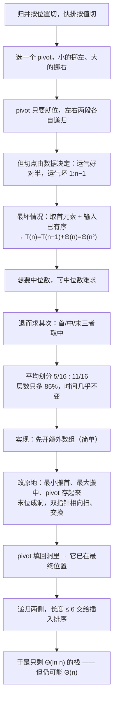

# C8.5 快速排序

> [!abstract] 这一讲的任务
> 归并排序按**位置**把表劈成两半：不管数据长什么样，一律中间切开，所以树高永远是 $\lg n$、代价永远是 $\Theta(n\ln n)$。
> 快速排序换一种切法：**按值切**。选一个**枢轴**（pivot），比它小的挪到左边、比它大的挪到右边——切点落在哪里，取决于数据本身的分布。运气好是对半分，运气坏是 $1:n-1$，后者就退化成 $\Theta(n^2)$。
> 更要命的是：**最坏情况恰恰是"已经排好序的输入"**。这一讲的大部分篇幅都在处理这个坑——从"取首元素"到"三者取中"，再到把等于 pivot 的元素聚到两端的**三路划分**。
> 好消息是：它**只需要 $\Theta(\ln n)$ 的栈**，是三种 $\Theta(n\ln n)$ 算法里"又快又省"的那一个，也是所有标准库排序的主干。

> [!info] 怎么读这份讲义
> 全篇一条主线：**按值分（一）→ 最坏情况（二）→ 三者取中（三）→ 怎么在原地划（四）→ 完整轨迹（五）→ 代价（六）→ 还能怎么改（七）→ 随堂题（八）**。
> 第三、四两节是本讲的重心：前者解释"为什么换个 pivot 选择就能把最坏的坑填掉"，后者解释"怎么不多开一个数组就把数分成两堆"。**第四节的原地划分最容易看错**（洞在哪里、两个指针各自找什么），配了 6 张图和一张 17 步的过程表。
> 标 **（补充）** 的是原稿没展开、按教材与通行讲法补的。原稿有**一处严重的代码笔误**（右递归的起点写错，会让区间重叠）和几处动画帧残留值，都在第九节。

> [!info] 课程信息与来源
> **Ya-Hui Jia（贾雅慧）｜SFT SCUT｜jiayahui@scut.edu.cn｜课程群 309044012**。全课程信息见 [[C1.0 课程信息与C++预备]] 与 [[数据结构 MOC]]。
> 本讲接在 [[C8.4 归并排序]] 之后。这一篇的材料页脚残留旧编号 **7.6–7.6.7**（源文件编号漂移留下的），本库不迁移旧编号，只按知识顺序记为 C8.5。
> **本讲无课堂转写稿**，整篇按整理版理解。



## 目录

| 小节 | 内容 |
| --- | --- |
| [[#零、开场：为什么还要再造一个 Θ(n ln n)]] | 快排的定位 |
| [[#一、策略：按值分，不按位置分]] | 与归并的对照、一次划分、递归 |
| [[#二、最坏情况：已经排好序的数组]] | $1:n-1$ 的退化、求中位数之难 |
| [[#三、三者取中：用便宜的近似换掉最坏]] | 定义、分布、层数、运行时间 |
| [[#四、两种实现：额外数组与原地]] | 填洞、双指针、pivot 落位 |
| [[#五、25 个数的完整轨迹]] | 一层划分的 17 步、递归结构 |
| [[#六、代价与内存]] | 时间、栈、三算法对照 |
| [[#七、还能更好：Bentley–McIlroy 的几招]] | 三次取中之中位数、三路划分 |
| [[#八、随堂题：11 个数]] | 阈值 4 的完整解答 |
| [[#九、原稿勘误与阅读边界]] | 一处右递归笔误、四处动画残留值 |

---

## 零、开场：为什么还要再造一个 $\Theta(n\ln n)$

比起归并排序，快速排序面对的是一个更苛刻的现实：

- 堆排序已经做到了原地 + 最坏 $\Theta(n\ln n)$；
- 归并排序做到了最快 + 稳定，代价是 $\Theta(n)$ 的缓冲。

**那为什么还要学第三个？** 因为实际跑起来，它常常是三者里最快的，而且只要 $\Theta(\ln n)$ 的栈——既不像堆排序那样常数大，也不像归并那样要一整块缓冲区。

代价是它把"最坏情况"从一个理论名词变成了**真实会发生的事故**：一份已经排好序的数组，如果 pivot 取的是首元素，它会退化成 $\Theta(n^2)$。所以这一讲的骨架是"**先造出它，再把它救回来**"。

## 一、策略：按值分，不按位置分

### 1.1 与归并的对照

| | 归并排序 | 快速排序 |
| --- | --- | --- |
| 怎么分 | 按**位置**：中间切开 | 按**值**：比 pivot 小的放一边 |
| 切出来的两段 | 大小几乎相等 | 大小**取决于数据** |
| 谁在做主要工作 | 合并（combine） | **划分**（partition） |
| 递归之后 | 还要合并 | **什么都不用做**（已经有序） |

最后一行是快排的精髓：**归并是"分得容易、合得费劲"；快排是"分得费劲、合得省事"。**

### 1.2 一次划分：pivot 落位

![[C8-按pivot划分成两组.png]]

15 个数的数组，取**中间那个 44** 当 pivot，把其余的按"比 44 小 / 比 44 大"分成两组：

```
原数组：80 38 95 84 66 10 79 44 26 87 96 12 43 81 3
划分后：38 10 26 12 43 3 | 44 | 80 95 84 66 79 87 96 81
```

看划分后的第二行：44 **左右两边都还没有排序**，但 44 已经在它**最终该在的位置**上了——因为左边 6 个（`38 10 26 12 43 3`）都比它小，右边 8 个都比它大。

> [!important] 一次划分的产出
> 划分做完，只有**一个**元素保证到了最终位置：pivot。其余元素只是被分到了正确的**一侧**。
> 但这就够了——**问题被劈成了两个互不相干的子问题**：左边的 6 个自己排、右边的 8 个自己排，两边怎么折腾都不会越过 pivot。

### 1.3 递归

于是算法是：

1. 若子表长度 $\le$ 阈值，用插入排序收尾；
2. 否则：选 pivot → 划分 → pivot 就位；
3. 对 pivot 左边递归，对右边递归。

和归并一样，这里也可以设一个阈值（材料取 6），小于等于它就交给插入排序。理由同 C8.4：小数组上插入排序的常数更小。

## 二、最坏情况：已经排好序的数组

### 2.1 退化成 $\Theta(n^2)$

![[C8-首元素作pivot的最坏情况.png]]

假设两件事同时成立：**pivot 取首元素**，**输入已经有序**。那么首元素就是全表最小值，划分结果是

$$1 : n-1$$

左边一个（pivot 自己），右边 $n-1$ 个。递归下去还是这样，每层只减少一个元素：

$$T(n)=T(n-1)+\Theta(n)\ \Longrightarrow\ T(n)=\Theta(n^2).$$

具体到次数：分层合并的总工作量是 $(n-1)+(n-2)+\cdots+1=\frac{n(n-1)}{2}$。25 个数是 300 次比较，而 $\Theta(n\ln n)$ 只需约 25×4.6 ≈ 116 次——**差 2.6 倍**；到 10 万个元素，差的就不是倍数而是量级了。

> [!warning] 这张图的文字与画面不一致
> 文字说的是"取**首元素**作 pivot、排一个**已有序**的表"，但图上的 15 个数并不是有序的，而且真的被拿来划分的是**下标 7 的 2**（正中间），不是首元素 80。
> 图的**意思**是对的：它演示的是"pivot 恰好是当前范围的最小值时，划分退化成 1 : n−1"。**推导按上面的文字走**（首元素 + 有序输入 → 每层切掉一个），结论 $T(n)=\Theta(n^2)$ 不受影响。

顺带一句：**"已排好序的输入最坏"这件事很讽刺**。它意味着"先用别的算法排一遍再交给快排"反而会更慢，也意味着测试时如果只拿随机数据，永远测不出这个坑。

### 2.2 想要中位数，可中位数难求

![[C8-三者取中选出44.png]]

要避免退化，理想的做法是**每次都取真正的中位数**当 pivot——这样每层都对半分，树高 $\lg n$，代价 $\Theta(n\ln n)$。

问题是：**求中位数本身要花时间**。在 $n$ 个元素里找中位数，就要 $O(n)$ 的代价（要统计顺序，order statistics）；而划分本来只要 $O(n)$。为了找 pivot 先花 $O(n)$，等于把这一步的成本翻倍。

所以退而求其次：**取一个"子集的中间值"作近似**。

## 三、三者取中：用便宜的近似换掉最坏

### 3.1 首、中、末三个取中间

> [!important] 定义：三者取中 median-of-three
> 取子表的**第一个、正中间一个、最后一个**元素，比较这三个，用**其中的中位数**当 pivot。

![[C8-三者取中选出44.png]]

本例：15 个数，首 = 80、中（下标 7）= 44、末 = 3。三者排序是 3 < 44 < 80，所以 pivot = **44**。

这个选择只花**两次比较**，却把"首元素恰好是最小/最大"这种最坏情况基本挡掉了——因为要退化，得让"三个候选同时都偏小或偏大"，概率低得多。

> [!note]（补充）它挡掉了什么、没挡掉什么
> **挡掉了**：有序输入 + 首元素（最常见的事故）。
> **没挡掉**：恰好构造出来的"杀手输入"——有人专门构造一种数组，让三者取中每次都取到次小值。这类输入在竞赛与对抗场景里真实存在（C++ 的 `std::sort` 早期就吃过这个亏）。
> 第五节的 25 元轨迹里就有一处现成的例子（p.309 那一帧），pivot 恰好取到了次小元素，划分退化成 $1:9$。

### 3.2 每一层都要重来

![[C8-两个子列表各自三者取中.png]]

44 就位之后，左右两段各自再来一次三者取中：

- 左段 `38 10 26 12 43 3`：候选 38（首）、26（中）、3（末）→ 中位数 **26**；
- 右段 `80 95 84 99 79 87 96 81`：候选 80（首）、99（中）、81（末）→ 中位数 **81**。

注意右段有 8 个元素，"中"落在段内下标 3（绝对下标 11），值是 99——**"中间"是按当前子表的相对位置算的，不是整个数组的中点**。

### 3.3 划分比例的分布

![[C8-三者取中的分布曲线与期望比例.png]]

pivot 落在哪里，决定了划分成什么比例。把 pivot 的**名次**归一化到 $[0,1]$，可以算出它的分布：

| pivot 选法 | 密度函数 | 平均划分比例 | 90% 的情况不劣于 |
| --- | --- | --- | --- |
| 均匀随机 | $1$ | $1/4 : 3/4$ | $1:19$ |
| 三者取中 | $6x(1-x)$ | $\mathbf{5/16 : 11/16}$（约 $1:2.2$） | $1:6.388$ |

那张图上的三条曲线，中间那条 $6x(1-x)$ 就是三者取中的密度：它像一个拱形，**峰值在中点 $x=0.5$**，说明取到"接近中间"的 pivot 比随机取更常见。

**期望比例怎么来的？** 三者取中的 pivot，其名次分布是"三个均匀随机数的中位数的分布"，密度是 $6x(1-x)$。平均值：

$$\bar x=2\int_{0}^{1/2}x\cdot 6x(1-x)\,dx=12\left[\frac{x^{3}}{3}-\frac{x^{4}}{4}\right]_{0}^{1/2}=12\left(\frac{1}{24}-\frac{1}{64}\right)=\frac{5}{16}.$$

为什么积分只到 $1/2$、再乘 2？因为 pivot 在哪一侧是对称的，$x$ 与 $1-x$ 是同一种划分，把 $[1/2,1]$ 折过去算一次就行。

所以 $5/16 : 11/16$，也就是 $1:2.2$。

> [!tip] 那张图上的另一个数：$3!\,x(1-x)$
> 图上写的是 $3!\,x(1-x)$，**$3!$ 是阶乘**（= 6），不是 $3$ 乘。这一点在 p.342 的公式里会再出现一次，很容易误算成斜率为 3。

### 3.4 层数变多，但时间几乎不变

划分不再是 $1:1$ 而是 $5/16 : 11/16$，树就会**深一点**。递归深度之比：

| 情况 | 每层缩小到 | 深度倍数 | 相对归并（$1/2$） |
| --- | --- | --- | --- |
| 随机 pivot | $3/4$ | $\dfrac{\ln(1/2)}{\ln(3/4)}\approx 2.41$ | 多 **141%** |
| 三者取中 | $11/16$ | $\dfrac{\ln(1/2)}{\ln(11/16)}\approx 1.85$ | 多 **85%** |
| 三次取中之中位数 | $811/1280$ | $\dfrac{\ln(1/2)}{\ln(811/1280)}\approx 1.52$ | 多 **52%** |

> [!note] 为什么用 $\ln$ 的比值算层数
> 每层把规模乘上比例 $r$（这里是 $3/4$ 或 $11/16$），打 $k$ 层之后规模是 $n\cdot r^k$。要缩到 1，需要 $r^k=1/n$，即 $k=\dfrac{\ln n}{-\ln r}=\dfrac{\ln n}{\ln(1/r)}$。
> 所以层数与 $\dfrac{1}{\ln(1/r)}$ 成正比。"每层缩小到 $s$"（$s=1/r$）时，倍数就是 $\dfrac{\ln 2}{\ln s}$。

![[C8-随机pivot与三者取中的运行时间比.png]]

可是**层数多 85%，时间却几乎没变**——这张图是材料里最反直觉的一页：

| 比较对象 | 大 $n$ 时的比值 |
| --- | --- |
| 随机 pivot / 理想中位数 | $\approx 1.0055$ |
| 三者取中 / 理想中位数 | $\approx 1.003$ |

**为什么？** 因为层数只是"树的形状"，而总工作量是**每层工作量之和**。用固定比例 $r$ 划分时，每层总规模是 $n(1+r+r^2+\cdots)$，而总和 $\dfrac{n}{1-r}$ 只与 $r$ 有关：

$$\frac{1}{1-3/4}=4,\qquad \frac{1}{1-11/16}=\frac{16}{5}=3.2 .$$

$3/4$ 划分的总工作量是 $4n$，$11/16$ 划分是 $3.2n$，理想对半分是 $2n$（准确说是 $\lg n$ 层的 $n$ 倍）。**两者与理想的差，都是常数倍**——这就解释了为什么"多 85% 的层"只换来"多 0.3% 的时间"：层数是对数的，常数因子藏在对数里。

> [!important] 这一节的结论
> **pivot 选得好不好，决定的是"常数"，不是"阶"**（只要不退化到 $1:n-1$）。
> 所以工程上花几次比较做三者取中是划算的：它不改善渐近，但它把"最坏情况"从"必定发生"变成"很难发生"。

## 四、两种实现：额外数组与原地

### 4.1 先看简单的：用一个额外数组

![[C8-额外数组划分开头.png]]

思路：**另开一个同样大的数组**，从两头往中间填。扫原数组的其余元素：

- 比 pivot 小的 → 放到新数组的**前端**（`low++`）；
- 比 pivot 大的 → 放到新数组的**后端**（`high--`）。

图上蓝箭头（往前放）与红箭头（往后放）就是这两条路。

![[C8-额外数组划分完成并把pivot填回洞.png]]

扫完之后，前后两块之间一定剩一个**洞**——正好是 pivot 该在的位置。把 pivot 填进去：

```
38 21 9 36 55 16 49 24 | 57 | 77 61 85 74 79 81 76 68 85 63 97 70
```

**洞的位置就是 pivot 的名次**：前面有 8 个比它小的，所以它在下标 8。

这个方法好写、好懂，代价是要 $\Theta(n)$ 的额外空间——如果每层都开一个，总共是 $\Theta(n\ln n)$，完全不能接受。**所以必须改成原地。**

### 4.2 原地：先在末尾腾出一个洞

![[C8-原地划分前把最小最大搬到两端.png]]

既然三者取中时已经看过首、中、末三个元素，就顺手把它们排一下序：**最小的放首位、最大的放中位、中位数（pivot）存进变量**。于是：

- 首位的元素保证 $\le$ pivot，不用再动；
- 中位现在放着最大值，也保证 $\ge$ pivot；
- **末位空出来成了一个洞**（pivot 原来可能在末位，但不管在哪，这一步之后末位的内容已经搬到首或中了）。

图上就是这一步：候选 80 / 44 / 3，最小 3 搬去下标 0、最大 80 搬去下标 7、44 存进 `pivot` 变量，下标 14 成洞。

### 4.3 双指针相向扫描

![[C8-双指针相向扫描开始.png]]

现在要把中间的 $n-3$ 个元素分成两堆。用两个指针：

- `low` 从 `first+1` 向右走，**找第一个比 pivot 大的**（它该去右边）；
- `high` 从 `last-2` 向左走，**找第一个不大于 pivot 的**（它该去左边）。

找到就**交换**，然后两个指针各走一步，继续。

![[C8-第一次交换low与high.png]]

第一层划分的第一次交换：`low = 1`（77 > 57）、`high = 21`（51 < 57），交换 77 与 51。

![[C8-双指针相邻还差一次交换.png]]

一直换到两个指针**相邻**：`low = 13`（99）、`high = 14`（17）。这时它们仍然"失序"（大的在左、小的在右），还要**再换一次**。

![[C8-双指针交错划分停止.png]]

换完之后 `low` 越过 `high`（`low = 14 > high = 13`），**停**。此刻 `low` 指向的就是"左边第一个比 pivot 大的元素"。

### 4.4 收尾：把大元素搬进洞，pivot 落位

![[C8-划分完成pivot落位.png]]

最后两步：

1. 把 `array[low]`（左边第一个大元素，这里是 99）搬到末尾的**洞**里；
2. 把 `pivot`（57）写进 `array[low]`。

于是 57 落在下标 14：左边 14 个都比它小，右边 10 个都比它大。**一次划分完成，用了 7 次交换。**

```cpp
template <typename Type>
void quicksort( Type *array, int first, int last ) {
    if ( last - first <= N ) {                  // 小段交给插入排序
        insertion_sort( array, first, last );
        return;
    }

    // 1) 三者取中：把三个候选排序，最小留在 first、最大挪到 mid、
    //    中位数取出来当 pivot，于是 last-1 空出来当"洞"
    int mid = (first + last) / 2;
    if ( array[first]  > array[mid] )     std::swap( array[first],  array[mid] );
    if ( array[first]  > array[last-1] )  std::swap( array[first],  array[last-1] );
    if ( array[mid]    > array[last-1] )  std::swap( array[mid],    array[last-1] );
    Type pivot = array[mid];                    // 中位数
    array[mid] = array[last-1];                 // 最大挪到 mid，末位成为洞

    // 2) 双指针相向扫描
    int low  = first + 1;
    int high = last - 2;
    while ( true ) {
        while ( low <= high && array[low]  <= pivot ) { ++low;  }   // 找左边第一个大的
        while ( low <= high && array[high] >  pivot ) { --high; }   // 找右边第一个不大于的
        if ( low > high ) break;                                    // 交错 → 停
        std::swap( array[low], array[high] );
        ++low;
        --high;
    }

    // 3) 收尾：把左边第一个大元素搬进洞，pivot 落位
    array[last-1] = array[low];
    array[low]    = pivot;

    // 4) 两边递归（注意右边界是 low + 1，材料印作 high 是笔误）
    quicksort( array, first,  low );
    quicksort( array, low + 1, last );
}
```

> [!bug] 右递归的起点：材料印错了
> 材料 p.240 写的是 `quicksort( array, high, last );`，**应为 `low + 1`**。
> 循环结束时恒有 `high = low - 1`，所以 `(high, last)` 等于 `(low-1, last)`——它会把"左边最后一个小于 pivot 的元素"和 pivot 自己都圈进右子区间，与左递归的 `(first, low)` **重叠**，pivot 会被重复排序、甚至死循环。
> 材料自己的动画就是证据：p.262 的第一层划分之后，右半是 `quicksort(array, 15, 25)`（`low = 14`）；p.298 的是 `(11, 14)`（`low = 10`）；p.329 的是 `(21, 25)`（`low = 20`）——全部是 `low + 1`。
> 两处内层 `while` 都带了 `low <= high` 的保护：否则当整段都小于 pivot 时，`low` 会一路冲出右边界。

## 五、25 个数的完整轨迹

### 5.1 第一层划分：7 次交换

数组（下标 0–24）：

`13 77 49 35 61 48 73 23 95 3 89 37 57 99 17 32 94 28 15 55 7 51 88 97 62`

三者取中：`a[0]=13`、`a[12]=57`、`a[24]=62` → **pivot = 57**；13 留在首位、62 搬到下标 12、**下标 24 成洞**。

| 步 | `low` | `high` | 动作 | 数组关键位置 |
| --- | --- | --- | --- | --- |
| 起点 | 1 | 23 | — | `13 [77] 49 35 61 48 73 23 95 3 89 37 62 99 17 32 94 28 15 55 7 [51] 88 97 _` |
| 1 | 1 | 21 | 77 > 57 停；97、88 均 > 57 跳过，51 < 57 → 换 **(1,21)** | `13 51 … 7 77 88 97 _` |
| 2 | 4 | 20 | 61 > 57；7 < 57 → 换 **(4,20)** | `… 7 48 … 55 61 77 …` |
| 3 | 6 | 19 | 73 > 57；55 < 57 → 换 **(6,19)** | `… 55 23 … 15 73 61 …` |
| 4 | 8 | 18 | 95 > 57；15 < 57 → 换 **(8,18)** | `… 15 3 … 28 95 73 …` |
| 5 | 10 | 17 | 89 > 57；28 < 57 → 换 **(10,17)** | `… 28 37 62 99 17 32 94 89 …` |
| 6 | 12 | 15 | 62 > 57；94 > 57、32 < 57 → 换 **(12,15)** | `… 37 32 99 17 62 94 …` |
| 7 | 13 | 14 | 99 > 57；17 < 57 → 换 **(13,14)** | `… 32 17 99 62 …` |
| 停 | 14 | 13 | `low > high` | `13 51 49 35 7 48 55 23 15 3 28 37 32 17 [99] 62 94 89 95 73 61 77 88 97 _` |
| 收 | — | — | `a[24] = a[14]`（99 进洞）、`a[14] = 57` | `… 17 57 62 94 … 97 99` |

划分结果：左边 14 个（0–13）全部小于 57，右边 10 个（15–24）全部大于 57。**7 次交换**。

### 5.2 递归结构

| 调用区间 | 长度 | 候选（首/中/末） | pivot | 交换 | 划分结果 | 处理 |
| --- | --- | --- | --- | --- | --- | --- |
| (0,25) | 25 | 13 / 57 / 62 | **57** | 7 次 | $14 \mid 57 \mid 10$ | 递归两侧 |
| (0,14) | 14 | 13 / 23 / 17 | **17** | 3 次 | $4 \mid 17 \mid 9$ | 递归两侧 |
| (0,4) | 4 | — | — | — | — | **插入排序**：`13 3 15 7` → `3 7 13 15` |
| (5,14) | 9 | 48 / 51 / 35 | **48** | 3 次 | $5 \mid 48 \mid 3$ | 递归两侧 |
| (5,10) | 5 | — | — | — | — | **插入排序**：`35 32 23 37 28` → `23 28 32 35 37` |
| (11,14) | 3 | — | — | — | — | **插入排序**：`49 55 51` → `49 51 55` |
| (15,25) | 10 | 62 / 61 / 99 | **62** | **0 次** | $1 \mid 62 \mid 8$ | 递归两侧 |
| (15,16) | 1 | — | — | — | — | **插入排序**（立即返回） |
| (17,25) | 8 | 89 / 77 / 94 | **89** | 1 次 | $3 \mid 89 \mid 4$ | 递归两侧 |
| (17,20) | 3 | — | — | — | — | **插入排序**：`77 88 73` → `73 77 88` |
| (21,25) | 4 | — | — | — | — | **插入排序**（`94 95 97 99` 本来就有序） |

递归树：

```
quicksort(0,25)  pivot=57
├─ quicksort(0,14)  pivot=17
│  ├─ quicksort(0,4)     4 ≤ 6 → 插入排序
│  └─ quicksort(5,14)  pivot=48
│     ├─ quicksort(5,10)  5 ≤ 6 → 插入排序
│     └─ quicksort(11,14) 3 ≤ 6 → 插入排序
└─ quicksort(15,25)  pivot=62
   ├─ quicksort(15,16)   1 ≤ 6 → 插入排序（立即返回）
   └─ quicksort(17,25)  pivot=89
      ├─ quicksort(17,20) 3 ≤ 6 → 插入排序
      └─ quicksort(21,25) 4 ≤ 6 → 插入排序
```

**统计**：11 次 `quicksort` 调用，其中 **5 次真做划分**（长度 25、14、9、10、8），**6 次直接转插入排序**。递归树最深 4 层 quicksort + 1 层插入排序 = **5 帧栈**——这就是 p.339 说"25 个元素只占 5 帧"的具体样子。

![[C8-选到次小元素导致划分失衡.png]]

这一帧值得单独看：区间 (15,25) 里的 10 个数是 `61 62 89 95 73 99 77 88 97 94`，三者取中的候选是 62（首）、61（中）、99（末）→ pivot = 62。可是 62 在这个区间里是**次小**的元素，于是 `low` 一上来就越过了 `high`——**一次交换都没做**，划分成 $1:8$。

> [!important] 这一帧就是"三者取中也救不了"的活证据
> 三者取中只能挡住"首元素恰好最小"这一类，挡不住"三个候选恰好都偏小"。要真正防住构造出来的坏输入，得靠随机化 pivot（随机取三个）或三路划分（第七节）。

![[C8-25元素快排最终有序.png]]

最终结果：

$$3\;7\;13\;15\;17\;23\;28\;32\;35\;37\;48\;49\;51\;55\;57\;61\;62\;73\;77\;88\;89\;94\;95\;97\;99$$

## 六、代价与内存

### 6.1 时间与栈

| 情况 | 时间 | 栈 |
| --- | --- | --- |
| 平均 | $\Theta(n\ln n)$ | $\Theta(\ln n)$ |
| 最坏 | $\Theta(n^2)$ | $\Theta(n)$ |

栈的来历：**每次递归调用都要把参数与局部变量压栈**，而栈的深度就是递归树的深度。平均情况下树高 $\Theta(\ln n)$；一旦退化到 $1:n-1$，树高变成 $n$——**时间退化的同时，内存也从 $\Theta(\ln n)$ 涨到 $\Theta(n)$**。

> [!note]（补充）这一点在实际系统里很危险
> 一个 $\Theta(n^2)$ 的排序最多是慢；一个 $\Theta(n)$ 的栈则可能直接**爆栈**（stack overflow）。所以在嵌入式或内核里用快排时，要么保证树高有上界（比如递归较深的那一侧改用循环），要么换成堆排序兜底。

### 6.2 三种 $\Theta(n\ln n)$ 的横向对照

| | 堆排序 | 归并排序 | 快速排序 |
| --- | --- | --- | --- |
| 平均时间 | $\Theta(n\ln n)$ | $\Theta(n\ln n)$ | $\Theta(n\ln n)$ |
| 最坏时间 | $\Theta(n\ln n)$ | $\Theta(n\ln n)$ | $\Theta(n^2)$ |
| 平均内存 | $\Theta(1)$ | $\Theta(n)$ | $\Theta(\ln n)$ |
| 最坏内存 | $\Theta(1)$ | $\Theta(n)$ | $\Theta(n)$ |
| 稳定性 | 否 | 是（写 `<=`） | 否 |

> [!warning] 表里的空格要读对
> 材料 p.340 的表里，堆排序与归并排序的"最坏"两列是**空的**——意思是"与平均相同"，不是"没有意义"。快排这四个格都有值，因为它的最坏与平均确实不同。

## 七、还能更好：Bentley–McIlroy 的几招

材料最后引了一篇非常有名的文章：**Bentley & McIlroy, *Engineering a Sort Function*, Software—Practice and Experience, 23(11), 1993**。这是 C 标准库 `qsort` 与 C++ `std::sort` 的工程基础。

### 7.1 三次取中之中位数

> [!important] 做法
> 取三组"首/中/末"，各做一次三者取中，得到三个中位数，再取这三个的中位数。

它的划分比例分布更向中间集中，平均划分比例是 $469/1280$：

$$\bar x=2\int_{0}^{1/2}x\cdot f(x)\,dx=\frac{469}{1280}=0.3664\quad\Longrightarrow\quad 1:1.7292 .$$

所以每次大约分成 $0.366n$ 与 $0.634n$ 两段，深度倍数

$$\frac{\ln(1/2)}{\ln(811/1280)}\approx1.52,$$

比归并多 **52%** 的层（对照：三者取中多 85%，纯随机多 141%）。90% 的情况下不劣于 $1:3.3304$。

> [!tip] 便宜又有效的取舍
> 它比"九选一"（median-of-nine，深度只多 46%）**便宜得多**，效果却差不了多少——这正是工程里最划算的位置。材料还特别说明：它"比 median-of-seven 好，但好算得多"。

### 7.2 三路划分：把等于 pivot 的元素分到两端

![[C8-按pivot划分成两组.png]]

（上图是普通的两路划分，拿它对照更容易看出三路的不同。）

普通划分只分"$<$"和"$\ge$"两类。如果数据里**大量重复**，这会很糟：假设所有元素都等于 pivot，普通划分会把它们全推到一边，划分成 $n-1 : 1$，**退化成 $\Theta(n^2)$**。

三路划分的做法是分成三类：

```
划分中：  = | < | ? | > | =     ← 两端同时攒"等于 pivot"的
扫完后：  = | < | > | =
收尾后：    < | = | >          ← 把两端的等值元素搬到中间
```

这样等于 pivot 的元素**一次就全部就位**，递归只需要处理严格小于和严格大于的两段。对重复键多的数据，这几乎是把"最坏情况"直接消掉了。

材料的注脚很实在：*"这需要多跟踪几个下标"*——三路划分要多维护两个边界，代码复杂度上去了，所以标准库里的实现往往比课本里的快排长得多。

## 八、随堂题：11 个数

材料 p.338 给了一道黑板题：用快排排下面的表，**子表长度 $\le 4$ 就用插入排序**（注意阈值从 6 改成了 4）：

$$34,\;15,\;65,\;59,\;68,\;42,\;40,\;80,\;50,\;65,\;23$$

> [!example] 完整解答（复算值，按材料的算法：三者取中 + 原地双指针 + 阈值 4）
> **第 1 层**：区间 (0,11)，中点 5。候选 $a_0=34$、$a_5=42$、$a_{10}=23$ → 中位数 **34**。
> 划分后 **0 次交换**（`low` 一路走到 2），pivot 34 落在下标 2：
> $$23\;15\;\mathbf{34}\;59\;68\;42\;40\;80\;50\;65\;65$$
> **左段 (0,2)**：长度 2 $\le 4$ → 插入排序 → `15 23`。
> **右段 (3,11)**：候选 $a_3=59$、$a_7=80$、$a_{10}=65$ → pivot **65**。交换 2 次：$(4,9)$、$(7,8)$。pivot 落在下标 8：
> $$15\;23\;34\;\mathbf{59}\;65\;42\;40\;50\;\mathbf{65}\;68\;80$$
> **段 (3,8)**：候选 $a_3=59$、$a_5=42$、$a_7=50$ → pivot **50**。交换 1 次：$(4,6)$。pivot 落在下标 5：
> $$15\;23\;34\;42\;40\;\mathbf{50}\;65\;59\;65\;68\;80$$
> **剩下三段**：(3,5) 长 2、(6,8) 长 2、(9,11) 长 2，全部 $\le 4$ → 各自插入排序。
> **最终结果**：
> $$\mathbf{15\;23\;34\;40\;42\;50\;59\;65\;65\;68\;80}$$

> [!warning] 这道题的三个坑
> 1. **阈值是 4 不是 6**：长 3–4 的段也要走插入排序，不要再往下分。
> 2. **"中点"按当前子表算**：段 (3,8) 的中点是 $(3+8)/2=5$，不是整表的中点。
> 3. **`65` 出现两次**：划分时"大于 pivot"用的是严格大于，所以等于 pivot 的元素会留在左边——这正好演示了两路划分对重复键不友好（见 7.2）。

## 九、原稿勘误与阅读边界

| 位置 | 原稿 | 更正 | 性质 |
| --- | --- | --- | --- |
| p.240 | `quicksort( array, high, last );` | **`low + 1`** | **原始笔误**：`high = low - 1`，写成 `high` 会与左递归重叠 |
| p.288 | `low = 8; high = 11` | `low = 9; high = 10` | 动画帧残留上一帧的数值 |
| p.290 | `low = 8; high = 11` | `low = 10; high = 9` | 同上；且与同帧"low > high，停"自相矛盾 |
| p.298 | `quicksort( array, 6, 14 )` | `(11, 14)` | 笔误（调用栈与后续帧都指向 11） |
| p.299 | 标题 `quicksort( array, 11, 15 )`、"15 − 11 ≤ 6" | `(11, 14)`、"14 − 11 = 3" | 笔误（`last` 是开区间右端 = 14） |
| p.324 | "Now, **4 − 0** ≤ 6" | "Now, **20 − 17** ≤ 6" | 从上文复制后忘了改 |
| p.226 | 文字说"取首元素 + 表已有序" | 图上是乱序数组，且用来划分的是下标 7 的 2 | 图文不一致（结论不受影响） |
| p.224 与 p.228 | 同一个数组，下标 4 处一个写 66、一个写 99 | 其余 14 个数相同；两处三者取中都得到 44 | 前后不一致 |
| p.230 / p.342 | 分布密度写作 `3!x(1−x)` | `3!` 是阶乘 6，即 $6x(1-x)$ | 记号易误读 |
| p.340 | 堆/归并的"最坏"两列为空 | 空 = 与平均相同 | 排版易误读 |

**阅读边界**：

- 25 元轨迹的 76 帧数组状态，已用按材料算法（三者取中 + 原地双指针 + 阈值 6）重写的 Python 版逐位复核，**76/76 一致**；随堂 11 元题按阈值 4 复算。
- 第三节的 $5/16$、$469/1280$、$1.8499$、$2.4094$、$1.5189$、$1:6.388$、$1:19$、$1:3.3304$ 均已独立复算，与材料标注一致。
- 第四节的完整代码里，两处 `while` 的边界保护（`low <= high`）被我省略成注释；材料 p.240 的原始实现也有同样的边界处理。**照抄前请以材料原码或第四节过程表为准。**
- 第七节的三路划分、三路划分的图示是（补充）内容——材料只有三行色带示意与"论文里还有别的建议"一句。
- **本讲没有作业页**；作业题在第 8 章最后（桶排序之后，编号 88、905）。

**配图清单**（16 张，均为 p.221–345 的印刷图示裁切）：

| 图 | 源页 | 说明 |
| --- | --- | --- |
| `C8-按pivot划分成两组.png` | p.224 | 取中间 44 为 pivot，划分成两组 |
| `C8-首元素作pivot的最坏情况.png` | p.226 | 划分退化成 $1:n-1$ 的示意 |
| `C8-三者取中选出44.png` | p.228 | 首 80、中 44、末 3 → 取 44 |
| `C8-两个子列表各自三者取中.png` | p.229 | 两个子表各自再取一次（26 与 81） |
| `C8-三者取中的分布曲线与期望比例.png` | p.230 | 三条密度曲线与 $5/16$ 的换算 |
| `C8-随机pivot与三者取中的运行时间比.png` | p.232 | 三个递推式之比（1.0055 / 1.003） |
| `C8-额外数组划分开头.png` | p.234 | 用额外数组：小的往前放、大的往后放 |
| `C8-额外数组划分完成并把pivot填回洞.png` | p.235 | 扫完后 pivot 填进中间的洞 |
| `C8-原地划分前把最小最大搬到两端.png` | p.237 | 最小搬首、最大搬中、末位成洞 |
| `C8-双指针相向扫描开始.png` | p.245 | `low` 与 `high` 的出发位置 |
| `C8-第一次交换low与high.png` | p.247 | 第一层划分的第一次交换（77↔51） |
| `C8-双指针相邻还差一次交换.png` | p.258 | 两指针相邻、仍失序，还要再换一次 |
| `C8-双指针交错划分停止.png` | p.260 | `low > high`，停 |
| `C8-划分完成pivot落位.png` | p.261 | 99 进洞、57 落位 |
| `C8-选到次小元素导致划分失衡.png` | p.309 | pivot 取到次小元素，划分退化成 $1:8$ |
| `C8-25元素快排最终有序.png` | p.337 | 25 元最终结果 |

## 这一讲的三句话

1. **快排按值分、归并按位置分**：一次划分只保证一件事——pivot 到了它最终的位置，其余元素只是被分对了**一侧**。所以递归之后**不需要合并**，这是它比归并省事的地方。
2. **它的软肋是最坏情况，而最坏情况恰好是"已排好序的输入"**：pivot 取首元素时每层只切掉一个，$T(n)=T(n-1)+\Theta(n)=\Theta(n^2)$。三者取中把平均划分压到 $5/16:11/16$（约 $1:2.2$），代价只是深度多 85%、运行时间几乎不变（约 +0.3%）——**pivot 选得好决定常数，不决定阶**。
3. **原地划分靠"一个洞 + 两个指针"**：最小搬到首、最大搬到中、pivot 存变量、末位成洞；`low` 找左边第一个大于 pivot 的，`high` 找右边第一个不大于的，交换到交错为止，最后把大元素搬进洞、pivot 落位。代价上要记住：平均 $\Theta(n\ln n)$ 时间 + $\Theta(\ln n)$ 栈，最坏 $\Theta(n^2)$ + $\Theta(n)$ 栈。

> [!tip] 速查
> | 量 | 值 |
> | --- | --- |
> | 一次划分 | 比较 $\Theta(n)$，交换最多 $\lfloor n/2 \rfloor$ 次 |
> | 平均/最坏时间 | $\Theta(n\ln n)$ / $\Theta(n^2)$ |
> | 平均/最坏栈 | $\Theta(\ln n)$ / $\Theta(n)$ |
> | 三者取中平均划分 | $5/16 : 11/16\approx1:2.2$ |
> | 三次取中之中位数 | $469/1280\approx1:1.73$ |
> | 深度倍数（相对对半分） | 三者取中 1.85、三次取中 1.52、纯随机 2.41 |
> | 最坏情况 | 取首元素 + 已有序；或全部元素相等（两路划分） |

## 下一讲预告

快排已经能用了，但它和归并都建立在同一个假设上：**元素之间能比大小**。而 C8.1 早就证明过，只靠比较就跨不过 $\Omega(n\lg n)$。

下一讲干脆**放弃比较**：如果数据都落在一个已知范围内（比如电话号码、成绩、身份证号），能不能不比较、直接按"桶"分配？答案是可以——代价是 $\Theta(n+m)$ 的时间和一个大小为 $m$ 的桶数组，其中 $m$ 是取值范围的大小。而如果范围大到 $m\gg n$，还有一招：**按位分配**，一位一位地来，每一趟都是稳定的桶排序——这就是基数排序。

---

## 相关笔记 Related Notes

上一讲：[[C8.4 归并排序]]
下一讲：[[C8.6 桶排序与基数排序]]
返回：[[数据结构 MOC]]
