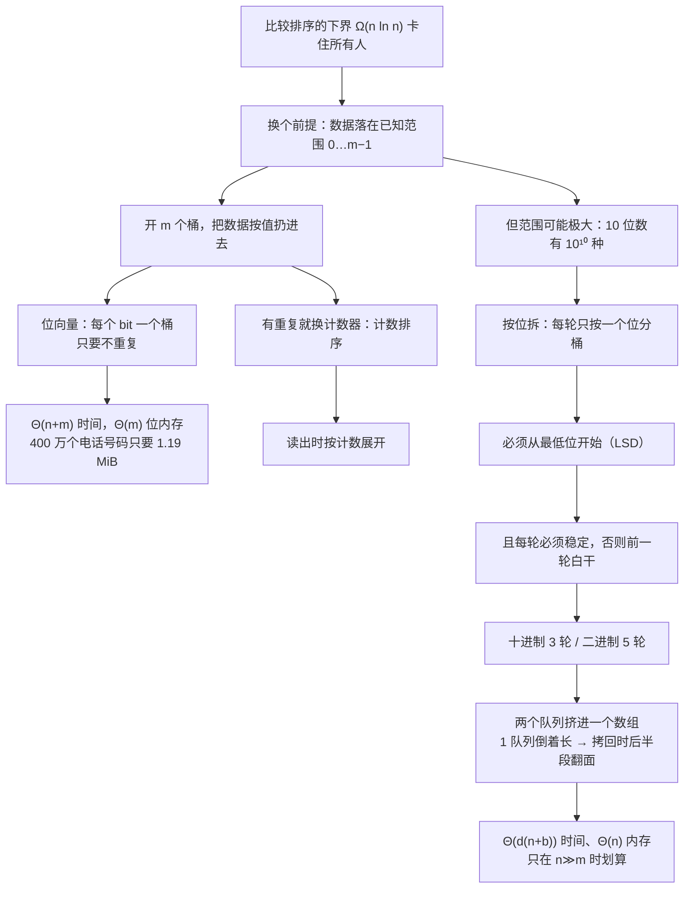

# C8.6 桶排序与基数排序

> [!abstract] 这一讲的任务
> 前面五个算法都被同一条线卡着：只靠比较，就跨不过 $\Omega(n\ln n)$（C8.1 证明过）。这一讲**放弃比较**。
> 如果数据都落在一个**已知的、不太大的范围**里（电话号码、成绩、身份证号的后几位），那就不必两两比较——直接**按值分配**：开一个覆盖整个范围的数组，每个可能的值一个"桶"，把数据扔进对应的桶里，再按桶的次序读出来。时间 $\Theta(n+m)$，$m$ 是范围大小。
> 如果范围太大（10 位数有 $10^{10}$ 种可能），还有一招：**一位一位地分**。每一轮按一个十进制位（或一个二进制位）做一次桶排序，从最低位做到最高位，**只要每一轮都是稳定的**，最后就整体有序。这就是基数排序，时间 $\Theta(d(n+b))$。

> [!info] 怎么读这份讲义
> 第一节是桶排序（含位向量与计数排序两个变体），第二节是基数排序（含它的正确性证明和"两队列挤一个数组"的实现）。**两节都有一张"数据→桶→结果"的完整表**，比代码更能说明问题。
> 第二节 2.7 的**反序拷回**是全篇最容易看错的一处：为什么 1 队列是倒着长的、为什么拷回时要把它翻过来。这里配了逐格对照。
> 标 **（补充）** 的是原稿没展开、按教材与通行讲法补的。原稿有**五处笔误**（含一处公式多算一位、一处下标印错），都在第五节。

> [!info] 课程信息与来源
> **Ya-Hui Jia（贾雅慧）｜SFT SCUT｜jiayahui@scut.edu.cn｜课程群 309044012**。全课程信息见 [[C1.0 课程信息与C++预备]] 与 [[数据结构 MOC]]。
> 本讲是第 8 章的最后一篇，接在 [[C8.5 快速排序]] 之后。源材料页脚残留旧编号 7.7，本库按知识顺序记为 C8.6。
> **本讲无课堂转写稿**，整篇按整理版理解。**章末作业 88、905 见第四节。**



## 目录

| 小节 | 内容 |
| --- | --- |
| [[#零、开场：四百万个电话号码]] | 一个真实规模的问题 |
| [[#一、桶排序：假设数据落在已知范围]] | 位向量、计数排序、$\Theta(n+m)$ |
| [[#二、基数排序：把大范围拆成一位一位]] | LSD、稳定性证明、两队列实现、反序拷回 |
| [[#三、为什么线性排序不违反下界]] | 换前提而不是打败下界 |
| [[#四、章末作业]] | 88、905 |
| [[#五、原稿勘误与阅读边界]] | 五处笔误与三处代码坑 |

---

## 零、开场：四百万个电话号码

多伦多 416 区号，要排出**所有住宅电话号码**。规模：大约 **400 万个**。

这活用快速排序也能干——但有个前提：**整个数组得能同时装进内存**。400 万个号码、每个假设 4 字节，就是 16 MB，还好。可如果规模是 4 亿呢？40 亿呢？快排要求"随机访问整块数据"，内存一装不下，就只能反复读写磁盘，代价立刻上一个数量级。

而这个问题的形状很特殊：**电话号码的范围是完全已知的**——416 区号下是 7 位号码，从 `000-0000` 到 `999-9999`，一共 **1000 万种可能**。

> [!question] 停一下，先自己想想
> 既然范围只有 1000 万种、而实际数据只有 400 万个，**能不能不比较大小，直接"按号码本身"把数据放到它该在的位置上？**
> 想不出来也没关系，关键是把"范围已知"这个前提用上——这是整篇的钥匙。

## 一、桶排序：假设数据落在已知范围

### 1.1 位向量：一个号码占一位

答案是一块 **1000 万位**的数组，每位对应一个可能的号码：

1. 把这块数组全部置 0；
2. 扫一遍输入，读到号码 $x$，就把**第 $x$ 位**置 1；
3. 最后从 0 扫到 9999999，**凡是位为 1 的，就把它对应的号码输出**。

![[C8-位向量-号码与位的对应.png]]

上图是位数组里的一个片段：下标 6857548 到 6857562 连续 15 格，每格 **1 bit**。已经打勾的 7 格对应的就是"这个号码存在"。

![[C8-位向量-遍历取出号码.png]]

扫完之后，8 个打勾的号码被依次取出：`685-7548`、`685-7549`、`685-7550`、`685-7553`、`685-7555`、`685-7558`、`685-7561`、`685-7562`。

**内存算一下**：$10^7$ 位 = $10^7/8=1.25\times10^6$ 字节，除以 $1024^2$ 得

$$\frac{10^7}{1024\times1024\times8}\approx 1.19\ \text{MiB}.$$

**不到 2 MB，全部驻留内存毫无压力**。同样的 400 万个号码，用 4 字节整数存是 16 MB，用位向量是 1.19 MB——省了 13 倍。

> [!note] 关键观察：数据量与范围"可比"
> 400 万个数据、1000 万个桶。这个比例很重要：**桶的数目只是数据量的 2.5 倍**，所以扫两遍（一遍数据、一遍桶）总代价是
> $$\Theta(n+m)=\Theta(4\times10^6+10^7)\approx1.4\times10^7\ \text{次操作}。$$
> 如果范围是 $10^{12}$ 而数据只有 100 个，这套就完全不行了——那是 8 TB 的位向量。**桶排序的全部价值都建立在这个"可比"上。**

### 1.2 算法：每个 bit 就是一个桶

> [!important] 桶排序的定义（位向量版）
> 设键都在 $0\dots m-1$ 范围内，且**互不相同**。准备 $m$ 个**桶**（bucket），每个桶对应一个可能的键值；把数据按值放进对应桶里；最后按桶的下标顺序把非空的桶取出来，就是有序序列。
> 在位向量实现里，**一个 bit 就是一个桶**：置 1 表示"这个值出现过"，置 0 表示"没出现"。

这个定义把"桶"从"容器"弱化成了"标记"——因为不重复，每个桶里最多一个东西，那就不必真存东西，记个"有/没有"就够了。

### 1.3 例子：0…31 里的 22 个整数

![[C8-位向量-勾选与读出.png]]

数据：`20 1 31 8 29 28 11 14 6 16 15 27 10 4 23 7 19 18 0 26 12 22`（22 个互不相同的整数，都在 0–31 之间）。

- 位向量长度 **32**，也就是 **32 bit = 4 字节**——比一个 `int` 还小；
- 把每个数对应的位置 1；
- 扫一遍，按顺序读出所有位为 1 的：

$$0\;1\;4\;6\;7\;8\;10\;11\;12\;14\;15\;16\;18\;19\;20\;22\;23\;26\;27\;28\;29\;31$$

22 个数，一个不差。**全程没有做一次"比较两个元素大小"的操作**——顺序是"下标天然有序"给的。

### 1.4 为什么这么快

材料的设问很关键：*How is this so fast?* 一个能排**任意**数据的算法必须 $\Omega(n\ln n)$，这里凭什么 $\Theta(n)$？

> [!important] 答案
> **这里的数据不是"任意"的。** 我们额外知道了"所有键都落在 $0\dots m-1$ 内、且互不相同"。
> 于是下界的前提（只靠比较、对任意排列都要正确）被换掉了——不是打败了下界，是**换了一个游戏**。C8.1 说过：比较树的下界只对"只靠比较"的算法成立。

### 1.5 有重复怎么办：计数排序

位向量有个硬伤：**只能表示"有/没有"，不能表示"有几个"**。数据一有重复（成绩、骰子、身份证后一位），位向量就把信息丢了。

> [!important] 计数排序 counting sort
> 把"每个桶一个 bit"换成"**每个桶一个计数器**"（或者一个链表）：
> 1. $m$ 个计数器清零；
> 2. 扫一遍数据，遇到值 $x$ 就 `count[x]++`；
> 3. 从 0 到 $m-1$ 扫计数器，**值 $v$ 的计数器是 $c$，就输出 $c$ 个 $v$**。

![[C8-计数排序-十个计数器.png]]

例子：给下面 37 个数字排序（值域 0–9）：

```
0 3 2 8 5 3 7 5 3 2 8 2 3 5 1 3 2 8 5 3 4 9 2 3 5 1 0 9 3 5 2 3 5 4 2 1 3
```

准备 10 个计数器（全 0）：

![[C8-计数排序-按计数读出.png]]

数完一遍，计数器是

| 值 | 0 | 1 | 2 | 3 | 4 | 5 | 6 | 7 | 8 | 9 |
| --- | --- | --- | --- | --- | --- | --- | --- | --- | --- | --- |
| 个数 | 2 | 3 | 7 | 10 | 2 | 7 | 0 | 1 | 3 | 2 |

**7 个 2、2 个 4**——输出就按这个展开：`0 0 1 1 1 2×7 3×10 4 4 5×7 7 8 8 8 9 9`，一共 37 个，与输入个数一致。

> [!tip] 链表桶与计数器桶的选择
> 材料给的判据是：**桶里的对象都相同（键重复）时，计数器更好**；如果桶里要存"整条记录"（不止键），那就得用链表把记录串起来，否则同一个键的多条记录就挤不下。
> 这就是"计数排序"与"桶排序（链表版）"的分界：前者只排键，后者排记录。

### 1.6 代价

> [!important] 桶排序的代价
> $$T(n,m)=\Theta(n+m),\qquad \text{内存}=\Theta(m).$$
> 拆开看三种情形：
> - $m=\omega(n)$（范围远大于数据量）：时间是 $\Theta(m)$，内存也是 $\Theta(m)$——**桶比数据多得多，很浪费**；
> - $m=\Theta(n)$（范围与数据量同阶）：时间 $\Theta(n)$，内存 $\Theta(n)$——**最佳区间**；
> - $m=o(n)$（范围比数据量小，即大量重复）：时间 $\Theta(n)$，内存 $o(n)$——**也很划算**。

所以桶排序的适用条件是"**范围不大且已知**"。超出这个条件，就要看第二节的基数排序。

## 二、基数排序：把大范围拆成一位一位

### 2.1 动机：范围一大，桶就爆

假设要排 **10 位数**、而且有重复。用桶排序，桶的数目是

$$10^{10}\ \text{个}.$$

每个计数器占 1 字节，就是 $10^{10}$ 字节：

$$\frac{10^{10}}{2^{30}}\approx 9.31\ \text{GiB}.$$

**9 个多 G 的内存，只为了排一堆数。** 这个方案在现实中不可行。

关键在于：**"位"是可以拆的**。一个 10 位数可以看成 10 个十进制位的组合，那就一位一位地排——每轮只开 10 个桶。

### 2.2 从最低位开始

![[C8-基数排序-十个空队列.png]]

十进制就是 10 个队列（0–9）。规则是：

> [!important] LSD 基数排序
> 从**最低位**（个位）开始，对每一位重复：
> 1. 按"当前这一位"的值，把每个数**入队**到对应的桶里；
> 2. 按桶的下标 0→9、桶内按**先进先出**的次序，把所有数**取出**，接成新序列；
> 3. 换下一位（往高位走），重复。

为什么必须**从低位到高位**？因为高位是"最终决定顺序"的：先排低位，可以保证"高位相同的那些数，内部已经按低位排好"；再排高位时，**稳定**的分配会把这份内部次序保留下来。反过来（先高位）则会让后一次分配打乱前一次的成果。

材料的演示（13 个数）：

```
原序列：16 31 99 59 27 90 10 26 21 60 18 57 17
按最后一位：90 10 60 | 31 21 | 16 26 | 27 57 17 | 18 | 99 59
取出一轮：  90 10 60 31 21 16 26 27 57 17 18 99 59
再按第一位：1[0 16 17 18] 2[21 26 27] 3[31] 5[57 59] 6[60] 9[90 99]
取出一轮：  10 16 17 18 21 26 27 31 57 59 60 90 99   ← 有序
```

（这一页只是"两轮就排好"的示意，不是完整的 LSD 三轮；完整的三轮在 2.4。）

### 2.3 为什么正确：稳定是关键

材料给了一个干净的两段式证明。设两个 $n$ 位数 $a$、$b$，它们**前 $m$ 位相同**，第 $m+1$ 位开始不同，且 $a$ 在这一位更小：

$$a=\underbrace{a_na_{n-1}\cdots a_{n-m+1}}_{\text{与前缀相同}}a_{n-m}\cdots a_0,\qquad b\ \text{同理},\qquad a_{n-m}<b_{n-m}.$$

材料举的例子是 $103574<103892$：前三位 $1=1$、$0=0$、$3=3$，第四位 $5<8$。

> [!important] 证明的两半
> **第一半**：在处理到第 $n-m$ 位（即两者第一次不同的那一位）时，$a$ 会进一个**下标更小的桶**，$b$ 进下标更大的桶，所以取出时 **$a$ 在 $b$ 前**。
> **第二半**：从这一轮之后，$a$、$b$ 的**所有更高位都相同**，于是它们此后**每一轮都进同一个桶**。因为桶内是**先进先出**（稳定），它们会**保持"$a$ 在前"这个相对次序**直到最后。
> 于是最终序列里 $a$ 一定在 $b$ 前面。而 $a,b$ 是任取的两个数，所以整体有序。

> [!warning] 这个证明里藏着一个必须满足的条件
> **每一轮都必须是稳定的**。如果某一轮把同一个桶里的元素次序打乱了（比如用栈、或者"从后往前取"），第二半就断了——第一轮的成果会被后面某一轮吃掉，结果整体不有序。
> **"基数排序的正确性 = 每一轮桶排序的稳定性"。** 这句话是本节的核心。

### 2.4 十进制例子：10 个数，3 轮

![[C8-基数排序-按第3位分配收集.png]]

初始：`086 198 466 709 973 981 374 766 473 342`（86 补成 086）。

**第 1 轮 · 个位**

| 桶 | 0 | 1 | 2 | 3 | 4 | 5 | 6 | 7 | 8 | 9 |
| --- | --- | --- | --- | --- | --- | --- | --- | --- | --- | --- |
| 入桶 | — | 981 | 342 | 973, 473 | 374 | — | 086, 466, 766 | — | 198 | 709 |

取出：`981 342 973 473 374 086 466 766 198 709`

![[C8-基数排序-按第2位分配收集.png]]

**第 2 轮 · 十位**

| 桶 | 0 | 1 | 2 | 3 | 4 | 5 | 6 | 7 | 8 | 9 |
| --- | --- | --- | --- | --- | --- | --- | --- | --- | --- | --- |
| 入桶 | 709 | — | — | — | 342 | — | 466, 766 | 973, 473, 374 | 981, 086 | 198 |

取出：`709 342 466 766 973 473 374 981 086 198`

![[C8-基数排序-按第1位分配收集.png]]

**第 3 轮 · 百位**

| 桶 | 0 | 1 | 2 | 3 | 4 | 5 | 6 | 7 | 8 | 9 |
| --- | --- | --- | --- | --- | --- | --- | --- | --- | --- | --- |
| 入桶 | 086 | 198 | — | 342, 374 | 466, 473 | — | — | 709, 766 | — | 973, 981 |

取出：`086 198 342 374 466 473 709 766 973 981` ✓ 有序。

> [!warning] 看图的注意事项
> 材料这三页的表格里，**同一桶的第 2、3 个元素被放进第 3、4 个数据格**（跳过第 2 格），看起来像"队列中间有空位"。这只是版面排版，**桶内顺序以页面底部那行 `and dequeue` 为准**——我逐桶复算过，与它完全一致。

### 2.5 二进制例子：5 位，五轮

![[C8-基数排序-二进制五位数与两队列.png]]

二进制只有 0、1 两个桶，更简单。5 位的 10 个数，补零后：

`01111 11011 11001 10000 11010 00101 11100 00111 01011 10101`

![[C8-基数排序-二进制按第5位.png]]

**第 1 轮（最低位）**：0 桶 3 个、1 桶 7 个，取出

`10000 11010 11100 01111 11011 11001 00101 00111 01011 10101`

后面四轮同理（每位一次），第五轮结束后：

`00101 00111 01011 01111 10000 10101 11001 11010 11011 11100`

也就是 $5,7,11,15,16,21,25,26,27,28$ ✓ 有序。

**代价**：5 轮 × 10 个数 = 每轮 10 次入队 + 10 次出队，共 **$5n$** 次入队出队。推广一下：$d$ 位就是 $dn$ 次操作——这就是后面 $\Theta(dn)$ 的来历。

### 2.6 只用一个数组：两个队列挤在一起

每个桶一个队列当然最直接，但 **$d$ 轮 × $b$ 个队列**的开销不小，而且每个队列都要先分配空间。材料给了一个很巧的办法：**只用两个队列（0 和 1），而且挤在同一个长度为 $n$ 的数组里**。

![[C8-基数排序-双端队列布局.png]]

布局是**双端**的：

- **0 队列从头往后长**：`0-head` 钉在左端，`0-tail` 向右移动；
- **1 队列从尾往前长**：`1-head` 钉在右端，`1-tail` 向左移动。

两个队列的项数之和恒为 $n$，所以一个长 $n$ 的数组刚好装下，中间不需要预留空隙。

**取出的规则**（材料 p.385）：

> [!important] 两队列的读法
> 设一轮结束后 0 队列有 `current` 项，则读出顺序是：
> $$\text{下标 }0\to\texttt{current}-1\ \text{顺着读},\qquad \text{再从 }n-1\ \text{倒着读到}\ \texttt{current}.$$
> 为什么后半段要倒着读？因为 1 队列是**从尾往前**长的，物理上"最右的格子是最早入队的"。所以要按到达顺序读，必须**反向**扫。

![[C8-基数排序-第一轮结果与分界.png]]

第一轮（按最低位）之后：0 队列 9 项（左边 9 格）、1 队列 11 项（右边 11 格，**倒序存放**）。红线标的就是 `current = 9`。

![[C8-基数排序-中间位一轮.png]]

第二轮（按中间位）之后：10 项 ‖ 10 项。图下方的双向蓝箭头就是"前段顺着读、后段倒着读"。

![[C8-基数排序-最高位一轮.png]]

第三轮（按最高位）之后：0 队列 11 项、1 队列 9 项。

### 2.7 反序拷回：为什么必须把后半段翻过来

![[C8-基数排序-反序拷回.png]]

到这里出现了一个必须处理的问题。**轮内**读出时，后半段倒着读，所以这一轮内部是对的。可是一轮结束之后，这个数组要**当作下一轮的普通输入**用——下一轮会把"下标 0 到 current−1"当前段、"下标 $n-1$ 倒着到 current"当后段。如果后段在物理上仍然是倒的，**"桶内先进先出"这条不变量就断了**，2.3 的证明当场失效。

所以每轮收尾要做一件事：**把后半段在物理上翻成正序**。

- 如果结果要拷回原数组：**前段正拷、后段反拷**（从源数组的末尾往前取，正着写进目标）；
- 如果结果就在原数组里：**原地把后半段翻转**（首尾对调）。

逐格对照（20 个 3-bit 数，第三轮之后）：

**拷回之前**（临时数组里，后段是倒的）：

```
000 000 001 001 001 010 010 010 010 011 011 ‖ 111 111 111 110 101 101 101 100 100
```

**拷回之后**（原数组，后段已正序）：

```
000 000 001 001 001 010 010 010 010 011 011 ‖ 100 100 101 101 101 110 111 111 111
```

逐格看：第 1–11 格**原位照搬**；第 12–20 格是**整段翻面**——源的第 20 格（100）进目标第 12 格、源 19（100）进 13、源 18（101）进 14 …… 源 12（111）进 20。图上那对**交叉的长箭头**画的就是这个翻面。

最后去掉临时数组，得到有序序列：

$$0\;0\;1\;1\;1\;2\;2\;2\;2\;3\;3\;4\;4\;5\;5\;5\;6\;7\;7\;7$$

> [!tip] 一句话记住这一节
> **1 队列是从尾巴上倒着长的，读的时候倒着读；等你要把这份数据交出去时，就得把它正过来。**
> 代码里对应两种写法（见 2.8）：`copy_back` 为真时用"倒着取源、正着写目标"的双循环；为假时在原数组里直接首尾对调。

### 2.8 代价：$\Theta(n\ln m)$

材料最后的分析是两步：

1. 桶排序一趟是 $\Theta(n+b)$，$b$ 是基数（十进制 10、二进制 2）；
2. 限定只按十进制位/二进制位分，则 $b=\Theta(1)$，所以**一趟是 $\Theta(n)$**；
3. 位数 $d$ 是多少？值域是 $0\dots m-1$，最大值 $m-1$，需要的位数是
   $$d=\lfloor\log_b(m-1)\rfloor+1=\lceil\log_b m\rceil .$$
4. 于是总时间
   $$T(n,m)=\Theta(d\,n)=\Theta(n\log_b m).$$

在基数固定（$b$ 是常数）的语境下，$\log_b m=\Theta(\ln m)$，所以

$$T(n,m)=\Theta(n\ln m),\qquad \text{内存}=\Theta(n).$$

> [!important] 什么时候才该用基数排序
> 要和 $\Theta(n\ln n)$ 的比较排序比，需要
> $$n\ln m < n\ln n\ \Longleftrightarrow\ m<n .$$
> 所以判据是：**只有 $m\ll n$（值域远小于数据量，也就是"范围小、重复多"）时，基数排序才划算**。材料那句 "$n=\omega(m)$ 时才该用它而不是快排"说的就是这个。
>
> 顺带解释了它为什么"理论上漂亮、实践用处小"：真实数据常常是 $m$ 比 $n$ 还大（比如给一批 64 位数排序，$m=2^{64}$），这时位数 $d$ 反而成了负担。

> [!note]（补充）基数排序在今天真正的用处
> 它的强项是**定长键 + 大数据量**：IP 地址、时间戳、身份证号、图算法里的边排序（GPU 上的 radix sort 是标准组件）。这类数据 $d$ 只有 4–10，$n$ 可以是上亿，$\Theta(dn)$ 就非常划算。
> 反过来说，"排一批任意整数"这种任务，它打不过 `std::sort`——因为 $d$ 按类型的位宽固定，而真实数据的密钥往往只占其中很小一段。

## 三、为什么线性排序不违反下界

这一篇和 C8.1 的那个 $\Omega(n\lg n)$ 摆在一起，看起来像矛盾。它不是：

| | 比较排序 | 桶/基数排序 |
| --- | --- | --- |
| 靠什么定序 | 两两比较 | 键本身的位置（下标） |
| 需要的前提 | 无（任意可比较的数据） | 键落在已知范围 $0\dots m-1$ |
| 下界 | $\Omega(n\lg n)$ | 不受它约束 |
| 代价 | — | $\Theta(m)$ 的内存/时间，或 $d$ 轮的分配 |

**它没有打败下界，它是换了一个问题**：把"任意数据"换成了"有范围的数据"。这也是所有线性时间排序的共同点——**它们都在某个额外假设下工作**，一旦假设不成立（键的分布未知、范围巨大），就退回比较排序。

## 四、章末作业

材料最后一页给了两道题：**作业 88、905**（题号按教材/习题集的编号，本库未取得原题面，只记录编号）。

> [!todo] 作业 88、905（第 8 章）
> 题号来自材料小结页（p.401）。原题面不在手上，复习时按"基数排序 + 桶排序的应用题"准备：给定一组键与其值域，判断该用哪种线性排序、算出桶数/位数/时间。

## 五、原稿勘误与阅读边界

| 位置 | 原稿 | 更正 | 性质 |
| --- | --- | --- | --- |
| p.399 | 位数 $=\lfloor\log_b m\rfloor+1$ | 值域是 $0\dots m-1$，最大值为 $m-1$，应为 $\lfloor\log_b(m-1)\rfloor+1=\lceil\log_b m\rceil$ | **原始笔误（多算一位）**，反例：$m=32$ 只需 5 位，公式给 6 |
| p.364 | "the run time must be **$\Theta(n)$**"（说下界） | 应为 $\Omega(n)$ | $\Theta/\Omega$ 混用，结论必须写对 |
| p.352 | `685-5762` | `685-7562` | 排版笔误（末四位换位），位向量本身没错 |
| p.388 | 输入行第 16 格印作 `100` | 应为 `010` | 单格笔误（该格是 20 个 3-bit 数里的第 16 个） |
| p.392 | 结果行的红分界线画在第 10 格后 | 该段 0 队列有 **11** 项，界线应在第 11 格后 | 绘图错位，数据没错 |
| p.366 | "9 GiB" | $10^{10}$ 字节 $=9.31$ GiB | 取整，不算错；本讲写 9.31 |
| p.384 | "enqueue it at **at** the front" | 多一个 at | 排版 |

> [!bug] p.396–398 代码的三个坑（不是笔误，但抄之前要知道）
> 1. `for ( Type bit = 1; bit; bit <<= 1 )`：轮数由**类型位宽**决定，而不是数据的实际范围；若 `Type` 是有符号类型，左移溢出是未定义行为。`bit` 应当用无符号类型。
> 2. `for ( size_t k = n - 1; k >= current; --k )`：`k` 是无符号数，一旦 `current == 0`（所有元素的当前位都是 1），条件恒真 → **死循环/越界**。稳妥写法是 `k-- > current`，或者用有符号的循环变量。
> 3. `copy_back` 分支里 `delete [] array;` 之后，结果只活在 `queue` 里，而形参是 `Type *array`（按值传递）——**调用方拿不到结果，自己的数组反被释放**。要让这份代码可用，形参得写成 `Type *&array`（或让函数返回指针）。

**阅读边界**：

- 十进制三轮、二进制五轮的全部分配/收集序列，以及 37 个数字的计数器值（0:2、1:3、2:7、3:10、4:2、5:7、6:0、7:1、8:3、9:2），均已用 Python 逐桶复算，与材料每一帧一致。
- 内存与位数：$10^7$ 位 = 1.19 MiB、$10^{10}$ 字节 = 9.31 GiB、$m=32$ 需 5 个二进制位，均已复算。
- "两队列挤一个数组 + 反序拷回"的机制是材料原意，但**逐步解释（为什么要翻面、两种拷回写法）是（补充）**——材料只给了图和一句 "copy back, swapping the second half"。
- 第三节的对照表、2.8 的补充应用是（补充）内容。
- **本讲没有随堂测**；章末作业为 88、905（见第四节）。

**配图清单**（16 张，均为 p.346–401 的印刷图示裁切）：

| 图 | 源页 | 说明 |
| --- | --- | --- |
| `C8-位向量-号码与位的对应.png` | p.350 | 号码与位向量的下标对应，已勾 7 格 |
| `C8-位向量-遍历取出号码.png` | p.352 | 8 个打勾号码被依次取出 |
| `C8-位向量-勾选与读出.png` | p.356 | 0–31 的 32 个桶与读出的 22 个数 |
| `C8-计数排序-十个计数器.png` | p.359 | 37 个数字与 10 个计数器（全 0） |
| `C8-计数排序-按计数读出.png` | p.362 | 按计数器展开的输出 |
| `C8-基数排序-十个空队列.png` | p.372 | 十进制 10 个队列 |
| `C8-基数排序-按第3位分配收集.png` | p.373 | 第一轮：按个位分配与收集 |
| `C8-基数排序-按第2位分配收集.png` | p.374 | 第二轮：按十位 |
| `C8-基数排序-按第1位分配收集.png` | p.375 | 第三轮：按百位（已有序） |
| `C8-基数排序-二进制五位数与两队列.png` | p.377 | 二进制例子：补零后的 5 位数与 0/1 队列 |
| `C8-基数排序-二进制按第5位.png` | p.378 | 二进制第一轮 |
| `C8-基数排序-双端队列布局.png` | p.384 | 两个队列挤进一个数组的双端布局 |
| `C8-基数排序-第一轮结果与分界.png` | p.388 | 第一轮后 9 ‖ 11 的分界 |
| `C8-基数排序-中间位一轮.png` | p.390 | 第二轮：前正后反的读法 |
| `C8-基数排序-最高位一轮.png` | p.392 | 第三轮：翻面前的最后状态 |
| `C8-基数排序-反序拷回.png` | p.394 | 后段整段翻面的逐格对照 |

## 这一讲的三句话

1. **桶排序不是"更快的比较排序"，它是"不做比较的排序"**：靠"键落在已知范围 $0\dots m-1$"这个前提，把数据按值放进 $m$ 个桶（位向量里一个 bit 就是一个桶），时间 $\Theta(n+m)$、内存 $\Theta(m)$。数据不重复用位向量，有重复用计数器（计数排序）。
2. **基数排序 = 对每一位做一次稳定的桶排序**，必须**从最低位开始（LSD）**。正确性的两半：第一次不同那一位决定谁进小桶；此后两数总在同一桶，靠**稳定性**保持次序。所以**每一轮桶排序都稳定**是它成立的唯一支点。
3. **它的代价是 $\Theta(dn)=\Theta(n\ln m)$**，只在 $m\ll n$（范围小、重复多、位数少）时才比 $\Theta(n\ln n)$ 划算。两队列挤一个数组省内存，代价是 1 队列**倒着长**，拷回时必须把后半段翻正。

> [!tip] 速查
> | 量 | 值/条件 |
> | --- | --- |
> | 桶排序 | 时间 $\Theta(n+m)$，内存 $\Theta(m)$ |
> | 位向量 | 只适合**互不相同**的键；$m$ 位 = $m/8$ 字节 |
> | 计数排序 | 有重复时用；输出按计数器展开 |
> | 基数排序 | 时间 $\Theta(d(n+b))$，内存 $\Theta(n+b)$ |
> | 位数 | $d=\lceil\log_b m\rceil$（值域 $0\dots m-1$） |
> | 适用判据 | $m\ll n$（$n=\omega(m)$）才比比较排序划算 |
> | 必要条件 | 每轮分配必须**稳定**，且从**最低位**开始 |

## 下一讲预告

排序这一章到此收尾。回头看，六篇讲义其实在回答同一个问题的不同分支：

- 数据有什么结构可利用？（基本有序 → 插入排序 $\Theta(n+d)$）
- 能不能少搬一点？（选择排序、堆排序）
- 能不能一次否掉一整片？（归并、快排）
- 能不能不比？（桶排序、基数排序）

下一章换一个完全不同的目标：**不排序，只问"里面有没有"**。给定一堆键和一个查询，能不能**一次就定位**到它？数组要扫、树要 $\lg n$ 层，而**哈希表**号称 $\Theta(1)$——代价是"顺序"这个信息彻底没了，而且还要处理"两个键抢一个位置"的冲突。那正是第 9 章要讲的事。

---

## 相关笔记 Related Notes

上一讲：[[C8.5 快速排序]]
返回：[[数据结构 MOC]]
