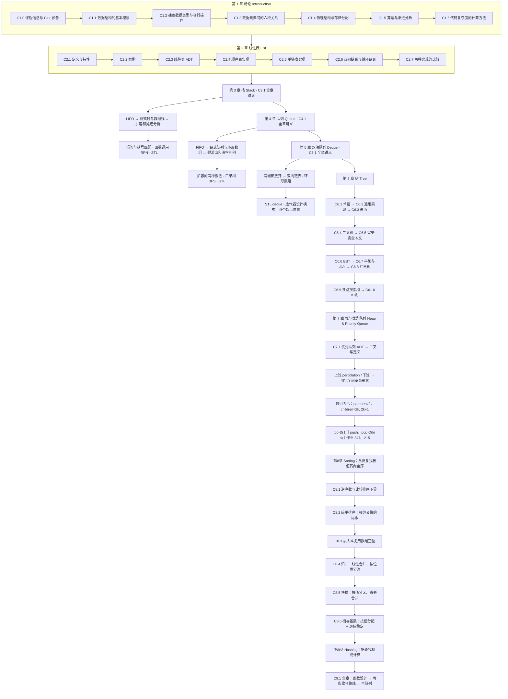

# 数据结构 Data Structure · 课程索引 MOC

> [!info] 课程信息
> **授课**：Ya-Hui Jia（贾雅慧），SFT SCUT ｜ **邮箱**：jiayahui@scut.edu.cn ｜ **课程群**：309044012
> **考核**：Homework + Final Test = 100（比例有两种口径：书面材料写 **30 + 70**，课堂口述 **40% + 60%**，以群里通知为准）
> **考勤**：日常不点名；督导检查时有形式化考勤，会提前在群里通知
> **难度**：每年约 **30%–40%** 的学生期末不及格（靠平时分通过），这门课很大程度上决定保研资格
> **教材**：Mark Allen Weiss《Data Structures and Algorithm Analysis in C++, 4th Ed.》电子工业出版社
> 详见 [[C1.0 课程信息与C++预备]]

> [!info] 「拓展」标注约定
> 第 1 章各篇笔记中，标有 **（拓展）** 或 **【拓展】** 的内容，是**课堂上没有讲到、由教材与通行讲法延伸补充**的部分。
> **复习优先级**：先掌握未标注的主干内容（课堂讲过 = 考试重点区），行有余力再看拓展部分。
> 第 2 章按现有记录尚未开课，暂不做逐条标注；第 3 章 Stack、第 4 章 Queue、第 5 章 Deque 已各整理为一篇全章讲义，第 6 章 Tree 按原有小节拆成多篇，第 7 章 Heap 为一篇全章讲义，但都没有对应转写稿，实际授课进度待核实。第 8 章 Sorting 已按确认方案分为 7 篇，也无对应转写稿。第 7、8、9 章的补充内容按本课前几章的口径写成 **（补充）**，不使用「拓展」标记。各篇开头有「授课进度说明」或来源说明，补充推导不冒充课堂原话。

> [!important] 配套的训练轨道（写代码用这个）
> 讲义是**读**的，光读不会写。练代码请去 [[00 训练手册|数据结构训练营]]：
> 顺序表、单链表的脚手架 + 自动判题测试已经就绪（`M1-线性表`，9 个关卡）。
> 用法：看讲义 → 去训练营写 → `make test` 判对错 → 卡住回讲义查口径。

## 课程全景

## 笔记索引

### 第 1 章 绪论 Introduction

| 笔记 | 核心内容 | 关键结论 |
| --- | --- | --- |
| [[C1.0 课程信息与C++预备]] | 课程信息、考核、教材；C++ 模板、指针、new/delete | 模板避免为每种类型重写；`new` 配 `delete`，`new[]` 配 `delete[]` |
| [[C1.1 数据结构的基本概念]] | 定义、历史、四层术语、逻辑/物理结构 | 数据结构 = 元素 + 关系；**逻辑结构唯一，物理结构不唯一** |
| [[C1.2 抽象数据类型与容器操作]] | ADT=(D,R,O)、容器六问、CRUD、操作清单 | ADT = 数据结构 + 操作；**减少操作可换取性能** |
| [[C1.3 数据元素间的六种关系]] | 线性序/层次序/偏序/等价关系/弱序/邻接关系 | 六种关系分别对应数组、树、DAG、并查集、排序、图 |
| [[C1.4 物理结构与存储分配]] | 顺序/链式/索引分配；行优先与列优先 | $Loc(i)=L_0+i\times u$ 是随机存取的全部秘密 |
| [[C1.5 算法与渐进分析]] | 算法五特性、四项指标、Landau 符号、Θ 是等价关系 | **硬件解决常数，算法解决增长率** |
| [[C1.6 代码复杂度的计算方法]] | 运算符/控制语句/串行/函数/递归的复杂度计算 | 递推式四步法；$T(n)=T(\frac{n-1}{2})+1=\Theta(\ln n)$ |

### 第 2 章 线性表 List

| 笔记 | 核心内容 | 关键结论 |
| --- | --- | --- |
| [[C2.1 线性表的定义与特性]] | 线性结构定义、术语、三要素 | 首尾唯一、前驱后继各一；空表是线性表 |
| [[C2.2 案例：字母表·花名册·多项式]] | 三个案例；稠密/稀疏多项式；链式相加 | 稀疏用 (系数,指数) 对；相加 $O(m+n)$，和为 0 要删结点 |
| [[C2.3 线性表 ADT]] | 五个基本操作、两种实现的接口对照 | Retrieve（按位置）与 Find（按值）是互逆的两个操作 |
| [[C2.4 顺序表实现]] | SqList 全部代码；插入删除的平均移动次数 | 插入平均 $n/2$（分母 $n+1$），删除平均 $\frac{n-1}{2}$（分母 $n$） |
| [[C2.5 单链表实现]] | 头指针/头结点/首元结点；五个操作；约瑟夫问题 | **先连后断**；$n=8,m=3$ 时第 7 人生还 |
| [[C2.6 双向链表与循环链表]] | DuLNode；插入四步、删除两步 | `p->prior=s` 必须放最后；已知结点删除真 $O(1)$ |
| [[C2.7 两种实现的比较]] | 空间/时间对照表；选型准则；作业 | 查得多用顺序表，改得多用链表 |

### 第 3 章 栈 Stack

| 笔记 | 对应课件 | 核心内容 |
| --- | --- | --- |
| [[C3.1 栈 Stack]] | `pdfs/3.02.Stacks.pdf` p.1–103，课件编号 3.2.1–3.2.6 | 单文件全章讲义；LIFO、链式与数组实现、扩容摊还分析、XHTML/C++ 匹配、调用栈、RPN 逐步求值、STL 和作业 |

**阅读顺序**：接在 C2.7 后阅读 C3.1，文件名沿用本库第 3 章编号；源文件里的 3.2 是原有内容编号，不据此重排本库章节。全章按用户要求合为一个 Markdown，以内部目录导航。没有 Stack 转写稿；未确认课堂手写批注，实际授课进度不能由 PDF 判断。

### 第 4 章 队列 Queue

| 笔记 | 对应课件 | 核心内容 |
| --- | --- | --- |
| [[C4.1 队列 Queue]] | `pdfs/3.03.Queues.pptx`（转出 `pdfs/3.03.Queues.pdf`）p.1–48，课件编号 3.3.1–3.3.6 | 单文件全章讲义；FIFO 与别名、链式队列、顺序队列的假溢出、环形数组与满空判别、两种扩容搬法、目录树 BFS 逐帧推演、STL queue、排队论补充、作业 |

**阅读顺序**：接在 C3.1 后阅读 C4.1；源文件里的 3.3 是原有内容编号，本库记为第 4 章。同样合为一个 Markdown。没有 Queue 转写稿；p.19 的红圈是原图自带强调，非课堂板书。

### 第 5 章 双端队列 Deque

| 笔记 | 对应课件 | 核心内容 |
| --- | --- | --- |
| [[C5.1 双端队列 Deque]] | `pdfs/3.04.Deques.pptx`（转出 `pdfs/3.04.Deques.pdf`）p.1–33，课件编号 3.4.1–3.4.5 | 单文件全章讲义；Deque ADT 与六个操作、迷宫求解、单调队列、双向链表与环形数组、STL deque 的分段结构、`operator[]` vs `at()`、暴露结点的四条罪状与悬空指针、迭代器设计模式、begin/end/rbegin/rend、迭代器失效 |

**阅读顺序**：接在 C4.1 后阅读 C5.1；源文件里的 3.4 是原有内容编号，本库记为第 5 章。**本章重心不在 deque 本身，而在迭代器**——小结页自己也这么说。本章**没有作业页**。

### 第 6 章 树 Tree

这一部分的源文件分装在 `tree_part1/2/3.pptx` 三个文件里，共 **620 页**，每个文件内部又打包了若干各有 Outline 与 Summary 的小节。**它们各自的编号 4.x / 5.x / 6.x 是乱的**（`tree_part2` 里 6.1 排在 4.9 之前，而 4.9 是 AVL 的前置），本库统一记为**第 6 章**，按知识依赖顺序编号。

| 笔记 | 对应课件 | 课件编号 | 核心内容 |
| --- | --- | --- | --- |
| [[C6.1 树的概念与术语]] | part1 p.1–35 | 4.1.1–4.1.3 | 定义、度/叶/内部、有序无序、路径深度高度、祖先后代子树、XHTML 与 CSS 后代选择器 |
| [[C6.2 抽象树与通用实现]] | part1 p.36–52 | 4.2.1–4.2.4 | `Simple_tree`（值+父指针+孩子链表）、九个成员函数、`size`/`height` 递归、数组与长子兄弟两种替代表示 |
| [[C6.3 树的遍历]] | part1 p.53–73 | 4.3–4.3.4 | BFS 与 DFS、回溯、每结点两个时机、四问模板、求高度/打印目录/统计磁盘占用三个应用 |
| [[C6.4 二叉树]] | part1 p.74–97 | 5.1–5.1.4 | 定义与左右子树、满结点/空子树/满二叉树、`BinaryNode`、代价取决于树高、Huffman 编码、表达式树、先中后序 |
| [[C6.5 完美二叉树·完全二叉树与N叉树]] | part1 p.98–150 | 5.2–5.4 | 完美树四个定理、完全树及其 $\lfloor\lg n\rfloor$ 高度、**数组存储与下标公式**、N 叉树矮 $\log_2 N$ 倍 |
| [[C6.6 二叉搜索树]] | part2 p.1–69 | 6.1.1–6.1.7 | 有序表 ADT、左小右大、查找/插入（空位即插入点）、**删除三种情况**（两个孩子用右子树最小值顶替）、`BinaryNode*&`、后继与第 k 小、退化成链；两道黑板例题有完整答案 |
| [[C6.7 平衡与AVL树]] | part2 p.70–207 | 4.9.x + AVL（无编号） | 平衡的三种定义（高度 / 空路径长度 / BB(α)）、AVL 最少结点数与斐波那契、$h\le1.44\lg n$、**LL/RR 单旋与 LR/RL 双旋**、八次插入与删除演示、数组存储要 $n^{1.44}$ |
| [[C6.8 红黑树]] | part2 p.208–295 | — | 三条颜色规则与两条推论、最坏高度 $2\lg(n+2)-3$、与 AVL 的取舍、**插入看叔叔（黑→旋转，红→变色）**、自顶向下插入；删除不讲 |
| [[C6.9 多路搜索树]] | part3 p.1–51 | 6.4.1–6.4.3.4 | 3 路树的定义、`find`/`insert`、14 个数的插入演示、中序遍历、推广到 $N$ 路、容量 $N^{h+1}-1$、最小高度 $\lfloor\log_N n\rfloor$、叶子占 $(N-1)/N$ |
| [[C6.10 B+树]] | part3 p.52–175 | — | 硬盘按块读写、为 4 KiB 块选 $L=39$ / $M=512$、十亿条记录读 3 次盘、**定义（同深度 + 半满）**、分裂（叶子复制键、内部移键、根分裂长高）、重分配与合并（删根变矮） |

**阅读顺序**：C6.1 → C6.2 → C6.3 → C6.4 → C6.5，之后按表格顺序。**C6.5 按约定合并了源文件的三个小节**（完美 / 完全 / N 叉）。tree_part1 的作业分别在 p.73（见 C6.3）和 p.97（见 C6.4）；**C6.1、C6.2、C6.5 三篇无作业页**。tree_part2 只有一处作业，在 p.69（见 C6.6）；**C6.7、C6.8 无作业页**。tree_part3 **没有作业页**。

#### 配图（本轮补齐）

这一章最初写完时**十篇笔记几乎没有插图**，很多页写的是「图太大不裁切」「用文字复述，未做裁切」。本轮**逐页渲染、按图形区域裁切**，补齐了 **120 张原图**；另有 **7 张**是先前就有的自绘示意图（python），保留不动。

| 笔记 | 新增原图 | 自绘保留 |
| --- | --- | --- |
| C6.1 | **7**（系统发生树浅/深两帧、路径长度、结点深度、树高、DOM 树与浏览器渲染、CSS 后代选择器） | — |
| C6.2 | **3**（度分布表与树、`Simple_tree` 内存图、长子兄弟表示） | — |
| C6.3 | **5**（BFS 队列逐层、DFS 回溯、递归求高度、目录树打印格式、目录树磁盘占用） | 深度优先绕树一周 |
| C6.4 | **4**（满结点三色图例、满二叉树、Huffman 前缀码撞墙、三种遍历顺序） | Huffman 构造过程 |
| C6.5 | **5**（完美树各高度、归纳证明红蓝子树、完全树逐层填满、数组存储最坏情况、完美四叉树） | 完全二叉树数组存储 |
| C6.6 | **7**（BST 定义三角、同数据四种形状、查找成功与失败、全部空位、删除三种情况、右子树最小值顶替、子树大小标注） | — |
| C6.7 | **4**（最好与最坏 AVL、两个失衡结点、四种情况对照、删除连锁再平衡） | 最少结点树、两种修正 |
| C6.8 | **5**（空路径黑结点序列、7 个结点的全部形状、红黑与 AVL 最坏高度曲线、根涂黑、两种插入法结果对照） | 三种插入修正 |
| C6.9 | **5**（新建中间子树、插入 14 键终态、中序遍历红线、满 3 路树规模、8 路搜索树） | — |
| C6.10 | **75**（动机与硬盘 4、容量与树形 14、例子树与查找 3、**插入逐帧 35**、**删除逐帧 19**；B+ 树是动画帧最多的一章，逐帧取图） | 叶块与内部分裂 |

**取图原则**：结构与嵌套关系简单到 mermaid 能忠实复现的（有序/无序树、XHTML 文档树、表达式树）**不重复贴扫描图**，只保留 mermaid；带高亮、配色、数值标注、前后对比的图（系统发生树、AVL 旋转、红黑树着色、B+ 树分裂）一律用**原图**，因为那些颜色和框线本身就是信息。

> [!note] 每篇的图都能自己核对
> 每篇笔记末尾「勘误与阅读边界」里都列出了：本篇有几张图、每张取自第几页、哪些是自绘、哪些动画帧被跳过。图片文件名统一是 `C6-描述.png`，全部在 `attachments/`。

> [!warning] 树这一章的几个陷阱（**考试重灾区**）
> **一、高度与深度的口径**：本课程采用的口径（及英文教材）**从 0 起算、数边**——根深度 0，单结点树高 0，空树高 −1；**国内教材从 1 起算、数结点**。换算：中文 = 英文 + 1。凡涉及高度的公式，先确认口径。详见 [[C6.1 树的概念与术语]] 第六节。
> **二、“满二叉树”的中英文不对应**：
> 
> | 英文 | 定义 | 国内译名 |
> | --- | --- | --- |
> | full binary tree | 每结点 0 或 2 个孩子，形状可不整齐 | 正则 / 严格二叉树 |
> | **perfect binary tree** | 每层填满 | **满二叉树** |
> | complete binary tree | 最后一层从左连续填 | 完全二叉树 |
>
> 详见 [[C6.4 二叉树]] 3.3 节与 [[C6.5 完美二叉树·完全二叉树与N叉树]] 1.1 节。
>
> **三、tree_part2 的演示页文字与图不一致时，以图为准**：AVL 插入演示 p.176 把 RL 写成 left-right，p.179、p.189 文字框里被截掉的一行写错了提升的结点；p.207 把“插入**至多**修正一次”写成了“至少”；红黑树例子树的根 20 左边挂着 24、26（不是 BST），p.293 两图左右对调。完整勘误见 [[C6.7 平衡与AVL树]] 第十三节、[[C6.8 红黑树]] 第十节。tree_part3 同理：B+ 树例子写“54 条记录”实为 51 条，p.150 把删除写成了“insertion”，见 [[C6.9 多路搜索树]] 第八节、[[C6.10 B+树]] 第十节。

### 第 7 章 堆与优先队列 Heap & Priority Queue

> [!info] 这一章是树之后的下一讲（按课件编号判断）
> 课件内部编号是 **7.1–7.2.6**，紧接搜索树的 4.x–6.x；而 `sort.pptx` 是 **8.x**、`hashing.pptx` 是 **9.x**（同源讲义 9.02 Hash functions）、并查集 `12.pptx` 与图 `13.pptx` 在 **10.x/11.x**（`14.pptx` 拓扑排序的编号是 11.4.x）。**编号线上树之后的第一章就是 7.x，所以下一节课讲堆与优先队列。** 完整证据见本页「授课进度与课件情况」。

| 笔记 | 对应课件 | 课件编号 | 核心内容 |
| --- | --- | --- | --- |
| [[C7.1 堆与优先队列]] | `pdfs/heap.pptx`（转出 `pdfs/heap.pdf`）p.1–89 | 7.1–7.2.6 | 单文件全章讲义；优先队列 ADT 与字典序优先级、M 个队列与 AVL 两种朴素实现、min-heap 定义与"两棵子树之间无关"、pop 提升最小孩子、push 上滤 percolation、用完全树保形状、**末元素提到根 + 下滤**的删法、层序数组表示与下标公式、两次入队与三次出队的完整轨迹、运行时间、max-heap、作业 347/215 |

**阅读顺序**：接在 [[C6.10 B+树]] 之后读 C7.1。本章内部只有 7.1、7.2 两节、共 89 页，合为一个 Markdown；**本章 0 处手写笔迹**，13 张插图全部是印刷图示的裁切，没有板书图。**本章材料没有给出堆的 C++ 类**（只讲下标推演），笔记第 9.3 节补了一份可编译的参考实现。

#### 配图（第 7 章）

| 笔记 | 新增原图 | 自绘 |
| --- | --- | --- |
| C7.1 | **13**（优先队列三操作、min-heap 示例、pop 提升最小孩子、改从右子树提升、完全树上提升留下的洞、push 挂成叶子、push 上滤终态、完全树层序进数组、数组父子下标、数组堆初始状态、数组 push 8 终态、数组三次 pop 前后、max-heap 示例） | **0**（关系型内容全部写成表格） |

**取图原则**：本章的图都属"某个结构长什么样"（树形与数组的对应、下标标注、交换路径），**用文字和坐标重述会失真**，所以一律裁原图；能用表格说清的（下标公式、代价对照、操作轨迹）一律用表格，没有装饰性插图。

### 第 8 章 排序 Sorting

本章按用户确认的 **6 篇** 方案，沿材料的完整主题分界组织；三种简单排序合为一篇以便对照，桶排序与基数排序合为一篇（两者共用"分配"这一手法）。来源为 `pdfs/sort.pptx`，401 页，转出 `pdfs/sort.pdf` 同为 401 页；下表页码是转出 PDF 的物理页，与页角编号一致（页角的三位数在排版里被折成两行，如 100 印作「10 0」）。

| 笔记 | 材料范围 | 原内部编号 | 读完能解决什么 |
| --- | --- | --- | --- |
| [[C8.1 排序基础与逆序数]] | p.1–31 | 8.1–8.1.7.1 | 排序是"列表 → 有序列表"、记录与关键字、稳定性、原地排序两种口径、五种基本手法、三档运行时间、比较树证明 $\Omega(n\ln n)$、Bogosort/Bozosort、逆序数的定义/期望/与相邻交换的关系 |
| [[C8.2 选择、插入与冒泡排序]] | p.32–96 | 选择与插入都标 8.2，冒泡 8.3 | 三种 $\Theta(n^2)$ 的代价构成完全不同：选择恒定 $\frac{n(n-1)}{2}$ 次比较 + $n-1$ 次交换；插入精确 $\Theta(n+d)$，$\text{swap}\to$ 搬移再快一倍；冒泡比较次数与 $d$ 无关，四次改进后仍输给插入排序 |
| [[C8.3 堆排序]] | p.97–140 | 8.4–8.4.6 | max-heap 与尾部空位这两个转弯、0 起下标的父子公式（$2k+1,2k+2$ / $\lfloor(k-1)/2\rfloor$）、原地堆化 $\Theta(n)$ 的按层求和、10 元完整轨迹、12 元随堂题 |
| [[C8.4 归并排序]] | p.141–220 | 8.5–8.5.6 | 三指针归并、收尾两段、稳定性只差一个 `<=`、按位置分治与阈值 6、25 元调用树（93 次比较）、$T(n)=2T(n/2)+\Theta(n)$ 的展开、为什么一次比较能消掉一整段 |
| [[C8.5 快速排序]] | p.221–345 | 残留 7.6–7.6.7 | 按值分 vs 按位置分、最坏情况恰是"已有序 + 取首元素"、三者取中的 $5/16:11/16$ 与"层数多 85%、时间只多 0.3%"、原地划分（洞 + 双指针）、$\Theta(\ln n)$ 栈、Bentley–McIlroy 的三次取中与三路划分、11 元随堂题 |
| [[C8.6 桶排序与基数排序]] | p.346–401 | 残留 7.7–7.7.5（基数排序无独立节号） | 位向量与"每个 bit 一个桶"、计数排序、$\Theta(n+m)$ 与 $m\ll n$ 的适用判据、LSD 的稳定性证明、十进制三轮与二进制五轮的全部序列、两队列挤一个数组与反序拷回、$\Theta(n\ln m)$、作业 88/905 |

**阅读顺序与依赖**：先 [[C7.1 堆与优先队列]]，再按 C8.1 → C8.6 顺读。C8.1 的逆序数解释 C8.2 为何有平方瓶颈；C8.3 复用最大堆，C8.4 与 C8.5 形成"按位置分治 / 按值分区"的对照；C8.6 改变了比较模型，用稳定桶保留逐位成果。缺渐近分析的记号可回看 [[C1.5 算法与渐进分析]]、[[C1.6 代码复杂度的计算方法]]。第 9 章哈希见 [[C9.1 哈希表 Hashing]]。

**配图与动画**：六篇共嵌入 **83 张**印刷原图裁切（C8.1 6、C8.2 11、C8.3 20、C8.4 14、C8.5 16、C8.6 16），全部为"某种结构/某个中间状态长什么样"、用文字重述会失真的图；代码页一律不裁，代码写进正文。**本课件 401 页无任何手写墨迹**（pptx_ink check 与 PDF 注释双向确认），因此没有板书图。柱状与曲线图（p.92–94 的实证曲线、p.101 的 $\ln(n!)$ 曲线、p.230/p.232 的分布与比值曲线）也全部取自原件，没有重绘。

**授课进度与证据**：本章已按材料整理完毕，未找到 Sorting 的课堂转写稿，不能由材料或算法补充推断"本学期讲过"。原文出现的 "Black Board Example"（堆排序 p.136、快速排序 p.338）是印刷题名，不代表材料里存在手写答案——这两道题分别由 C8.3、C8.5 独立给出完整解答（复算值）。

**勘误总览**（各篇末节有逐条依据，这里只列会影响结论或会让人抄错代码的）：

| 位置 | 问题 | 记在哪里 |
| --- | --- | --- |
| p.26 | 56 元例子印 655 inversions / 885 ordered pairs，复算为 **646 / 894** | C8.1 |
| p.84、p.86 | 两段冒泡改进的内层上界印成 `j < i`，应为 `j <= i`，否则下标 $i$ 处元素被覆盖丢失 | C8.2 |
| p.125 | "maximum child (70)" 应为 **81**（同一帧数组可证） | C8.3 |
| p.123 | "position n/2 = 5" 是 1 起编号；0 起下标的最后一个非叶结点是 **4** | C8.3 |
| p.166 | `k > first` 应为 `j > first`（死循环）；`temp` 应为 `tmp`（编译不过） | C8.4 |
| p.240 | 右递归 `quicksort(array, high, last)` 应为 **`low + 1`**，否则与左递归重叠 | C8.5 |
| p.399 | 位数 $\lfloor\log_b m\rfloor+1$ 多算一位，值域 $0\dots m-1$ 应为 $\lceil\log_b m\rceil$ | C8.6 |

### 第 9 章 哈希表 Hashing

材料是 `pdfs/hashing.pptx`，**69 页，页角没有可见节号**（课程 MOC 记其同源讲义编号 9.02 Hash functions），因此不按节切，整章合为一篇。

| 笔记 | 材料范围 | 原内部编号 | 读完能解决什么 |
| --- | --- | --- | --- |
| [[C9.1 哈希表 Hashing]] | p.1–69 | 无可见节号（同源讲义 9.02） | Map ADT 与"$O(\ln n)$ 还能不能更快"、把键折算成下标、冲突为何必然（鸽笼 + 生日问题 $39.1\%$）、整数/字符串/结构体三类函数（求和 → $27$ 进制 → $37$ 滚动）、表长为何取素数、键必须不可变、拉链法与负载因子（$\lambda/2+1$）、探测法与"遇空格即停"的不变量、线性探测的一次聚集（$11$ 次探测走遍全表）、平方探测的素数条件与半数装载定理、双散列与步长陷阱、惰性删除、再散列与均摊、哈希表丢掉了什么 |

**阅读顺序与依赖**：接在 [[C8.6 桶排序与基数排序]] 之后读。本讲的起点是 [[C6.6 二叉搜索树]] 与 [[C6.7 平衡与AVL树]] 那句"$O(\ln n)$ 还能不能更快"；再散列的均摊论证与 [[C3.1 栈 Stack]] 的倍增扩容同源。**下一章并查集尚未建立讲义。**

**配图与来源**：本篇嵌入 **11 张**印刷原图裁切（名字到下标、冲突现场、拉链桶、负载因子、线性探测绕回、一次聚集两帧、平方探测两帧、双散列两帧），全部是"某个中间状态长什么样"、用文字重述会失真的图；代码页一律不裁，代码写进正文。**该材料 0 处手写墨迹**，因此没有板书图。其中两张"格子不可达"示意图的格内数值与哈希值对不上（见下方问题清单），笔记按结论写，并在正文里当场点出。

**勘误总览**（逐条依据见篇末）：

| 位置 | 问题 | 记在哪里 |
| --- | --- | --- |
| p.6、p.8、p.25–28 | 存 Bob 的那一格写的是 Alice 的号码 `555-341-1231`，而 Bob 自己的号码是 `555-987-2314` | C9.1 |
| p.16 | 滚动哈希的展开式字符序反了、指数整体多 $1$；"This is what Java Strings use" 的常数实为 **31**（不是 37） | C9.1 |
| p.14–15、p.19 | 三元组哈希的形参写成 `Integer` 却按字符串下标、返回值漏取模；结构体哈希缺 `return` | C9.1 |
| p.46–48 | "整块对 hash 到 $k<7$ 的键不可用"表述错误——受影响的只有**算到 7** 的键 | C9.1 |
| p.55–56 | 两张"格子不可达"示意图的格内数值与哈希值不自洽（$9$ 在 $0$ 号格、$47$ 在 $0$ 号格、$13$ 在 $5$ 号格） | C9.1 |
| p.57 | 定理写"前 TableSize$/2$ 个位置互不相同"，自己的证明用的是 TableSize$/2+1$ 个 | C9.1 |
| p.68 | "扩容到两倍"与"表长取素数"冲突，实际取 $\ge2p$ 的第一个素数 | C9.1 |

## 高频公式速查

| 公式 | 出处 | 含义 |
| --- | --- | --- |
| $Loc(e_i)=L_0+(i-1)m$ | [[C2.4 顺序表实现]] | 顺序表地址（序号从 1 起） |
| $Loc(i)=L_0+i\times u$ | [[C1.4 物理结构与存储分配]] | 同上（下标从 0 起） |
| $\mathrm{AMN}_{插入}=\frac{1}{n+1}\sum_{i=1}^{n+1}(n-i+1)=\frac n2$ | [[C2.4 顺序表实现]] | 插入平均移动次数 |
| $\mathrm{AMN}_{删除}=\frac1n\sum_{i=1}^{n}(n-i)=\frac{n-1}{2}$ | [[C2.4 顺序表实现]] | 删除平均移动次数 |
| $\sum_{i=0}^{n-1}i=\frac{n(n-1)}2$ | [[C1.6 代码复杂度的计算方法]] | 三角形循环 → $\Theta(n^2)$ |
| $c_1g(n)<f(n)<c_2g(n),\ n>N$ | [[C1.5 算法与渐进分析]] | Θ 的 ε–N 定义 |
| $T(n)=T(n-1)+1\Rightarrow\Theta(n)$ | [[C1.6 代码复杂度的计算方法]] | 阶乘递归 |
| $T(n)=T(\frac{n-1}2)+1\Rightarrow\Theta(\ln n)$ | [[C1.6 代码复杂度的计算方法]] | 二分查找递归 |
| $J(n,m)=(J(n-1,m)+m)\bmod n$ | [[C2.5 单链表实现]] | 约瑟夫问题递推 |

### 栈的扩容公式与核对值

均见 [[C3.1 栈 Stack]]；从空栈连续入栈，不缩容，计数只算搬旧元素。

| 策略或例子 | 公式 / 核对值 | 条件 |
| --- | --- | --- |
| 加 1 | $C(n)=n(n-1)/2$，push 摊还 $\Theta(n)$ | 初始容量 1 |
| 加固定 m | $C(n)=n^2/(2m)-n/2$，push 摊还 $\Theta(n)$ | 初始容量 m，n 为 m 的倍数 |
| 倍增 | $C(n)=n-1$；任意 n 有 $C(n)<2n$，push 摊还 $\Theta(1)$ | 精确等式要求 n 是 2 的幂，初始容量 1 |
| 插入 8 个：加 1 / 加 4 / 倍增 | 28 / 4 / 7 次复制 | 初始容量分别为 1 / 4 / 1 |
| 倍增插入 9 个 | 15 次复制，容量 16，空位 7 | 初始容量 1 |
| RPN 大题 | 250，最大栈深 5 | p.80–98；删括号后的另一个式子为 −132 |

### 环形队列公式速查

见 [[C4.1 队列 Queue]]。设容量 $M$，**两套约定不可混用**。

| | 本课程（`iback` = 最后一个元素） | 国内教材（`rear` = 下一个空位） |
| --- | --- | --- |
| 判空 | `queue_size == 0` | `front == rear` |
| 判满 | `queue_size == M` | `(rear + 1) % M == front`（牺牲一格） |
| 队长 | `queue_size` | `(rear - front + M) % M` |
| 推进 | `i = (i + 1) % M` | 同左 |
| 初值 | `ifront = 0, iback = -1` | `front = rear = 0` |

| 核对值 | 数值 | 出处 |
| --- | --- | --- |
| 假溢出例子 | 容量 16，push 16 次、pop 5 次 → size = 11，`ifront=5`、`iback=15`，再 push 越界到 16 | Queue p.23 |
| 搬后段扩容 | 后段 10 个落到新数组 22–31，下次 push 写 6 | Queue p.28 |
| 归一化扩容 | 16 个占 0–15，下次 push 写 16 | Queue p.29 |
| 目录树 BFS 次序 | **A B H C D G I E F J K** | Queue p.33–45 |

> [!warning] Queue 的口径
> p.26 写「五个选项」只列了四条；p.19 的类声明把 `front()` 误写成 `top()`；p.22 的 `return array[ifront - 1]` 在环形版本下会越界。提纲里的 Queuing theory 无对应幻灯片。逐条见 [[C4.1 队列 Queue]] 第十二节。
> **已订正**：p.6 的「两个异常」**不是遗漏**——`front` 和 `pop` 在空队列上各算一个。对照 [[C5.1 双端队列 Deque]] p.4 的「四个错误」（front/back/pop_front/pop_back）可确认三章用的是同一套数法。

> [!warning] Deque 的口径
> p.28 两处 `endl` 误写成 `end`（无法编译）；p.11 输出里那个 `0` 是 `operator[]` 越界读到的垃圾值、随后 `at()` 抛 `out_of_range`，同页循环条件 `i <= size()` 应为 `<` 且有符号/无符号比较问题；p.7 的内部结构缩略图在转出 PDF 中无法辨认。逐条见 [[C5.1 双端队列 Deque]] 第十一节。

> [!warning] Stack 的口径
> p.45 扩容表混用了单次与整串复制的统计口径，详见全章讲义中的原表、反例与统一修正版。p.82、95 的 “Push 1” 分别应为入栈 2、9。不能把倍增的摊还常数时间误读为每次 push 最坏也为常数。

### 排序公式（第 8 章）

$n$ 为记录数、$d$ 为逆序数；桶排序$m$为键域大小，基数排序另用$b$为基数、$U$为整个键域大小，避免混用。计数、比较次数无物理单位。

| 公式或判据 | 条件与符号 | 推导位置 |
| --- | --- | --- |
| $d=\#\{(j,k):j<k,a_j>a_k\}$；$E[d]=n(n-1)/4$ | 期望式要求互异键的均匀随机排列 | [[C8.1 排序基础与逆序数]] |
| $h\ge\lceil\log_2(n!)\rceil=\Omega(n\log n)$ | 一般比较排序、互异键、最坏决策树深度 | [[C8.1 排序基础与逆序数]] |
| $T(n,d)=\Theta(n+d)$ | 插入排序，不是所有改进冒泡 | [[C8.2 选择、插入与冒泡排序]] |
| 孩子$2k+1,2k+2$；父$\lfloor(k-1)/2\rfloor$ | 本章堆排从0开始，父公式要求$k>0$；第7章从1开始 | [[C8.3 堆排序]] |
| $\sum_{k=0}^{h-1}2^k(h-k)=n-\log_2(n+1)$ | 完美树$n=2^{h+1}-1$；线性建堆交换上界 | [[C8.3 堆排序]] |
| $T(n)=2T(n/2)+n=n+n\log_2n$ | $n$为2的幂、单位叶成本；一般情形同阶 | [[C8.4 归并排序]] |
| $T(n)=T(n-1)+\Theta(n)=\Theta(n^2)$ | 快排持续极端分区；一次不均匀不够 | [[C8.5 快速排序]] |
| $T=\Theta(n+m)$ | 直接寻址位图/计数；线性时间需$m=O(n)$ | [[C8.6 桶排序与基数排序]] |
| $T=\Theta(d(n+b))$；$d=\lceil\log_bU\rceil$ | LSD稳定分配；位数式$U\ge2$；此行$d$专指位数 | [[C8.6 桶排序与基数排序]] |

### 哈希表公式（第 9 章）

$N$ 为键数、$T$ 为表长、$\lambda=N/T$；探测代价都是均匀散列假设下的**期望次数**，不是上界。

| 公式或判据 | 条件与符号 | 推导位置 |
| --- | --- | --- |
| $(h+f(i))\bmod T$ | 探测法统一式；$f(i)=i$ 线性、$i^2$ 平方、$i\cdot\text{hash}_2(x)$ 双散列 | [[C9.1 哈希表 Hashing]] |
| $1-\prod_{i=0}^{N-1}\frac{T-i}{T}$ | 至少一对冲突的概率；$T=10007,N=100$ 给 $39.1\%$ | 同上 |
| $\lambda/2+1$；$\lambda$ | 拉链法成功 / 失败查找；设计目标 $\lambda\approx1$ | 同上 |
| $\frac12\big(1+\frac1{1-\lambda}\big)$；$\frac12\big(1+\frac1{(1-\lambda)^2}\big)$ | 线性探测成功 / 失败；$\lambda=0.9$ 时失败要 $50.5$ 次 | 同上 |
| $-\frac{\ln(1-\lambda)}{\lambda}$；$\frac1{1-\lambda}$ | 平方探测与双散列成功 / 失败 | 同上 |
| $\lfloor p/2\rfloor+1$ 个位置互不相同 | $p$ 为素数；$N\le p/2$ 时必有空格 | 同上 |
| $\text{hash}_2(x)=R-(x\bmod R)$ | $R$ 为小于 $T$ 的素数；步长 $\in[1,R]$，永不为 $0$ | 同上 |
| $11\to23\to47\to97\to197$ | 再散列取 $\ge2T$ 的第一个素数 | 同上 |

| 核对值 | 数值 | 出处 |
| --- | --- | --- |
| "Anna" 的 ASCII 和 | $65+2\cdot110+97=382$ | p.11 |
| `rescued` / `secured` / `seducer` 的 ASCII 和 | 都是 **747**（异位词必撞） | p.13 |
| 求和法的值域 | $127\times8=1016$ → 只可能用到前 **1017** 格 | p.12 |
| "Anna" 的 $37$ 滚动值 | $3447202$，模 $10007$ 得 $4794$ | 复算 |
| $37$ 进制的溢出点 | $37^6\approx2.57\times10^9>2^{31}-1$，第 7 个字符即溢出 | 复算 |
| 10 键拉链的平均成功代价 | $14/10=1.4$（公式给 $1.5$：该表不满足均匀散列） | p.30–31 |
| 线性探测末次插入 | **11 步**走遍 11 格（$\lambda=10/11$） | p.49 |
| 平方探测（$T=8$，$h=3$）可达格 | 只有 $\{3,4,7\}$，序列 $4,7,4,3,\dots$ 打转 | p.55 |
| 平方探测（$T=11$，$h=0$）可达格 | 只有 $\{0,1,3,4,5,9\}$，$\lambda=7/11\approx0.64$ 即卡死 | p.56 |
| 再散列的搬移量 | 从 11 格插到 100 个键，共搬 $6+12+24+49+99=190$ 次 | 复算 |

## 课堂强调的几个判断口径

| 问题 | 口径 |
| --- | --- |
| 三个课程目标里哪个当下最不重要 | **Implement（实现）**——有大模型辅助；理解概念才是与模型沟通、调试改进的前提 |
| 数据结构定义里最关键的词 | **efficient**——随便堆也能存取，但不高效 |
| 算法四种描述方式的精确度 | 自然语言（最差，如菜谱"盐少许"）< 流程图/伪代码 < 程序设计语言（最精确） |
| 空间复杂度算什么 | 只算**额外空间 additional memory**，不算数据本身占的 $n$ |
| 大 $O$ 代表什么情况 | **最坏情况**；$\Theta$ 才是确切的阶。报告习惯写 $O$，心里要清楚是 $\Theta$ |
| 多项式 vs 指数 | 计算复杂性理论中的**可计算 / 不可计算**分界线；密码安全性正建立于此 |
| 插入排序 vs 快排图中的颜色 | **蓝线 = 快排，红线 = 插入排序**（按名字猜会看反） |
| 常数倍的算法差距 | 可以**用更快的机器买回来**（1 GHz 跑 $n^2$ ≈ 2 GHz 跑 $2n^2$）；$n^2$ 与 $n\lg n$ 的差距买不回来 |
| 实际运行时间能不能用 | 理论分析上不用；但**大数据/AI 时代实践中越来越常用**（多少 GPU、多少小时、多少钱） |

## 复杂度速查表

| 操作 | 顺序表 | 单链表 | 双链表 |
| --- | --- | --- | --- |
| 按下标取值 | $O(1)$ | $O(n)$ | $O(n)$ |
| 按值查找 | $O(n)$ | $O(n)$ | $O(n)$ |
| 头插/头删 | $O(n)$ | $O(1)$ | $O(1)$ |
| 尾插（有 tail） | $O(1)$ | $O(1)$ | $O(1)$ |
| 已定位后删除 | $O(n)$ | $O(n)$（需找前驱） | **$O(1)$** |
| 存储密度 | 1 | ≈1/3（存 int） | ≈1/5（存 int） |

| 复杂度类 | 名称 | 典型算法 |
| --- | --- | --- |
| $\Theta(1)$ | constant | 数组随机存取 |
| $\Theta(\ln n)$ | logarithmic | 二分查找 |
| $\Theta(n)$ | linear | 顺序查找 |
| $\Theta(n\ln n)$ | n log n | 归并/快排/堆排 |
| $\Theta(n^2)$ | quadratic | 选择/插入/冒泡 |
| $\Theta(n^3)$ | cubic | 朴素矩阵乘法 |
| $2^n,e^n,4^n$ | exponential | 子集枚举 |

### 栈操作补充

| 实现 | top / pop | push 单次最坏 | push 摊还 |
| --- | --- | --- | --- |
| 链式栈，栈顶在头 | $\Theta(1)$ | $\Theta(1)$ | $\Theta(1)$ |
| 倍增数组栈，栈顶在尾 | $\Theta(1)$ | $\Theta(n)$ | $\Theta(1)$ |

条件：按常数成本元素分析；数组不缩容；摊还从空栈、固定初始容量起算。详见 [[C3.1 栈 Stack]]。

### 队列操作补充

| 实现 | `front` / `pop` | `push` 单次最坏 | `push` 摊还 |
| --- | --- | --- | --- |
| 链式队列（头出尾进，有 tail） | $\Theta(1)$ | $\Theta(1)$ | $\Theta(1)$ |
| 定长环形数组队列 | $\Theta(1)$ | 未满 $\Theta(1)$，满则按策略处置 | $\Theta(1)$ |
| 倍增环形数组队列 | $\Theta(1)$ | $\Theta(n)$ | $\Theta(1)$ |

详见 [[C4.1 队列 Queue]]。

### 双端队列操作补充

| 操作 | 双向链表实现 | 环形 / 分段数组实现 |
| --- | --- | --- |
| `front` / `back` | $\Theta(1)$ | $\Theta(1)$ |
| `push_front` / `push_back` | $\Theta(1)$ | 摊还 $\Theta(1)$ |
| `pop_front` / `pop_back` | $\Theta(1)$ | $\Theta(1)$ |
| **随机访问 `[k]`** | **$\Theta(n)$** | **$\Theta(1)$** |

`std::deque` 要求 $\Theta(1)$ 随机访问，**因此不可能是双向链表实现**；通行做法是 map + 固定大小块的分段结构。详见 [[C5.1 双端队列 Deque]]。

### 迭代器速查

| 写法 | 含义 | 注意 |
| --- | --- | --- |
| `begin()` / `end()` | 首元素 / **尾后**位置 | `end()` **不可解引用**；空容器时两者相等 |
| `rbegin()` / `rend()` | 末元素 / 首元素**之前** | 反向迭代器的 `++` 往前端走 |
| `*itr` | 读写当前元素（返回引用） | 越过尾后即未定义行为 |
| `itr1 != itr2` | 位置是否不同 | 循环条件用 `!=` 不用 `<`（链表迭代器不支持 `<`） |
| `at(k)` / `[k]` | 检查 / 不检查越界 | `at` 抛 `out_of_range`，`[]` 越界是 UB |

详见 [[C5.1 双端队列 Deque]] 第七至九节。

### 堆与优先队列速查（第 7 章）

见 [[C7.1 堆与优先队列]]。**数组从下标 1 开始**（牺牲第 0 格，换来干净的下标公式）。

| 想要 | 公式 | 代码 |
| --- | --- | --- |
| $k$ 的父亲 | $\lfloor k/2\rfloor$ | `k >> 1` |
| 左孩子 / 右孩子 | $2k$ / $2k+1$ | `k << 1` / `(k << 1) \| 1` |
| 下一个空位 | $\texttt{count}+1$ | 上滤的起点 |
| 有没有孩子 | $2k \le \texttt{count}$ | 下滤的循环条件 |

| 操作 | 数组二叉堆（本课） | M 个队列 | AVL 树 |
| --- | --- | --- | --- |
| `top` | $\Theta(1)$ | $O(M)$ | $\Theta(\ln n)$ |
| `push` 最坏 / 最好 | $O(\ln n)$ / $\Theta(1)$ | $\Theta(1)$ | $\Theta(\ln n)$ |
| `pop` 最坏 | $O(\ln n)$ | $O(M)$ | $\Theta(\ln n)$ |
| 建堆（$n$ 个元素） | **$\Theta(n)$**（heapify） | $\Theta(n)$ | $\Theta(n\ln n)$ |
| 内存 | $\Theta(n)$，**零指针** | $\Theta(M+n)$ | $\Theta(n)$，含指针与平衡信息 |

| 核对值 | 数值 | 出处 |
| --- | --- | --- |
| 示例堆结点数 / 最小键 / 最大键 | 18 / 3 / 89（3 与 89 同在根的左子树里） | heap p.18–19 |
| 完全树版示例（16 键） | `15 17 32 25 19 41 36 33 55 31 58 42 89 39 53 88` | heap p.40 / p.56 |
| pop 12 的结果 | `15 17 32 25 19 41 36 33 55 31 58 42 89 39 53 88` | heap p.44–48 |
| 后续三次 pop 提到根的元素 | $15\to88$、$17\to53$、$19\to39$ | heap p.49–54 |
| 数组演示起点（11 键） | `3 6 12 9 14 23 29 10 25 19 15` | heap p.63 |
| push 26 / push 8 | 26 不动；8 交换两次（$8\leftrightarrow23$、$8\leftrightarrow12$） | heap p.64–67 |
| 连续三次 pop 的终态（10 键） | `10 14 12 26 15 8 29 23 25 19` | heap p.85 |
| 完全二叉树高度 | $n=16\Rightarrow4$，$n=10^6\Rightarrow19$，$n=10^9\Rightarrow29$ | 引 [[C6.5 完美二叉树·完全二叉树与N叉树]] |

### 排序选型与代价（第 8 章）

比较平均界按互异键的均匀随机输入或明确随机枢轴模型理解；额外空间含递归栈。具体实现与边界见各篇。

| 算法 | 最好 | 平均 | 最坏 | 额外空间 | 稳定性（本次实现） |
| --- | --- | --- | --- | --- | --- |
| 选择 | Θ(n²) | Θ(n²) | Θ(n²) | Θ(1) | 否 |
| 插入 | Θ(n) | Θ(n²) | Θ(n²) | Θ(1) | 是，严格大于才移动 |
| 基本冒泡 | Θ(n²) | Θ(n²) | Θ(n²) | Θ(1) | 是 |
| 提前终止冒泡 | Θ(n) | Θ(n²) | Θ(n²) | Θ(1) | 是，不保证所有d=O(n)输入都线性 |
| 堆排 | Θ(n)，全等且提前停下滤 | Θ(n log n) | Θ(n log n) | Θ(1) | 否 |
| 常规归并 | Θ(n log n) | Θ(n log n) | Θ(n log n) | Θ(n) | 是，相等取左；原稿代码取右不稳定 |
| 二路快排 | Θ(n log n)，本次等值也推进 | Θ(n log n) | Θ(n²) | 平衡Θ(log n)，最坏Θ(n) | 否 |
| 位图/计数重建整数 | Θ(n+m) | Θ(n+m) | Θ(n+m) | m位/Θ(m)字 | 记录稳定性取决于输出方案 |
| 基数 | Θ(d(n+b)) | 同左 | 同左 | Θ(n+b) | 每位稳定才成立 |

原材料局部经验速度、取样比例与实际机器性能分开：小数组或少逆序考虑插入；严格常数空间且要最坏保证考虑堆排；要稳定考虑正确归并；整数键且位数适合可考虑桶/基数。没有对所有任务同时最优的方法。

## 作业

> [!todo] 作业 #1（第 1 章，已布置）
> **写一个二分查找程序，并画出「比较次数随问题规模增长」的曲线。**
> - 提交到 **QQ 群文件 → `binary search` 子文件夹**
> - C / C++ / Python 均可；**文件名 = 学号 + 扩展名**（如 `2023xxxxxx.py`）
> - **只交程序，不交图表**；截止时间待群内通知
> - 进阶：再写一个拟合/回归算法拟合这条曲线；难点在于**平均情况那条线怎么画**
> - 详见 [[C1.6 代码复杂度的计算方法]] 第八节

> [!todo] 作业 #2（第 2 章，原题已列出）
> LeetCode **No. 2, 53, 80, 83, 92, 169** —— 逐题分析见 [[C2.7 两种实现的比较]]

> [!todo] 作业 #3（Stack，原题已列出）
> LeetCode **20、682、1190**。题意核对、解题路线、代码与复杂度见 [[C3.1 栈 Stack]]；原题未注明本次提交方式与截止日期。

> [!todo] 作业 #5（树的遍历，tree_part1 p.73）
> LeetCode **559、589、590**（均为 N 叉树）。逐题路线见 [[C6.3 树的遍历]] 第八节。

> [!todo] 作业 #6（二叉树，tree_part1 p.97）
> **必做：LeetCode 94、100**；**选做：101、144、145**。逐题路线见 [[C6.4 二叉树]] 第九节。

> [!todo] 作业 #7（二叉搜索树，tree_part2 p.69）
> LeetCode **108**（有序数组转平衡 BST）、**700**（BST 中的查找）。逐题路线见 [[C6.6 二叉搜索树]] 7.3 节。

> [!todo] 作业 #8（堆与优先队列，heap p.89）
> LeetCode **347**（前 K 个高频元素）、**215**（数组中的第 K 个最大元素）。两道题都是 Top-K 定式（大小为 $k$ 的堆，堆顶放"当前最该被淘汰的那个"），逐题路线见 [[C7.1 堆与优先队列]] 第十节；原题未注明提交方式与截止日期。

> [!todo] 作业 #4（Queue，原题已列出）
> LeetCode **225、641、649、1700**，外加 Lab：**实现一个游戏匹配算法**（LOL 五角色组队，目标是最小化平均排队时间与队内平均分差）。逐题路线与设计拆解见 [[C4.1 队列 Queue]] 第十一节；原题未注明提交方式与截止日期。

> [!todo] 第8章排序（sort p.401）
> LeetCode **88**（合并有序数组）、**905**（按奇偶分区）。题号见 [[C8.6 桶排序与基数排序]] 作业一节（本库未取得原题面，只记编号）；两道黑板题另见 [[C8.3 堆排序]] 8.4.5（p.136 的 12 元题）与 [[C8.5 快速排序]] 7.6.5 随堂题（p.338 的 11 元题）。没有提交期限信息。

## 待补内容

> [!warning] 授课进度与待补内容
> - **课堂进度**：按用户信息，**树（第 6 章）已经讲完**；现有转写稿只到**第四节课**（内容停在第 3 章栈的扩容过程），第 2–6 章的课堂细节没有记录，C2.x–C6.x 各篇内容来自课件与教材整理。
> - **2.7 Applications**（应用）与 **2.8 Case Analysis**（案例分析）：目录中出现但课件正文未展开
> - **Project**：题目尚未确定（"I have not decided yet."）；已确定的是**属于下学期的《数据结构实践》课程**，4–5 人一组、最多 5 人，也允许一个人做
> - 第 3 章 Stack：课件 p.1–103 已完整整理为 [[C3.1 栈 Stack]]；尚无本章转写稿，实际授课进度待核实。
> - 第 4 章 Queue：课件 48 页已完整整理为 [[C4.1 队列 Queue]]；同样没有转写稿。课件提纲列出的 **Queuing theory** 无对应幻灯片，笔记第十节为补充内容，是否考核待核实。
> - 第 5 章 Deque：课件 33 页已完整整理为 [[C5.1 双端队列 Deque]]；同样没有转写稿。**本章课件没有作业页**，最后一页是参考文献（Knuth TAOCP Vol.1 §2.2.1 p.238；Weiss 第 **3** 版 §3.3.1 p.75——注意本课指定教材是第 4 版，章节号可能对不上）。
> - **线性结构（List / Stack / Queue / Deque）与树均已讲完**；第 7 章 Heap 已整理成篇，见上一节索引。
> - 第 6 章 树 Tree：课件共 620 页，拆为 10 篇。**tree_part1、tree_part2、tree_part3 共 620 页已全部整理完成**，对应 C6.1–C6.10；**120 张课件原图已按小节裁切补入**（见本页「第 6 章 · 配图」；其中 C6.10 B+ 树一章就占 75 张，因为这一章的分裂/合并全是逐帧动画）。tree_part2 p.78–85 页角有红色禁止符号（同 C3.1），含义未说明，见 [[C6.7 平衡与AVL树]] 第二节；红黑树删除课件声明不讲、另发视频（p.294）。三个 pptx 均已转出同名 PDF 存于 pdfs/。
> - **手写笔迹检查结果（全课程，已实测）**：`pdfs/` 下 **13 份 pptx 全部为 0 处内置墨迹**（`12.pptx`、`13.pptx`、`14.pptx`、`3.02.Stacks`、`3.03.Queues`、`3.04.Deques`、`Genetic programming`、`hashing`、`heap`、`sort`、`tree_part1/2/3`）；**8 份 PDF 也没有任何 Ink 注释**。也就是说，**这门课的课件里没有课堂手写板书**，笔记中的插图全部来自课件自带的印刷图示。**「某页公式缺一项 / 图不完整」这类现象，在这门课上不能归因于「板书被导出丢掉」**——它是课件本身如此。
> - 第 7 章 堆与优先队列：`heap.pptx` 共 89 页已完整整理为 [[C7.1 堆与优先队列]]，并转出 `pdfs/heap.pdf`（页码与笔记引用一致）；**本章 0 处手写笔迹**，13 张插图全部为印刷图示裁切；原稿 p.88 的 max-heap 图与数组不是合法最大堆（把 23 与 25 对调才合法），p.40 的"上一棵树"实为"弹出根之后"的形态，详见该篇第十一节。
> - **下一节课讲什么（2026-10 判断）**：树已讲完。剩余课件里，`heap.pptx` 的内部编号是 **7.1–7.2.6**，紧接搜索树的 4.x–6.x；`sort.pptx` 是 **8.x**（其快排/桶排页残留旧号 7.6/7.7），`hashing.pptx` 为 9.x，并查集 `12.pptx`、图 `13.pptx`、拓扑排序 `14.pptx`（11.4.x）在更后面。再加上 `heap.pptx` 第 3 页那张背景页把"线性结构 → 搜索树 → 优先队列"串成一条线，**判断下一讲是第 7 章堆与优先队列**。若老师按指定教材（Weiss 第 4 版，哈希在第 5 章、堆在第 6 章）的顺序走，则可能先讲哈希——拿到转写稿即可确认。**（后记：heap → sort 之后实际排到 hashing，两份材料都已整理成篇。）**
> - **再往后（章节顺序，2026-10 判断）**：`heap.pptx` 是 **7.1–7.2.x**（7.1@p3、7.2@p16），紧接它的是 **`sort.pptx` 的 8.1–8.5**（8.1@p3、8.2@p33、8.3@p68、8.4@p98、8.5@p142；尾部两节还留着旧号 7.6@p222、7.7@p347），共 **401 页**，内容依次为：排序的定义与前提 → 逆序数 → 选择排序 / 插入排序 / 冒泡排序 → **堆排序** → **归并排序** → **快速排序** → **桶排序与基数排序**。所以第 7 章堆之后是**第 8 章排序**；再往后是第 9 章哈希（`hashing.pptx`，69 页，同源讲义 9.02，这份 deck 页角没留可见编号）、第 10 章并查集（`12.pptx`，79 页）、第 11 章图（`13.pptx`，292 页，11.4 拓扑排序在 `14.pptx` 141 页里）。**堆排序正好是第 7 章与第 8 章的接缝**，这条顺序在内容上也连得上。
> - 其余未整理课件：`Genetic programming.pptx`（客座讲座，亓瑞，2024-10-08）、`12.pptx`（并查集，79 页）、`13.pptx`（图，292 页）、`14.pptx`（拓扑排序，141 页）、`prim.cpp`（最小生成树代码）。**这一批尚未做成笔记**。
> - 第 8 章 Sorting：**401 页已整理为 C8.1–C8.6 六篇**（按 8.1 / 三种 Θ(n²) / 堆 / 归并 / 快排 / 桶与基数分界），共嵌入 **83 张**印刷原图裁切。两道印刷版「Black Board Example」已各自解出复算答案；没有当期转写稿，授课状态待确认。逐条复算见各篇末节与下方问题清单。
> - 第 9 章 Hashing：`hashing.pptx` 共 **69 页、无可见节号**，整理为单篇 [[C9.1 哈希表 Hashing]]，嵌入 **11 张**印刷原图裁切；**0 处手写笔迹**（`pptx_ink.py check` 确认）。材料只覆盖 Map ADT → 函数设计 → 拉链 / 线性探测 / 平方探测 / 双散列 → 再散列，**完全没有删除与空表建立**，惰性删除一节按教材补为（补充）。没有当期转写稿，授课状态待确认。
> - **待合并的转写稿**：`transscript/第三节课.txt`、`第四节课.txt` 尚未并入笔记（内容覆盖第 2 章线性表与第 3 章栈的开头，第四节课结束在栈的扩容过程）。合并后需要回头做「拓展」标注退役。

> [!warning] 课件问题清单（逐条指到篇目）
> - **sort p.26（逆序计数）**：印 655 inversions / 885 ordered pairs；同页 56 个数枚举复算为 **646 / 894**（和都是 1540 = $\binom{56}{2}$），期望 770 正确。见 [[C8.1 排序基础与逆序数]]。
> - **sort p.4（人名拼写）**：同一批记录里 Kilji / Khilji 两种拼法，与排序逻辑无关，保留原样。
> - **sort p.84、p.86（冒泡漏端点）**：内层印 `j < i`，应为 `j <= i`；否则下标 $i$ 的元素从未参与比较却被 `array[i]=max` 覆盖，**会丢元素**（`[3,1,2]` 复算成 `[1,1,3]`）。2000–3000 组随机数组测试：印刷版失败率 91%–95%，改后 0 失败。见 [[C8.2 选择、插入与冒泡排序]]。
> - **sort p.80（图文不符）**：文字说"最后交换两项"，实际该趟一次交换都没有。见 C8.2。
> - **sort p.61（实测表不自洽）**：175/750/2700/8000 ns 前三行约合 12.5 ns 每逆序，末行只合 7.9 ns；按 12.5 ns 推算 n=64 应约 12 600 ns。趋势仍成立，只作参考。见 C8.2。
> - **sort p.125（最大孩子数值）**：文字写 "(70)"，实际换的是 **81**（同页数组可证）。见 [[C8.3 堆排序]]。
> - **sort p.123（编号口径）**："position n/2 = 5" 是 1 起编号；0 起下标的最后一个非叶结点是 **4**，材料下一帧实际处理的也是 4。见 C8.3。
> - **sort p.105（父公式）**：`(k+1)/2 - 1` 需取整，精确式 $\lfloor(k-1)/2\rfloor$。见 C8.3。
> - **sort p.143（两套数组）**：三指针首帧的两段与随后动画的两段不是同一组（并集相同、切法不同），首帧只能当示意。见 [[C8.4 归并排序]]。
> - **sort p.155、p.164–166（归并代码）**：归并比较用 `<` 时相等取右段 → **不稳定**（要稳定须 `<=`）；插入排序子区间版的 `k > first` 应为 `j > first`（死循环 + 越界），`temp` 应为 `tmp`（编译不过）。见 C8.4。
> - **sort p.157 / p.163 / p.218（表述与编号）**：`++out` 与代码里的 `++k` 不一致；p.163 的索引标成 9…33（整体 +9，不能与 0…24 的轨迹混用）；p.218 的 "heap or **quick** sort" 应为 **merge sort**。见 C8.4。
> - **sort p.226（图文不符）**：文字说"取首元素 + 表已有序"，图上却是乱序数组、用来划分的是下标 7 的 2；结论 $T(n)=\Theta(n^2)$ 不受影响。见 [[C8.5 快速排序]]。
> - **sort p.240（快排递归边界）**：右递归印 `quicksort(array, high, last)`，应为 **`low + 1`**；否则与左递归 `(first, low)` 重叠。材料自己的后续帧（15/11/21 三处）都证明是 `low + 1`。见 C8.5。
> - **sort p.288、290、298、299、324（动画标签）**：`low/high` 残留上一帧数值；`(6,14)` 应为 `(11,14)`、`(11,15)` 应为 `(11,14)`、`4−0` 应为 `20−17`。见 C8.5。
> - **sort p.352、388、392（桶与基数的图）**：`685-5762` 应为 `685-7562`；三位示例第 16 格写 `100` 应为 `010`；p.392 的红分界线偏左一格（该段 0 队列 11 项）。见 [[C8.6 桶排序与基数排序]]。
> - **sort p.364、399（界记号与位数）**：说下界时用了 $\Theta(n)$，应为 $\Omega(n)$；位数 $\lfloor\log_b m\rfloor+1$ 多算一位（值域 $0\dots m-1$，应为 $\lceil\log_b m\rceil$）。见 C8.6。
> - **sort p.396–398（基数实现）**：`size_t` 逆向循环在 `current == 0` 时下溢成死循环；`Type bit` 有符号左移溢出是 UB；`copy_back` 分支 `delete[] array` 后结果只活在按值传入的 `queue` 里，调用方拿不到。见 C8.6。
> - **hashing p.6、p.8、p.25–28（示例数据笔误）**：存 Bob 的那一格写 `Bob 555-341-1231`（Alice 的号码），而同一帧里 Bob 自己的号码是 `555-987-2314`。逐帧沿用，不影响机制。见 [[C9.1 哈希表 Hashing]]。
> - **hashing p.16（滚动哈希）**：展开式写成 $k_{N-1}\cdot37^N+\cdots+k_0$，循环实际算出的是 $k_0\cdot37^{N-1}+\cdots+k_{N-1}$（字符序反了、指数整体多 1）；同页「This is what Java Strings use」的常数实为 **31**（37 是 Weiss 教材的选择）。见 C9.1。
> - **hashing p.14–15、p.19（代码笔误）**：三元组哈希的形参写成 `Integer` 却按 `key[i]` 下标、返回值没取模；结构体哈希声明为 `int` 却缺 `return hashVal;`。见 C9.1。
> - **hashing p.46–48（表述错误）**：写「the entire block is unavailable to keys that hash to $k<7$」，但算到 $k<7$ 的键只要格子空着就直接落下，受影响的只有**算到 7** 的键。见 C9.1。
> - **hashing p.55–56（示意图不自洽）**：$T=8$ 那页把 $9$ 画在 $0$ 号格（$9\bmod8=1$）；$T=11$ 那页把 $47$ 画在 $0$ 号格（$47\bmod11=3$）、$13$ 画在 $5$ 号格（$13\bmod11=2$）而 $2$ 号格空着。两页只用于说明「某些格子不可达」，递推细节不必对上。见 C9.1。
> - **hashing p.57（口径不严）**：定理写「前 TableSize/2 个位置互不相同」，自己证明里的范围是 $0\le i<j\le$ TableSize/2，也就是 TableSize/2+1 个位置；差的那一个正是「半数装载仍能找到空格」的依据。见 C9.1。
> - **hashing p.68（表述不完整）**：「分配两倍大的新表」与「表长取素数」直接冲突（$2p$ 必为偶数），实际取 $\ge2p$ 的第一个素数。见 C9.1。
> - **heap p.88（最大堆示例不合法）**：图中与数组 `29 23 26 14 25 9 15 12 6 19 10 3 8` 把 25 挂在 23 之下（25 > 23），违反最大堆定义；**把下标 2 与 5 的 23、25 对调**即合法（`29 25 26 14 23 9 15 12 6 19 10 3 8`）。数据集合本身与前面数组演示一致。见 [[C7.1 堆与优先队列]] 8.2 节与第十一节。
> - **heap p.40（"上一棵树"与数据不符）**：该页声称展示"上面那棵堆"的完全树形态，却只给出 16 个键、根为 15；而那棵抽象堆有 17 个键、根为 12。该数组实际等于"弹出根 12 之后"的形态，与 p.44–48 的推演结果逐项一致（已复算）。
> - **heap p.16 / p.57（措辞）**：p.16 的推论写"子树中所有键都 greater than 根键"，与定义里的 $\le$ 只在键不重复时等价；p.57 的 "The parent of node is a k/2" 应为 $\lfloor k/2\rfloor$。
> - **heap p.8 / p.14（导出丢失）**：转出的渲染图这两页正文整块空白（只剩编号），XML 文本层完好——p.8 是"多个队列"的四行做法，p.14 是 7.1 的小结。笔记按 XML 文本写，属**导出丢失**而非原稿缺失。
> - **tree_part3 p.80（着色的含义：此处结论已更正）**：B+ 树规范结构图上，**中间层每个内部结点的路标键，和它对应的那个叶子块的首键，涂的是同一种颜色**——这层着色恰好画出"**父结点的路标是从孩子那里抄上来的最小键**"（根里的 `33 68` 同理，只是没上色），**是有结构含义的，不是随手强调**。早先曾把它读成"无意义着色"并据此写了勘误，现已在 [[C6.10 B+树]] 3.2 节改正为正确读法。
> - **tree_part3 p.100–101（最坏高度偏乐观）**：原文用"根也至少有 $\lceil M/2\rceil$ 个孩子"的口径，算出 $10^9$ 条最坏高度 4、$10^{13}$ 条最坏 5。按 B+ 树定义（**根只要 2 个孩子**）严格推，应为 **5** 与 **6**：$h=4$ 的最坏容量只有 $2\cdot256^3\cdot20=6.71\times10^8<10^9$。完整推导见 [[C6.10 B+树]] 6.1 节。
> - **tree_part3 p.103 记录条数**：原文写 "54 records"，实为 **51** 条；该树存在只有 **2 条记录**的叶子块（$L=3$ 时下限 $\lceil L/2\rceil=2$），与"半满"一致，不算错误。
> - **tree_part3 其余笔误与重复页**（p.61 / p.74 / p.87 / p.99 / p.149 / p.150 / p.152 / p.173）：清单见 [[C6.10 B+树]] 第十节勘误表——$18\times4098$ 应为 $4096$、"maximum height"应为最优高度、512 路实为 511 键 + 512 指针、键与子树编号错位、$L$ 从 39 突变为 32、"insertion"应为 "erasure"、p.151 与 p.152 完全重复、p.173 把不足半满写成半满。
> - **tree_part3 p.105–107 / p.77–78 / p.81–82 / p.166–168（同一张位图被反复使用）**：查找 14、65、71 这三页的树**逐像素完全相同**，p.78 与 p.77、p.82 与 p.81、p.168 与 p.166 也是如此；**那些"高亮路径""被划掉的键"都是点击后才播放的动画，静态导出里根本没有留下**（PDF 与 pptx XML 双向确认：这些页只有一张位图、没有额外矢量标注）。笔记因此**每对只留一帧**，查找路径改用表格讲，见 [[C6.10 B+树]] 7.2 节与第十节阅读边界。
> - **tree_part3 全书 175 页：0 处手写笔迹**（`pptx_ink.py check` 与 PDF Ink 注释双向确认），也没有"整页空白"需要回查的页；该章插图为印刷内容或自绘。

---

*课件来源：`pdfs/第1章：绪论.pdf`、`pdfs/第2章：线性表.pdf`、`pdfs/3.02.Stacks.pdf`、`pdfs/3.03.Queues.pptx`、`pdfs/3.04.Deques.pptx`、`pdfs/tree_part1.pptx`、`pdfs/tree_part2.pptx`、`pdfs/tree_part3.pptx`（均已转出同名 PDF）*
