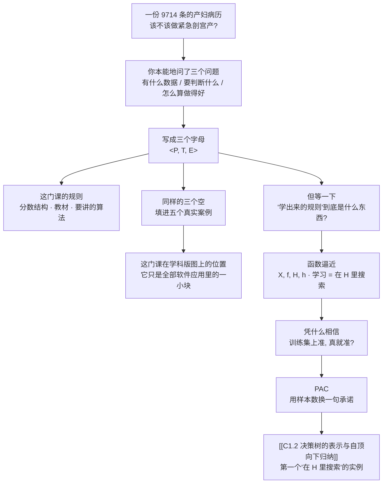

# C1.1 机器学习概述与课程导航

> [!abstract] 这一讲的任务
> 第一节课要办成三件事。**第一**，把"机器学习"这四个字拆成三个能动手填的空，让你拿到任何新场景都能当场写出 $\langle P,T,E\rangle$。**第二**，交代这门课的分数怎么来、教材是哪几本、这一学期会走哪些算法。**第三**，给出贯穿全课的一套记号——函数逼近 $f:X\to Y$、假设空间 $H$、以及"学习就是在 $H$ 里搜索"这句话。第三件事最容易被当成套话，但它是后面每一讲的坐标系：决策树搜的是树的集合，线性回归搜的是直线的集合，支持向量机搜的是间隔最大的那个超平面。

> [!info] 怎么读这份讲义
> 带 **（拓展）** 标记的是这里没有展开、按教材与通行讲法补上的内容，读不懂可以跳过；不带的，是这门课正文给出的内容。
> 符号统一在第五节交代，遇到不认识的记号先去那张表里找，不必回头翻。
> 每一节若出现「停一下」，那是这一节真正需要停下来想清楚的问题，先自己答，再往下看。

---

## 0. 开场：一份没人敢签字的病历

设想你在医院信息科实习。妇产科的值班医师把你叫过去，桌上摊着一份病历。

病人 34 岁，初孕，孕中期超声提示胎盘位置异常，入院时胎位不正。要不要现在推进手术室做紧急剖宫产？

这不是一道练习题。推早了，产妇白挨一刀，术后恢复、住院费、感染风险都要她承担；推晚了，可能就是一尸两命。而**坐在你面前的这位医生，是三个月前才入职的**。她看过的同类病例不超过二十例，而那二十例她全都记不清了——人的记忆装不下 215 个指标之间的相互作用。

她问你：**能不能让机器给她一个数？**

你手上确实有东西：这家医院过去几年积累的 **9714 份产妇记录**，每一份都被逐时间点记录下来（`time=1`、`time=2`……），每条记录有 **215 个特征**——年龄、是否初孕、是否贫血、是否糖尿病、既往早产史、超声结果……最后一行是结局：`Emergency C-Section: Yes / No`。

于是你在纸上写了三行字：

1. **我们有什么？** 一万份左右、每份带 215 个指标和最终结局的历史病历。
2. **要它做什么？** 给一个刚入院的新病人，输出"需要紧急剖宫产"的概率。
3. **怎么算做得好？** 拿一批模型没见过的病例去考它，看答对多少。

写完你愣了一下。你其实什么都没算，只是把一件事问清楚了三遍。但正是这三行字，决定了接下来所有的技术选择：第 1 行决定你用什么算法（数据是表格，不是图片），第 2 行决定输出是什么（一个概率，不是一个类别），第 3 行决定你怎么判断该收工还是该继续调（在没见过的病例上量，不在训练集上量）。

> [!important] 你刚才做的，就是一次完整的机器学习问题定义
> 这三行字，就是下面要讲的 $\langle P, T, E\rangle$。**这门课十四讲，变的只是这三行中间填什么，不变的是永远要填这三行。** 一个项目失败，十次里有七次不是算法选错，而是这三行里有一行从一开始就没想清楚——最常见的是第 3 行：拿训练集上的准确率当性能，自欺欺人（这个坑到 [[C1.4 过拟合与剪枝]] 会被正式命名为过拟合）。

---

## 1. 把三个问题写成三个字母

### 1.1 定义

上面那三行字，Mitchell 给了它一个至今通用的写法。

> [!important] 定义：机器学习 Machine Learning
> 机器学习研究的是**这样一类算法**：它们在**任务 $T$** 上的**性能 $P$**，会随着**经验 $E$** 的增加而提升。
>
> 一个**良定义的学习问题 well-defined learning task**，就是一个三元组
> $$\langle P,\ T,\ E\rangle .$$

这句话读起来像废话——"性能随经验提升"，哪个学科不是这样？它的分量全在**三个字母必须同时说清**：

| 字母 | 是什么 | 具体化的问法 | 剖宫产例子里填什么 |
|---|---|---|---|
| $E$ 经验 Experience | **就是数据** | 你手上有多少条、每条有什么 | 9714 份病历，每份 215 个特征 + 最终结局 |
| $T$ 任务 Task | 你要它做的事 | 输入什么，输出什么 | 输入一位新病人，输出紧急剖宫产的概率 |
| $P$ 性能 Performance | 好坏怎么量 | 在**哪批数据**上、用什么指标 | 未见过的病例上，预测的准确率 |

定义里有个容易被跳过的词：**"这样一类算法"**。它不是"一种算法"，而是一族——决策树、线性回归、神经网络都在这一族里。它们的共同点不是结构，而是**都要靠数据把自己调好**；不同点才是后面十四讲要讲的内容。

### 1.2 为什么"经验"就等于"数据"

人学骑车，摔几次就会了。摔的那几次就是经验，身体记住了"往哪边倒要往哪边拐"。机器没有身体，它唯一能"经历"的东西，就是被喂进去的**样本 sample** 和**标签 label**。

所以工程上：

- 一条样本 = 一组描述（**特征 feature**）＋ 一个答案（**标签 label**）；
- "积累经验" = 加数据、洗数据、补标注；
- "经验不足" = 数据不够、或者数据里根本没有描述这件事的关键那一维。

这也解释了这门课后面反复出现的一句话：**数据是这件事的燃料，算法只是发动机。** 发动机再先进，没有油也动不了。反过来说，一家公司手里攥着海量真实行为数据，算法用公开的、别人也能拿到的那些，照样能做出别人做不出的产品——护城河不在算法保密，在数据回路。

### 1.3 性能 $P$：最容易骗自己的那一个字母

三个字母里，$E$ 和 $T$ 想清楚不难，**$P$ 最容易被偷偷改掉**。

原因很朴素：训练集是我们自己手里的，考自己总是容易的。一个模型在训练集上答对 99%，听上去很美——但它可能只是**把那 9714 份病历背下来了**，包括里面所有的记录错误、笔误和巧合。真实的考验是：明天来一个新病人，它还答得对吗？

> [!warning] 一条从现在管到第十四讲的规矩
> 性能必须在**没有参与训练的数据**上度量。在训练集上刷出来的分数不叫性能，叫**记忆力**。
> 这条规矩在 [[C1.4 过拟合与剪枝]] 变成"训练误差 vs 真实误差"的正式定义，在 [[C9.1 模型评估与训练测试集]] 变成一整套划分与评估流程。现在只需要记住：**换一批数据再问一次。**

### 1.4 手算：把两个场景填成三元组

> [!example] 练习一：剖宫产（把第 0 节的三句话写成形式）
> $$P:\ \text{未见病例上的预测准确率},\quad T:\ \text{病历}\to\{\text{紧急剖宫产},\ \text{否}\},\quad E:\ 9714\times 215\ \text{的病历表}.$$
>
> 三个字母**互相牵制**：如果 $P$ 改成"预测概率的校准程度"（说 0.6 就真有六成会发生），那么 $T$ 的输出就必须是一个概率而不是一个类别，整套方法都要跟着换。**改一个字母，等于换一个问题。**

> [!example] 练习二：预测明天股价涨跌
> - $T$：给定某只股票截至今日的行情特征（价格、成交量、换手率……），输出次日涨／跌。
> - $E$：过去若干年的日频行情，以及每一天对应的次日真实涨跌。
> - $P$：**未来、未参与训练**的交易日上的预测准确率；如果目标是赚钱，还要看策略收益能否跑赢基准（买入持有）。
>
> 注意最后半句：**"准确率"和"能不能赚钱"不是一个指标。** 涨的日子多、但每次只涨一点点，跌的日子少、但每次跌很多，准确率可以很漂亮而账户是亏的。选错了 $P$，算法会朝错误的方向优化——这是"三行字没想清楚"的经典翻车方式。

### 1.5 那三个字母还差什么

如果三个字母就够了，那这门课应该是三节课，而不是十四讲。

缺的那一块是：**怎么从 $E$ 得到那个"能提升的算法"本身。** 三个字母只规定了问题的形状，没有规定解的形状。同样一张 9714 条的病历表，可以学出一棵 if-else 的决策树，可以学出一个线性打分函数，可以学出一个多层神经网络——三者的输出都可以叫"概率"，但它们的**能力边界、需要的样本量、能不能解释**完全不同。

所以后面每一讲都在回答同一个问题的不同版本：

> **给定这样的 $E$ 和这样的 $T$，我们应该在什么样的"答案集合"里找？找的时候怎么保证不白找？找出来的东西凭什么在新数据上还成立？**

这三个问句，就是本课程全部内容的三条主线：**表示（在哪个集合里找）、优化（怎么找）、泛化（凭什么信）**。第一节剩下的部分，先把这门课的范围和这套语言交代清楚。

---

## 2. 这门课的规则与范围

先把最实际的事情说完，后面讲内容时你才知道该往哪儿使劲。

### 2.1 分数怎么来（p.2）

| 项目 | 占比 | 具体形式 |
|---|---|---|
| 课堂表现 Class performance | **10%** | 出勤 |
| 平时项目作业 Regular project assignments | **30%** | 项目作业 |
| 期末考试 Exam | **60%** | 考试 |

> [!note] 从分数结构里读出来的两件事
> 1. **60% 在考试上**，所以考试考的是手算与推导，不是"会不会调包"。凡是能被手算的东西，都要练到不假思索——熵、条件熵、信息增益是第一个（见 [[C1.3 熵与信息增益]]）。
> 2. **30% 在项目上**，所以基础算法的核心函数要亲手实现一遍。实现过的人才能回答"它为什么在这份数据上不好"，只调过包的人回答不了。

### 2.2 教材（p.2）

| 书 | 作者／出版 | 适合怎么用 |
|---|---|---|
| *Pattern Recognition and Machine Learning* | C. Bishop | 一千页以上，体系最完整，当字典查 |
| 《机器学习方法》 | 周志华，清华大学出版社 | 中文，覆盖面广，术语对照方便 |
| 《统计学习方法》 | 李航，清华大学出版社 | 中文，推导干净，适合对着公式一步步核 |
| *Machine Learning* | Tom Mitchell | 偏"这个领域是怎么一步步长出来的"；决策树部分的记号与 PlayTennis 例子沿用此书 |

这四本不用都买。**决策树这一章对着 Mitchell 读最省力**（例子、记号、术语都是同一套）；后面 SVM、EM 这类推导密集的部分对着 Bishop 或李航查。

### 2.3 你会学到什么（p.3、p.14）

这一讲的题目是 **Overview of Machine Learning and Decision Tree**——一张地图，加一个能走通全程的例子。整门课要给你的四样东西是：

1. **主要的机器学习算法**：逻辑回归、贝叶斯方法、隐马尔可夫模型、支持向量机、强化学习、决策树学习、boosting、无监督聚类……
2. **怎么把它们用在真实数据上**：文本、图像、结构化数据，以及你自己的项目。
3. **底层的统计与计算理论**：为什么这些方法在什么条件下成立。
4. **足以读懂研究论文的功底**。

第 4 条值得单独说一句：**读论文的能力不是副产品，是目标之一**。这门课讲的都是经典方法，但经典方法是新方法的地基——你能看懂一个 1990 年代的推导，才能看懂今天的论文在改哪一行。

---

## 3. 应用全景：五个案例，同一个句式

接下来五个真实案例，不是"机器学习能干什么"的清单，而是**同一句话填了五次空**：

> 现实里有一件事，人做不好或做不快 → 把它写成 $T$ → 找出能描述它的 $E$ → 定一个 $P$ → 学出一个规则。

读的时候不妨每个案例都自己填一遍三个字母，再看它是怎么落地的。

### 3.1 剖宫产：回头看那个规则（p.5）

第 0 节那份 9714 条记录，最终学出了 **18 条规则**，其中一条长这样：

> **If** 无既往阴道分娩 **and** 孕中期超声异常 **and** 入院时胎位不正
> **Then** 紧急剖宫产的概率 = 0.6

这条规则在数据上的表现是：

- 训练数据：$26/41 = 0.63$
- 测试数据：$12/20 = 0.60$

（这两个分数自己算一遍：$26 \div 41 = 0.6341$，$12 \div 20 = 0.6$。它们几乎相等，相差 0.03。）

> [!note] 这个例子真正要你读懂的三件事
> **1. 为什么值得做。** 新入职的医生没有几十年的临床直觉，看这一堆化验单判断不了。把全院数据汇总起来学出规则，等于把资深医生的经验**固化**下来，让每个值班的人都能调用。
>
> **2. 0.6 不是失败。** 0.63 和 0.60 这两个数字几乎相等，说明这条规则抓到的是真规律，而不是背下来的巧合——这正是我们要的东西（对照 [[C1.4 过拟合与剪枝]]：如果训练 0.95、测试 0.60，那才叫背答案）。
>
> **3. 准确率上不去，常常不是算法的错。** 更可能是**特征不够**：真正决定这个病例走向的那个量，根本没被采集。这也是为什么"该采哪些特征"本身就是一个昂贵的决策——它比调参重要得多，也比调参难得多。

这里还藏着一个容易被忽略的设计：**训练 41 条、测试 20 条，加起来只有 61 条**。为什么不用全部 9714 条？因为这条规则描述的是一个**很窄的子集**（同时满足三个条件的病人），大部分病历根本不落在这个子集里。这也说明"规则"这种模型形状的一个特点：它天然只对局部负责，全局的准确率要靠很多条规则拼起来。

### 3.2 文本分类：spam vs. not spam（p.6）

邮箱里那个"举报垃圾邮件"按钮背后是一个二分类器。人判断垃圾邮件靠的是线索：出现巨额金额（"cash prize of \$100,000.00"）、陌生的机构名、满屏的转发符号 `>`、"Attn: PRIVATE" 这类话术、莫名其妙的"你已中奖"。

机器要做的事，是把这些线索变成**可计算的特征**：某个词出现了没有、出现了几次、大写字母占比多少、有多少个链接、发件人域名新不新。然后交给分类器。

> [!note] 为什么这个例子比看起来难（拓展）
> **【拓展】** 把一封邮件变成向量，最省事的做法是**词袋 bag-of-words**：词表里每个词占一维，值为该词出现与否。它丢掉了词序，于是"not good"和"good"在特征上几乎一样——这是朴素贝叶斯这类方法的软肋，也是后来一切序列模型（HMM、RNN、Transformer）存在的理由。**特征表达决定了模型能力的上限**，这句话在后面每一章都会以不同形式出现。

### 3.3 图像中的人脸与物体检测（p.7）

做法是按**朝向**分别训练：正脸一组训练样本，侧脸一组，各自学一个检测器。学成之后，一张几十人的合影扔进去，能同时框出不同姿态、不同遮挡、不同光照的人脸。

> [!note] 时间尺度感
> 这件事在十年前还做不到。今天不仅能做，戴口罩也能识别，猫狗的品种也能细分。**它不是某一天突然突破的，而是算法、数据、算力三者同时往前推的结果**——这也正是第 4.1 节说的"机器学习应用这一小块在长大"。

这里也是初学者最常问的地方：为什么现在的检测器又快又准？这类"实时检测"的关键从来不是网络多深，而是**把"找框"和"认类别"放到一次前向里做完**——这个思想在后面的卷积网络里会正式出现（本课程第 13 章起）。

### 3.4 从 fMRI 脑活动读出"你在想哪个词"（p.8）

输入是一整片脑区的活动：每个小格子是一个体素（voxel）的时间序列，成百上千条曲线；输出是词的类别。也就是说，$T$ 是"脑信号 → 语义类别"，$E$ 是同一批受试者在想不同词时记录的脑活动。

> [!note] 这个例子真正说明的事
> 它证明的不是"脑机接口快成了"，而是**"特征"的形状可以极其陌生**：这里的一条样本不是一行表格，而是几百条时间序列。同一个算法框架能吃下这种数据，说明机器学习处理的是**"输入到输出的映射"**，而不是某种特定格式的数据。这也解释了为什么这门课的很多方法可以直接搬到信号、图像、文本上——它们关心的是映射，不是载体。

### 3.5 神经植入体驱动的假肢（p.9）

从猴子运动皮层采集神经信号，直接驱动机械臂完成抓取。$T$ 是"神经放电模式 → 手臂动作指令"，$E$ 是大量"同时记录了神经信号和真实动作"的配对数据。

> [!note] 为什么这两个例子要放在一起
> 3.4 和 3.5 合起来就是**脑机接口 Brain–Computer Interface (BCI)** 这条路线：读出信号 → 解码意图 → 驱动执行器，让失去运动能力的人重新站起来、握手。这条路已经有巨头重金投入，但**可靠性**仍在攻关——解码错了不是掉分，是伤人。这也是"分类准确率 99%"这类数字在医疗场景里根本不够用的原因：错的那 1% 落在哪里，比整体的 99% 重要得多。

### 3.6 汇总：五个案例共用的词汇（p.10）

| 应用 | 一句话任务 $T$ |
|---|---|
| Mining Databases（数据挖掘） | 从历史记录里学出规则，预测个体结局（剖宫产例） |
| Speech Recognition（语音识别） | 声波 → 文字 |
| Control learning（控制学习） | 观测 → 控制指令（直升机悬停） |
| Object recognition（物体识别） | 图像 → 框 + 类别 |
| Text analysis（文本分析） | 文本 → 实体／关系／标签 |

支撑这些应用的经典算法，就是这门课要逐个讲的那些：**支持向量机 SVM、贝叶斯网络 Bayesian networks、隐马尔可夫模型 HMM、深度神经网络 DNN、强化学习 Reinforcement Learning**。

> [!warning] 别把这张表当目录背
> 这张表的用处是**建立索引**，不是背名词。真正要记住的是：**每个算法的差别，只在三件事上——它在什么样的答案集合里找、它认为什么叫"好"、它怎么找。** 这三件事就是下一节要给的坐标系。

---

## 4. 这门课在学科版图上的位置

### 4.1 机器学习在计算机科学里的位置（p.12）

机器学习已经是下列问题的**首选方法**：语音识别与自然语言处理、计算机视觉、医学结局分析、机器人控制。

但它在整个软件版图里占多大？**很小的一块，而且还在长大。** 长大的原因有三条：

1. **算法在进步**：同样的问题，今天的方法比十年前好得多；
2. **在线数据在变多**：手机、终端、传感器每天在产生新的数据；
3. **对"自适应软件"的需求在增加**：写死的规则跟不上变化，软件得自己会调。

> [!note] 为什么"自适应"这条最难兑现
> 前两条是资源，第三条是需求。一条规则写死在代码里，只要世界不变它就永远对；而世界会变——用户口味会变、攻击手法会变、设备型号会变。**"自己会调"意味着程序必须从运行中拿数据、改自己的参数**，这就把软件工程里"部署之后就稳定"的假设推翻了：上线那一刻，模型的性能其实才开始被真正检验。

### 4.2 它坐在几个学科的交集上（p.13）

![[C1.1-机器学习与相关学科关系.png]]

机器学习不在任何单一学科的圈里，而在**计算机科学、统计学、经济学与组织行为学、动物学习（认知科学／心理学／神经科学）、自适应控制理论、进化论**的交集上。

> [!note] 这张图想说的（拓展）
> **【拓展】** 每个圈都对"什么叫学习"给过一套答案：统计学给了估计与置信；控制论给了反馈与收敛；神经科学给了突触可塑性；进化论给了选择与变异；经济学给了激励与决策。机器学习不是凭空发明的，它的每个核心概念几乎都能在某个圈里找到前身——本章要用的**熵**就是从**信息论（通信）**借来的（见 [[C1.3 熵与信息增益]]）；下一章的"贪心搜索"是从**算法设计**借来的。

### 4.3 怎么判断一个场景能不能上机器学习

一条很实用的判据：**只要能定义出问题、能采到带特征的数据，机器学习就可以用。**

两个条件缺一不可。"能定义问题"意味着你知道输入是什么、输出是什么、怎么算对——这就是第 1 节的三元组；"能采到数据"意味着 $E$ 存在。缺第一个，你会做出一个没人能验收的东西；缺第二个，再好的算法也是空转。

这条判据也解释了为什么机器学习今天能进电子、电气、自动控制、测量这些"非计算机"专业：他们的场景里**既有很多传感器数据，又有明确的控制目标**——两个条件都满足。

---

## 5. 先把"规则"说清楚：函数逼近

到这里，"学出一个规则"这句话已经出现了十几次，但我们一直没定义**规则是什么东西**。

这不是抠字眼。如果你说不出"规则"是个什么数学对象，就没法回答"在两个规则里哪个更好"，更没法回答"能不能保证找到最好的那个"。这一节把这件事定下来，之后每一讲都在这个框架里换零件。

### 5.1 从"预测"到"一个函数"

回到剖宫产。我们要的东西，本质上是这样一个东西：

> 给一份病历 $x$，输出一个概率 $y$。

写成数学：一个映射 $f$，把"病历"变成"概率"。输入的所有可能取值构成一个集合，叫**实例空间 instance space** $X$；输出的所有可能取值构成 $Y$。于是

$$f:\ X\to Y .$$

这个 $f$ 就是我们要找的"规则"。**注意：$f$ 是客观存在的**——每一个病人到底会不会需要剖宫产，这件事有确定答案，只是我们看不到那个答案的生成机制。医生凭经验逼近它，我们凭数据逼近它。

### 5.2 三个对象，一次说清

> [!important] 形式化：函数逼近 Function Approximation（p.16）
> - **实例集合** $X$：一条数据可以长成的所有样子。
> - **未知的目标函数** $f:X\to Y$：真正的规律。它存在，但我们永远只能看到它在有限个点上的取值。
> - **假设空间 hypothesis space** $H=\{h\mid h:X\to Y\}$：**我们允许自己交出的答案的集合**。
>
> **输入**：$f$ 的一组训练样本 $\{\langle x^{(i)}, y^{(i)}\rangle\}_{i=1}^{m}$
> **输出**：一个假设 $h\in H$，使 $h$ **最好地逼近** $f$。

这三个对象的区别，用一句话就能记住：

- $X$ 是**题目长什么样**；
- $f$ 是**标准答案**（看不到）；
- $H$ 是**你能交的答卷的格式**；
- $h$ 是**你交上来的那一份**。

**选择 $H$ 就是选择模型族。** 说"$H$ 是所有决策树"，就是在学决策树；说"$H$ 是所有直线"，就是在做线性回归；说"$H$ 是所有三层神经网络"，就是在训一个三层网络。后面每一讲开头几乎都会先交代一句"我们的 $H$ 是什么"——听到这句话就要警觉：**这一讲的整个能力上限，在这里就定死了。**

### 5.3 输入输出：学习被压缩成了一句话

把上面的东西拼起来，"学习"这件事的定义短得惊人：

> 给我一堆 $\langle x^{(i)},y^{(i)}\rangle$，在 $H$ 里挑一个 $h$，让它尽量像 $f$。

这个定义有两个立刻能看出来的后果：

**第一，$H$ 选小了，怎么搜都没用。** 如果真实规律是一条曲线，而 $H$ 里只有直线，那最好的 $h$ 也还是错。这叫**近似误差 approximation error**，它不是算法不行，是"答卷格式"不够用。

**第二，$H$ 选大了，会背答案。** 如果 $H$ 大到能容纳任何映射（比如"所有可能的查表函数"），那总有一个 $h$ 在训练集上 100% 正确——但它在新数据上可能一文不值。这叫**估计误差 estimation error**。

> [!note] 这两个误差就是后面反复出现的偏差与方差（拓展）
> **【拓展】** 近似误差对应**偏差 bias**（模型族本身表达不了真规律），估计误差对应**方差 variance**（从有限样本里挑出来的 $h$ 抖动太大）。一句话：**$H$ 太小 → 偏差大；$H$ 太大 → 方差大。** 这对矛盾贯穿全课，第一次正式登场在 [[C1.4 过拟合与剪枝]]，系统展开在 [[C9.2 模型选择与偏差方差诊断]]。

### 5.4 上下标：一条样本 vs 一个特征

这套记号有一个地方几乎每个人都会写错，现在一次说清，后面不再重复。

> [!warning] 最容易混的两个记号
> - $x^{(i)}$：**第 $i$ 条训练样本**，一整个向量（比如一位病人的 215 个指标）。
> - $x_j$：**一条样本里的第 $j$ 个特征**（比如"年龄"这一维）。
>
> 合起来，$x^{(i)}_j$ 是"第 $i$ 条样本的第 $j$ 个特征"。
>
> **上标是样本编号，下标是特征编号。** 上标加圆括号，就是为了和"平方"区分开——$x^{(2)}$ 不是 $x$ 的平方。

> [!example] 手算检查
> 剖宫产数据有 9714 条记录、每条 215 个特征。那么：
> - $x^{(9714)}$ 是最后一位病人的**整个 215 维向量**；
> - $x_{215}$ 是全数据里**第 215 个特征这一列**（9714 个数）；
> - $x^{(3)}_{2}$ 是第 3 位病人的第 2 个指标（比如"是否初孕"）。
>
> 写错上下标，是作业和考试里最常见、也最冤枉的失分点——它不说明你不懂，只说明你在符号上偷了懒。

### 5.5 于是"学习"变成了一个搜索问题

把第 5.2 节的定义再压缩一层：

$$\text{学习} = \text{在集合 } H \text{ 里搜索一个最好的 } h.$$

一旦这么看，**所有算法的差别就只有三件事**：

| 问题 | 说法 | 例子 |
|---|---|---|
| $H$ 是什么？ | 答案的格式 | 所有决策树／所有直线／所有神经网络 |
| "最好"怎么定义？ | 打分标准（损失函数） | 训练误差最小／间隔最大／似然最大 |
| 怎么搜？ | 搜索策略 | 贪心分裂／梯度下降／闭式解 |

这三件事就是这门课的三条主线（第 1.5 节预告过：表示、优化、泛化）。**下一讲要做的第一件事，就是把这三件事在一棵决策树上各填一次**——你会看到一棵树是怎么把自己"搜"出来的。

> [!question] 停一下，先自己想想
> 如果 $H$ 是"所有可能的决策树"，这个集合有多大？它有限吗？如果"最好"定义成"训练误差最小"，我们能不能直接找到最好的那棵？
>
> 先想三十秒。答案在下一讲开头：$H$ 是有限的（特征和取值都有限时），但大得不可能枚举；而"训练误差最小"这个标准会导致**过拟合**，也会让搜索卡在局部最优——所以真实的算法既不敢穷举，也不敢只看训练误差，只能找一个**近似**的答案。这就是"启发式搜索"这四个字的来历。

---

## 6. 凭什么相信：PAC 与"样本换承诺"

第 1.3 节留下了一个不舒服的问题：

> 我们只在 9714 条病历上试过，凭什么说它在新病人上也准？

这句话不能靠"我觉得"回答。要么给一个**概率意义上的承诺**，要么承认这个领域全靠碰运气。这一节讲的就是那个承诺——它是这门课唯一一处"先讲理论、后讲算法"的地方，因为后面所有关于"过拟合"的讨论，本质上都在绕开这个承诺的漏洞。

### 6.1 一个让人不安的事实

先看一个极端情形：假设 $H$ 大到包含"所有可能的映射"。那么无论训练集长什么样，我总能找到一个 $h$，在训练集上**一个都不错**——因为我可以直接记住每一条样本的答案，遇到没见过的输入就随便猜。

这种 $h$ 在训练集上的误差是 0，在新数据上的误差可能接近瞎猜。**训练误差可以完全不代表真实误差。**

所以"训练误差小"本身不是一个证据。要把它变成证据，必须额外知道一件事：**$H$ 不能太大，而且样本不能太少。** PAC 就是把这句话量化。

### 6.2 PAC 是什么：三个字母和一句人话

PAC = **Probably Approximately Correct**，直译"大概、近似、正确"。三个词各管一件事：

- **Probably（大概）**：允许失败，但失败概率要小——记作 $\delta$，要求"以至少 $1-\delta$ 的把握"。
- **Approximately（近似）**：允许错，但错得不能多——真实误差记作 $\epsilon$，要求"不超过 $\epsilon$"。
- **Correct（正确）**：指的是"上面这个承诺是真的"，不是"每个样本都对"。

连起来：**以至少 $1-\delta$ 的把握，学出来的 $h$ 的真实误差不超过 $\epsilon$。** 这不是对某个具体 $h$ 的保证，而是对"整个学习过程"的保证——它说的是：只要你用了足够多的样本，那么**大概率**你交出来的东西不会太差。

### 6.3 公式：需要多少样本

> [!important] PAC 界（监督概念学习，p.11）
> 若假设空间为 $H$，要求真实误差 $\le\epsilon$、失败概率 $\le\delta$，则样本数 $m$ 满足
> $$m\ \ge\ \frac{1}{\epsilon}\Big(\ln|H|+\ln\frac{1}{\delta}\Big).$$

这个式子的来源不神秘：它来自"坏假设"的数量上界。$H$ 里的每一个 $h$ 都有一定概率在训练集上"碰巧全对"，坏假设越多，至少有一个碰巧全对的概率就越大（联合界／union bound）；要让这个概率压到 $\delta$ 以下，样本数就得跟着涨。**详细推导属于学习理论的范围，这里要的是把它读成一句人话：**

> **你要的把握越大（$\delta$ 越小）、精度越高（$\epsilon$ 越小）、答案格式越多（$|H|$ 越大），需要的样本就越多。**

### 6.4 逐项读出三个直觉

**$\epsilon$ 在分母，是反比。** 精度从 10% 提到 5%，样本量翻倍。这是最贵的一项——**精度是线性买来的，一倍精度一倍数据。**

**$|H|$ 在 $\ln$ 里，是对数。** 假设空间从 1000 扩到 100 万，$\ln$ 只从 6.9 涨到 13.8，样本量只多一倍。这条也许反直觉：**模型复杂度翻很多倍，数据量并不需要跟着翻**。它是深度学习能成立的理论底气之一——参数量从 100 万涨到 10 亿，$\ln$ 只是从 13.8 涨到 20.7。

**$\delta$ 也在 $\ln$ 里，而且更便宜。** 把翻车概率从 5% 压到 0.5%，$\ln(1/\delta)$ 从 3.0 涨到 5.3，样本量只多 2.3/$\epsilon$。

> [!example] 手算：一个具体的数字
> 取 $|H|=1000$、$\epsilon=0.1$、$\delta=0.05$：
> $$m\ \ge\ \frac{\ln 1000+\ln 20}{0.1}=\frac{6.9078+2.9957}{0.1}=\frac{9.9035}{0.1}=99.04 .$$
> 所以**至少 100 条样本**。
>
> 把精度提到 $\epsilon=0.05$（其余不变）：$m\ge 198.07$，也就是 **199 条**——正好翻倍，和"$\epsilon$ 在分母"一致。
>
> 把假设空间扩到 $|H|=10^6$：$\ln 10^6=13.82$，$m\ge 168.2$，也就是 **169 条**——比刚才只多了 69 条。这就是 $\ln$ 的力量。

### 6.5 这个界为什么"松"，以及它真正的用处

拿上例去对现实，会觉得荒谬：**100 条样本就能学会一个一千种可能的假设空间？** 现实中训练一个能用的模型动辄十万条。

原因有三个，都值得知道：

1. **PAC 界是"最坏情况"的界**。它对 $H$ 里**每一个**假设都做保证，包括那些明显荒谬的。真实的学习算法有偏好（比如偏好简单的树），实际需要的样本远少于最坏情况。
2. **$|H|$ 是"离散且有限"的假设空间才有的量**。线性回归的 $H$ 是连续无穷的，$\ln|H|$ 直接无定义——所以对连续模型要用 VC 维一类的量替代 $|H|$。**这个公式不能直接套到线性回归上**，它只适用于有限假设空间（比如所有深度受限、取值离散的决策树）。
3. **它给的是"能不能学会"的判据，不是"要多少数据"的工程配方**。它的真正用处是回答"这条路本质上可行吗"：如果 $m$ 需要 $10^{12}$，那就别做了；如果 $m$ 只要几百，那说明问题结构很好。

> [!note] 理论上还关心什么（拓展）
> **【拓展】** 除了 PAC 界，这一支还研究：其他范式的理论（强化学习＝从奖励里学策略；半监督＝只有少数样本带标签；主动查询＝由算法决定去问哪几条的答案）；以及一批被刻画的其他量——学习过程中的**犯错次数**、学习器的**查询策略**、**收敛速率 convergence rate**、**渐近性能**、**偏差与方差**。这门课后面真正会用到的，是最后一项（第 9 章）和收敛速率（梯度下降那一章）。

> [!warning] 一句别记错的话
> PAC 界保证的是"**以高概率**真实误差不超过 $\epsilon$"，**不是**"训练误差小 ⟹ 真实误差小"。后者需要额外假设（样本独立同分布、$H$ 不太大）。**把这两句话混起来，是机器学习里最常见的一次概念偷换。**

---

## 这一讲的三句话

1. **任何学习问题先写成 $\langle P,T,E\rangle$，尤其别放过 $P$。** 性能必须在没参与训练的数据上量；训练集上的高分是记忆力，不是能力。
2. **"学出一个规则"的正式说法是"在假设空间 $H$ 里搜一个 $h$ 去逼近 $f$"。** 所有算法的差别只有三件事：$H$ 怎么定、"最好"怎么定、怎么搜——这三件事就是后面十四讲的坐标系。
3. **训练误差小不代表真实误差小，PAC 给的是"样本数换承诺"的最坏情况界。** 它的用处不是算要多少数据，而是判断这条路本质上可行不可行。

## 速查表

| 记号／术语 | 含义 | 第一次出现 |
|---|---|---|
| $\langle P,T,E\rangle$ | 良定义学习任务：性能／任务／经验 | 1.1 |
| 特征 feature / 标签 label | 一条样本的描述部分／答案部分 | 1.2 |
| 过拟合 overfitting | 训练误差小但真实误差大 | 1.3（预告） |
| 实例空间 $X$ | 一条数据所有可能的样子 | 5.1 |
| 目标函数 $f$ | 真正的规律，看不到 | 5.2 |
| 假设空间 $H$ | 允许交出的答案的集合 | 5.2 |
| 假设 $h$ | 从 $H$ 里挑出来的那一个 | 5.2 |
| $x^{(i)}$ / $x_j$ | 第 $i$ 条样本／第 $j$ 个特征 | 5.4 |
| 近似误差 / 估计误差 | $H$ 太小造成的／$H$ 太大造成的 | 5.3 |
| PAC 界 | $m\ge\frac{1}{\epsilon}(\ln|H|+\ln\frac1\delta)$ | 6.3 |
| $\epsilon$ / $\delta$ | 允许的真实误差／允许的失败概率 | 6.2 |

## 下一讲预告

第一讲把坐标系立起来了：**学习 = 在 $H$ 里搜一个最好的 $h$**。但这句话里有一处一直含糊——"最好"到底怎么衡量？

下一讲从一份 14 行的表格开始：四个天气指标（outlook、temperature、humidity、wind），一个决定（今天打不打网球）。我们要在这张表上学出一棵**决策树**，于是立刻撞上三个具体的问题：树长什么样？在哪一步分裂？"哪个属性更好"凭什么判断？

最后一个问题会逼出一个新的量——**熵**。它是这门课第一个真正需要手算的东西。

---

上一节：（本章起点） · 下一节：[[C1.2 决策树的表示与自顶向下归纳]]
索引：[[机器学习课程 MOC]]
