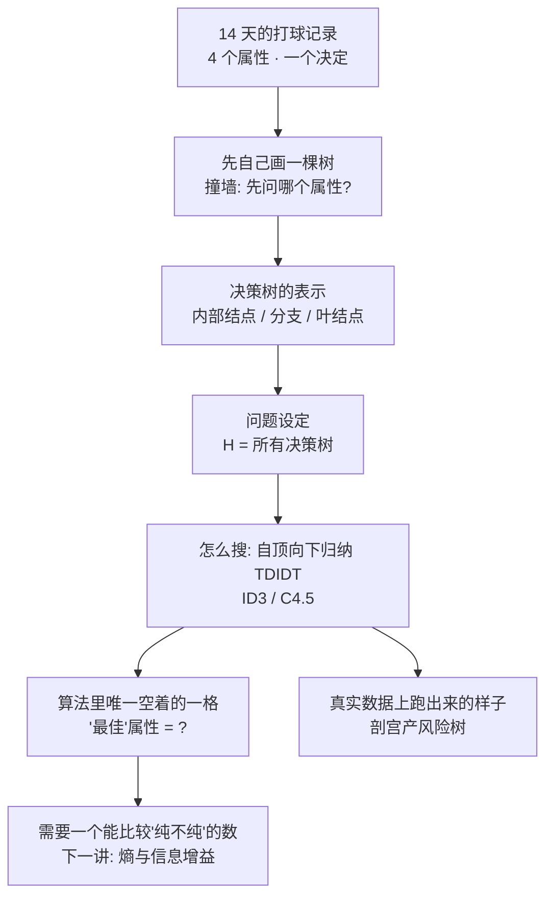
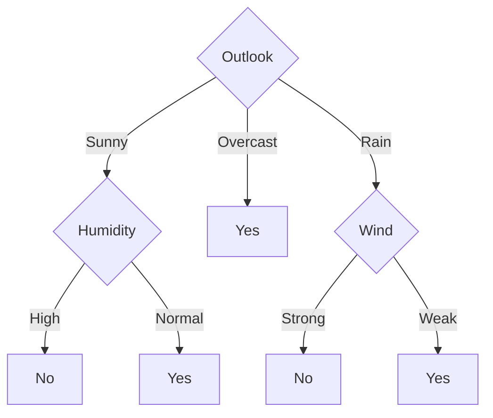

# C1.2 决策树的表示与自顶向下归纳

> [!abstract] 这一讲的任务
> 上一讲把学习定义成"在假设空间 $H$ 里搜一个最好的 $h$"，但没给过一个真正的 $H$。这一讲把第一个 $H$ 落地：**$H$ = 所有可能的决策树**。要做成三件事：说清一棵树长什么样（表示）、说清怎么从数据里把树"搜"出来（自顶向下归纳）、并且当场撞上这个算法唯一没解决的问题——**"哪个属性最好"到底怎么判断**。最后这个问题会卡住整个算法，下一讲专门解决它。

> [!info] 怎么读这份讲义
> 不带标记的是这门课正文给出的内容；带 **（拓展）** 的是按教材与通行讲法补的。
> 这一讲的手算只有一处（数一数有多少种可能的树），其余都是结构性的理解。
> 建议第一遍读完之后，拿张纸把第 1 节那张表抄下来，自己画一次树——第 1.2 节会告诉你为什么值得动手。



---

## 0. 开场：把一位老教练的直觉画成一张图

设想你是学校网球社的干事。社团每周要定一件事：明天下午的场地，约还是不约？

老教练心里有一张表，但他说不出来。你追问了三遍，只问出四句话：

- 看天。**阴天一定打**，不用问别的。
- **晴天**再看湿度，湿度高的日子大家都嫌闷，不打。
- **下雨**就看风，风大不打，风小照打。
- 气温？他摆摆手："那玩意儿不重要。"

于是你在纸上画出了一张流程图：先问天气，阴天直接去；晴天拐到湿度；下雨拐到风。三个判断，五个结局。

**这张图就是一棵决策树。** 它有三个好处，恰好对应它为什么值得学：

1. **它能被念出来。** 老教练的四句话，和你画的图，是同一件事的两种写法。别的模型（比如一个 215 维的线性打分函数）给不出这样的解释。
2. **它不必问全所有属性。** 阴天那一枝只问了一个问题就下结论了，气温从头到尾没被问过。
3. **它天然带特征选择。** 那些没被用上的属性，就是被数据"投票淘汰"的——不是你先验地删掉它们。

现在把这件事交给机器：**不许人画，让它自己从记录里长出这张图。**

---

## 1. 一份 14 行的表

要让机器长出这张图，得先给它记录。这里用的是一份在这个领域流传最广的教学数据——Mitchell 教材里的 **PlayTennis**。

| Day | Outlook 天气 | Temperature 气温 | Humidity 湿度 | Wind 风 | PlayTennis? |
|---|---|---|---|---|---|
| D1 | Sunny | Hot | High | Weak | **No** |
| D2 | Sunny | Hot | High | Strong | **No** |
| D3 | Overcast | Hot | High | Weak | **Yes** |
| D4 | Rain | Mild | High | Weak | **Yes** |
| D5 | Rain | Cool | Normal | Weak | **Yes** |
| D6 | Rain | Cool | Normal | Strong | **No** |
| D7 | Overcast | Cool | Normal | Strong | **Yes** |
| D8 | Sunny | Mild | High | Weak | **No** |
| D9 | Sunny | Cool | Normal | Weak | **Yes** |
| D10 | Rain | Mild | Normal | Weak | **Yes** |
| D11 | Sunny | Mild | Normal | Strong | **Yes** |
| D12 | Overcast | Mild | High | Strong | **Yes** |
| D13 | Overcast | Hot | Normal | Weak | **Yes** |
| D14 | Rain | Mild | High | Strong | **No** |

先把这张表的"形状"记住，后面每一步都在它上面动刀：

- **四个属性，取值数各不相同**：Outlook ∈ {Sunny, Overcast, Rain}（3 个），Temperature ∈ {Hot, Mild, Cool}（3 个），Humidity ∈ {High, Normal}（2 个），Wind ∈ {Weak, Strong}（2 个）。
- **总数 14 条，其中 9 条打、5 条不打**，记作 $[9+, 5-]$。
- **没有一条记录是重复的**，也就是说，四个属性合起来能唯一确定这 14 天。

### 1.1 为什么是这四个属性

表里为什么只有天气、气温、湿度、风？

因为有人在采集之前就决定了"打不打球要看这四件事"。完全可以再加两列："今天心情好不好""朋友是否放假""球拍有没有断线"。加了会怎样？

- **好的一面**：可能真的有用，模型能多一条线索。
- **坏的一面**：每多一列，采集成本（钱、时间、以及被采集者的配合度）就上去一分；而且你**事先并不知道它有没有用**——它就是没用，你也得先花钱采了才知道。

这个取舍在真实项目里反复出现。上一讲剖宫产的例子里，规则准确率只有 0.6，最可能的解释不是算法不行，而是**描述这个病例最关键的那个量根本没被采集**。所以"该采哪些特征"本身就是一个决策，而且往往是整个项目里最贵的那个决策。

> [!note] 一个反直觉的事实
> 特征不是越多越好。加一列纯随机的特征（比如病人的社保号末位），模型在训练集上的表现几乎一定会变好——因为它多了一个可以"背答案"的维度——但在新数据上会变差。这个现象在 [[C1.4 过拟合与剪枝]] 会正式讲清楚。

### 1.2 先自己画一棵，你会立刻卡住

在往下读之前，试着只用这张表，画出一棵能解释全部 14 天的树。你会发现两件事：

**第一件，根结点该问什么，你其实拿不准。** 天气？湿度？还是气温？四个都可以当根，画出来是四棵不同的树。而且它们**都能把 14 天全部解释对**——因为 14 天太少了，随便怎么切，只要切到叶子只剩一种答案，就能自圆其说。

**第二件，就算你选对了根，第二层又要重新纠结一次。** 选了天气之后，晴天那 5 天里还要再问一个问题；这次可选的属性少了（天气已经用过了），但仍然是三个里挑一个。

这两件事合起来说明：**画树不是"找到唯一正确的图"，而是在一大堆都能解释训练数据的图里，挑一个"更可能在新数据上还对"的。** 挑的标准是什么？这是这一讲最后要撞上的墙。

---

## 2. 决策树的表示：一棵树由三种零件构成

把上面那张流程图抽象一下，就是决策树的全部表示。



> [!important] 决策树的三个零件（p.18）
> - **内部结点 internal node**：检验**一个**离散取值的属性 $X_i$。
> - **分支 branch**：从结点出发的每一条边，对应该属性的**一个取值**。
> - **叶结点 leaf node**：给出预测的 $Y$（也可以给出 $P(Y\mid X\in\text{leaf})$，即落在这个叶子里的样本属于各类的比例）。

上面这棵树，正是针对这份 14 行数据学出来的结果（怎么学出来的，从第 4 节开始讲）。

### 2.1 怎么用一棵树做预测

拿一条新记录：`<Outlook=Sunny, Temp=Hot, Humidity=Normal, Wind=Strong>`。

1. 从根开始，看 Outlook = Sunny，走 Sunny 枝，到了 Humidity 结点；
2. Humidity = Normal，走 Normal 枝，到叶结点；
3. 叶子写着 **Yes**，输出"打"。

整条路径只查了 **2 个属性**，气温和风一次都没看。

再看一条：`<Overcast, Cool, High, Strong>`。Outlook = Overcast 直接到叶结点 Yes，**只查了 1 个属性**。

> [!note] 这个细节比它看起来重要
> 不同的路径可以用到不同数量的属性。阴天那一枝只问一个问题就下结论，晴天那一枝要问两个。**树自动把"容易判断的情况"放在前面**——这不是设计出来的，是从数据里长出来的。
> 对比一下线性模型：$h(x)=\theta_0+\theta_1x_1+\cdots+\theta_nx_n$，它对每一条输入都要把**全部** $n$ 个特征算一遍。所以"少查几个属性"本身就是决策树的一种优势，尤其在特征获取很贵（要抽血、要拍片、要发问卷）的场景里。

### 2.2 一个必须满足的要求：完备性

> [!warning] 树必须能处理任何一条输入
> 不允许出现"走到某个结点，发现没有任何分支匹配"的情况。所以每个内部结点都要为它所测属性的**每一个取值**留出分支。
>
> 这条要求看起来是废话，但它决定了一个设计细节：**属性取值的集合必须是有限的、事先已知的**。如果某个属性是连续值（比如身高 172.3 cm），它有无穷多个取值，就没法给每个取值开一条枝——怎么办？把它切成区间（比如 172.3 → "≥170"）。连续属性的处理见 [[C1.5 学习理论视角与决策树扩展]]。

### 2.3 叶子为什么可以输出概率

叶结点写的不一定是硬标签。如果一个叶子里落进来 5 条样本，3 条打、2 条不打，那么这一片叶子的"纯度"只有 3/5。这时候有两个选择：

- 输出 **Yes**（多数票）；
- 输出 $P(\text{Yes})=0.6$。

后者在很多场景下更值钱：**需要排序或者需要设阈值的时候，一个概率比一个标签有用**。比如风控里"这单该不该拦"，你要的不是"拦/不拦"，而是"风险 0.6，可以拦也可以放，看你的额度"。

> [!note] 这个区别会贯穿全课（拓展）
> **【拓展】** 输出概率意味着模型给出的是**一个分布**，而不只是一个决定。后面逻辑回归、朴素贝叶斯、EM 都在做同一件事：估计 $P(Y\mid X)$。而决策树默认输出标签，是因为它的训练准则（纯度）只关心"哪类占多数"，不关心"有多确定"——这两件事的差别，在第 9 章评估指标（精确率、召回率、AUC）里会变成实实在在的分数差。

---

## 3. 问题设定：$H$ 就是所有决策树

现在把上一讲那套语言套到树上（p.19–p.20）。

> [!important] 决策树学习的问题设定
> - **实例集合** $X$：每个实例 $x$ 是一个**特征向量 feature vector** $x=\langle x_1,x_2,\dots,x_n\rangle$。例如 `<Humidity=low, Wind=weak, Outlook=rain, Temp=hot>`。
> - **未知目标函数** $f:X\to Y$，其中 $Y$ 是**离散值**——打球那天 $Y=1$，否则 $Y=0$。
> - **假设空间** $H=\{h\mid h:X\to Y\}$，**每一个假设 $h$ 就是一棵决策树**。树把 $x$ 分拣（sort）到某个叶子，该叶子给出 $y$。
>
> **输入**：训练样本 $\{\langle x^{(i)},y^{(i)}\rangle\}$
> **输出**：最好地逼近 $f$ 的 $h\in H$

三句话读这个设定：

- **$X$ 是有限的。** 四个属性都只有几个取值，所以整张"可能的天气"表格只有 $3\times3\times2\times2=36$ 行。$X$ 不再是无穷的图片空间，而是一张 36 行的表。
- **$Y$ 是离散的**，所以这一讲做的是**分类 classification**，不是回归。
- **$h$ 是一棵树**，所以"选模型"变成了"选树形"。

> [!warning] "$Y$ 是离散值"这一条别漏
> 它限定了决策树在这里做的是分类。（回归树是可以做的：把叶子的输出改成实数、把划分准则从"纯度"改成"平方误差"。那是后面的内容，但记号完全一样。）

### 3.1 顺手算一下：这个 $H$ 有多大

$X$ 有 36 个元素，$Y$ 有 2 个元素。所以**所有可能的 $f:X\to Y$ 一共有 $2^{36}$ 个**——因为对 36 种天气组合，每一种都可以独立地标"打"或"不打"，一共 $2\times2\times\cdots\times2$（36 次）。

$$2^{36}=68{,}719{,}476{,}736\ \approx\ 6.87\times10^{10}.$$

也就是说，未知的目标函数有将近 **687 亿**种可能。而我们手里只有 14 条记录。

这个对比很值得停一下：**14 条证据，要在一个有 687 亿个候选答案的世界里选一个。** 从信息论的角度看，14 条二值记录最多只携带 14 bit 的信息，而"哪个 $f$ 是真的"需要 36 bit 才能说清——所以**不可能唯一确定 $f$**，无论用什么算法。

> [!important] 这就是"学习"这件事的真相
> 我们不是"发现"了 $f$，我们是在**一小部分证据上做一个会被新证据推翻的猜测**。这件事之所以可行，全靠一个额外假设：**$f$ 不是任意一个函数，它是有规律的**（比如它大致是"用少数几个属性做几个阈值判断"）。这个假设，就是假设空间 $H$ 的作用——它不是"我们能搜的范围"，而是**我们押的那个赌**。
>
> 押对了，14 条就能学到东西；押错了，687 亿种可能里我们永远找不到对的那个。

### 3.2 $H$ 比"所有函数"小多少

决策树的 $H$ 是 $2^{36}$ 里的一小部分：它只包含"能用若干次属性判断写出来"的函数。这带来两个后果：

- **好处**：$H$ 小，所以 14 条样本就够（回忆上一讲 PAC 界里 $|H|$ 在 $\ln$ 里——$H$ 从 687 亿缩到几万，需要的样本数只少了一点点，但"能不能学会"的性质变了）。
- **代价**：如果真实的 $f$ 不是树形的（比如它其实是"天气好且心情好"这种交互，或者需要把两个属性加起来比较），那么**再多的数据也学不到**，因为 $H$ 里根本没有它。

> [!note] 用上一讲的话说
> 好处对应**估计误差**小，代价对应**近似误差**大。选 $H$ 永远是在这两者之间挪：$H$ 越大约束越少、越容易拟合，但越难从有限样本里挑准。这个张力在第 5 节挑"属性"的时候会具体化成一个可算的数。

---

## 4. 怎么搜：自顶向下归纳 TDIDT

有了 $H$，下一个问题是"怎么在里面搜"。答案是这门课第一个完整算法（p.22）。

> [!important] 自顶向下归纳决策树 Top-Down Induction of Decision Trees `[ID3, C4.5, Quinlan]`
> ```text
> node = Root
> Main loop:
>   1. A ← 当前 node 的"最佳"决策属性
>   2. 把 A 指派为 node 的决策属性
>   3. 对 A 的每一个取值，创建 node 的一个后继结点
>   4. 把训练样本分拣到各叶结点
>   5. 若训练样本已被完美分类，则 STOP；否则对新的叶结点重复
> ```

五步，两个变量（当前的结点、当前的样本子集），一个未知的"A 怎么算"。逐行读一遍：

**第 1 步：选属性。** 注意它是"当前 node 的最佳"，不是"全局最佳"。这个限定很重要，第 4.4 节会看到后果。

**第 2–3 步：长出分支。** 一个属性有 3 个取值，就长出 3 条枝。这一步是纯机械的——它不思考，只是把"测试这个属性"这件事画出来。

**第 4 步：分拣样本。** 把当前结点上的样本，按属性取值分到各条枝里。这一步是**唯一真正改变数据的地方**：分完之后，每条枝上的样本数变少了，正负比例也变了。

**第 5 步：判断停不停。** "完美分类"指的是：当前结点上的样本全是同一类，或者没有样本了。满足就停（变成叶结点），否则对每个新结点回到第 1 步。

### 4.1 走一遍前两步

拿第 1 节那张表：

- 起点是根，样本是全部 14 条，$[9+,5-]$。
- 第 1 步：在 Outlook、Temperature、Humidity、Wind 里选一个"最佳"。假设选中的是 **Outlook**（下一讲会算出它确实最好）。
- 第 2–3 步：Outlook 有 3 个取值，长出 Sunny / Overcast / Rain 三条枝。
- 第 4 步：分拣。
  - Sunny：D1, D2, D8, D9, D11，$[2+,3-]$；
  - Overcast：D3, D7, D12, D13，$[4+,0-]$；
  - Rain：D4, D5, D6, D10, D14，$[3+,2-]$。
- 第 5 步：
  - Overcast 这一枝**全打**，$[4+,0-]$，完美分类，**停**，变成叶子 Yes；
  - Sunny 和 Rain 还是混的，**继续**。

于是现在的树是一个三叉结点加一个叶子，另外两条枝末端挂着两个问号——它们各自面对一个更小的子问题：**"在只剩 5 条样本的情况下，用剩下 3 个属性，再选哪个最好？"**

### 4.2 它是递归的

第 5 步那句"对新的叶结点重复"，意味着 Sunny 那一枝要做的事和根结点**一模一样**，只是数据从 14 条变成了 5 条。

这个结构叫**递归 recursion**，它带来一个很实用的好处：**你只需要会解一个问题，剩下的是同一个问题的缩小版**。算法的伪代码只有五行，却能把任意深度的树长出来，原因就在这里。

它同时带来一个隐患：递归什么时候结束，取决于第 5 步的停止条件。而**"完美分类"这个停止条件几乎总是能达到的**——只要允许树长得足够深，总能把 14 条样本一条一条分到只剩自己的叶子。**达到之后，训练误差是 0，但这不代表学到了东西。** 这个坑先记住，[[C1.4 过拟合与剪枝]] 专门处理。

### 4.3 它是贪心的：为什么不穷举

算法对一个属性做出选择之后，**永不回头**。它不会先选 Outlook、发现后面长得不好，再回来改选 Humidity。

这就是**贪心 greedy** 的意思：每一步都选当下看起来最好的，不问全局。

为什么不敢穷举？因为 $H$ 太大。哪怕只有 4 个属性、14 条样本，可能的树也多到没法枚举：沿着一条深度为 4 的路径，每个结点都要从 4 个属性里选一个，光这一条路径就有 $4^4=256$ 种选法；再把分支数、深度、停止位置都算进去，数量还要乘上好几个量级。真实的表格动辄几十个属性、几十万条样本，穷举是天文数字。

所以这是一个**用最优性换可行性**的交易：贪心保证算法能在可以接受的时间里跑完，代价是它可能错过"第一刀切得不好、但整体更好"的树。

> [!note] 这个交易值不值（拓展）
> **【拓展】** 一般不值——贪心算法在大多数实际数据上给出的树，和最优树差得不多，因为"好属性"往往在子集上仍然好。但确实存在反例：两个属性单独看都不算强，组合起来才强（典型的例子是异或 XOR），贪心会先选一个看着不错的，把另一个的有用信息一起毁掉。这类反例在 [[C1.5 学习理论视角与决策树扩展]] 讨论"为什么不用错误率做准则"时会再出现一次。

### 4.4 关键点只有一个

五步里，第 2、3、4、5 步都是**机械的**：给一个属性，怎么长枝、怎么分样本、怎么判断停，都没有选择余地。

**唯一有选择的是第 1 步：什么叫"最佳"。**

这也解释了为什么 ID3、C4.5、CART 这些算法名字不同——它们的差别几乎全在第 1 步的评分标准上（熵、增益率、基尼指数），而第 2–5 步基本一样。

> [!important] 所以这一讲的真正问题只剩一个
> **给定当前结点上的一批样本，怎么给每个候选属性打一个分，然后选分最高的？**
>
> 这个分数必须满足三个条件：
> 1. **能比较"纯不纯"**：切完之后每个子集越接近"全是一类"越好；
> 2. **能跨分枝加权**：切出三个子集，不能用"三个子集熵的平均"来算，因为三个子集大小不同；
> 3. **能在不同属性之间比较**：属性取值个数不同（2 个 vs 3 个），分数不能因为"切得多"就虚高。
>
> 满足这三条的那个数，就是下一讲的**熵**。

---

## 5. 撞墙：凭什么说这个属性更好

在引入任何公式之前，先看清楚这道墙长什么样（p.22 下半部分）。

两份候选划分，样本都是 $[29+,35-]$：

| 候选 | 划分结果 | 看着怎么样 |
|---|---|---|
| $A_1$ | t 枝 $[21+,5-]$，f 枝 $[8+,30-]$ | 两边都明显偏一侧，但都不纯 |
| $A_2$ | t 枝 $[18+,33-]$，f 枝 $[11+,2-]$ | f 枝非常纯（11:2），t 枝还是很混 |

**眼睛能看出"都不完美"，但说不清哪个更好、好多少。**

- $A_1$ 的两边都朝某个方向偏了（21:5 偏正，8:30 偏负），像是把样本"大致分开"了。
- $A_2$ 是一边极纯、一边极混，像是"切出了一小块干净的区域，剩下的不管"。

这两种形状，在什么样的任务上更好？答案取决于你后面要什么——如果只关心"能不能挑出高置信的少数",$A_2$ 更好；如果关心整体分得开,$A_1$ 更好。**没有公式就没法讨论。**

### 5.1 我们需要的是一个"不纯度"函数

把上面的直觉写成要求，就是三个性质：

1. **纯的时候最小、各半的时候最大。** 全是一类，不纯度 0；一半一半，不纯度最高。
2. **对划分加权。** 切完之后的总不纯度 = 各子集不纯度按样本数加权求和。
3. **能跨属性比较。** 取值多的属性切出的子集更多，不能让"切得多"自动占便宜。

满足这三条的最自然的候选，是通信领域里早就有的一样东西：**一个分布平均需要多少比特才能说清**。分布越均匀，越难说清，需要的比特越多；越集中，越容易说清。

那样东西叫**熵**。

### 5.2 顺手排掉一个看起来很自然的答案

> [!question] 停一下，先自己想想
> 为什么不直接用**错误率**？反正我们最终关心的就是"分对多少"。切完以后各子集的错误率加权平均，越小越好——这不就是最直接的标准吗？
>
> 这个问题值得认真想三十秒，因为它的答案不显然，而且它是这一章唯一一个"为什么不能用最直觉的做法"的论证。
>
> 简短的回答：**错误率对"往对的方向走"不敏感。** 拿第 1 节那张表算：整体 $[9+,5-]$，错误率是"少数类占比" $5/14pprox0.357$。按 **Wind** 切开：Weak 枝 $[6+,2-]$（8 条里错 2 条），Strong 枝 $[3+,3-]$（6 条里错 3 条）。加权平均
> $$rac{8}{14}\cdotrac{2}{8}+rac{6}{14}\cdotrac{3}{6}=rac{2}{14}+rac{3}{14}=rac{5}{14}pprox0.357 .$$
> **一点没变。** 但这一步确实把数据变纯了一点（粗略地说，Weak 那一枝从 64% 正变成了 75% 正）。如果准则只看错误率，算法在这一步会认为"切了等于没切"，于是可能直接停手，或者随便选一个属性。
>
> 错误率的问题在于它是**计数**，不是**程度**：只要每一枝的多数类没被翻过来，错误数就不动。完整论证在 [[C1.5 学习理论视角与决策树扩展]]——用错误率做准则，搜索会卡在**局部极小**。而熵对"哪怕只变纯一点"也有反应，因为它是**连续**的。

---

## 6. 算法在真实数据上跑出来是什么样

在动手算之前，先看一眼"学成的树"在真实数据上的形态——它和 14 行数据画出来的那张图，结构完全一样，只是规模大得多（p.21）。

用 **1000 位产妇**的病历学出的树（注意：这里**负例是剖宫产**，`+` 表示顺产）：

```text
[833+,167-]  .83+  .17-
Fetal_Presentation = 1: [822+,116-]  .88+  .12-
| Previous_Csection = 0: [767+,81-]  .90+  .10-
| | Primiparous = 0: [399+,13-]  .97+  .03-
| | Primiparous = 1: [368+,68-]  .84+  .16-
| | | Fetal_Distress = 0: [334+,47-]  .88+  .12-
| | | | Birth_Weight < 3349: [201+,10.6-]  .95+  .05-
| | | | Birth_Weight >= 3349: [133+,36.4-]  .78+  .22-
| | | Fetal_Distress = 1: [34+,21-]  .62+  .38-
| Previous_Csection = 1: [55+,35-]  .61+  .39-
Fetal_Presentation = 2: [3+,29-]  .11+  .89-
Fetal_Presentation = 3: [8+,22-]  .27+  .73-
```

> [!note] 这种"文本树"怎么读
> - **缩进就是层级**，`|` 是树枝的竖线。顶行 `[833+,167-]` 是根：1000 例里 833 顺产、167 剖宫产，比例 .83 / .17。
> - **根选的是 `Fetal_Presentation`（胎位）**。它有 3 个取值，所以根下有三枝。这说明在第 1 步的评分里，胎位比"是否初孕""上次是否剖宫产"都高。
> - **看它切得多干净**：胎位 = 2 时是 $[3+,29-]$，**.89 需要剖宫产**；胎位 = 1 时反过来，.88 顺产。**一个属性就把人群切成了风险完全相反的两群**——这就是"好属性"长什么样。
> - **不同分枝深度不同**：胎位 = 2 和 = 3 直接停住（已经够纯），胎位 = 1 那一枝继续切了四层。决策树不是平衡二叉树，**哪里还乱就往哪里切**。
> - **`[201+,10.6-]` 里出现小数**：这不是笔误，是缺失值处理的结果——某条记录的这个属性缺失时，它被按比例拆成几份，同时分到多个子结点去。细节见 [[C1.5 学习理论视角与决策树扩展]]。
> - **`Birth_Weight < 3349`**：这是连续属性被切成两段。注意它不是"某个取值"，而是一个阈值比较——这就是连续属性在决策树里的处理方式。

> [!warning] 叶子的纯度不等于模型的准确率
> 最纯的那个叶子是 .97（399 顺产 / 13 剖宫产），最混的是 .62。如果你把这个树的预测结果拿去统计整体准确率，得到的数会低于"按叶子纯度加权平均"的直觉值——因为**混淆的方向不一样代价不一样**：把该剖的判成顺产，和把顺产判成该剖，不是同一件事。
> 这个"不同错误代价不同"的问题，在第 6 章评估指标、第 9 章模型评估里会正式处理。

---

## 7. 停一下：我们刚才做了什么

回头看这条路：

1. 把"打不打球"这件事写成一张 14 行的表（$E$）；
2. 把"答案"规定成"一棵能判断的树"（$H$）；
3. 用一个五步的贪心递归算法在 $H$ 里搜（优化）；
4. 撞上第 1 步——**"最佳属性"没有定义**。

第 3 步做得漂亮，但它留下的那个空格，是整个算法里唯一需要数学的地方。**下一讲就是去填这一个空格。**

这也解释了这一章的学习顺序为什么是这样：不是先学熵再学树，而是**先让树长出来、卡住，再去找那个数**。先有需求，后有工具。

---

## 这一讲的三句话

1. **决策树 = 三种零件**：内部结点测一个属性，每条分支对应一个取值，叶结点给答案。它的价值在于"路径就是人能念出来的规则"，而且不必问全所有属性。
2. **在树这个假设空间里，学习 = 贪心递归地长树**（TDIDT）：每步选当下最好的属性、分样本、到纯了就停。贪心是为了可行，代价是不保证最优。
3. **算法里唯一需要数学的一步是"哪个属性最好"。** 它需要一个能衡量"纯不纯"、能按样本数加权、能跨属性比较的数——那就是下一讲的熵。

## 速查表

| 术语 | 含义 | 位置 |
|---|---|---|
| PlayTennis | 14 条、4 属性的教学数据集，$[9+,5-]$ | 1 |
| 内部结点 / 分支 / 叶结点 | 测属性 / 对应一个取值 / 给预测 | 2 |
| 完备性 | 每个内部结点必须覆盖属性的所有取值 | 2.2 |
| $X$ 的大小 | $3\times3\times2\times2=36$ 种组合 | 3.1 |
| 可能的 $f$ 个数 | $2^{36}\approx6.87\times10^{10}$ | 3.1 |
| TDIDT | 自顶向下归纳，ID3／C4.5 的共同骨架 | 4 |
| 贪心 greedy | 选了就不回头，不保证全局最优 | 4.3 |
| 划分准则 splitting criterion | 第 1 步"最佳"的定义，各算法真正的差别 | 4.4 |

## 下一讲预告

现在只剩一个空格：给定 14 条样本，怎么算出"哪个属性最好"。

下一讲会从一件看起来毫不相干的事讲起——**一串符号平均要用几个比特才能传完**。答案会逼出一个量，它在"分布均匀"时最大、在"全是一类"时为零，恰好满足第 5.1 节的三条要求。

那个量叫熵。用它算出来的分数叫**信息增益**，而下一讲收官时，我们会拿它把这份 14 行数据上的树一层层长完——包括为什么最后那棵树里，**气温一次都没被用上**。

---

上一节：[[C1.1 机器学习概述与课程导航]] · 下一节：[[C1.3 熵与信息增益]]
索引：[[机器学习课程 MOC]]
