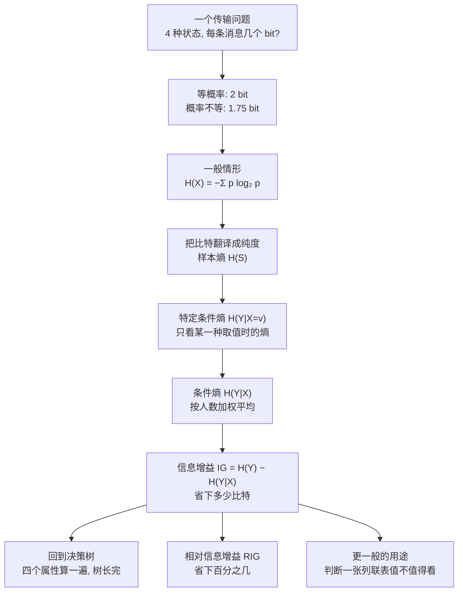
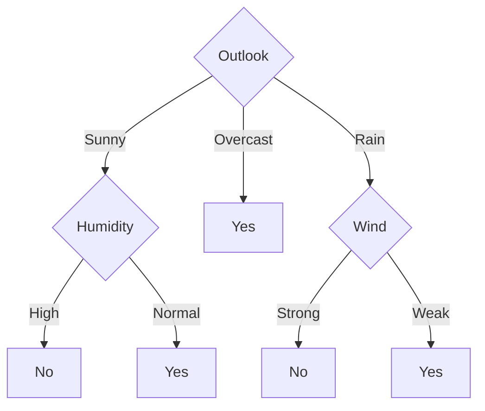

# C1.3 熵与信息增益

> [!abstract] 这一讲的任务
> 上一讲把决策树算法写完了，只留下一个空格：**"哪个属性最好"**。这一讲去填这个空格。但我们不从决策树讲起，而是从一个看起来毫不相干的问题讲起——**一串符号，平均要用几个比特才能传完**。它的答案恰好就是我们需要的那把尺子：一个在"全是一类"时为零、在"一半一半"时最大的量。这个量叫**熵 entropy**，用熵算出来的分数叫**信息增益 information gain**。讲完你应当能：给一张属性—标签表，独立算出 $H(Y)$、$H(Y|X)$、$IG(Y|X)$，并说清每个数在"省了多少比特"意义上的含义。

> [!info] 怎么读这份讲义
> 不带标记的是这门课正文给出的内容；带 **（拓展）** 的是按教材与通行讲法补的。
> 这一讲是全章唯一需要大量手算的地方，**每一处演算都要自己走一遍**，不要只看懂。
> 第 5 节是总演练：拿上一讲那份 14 行数据，把四个属性各算一遍，再把树长完。如果时间只够读一节，读那一节。

---

## 0. 开场：一台只会报四种状态的传感器

设想你在做一个机房温控项目。传感器装在天花板上，它每分钟上报一次状态，只有四种：

- `A` 一切正常
- `B` 温度偏高
- `C` 湿度偏高
- `D` 有人靠近（红外触发）

数据要走一条很窄的串行链路——**每个字节都很贵**。你现在的编码是这么定的：

| 状态 | 编码 |
|---|---|
| A | `00` |
| B | `01` |
| C | `10` |
| D | `11` |

每条消息 2 个 bit，一天 1440 条，`1440 × 2 = 2880` bit。听起来很省，但运行一个月后你发现：**`A` 占了九成**。

绝大多数时候传感器在说"一切正常"，而"正常"这个词花了你 2 个 bit。这显然浪费——一个问题随之而来：

> **有没有可能，用不到 2 个 bit 就把这条数据流传完？**

答案是**有**，而且不是靠"把 A 缩成一个特殊字符"这种小聪明。下面会让你亲眼看到它怎么做到，而这个做法背后那个"平均每个符号要几个 bit"的数，就是这一讲的全部内容。

---

## 1. 从编码长度逼出熵

### 1.1 先看最简单的情形：四种等概率

假设传感器四种状态**完全等概率**，各 $1/4$。你看到的序列长这样：

`BAACBADCDADDDA…`

二进制链路上，A、B、C、D 各用两个 bit，`A=00, B=01, C=10, D=11`，数据流变成：

`0100001001001110110011111100…`

**平均每符号 2 bit。** 这个数是怎么来的？因为 $2^2=4$，两个 bit 刚好能区分四种状态。一般地，$k$ 个等概率取值，需要 $\log_2 k$ 个 bit。

### 1.2 概率不等：2 bit 不是极限

现在有人告诉你真实情况并非等概率：

$$P(A)=\tfrac12,\quad P(B)=\tfrac14,\quad P(C)=\tfrac18,\quad P(D)=\tfrac18 .$$

（这组数在机房项目里很典型：一半时间正常，四分之一偏高，两种异常各占八分之一。）

**存在一种编码，平均只用 1.75 bit/符号。** 它长这样：

| 符号 | 概率 | 编码 | 码长 |
|---|---|---|---|
| A | 1/2 | `0` | 1 |
| B | 1/4 | `10` | 2 |
| C | 1/8 | `110` | 3 |
| D | 1/8 | `111` | 3 |

平均码长：

$$\bar{L}=\tfrac12(1)+\tfrac14(2)+\tfrac18(3)+\tfrac18(3)=0.5+0.5+0.375+0.375=\mathbf{1.75}.$$

比 2 少了 12.5%。一天省下 `1440 × 0.25 = 360` bit。

> [!important] 核心思想：常出现的给短码，罕见的给长码
> A 占了一半的出现次数，就让它只花 1 bit；C、D 很少来，让它们花 3 bit 也无所谓。
> **分布越不均匀，能压缩的空间就越大。** 这句话反过来就是熵的意义：熵是**这个分布理论上能压到的极限平均码长**。

> [!note] 这套码为什么不会译错（拓展）
> **【拓展】** 它是一个**前缀码 prefix code**：没有任何一个码字是另一个码字的前缀。所以接收端从左往右读，读到 `0` 立刻知道是 A，读到 `10` 立刻知道是 B，不需要分隔符，也不会有歧义。变长编码必须满足这个性质才可用；构造"最优前缀码"的算法叫**哈夫曼编码 Huffman coding**。

### 1.3 三种等概率：1.58496 bit，一个不是整数的答案

再换一个情形：三种等概率取值，各 $1/3$。

朴素编码 `A=00, B=01, C=10`，每条 2 bit。但**理论上可以做到 1.58496 bit/符号**。

$$\log_2 3 = 1.58496\ldots$$

这个数看着别扭：一个符号怎么可能只用 1.58 个 bit？bit 是整数单位啊。

答案是：**不要一个符号一个符号地编，要打包编。** 3 个符号一共 $3^3=27$ 种组合，而 $2^4=16<27\le2^5=32$——所以可以用 **5 bit 传 3 个符号**，即 $5/3\approx1.67$ bit/符号，已经优于 2。打包越长越接近 1.585：9 个符号 $3^9=19683$ 种，$2^{14}=16384<19683\le2^{15}$，$15/9\approx1.667$……（真正逼近需要更细致的编码，但趋势已经清楚）。

> [!note] 这个数在回答什么
> 它不是"某个具体码字的长度"，而是**平均码长的下界**——无论你怎么设计编码，都不可能低于它。熵就是这样一个**极限值**，允许是小数。

### 1.4 一般情形：定义

设 $X$ 有 $m$ 个取值 $V_1,\dots,V_m$，$P(X=V_j)=p_j$。

> [!important] 熵 Entropy
> $$H(X)=-\sum_{j=1}^{m}p_j\log_2 p_j$$
>
> $H(X)$ = 传输一个从 $X$ 的分布中随机抽取的符号，在**最有效编码**下平均所需的**比特数**。

同一个定义还有一种以 $n$ 为上限、按取值 $i$ 求和的写法：

$$H(X)=-\sum_{i=1}^{n}P(X=i)\log_2 P(X=i),$$

其中 $n$ 是 **$X$ 可能取值的个数**。两种写法是同一件事，只是变量名不同——手算时按"有几个取值"来定求和项。

> [!important] 为什么是这个式子：信息论的两句话
> 1. 最有效的编码，给消息 $X=i$ 分配 $-\log_2 P(X=i)$ 个比特（越罕见，码越长）；
> 2. 因此编码一个随机的 $X$，平均所需比特数是
> $$\sum_{i=1}^{n}P(X=i)\bigl(-\log_2 P(X=i)\bigr).$$
>
> 这正是 $H(X)$。**熵 = 码长的期望。** 负号只是为了把结果变成正数（因为 $\log_2 p\le0$）。

> [!example] 用 1.2 节的例子验一遍
> $$H=-\tfrac12\log_2\tfrac12-\tfrac14\log_2\tfrac14-\tfrac18\log_2\tfrac18-\tfrac18\log_2\tfrac18=\tfrac12(1)+\tfrac14(2)+\tfrac18(3)+\tfrac18(3)=1.75 .$$
> 和手写的那套编码**完全一致**——说明那套码已经是最优的。
> 注意 $-\log_2 p_j$ 恰好就是表里的码长：$-\log_2\frac12=1$、$-\log_2\frac14=2$、$-\log_2\frac18=3$。**这不是巧合**，第 1.4 节的第一句话就是它。

### 1.5 必须背下来的方向：高熵与低熵

> [!important] 两句话
> - **"高熵 High Entropy"** ⟺ $X$ 来自**均匀 uniform（无聊的）分布** ⟺ 直方图是**平的** ⟺ 采样值**到处都是、无法预测**。
> - **"低熵 Low Entropy"** ⟺ $X$ 来自**有峰有谷 varied 的分布** ⟺ 直方图**大量低值、一两个高峰** ⟺ 采样值**更可预测**。

> [!warning] 最容易记反的一点
> 直觉上"变化多端"听起来像高熵，但"varied（有峰有谷）"形容的是**直方图的形状起伏大**（有尖峰），不是"取值花样多"。
> **抓住唯一可靠的判据：均匀 = 高熵 = 难预测；集中 = 低熵 = 易预测。** 拿不准时先问"能不能猜准"，能猜准就是低熵。

有一个很好记的比喻：两张宝宝吃饭的照片。

| | 低熵 Low Entropy | 高熵 High Entropy |
|---|---|---|
| 画面 | 宝宝干干净净，汤都在碗里 | 汤糊了一脸、洒了一桌 |
| 解说 | 取值（汤的位置）**全都落在汤碗里** | 取值**不可预测**，几乎均匀地分布在整个餐厅 |
| 含义 | 你知道去哪儿找汤 → 易预测 | 汤哪儿都有 → 难预测 |

> [!note] 这个比喻和决策树的关系
> 我们做预测，就是希望"汤都在碗里"。所以决策树要找的，是**能把数据变成低熵状态的属性**——切完之后每个子集尽量纯。
> 上一讲那个"需要一个数"的空格，填的就是这个。

---

## 2. 把比特翻译成纯度：样本熵

上面的熵是"一个随机变量的分布有多难猜"。决策树面对的是一个具体的数据集 $S$，所以需要一个直接按样本数算的版本。

对**二分类**（正例 $\oplus$、负例 $\ominus$），样本熵就是：

> [!important] 样本熵 Sample Entropy
> - $S$ 是一批训练样本；
> - $p_\oplus$ 是 $S$ 中**正例的比例**，$p_\ominus$ 是**负例的比例**；
> - 熵度量 $S$ 的**不纯度 impurity**：
> $$H(S)\equiv-p_\oplus\log_2 p_\oplus-p_\ominus\log_2 p_\ominus .$$

它和上一节的 $H(X)$ 是同一个式子，只是把"取值"换成了"类别"。所以"比特"在这里读作**混的程度**：

- 全是正例：$p_\oplus=1$，$H=0$，一个 bit 都不用传（你早就知道答案）；
- 一半一半：$H=1$，最混，要满满 1 bit。

![[C1.3-样本熵曲线-图示.png]]

> [!note] 怎么读这张曲线
> - **横轴**是 $p_\oplus$（正例比例），**纵轴**是 $H(S)$。
> - **两端为 0**：$p_\oplus=0$ 或 $1$ 时全是一类，熵 0。
> - **中点最高，为 1**：$p_\oplus=0.5$ 时正负各半，最混乱。
> - 曲线**上凸**，而且在两端**下降极快**：从 0.5 降到 0.4，熵几乎没掉（0.971）；从 0.1 降到 0，才掉得猛。这解释了一个现象——**要靠一次划分把熵降下来，必须切得相当纯才有明显收益**。

> [!warning] 约定 $0\log_2 0=0$
> $p=0$ 时 $\log_2 0$ 无定义，按极限约定该项取 0。所以 $[4+,0-]$ 的熵是 $0$，不是"算不出来"。手算时遇到纯结点直接写 0。

> [!note] 二分类熵的常用值（背下来能省很多时间）
> | 分布 $[n_+,n_-]$ | 熵 |
> |---|---|
> | 纯（如 $[4+,0-]$） | 0 |
> | 1:5 | 0.650 |
> | 1:4 | 0.722 |
> | 1:3 | 0.811 |
> | 2:5 | 0.863 |
> | 1:2 | 0.918 |
> | 2:3 | 0.971 |
> | 3:4 | 0.985 |
> | 1:1 | 1.000 |
>
> 第 5 节演算里出现的 .811 / .918 / .971 / .985 / 1.00 全在这张表里。**算之前先查表，能避免一半的按键错误。**

---

## 3. 条件熵：知道了 $X$，还剩多少不确定

有了"熵"，下一个问题是：**如果我已经知道属性 $X$ 的取值，还剩多少不确定？**

这需要两步：先看"某一类人"的熵，再按人数加权。

### 3.1 特定条件熵 $H(Y\mid X=v)$

换一份小数据来讲这件事：**大学专业 vs. 是否喜欢电影《角斗士 Gladiator》**。

| X = College Major | Y = Likes "Gladiator" |
|---|---|
| Math | Yes |
| History | No |
| CS | Yes |
| Math | No |
| Math | No |
| CS | Yes |
| History | No |
| Math | Yes |

把这 8 条当真实分布，可以直接读出：

- $P(\text{LikeG}=\text{Yes})=0.5$
- $P(\text{Major}=\text{Math})=0.5$
- $P(\text{Major}=\text{Math}\wedge\text{LikeG}=\text{No})=0.25$
- $P(\text{LikeG}=\text{Yes}\mid\text{Major}=\text{History})=0$

并且 $H(X)=1.5$，$H(Y)=1$。

> [!note] 这两个数怎么来的
> $X$ 的分布是 Math $4/8$、History $2/8$、CS $2/8$，即 $(\frac12,\frac14,\frac14)$：
> $$H(X)=\tfrac12(1)+\tfrac14(2)+\tfrac14(2)=1.5 .$$
> $Y$ 的分布是 Yes $4/8$、No $4/8$：$H(Y)=1$。

> [!important] 定义：特定条件熵 specific conditional entropy
> $H(Y\mid X=v)$ = **只在 $X$ 取值为 $v$ 的那些记录中**，$Y$ 的熵。

逐个取值算：

| $v$ | 该子集里的 $Y$ | $H(Y\mid X=v)$ |
|---|---|---|
| Math | Yes, No, No, Yes → 2 正 2 负 | **1** |
| History | No, No → 全负 | **0** |
| CS | Yes, Yes → 全正 | **0** |

> [!note] 这三个数在说什么
> "你告诉我他是历史系的，我就**确定**他不喜欢这部电影"——熵 0，一个 bit 都不用再传。CS 系同理。
> "你告诉我他是数学系的，我还是**完全猜不出**"——熵 1，和没告诉一样。
> 所以"专业"这个属性的价值是**不均匀**的：对某些取值极有用，对另一些毫无用处。下一步就是把这些价值按人数**加权平均**。

### 3.2 条件熵 $H(Y\mid X)$

> [!important] 定义：条件熵 conditional entropy
> $H(Y\mid X)$ = $Y$ 的**平均特定条件熵**
> = 随机抽一条记录，以它的 $X$ 值为条件时 $Y$ 的不确定性的期望
> = **在收发双方都已知 $X$ 的前提下，传输 $Y$ 平均还需要多少比特**
>
> $$H(Y\mid X)=\sum_{v}P(X=v)\,H(Y\mid X=v).$$

代入上例：

| $v_j$ | $P(X=v_j)$ | $H(Y\mid X=v_j)$ |
|---|---|---|
| Math | 0.5 | 1 |
| History | 0.25 | 0 |
| CS | 0.25 | 0 |

$$H(Y\mid X)=0.5\times1+0.25\times0+0.25\times0=\mathbf{0.5}.$$

> [!warning] 权重是 $P(X=v_j)$，不是 $1/(\text{取值个数})$
> 三个取值不是各占 $1/3$——Math 占了一半。**按样本数加权**是手算最容易漏的一步。
> 在决策树里，这个权重写成 $\frac{|S_v|}{|S|}$，是同一件事。

一般形式：

$$H(X\mid Y=v)=-\sum_{i=1}^{n}P(X=i\mid Y=v)\log_2 P(X=i\mid Y=v),$$
$$H(X\mid Y)=\sum_{v\in values(Y)}P(Y=v)\,H(X\mid Y=v).$$

> [!warning] 条件熵不会变大
> 恒有 $H(Y\mid X)\le H(Y)$：**多知道一个变量，不可能让不确定性增加**。最好的情况是 $X$ 完全决定 $Y$（$H(Y\mid X)=0$），最差的情况是 $X$ 与 $Y$ 独立（$H(Y\mid X)=H(Y)$）。
> 所以下面的信息增益**永远非负**。手算算出负值，一定是算错了。

---

## 4. 信息增益：省下了多少比特

到这里，两件事都准备好了：原始的不确定性 $H(Y)$，和"知道 $X$ 之后剩下的"不确定性 $H(Y\mid X)$。两者之差，就是 $X$ 帮我们省下的东西。

> [!important] 定义：信息增益 information gain
> $IG(Y\mid X)$ = 我必须传输 $Y$。如果链路两端都已经知道 $X$，**平均能替我省下多少比特**？
>
> $$IG(Y\mid X)=H(Y)-H(Y\mid X).$$

上例：$H(Y)=1$，$H(Y\mid X)=0.5$，故

$$IG(Y\mid X)=1-0.5=\mathbf{0.5}.$$

意思是：如果接收方事先知道对方的专业，那么传"他喜不喜欢这部电影"这件事，平均能省一半的比特。

> [!important] 三个名字，一个东西
> **信息增益 Information Gain = 互信息 Mutual Information = 熵的期望下降量**
> $$I(X,Y)=H(X)-H(X\mid Y)=H(Y)-H(Y\mid X).$$
> 注意这个式子**对称**：$X$ 告诉你关于 $Y$ 的信息量，等于 $Y$ 告诉你关于 $X$ 的信息量。这一点在决策树里很自然——"专业"和"是否喜欢"之间的关联，从哪边看都是同一份关联。

> [!note] 为什么叫"增益"
> 名字来自"预算"的隐喻：你要传的东西有一个**价码**（$H(Y)$ 比特），知道了 $X$ 之后价码降了（$H(Y\mid X)$ 比特），降下来的部分就是**增益**。
> "互信息"是同一个量的另一个名字，来自"两个变量共享多少信息"的视角。**同一件事，一个从成本看，一个从关联看。**

在决策树的语境里（上一讲那个空格的填法）：

> [!important] 决策树里的信息增益
> 信息增益是输入属性 $A$ 与目标变量 $Y$ 之间的互信息；
> 它是"按属性 $A$ 对样本 $S$ 做分拣"所带来的**目标变量 $Y$ 的期望熵下降**：
> $$Gain(S,A)=I_S(A,Y)=H_S(Y)-H_S(Y\mid A).$$

于是上一讲那个空格的答案是：**选让我省下最多比特的那个属性。**

---

## 5. 总演练：把 14 天算一遍

现在回到上一讲那份表（14 条，$[9+,5-]$）。这一节是整章的手算核心，每一步都写全。

### 5.1 根结点：$H(S)$

$$H(S)=-\tfrac{9}{14}\log_2\tfrac{9}{14}-\tfrac{5}{14}\log_2\tfrac{5}{14}.$$

查表（9:5 不在小表里，直接算）：

$$\log_2\tfrac{9}{14}=-0.6375,\qquad \log_2\tfrac{5}{14}=-1.4854,$$
$$H(S)=\tfrac{9}{14}(0.6375)+\tfrac{5}{14}(1.4854)=0.4098+0.5305=\mathbf{0.940}.$$

### 5.2 两个属性的完整演算

**Humidity（湿度）**：切 High / Normal 两枝。

| 取值 | 样本 | 分布 | 熵 |
|---|---|---|---|
| High | D1, D2, D3, D4, D8, D12, D14 | $[3+,4-]$ | 0.985 |
| Normal | D5, D6, D7, D9, D10, D11, D13 | $[6+,1-]$ | 0.592 |

$$Gain(S,\text{Humidity})=.940-\tfrac{7}{14}(.985)-\tfrac{7}{14}(.592)=.940-.4925-.2960=\mathbf{.152}.$$

（按精确值算是 .1518；若先把 .940 / .985 / .592 取三位再算，得 .151。**两种写法都会出现，只要方法对，差 0.001 不算错。**）

**Wind（风）**：切 Weak / Strong 两枝。

| 取值 | 样本 | 分布 | 熵 |
|---|---|---|---|
| Weak | D1, D3, D4, D5, D8, D9, D10, D13 | $[6+,2-]$ | 0.811 |
| Strong | D2, D6, D7, D11, D12, D14 | $[3+,3-]$ | 1.000 |

$$Gain(S,\text{Wind})=.940-\tfrac{8}{14}(.811)-\tfrac{6}{14}(1.0)=.940-.4634-.4286=\mathbf{.048}.$$

### 5.3 另外两个属性（补全演算）

**Outlook（天气）**：三枝。

| 取值 | 样本 | 分布 | 熵 |
|---|---|---|---|
| Sunny | D1, D2, D8, D9, D11 | $[2+,3-]$ | 0.971 |
| Overcast | D3, D7, D12, D13 | $[4+,0-]$ | **0** |
| Rain | D4, D5, D6, D10, D14 | $[3+,2-]$ | 0.971 |

$$Gain(S,\text{Outlook})=.940-\tfrac{5}{14}(.971)-\tfrac{4}{14}(0)-\tfrac{5}{14}(.971)=.940-.6936=\mathbf{.247}.$$

**Temperature（气温）**：三枝。

| 取值 | 样本 | 分布 | 熵 |
|---|---|---|---|
| Hot | D1, D2, D3, D13 | $[2+,2-]$ | 1.000 |
| Mild | D4, D8, D10, D11, D12, D14 | $[4+,2-]$ | 0.918 |
| Cool | D5, D6, D7, D9 | $[3+,1-]$ | 0.811 |

$$Gain(S,\text{Temperature})=.940-\tfrac{4}{14}(1)-\tfrac{6}{14}(.918)-\tfrac{4}{14}(.811)=.940-.9111=\mathbf{.029}.$$

### 5.4 比一比，选出根

| 属性 | $Gain$ |
|---|---|
| **Outlook** | **.247** ← 最大 |
| Humidity | .152 |
| Wind | .048 |
| Temperature | .029 |

**根结点选 Outlook。**

> [!note] 为什么 Overcast 帮了 Outlook 大忙
> Overcast 那一枝是 $[4+,0-]$，熵为 **0**——四天全打球，一个反例都没有。加权求和时它贡献的是 $\frac{4}{14}\times0=0$，把总的条件熵往下拉了一截。
> **一个属性只要能"切出一块完全纯的子集"，它的信息增益就很可观。**
> 反过来看 Temperature：它切出的三块分别是 1.0、0.918、0.811，**没有一块是纯的**，所以加权后的条件熵 .9111 几乎没比原来的 .940 低多少。

### 5.5 第二层：Sunny 与 Rain 各自怎么办

根选 Outlook 之后，长出三枝：

- **Overcast**：$[4+,0-]$，纯了，**停**，叶子 = Yes。
- **Sunny**：$\{D1,D2,D8,D9,D11\}$，$[2+,3-]$，还要继续。
- **Rain**：$\{D4,D5,D6,D10,D14\}$，$[3+,2-]$，还要继续。

**Sunny 分枝**（$H=.971$）——注意现在是**在 5 条样本上**重新算，不能沿用根上的排名：

| 属性 | 划分 | 条件熵 | $Gain$ |
|---|---|---|---|
| Humidity | High $[0+,3-]$ / Normal $[2+,0-]$ | $\frac35(0)+\frac25(0)=0$ | **.971** |
| Temperature | Hot $[0+,2-]$ / Mild $[1+,1-]$ / Cool $[1+,0-]$ | $\frac25(0)+\frac25(1)+\frac15(0)=.400$ | .571 |
| Wind | Weak $[1+,2-]$ / Strong $[1+,1-]$ | $\frac35(.918)+\frac25(1)=.951$ | .020 |

**选 Humidity**——增益 .971 **等于该子集的全部熵**，说明它一刀切干净：Sunny 且 High 的三天（D1, D2, D8）全不打，Sunny 且 Normal 的两天（D9, D11）全打。两根枝都变成叶子。

**Rain 分枝**（$H=.971$）：

| 属性 | 划分 | 条件熵 | $Gain$ |
|---|---|---|---|
| Wind | Weak $[3+,0-]$ / Strong $[0+,2-]$ | $0+0=0$ | **.971** |
| Humidity | High $[1+,2-]$ / Normal $[2+,0-]$ | $\frac35(.918)+\frac25(0)=.551$ | .420 |
| Temperature | Cool $[2+,1-]$ / Mild $[1+,1-]$ | $\frac35(.918)+\frac25(1)=.951$ | .020 |

**选 Wind**，同样一刀切干净：下雨且风小照打（D4, D5, D10），下雨且风大打不了（D6, D14）。

> [!warning] 手算题最容易错的地方：**属性排名是局部的**
> 在全集上 Humidity（.152）排第二，Temperature（.029）垫底；但在 Sunny 子集上，Humidity 是压倒性的第一（.971），而 Temperature 的 .571 也不算低。
> **每到一个新结点，都要用它自己那份子数据重新算一遍。** 把父结点的排名抄下来，是这类题最常见的失分点。

### 5.6 树长完了，还有一件事值得看

所有叶子都纯了，算法停止。**14 条数据、4 个属性，最终只用了 3 个属性、3 个内部结点、5 个叶子。**

注意**气温一次都没被用上**。这不是因为它"没用"——它在 Sunny 子集上的增益 .571 排第二——而是因为它**从来没有排过第一**。信息增益是个"选美"式准则：只要有一个更好的，其他的就一律不选，哪怕它也不错。

> [!note] 这棵树有什么好
> 它是一组人能念出来的规则："阴天就打；晴天看湿度；下雨看风。" 8 个结点，四句话说完。
> 对比一个 4 维线性打分函数：它也能把这 14 条分对，但你没法把系数念给教练听。

> [!warning] 它同时埋着一个问题
> 如果继续往下切，只要允许，总能把训练集切到 100% 正确——**那是不是就更好？** 答案是"不"。这棵树有 5 个叶子对应 14 条样本，再深一点就会开始"为每一条样本单独造一个叶子"，那就是背答案。
> 这个问题在 [[C1.4 过拟合与剪枝]] 正式处理。

---

## 6. 相对信息增益：省下了百分之几

$Gain$ 是一个"绝对"的数，单位是比特。它在**同一个数据集内部**比较属性时很好用，但跨数据集比较时会有问题：如果 $H(Y)$ 本来就很小（比如 0.1），那么 $Gain=0.05$ 已经砍掉了一半的不确定性；而在 $H(Y)=1$ 的问题里，0.05 微不足道。

于是有了相对版本：

> [!important] 定义：相对信息增益 relative information gain
> $RIG(Y\mid X)$ = 如果两端都知道 $X$，能替我省下**百分之几**的比特？
> $$RIG(Y\mid X)=\frac{H(Y)-H(Y\mid X)}{H(Y)}.$$
> 代入上例：$H(Y)=1$、$H(Y\mid X)=0.5$，故 $RIG=(1-0.5)/1=0.5$（省下一半）。

> [!warning] 一处印刷错误
> 原式印作 `RIG(Y|X) = H(Y) - H(Y | X) / H(Y)`，**漏了分子的括号**。按运算优先级读会变成 $H(Y)-\frac{H(Y\mid X)}{H(Y)}$，与它自己给的算例 $(1-0.5)/1$ 不符。**以带括号的写法为准。**

> [!note] 什么时候该用相对量（拓展）
> **【拓展】** 绝对增益受 $H(Y)$ 的量级影响，相对增益把它归一化了。所以**跨数据集、跨任务比较"这个属性有多少信息"时**，相对量才公平。
> 不过在决策树里，同一个结点上所有候选属性面对的是同一个 $H(Y)$，分母相同，所以**选哪个属性时用绝对值和用相对值结果完全一样**。这不是巧合——这也说明"决策树为什么用绝对增益"并不需要额外理由。

---

## 7. 信息增益还能干什么

熵这套工具不只服务决策树。它更一般的用途是回答一个问题：**一张二维列联表（2-d contingency table，就是按两个属性交叉计数排出来的表）到底值不值得看？**

### 7.1 四个属性，一张表（p.20）

假设你要预测一个人**能否活过 80 岁**。从历史数据里算出各属性的信息增益：

| 属性 | $IG(\text{LongLife}\mid\cdot)$ |
|---|---|
| Gender 性别 | **0.25** |
| Smoker 是否吸烟 | 0.2 |
| HairColor 发色 | 0.01 |
| LastDigitOfSSN 社保号末位 | 0.00001 |

> [!important] 这张表真正的信息在最后一行
> - **Gender 0.25**：女性平均寿命更长，是真实且强的关联 → 第一刀就该切它。
> - **Smoker 0.2**：吸烟显著影响寿命 → 第二刀。
> - **HairColor 0.01**：几乎没关系。
> - **社保号末位 0.00001**：**本来就应该是 0**。它是随机编号，与寿命毫无关联；算出来的 0.00001 完全是有限样本的噪声。
>
> 最后一行给了你一个**基准**：一个和目标毫无关系的属性，$IG$ 会趋近于 0。
> 反过来说，**$IG$ 明显大于 0，就意味着这个属性和目标之间存在统计关联**——不管这关联你能不能解释。

> [!note] 所以它可以当自动特征筛选
> 手上有 500 个候选特征，不可能一个个人工判断哪个有用。把 $IG$ 全算一遍，排个序，前 30 个拿去建模——这就是**特征筛选 feature selection** 最朴素的做法。
> 这个思路在后面还会以别的形式出现：第 10 章 SVM 的核选择、第 13 章神经网络的输入设计，本质都是"先判断哪个输入带信息"。

> [!warning] 相关不等于因果
> $IG$ 高只说明**统计上相关**。"发色"如果在某个数据集里 $IG$ 很高，也可能只是因为它与"年龄""地域"耦合。决策树会照用不误，但你解释结论时要当心。

### 7.2 两个真实数据上的算例

**例 1：性别对财富的信息增益（p.17）**

![[C1.3-信息增益例-性别与财富.png]]

| gender | poor | rich | $H(\text{wealth}\mid\text{gender}=\cdot)$ |
|---|---|---|---|
| Female | 14423 | 1769 | 0.497654 |
| Male | 22732 | 9918 | 0.885847 |

$$H(\text{wealth})=0.793844,\qquad H(\text{wealth}\mid\text{gender})=0.757154,$$
$$IG(\text{wealth}\mid\text{gender})=0.793844-0.757154=\mathbf{0.0366896}.$$

> [!note] 复核条件熵的加权
> Female 共 $14423+1769=16192$ 人，Male 共 $22732+9918=32650$ 人，合计 $48842$。
> $$H(\text{wealth}\mid\text{gender})=\frac{16192}{48842}(0.497654)+\frac{32650}{48842}(0.885847)\approx0.7572 .$$
> 图中蓝条 = poor、红条 = rich，**条形的红蓝比例就是该组的分布**：女性组红色很短（更纯）所以熵低 0.498，男性组红蓝更接近（更混）所以熵高 0.886。

**例 2：年龄段对财富的信息增益（p.18）**

![[C1.3-信息增益例-年龄段与财富.png]]

| agegroup | poor | rich | $H(\text{wealth}\mid\text{agegroup}=\cdot)$ |
|---|---|---|---|
| 10s | 2507 | 3 | 0.0133271 |
| 20s | 11262 | 743 | 0.334906 |
| 30s | 9468 | 3461 | 0.838134 |
| 40s | 6738 | 3986 | 0.951961 |
| 50s | 4110 | 2509 | 0.957376 |
| 60s | 2245 | 809 | 0.834049 |
| 70s | 668 | 147 | 0.680882 |
| 80s | 115 | 16 | 0.535474 |
| 90s | 42 | 13 | 0.788941 |

$$H(\text{wealth})=0.793844,\qquad H(\text{wealth}\mid\text{agegroup})=0.709463,$$
$$IG(\text{wealth}\mid\text{agegroup})=\mathbf{0.0843813}.$$

> [!important] 结论：只在这两个属性里选，选 agegroup
> $0.0844>0.0367$，年龄段带来的熵下降是性别的两倍多。

> [!note] 从表里读出的规律
> 10s 那组 $2507:3$，几乎全是 poor，熵只有 0.013——**十几岁的人几乎不可能富有**，这一条几乎是确定的。40s、50s 的熵接近 1（0.95 左右），说明中年人贫富最难预测。
> 年龄段的价值，主要来自两端那些**极纯**的组。这和 5.4 节 Outlook 靠 Overcast 那一枝赢下来，是同一个机制。

> [!warning] 一个陷阱：取值多的属性天然占便宜
> agegroup 有 **9 个取值**，gender 只有 **2 个**。
> 极端情况下，拿"身份证号"当属性：每个取值只有一条记录，条件熵为 0，信息增益达到最大值 $H(Y)$——但这棵树毫无用处，它只是把每条样本单独装进一个盒子。
> **增益会奖励"切得碎"，而切得碎本身不是优点。** 修正办法是 **GainRatio（增益率）**，见 [[C1.5 学习理论视角与决策树扩展]]。

---

## 8. 手算流程与检查清单

> [!important] 给一张表，三步走
> 1. **算 $H(Y)$**：数总的正负例，$H=-p_\oplus\log_2p_\oplus-p_\ominus\log_2p_\ominus$。
> 2. **算 $H(Y\mid A)$**：按属性 $A$ 的每个取值分组 → 每组数正负例、算熵 → **按 $\frac{|S_v|}{|S|}$ 加权求和**。
> 3. **相减**：$Gain(S,A)=H(Y)-H(Y\mid A)$。对每个候选属性重复，取最大者。

> [!warning] 检查清单
> - [ ] 权重用的是**样本比例**，不是取值个数的倒数
> - [ ] 纯结点（$[n+,0-]$）的熵直接写 **0**，别去算 $\log 0$
> - [ ] $\log$ 的底是 **2**（计算器上用 $\log_2x=\ln x/\ln2$）
> - [ ] 结果必须 **≥ 0**，出现负数一定错了
> - [ ] 进入子结点后**重新数一遍正负例**，父结点的排名不能沿用
> - [ ] 保留三位小数即可，与 .940 / .985 / .592 / .152 / .048 这类值对齐

---

## 这一讲的三句话

1. **熵就是"平均要几个比特"**：$H(X)=-\sum p\log_2p$。均匀分布最贵（难猜），集中分布最便宜（好猜）。在决策树里它换个读法叫**不纯度**。
2. **条件熵按人数加权，信息增益是两者之差**：$IG=H(Y)-H(Y\mid A)$，含义是"知道 $A$ 能省多少比特"。它永远非负。
3. **选属性 = 选增益最大的那个**，但每到一个新结点都要重新算（在 Sunny 子集上，湿度从第二名变成第一名）。而且增益偏爱取值多的属性，这个缺陷要用增益率修。

## 速查表

| 量 | 公式 | 读法 |
|---|---|---|
| 熵 | $H(X)=-\sum_j p_j\log_2p_j$ | 平均几个比特 / 有多不纯 |
| 样本熵 | $H(S)=-p_\oplus\log_2p_\oplus-p_\ominus\log_2p_\ominus$ | 二分类的不纯度 |
| 特定条件熵 | $H(Y\mid X=v)$ | 只看 $X=v$ 那批人的熵 |
| 条件熵 | $H(Y\mid X)=\sum_v P(X=v)H(Y\mid X=v)$ | 按人数加权的平均 |
| 信息增益 | $IG=H(Y)-H(Y\mid X)$ | 省下多少比特 |
| 相对增益 | $RIG=\dfrac{H(Y)-H(Y\mid X)}{H(Y)}$ | 省下百分之几 |
| 互信息 | $I(X,Y)=H(Y)-H(Y\mid X)$ | 与 $IG$ 同一个量，对称 |

## 下一讲预告

现在树能长了，也能算"哪个属性最好"了。但第 5.6 节留了一个不安的尾巴：**继续切，训练集总能切到 100% 正确——那是不是更好？**

下一讲要处理这个问题。它会先给一个漂亮的原则（奥卡姆剃刀：简单的解释更可能是对的），再给一条把训练集切到完美的曲线（训练精度 100%，测试精度掉下去），最后给两种"把树剪小"的做法。

那一讲的名字叫**过拟合与剪枝**。

---

上一节：[[C1.2 决策树的表示与自顶向下归纳]] · 下一节：[[C1.4 过拟合与剪枝]]
索引：[[机器学习课程 MOC]]
