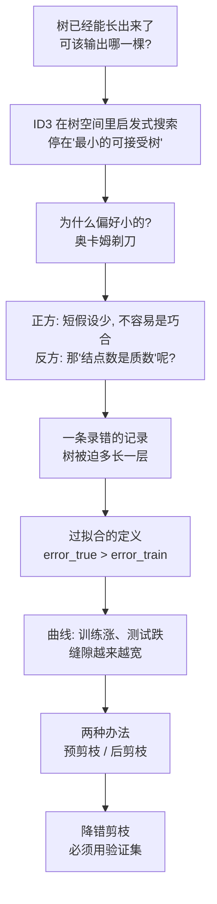
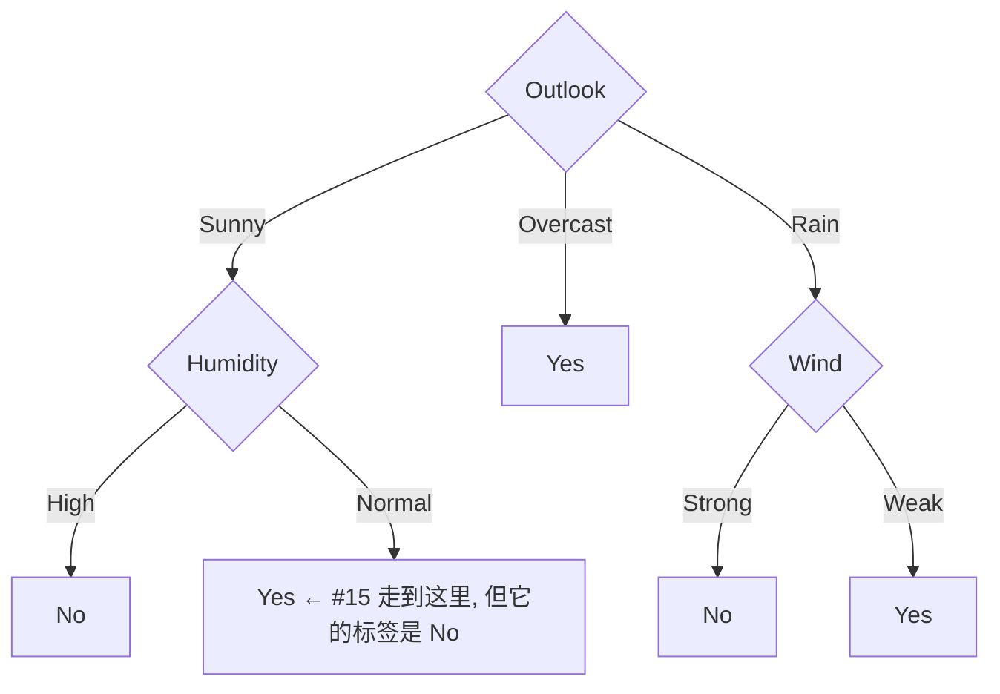

# C1.4 过拟合与剪枝

> [!abstract] 这一讲的任务
> 上一讲把树长完了：五步循环，到"训练样本被完美分类"就停。这一讲要处理那个停止条件埋下的雷——**如果继续切，训练集总能切到 100% 正确，那是不是更好？** 答案是不好，而且不好得很具体：一条录错的记录就能让树长出一层只服务于它的枝。这一讲给三样东西：**过拟合的形式定义**（一个不等式）、**一条必须会读的曲线**（训练精度涨、测试精度跌）、**两种把树剪小的做法**（预剪枝与后剪枝）。最后你会看到，"简单即好"这条偏好其实不是逻辑必然，而是一个必须主动押下的赌注。

> [!info] 怎么读这份讲义
> 不带标记的是这门课正文给出的内容；带 **（拓展）** 的是按教材与通行讲法补的。
> 第 5 节那条曲线是这一讲的中心，值得反复看几遍，把四个关键位置（起点、峰值、拐点、平台）记牢。
> 第 7 节的"为什么必须用验证集"是理解后面所有模型选择内容的钥匙。

---

## 0. 开场：贴在器材室门口的那张图

上一讲那棵树，你画出来了。三个判断、五个结局，社团干事把它打印出来贴在器材室门口，谁值班谁照着它定场地。

头三周很顺。第四周出了一次事：那天是**晴天、气温很热、湿度正常、风很大**。按图走，晴天 → 湿度正常 → **打**。值班的人照做了，结果来了六个人，场地被另一队占着，白跑一趟。

你去查记录，发现原因很蠢：**记分员把那天记错了。** 他们本来没订场地，但记录表上写的是"打了"（其实是隔壁羽毛球队的活动被误记进来了）。于是表格里多了一行：

$$\langle \text{Sunny},\ \text{Hot},\ \text{Normal},\ \text{Strong}\rangle,\quad \text{PlayTennis}=\textbf{No}$$

矛盾随之出现：原来"晴天且湿度正常 → Yes"这个叶子里已经有两个正例（D9、D11），现在又来了一个反例。**这个叶子不纯了。**

而上一讲那个算法的停止条件是"训练样本被完美分类"。它不会接受"这个叶子有 1/3 是反例"这件事，它会**在这个叶子下面再加一层判断**，专门把这一个反例切出去。比如再测一下气温：Hot 的走左边得 No，Mild/Cool 的走右边得 Yes。

加完之后，训练集 15 条**全对**。准确率从 14/15 变成 15/15。

而这张新图在真实世界里的表现呢？**变差了。** 因为"晴天、湿度正常"本来就是适合打球的日子，现在你多了一条"如果气温恰好很热，就不打"的规则——它唯一的依据，是记分员的一次笔误。

这就是这一讲要讲的事。它的名字叫**过拟合 overfitting**。

---

## 1. 该输出哪一棵树

先把镜头拉远一点，看清"长树"这个动作在整个搜索里长什么样（p.1）。

![[C1.4-ID3假设空间搜索-图示.png]]

> [!important] 两句话（p.1）
> - **ID3 在决策树空间里做启发式搜索 heuristic search。**
> - **它停在"最小的可接受的树 smallest acceptable tree"。为什么？**
>
> > **奥卡姆剃刀 Occam's razor：在能拟合数据的假设中，优先选最简单的那个。**
> > *prefer the simplest hypothesis that fits the data*

> [!note] 这张图在画什么
> 图里每个小图标都是**一棵候选决策树**，箭头表示"在某个叶子上再展开一个属性"。
> - 最上面是只有一层的树；往下每层是在上一层某个叶子上再切一刀（A1、A2、A3、A4……）。
> - 分叉出来的多条箭头表示"这一步有多个属性可选"，**粗箭头是 ID3 实际走的那条路**——每一步靠信息增益选一个，选了不回头。
> - 省略号表示这个空间极其巨大，ID3 只沿着一条细线往下走。
>
> 所以"学习"在这里被具体化成 [[C1.1 机器学习概述与课程导航]] 那句话：**在假设空间 $H$ 里搜索**。$H$ = 所有决策树；搜索策略 = 贪心地按信息增益往下长。

### 1.1 "最小的可接受"这个说法值得琢磨

注意它说的不是"最小的树"，而是"**最小的可接受**的树"。

"可接受"的意思是：**它能把训练数据分对。** 于是整句话变成：

> 沿着一条贪心路径往下长，长到**第一次**能把训练数据全分对的那一层，就停。

这个停止规则本身就已经是一次偏好了——它没有继续长，而是选了**在那条路径上最早合理解释数据的那棵树**。换句话说，**ID3 已经内置了一份"偏好小树"的倾向**，只是它把这份偏好藏在了停止条件里，而没有写成一条显式的准则。

那为什么要有这份偏好？下一节给出正反两方的说法。

---

## 2. 为什么偏好短的假设：奥卡姆剃刀

### 2.1 名字本身要先拆开

> [!important] 奥卡姆剃刀 Occam's razor 是什么
> 一句话：**在都能解释同一批现象的假设里，砍掉多余的那些，留下最简单的。**
>
> 名字拆开：**奥卡姆**是 14 世纪英国逻辑学家奥卡姆的威廉（William of Ockham），他提出"如无必要，勿增实体"（不要把没必要的假设加进解释里）；**剃刀**是比喻——像剃刀一样，把多余的假设**剃掉**。它是一把用来**削**的工具，不是一条定律。

这个"剃"的动作，恰好就是这一讲后半部分要讲的技术动作：**剪枝 prune**——树本来就叫树，把它多余的枝剪掉，比喻直接对上了。

### 2.2 正方：短假设少，不容易碰巧

论证可以压缩成两行（p.2）：

> [!important] 支持的理由 argument in favor
> - **短的假设比长的假设少**；
> - ⟹ 一个短假设居然能把数据拟合住，**不太可能只是统计上的巧合**。

第二句是全部关键。它用的是"反证式"的直觉：如果一个东西本来就是稀有事件，那么它发生了，你就有理由怀疑它不是偶然。

举个不严谨但好懂的例子：有人告诉你"我昨天梦见了明天彩票的号码，而且中了"。你会觉得是巧合吗？不会——因为"梦见准确号码"这件事的先验概率极低。但如果他告诉你"我昨天梦见了一个数字，今天路上看见了这个数字"，你只会耸耸肩——这种事天天发生。

**短假设就是那个"梦见准确号码"。** 它稀有，所以它成立时更值得相信。

### 2.3 反方：那"结点数是质数"呢？

紧接着，反方也被摆了出来——这一刀很锋利（p.2）：

> [!warning] 反对的理由 argument opposed
> - "**结点数是质数**、且**属性名以字母 Z 开头**"的假设，同样也很少；
> - 那么，"短"到底凭什么比"结点数是质数且以 Z 开头"更特殊？

这个反驳击中的是**论证形式**，不是结论。

"备选少 ⟹ 不容易是巧合"这个推理，对**任何一个人为定义的稀有集合**都成立。你可以定义"只用英文名里带字母 k 的属性构成的树"，这个集合也很小，按同样的逻辑它也应该被偏好——但这显然荒谬。

所以"偏好简单"**不是一条能从逻辑上推出来的真理**。它是一条我们**主动注入的偏好**。这件事有个正式的名字：

> [!important] 归纳偏置 inductive bias
> 学习算法为了在**没见过的输入**上做出判断，必须自带一些"数据里没有明说"的偏好。这些偏好就是归纳偏置。
> **去掉它，学习就不可能发生**——因为对训练集拟合得同样好的假设有无数个，不对它们做任何区分，算法就无从选择。

这一点在 [[C1.5 学习理论视角与决策树扩展]] 会被讲得更彻底：**没有任何归纳偏置的归纳学习是徒劳的（futile）**。

> [!note] 那为什么还是选"简单"（拓展）
> **【拓展】** 因为"简单"至少有两条别的支撑，而"结点数是质数"一条也没有：
> 1. **计算上的**：简单假设更容易搜到、更容易存、预测更快；
> 2. **统计上的**：假设空间越小，PAC 界要求的数据量越少（回忆 $m\ge\frac{1}{\epsilon}(\ln|H|+\ln\frac1\delta)$）——**限制假设空间的规模，本质上是在为泛化买单**。
>
> 所以"偏好简单"不是因为它逻辑上更正确，而是因为它**恰好和一个可证明的泛化保证方向一致**。这是一条经验法则被理论追认的典型例子。

### 2.4 从工程角度看

假设有两棵树都能把训练数据完全拟合：一棵先切天气、湿度、风；另一棵结构啰嗦、分枝更多、还绕了几个弯。选哪棵？

- **解释性**：分枝少的那棵，人能念出来。
- **速度**：结点少，预测时问的问题少。
- **准确率**：这一点不显然，但下一节会看到——在新数据上，它通常错得更少。

三条都指向同一侧。这就是为什么"简单即好"能成为这个领域的默认偏好，而不是一条需要每次重新论证的主张。

---

## 3. 一条录错的记录，如何把树带偏

现在回到开场那个故事，把机制看清楚（p.3）。

原来是这棵树：

> [!important] 冲突是这样产生的
> 把 #15 顺着树走：Outlook = Sunny → 到 Humidity 结点；Humidity = Normal → 叶结点预测 **Yes**。
> 但 #15 的真实标签是 **No**。这个叶子原本是纯的（D9、D11 都是 Yes），现在变成 $[2+,1-]$，**不纯了**。

关键在于下一步会发生什么。ID3 的停止条件是"训练样本被完美分类"，所以它**不会就此罢手**——它会在那个叶子下面**再加一层划分**（比如测 Wind，或者测 Temperature），把 #15 单独切出去。切完之后，15 条样本全部正确。

> [!warning] 注意这一层"存在的理由"
> 新长出来的那一层，**唯一的作用就是伺候这一条录错的样本**。
> 它在训练集上把准确率从 14/15 提到了 15/15，但它编码的不是真实规律——真实世界里"晴天、湿度正常"就是适合打球。**未来再遇到同类的天气，这一层只会让你预测错。**
> 准确率数字变好了，模型变差了。这就是过拟合最朴素的样子。

### 3.1 过拟合的两个来源

> [!note] 为什么会出现这种事
> **1. 数据有噪声。** 标注错误、录入错误、测量误差、极端个例。上面这一条就属于录入错误。
> **2. 模型太复杂。** 特征太多、树太深，模型"有余力"去记住每一条训练样本，而不是提炼规律。
>
> 两者缺一不可。只有噪声、模型很简单，它记不住那些噪声；只有复杂模型、数据干净，它也没必要去记。
> **过拟合 = 模型的容量 × 数据的噪声**，两个乘数同时不为零时它才发生。

### 3.2 一个具体的问题：那这条错数据怎么办

你现在有三个选择，每一个都有代价：

1. **把那条记录删掉**。最直接，但你得先知道它错了——而机器不知道。
2. **让树别长那么深**。它就不会去伺候这一条了，但也可能错过真正的细节。
3. **长完之后把那一层剪掉**。先让树把所有细节（包括噪声）都学到，再回头砍。

第 3 种就是这一讲后面要讲的后剪枝。第 2 种是预剪枝。但在这之前，得先能**说清"变差了"到底是什么意思**——否则你连"该不该剪"都判断不了。

---

## 4. 过拟合的形式定义

上面一直是"感觉变差了"。要给一个能算、能比较的定义（p.4）。

> [!important] 过拟合 Overfitting
> 考虑一个假设 $h$ 及其
> - 在**训练数据**上的错误率：$error_{train}(h)$
> - 在**全体数据**上的真实错误率：$error_{true}(h)$
>
> 若
> $$error_{true}(h)>error_{train}(h)$$
> 则称 $h$ **过拟合**了训练数据。
>
> **过拟合的量 amount of overfitting** $=error_{true}(h)-error_{train}(h)$。

这个定义很短，但三个地方值得停下来。

### 4.1 它说的不是"错得多"，而是"有落差"

注意它比较的是**两个错误率**，不是"错误率大不大"。

所以：
- 一个真实误差 0.3、训练误差 0.3 的模型，**不算过拟合**——它只是笨，两边一致地笨。
- 一个真实误差 0.05、训练误差 0.02 的模型，**也不算严重过拟合**——差距只有 0.03。
- 一个真实误差 0.30、训练误差 **0.00** 的模型，**是严重过拟合**——它把训练集背得滚瓜烂熟，一到新数据就崩。

> [!warning] 别只盯着"训练误差小"
> 训练误差小**本身不是优点**。要看的永远是这两个数的**差距 gap**。
> 回忆 [[C1.1 机器学习概述与课程导航]] 里剖宫产的例子：训练 .63、测试 .60，差距 0.03——这是一个"学到真规律"的样子。如果换成训练 .95、测试 .60，那就不是"更好的模型"，而是"背答案的模型"。

### 4.2 $error_{true}$ 是拿不到的

这个定义有一个尴尬：**"全体数据上的错误率"你永远算不出来**——你要是有全体数据，就不需要学习了。

所以它是个**理论量**，定义的作用是让你有个精确的说法。工程上的估计是：

> 留出一批**没参与训练**的数据，在上面算错误率，记作 $error_{test}$，用它来估计 $error_{true}$。

这就引出了第 7 节那个"验证集"的概念。现在只需要记住：**这个定义真正的用途，是让你意识到"训练误差"和"真实误差"是两个不同的量**，而算法只看得见前一个。

### 4.3 为什么"完美分类"必然会过拟合

把定义和上一讲的算法放在一起看，会发现一件必然的事：

ID3 的停止条件是"训练样本被完美分类"，也就是 $error_{train}=0$。**它把训练误差压到了极限。** 而 $error_{true}$ 不受它控制。于是两者的差 $error_{true}-0=error_{true}$，就成了过拟合的量。

**算法把自己优化到了定义里最糟的那个端点。** 这不是 bug，是那个停止条件的直接后果——这也解释了为什么这一讲必须存在。

---

## 5. 那条必须会读的曲线

光有定义还不够，还得知道它长什么样（p.5）。

![[C1.4-过拟合-树规模与精度曲线.png]]

> [!important] 怎么读这张图
> - **横轴**：树的规模（结点数），从 0 到 100——这就是**模型复杂度**。
> - **纵轴**：准确率 accuracy（越高越好）。
> - **实线 = 训练集**：随着树变大**单调上升**，从 0.65 一路爬到 0.86 以上。树越大越能背下训练数据，这是必然的。
> - **虚线 = 测试集**：先上升，在**约 10–25 个结点**处见顶（约 0.75），之后开始**下降**，到 60 个结点后掉到 0.68 左右并趋平。

**两条线之间的缝隙，就是过拟合的量。它随树变大而持续变宽。**

> [!important] 这张图给出的操作性结论
> **最优模型复杂度不在"训练精度最高处"，而在测试曲线的峰值处**——本例大约 10–25 个结点。
> 再往右长，训练分数还在涨（你能看到的指标在变好），但你真正关心的性能已经在变差（你想要的指标在变坏）。
>
> 一句话：**训练精度是你能看到的，测试精度是你真正要的，两者在某个点之后开始背道而驰。**

### 5.1 三个位置，三种判断

把曲线上的三个位置记住，以后遇到任何"模型越复杂越好吗"的问题都能套：

| 位置 | 训练准确率 | 测试准确率 | 诊断 |
|---|---|---|---|
| 最左边（树太浅） | 0.65 | 0.65 | 两边都低 = **欠拟合**，模型表达能力不够 |
| 峰值附近（10–25） | 0.75–0.80 | 0.75 | 两边接近，这是**最优点** |
| 最右边（树很深） | 0.86 | 0.68 | 训练高、测试低 = **过拟合**，缝隙 0.18 |

> [!note] 注意最左边那一段
> 曲线最左边，训练和测试**几乎一样低**。这不是过拟合，是**欠拟合 underfitting**——模型太简单，连训练集都没拟合住。
> 两种情况要分清楚：**欠拟合是"两边都差"，过拟合是"一边好一边差"**。它们对应的解法完全相反（一个要加复杂度，一个要减），诊断错了就会往错误方向使劲。这套诊断方法在第 9 章会系统展开（偏差—方差）。

---

## 6. 两种避免过拟合的路线

有了曲线，问题就变成了：**怎么让模型停/回到峰值附近？** 有两条路线（p.6）。

> [!important] 两条路线（p.6）
> - **停早一点**：当数据划分**在统计上不显著**时就停止生长
>   *stop growing when data split not statistically significant*
> - **长完再剪**：先把树**长满**，再**剪枝**
>   *grow full tree, then post-prune*

第一条叫**预剪枝 pre-pruning**（先剪，边建边长），第二条叫**后剪枝 post-pruning**（后剪）。

### 6.1 预剪枝：什么算"统计上不显著"

这个说法需要翻译。"显著"在这里是一个统计判断：**这次划分带来的纯度提升，有没有大到不像是随机波动造成的？**

- 你在某个结点上想把数据切成两枝，结果一枝 1 条、另一枝 2 条——总共三条数据的划分，**它反映的极可能是偶然而不是规律**。这时候就不该再切。
- 更形式化的做法：算这次划分的信息增益，或者用**卡方检验 $\chi^2$** 判断"切完的分布"与"随便切一刀"有没有显著差别。

> [!note] 预剪枝的具体实现（拓展）
> **【拓展】** 常见的几条阈值规则：
> - 结点上的样本数少于某个数（比如 5 条），不再切；
> - 这次划分的信息增益低于某个阈值，不再切；
> - 划分后某一枝上的样本数占比太小（比如 < 5%），不切；
> - 用**卡方检验 $\chi^2$**（比较"实际切出来的分布"和"随机切也会得到的分布"差多少）或**信息增益的显著性检验**判断。
>
> 这些阈值都是超参数，**没有一个通用最优值**——这也是"数据多就多切、数据少就早停"这类经验法则的来历。

### 6.2 后剪枝：先长满再砍

做法反过来：**先让树长到把训练集完全分对（哪怕过拟合），然后自底向上砍掉那些"砍掉之后反而更好"的枝。**

"更好"用谁来判断？答案就是第 4.2 节那个 $error_{true}$ 的替身——一批没参与建树的数据。下一节专门讲这条算法。

### 6.3 两者的取舍

> [!warning] 预剪枝的短视问题
> 预剪枝快，但有个致命毛病：**短视**。
> 某个属性单独看增益很小（可能就被阈值卡掉了），但它和下一层的属性**组合起来**却很有效。提前停止，就永远发现不了这个组合。
> 典型的例子是**异或 XOR**：两个属性单独看都和标签无关，必须一起看才有用。预剪枝会在第一步就把路堵死。

> [!note] 为什么后剪枝通常更好（拓展）
> **【拓展】** 后剪枝在一个**完整的树**上做判断，它看到的是"这一整棵子树到底有没有用"，而不是"这一刀值不值"。信息更全，判断更准。
> 代价是计算量大：要先把树长满（可能长到几百个结点），再逐个试探。
> **实践里后剪枝是主流**——C4.5 用的就是"规则后剪枝"（把树转成 if-then 规则，再逐条剪条件），CART 用的是"代价复杂度剪枝"。

---

## 7. 降错剪枝：一条能直接执行的算法

最经典的一种后剪枝叫**降错剪枝 reduced-error pruning**（p.7）。

> [!important] 算法：Reduced-Error Pruning
> 1. 把数据划分为**训练集 training set** 与**验证集 validation set**。
> 2. 用训练集建出一棵能**完全正确分类训练集**的树。
> 3. 循环，直到"继续剪枝反而有害"为止：
>    1. 对**每一个可能被剪掉的结点**（连同它下面的整棵子树），评估剪掉它对**验证集**的影响；
>    2. **贪心地**移除那个能**最大提升验证集准确率**的结点。
>
> **性质**：产出**最准确子树中规模最小的那一个**（*produces smallest version of most accurate subtree*）。
> **遗留问题**：**如果数据本来就不多怎么办？**（*What if data is limited?*）

### 7.1 第 1 步为什么要划出一份验证集

这是全讲最容易被跳过、也最值得说清的一步。

问一个问题：**"剪掉这一枝会不会更好"，能不能用训练集来判断？**

不能，而且理由是必然的：

> 那棵树**本来就是为拟合训练集而长出来的**。剪掉任何一枝，训练集上的准确率**只会下降**——因为那一枝的存在理由就是让训练集的某几条样本更对。用训练集来问"该不该剪"，答案永远是"不该剪"。

所以必须换一份**没参与建树**的数据来问：

> "在**没见过的数据**上，去掉这一枝，是变好了还是变坏了？"

这份数据就是**验证集**。

> [!important] 关键点：验证集的作用是"替身"
> 训练集回答"拟合得好不好"，验证集回答"泛化得好不好"。
> 后者才是我们真正关心的，而前者会系统性地**偏乐观**——因为模型见过那些数据。

### 7.2 三份数据的分工，务必分清

| 数据集 | 用途 | 会不会影响模型 |
|---|---|---|
| **训练集 training** | 建树、拟合参数 | 直接决定 |
| **验证集 validation** | 选超参数、决定剪不剪 | 间接决定（通过"选哪个"） |
| **测试集 test** | 最终报告性能 | **全程不参与，只在最后用一次** |

> [!warning] 最常见的错误：拿测试集调参
> 一旦你用测试集去决定"剪不剪""用哪个模型"，它就变成了验证集。你报出来的那个数字，是"在这份数据上挑出来的最好结果"，**偏乐观**。
> 这条纪律在 [[C9.1 模型评估与训练测试集]] 会变成一整套流程。

### 7.3 "数据不多怎么办"

这个问题被留白了。它其实是这类方法最实际的一道坎：**验证集分走了数据，训练集就少了；数据本来就少，再分一份就更少。**

> [!note] 两个标准答案（拓展）
> **【拓展】**
> 1. **规则后剪枝 rule post-pruning**（C4.5 采用）：把树转成一条条 `if-then` 规则，对每条规则**单独**剪条件——不需要单独留一份验证集，用训练集上的统计量就能判断。这是它比降错剪枝更常用的原因之一。
> 2. **交叉验证 $k$-fold cross-validation**：把数据分成 $k$ 份，轮流拿一份当验证、其余当训练，跑 $k$ 次取平均。这样每一份数据都既当过训练又当过验证，**不浪费**。
>
> 这两个方法在第 9 章模型选择里会正式讲。这里只需要建立直觉：**"留出一份数据来问泛化问题"是本质，"怎么在数据少的时候也能问"是工程。**

### 7.4 一个必须注意的细节：贪心

第 3 步的循环用的是"**每次剪一个、剪那个最好的**"，这也是贪心——和长树时的贪心是同一个思路。

后果也一样：它不保证找到全局最优的子树。一个两层的枝，单独剪掉上面一层可能让验证集变差，但连下面一起剪掉可能让验证集变好。逐个剪的贪心路线可能走不到那个组合。

> [!note] 这算不算大问题（拓展）
> **【拓展】** 实践上不算。因为降错剪枝的目标是"够好且够小"，而不是"最优"；贪心剪出来的树在验证集上的表现通常已经落在峰值附近。
> 更重要的是：**它给出了一棵你能解释的树**。一棵 20 个结点的树，你可以念给医生听；一棵 200 个结点的树，你只能相信它。

---

## 8. 剪枝之后，赚回了什么

![[C1.4-降错剪枝效果曲线.png]]

> [!important] 三条线的读法
> 与第 5 节同一张底图，多了一条线：
> - **实线**：训练集准确率，随树增大单调上升到 0.86 以上；
> - **短虚线**：**未剪枝**树的测试准确率——约 10–25 个结点处见顶 0.75，之后跌到 0.69；
> - **点线**：**剪枝过程中**的测试准确率——从一棵很大的树开始往回剪，准确率**一路上升**，最终回到 0.75 附近。
>
> **结论：剪枝把过拟合损失掉的那部分测试性能又赚了回来。** 一棵长满 90 个结点的树，剪回到二三十个结点后，测试准确率与"一开始就只长到最优规模"相当。

> [!note] 但要注意：它不完全等价
> 点线最后落在 0.75 附近，而虚线的最佳值也在 0.75 附近——**两条路径到达了相似的高度，但走的路不同**。
> 后剪枝的优势在于：它是在**看过全部结构**之后做减法的，所以它保留下来的是"验证集认可的结构"，而不是"长到一半就停手时碰巧没长出来的结构"。
> 这个差别在数据量中等时最明显。数据很多时，两种方法差不多；数据很少时，预剪枝反而稳（因为验证集不可靠）。

---

## 这一讲的三句话

1. **过拟合 = 真实误差大于训练误差**，过拟合的量就是那个差。所以"训练误差小"不是优点，**两个数接近**才是。曲线的形状记住：训练单调涨、测试先涨后跌，最优点在峰值。
2. **一条噪声记录就足以让树多长一层**，因为 ID3 的停止条件是"完美分类"。要避免它，要么别长那么深（预剪枝），要么长完再剪（后剪枝）。
3. **判断"该不该剪"必须用没参与建树的数据**——训练集永远说"不该剪"。这就是验证集的全部意义，也是后面所有模型选择方法的起点。

## 速查表

| 术语 | 含义 | 位置 |
|---|---|---|
| 最小的可接受树 | ID3 停下的位置：第一次能全分对 | 1.1 |
| 奥卡姆剃刀 | 能拟合数据的假设里选最简单的 | 2.1 |
| 归纳偏置 inductive bias | 算法自带的、数据里没明说的偏好 | 2.3 |
| 过拟合 | $error_{true}(h)>error_{train}(h)$ | 4 |
| 过拟合的量 | $error_{true}-error_{train}$ | 4.1 |
| 欠拟合 | 训练与测试**都**低，模型太简单 | 5.1 |
| 预剪枝 | 划分不显著就停止生长 | 6.1 |
| 后剪枝 | 长满再自底向上砍 | 6.2 |
| 降错剪枝 | 用验证集贪心地剪，得"最准确子树里最小的" | 7 |
| 训练／验证／测试 | 拟合／选择／最终报告 | 7.2 |

## 下一讲预告

到这里，决策树这条线基本走完了：能表示、能搜、能算、能剪。但还有三个问题悬着：

- 凭什么说"偏好简单"是对的？这一讲留了一句"没有归纳偏置的归纳学习是徒劳的"，它需要一个正式的说法。
- 树只能处理**离散**属性，遇到"身高 172.3 cm"这种连续值怎么办？
- 某个属性的取值有十几个、甚至上百个，或者干脆**缺失**了，又怎么办？

下一讲先给出一个更大的框架（监督学习的形式化、计算与泛化两大主题），再拿它把决策树的这几个缺口补上。那一讲的名字叫**学习理论视角与决策树扩展**。

---

上一节：[[C1.3 熵与信息增益]] · 下一节：[[C1.5 学习理论视角与决策树扩展]]
索引：[[机器学习课程 MOC]]
