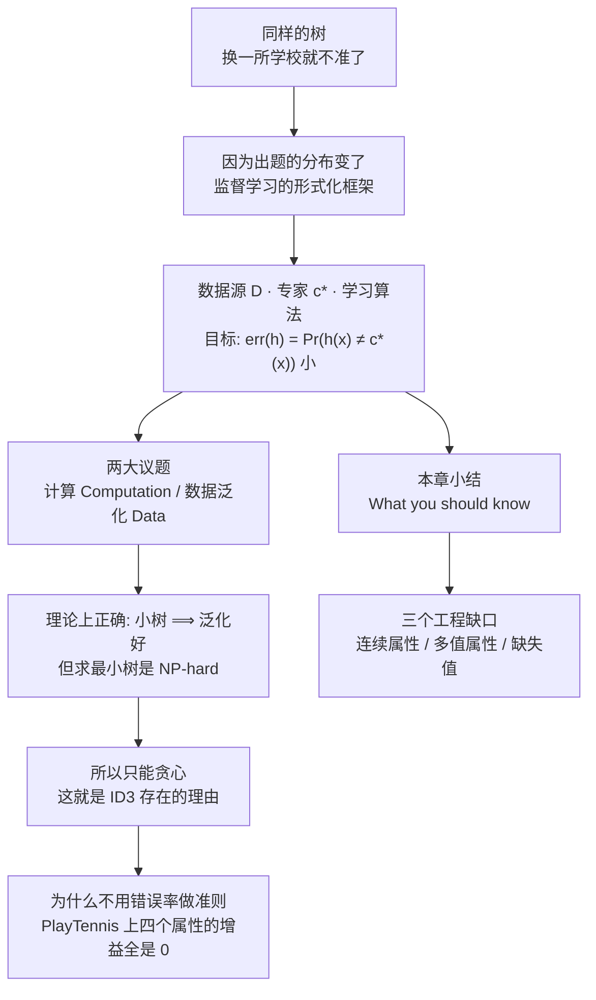
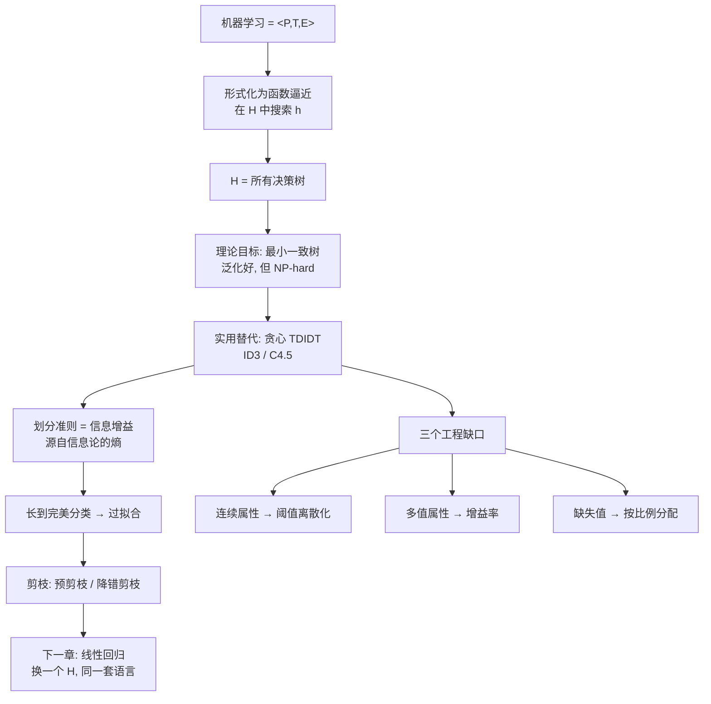

# C1.5 学习理论视角与决策树扩展

> [!abstract] 这一讲的任务
> 前四讲把一棵树从头到尾做了一遍，但都是在"数据长这样"的默契下做的。这一讲要补两件事。**第一件，换一个更高的视角**：把监督学习写成一张流程图——数据源按某个**分布** $D$ 出题，专家按某个**函数** $c^*$ 给答案，算法只看得到其中 $m$ 条带答案的样本，却要在整个 $D$ 上被评价。这个框架能一句话解释清楚过拟合为什么必然存在，也能说清"为什么只能贪心"。**第二件，补上三个工程缺口**：属性是连续值怎么办、取值太多怎么办、有缺失值怎么办。这三件事在真实数据上几乎天天遇到。

> [!info] 怎么读这份讲义
> 不带标记的是这门课正文给出的内容；带 **（拓展）** 的是按教材与通行讲法补的。
> 第 1 节是这一讲的骨架，值得读两遍：它把"分布"和"标注函数"分开，后面所有关于泛化的话都从这里长出来。
> 第 4 节是整章的收束（本章小结），读完它应该能自己把前四讲串成一条线。
> 第 5 节三个扩展彼此独立，可以按需要挑着读。

---

## 0. 开场：同一棵树，换一所学校就不灵了

上一讲那棵树，你用本校三年的记录长出来，测试准确率 0.75。隔壁学校听说好用，要了一份去，把他们的记录也整理成同样的四列，照着这棵树跑。

结果准确率掉到 0.52，基本等于抛硬币。

你去看他们的数据，发现三件事：

1. **那所城市很少下雨**。三年里 `Rain` 只出现过十一次，而在这十一次里恰好有七次是"打球"——因为一下雨，室内馆就成了唯一选择，反而都去打了。
2. **他们的"湿度高"定义不一样**。本校用的是相对湿度 > 80%，他们用的是 > 90%。
3. **他们的记录里有一列是空的**。有些天刮大风，值班的人干脆没写湿度。

这三件事，一件比一件难修。第一件不是数据错，是**世界不一样**；第二件是**同一个词在不同地方指不同的东西**；第三件是**信息不全**。

第一件事最要命，也最值得单独说。它说明：你这棵树学到的不是"打球的规律"，而是"**本校这三年天气分布下**打球的规律"。你换了一个分布，它就不成立了。

这件事在数学上可以被精确地写出来——而写出来之后，你会发现上一讲那个"过拟合"不再是一个工程事故，而是一个**结构性的必然**。这一讲就从这里开始。

---

## 1. 监督学习的形式化框架

### 1.1 一张流程图（p.10–p.11）

> [!important] 三条关键陈述（p.11）
> 1. 算法看到的训练样本 $S:(x_1,c^*(x_1)),\dots,(x_m,c^*(x_m))$，其中 $x_i$ **独立同分布地（i.i.d.）抽自分布 $D$**；
> 2. 算法在 $S$ 上做**优化 optimization**，找出假设 $h$（例如一棵决策树）；
> 3. **目标：$h$ 在分布 $D$ 上的误差要小**
> $$err(h)=\Pr_{x\sim D}\bigl(h(x)\ne c^*(x)\bigr).$$

### 1.2 这图最重要的一处：它把两件事拆开了

**数据源产生 $x$，专家给出 $y$——这两个动作是分开的。**

这个拆分听着平淡，但它是整门课最重要的一次"分而治之"：

- **$D$ 是"会出什么题"的分布。** 它决定你会遇到什么样的病人、什么样的天气、什么样的邮件。它不告诉你答案，只决定题目从哪儿来。
- **$c^*$ 是"标准答案"的函数。** 它是一位理想专家的知识——给他任何一道题，他都能给出正确答案。注意它是 $X\to Y$ 的一个**函数**，不是一张表：这就是我们上一讲说的那个"客观存在的 $f$"。
- **我们买到的只有 $m$ 条答案。** $c^*$ 本身永远看不到，我们只从它那里拿到了 $m$ 个"输入—输出"对。
- **$h$ 是算法交出来的答卷。** 它也是 $X\to Y$ 的一个函数，但它只看过 $m$ 道题。

于是整个困难可以压缩成一句话：

> **算法只能在 $S$（$m$ 条样本）上优化，却要在 $D$（所有可能的题）上被评价。**

这两件事不是同一件事，而算法**只看得见前一件**。上一讲那条"训练精度涨、测试精度跌"的曲线，根就在这里——它不是某一个算法的失误，而是这个结构决定的。

### 1.3 $err(h)$ 怎么读

$$err(h)=\Pr_{x\sim D}\bigl(h(x)\ne c^*(x)\bigr)$$

逐符号：

- $x\sim D$：**按分布 $D$ 随机抽一道题**。不是随便抽，是按真实世界出题的比例抽——如果这所城市八成是晴天，那就八成抽到晴天。
- $h(x)$：你的模型给的答案。
- $c^*(x)$：标准答案。
- $\ne$：两个答案不一样，记一次错。
- $\Pr(\cdot)$：**在无穷多道题上，错的比例**。

所以 $err(h)$ 是"**这个模型在真实世界里会错多少**"的精确值——一个我们**永远算不出来**的数（因为 $D$ 和 $c^*$ 都看不到）。

> [!note] 它就是 0-1 损失（拓展）
> **【拓展】** $\Pr(h(x)\ne c^*(x))$ 是"预测错的概率"，等价于 **0-1 损失 0-1 loss** 的期望：错记 1 分、对记 0 分，再取平均。
> 后面讲回归时会换成**平方损失**，讲逻辑回归时换成**对数损失**，但"在分布上取期望"这个框架一个字都不变。**这一节给的其实不是一个式子的定义，而是一个模板。**

### 1.4 i.i.d. 不是废话

> [!warning] 训练数据和未来数据必须来自同一个分布
> "独立同分布"这句话有两个分量：
> - **同分布**：训练样本和你将来要预测的样本，出自同一个 $D$；
> - **独立**：一条样本的出现不影响另一条（不是同一个人重复出现了十次）。

第一条一旦违反，前面所有结论都作废。举几个具体的违反：

- 用 2015 年的行情训练，去预测 2026 年的市场（**分布漂移**）；
- 用一间医院的病历训练，拿去另一间医院用（就是开场那个故事：$D$ 变了）；
- 训练集全是白天拍的照，上线后用户晚上拍（**采集条件变了**）。

第二条违反得更隐蔽：如果训练集里同一个人出现了五十次，你会误以为自己有五十条独立证据，其实只有一条。

> [!important] 这条假设解释了开场那个失败
> 树没错，算法没错，错的是**我们把一个在 $D_1$ 上学的模型拿到 $D_2$ 上用了**。
> 严格说，这件事在框架里根本没有被"允许"——$err(h)$ 的定义里那个 $D$ 是**训练时那个分布**。换分布之后，你连"它在新的 $D'$ 上错多少"都无法用原来的理论说任何话。
> 工程上的应对（重新采样、加权重、在线更新）属于后面的内容，但**识别"这是分布变了"而不是"模型坏了"，是这一节最实用的收获**。

---

## 2. 机器学习的两大核心议题

有了框架，就能把整个领域切成两半（p.12）。

> [!important] Two Core Aspects of Machine Learning
> **① 算法设计：如何优化？ Algorithm Design. How to optimize?**　关键词：**计算 Computation**
> 　自动生成在**已观测数据**上表现好的规则。
>
> **② 置信界与泛化 Confidence Bounds, Generalization**　关键词：**（带标注的）数据 (Labeled) Data**
> 　规则在**未来数据**上有效的置信度。

> [!note] 一句话区分
> ①管"**能不能算出来**"（算力、优化难度、收敛速度）；
> ②管"**算出来能不能信**"（泛化、样本量、假设空间大小）。
>
> 一个方法要成立，两件事都得过关。**这门课后面几乎每一讲都在其中一侧工作**：梯度下降、EM、反向传播都是①；PAC、VC 维、偏差方差、交叉验证都是②。

**关于②，现状是这样（p.12）**：

- 这一侧已经被研究得**很透彻**：**Occam 界 Occam's bound**、**VC 理论 VC theory** 等（都是"用假设空间的大小换泛化保证"这一类结果；[[C1.1 机器学习概述与课程导航]] 里的 PAC 界是同一族）。
- 对决策树而言：**如果能找到一棵能很好解释数据的小决策树，就有很好的泛化保证。**
- 但是——**找最小的一致决策树是 NP-hard 的** `[Hyafil-Rivest'76]`。

> [!note] "NP-hard" 是什么意思（拓展）
> **【拓展】** 不必记正式定义，记它的**后果**就够了：这类问题的求解时间随规模增长得极快，目前没有已知的多项式时间算法，**规模一大就不可能算完**。
> 这里的规模是什么？是属性的个数和取值组合。属性一多，可能的树的数量就爆炸——不是"多一点"，是每一层相乘。
> 所以 NP-hard 在这里不是一个理论标签，而是一句工程判决：**"最理想的那棵树"这条路，走不通。**

### 2.1 三点串起来，就是 ID3 存在的理由

> [!important] 这个闭环值得单独记住
> 1. **理论说：小树 ⟹ 泛化好。** 这正是上一讲"奥卡姆剃刀"的数学依据——它不是审美偏好，而是一条能从 PAC／Occam 界推出来的结论。
> 2. **但求最小的一致树是 NP-hard 的**，穷举不可行。
> 3. **所以退而求其次，用贪心启发式去逼近**——这就是 ID3。
>
> **ID3 不是因为"简单好写"才被采用，而是因为理论上正确的那个目标算不动。**

这也解释了上一讲那个"贪心为什么不穷举"的问题：不是不想，是**算不完**。而这笔交易的代价我们已经见过——贪心会卡在局部最优，会为了让一条噪声样本变对而多长一层。

> [!note] 关于①：算力这件事（拓展）
> **【拓展】** 很多算法的计算量极大，这正是今天离不开 GPU 的原因。所谓"70B 模型"指的是 **700 亿个参数**，每一个参数都要在每次前向／反向中被反复计算。**参数规模本身就是一个计算议题**，而不是纯粹的"模型能力"问题——这也是为什么"同一个算法，十年前跑不动、今天能跑"。

### 2.2 思考题：为什么不做穷举搜索

> [!question] 停一下，先自己想想
> ID3 和 C4.5 都是在决策树空间里搜索的**启发式**算法。既然"最小的一致树"才是理想答案，为什么不干脆把所有可能的树都试一遍，取最小的那棵？
>
> 想一想：如果只有 4 个属性、14 条样本，这个空间有多大？如果加到 20 个属性呢？
>
> 答案：**组合爆炸**。属性数一多，不同树的数量远远超过指数级增长；而"找最小一致决策树是 NP-hard"是有定理的（Hyafil & Rivest, 1976）。
> 穷举在任何实际规模上都不可行。于是只能用贪心启发式换可计算性——**代价是可能落进局部最优**。这不是设计缺陷，是在"算得出"和"算得对"之间必须做的一次选择。

---

## 3. 自顶向下算法，以及一个被否掉的准则

### 3.1 这一节的四条结论（p.13）

> [!important] 四条
> - 决策树：**若能找到与数据一致的小决策树，就有很好的泛化保证**；但求最小树 **NP-hard** `[Hyafil-Rivest'76]`。
> - 存在**很好用的实用启发式**：自顶向下算法，例如 **ID3**。
> - 这类算法是**自然的贪心方法**：从根到叶生长，反复地把一个已有的叶结点替换为内部结点。
>   - **关键点：划分准则 splitting criterion。**
>   - **ID3：选择使熵下降最多的那个划分。**
> - **为什么不直接按错误率来划分——毕竟错误率才是我们真正关心的？**
>   - **因为存在会卡在局部极小的例子！**

最后一条是这一讲最值得花时间的地方。它值得，因为"用错误率"这个想法**太自然了**——我们最终关心的就是错多少，为什么不用它？

### 3.2 让我们真的算一次

拿上一讲那份 14 行数据。不用信息增益，改用**错误率**：一个结点的错误率就是"少数类占比"，一次划分的得分就是**加权平均错误率**，越小越好。

根结点 $[9+,5-]$，错误率 $=5/14\approx0.357$。

四个属性各切一刀，算加权错误率：

| 属性 | 划分 | 各枝错误率 | 加权后 |
|---|---|---|---|
| **Outlook** | Sunny $[2+,3-]$／Overcast $[4+,0-]$／Rain $[3+,2-]$ | $3/5$，$0$，$2/5$ | $\frac{5}{14}\cdot\frac35+\frac{4}{14}\cdot0+\frac{5}{14}\cdot\frac25=\frac{3+0+2}{14}=\frac{5}{14}$ |
| **Humidity** | High $[3+,4-]$／Normal $[6+,1-]$ | $4/7$，$1/7$ | $\frac{7}{14}\cdot\frac47+\frac{7}{14}\cdot\frac17=\frac{4+1}{14}=\frac{5}{14}$ |
| **Wind** | Weak $[6+,2-]$／Strong $[3+,3-]$ | $2/8$，$3/6$ | $\frac{8}{14}\cdot\frac28+\frac{6}{14}\cdot\frac36=\frac{2+3}{14}=\frac{5}{14}$ |
| **Temperature** | Hot $[2+,2-]$／Mild $[4+,2-]$／Cool $[3+,1-]$ | $2/4$，$2/6$，$1/4$ | $\frac{4}{14}\cdot\frac24+\frac{6}{14}\cdot\frac26+\frac{4}{14}\cdot\frac14=\frac{2+2+1}{14}=\frac{5}{14}$ |

> [!important] 四个属性，四个 $5/14$，一点都没降
> **用错误率做准则，根结点就会停住**：所有候选划分的得分都和"不切"完全一样，算法没有任何理由选任何一个。
> 而同一批数据用信息增益算，四个属性的增益分别是 $.247$、$.152$、$.048$、$.029$——**差别清楚得很**。

### 3.3 为什么会这样：计数 vs 程度

错误率是个**计数**：它只数"错了几个"。而"错"这个判断，只在每一枝的**多数类**上发生变化时才会变。

上面四个划分，没有一个把任何一枝的多数类翻过来：
- Outlook 把 Sunny 切成 $[2+,3-]$（多数是负），和整体 $[9+,5-]$（多数是正）**翻了一次**，但同一刀也让 Overcast 变成 $[4+,0-]$（完全正确），两边一抵，总数不变。
- 其余三个属性，每一枝的多数类都和整体一致，所以"错的个数"完全不变。

于是错误率看到的是一片平原：**任何方向都走不出一步。**

而熵不是数"错了几个"，它衡量的是"**有多不确定**"。$[6+,2-]$ 比 $[9+,5-]$ 纯（0.811 对 0.940），虽然多数类没变、错的个数也没变，但熵**看见了这点进步**。

> [!important] 一句话：熵对"部分进步"敏感，错误率不敏感
> 熵是**严格凹**的，错误率是**分段线性**（一段一段平的）。凹函数对任何"往纯的方向挪一点"都有反应；分段线性函数在段内完全不变。
> 所以用错误率做准则的搜索会**停在第一个平原上**——这就是局部极小。

> [!note] 为什么这个例子特别值得记（拓展）
> **【拓展】** 它不依赖任何人为构造的数据，就用本课程那份 14 行的表，而且四个属性**全部**打平。这比抽象地讲"分段线性会卡住"有力得多。
> 更一般地：只要标签是可以被"两刀分干净"的（这是 XOR 类问题的特征），贪心的错误率准则就会卡住。而两者都不变的极端情形，就是上一讲提到的 XOR——那种情况下连熵也救不了，需要别的机制（多变量划分、或者干脆换模型）。**所以"熵比错误率好"是有条件的，不是万能的。**

### 3.4 顺带说一句基尼指数（拓展）

除了熵，另一个常用的划分准则是**基尼指数 Gini index**（CART 算法采用）：

$$Gini(S)=1-\sum_k p_k^2 .$$

它的形状和熵极像：纯的时候为 0，均匀分布时最大，而且**也是严格的凹函数**——所以它同样能看见"部分进步"，不会卡在上面那种平原上。

**两者谁更好没有定论**，实际效果非常接近；基尼不用算对数，快一点。要记的不是"选哪个"，而是：**这几个准则的共同点是"连续、凹"，而不是"叫熵"。**

---

## 4. 本章小结：这一章到底给了你什么

p.15 做了一次收束，这三段就是整章的骨架，值得逐条能自己讲一遍。

> [!important] What you should know（p.15）
> **良定义的函数逼近问题：**
> - 实例空间 $X$
> - 带标签的训练数据样本 $\{\langle x^{(i)},y^{(i)}\rangle\}$
> - 假设空间 $H=\{f:X\to Y\}$
>
> **学习是 $H$ 上的搜索／优化问题：**
> - 目标函数有多种选择
>   - 最小化训练误差（**0-1 损失**）
>   - 在所有最小化训练误差的假设中，**选最小的那个（?）**
> - **但没有某种偏置的归纳学习是徒劳的！**（*inductive learning without some bias is futile!*）
>
> **决策树学习：**
> - 决策树的贪心自顶向下学习（**ID3, C4.5, …**）
> - **过拟合与树的后剪枝**
> - 扩展……

> [!warning] 那个孤零零的问号，是整章最锋利的一处
> "选最小的那个（?）"——为什么要选最小？这个"最小"是谁规定的？数据里哪一句话说了要小？
>
> **没有。** 数据只说了"要拟合"，一个字也没说"要小"。
> 紧接着的下一行就是答案：**没有偏置的归纳学习是徒劳的**。
>
> 因为"所有能拟合训练数据的假设"在训练集上表现**完全一样**，数据本身无法在它们之间做选择。必须有人（算法设计者）注入一条偏好。那条偏好就是**归纳偏置 inductive bias**。

> [!important] 决策树的归纳偏置是什么
> 两条：
> 1. **偏好小的树**（节点少、深度浅）；
> 2. **偏好把高信息增益的属性放在靠近根部**（贪心顺序）。
>
> 这两条都不在数据里，都是设计时加进去的。承认这一点，才能理解为什么换一个准则（基尼、增益率）会得到不同的树——**换了准则，其实是换了偏置**。

---

## 5. 三个工程缺口

这三项有一个共同的名字：*extensions to decision tree learning*——决策树学习的扩展。名字叫"扩展"，但**每一项都是真实数据上一定会遇到的**：真实数据不会是"四个属性、每个属性两三个取值、一个不缺"这种教科书形状。

### 5.1 连续值属性 Continuous Valued Attributes（p.17）

> [!important] 做法：为连续属性造一个离散属性来测试
> - 原始值：$Temperature=82.5$
> - 造出来的布尔属性：$(Temperature>72.3)=t,\ f$

道理很直接：树的内部结点只能测**离散取值**（上一讲说过，每个取值要开一条枝），而连续值有无穷多个取值，开不了枝。所以把它变成一个"**是／否**"的问题。

这批数据是：

| Temperature | 40 | 48 | 60 | 72 | 80 | 90 |
|---|---|---|---|---|---|---|
| PlayTennis | No | No | Yes | Yes | Yes | No |

> [!warning] 72.3 只是示意值，别当成结论
> 按这张表，"$>72.3$"会把数据切成 $\{60,72,80\}$（全 Yes）和 $\{40,48,90\}$（两 No 一 Yes）——这一刀其实不错。但如果你取 "$>75$"，切出来的是 $\{80,90\}$（一 Yes 一 No）和 $\{40,48,60,72\}$（两 No 两 Yes），两边的熵都是 1，**信息增益为 0**。
> 换句话说：**阈值不能随便取**，取错就白切。下面给怎么选。

> [!important] 阈值怎么选：只在"标签变化"的地方试
> 1. 把样本按该属性**排序**（40, 48, 60, 72, 80, 90）；
> 2. 只在**标签发生变化的相邻两点之间**取候选阈值（取中点）；
> 3. 对每个候选阈值算信息增益，**选增益最大的那个**。

这张表的标签是 No, No, Yes, Yes, Yes, No，变化发生在两处：

- $48\to60$（No → Yes），候选阈值 $\frac{48+60}{2}=54$；
- $80\to90$（Yes → No），候选阈值 $\frac{80+90}{2}=85$。

两个候选各算一次：

**阈值 54**：$>54$ 得 $\{60,72,80\}$，$[3+,0-]$，熵 0；$\le54$ 得 $\{40,48,90\}$，$[1+,2-]$，熵 $0.918$。
$$Gain=1-\tfrac36(0)-\tfrac36(0.918)=1-0.459=\mathbf{0.541}.$$

**阈值 85**：$>85$ 得 $\{90\}$，$[0+,1-]$，熵 0；$\le85$ 得 $\{40,48,60,72,80\}$，$[3+,2-]$，熵 $0.971$。
$$Gain=1-\tfrac16(0)-\tfrac56(0.971)=1-0.809=\mathbf{0.191}.$$

**选 54**（增益 0.541 明显更高）。它把"偏冷的两天"和"热的三天"分开，只留下 90 号那一天是反例。

> [!note] 为什么只看标签变化处（拓展）
> **【拓展】** 可以证明：使信息增益最大的阈值**必定**落在"标签发生变化的相邻样本"之间。理由不难想：如果阈值两边的最近两个样本标签相同，把阈值往那边挪，切出来的两个集合不变（或者只是把一个同类样本从一边挪到另一边），熵不会更好。
> 这条性质把候选从"无穷多个"压到"至多 $n-1$ 个"，是 C4.5 处理连续属性的标准做法。

> [!warning] 连续属性有个隐藏代价
> 每切一刀，就从数据里挑了一个具体的阈值。如果训练集只有 20 条样本，这个阈值很可能**只在这 20 条上成立**——换个数据集，最优阈值变成 58 或 51 都有可能。
> **属性是连续的，不代表切出来的规则是稳的。** 这也解释了为什么小样本上长出的树特别容易过拟合。

### 5.2 取值很多的属性 Attributes with Many Values（p.18）

> [!warning] 问题
> - 如果一个属性有很多取值，**$Gain$ 会倾向于选中它**；
> - 想象把 $Date=Jun\_3\_1996$ 当作属性。

> [!important] 为什么会这样
> 极端情况下，"日期"给每条样本一个**独有的取值**。按它划分，每个子结点只有一条样本，**熵全部为 0**，于是
> $$Gain(S,Date)=H(S)-0=H(S),$$
> 取到**最大可能值**。信息增益会毫不犹豫地选它。
>
> 但这棵树**没有任何泛化能力**：遇到一个新日期，它连该走哪条枝都不知道。
>
> **本质：信息增益奖励"分得细"，而分得细本身不等于分得好。** 上一讲 agegroup 有 9 个取值、gender 只有 2 个，就是这个陷阱的温和版本。

> [!important] 一种解决办法：改用增益率 GainRatio
> $$GainRatio(S,A)\equiv\frac{Gain(S,A)}{SplitInformation(S,A)}$$
> $$SplitInformation(S,A)\equiv-\sum_{i=1}^{c}\frac{|S_i|}{|S|}\log_2\frac{|S_i|}{|S|},$$
> 其中 $S_i$ 是 $S$ 中属性 $A$ 取值为 $v_i$ 的子集。

> [!note] $SplitInformation$ 是什么
> 它是**属性 $A$ 自身取值分布的熵**——注意，**和标签 $Y$ 完全无关**。它只问一件事：这个属性把数据切成了几份、每份多大？
> - 二值、且两半均分：$SplitInformation=1$；
> - $n$ 个取值、均匀分布：$SplitInformation=\log_2n$。
>
> 所以取值越多，分母越大。**拿它当分母，等于给"分得太细"罚款。**

算一下极端情形：14 条样本、14 个不同日期。

$$SplitInformation(S,Date)=\log_2 14=3.807,\qquad GainRatio=\frac{0.940}{3.807}=0.247 .$$

而 Outlook 呢？它的取值分布是 $5/14$、$4/14$、$5/14$：

$$SplitInformation(S,\text{Outlook})=-\tfrac{5}{14}\log_2\tfrac{5}{14}-\tfrac{4}{14}\log_2\tfrac{4}{14}-\tfrac{5}{14}\log_2\tfrac{5}{14}=1.577,$$
$$GainRatio(S,\text{Outlook})=\frac{0.247}{1.577}=0.157 .$$

> [!warning] 罚款 ≠ 禁止：要诚实看待它的效果
> 在上面这个 14 条样本的例子里，$Date$ 的增益率 0.247 **仍然高于** Outlook 的 0.157。原因很简单：$Gain$ 是 $0.940$，分母只是 3.8，压不下去多少。
>
> 它真正起作用是在**样本更多**时：$Gain$ 最多就是 $H(S)$（不会随样本量增长），而 $SplitInformation=\log_2n$ 会一直涨。比如 $n=100$ 个取值，分母是 6.64，增益率降到 $0.940/6.64=0.14$。
>
> 所以增益率是一条**随规模生效**的修正，不是一票否决。**实践中最稳妥的做法是：ID 类属性（编号、日期、流水号）在建树前直接删掉，不要指望准则替你发现。**

> [!note] 增益率自己的坑（拓展）
> **【拓展】** 反过来，如果某个属性的取值**极度集中**（比如 99% 的样本都是同一个值），
> $$SplitInformation\approx0,\qquad GainRatio\to\infty,$$
> 于是它会选中一个"几乎不分割数据"的废属性。
> C4.5 的实际做法是**两步走**：先在候选里按信息增益筛掉低于平均水平的，再在剩下的里面比增益率。**两个准则各管一段，谁也不能单独用。**

### 5.3 缺失的属性值 Unknown Attribute Values（p.19）

> [!important] 若有些样本缺失属性 $A$ 的取值怎么办
> **照样使用这条训练样本，把它顺着树往下分拣。** 三种填补策略：
> 1. 若结点 $n$ 测试属性 $A$，就用**分拣到结点 $n$ 的其他样本中 $A$ 的最常见取值**来填；
> 2. 用**分拣到 $n$、且目标值相同的其他样本中 $A$ 的最常见取值**来填（比 ① 更精细）；
> 3. 为 $A$ 的每个可能取值 $v_i$ 赋一个概率 $p_i$，**把这条样本按比例 $p_i$ 拆开，每个后继结点分一小份**。
>
> **对新样本的分类，采用同样的方式处理。**

> [!note] 三种策略的取舍
> **①最简单，但忽略了标签信息。** 它只看"这个结点里的人大多写了什么"，不管他们打不打球。
> **②用上了标签。** 如果结点里"打球的人"大多写了 Normal，那么对一个正在判断"今天打不打"的样本，填 Normal 更合理。更精细，但实现复杂。
> **③信息损失最小**，也是 C4.5 采用的方案：它**不做硬性猜测**，而是把"我不知道"这个不确定性一路带下去——一条样本被分成 0.6 份走这条枝、0.4 份走那条枝。

> [!important] 这解释了一个之前见过的细节
> 上一讲那棵剖宫产树上，出现过 `[201+, 10.6-]` 这样的**小数计数**。
> 那不是笔误，就是策略 ③：一条属性值缺失的样本，被按概率拆成了几个小数份额，分别落进不同的子结点。**看到小数，就知道用了"按比例分配"。**

> [!warning] 别把缺失值的样本直接删掉
> 两个理由：
> 1. **量的问题**：真实数据里缺失往往很多，逐条删会损失大量样本，小数据集上删完可能就没了。
> 2. **信息的问题**：**"缺失"本身可能带信息**。某项检查没做，可能正说明医生认为没必要做；用户没填年龄，可能本身就是个信号。
>
> 把"缺失"当成一个**取值**（即加一条 "Unknown" 枝）也是一种做法，它和上面三种策略并列，各有适用场景。

---

## 6. 本章知识地图

这张图的每一个箭头，对应本课程的一篇笔记：

| 环节 | 在哪一篇 |
|---|---|
| $\langle P,T,E\rangle$ 与函数逼近 | [[C1.1 机器学习概述与课程导航]] |
| 树怎么表示、怎么贪心搜 | [[C1.2 决策树的表示与自顶向下归纳]] |
| 熵与信息增益（怎么填"最佳"） | [[C1.3 熵与信息增益]] |
| 过拟合与剪枝 | [[C1.4 过拟合与剪枝]] |
| 理论框架与三个扩展 | 本篇 |

---

## 这一讲的三句话

1. **监督学习的完整图景是"分布 $D$ 出题、专家 $c^*$ 给答案、算法只看 $m$ 条"**。目标是 $err(h)=\Pr_{x\sim D}(h(x)\ne c^*(x))$，而算法只能在训练集上优化——这个错位就是过拟合的根源，也是 i.i.d. 假设必须成立的理由。
2. **"小树泛化好"有理论支撑，但求最小树是 NP-hard**，所以只能用贪心。而**用错误率当准则是真的不行**：在那份 14 行数据上，四个属性的错误率增益全是 $5/14$，一刀都切不动；熵能看见"变纯了一点"。
3. **三个工程缺口各有标准解法**：连续属性按"标签变化处"找阈值（本例最优是 54）、多值属性用增益率罚款（但要配合增益筛选）、缺失值按比例拆开（这也解释了树上的小数计数）。

## 速查表

| 量／术语 | 含义 | 位置 |
|---|---|---|
| $D$ / $c^*$ | 出题的分布／标准答案的函数 | 1.2 |
| $err(h)=\Pr_{x\sim D}(h(x)\ne c^*(x))$ | 真实误差，算不出来的那个数 | 1.3 |
| i.i.d. | 训练与未来样本同分布且相互独立 | 1.4 |
| 两大议题 | 计算（能不能算）／数据（能不能信） | 2 |
| NP-hard | 求最小一致树不可行，故用贪心 | 2.1 |
| 错误率准则的失败 | 四个属性增益全为 $5/14$ | 3.2 |
| 归纳偏置 | 数据里没有、必须注入的偏好 | 4 |
| 连续属性阈值 | 只在标签变化处试，本例最优 54 | 5.1 |
| 增益率 | $Gain/SplitInformation$ | 5.2 |
| $SplitInformation$ | 属性自身取值分布的熵（与 $Y$ 无关） | 5.2 |
| 缺失值策略③ | 按概率拆成小数份额（C4.5） | 5.3 |

## 下一讲预告

第一章到此结束。回头看，这一章其实只做了一件事：**把"学习"这件事讲成一个可以在集合里搜索的问题**，然后用一棵决策树把这个过程完整地走了一遍——表示、搜索、准则、过拟合、剪枝、工程细节。

但决策树有一个特点，它在这章里一直没被点破：**它输出的规则是离散的、分段的**。你的预测永远是某个叶子里已有答案的复制，永远不会"介于两者之间"。

下一章换一个答案的格式：$h$ **是一条直线（或一个超平面）**。同样是"在 $H$ 里搜一个最好的 $h$"，但"最好"的定义、搜索的方法、以及能表达什么样的规律，全都变了。第一件事是给它定一个**代价函数**——那将是这门课第二个必须手算的东西。

---

上一节：[[C1.4 过拟合与剪枝]] · 下一节：[[C2.1 单变量线性回归与代价函数]]
索引：[[机器学习课程 MOC]]
