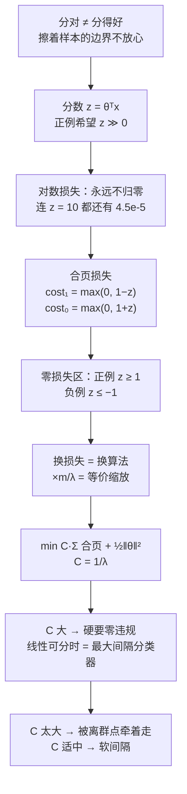

# 第 10 章 · 第 1 讲　支持向量机的目标与大间隔（课堂讲授版2）

> [!quote] 本讲开场
> 同学们好。第 9 章我们学会了怎么衡量一个模型——训练集、验证集、测试集，偏差方差，学习曲线。可衡量完之后呢？你还得**有一个更强的模型**去衡量。
>
> 从今天起，第 10 章交给你们工具箱里最后一把、也是最锋利的一把分类武器：**支持向量机 Support Vector Machine，SVM**。它在深度学习流行之前，是工业界处理中小规模表格数据、文本分类、图像特征分类的默认选择；今天它在小样本、高维、需要强理论保证的场合依然是最常见的首选。所以这一章不是"多学一个算法"，而是必修。
>
> 我们从一个很朴素的问题出发：二维平面上有两堆点，能画一条直线把它们分开——**这样的直线有无数条。到底哪一条最好？** 更具体一点：一条线擦着一个样本过去，另一条线在两堆点中间留出很宽的空隙，你会选哪条？直觉会选第二条。可是"空隙宽"这件事，怎么变成一个可以求最小值的目标函数？这一讲就把它逼出来：
> 1. 先把逻辑回归的**分数** $z=\theta^Tx$ 单独拎出来看；
> 2. 把对数损失换成**合页损失 Hinge Loss**，得到"分对了但余地不够也要罚"的损失；
> 3. 看清目标里的 **$C$** 是怎么从 $\lambda$ 换算过来的；
> 4. 顺着 $C$ 很大的极限，理解**最大间隔分类器**，以及为什么一个离群点就能把这条界线拽歪。
>
> 这一讲的四个目标连起来是一条线：**从"分对"走到"分得好"**。好，我们从那两条都能分对的线开始。

> [!info] 怎么读这份讲义
> 前置内容是 [[C2.5 逻辑回归]]（分数、sigmoid、对数损失）与 [[C2.7 过拟合与正则化]]（$\lambda$ 的作用）。目前没有本学期对应转写稿，本篇内容全部来自课件与教材整理，标有 **（拓展）** 或 **【拓展】** 的部分是课堂上未展开、由课件和教材延伸补充的内容，复习时先掌握未标注的主干。
>
> 本篇沿用 $y\in\{0,1\}$ 的记号；需要把两种标签写成一个式子时会换成 $t=2y-1\in\{-1,+1\}$，两者在 1.3 节里做完整换算。另外，$C$ 与 $\lambda$ 的换算关系依赖目标函数怎么归一化，"$C=1/\lambda$"不是一条放之四海而皆准的等式，3.3 节讲清楚。

---

## 一、从逻辑回归的分数出发

### 1.1 两条都分对的线

先把手弄脏。假设你手上是一个二维二分类问题：左下一堆红色叉、右上一堆蓝色圈，两组点之间能画直线分开。你随手画，会发现能画**无数条**——有的线几乎贴着某个红叉过去，只要那个样本的位置有一点测量误差，它就会掉到线右边去；有的线从两堆中间穿过，离两边最近的样本都留出一段距离。

作为要交付模型的人，你当然更放心第二条。原因也很直白：**样本位置是有噪声的**，边界离样本越近，模型对噪声越敏感。

问题在于，逻辑回归的目标函数根本不知道你在乎这件事。

### 1.2 分对与"有把握地分对"是两回事

回到熟悉的记法。令

$$z=\theta^Tx=\theta_0+\sum_{j=1}^{n}\theta_jx_j,\qquad h_\theta(x)=g(z)=\frac{1}{1+e^{-z}},\qquad x_0=1 .$$

$z$ 叫**分类分数**（也叫净输入），sigmoid $g$ 把它压成 $[0,1]$ 之间的数，解释成"正类的概率"。

现在看两种不同的要求：

- **分对**：$y=1$ 时只要 $z\ge0$，就有 $h_\theta(x)\ge0.5$，判成正类；
- **有把握地分对**：$y=1$ 时希望 $h_\theta(x)\approx1$，这就要求 $z$ **远远大于 0**。

负例那边反过来：$y=0$ 时希望 $h_\theta(x)\approx0$，也就是 $z$ **远远小于 0**。

$x$ 是给定的，所以改变 $z$ 只有一个办法：**改动 $\theta$**。而 $\theta$ 决定了那条分界线。于是"希望 $z$ 离 0 更远"这句话，翻译成几何语言就是"希望分界线离样本更远"。这正是我们要找的东西。

> [!question] 停一下，先自己想想
> $z$ 越大就越"远离边界"吗？把 $\theta$ 整体乘 2，所有样本的 $z$ 都翻了一倍，分界线动了吗？

没动。分界线的位置由 $\theta^Tx=0$ 决定，把 $\theta$ 乘上正数 $2$，方程还是同一个方程，线还是那条线，但每个样本的分数都翻倍了。所以 **$z$ 本身不是几何距离，它的大小可以被尺度随意放大。** 这一点先记下，下一讲会用范数把尺度固定住，才能把 $z$ 变成一个真正的距离。

### 1.3 记号换算：$y\in\{0,1\}$ 与 $t=2y-1\in\{-1,+1\}$（拓展）

这两套记法常常交替出现，先把账做平：

| $y$ | $t=2y-1$ | 正数一侧 | 零损失希望 |
| --- | --- | --- | --- |
| $1$（正例） | $+1$ | $\theta^Tx>0$ | $\theta^Tx$ 大 |
| $0$（负例） | $-1$ | $\theta^Tx<0$ | $\theta^Tx$ 小 |

两套记法的意义完全相同，只是后者能把"正例一个条件、负例另一个条件"压成一个不等式。**判断正类只差一个符号约定**：$y\in\{0,1\}$ 时判 $z\ge0$；$t\in\{-1,+1\}$ 时判 $z>0$ 即为 $t=+1$。**本篇主线和考试写法都沿用 $y\in\{0,1\}$**，只有想把两种损失合并成 $\max(0,1-tz)$ 这种紧凑形式时才换到 $t$。混用这两套记号是最常见的低级错误，做题时先在草稿纸角上写明你用哪套。

---

## 二、换一种损失：合页损失

### 2.1 先把单个样本的损失写成 $z$ 的函数

逻辑回归用的是**对数损失**。单个样本的损失是

$$-y\log g(z)-(1-y)\log\bigl(1-g(z)\bigr).$$

两条分支各自是什么样子？把 $y$ 代进去：

- $y=1$：只剩 $-\log g(z)$，而 $g(z)=\dfrac{1}{1+e^{-z}}$，所以

  $$\ell_1(z)=-\log g(z)=\log(1+e^{-z});$$

- $y=0$：只剩 $-\log(1-g(z))$，而 $1-g(z)=\dfrac{1}{1+e^{z}}$，所以

  $$\ell_0(z)=-\log\bigl(1-g(z)\bigr)=\log(1+e^{z}).$$

两步只用了两个初等变形，值得在草稿纸上过一遍：

- $y=1$：$-\log g(z)=-\log\dfrac{1}{1+e^{-z}}=\log(1+e^{-z})$，用的是 $\log\frac1A=-\log A$；
- $y=0$：先算 $1-g(z)=1-\dfrac{1}{1+e^{-z}}=\dfrac{e^{-z}}{1+e^{-z}}=\dfrac{1}{1+e^{z}}$（分子分母同乘 $e^{z}$），再取负对数得 $\log(1+e^{z})$。

这两条曲线有个共同点，也是我们要动手改的地方：**它们永远大于 0，永远在下降。** 正例的分数 $z$ 从 $-\infty$ 涨到 $+\infty$，损失一路从 $+\infty$ 降到 $0$，但**永远到不了 0**。哪怕 $z=10$（已经是十足十的正例），损失还有 $\log(1+e^{-10})\approx4.5\times10^{-5}$。

> [!important] 一句话抓住设计动机
> 逻辑回归在说：**"再正一点，我就更高兴一点。"** 它对"已经很正"的样本仍然继续给奖励。
> SVM 换了态度：**"够了就别管了——分数达到要求，损失就记 0。"**

### 2.2 合页损失：分对了但余地不够，也要罚

按上面这句话，把光滑曲线换成折线。正例要求 $z\ge1$ 就记零损失，没到就按缺口线性惩罚；负例要求 $z\le-1$ 就记零损失。于是

$$\operatorname{cost}_1(z)=\max(0,\,1-z)=\begin{cases}1-z,&z<1,\\[2pt]0,&z\ge1,\end{cases}$$

$$\operatorname{cost}_0(z)=\max(0,\,1+z)=\begin{cases}0,&z\le-1,\\[2pt]1+z,&z>-1.\end{cases}$$

这就是**合页损失 Hinge Loss** 的两种标签写法。"合页"是形状名——曲线像一个门合页：一段斜线，然后被压平在横轴上。这里斜率取 $-1$ 和 $+1$，是**单位斜率的归一化**，不是自然规律；把整个损失乘上任意正数 $k$，折线的折点位置不变，只是斜率变了，而这只会等比例改变目标函数的值，不改变最优的 $\theta$（3.2 节会证明这一点）。所以"单位斜率"只是为了写起来干净。

![[C10-逻辑损失与合页损失2.png]]

上图是同一个 $z$ 轴上两种损失的对照。**左图真实标签为 $1$**：蓝色是逻辑回归的 $-\log g(z)$，红色是 SVM 的 $\operatorname{cost}_1(z)$。两处值得记：

1. 红色的折点在 **$z=1$**，$z\ge1$ 之后贴着横轴，损失**精确等于 0**；蓝色在 $z=1$ 处还有 $\log(1+e^{-1})\approx0.3133$，而且永远下不去。
2. 在 $z<1$ 的区间，红色**始终不低于**蓝色——同样一个"分得不够好"的样本，SVM 罚得更狠。所以在可分的中间地带，SVM 的损失常常是 0，而逻辑回归还是一个小正数。

**右图真实标签为 $0$**，对应关系是 $\operatorname{cost}_0(z)$、折点在 $z=-1$。注意零损失区在**左侧** $z\le-1$，不是 $z\le1$。这个负号极易写漏，下面 5.1 节还会专门点一次。

### 2.3 两个阈值，两种"对"

这里要区分清楚两个数，考试很爱出：

| 阈值 | 含义 | 越过的后果 |
| --- | --- | --- |
| $z$ 与 $0$ 比 | 判对 / 判错的分界（决策边界） | 只决定预测标签 |
| $z$ 与 $\pm1$ 比 | 间隔要求是否满足（零损失） | 还决定损失是否为 0 |

也就是说，**$0<z<1$ 的正例：分对了，但要交罚款。** SVM 认为"你判对了，可你站得太靠边，我一改参数你就翻过去了"，所以照样惩罚。这跟逻辑回归的"分对了就基本满意"是两种世界观。

### 2.4 手算：正例的五个分数

把 $z=-2,\,0,\,0.5,\,1,\,2$ 代进 $\operatorname{cost}_1(z)=\max(0,1-z)$：

| $z$ | $1-z$ | $\operatorname{cost}_1(z)$ | 说明 |
| --- | --- | --- | --- |
| $-2$ | $3$ | $3$ | 分错，罚最重 |
| $0$ | $1$ | $1$ | 恰好压在边界上，罚 1 |
| $0.5$ | $0.5$ | $0.5$ | **分对了，但仍罚 0.5** |
| $1$ | $0$ | $0$ | 刚够要求，停止惩罚 |
| $2$ | $-1$ | $0$ | 已经很正，$\max$ 把它截断为 0 |

反例那边对称：$\operatorname{cost}_0(z)$ 在 $z=2,\,1,\,0.5,\,0,-2$ 处依次是 $3,\,2,\,1.5,\,1,\,0$。

> [!question] 停一下，先自己想想
> 一个正例的分数是 $z=0.5$。它分错了吗？它的 SVM 损失是 0 吗？

没有分错——分数大于 0，符号是对的。但损失是 $1-0.5=0.5$，因为它还没达到正例要求的 $z\ge1$。**这就是"分对"和"分好"的差别，也是整个 SVM 的起点。**

---

## 三、优化目标里的 $C$ 从哪里来

### 3.1 先分清两件事：哪一步是换算法，哪一步是等价变形

把正则化逻辑回归的目标写出来，记 $A_{log}(\theta)$ 为全部样本对数损失之和、$B(\theta)=\frac12\sum_{j=1}^{n}\theta_j^2$：

$$\min_\theta\ \frac1m\Bigl[A_{log}(\theta)+\lambda B(\theta)\Bigr].$$

现在做两步，**性质完全不同**，一定不要混：

1. **把 $A_{log}$ 换成合页损失之和** $A_{hinge}(\theta)=\sum_{i=1}^{m}\Bigl[y^{(i)}\operatorname{cost}_1(\theta^Tx^{(i)})+(1-y^{(i)})\operatorname{cost}_0(\theta^Tx^{(i)})\Bigr]$。
   这一步**改变了学习算法**——目标函数换了个形状，最优解也会变。这不是等价变形。
2. **再乘一个正数做缩放**。对 $\frac1m\bigl[A_{hinge}+\lambda B\bigr]$ 乘上 $\dfrac{m}{\lambda}$（$\lambda>0$）：

   $$\frac{m}{\lambda}\cdot\frac1m\bigl[A_{hinge}+\lambda B\bigr]=\frac{1}{\lambda}A_{hinge}+B.$$

   若再记 $C=\dfrac1\lambda$，就得到 SVM 的标准目标：

$$\boxed{\ \min_\theta\ C\sum_{i=1}^{m}\Bigl[y^{(i)}\operatorname{cost}_1(\theta^Tx^{(i)})+(1-y^{(i)})\operatorname{cost}_0(\theta^Tx^{(i)})\Bigr]+\frac12\sum_{j=1}^{n}\theta_j^2\ }$$

这一步**是等价变形**：最优的 $\theta$ 一点没变，变的只是目标函数在最优点上的取值。

![[C10.1-板书-目标改写与C的由来2.png]]

### 3.2 为什么乘正数不改变最小点

一句话：**乘正数保序。** 若 $F(a)\le F(b)$，那么对任意 $k>0$ 有 $kF(a)\le kF(b)$——大小关系不会翻转，所以谁是冠军不变。

拿一个具体例子看：考察

$$\min_u\ \bigl[(u-5)^2+1\bigr]\quad\text{和}\quad\min_u\ \bigl[10(u-5)^2+10\bigr].$$

第一个在 $u=5$ 取最小值 $1$；第二个在 $u=5$ 取最小值 $10$。**最小值都"落在" $u=5$，变的是最小值本身的数值。** 这正是我们要的效果：$C$ 只调节两项之间的相对权重，不会因为"数值大了"就换一个解。

> [!warning] 两处最容易踩的坑
> 1. **$C$ 与 $\lambda$ 的方向是反的。** $C=1/\lambda$，所以 $C$ 大 = $\lambda$ 小 = **正则化弱**；$C$ 小 = $\lambda$ 大 = **正则化强**。很多人在这一步把方向搞反，然后"$C$ 调大反而更欠拟合"怎么都想不通。
> 2. **$C=1/\lambda$ 依赖目标的归一化写法。** 上式对应本课 $\frac1m\sum\ell+\frac{\lambda}{2m}\lVert\theta\rVert^2$ 这一路写法。若另一份资料写的是 $\frac1m\sum\ell+\frac{\lambda}{2}\lVert w\rVert^2$，同样缩放到 $C\sum\ell+\frac12\lVert w\rVert^2$，得到的却是 $C=\dfrac{1}{m\lambda}$。**所以比较两个模型的 $C$ 之前，先看清两边的完整目标函数**——只比字母，必错。

**用书本的说法给这两项命名**：$CA_{hinge}$ 是**经验风险**（在训练数据上犯了多少错），$\frac12\sum\theta_j^2$ 是**结构风险 / 正则项**（模型有多"陡"、多复杂）。SVM 就是在两者之间找平衡。另外，$\theta_0$（偏置项）**照旧不进入平方惩罚**——这条约定从 [[C2.7 过拟合与正则化]] 一路延续到这里，没有变。

### 3.3 $C$ 在说什么：违规有多贵

现在可以不看公式、用一句话读 $C$：

- **$C$ 很大**：折线损失那一项权重极高，模型宁可把参数搞大、把边界拧得七扭八歪，也要让每个样本都满足间隔要求。这是**较弱的相对正则化**。
- **$C$ 很小**：平方项说话更大声，模型愿意为一条"简单、平滑、范数小"的边界容忍更多间隔违规。

注意"容忍"这个词。**SVM 从来不是"必须把所有训练样本分对"的算法**（下一节会看到为什么）。$C$ 就是这个取舍旋钮。

---

## 四、SVM 的假设函数

### 4.1 训练求最小值，预测只看符号

训练阶段求上面那个目标的最小值。预测阶段则**只看分数落在哪一侧**：

$$\boxed{\ h_\theta(x)=\begin{cases}1,&\theta^Tx\ge0,\\[2pt]0,&\theta^Tx<0.\end{cases}\ }$$

![[C10.1-板书-SVM预测规则2.png]]

> [!important] 别把 SVM 的输出当概率
> 这里的 $h_\theta(x)$ 只输出类别 $0$ 或 $1$。原始分数 $\theta^Tx$ **不是正类概率**——它可以取 $\pm 10^6$ 这种任意大的数，没有任何概率含义。逻辑回归的 sigmoid 概率解释**不能直接搬到 SVM 上**。
>
> 想要概率输出，标准做法是训练完 SVM 之后**再套一层**（Platt 缩放那一类校准），这是额外的一步，不是 SVM 自带的。

### 4.2 一处导出丢失（不影响知识）

介绍假设函数的地方，"Hypothesis:" 下面本来该跟着预测规则，却是一片**空白**——这是**导出时公式丢了，不是知识缺失**：同一份推导的完整版本紧接着就出现了一次前后对照。把上面那个分段函数当成正式规则掌握即可，不要以为这一讲没讲预测。（**拓展**：另一套常见写法用 $t\in\{-1,+1\}$，预测写成 $t=\operatorname{sign}(\theta^Tx)$，$+1$ 对应正类，与上式同一个意思。）

---

## 五、大间隔直觉：为什么"分对"还不够

### 5.1 零损失要求更严格

现在把合页损失的要求翻译成人话。要让损失**精确等于 0**：

- 正例 $y^{(i)}=1$：必须 $\theta^Tx^{(i)}\ge1$；
- 负例 $y^{(i)}=0$：必须 $\theta^Tx^{(i)}\le-1$。

注意这两个条件比"判对"严格得多：判对只要 $z$ 和 $0$ 比大小，零损失要求 $|z|\ge1$。

![[C10.1-板书-零损失的间隔要求2.png]]

> [!warning] 一处漏掉的负号
> 有一条注记把负例的零损失区写成了 $z\le1$，**这是错的**。同一处的 $\operatorname{cost}_0$ 折线要到 $-1$ 才被压平（$z\le-1$ 时为零），正式条件也明明白白写着 $\theta^Tx\le-1$。**正确零损失区是 $z\le-1$。** 记住它，不要照抄那个漏了负号的注记。

### 5.2 把"违规很贵"推到极限：约束优化形式

假设数据**线性可分 Linearly Separable**——存在一个超平面把全部样本分开。这时候如果 $C$ 取得足够大，可以这样理解 SVM 在干的事：**优先让全部样本的合页损失为 0**（一项都不许违规），在这个前提下，**在所有满足条件的 $\theta$ 里找平方范数最小的那个**：

$$\min_\theta\ \frac12\sum_{j=1}^{n}\theta_j^2\quad\text{s.t.}\quad\begin{cases}\theta^Tx^{(i)}\ge1,&y^{(i)}=1,\\[2pt]\theta^Tx^{(i)}\le-1,&y^{(i)}=0.\end{cases}$$

"$\text{s.t.}$" 是 *subject to*，"满足以下约束"。这句话读作：**分界线必须把所有人都分对而且留够余地（约束），在这些线里挑最"平"的一条（目标）。** 这类问题叫**硬间隔 Hard Margin** 问题。

![[C10.1-板书-大C与约束优化2.png]]

> [!note] 关于 $C=100{,}000$ 这个数
> 这个数字只是用来**表达"损失很贵"的直觉**，不是"$C>10^5$ 就一定能零损失"的通用阈值。数据不可分时，再大的 $C$ 也做不到零损失；数据可分时，有时 $C=1$ 就已经够。**不要把它当判据背。**

> [!warning] 一处印刷笔误：正则项的求和指标
> 目标函数左侧的样本求和已经用了指标 $i$（$\sum_{i=1}^{m}$），而右侧正则项写成了 $\sum_{i=1}^{n}\theta_j^2$——**同一个式子里 $i$ 被用了两次**。既然被求和的项是 $\theta_j$，那个指标应当是 $j$：正确的写法是

$$\frac12\sum_{j=1}^{n}\theta_j^2 .$$

> 这个笔误在连续几处都出现过（同一段公式被反复复制），而跟着它的推导已经按 $j$ 写对了。顺带说一句：紧挨在上面的那个逻辑回归目标里的同一项**是对的**，写的就是 $j=1$——所以这不是"不知道要写 $j$"，而是复制改写时漏改了。**含义上没有任何歧义——正则项永远是对非偏置参数 $j=1,\dots,n$ 求和。**

### 5.3 大间隔分类器：更宽的走廊

在平面上把**所有能分对**的直线都画出来，你会发现它们有的偏向这一类、有的贴着最近的样本，只有一条**在两类之间留下的通道最宽**。上面那个约束优化选出来的，正是这一条。

![[C10.1-板书-最大间隔分界线2.png]]

![[C10-最大间隔与间隔宽度2.png]]

上图里，黑色实线是决策边界 $\theta^Tx=0$，两条绿色虚线是**支持线** $\theta^Tx=\pm1$——它们是"零损失线"在几何上的样子：线上的样本损失刚好为 0，再往两边就都是 0 了。夹在两条虚线之间的绿色区域就是**间隔 Margin**，它的宽度是

$$\text{margin}=\frac{2}{\lVert\theta\rVert}.$$

**先记住这条对应关系**：在 $\pm1$ 的分数约束下，**非偏置参数的范数 $\lVert\theta\rVert$ 越小，走廊越宽**。

> [!question] 停一下，先自己想想
> 那干脆把 $\theta$ 取得无限小，$\lVert\theta\rVert\to0$，走廊不就无限宽了？为什么不行？

因为**约束会立刻翻脸**。$\theta$ 缩小时分数 $\theta^Tx^{(i)}$ 也一起缩小，很快就会掉到 $\pm1$ 的要求以下，损失不再是 0，目标函数里 $C\sum\ell$ 那一项立刻暴涨。**约束把尺度钉死了**：你可以转方向、可以让边界平移，但不能整体缩水。这就是"最小化范数"和"卖白菜式地缩小参数"之间的区别。

下一讲会用投影把 margin $=2/\lVert\theta\rVert$ 完整证出来，还会解释 $\theta_0$ 在这一讲为什么被临时设成 0（它只影响边界平移，不影响走廊宽度）。

---

## 六、一个离群点就能改变整条边界

### 6.1 $C$ 大与 $C$ 小的两种选择

现在往上面那个干净的数据集里放一个**离群点**：它明明是正例，却落在负例那一堆里（或者反过来）。会发生什么？

- **$C$ 很大**：这个点的违规"太贵了"，模型几乎不惜代价要把它分对——边界会明显往它那边倾斜，代价是**其他本来舒服的样本现在离边界更近了**。整体间隔被牺牲。
- **$C$ 适中或较小**：模型盘算了一下，为了一个点把整条边界拧歪不划算，于是**接受这个点违规**（它落在间隔内部，甚至被分错），换取一条对大多数样本更合理的边界。

![[C10-离群点下C的取舍2.png]]

![[C10.1-板书-离群点与C的取舍2.png]]

上图里紫色线对应"$C$ 很大"，它为了吞下右下角那个带着正标签的样本，被迫陡峭倾斜；黑色线对应"$C$ 不太大"，它把这个点当作噪声放过，保住了一条宽而平的边界。**两条线哪个更好？换成真数据，后者通常泛化更好。**

> [!important] 由此得到一条重要纠正
> "SVM 总会把每个训练样本都分对"——**这是错的**。有限 $C$ 的目标函数本来就在做取舍；即使数据线性可分，$C$ 偏小也可能接受训练错误。数据不可分时更不可能强行满足全部硬约束。
>
> 反过来说，**"间隔宽"和"训练零错误"在有限 $C$ 下是两件会打架的事**，$C$ 就是让它们打架的旋钮。

### 6.2 把"允许违规"写成公式：软间隔（拓展）

硬间隔要求 $t_i(\theta^Tx^{(i)})\ge1$ 一条都不许破。真实数据做不到，所以我们给每个样本发一点"违规配额"。令 $t_i=2y^{(i)}-1\in\{-1,+1\}$，$z_i=\theta^Tx^{(i)}$，两种损失可以合并写成 $\max\bigl(0,\,1-t_iz_i\bigr)$，再引入**松弛变量 Slack Variable** $\xi_i\ge0$：

$$\min_{\theta,\ \xi}\ \frac12\lVert\theta\rVert^2+C\sum_{i=1}^{m}\xi_i\qquad\text{s.t.}\quad t_i\theta^Tx^{(i)}\ge1-\xi_i,\quad \xi_i\ge0 .$$

$\xi_i$ 的含义就是"第 $i$ 个样本离间隔要求还差多少"。

> [!important] 它和合页损失是同一件事
> 对**固定的** $\theta$，想让 $C\sum\xi_i$ 最小，$\xi_i$ 当然取得越小越好；但约束要求 $\xi_i\ge1-t_i\theta^Tx^{(i)}$。两个条件合起来，最优的取法就是
> $$\xi_i=\max\bigl(0,\,1-t_i\theta^Tx^{(i)}\bigr),$$
> 代回去正好还原成合页损失。所以**"合页损失目标"和"软间隔约束形式"在数学上是同一个问题**，只是从两个角度写。
>
> 完全不允许违规（$\xi_i\equiv0$）的版本叫**硬间隔 Hard Margin**，就是 5.2 节那个约束优化。真实数据基本都用软间隔。

$\xi_i$ 的取值也能直接读出这个样本的处境：

| $\xi_i$ | 样本在哪 | 有没有分对 |
| --- | --- | --- |
| $\xi_i=0$ | 在间隔之外（走廊边缘或更远） | 分对，且满足间隔 |
| $0<\xi_i<1$ | 掉进走廊内部 | **仍然分对**，但余地不够 |
| $\xi_i=1$ | 正好落在决策边界上 | 边界，约定决定归属 |
| $\xi_i>1$ | 跑到错误那一侧去了 | **分错** |

---

## 七、停一下：这一讲的主线

这一讲其实只做了一件事：**把"分得好"这句话，逐步写成一个可以求最小值的目标函数。**

请注意顺序：**先有损失函数（局部怎么罚），再有整体目标（罚多少 + 模型多复杂），最后才是 $C$ 这个旋钮。** 反过来背"$C$ 大方差大"也能应付考试，但遇到"为什么把 $\lambda$ 换成 $C$"这种题就答不出来了。

---

## 本讲小结：今天要记住的三件事

> [!important] 三句话
> 1. **SVM 用合页损失替换对数损失**：$\operatorname{cost}_1(z)=\max(0,1-z)$、$\operatorname{cost}_0(z)=\max(0,1+z)$。因此**正例分数至少要到 $1$、负例至少要到 $-1$ 才记零损失**——分对不等于零损失，$0<z<1$ 的正例照样要交 $1-z$ 的罚款。判对/判错看 $z$ 与 $0$ 的大小，有没有满足间隔看 $z$ 与 $\pm1$ 的大小。
> 2. **目标函数 $\min_\theta\ C\sum_{i}\bigl[y^{(i)}\operatorname{cost}_1+\bigl(1-y^{(i)}\bigr)\operatorname{cost}_0\bigr]+\frac12\sum_{j=1}^{n}\theta_j^2$**，其中 $C=1/\lambda$ 来自把 $\frac1m(A_{hinge}+\lambda B)$ 乘正数 $\frac{m}{\lambda}$ 的**等价缩放**（换损失那一步不是等价变形）。**$C$ 越大 = 正则化越弱 = 违规越贵**；偏置 $\theta_0$ 不进入平方惩罚。$C=1/\lambda$ 的系数依赖目标的归一化写法，比较模型前先对齐定义。
> 3. **大间隔与大 $C$ 的关系**：线性可分且把 $C$ 推大时，SVM 等价于"在满足 $\theta^Tx^{(i)}\ge1$（正例）/ $\le-1$（负例）的 $\theta$ 里取 $\lVert\theta\rVert$ 最小者"，得到的走廊宽度为 $2/\lVert\theta\rVert$。但**$C$ 太大会被离群点牵着走**，所以有限 $C$ 下 SVM 允许训练错误——"SVM 一定全分对"是错的。

### 速查表（考试前扫一眼）

| 名称 | 公式 / 内容 |
| --- | --- |
| 分数 | $z=\theta^Tx$，$x_0=1$ |
| 正例损失 | $\operatorname{cost}_1(z)=\max(0,\,1-z)$，折点 $z=1$ |
| 负例损失 | $\operatorname{cost}_0(z)=\max(0,\,1+z)$，折点 $z=-1$ |
| 统一写法（**拓展**） | $t=2y-1$，$\max(0,\,1-tz)$ |
| 零损失条件 | 正例 $z\ge1$；负例 $z\le-1$ |
| 判对条件 | 正例 $z\ge0$；负例 $z<0$（比零损失松） |
| 预测规则 | $h_\theta(x)=1$ 若 $\theta^Tx\ge0$，否则 $0$ |
| SVM 目标 | $\displaystyle C\sum_{i=1}^m\Bigl[y^{(i)}\operatorname{cost}_1(\theta^Tx^{(i)})+(1-y^{(i)})\operatorname{cost}_0(\theta^Tx^{(i)})\Bigr]+\frac12\sum_{j=1}^{n}\theta_j^2$ |
| $C$ 的来源 | 由 $\lambda$ 缩放得来：$C=1/\lambda$（本课归一化下） |
| 另一种归一化 | 若用 $\frac1m\sum\ell+\frac\lambda2\lVert w\rVert^2$，则 $C=1/(m\lambda)$ |
| $C$ 大 / 小 | 大：正则化弱、违规贵、易高方差；小：正则化强、易高偏差 |
| 正例五个分数 | $z=-2,0,0.5,1,2\Rightarrow\operatorname{cost}_1=3,1,0.5,0,0$ |
| 逻辑损失对照 | $-\log g(1)=\log(1+e^{-1})\approx0.3133$（合页损失在此为 0） |
| 硬间隔约束形式 | $\min_\theta\frac12\sum_j\theta_j^2$ s.t. $\theta^Tx^{(i)}\ge1\ (y=1)$，$\le-1\ (y=0)$ |
| 间隔宽度 | $2/\lVert\theta\rVert$（下一讲证明） |
| 软间隔（**拓展**） | $\min\frac12\lVert\theta\rVert^2+C\sum\xi_i$ s.t. $t_i\theta^Tx^{(i)}\ge1-\xi_i$，$\xi_i\ge0$，且 $\xi_i=\max(0,1-t_i z_i)$ |
| 违规程度 | $\xi=0$ 满足间隔；$0<\xi<1$ 分对但在走廊内；$\xi>1$ 分错 |

---

## 下一讲预告

这一讲留下了两个洞，下一讲都补上。

**第一个洞**：我说了"$\lVert\theta\rVert$ 越小，走廊越宽"，还给了 $2/\lVert\theta\rVert$ 这个公式，但没证明。为什么不是别的函数？为什么减小 $\lVert\theta\rVert$ 和扩大间隔是同一件事？这需要先补一个工具——**内积就是有符号投影乘长度**。补完这个工具，整件事会变得非常干净：$\theta^Tx^{(i)}=p^{(i)}\lVert\theta\rVert$，代入约束 $\theta^Tx^{(i)}\ge1$ 就得到 $p^{(i)}\lVert\theta\rVert\ge1$。约束把乘积钉在 1 以上，$\lVert\theta\rVert$ 越小，投影 $p^{(i)}$ 就必须越大——**间隔是被约束逼出来的**。

**第二个洞**：如果两类根本画不出直线呢？比如一堆正例被负例围成一圈。下一讲会用**地标 Landmark** 和**高斯核 Gaussian Kernel** 造出一组新特征 $f_1,f_2,f_3$：不看"$x_1$ 多大"，改看"$x$ 离这个地标有多近"。近就输出 1，远就输出 0，几个局部区域拼起来，就长出了一条弯曲的边界。

---
上一讲：[[C9.3 正则化选择与学习曲线2]]
下一讲：[[C10.2 间隔的几何解释与高斯核2]]
返回：[[机器学习课程 MOC]]
