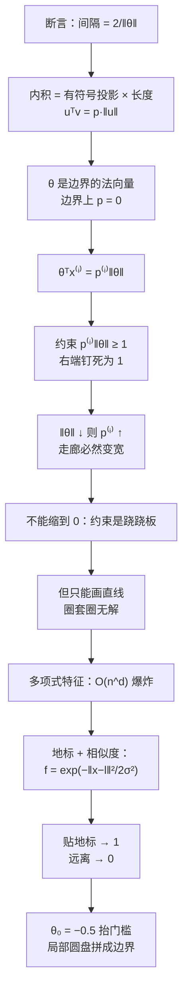

# 第 10 章 · 第 2 讲　间隔的几何解释与高斯核（课堂讲授版2）

> [!quote] 本讲开场
> 同学们好。上一讲我们拿到了 SVM 的目标函数，也在图上说了一句"$\lVert\theta\rVert$ 越小，走廊越宽"。**可这只是断言，不是证明。** 凭什么宽度是 $2/\lVert\theta\rVert$？为什么是范数、不是别的什么量？这一讲前半段就把这件事算清楚——而且算完你会发现，整个过程只用一个工具：**内积**。
>
> 顺带说一句：这一讲的几何推导标着 *optional*（可选阅读）。那只是阅读建议，不是"不用考"的声明；更重要的是，不理解间隔的几何来源，后面核方法你也理解不进去。所以老老实实推导一遍。
>
> 前半段的结论是：**约束把尺度钉死，于是"最小化范数"就等价于"最大化间隔"。**
>
> 后半段换一个问题。前面所有的边界都是直线（高维叫超平面）。可要是数据长成一个圈套一个圈——正例在中间，负例围成一圈——**直线再也分不开了**。这时候我们不再问"$x_1$ 是多少、$x_2$ 是多少"，而改问一个看起来很奇怪的问题：**"这个样本，离那三个特殊点有多近？"** 就靠这个"像不像"的新特征，我们能拼出弯曲的边界。这就是**核 Kernel** 的开端。
>
> 好，我们从那个唯一的工具开始。

> [!info] 怎么读这份讲义
> 前置内容是 [[C10.1 支持向量机的目标与大间隔2]] 的目标函数与 $\pm1$ 约束，以及 [[C2.3 多变量线性回归与梯度下降实践]] 里的向量记号。目前没有本学期对应转写稿，本篇内容全部来自课件与教材整理，标有 **（拓展）** 或 **【拓展】** 的部分是课堂上未展开、由课件和教材延伸补充的内容，复习时先掌握未标注的主干。
>
> 本篇出现两处需要点名的材料缺陷：一条负例约束的标签写错（2.7 节）、一处角标的来源需要说清（4.2 节）。它们都不影响结论，但照抄会出错。

---

## 一、先把几何工具补上：内积是有符号投影乘长度

### 1.1 为什么非要这个工具

回到上一讲的核心式子。约束写着 $\theta^Tx^{(i)}\ge1$，左边的 $\theta^Tx^{(i)}$ 就是**两个向量的内积**。如果只会"把坐标乘起来再相加"，你看到的是一个数；但如果知道内积的几何含义，你会看到**一个投影乘一个长度**——而"投影"正是"样本在边界法线方向上离开原点多远"，这就是距离。

所以这一步不是花哨的补充，而是**把代数式翻译成几何量的唯一通道**。

### 1.2 内积的两种读法

对我两个二维向量

$$u=\begin{bmatrix}u_1\\u_2\end{bmatrix},\qquad v=\begin{bmatrix}v_1\\v_2\end{bmatrix},$$

**代数读法**（这也是计算机实际算的）：

$$u^Tv=u_1v_1+u_2v_2 .$$

**几何读法**：

$$\lVert u\rVert=\sqrt{u_1^2+u_2^2}\ \in\mathbb{R}\quad(\text{向量 }u\text{ 的长度，即范数})$$

$$u^Tv=p\cdot\lVert u\rVert,\qquad p=\text{向量 }v\text{ 在 }u\text{ 方向上的有符号投影长度}.$$

![[C10.2-板书-内积与有符号投影2.png]]

关于 $p$ 有三点必须记牢：

1. **$p$ 是个实数，可以是负的。** 所以叫"**有符号** signed 投影"。$v$ 和 $u$ 的夹角小于 $90^\circ$ 时 $p>0$；大于 $90^\circ$ 时 $p<0$。图上第二张就是钝角情形，$v$ 的投影落在原点**反方向**，$p<0$。
2. **内积是对称的**：$u^Tv=v^Tu$。投影的"方向"换了，但乘积不变（因为 $p$ 与 $\lVert u\rVert$ 的角色对调后，$q\lVert v\rVert$ 也等于同一个数）。
3. **$u$ 的长度不参与"谁投到谁身上"的判断**：$u^Tv$ 把长度信息混在一起了。要单独取出投影，得**除以** $\lVert u\rVert$。

### 1.3 手算两遍

取 $u=(3,4)^T$、$v=(2,1)^T$：

- 代数算：$u^Tv=3\times2+4\times1=10$；
- 长度：$\lVert u\rVert=\sqrt{3^2+4^2}=\sqrt{25}=5$；
- 于是 $v$ 在 $u$ 上的有符号投影 $p=10/5=2$。

再换 $v=(-2,-1)^T$（正好和上一个 $v$ 反向）：

- $u^Tv=3\times(-2)+4\times(-1)=-10$；
- $\lVert u\rVert$ 还是 $5$；
- 于是 $p=-10/5=-2$。

**内积的符号完全由 $p$ 的符号决定**（因为 $\lVert u\rVert>0$）。这一点后面会直接用来判断"样本落在边界的哪一侧"。

### 1.4 一个特例：$90^\circ$ 与"投影为零"

若 $v\perp u$，则 $p=0$，于是 $u^Tv=0$。反过来也成立。这个特例值得单独记住，因为**决策边界 $\theta^Tx=0$ 就是"$\theta$ 与 $x$ 垂直"**——在二维平面上，所有落在分界线上的点，它们到 $\theta$ 的投影都是 0。**$\theta$ 是分界线的法向量**，这是下一节全部推导的基石。

---

## 二、最大间隔的数学：为什么减小范数就是扩大间隔

### 2.1 先把目标写短

上一讲的约束形式是

$$\min_\theta\ \frac12\sum_{j=1}^{n}\theta_j^2\quad\text{s.t.}\quad\begin{cases}\theta^Tx^{(i)}\ge1,&y^{(i)}=1,\\[2pt]\theta^Tx^{(i)}\le-1,&y^{(i)}=0.\end{cases}$$

左边那个求和就是范数的平方，一步就能换掉：

$$\frac12\sum_{j=1}^{n}\theta_j^2=\frac12\bigl(\theta_1^2+\theta_2^2\bigr)=\frac12\Bigl(\sqrt{\theta_1^2+\theta_2^2}\Bigr)^2=\frac12\lVert\theta\rVert^2 .$$

（中间那步"先开方再平方"看着多余，其实是**把 $\lVert\theta\rVert$ 从求和号里揪出来**：根号里的东西就是范数的定义。）于是目标变成"让 $\lVert\theta\rVert$ 尽量小"。

![[C10.2-板书-间隔的几何解释2.png]]

### 2.2 两个简化：$\theta_0=0$ 与 $n=2$

要看清几何，先把画面简化：

- **$\theta_0=0$**：分界线 $\theta^Tx=0$ 必须**穿过原点**。这样画面上只有方向在变，不用同时考虑平移。（$\theta_0\ne0$ 的情形在 2.8 节补上，结论不变。）
- **$n=2$**：两个特征，好在纸上画。

这两个简化只是为了看得见，**推导本身对任意 $n$、任意 $\theta_0$ 都成立**。

### 2.3 关键一步：把内积换成投影

现在问一个看起来很突兀的问题：$\theta^Tx^{(i)}$ 是什么？

1.2 节那个工具给的答案：**它是 $x^{(i)}$ 在 $\theta$ 方向上的有符号投影 $p^{(i)}$ 乘以 $\theta$ 的长度**：

$$\boxed{\ \theta^Tx^{(i)}=p^{(i)}\cdot\lVert\theta\rVert\ }$$

这里的 $p^{(i)}$ 有一个非常具体的几何身份：**从原点到第 $i$ 个样本的连线，落在 $\theta$ 方向上的那段投影长度**。由于边界过原点且垂直于 $\theta$，$p^{(i)}$ 也就等于**第 $i$ 个样本到决策边界的有符号距离**。$p^{(i)}>0$ 表示它在 $\theta$ 指向的那一侧，$p^{(i)}<0$ 表示在另一侧。

**注意 $p$ 不带任何尺度自由度**：它不是"分数"，是真真切切的距离（单位与坐标轴一致）。

### 2.4 约束变成对投影的要求

把 2.3 的等式代进约束：

$$\theta^Tx^{(i)}\ge1\quad\Longleftrightarrow\quad p^{(i)}\cdot\lVert\theta\rVert\ge1\qquad(y^{(i)}=1),$$

$$\theta^Tx^{(i)}\le-1\quad\Longleftrightarrow\quad p^{(i)}\cdot\lVert\theta\rVert\le-1\qquad(y^{(i)}=0).$$

![[C10.2-板书-范数与投影约束2.png]]

现在这个约束读起来像一句人话了：

> **每个样本在 $\theta$ 方向上的投影 $p^{(i)}$，乘上长度 $\lVert\theta\rVert$，绝对值至少要是 1。**

### 2.5 为什么减小 $\lVert\theta\rVert$ 会让走廊变宽

看这个乘积 $p^{(i)}\lVert\theta\rVert\ge1$。它的**右端是钉死的常数 1**。所以两边是跷跷板：

- 把 $\lVert\theta\rVert$ **调小** → 为了维持乘积 $\ge1$，$p^{(i)}$ **必须变大** → 样本必须离边界更远 → **走廊变宽**；
- 把 $\lVert\theta\rVert$ **调大** → 乘积容易满足，$p^{(i)}$ 可以很小 → 样本可以贴着边界 → **走廊变窄**。

再换一个角度看更直观：**$p^{(i)}$ 是样本到边界的距离，$\lVert\theta\rVert$ 是法向量的长度。** 我们要最大化的 margin 就是"最近的那个样本的投影"，即 $\min_i|p^{(i)}|$。约束给出

$$|p^{(i)}|\ge\frac{1}{\lVert\theta\rVert}\quad\text{对所有 }i\ \Longrightarrow\quad \text{margin}=\min_i|p^{(i)}|=\frac{1}{\lVert\theta\rVert}.$$

这是**半宽**（从边界到最近样本）。走廊两边各有一条支持线，所以**总宽度是**

$$\boxed{\ \text{margin}=\frac{2}{\lVert\theta\rVert}\ }$$

**这就是上一讲那个断言的证明。** 而且现在你也能看出为什么这条路上绕不开范数：因为约束的右端是固定的 $1$，样本距离与法向量长度只能成反比。

### 2.6 为什么不能把 $\theta$ 直接缩成 0

$2/\lVert\theta\rVert$ 这个式子看起来在说："$\lVert\theta\rVert\to0$ 时走廊无限宽，那还优化什么？"

**约束不答应。** 约束是 $p^{(i)}\lVert\theta\rVert\ge1$，左边是两个因子的乘积。把 $\lVert\theta\rVert$ 压到很小，$p^{(i)}$ 就得大到离谱；但 $p^{(i)}$ 是**数据给定的投影**，你把 $\theta$ 转一下方向，$p^{(i)}$ 就变了，不可能对所有样本一起变大到任意程度。一旦某个样本的乘积掉到 $1$ 以下，它就不再是零损失，$C\sum\ell$ 那一项马上跳起来。

所以正确的说法是：**在"每个人都被分对且留够余地"这个可行集合里，找 $\lVert\theta\rVert$ 最小的那个。** 可行集合被约束限定住了，$\lVert\theta\rVert$ 不可能无限小——这个最小值，就是最大间隔。

### 2.7 一处标签笔误

上面第二个约束的标签写成了 $y^{(i)}=1$。这显然是复制第一行时没改过来的：如果两类样本都要求 $p^{(i)}\lVert\theta\rVert\ge1$，那同一批样本又要 $\le-1$，形式上都自相矛盾。**负例那一行应当是 $p^{(i)}\lVert\theta\rVert\le-1$，对应 $y^{(i)}=0$。** 同一处的 $\operatorname{cost}_0$ 零损失区、以及上一讲的正式条件，都支持这一点。

### 2.8 偏置不为零时，只是边界平移（拓展）

放开 $\theta_0=0$ 这个简化，边界变成 $\theta^Tx+\theta_0=0$，它不再过原点，但**仍然垂直于 $\theta$**，走廊宽度仍然是 $2/\lVert\theta\rVert$。为什么？因为 $\theta_0$ 只让整条边界**平行移动**，不改变方向、也不改变样本之间的相对投影差。把 $\theta_0$ 想成"把整张图沿法线方向推了一下"就够了。

顺带澄清一处容易看花眼的地方：**$\theta_0\ne0$ 时，决策边界不再穿过原点**，从原点到边界的垂足也不再落在原点上——所以"把 $\theta$ 从原点画出去、边界正好在原点垂直于它"那套漂亮图形，只在 $\theta_0=0$ 时成立。但 $\theta_0$ 只是把整条边界连同两条支持线一起**平移**，方向没变、三条线依然互相平行，所以间隔宽度分毫不差地还是 $2/\lVert\theta\rVert$。**两种情形的结论（间隔 $=2/\lVert\theta\rVert$、最小化范数等价于最大化间隔）完全一样。**

> [!example] 同一方向的两种范数，量一下走廊
> 取 $\theta=(2,0)^T$、$\theta_0=0$。边界是 $\theta^Tx=0$，即 $x_1=0$。两条支持线是 $\theta^Tx=\pm1$，即 $x_1=\pm0.5$，走廊宽度 $1$。用公式校验：$2/\lVert\theta\rVert=2/2=1$，对上。
>
> 换成 $\theta=(4,0)^T$：边界**还是** $x_1=0$（同一个方向、同一个位置），但支持线变成 $x_1=\pm0.25$，走廊宽度 $0.5=2/4$。**边界没动，走廊却窄了一半。** 这就是 1.2 节那句"$z$ 的大小可以被尺度随意放大"的代价：**光看约束 $\pm1$ 不够，必须把范数一起看。**

---

## 三、直线不够用：从多项式特征到"只看像不像"

### 3.1 一个圈套一个圈的数据

前面的几何讨论都建立在一个隐含假设上：**存在一条直线能把两类分开。** 现在把这个假设拿掉。

想象这样一份数据：正例（红叉）聚在中间一小团，负例（蓝圈）围着它们散成一圈。你拿起尺子画直线——不管怎么画，都会切掉一部分正例或者漏掉一部分负例。**没有一条直线能用。**

### 3.2 老办法：多项式特征

其实我们在 [[C2.4 多项式回归与正规方程]] 里已经见过这一招：**不换模型，换特征**。把原始特征 $x_1,x_2$ 扩成

$$f_1=x_1,\quad f_2=x_2,\quad f_3=x_1x_2,\quad f_4=x_1^2,\quad f_5=x_2^2,\ \dots$$

然后照旧学一个线性模型：

$$\text{预测 }y=1\ \text{当}\ \theta_0+\theta_1f_1+\theta_2f_2+\theta_3f_3+\dots\ge0 .$$

![[C10.2-板书-非线性边界与多项式特征2.png]]

在**原始坐标 $(x_1,x_2)$ 的平面里**，判别式 $\theta_0+\theta_1x_1+\theta_2x_2+\theta_3x_1x_2+\theta_4x_1^2+\theta_5x_2^2=0$ 是一条曲线（二次项齐全时是椭圆、双曲线或抛物线）。取 $\theta_0=-1$、$\theta_4=\theta_5=1$、其余为 $0$，判别式变成 $x_1^2+x_2^2-1=0$——**一个单位圆**。正例在圈内、负例在圈外，完美分开。

**关键认识：模型在"特征空间"里仍然是线性的；只是这个特征空间到原始平面是非线性的映射。** 这也是为什么我们在前面花了那么大力气研究线性 SVM——如果能把问题搬到"线性可分"的特征空间里，一切结论马上能用。

### 3.3 代价：特征数爆炸

那为什么不干脆把所有 $x_1^ax_2^b$ 都造出来、一路堆到 100 次多项式？

算一下就知道不行。原始 $n$ 个特征、造到 $d$ 次多项式，特征数按二项式系数 $\binom{n+d}{d}$ 增长。取 $n=100$：

| 次数 $d$ | 特征数 |
| --- | --- |
| $2$ | $\binom{102}{2}=5151$ |
| $3$ | $\binom{103}{3}=176{,}851$ |
| $5$ | $\binom{105}{5}=96{,}560{,}646\approx9.7\times10^7$ |

（粗估用的 $n^d$ 在 $d=5$ 时给出 $10^{10}$，量级更大，但结论一样。）**存储、训练、过拟合**三件事一起爆。而且手工挑该保留哪几项，本身就是一门玄学。

所以真正的问题不是"要不要非线性"，而是：**有没有一种办法，花很少的计算，得到（近似）无穷多个非线性特征的表达能力？** 这就是核方法要回答的。

---

## 四、地标与高斯核：用"像谁"来描述样本

### 4.1 换一个问法

不再问"$x_1$ 是多少、$x_2$ 是多少"，我们挑几个**地标 Landmark**，记为 $l^{(1)},l^{(2)},l^{(3)}$，然后对任意样本 $x$ 问：**"你离这几个地标有多近？"**

近，就是一个有意义的新特征；远，就没有。这是一个非常符合直觉的提问方式：判断一个人像不像某个参照物，比列他的所有身体尺寸往往更有效。

### 4.2 相似度函数与高斯核

把这个"有多近"写下来，就是**相似度函数 Similarity Function**：

$$f_1=\operatorname{similarity}\bigl(x,l^{(1)}\bigr)=\exp\!\left(-\frac{\lVert x-l^{(1)}\rVert^2}{2\sigma^2}\right),$$

$$f_2=\operatorname{similarity}\bigl(x,l^{(2)}\bigr)=\exp\!\left(-\frac{\lVert x-l^{(2)}\rVert^2}{2\sigma^2}\right),\qquad f_3=\ \cdots$$

这个函数就叫**高斯核 Gaussian Kernel**，常记作 $k\bigl(x,l^{(i)}\bigr)$。逐个符号拆开：

- $\lVert x-l^{(i)}\rVert^2$：样本与地标的**平方欧氏距离**。写成范数就是 $v=x-l^{(i)}$ 的长度平方，
  $$\lVert v\rVert^2=v_1^2+v_2^2+\dots+v_n^2=(x_1-l_1)^2+(x_2-l_2)^2+\dots+(x_n-l_n)^2 .$$
  指数里那个双竖线只是范数记号，没有别的含义。
- $2\sigma^2$：分母，$\sigma^2$ 是**核宽度参数**，控制"近"的判定范围有多宽松（4.4 节专讲）。
- $\exp(-\,\cdot\,)$：把负的距离变成 $(0,1]$ 之间的相似度。距离 0 → $\exp(0)=1$；距离越大 → 指数越负 → 越接近 0。

![[C10.2-板书-地标与高斯核2.png]]

### 4.3 两个端值：$1$ 与 $0$

把上面这句话做到底，只看两个极端：

**（1）$x$ 就在地标上（$x\approx l^{(1)}$）**：距离为 0，于是

$$f_1\approx\exp\!\left(-\frac{0}{2\sigma^2}\right)=\exp(0)=1 .$$

**（2）$x$ 离地标很远**：距离是个大数 $R$，于是

$$f_1=\exp\!\left(-\frac{R^2}{2\sigma^2}\right)\approx0 .$$

![[C10.2-板书-距离与相似度2.png]]

> [!important] 一句话记住高斯核
> **它是"距离"的单调递减函数，取值被压在 $(0,1]$ 里**：贴着地标就是 1，离远了就是 0，中间平滑过渡。$f_i$ 因此可以读作"$x$ 属于第 $i$ 个地标附近这个局部区域的**像不像**程度"。
>
> 每个地标配一个自己的特征：$l^{(1)}\to f_1$，$l^{(2)}\to f_2$，$l^{(3)}\to f_3$。**有几个地标就有几个特征。**

### 4.4 $\sigma^2$ 控制小山有多宽

$\sigma^2$ 是这一节唯一需要调的量，它的作用可以一句话概括：**它决定"多远算远"。**

![[C10-高斯核截面曲线2.png]]

上图是同一条核函数的截面（横轴是到地标的距离 $\lVert x-l\rVert$，纵轴是相似度 $f$），三条曲线只差 $\sigma^2$：

- $\sigma^2=0.5$（红）：下降极快，只在半径约 $0.83$ 的范围内还算"像"；远处几乎瞬间归零。**非常局部。**
- $\sigma^2=1$（蓝）：半高距离约 $1.18$。
- $\sigma^2=3$（绿）：半高距离约 $2.04$，曲线宽阔平缓，**样本要在相当远的地方才被认为"不像"**。

半高距离的公式是 $\sqrt{2\sigma^2\ln2}$：由 $\exp(-d^2/(2\sigma^2))=0.5$ 解得。

![[C10-核宽度等值线2.png]]

换成俯视的等值线图更直观：**同一个地标**，$\sigma^2$ 小的时候等值线挤成一个小圈（只有"家门口"算像）；$\sigma^2$ 大的时候等值线摊成一大片（半个城市都算像）。这就是"特征 $f_i$ 变化得**陡**还是**平缓**"——下一讲 3.2 节会看到，这个陡峭程度直接决定模型的偏差方差。

> [!example] 手算三组 $f_1$
> 取 $l^{(1)}=(3,5)^T$。
>
> **（a）$x=(3,5)^T$（就在地标上）**：$\lVert x-l^{(1)}\rVert^2=0^2+0^2=0$，所以 $f_1=\exp(0)=1$，**与 $\sigma^2$ 无关**。
>
> **（b）$x=(4,5)^T$（差 1 个单位）**：$\lVert x-l^{(1)}\rVert^2=1$，于是
> - $\sigma^2=0.5$：$f_1=\exp\!\bigl(-\tfrac{1}{1}\bigr)=e^{-1}\approx0.3679$；
> - $\sigma^2=1$：$f_1=\exp\!\bigl(-\tfrac12\bigr)\approx0.6065$；
> - $\sigma^2=3$：$f_1=\exp\!\bigl(-\tfrac{1}{6}\bigr)\approx0.8465$。
>
> **同样的距离，$\sigma^2$ 越大，相似度越高**——因为"远"的标准更宽松。
>
> **（c）$x=(0,0)^T$（差 3 和 5）**：$\lVert x-l^{(1)}\rVert^2=3^2+5^2=34$，于是
> - $\sigma^2=0.5$：$\exp(-34)\approx1.7\times10^{-15}$（数值上就是 0）；
> - $\sigma^2=1$：$\exp(-17)\approx4.1\times10^{-8}$（也基本是 0）；
> - $\sigma^2=3$：$\exp(-34/6)=\exp(-5.667)\approx0.0035$（虽然仍很小，但已经比 $\sigma^2=1$ 时大了约 **5 个数量级**，比 $\sigma^2=0.5$ 时大了约 **12 个数量级**）。
>
> 这三组数把"**指数**上的差距会被放大得极夸张"演示得很清楚：距离从 $1$ 变成 $34$，$\sigma^2=1$ 时 $f_1$ 从 $0.6065$ 掉到 $4\times10^{-8}$。**这也是为什么做核方法之前一定要先做特征缩放**（第 10.3 讲 4.3 节展开）：某个量纲大的特征会独占这个"平方距离"。

---

## 五、几个局部响应怎样拼出弯曲边界

有了 $f_1,f_2,f_3$，判别规则就是普通的线性组合：

$$\text{预测 }y=1\quad\text{当}\quad\theta_0+\theta_1f_1+\theta_2f_2+\theta_3f_3\ge0 .$$

看起来和逻辑回归一样，但每个 $f_i$ 都是"离第 $i$ 个地标多近"。取一组具体参数看看它是怎么工作的：设

$$\theta_0=-0.5,\qquad\theta_1=1,\qquad\theta_2=1,\qquad\theta_3=0 .$$

![[C10.2-板书-相似度数值判例2.png]]

**判例一：样本落在 $l^{(1)}$ 附近。** 这时 $f_1\approx1$，而它离另外两个地标都很远，$f_2\approx0$、$f_3\approx0$。代入：

$$\theta_0+\theta_1f_1+\theta_2f_2+\theta_3f_3\approx-0.5+1\times1+1\times0+0\times0=-0.5+1=0.5\ge0\ \Longrightarrow\ \text{预测 }1 .$$

**判例二：样本离三个地标都很远。** 这时 $f_1\approx f_2\approx f_3\approx0$，代入：

$$\theta_0+\theta_1f_1+\theta_2f_2+\theta_3f_3\approx-0.5<0\ \Longrightarrow\ \text{预测 }0 .$$

**$-0.5$ 这个偏置就是整个机制的枢纽。** 它的作用是"抬高门槛"：**没有任何一个地标说"我认识你"的时候，一律判 0。** 而只要落进任意一个被赋正权重的地标附近（$f_i$ 接近 1），那 $1$ 就能把 $-0.5$ 顶过 0，判成 1。

于是"正类区域"变成了**若干局部小圆盘的并集**——把地标铺在想要的正类区域上，就能长出一个形状任意的区域。取 $\theta_2=\theta_3=0$ 表示只认 $l^{(1)}$ 附近的区域；把它们改成正数，区域就扩成两三块的并集。**这就是"局部响应拼出非线性边界"的完整机制。**

> [!question] 停一下，先自己想想
> 如果 $\theta_0$ 取成正的 $+0.5$ 会怎样？

那情况就反过来了：**远离所有地标的样本会被判成 1**，正类区域变成"背景 + 地标附近的小坑"，模型表达的是完全相反的形状。参数的正负号决定每个局部区域是"加分项"还是"减分项"。

---

## 六、停一下：这一讲的主线

两条主线在最后合流：**前半段把"分数"变成"距离"，所以 SVM 才能谈间隔；后半段把"坐标"变成"像不像"，所以线性模型才能画曲线。** 而这两件事的共同工具，都是内积。

---

## 本讲小结：今天要记住的三件事

> [!important] 三句话
> 1. **内积是有符号投影乘长度**：$u^Tv=p\lVert u\rVert$，$p$ 是 $v$ 在 $u$ 方向上的有符号投影（可正可负）。手算锚点：$u=(3,4)$、$v=(2,1)$ 时 $u^Tv=10$、$\lVert u\rVert=5$、$p=2$；换成 $v=(-2,-1)$ 则 $p=-2$。
> 2. **最大间隔的证明**：约束 $\theta^Tx^{(i)}\ge1$ 在几何上就是 $p^{(i)}\lVert\theta\rVert\ge1$（$p^{(i)}$ 是样本在法向量 $\theta$ 上的投影，也是到边界的距离）。右端固定为 $1$ 时，$\lVert\theta\rVert$ 越小、$p^{(i)}$ 就必须越大，所以**最小化 $\lVert\theta\rVert$ 等价于最大化间隔，走廊宽度 $=2/\lVert\theta\rVert$**。$\theta_0$ 只平移边界，不改变这个宽度；$\theta$ 也不可能缩到 0，因为约束会立刻被违反。
> 3. **高斯核把"距离"变成"相似度"**：$f_i=\exp\!\bigl(-\lVert x-l^{(i)}\rVert^2/(2\sigma^2)\bigr)\in(0,1]$，贴地标为 1、远离为 0，$\sigma^2$ 越大越"宽厚"。**它换掉了"特征数爆炸"的老路**——不需要造 $O(n^d)$ 个多项式特征，只要几个地标，用 $\theta_0+\theta_1f_1+\theta_2f_2+\dots\ge0$ 就能拼出弯曲边界；$\theta_0=-0.5$ 这样的偏置负责"一个地标都不认时判 0"。

### 速查表（考试前扫一眼）

| 名称 | 公式 / 内容 |
| --- | --- |
| 范数 | $\lVert u\rVert=\sqrt{u_1^2+u_2^2}$ |
| 内积（代数） | $u^Tv=u_1v_1+u_2v_2$ |
| 内积（几何） | $u^Tv=p\lVert u\rVert$，$p$ 为 $v$ 在 $u$ 上的有符号投影，$p\in\mathbb{R}$ |
| 对称性 | $u^Tv=v^Tu$ |
| 垂直判据 | $u\perp v\iff u^Tv=0$ |
| 手算锚点 | $u=(3,4),v=(2,1)$：$u^Tv=10$，$\lVert u\rVert=5$，$p=2$ |
| 目标改写 | $\frac12\sum_{j=1}^n\theta_j^2=\frac12\lVert\theta\rVert^2$ |
| 简化假设 | $\theta_0=0$（边界过原点）、$n=2$（可画） |
| 投影分解 | $\theta^Tx^{(i)}=p^{(i)}\lVert\theta\rVert$ |
| 约束的几何形式 | 正例 $p^{(i)}\lVert\theta\rVert\ge1$；负例 $p^{(i)}\lVert\theta\rVert\le-1$ |
| 走廊宽度 | $\text{margin}=2/\lVert\theta\rVert$（半宽 $1/\lVert\theta\rVert$） |
| $\theta$ 的几何身份 | 决策边界的法向量；边界上所有点投影为 0 |
| 手算校验 | $\theta=(2,0)$：支持线 $x_1=\pm0.5$，宽度 $1=2/2$；$\theta=(4,0)$：宽度 $0.5$ |
| 高斯核 | $f_i=\exp\!\bigl(-\lVert x-l^{(i)}\rVert^2/(2\sigma^2)\bigr)\in(0,1]$ |
| 两个端值 | $x\approx l^{(i)}\Rightarrow f_i\approx1$；$x$ 远 $\Rightarrow f_i\approx0$ |
| 半高距离 | $\sqrt{2\sigma^2\ln2}$：$\sigma^2=0.5/1/3$ → $0.833/1.177/2.039$ |
| 手算 $f_1$（$l^{(1)}=(3,5)$，$x=(4,5)$） | $\sigma^2=0.5/1/3$ → $0.3679/0.6065/0.8465$ |
| 手算 $f_1$（$x=(0,0)$，距²$=34$） | $\sigma^2=0.5/1/3$ → $\approx0/\approx0/0.0035$ |
| 判别规则 | $\theta_0+\theta_1f_1+\theta_2f_2+\dots\ge0$ 判 1 |
| 判例参数 | $\theta_0=-0.5,\theta_1=1,\theta_2=1,\theta_3=0$：$f_1\approx1$ 其余 $\approx0$ → $0.5\ge0$ 判 1；三个都 $\approx0$ → $-0.5<0$ 判 0 |
| 多项式特征 | $f_1=x_1,f_2=x_2,f_3=x_1x_2,f_4=x_1^2,f_5=x_2^2$；代价 $O(n^d)$ |

---

## 下一讲预告

这一讲的地标是**我们手挑的**——在纸上点三个点，说"就你仨了"。真实数据几百上千维，人手挑地标根本不现实。

那么问题来了：**地标能不能自动产生？** 下一讲给出的答案简单得有点粗暴——**就把每一个训练样本都当地标**。$m$ 个样本就是 $m$ 个地标，于是特征向量 $f$ 变成一个 $m+1$ 维的向量，而训练目标里的正则项也随之要重新解释（你会发现它写成一个二次型 $\theta^TM\theta$ 才严谨）。

后半段还有三个实操问题，都是"真正跑模型时一定会撞上"的：训练核 SVM 时到底要交给求解器什么？为什么**做高斯核之前必须做特征缩放**（这一讲 4.4 的手算已经暴露了原因）？以及最实用的一张选型表——**特征数 $n$ 和样本数 $m$ 的四种组合，各自该用逻辑回归、线性核 SVM 还是高斯核 SVM。**

---
上一讲：[[C10.1 支持向量机的目标与大间隔2]]
下一讲：[[C10.3 核 SVM 的训练与模型选择2]]
返回：[[机器学习课程 MOC]]
