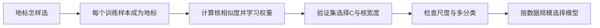

# C10.3 核 SVM 的训练与模型选择

> [!abstract] 本讲任务
> 上一讲手选几个地标，就能拼出局部的正类区域。但真实数据有很多维，不可能一直靠人画地标。这一讲让训练样本自己充当地标，建立从原始输入到核分类分数的完整流程。
>
> 随后把第 9 章的诊断方法用于 $C$ 与核宽度，处理特征缩放、多分类、核选择，以及逻辑回归和 SVM 的取舍。

> [!info] 怎么读这份讲义
> 接 [[C10.2 间隔的几何解释与高斯核]]。p26 的“对核相似度特征直接作 L2 正则化”是教学简化，同页已提示一般二次型；第 2 节说明它与标准核 SVM 的区别。目前没有本学期对应转写稿。“拓展”表示对课件直觉的进一步数学或实践展开。

---

## 1. 让数据自己提供地标

### 1.1 从三个地标推广到 $m$ 个

你有一批标注样本，要让边界贴合实际分布。与其凭空猜地标位置，不如直接选择

$$l^{(1)}=x^{(1)},\quad l^{(2)}=x^{(2)},\quad\ldots,\quad l^{(m)}=x^{(m)}.$$

这里使用**所有训练样本**的位置，既包括正例也包括负例。它们的标签不会直接进入核相似度公式，而是在学习分类权重时决定哪些响应应鼓励正类、哪些应反对正类。

![[C10.3-板书-用训练样本作地标.png]]

对一个新输入 $x$，计算

$$f(x)=\begin{bmatrix}1\\K(x,x^{(1)})\\K(x,x^{(2)})\\\vdots\\K(x,x^{(m)})\end{bmatrix}\in\mathbb R^{m+1}.$$

最前面的 $f_0=1$ 用来容纳偏置。若原始输入有 $n$ 个非偏置特征，原始维度是 $n$，新向量有 $m$ 个核相似度加一个偏置项。**训练样本数 $m$ 和原始特征数 $n$ 不再决定同一件事。**

对训练样本 $x^{(i)}$ 也作完全相同的变换。其中第 $i$ 个核分量

$$f_i^{(i)}=K(x^{(i)},x^{(i)})=e^0=1.$$

![[C10.3-板书-核特征向量与维度.png]]

> [!question] 停一下，先自己想想
> 测试样本来了以后，要不要把它也加到地标列表里，再给原模型增添一个系数？

不需要。地标列表和模型一起固定。测试时计算它相对于**训练地标**的相似度，再交给已经学好的权重；擅自加入新地标会改变特征维度，原参数便不再匹配。

**【拓展】** 用验证集选择模型时，也应只从该次训练数据建立地标。把验证或测试样本提前混进地标列表，会改变学习设定，不再是本课的纯监督留出评估流程。

## 2. 核特征怎样训练，以及一个不能忽略的简化

### 2.1 先看容易理解的显式特征模型

拿 $f(x)$ 替换原来的 $x$，参数也有 $m+1$ 个：

$$z=\theta^Tf(x)=\theta_0+\sum_{j=1}^m\theta_jK(x,x^{(j)}),\qquad\hat y=\mathbf1[z\ge0].$$

按显式特征分类器写法，可以最小化

$$C\sum_{i=1}^m\left[y^{(i)}\operatorname{cost}_1(\theta^Tf(x^{(i)}))+(1-y^{(i)})\operatorname{cost}_0(\theta^Tf(x^{(i)}))\right]+\frac12\sum_{j=1}^m\theta_j^2.$$

损失仍是上一讲的合页损失，偏置 $\theta_0$ 不惩罚。由于这里使用了 $m$ 个地标，最后一个求和上限应是 **$m$**，不再是原始特征数 $n$。若有一万个训练样本，就是一万个相似度分量，再加偏置项。

![[C10.3-板书-核模型目标与正则项.png]]

> [!warning] “相似度特征 + 普通 L2”不自动等于标准核 SVM
> p26 的印刷目标展示了易理解的 $\sum_j\theta_j^2$；同页手写又指出正则项可写为 $\theta^TM\theta$。仅把原输入换成核相似度向量、再使用普通欧氏 L2，得到的是一个有效的显式特征模型，但一般不是同一个核对应的标准核 SVM。若使用成熟的核 SVM 求解器，应让求解器处理它自己的核空间正则化。

### 2.2 为什么会出现 $\theta^TM\theta$（拓展）

这里补出上述区别的数学原因。一个有效核可解释成某个特征映射 $\phi$ 的内积：$K(x,z)=\langle\phi(x),\phi(z)\rangle$。这些特征可能非常多，不必真的列出来。

若核空间权重写成 $w=\sum_{j=1}^ma_j\phi(x^{(j)})$，分数为

$$\langle w,\phi(x)\rangle+b=b+\sum_j a_jK(x^{(j)},x),$$

而权重范数是

$$\lVert w\rVert^2=\sum_{i,j}a_ia_jK(x^{(i)},x^{(j)})=a^TKa,$$

其中矩阵 $K$ 的元素为 $K_{ij}=K(x^{(i)},x^{(j)})$，称为**核矩阵 Kernel Matrix**。因此在这组核展开系数下，标准核空间的正则项为 $\frac12a^TKa$，不是一般的 $\frac12a^Ta$。这里 $a$ 对应去掉偏置后的核展开系数，不要与前面原始特征空间的权重 $w$ 混用。

这解释了 p26 一般二次型的来路。反过来，若显式使用 $f(x)=(K(x,x^{(1)}),\ldots,K(x,x^{(m)}))^T$ 并对其线性权重作普通 L2，它实际使用的特征内积是 $f(x)^Tf(z)$，通常不等于 $K(x,z)$。

以上核空间解释与有效核条件已按 [Stanford CS229 的 SVM 讲义](https://cs229.stanford.edu/summer2019/cs229-notes3.pdf) 核验；本课程仍以 MOC 所列参考教材和当前课件为主，不要求为了使用 SVM 先学完整的对偶优化。

### 2.3 地标和支持向量不是同一个概念

把所有训练样本列为候选地标，不表示它们最终都对分数有非零贡献。标准核 SVM 的解可写成

$$z(x)=b+\sum_i\alpha_i t_iK(x^{(i)},x),\qquad t_i=2y^{(i)}-1,$$

只有系数 $\alpha_i>0$ 的训练样本实际参与这个和，它们是支持向量。这解释了为什么预测时常只需保留支持向量及相应系数。支持向量数量由训练结果决定，并不保证远小于样本总量。

## 3. 把偏差方差诊断用到两个参数上

### 3.1 $C$ 控制对违规的重视程度

沿用 [[C10.1 支持向量机的目标与大间隔]] 的目标：$C$ 大，违反间隔更昂贵，模型更努力拟合训练数据，通常偏向较低偏差、较高方差；$C$ 小，相对正则化更强，通常偏向较高偏差、较低方差。

### 3.2 $\sigma^2$ 控制局部响应范围

高斯核

$$K(x,l)=\exp\left(-\frac{\lVert x-l\rVert^2}{2\sigma^2}\right)$$

在 $\sigma^2$ 大时变化更缓，一个地标影响较大范围，边界不容易围绕单个样本急转，通常偏向高偏差、低方差。$\sigma^2$ 小时响应很局部，模型可以形成细碎区域，通常偏向低偏差、高方差。

![[C10.3-板书-C与核宽度的偏差方差.png]]

| 参数变化 | 典型趋势 | 可能尝试的情形 |
|---|---|---|
| $C\uparrow$ | 更重视训练间隔，偏差降、方差升 | 训练表现差且正则化可能过强 |
| $C\downarrow$ | 相对约束增强，偏差升、方差降 | 训练好、验证明显差 |
| $\sigma^2\uparrow$ | 局部响应更宽，边界更平缓 | 过拟合、边界过度局部化 |
| $\sigma^2\downarrow$ | 局部响应更窄，边界更灵活 | 边界表达可能不足 |

这些是诊断方向，不是“单独转动一个旋钮，所有数据上都单调变好”的保证。两个参数应共同在验证集上选择，最终测试集只报告选定方案的表现。

**【拓展】** 常见另一记法是 $K(x,l)=e^{-\gamma\lVert x-l\rVert^2}$。比较指数可得 $\gamma=1/(2\sigma^2)$，所以 $\gamma$ 大对应核窄，不是宽。例如 $\sigma^2=0.5,1,3$ 分别对应 $\gamma=1,0.5,1/6$。

## 4. 真正使用 SVM 时，要交给求解器什么

### 4.1 指定模型，而不是手工画边界

可以使用成熟求解器，例如课件列举的 LIBLINEAR、LIBSVM。需要明确提供训练数据和标签，选择 $C$，再选择核；高斯核还需选择宽度参数。

**线性核 Linear Kernel** 对应直接学习 $w^Tx+b$，不通过高斯相似度作非线性变换。课件称它为 “no kernel”，意思是不用非线性核技巧，并非线性内积在数学上不算核。

![[C10.3-板书-选择线性核或高斯核.png]]

### 4.2 高斯核的计算不复杂，尺度却很关键

计算步骤为：取两个输入向量 $u,v$，求差 $r=u-v$，得到 $r^Tr=\sum_k(u_k-v_k)^2$，最后返回 $e^{-r^Tr/(2\sigma^2)}$。

如果第一个特征是以平方英尺计的面积，量级上千；第二个是卧室数，通常只有几个。未缩放时，平方距离容易被面积项主导，核便主要按面积决定相似程度，卧室数即使很有意义也几乎不起作用。

![[C10.3-板书-高斯核计算与特征缩放.png]]

> [!example] 平方会放大量纲差异
> 两套房面积差为 100、卧室数差为 1，则两项分别贡献 $100^2=10000$ 和 $1^2=1$。这样的“相似”主要由单位决定，未必符合任务意义。
> 一种缩放办法是对第 $k$ 个特征计算 $x'_k=(x_k-\mu_k)/s_k$，其中均值 $\mu_k$、标准差 $s_k$ 只用训练集估计，再同样应用到验证和测试样本。零方差特征需单独处理，不能除以零。

这与 [[C2.3 多变量线性回归与梯度下降实践]] 的特征缩放相通，但这里影响的不只是优化速度，而是**模型对距离的定义**。改变尺度以后，原来的 $\sigma^2$ 通常也要重新选择。

## 5. 为什么不能随便把“相似函数”塞进核 SVM

高斯核之外，还可用**多项式核 Polynomial Kernel**：

$$K(x,l)=(x^Tl+c)^d.$$

例子有 $(x^Tl)^2$、$(x^Tl)^3$、$(x^Tl+1)^3$、$(x^Tl+5)^4$。常用安全设定是非负常数 $c$ 与非负整数阶数 $d$。此外还有用于专门数据的字符串核 String Kernel、卡方核 Chi-square Kernel、直方图交集核 Histogram Intersection Kernel；后两类通常针对非负直方图等适当输入，不是对任意数据无条件使用。

![[C10.3-板书-其他核与有效核条件.png]]

关键在于：标准核 SVM 需要的是可以解释为特征空间内积的有效核，不是任意看起来“近则大、远则小”的函数。一个实用的数学条件是：对任意有限样本集合，核矩阵都必须**对称且半正定**，即对任意向量 $a$ 都有 $a^TKa\ge0$。

课件把这个条件联系到 Mercer 定理。其作用是保证标准核优化所依赖的几何与凸性结构；不满足时不能继续套用原来的保证，但不宜简单表述为“每次运行必然数值发散”。初学时优先选已知有效的核，并核对其参数和输入限制。

## 6. 多分类：沿用一对多，但比较的是分数

若标签为 $y\in\{1,2,\ldots,K\}$，许多求解器已有多分类功能。另一种理解简单的方案是**一对多 One-vs-All**：训练 $K$ 个二分类器，第 $k$ 个将类别 $k$ 当正例，其余全当负例。

对输入 $x$，计算各分类器分数 $s_k(x)$，预测

$$\hat y=\arg\max_{k=1,\ldots,K}s_k(x).$$

线性 SVM 中 $s_k=w_k^Tx+b_k$；核 SVM 中则使用对应的核展开分数。这里不比较多个硬标签 0/1，否则容易出现全为 0 或多个 1，无法表达哪个类别证据更强。

![[C10.3-板书-一对多分类.png]]

这与 [[C2.6 高级优化算法与多分类]] 的拆解思路一致，但逻辑回归那里比较的是类别概率输出，SVM 这里比较的是分类分数。库的内置多分类也可能采用别的分解方式，应区分“本课讲的一对多”与“某个库实际采用的方法”。

## 7. 逻辑回归、线性 SVM、高斯核 SVM 怎样选

先确认 $n$ 是原始特征数，$m$ 是训练样本数。以下是课件时代的经验选型表，**数值是规模示意，不是硬件无关的适用上限**。

| 数据形态 | 课件的示意规模 | 候选方向 |
|---|---|---|
| $n$ 相对 $m$ 很大 | $n=10000$，$m$ 约 10–1000 | 逻辑回归或线性 SVM |
| $n$ 较小，$m$ 中等 | $n$ 约 1–1000，$m$ 约 10–10000 | 尝试高斯核 SVM |
| $n$ 较小，$m$ 很大 | $n$ 约 1–1000，$m\ge50000$ | 构造更多有效特征，再用逻辑回归或线性 SVM |

![[C10.3-板书-样本特征规模与模型选择.png]]

为什么这样考虑？原始特征已经很多时，线性组合可能足以表达有用边界；特征少而边界非线性时，高斯核提供更丰富的表示；样本非常多时，核方法的训练代价可能成为瓶颈。

**【拓展】** 若显式保存全部核矩阵，需要 $m^2$ 个元素。$m=10000$ 时是 $10^8$ 个元素，以每元素 8 字节估算约 0.8 GB（十进制）；$m=50000$ 时约 20 GB。实际求解器可以缓存、分块，不一定存整张矩阵，但这个增长趋势说明了为什么不能只看单次核计算有多简单。

神经网络在多种规模和非线性情形中也能成为候选；课件提醒其训练可能更慢，实际耗时则取决于架构、实现与设备。选择最终还是回到 [[C9.1 模型评估与训练验证测试集]]：用匹配任务的指标、合理的数据划分和可接受的计算预算作比较，而不是背诵“哪个算法永远更好”。

如果任务确实需要可解释的正类概率，逻辑回归的输出形式直接匹配这个需求；标准 SVM 分数本身没有概率含义。若输入是图像特征或文本向量，也要先看已有表示是否使类别接近线性可分，再决定是否需要非线性核。

## 8. 小结

> [!important] 这一讲的三句话
> 1. 可以把训练样本作为核地标，但显式相似度特征上的普通 L2 与标准核 SVM 的核空间正则化需要区分。
> 2. 用验证集共同选择 $C$ 与核宽度，高斯核前先缩放特征；大 $C$ 与小 $\sigma^2$ 通常使模型更容易追逐局部训练模式。
> 3. 多分类可以一对多取最大分数，模型选型则综合特征数、样本量、所需非线性与计算代价，最终由独立评估确认。

### 速查表

| 内容 | 公式或操作 |
|---|---|
| 地标 | $l^{(j)}=x^{(j)}$，来自训练集 |
| 相似度向量 | $f=(1,K(x,x^{(1)}),\ldots,K(x,x^{(m)}))^T$ |
| 训练点自相似度 | 高斯核 $K(x^{(i)},x^{(i)})=1$ |
| 标准核展开 | $s(x)=b+\sum_i\alpha_it_iK(x^{(i)},x)$ |
| 核空间正则项 | 核展开系数 $a$ 下为 $\frac12a^TKa$ |
| 参数换算 | $\gamma=1/(2\sigma^2)$ |
| 大 $C$ / 小 $\sigma^2$ | 通常较低偏差、较高方差 |
| 小 $C$ / 大 $\sigma^2$ | 通常较高偏差、较低方差 |
| 有效核 | 任意有限样本的核矩阵对称半正定 |
| 多分类 | $\arg\max_k s_k(x)$ |

> [!abstract] 后续学习预告
> 现在我们会从评估、诊断走到一种完整的分类器。再往下，一个自然问题是：支持向量的系数为什么恰好具有稀疏性，求解器又怎样找到它们？这会通向对偶问题与约束优化；待后续课件提供相应内容再展开，本次不预设授课顺序。

---
上一讲：[[C10.2 间隔的几何解释与高斯核]]
返回：[[机器学习课程 MOC]]
