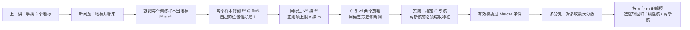
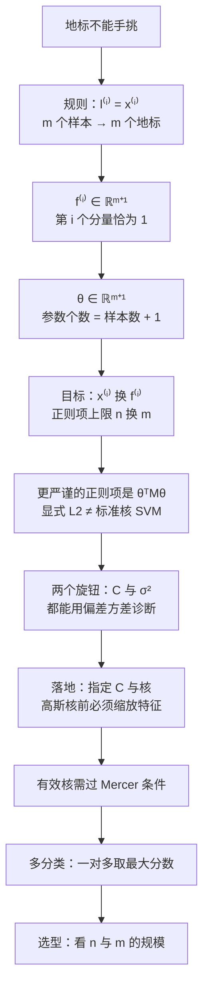

⭐
# 第 10 章 · 第 3 讲　核 SVM 的训练与模型选择（课堂讲授版）

> [!quote] 本讲开场
> 同学们好。上一讲我们靠"离地标多近"造出了非线性边界，但地标是**在纸上手点的**。三个还行，三百个就该疯了——更别说数据有上千维，你连图都画不出来。
>
> 这一讲要解决的就是这个"地标从哪来"的问题，而且答案简单得有点粗暴：**把每一个训练样本都当地标。** $m$ 个样本就是 $m$ 个地标，$m+1$ 个新特征。你会看到一个训练样本的核特征向量里，**它自己的那个位置永远是 1**——这不是巧合，是"自己跟自己最像"。
>
> 但真正落地之前，还有四件事必须讲清楚：
> 1. **训练目标长什么样**？把输入 $x$ 换成核特征 $f$ 之后，正则项的求和范围要怎么改，为什么更严谨的写法是一个二次型 $\theta^TM\theta$？
> 2. **$C$ 和 $\sigma^2$ 两个旋钮怎么调**？它们各自对偏差方差有明确影响，这张诊断表考试和调参都用得上。
> 3. **交给求解器什么**？为什么**做高斯核之前必须做特征缩放**——这一讲会用一个"1000 平方英尺 vs 1 间卧室"的例子把后果算给你看。
> 4. **什么时候根本不该用 SVM**？最后那张"$n$ 大 / $n$ 小、$m$ 大 / $m$ 小"的选型表，是这一章最实用的一页。
>
> 好，我们从"让数据自己当参照物"开始。

> [!info] 怎么读这份讲义
> 前置内容是 [[C10.2 间隔的几何解释与高斯核]] 的地标与高斯核，以及 [[C9.2 模型选择与偏差方差诊断]] 的诊断方法（这一讲直接拿它来调 $C$ 与 $\sigma^2$）。目前没有本学期对应转写稿，本篇内容全部来自课件与教材整理，标有 **（拓展）** 或 **【拓展】** 的部分是课堂上未展开、由课件和教材延伸补充的内容，复习时先掌握未标注的主干。
>
> 本篇要点名两处材料问题：正则项的求和上限在地标换成训练样本之后需要跟着改（2.2 节），以及"核特征 + 普通 L2"与"标准核 SVM"不是同一个模型（2.4 节）。后者是这一讲最容易学出错误印象的地方。



---

## 一、地标从哪里来：让训练样本自己当

### 1.1 从三个地标推广到 $m$ 个

给定训练集 $(x^{(1)},y^{(1)}),(x^{(2)},y^{(2)}),\dots,(x^{(m)},y^{(m)})$，上一讲我们手挑了 $l^{(1)},l^{(2)},l^{(3)}$。现在改成一个不需要任何人为干预的规则：

$$\boxed{\ l^{(1)}=x^{(1)},\quad l^{(2)}=x^{(2)},\quad \dots,\quad l^{(m)}=x^{(m)}\ }$$

**每个训练样本，就是它自己那个地标的复制品。** 样本有多少个，地标就有多少个。

![[C10.3-板书-用训练样本作地标2.png]]

这个做法看着偷懒，其实很有道理：**如果某个样本附近有一批同类样本，那么这个地标就能"代表"那一小片区域**。地标的密度自动跟着数据的分布走——数据密的地方地标密，数据稀的地方地标稀。这比人手布点聪明得多。

### 1.2 来了一个样本 $x$，算它的核特征

对任意样本 $x$（训练集里的，或者测试时新来的），照上一讲的公式算：

$$f_i=\operatorname{similarity}\bigl(x,l^{(i)}\bigr)=\exp\!\left(-\frac{\lVert x-l^{(i)}\rVert^2}{2\sigma^2}\right),\qquad i=1,\dots,m .$$

再补一个恒为 $1$ 的**截距特征** $f_0=1$，凑成一个向量

$$f=\begin{bmatrix}f_0\\f_1\\f_2\\\vdots\\f_m\end{bmatrix}\in\mathbb{R}^{m+1}.$$

![[C10.3-板书-核特征向量与维度2.png]]

### 1.3 训练样本自己的特征向量：那个 $1$ 是怎么来的

取第 $i$ 个训练样本 $x^{(i)}$ 来算它的核特征 $f^{(i)}$。其中第 $j$ 个分量是

$$f_j^{(i)}=\exp\!\left(-\frac{\lVert x^{(i)}-l^{(j)}\rVert^2}{2\sigma^2}\right),\qquad l^{(j)}=x^{(j)} .$$

现在看**当 $j=i$ 的那一项**：$x^{(i)}$ 和 $l^{(i)}=x^{(i)}$ 是同一个点，距离为 0，于是

$$f_i^{(i)}=\exp\!\left(-\frac{0}{2\sigma^2}\right)=\exp(0)=1 .$$

**对角线上的那个 $1$ 是必然的**，不管 $\sigma^2$ 取多少、数据多大。它有一个很直观的意思：**一个人跟自己百分之百像。** 也正因为如此，凡是 $f_i^{(i)}$ 不等于 1，就说明代码里的核函数或者地标对应关系写错了——这是一个免费的单元测试。

于是第 $i$ 个训练样本的特征向量是

$$f^{(i)}=\begin{bmatrix}f_0^{(i)}=1\\ f_1^{(i)}\\ \vdots\\ f_m^{(i)}\end{bmatrix}\in\mathbb{R}^{m+1},\qquad \text{其中第 }i\text{ 个分量恰为 }1 .$$

顺带把上一讲遗留的一个记号问题补上：**原始输入 $x^{(i)}\in\mathbb{R}^{n+1}$，而核特征 $f^{(i)}\in\mathbb{R}^{m+1}$。** 两者维度完全由不同的东西决定——前者由特征数 $n$ 决定，后者由样本数 $m$ 决定。这是核方法最重要的一条"记账规则"，后面所有 $n$ 与 $m$ 的选型讨论都从这来。

> [!question] 停一下，先自己想想
> 用 $m$ 个地标、$m+1$ 个参数去拟合 $m$ 个训练样本——参数比样本还多，这不是最典型的过拟合配置吗？为什么核 SVM 不会退化成"把每个训练样本死记下来"？

答案分两半，先说第一半：**训练完之后，绝大多数 $\theta_i$ 会恰好等于 0**，模型实际只用到少数几个样本（1.4 节）。另一半是 $\sigma^2$：它控制每个 $f_i$ 有多陡，平滑的核让模型没法绕着单个样本长尖峰（3.2 节）。所以不是"参数多就一定过拟合"——**正则项和核宽度一起把有效容量压下来了。**

### 1.4 地标和支持向量不是同一个概念（拓展）

名字听起来像，但两者差得很远，别混：

| | **地标 Landmark** | **支持向量 Support Vector** |
| --- | --- | --- |
| 是什么 | 每个训练样本，一律都是 | 训练完**只有一部分**样本的系数 $\theta_i\ne0$ |
| 谁决定的 | 我们在建模时就定好 | 由优化问题**自动选出** |
| 数量 | 恰好 $m$ 个 | 通常远少于 $m$，而且是稀疏的 |

也就是说：**地标是"原料"，支持向量是"结果"。** 所有样本都当地标，但训练完之后，大多数 $\theta_i$ 会恰好等于 0——只有那些"卡在走廊边上、真正决定了边界位置"的样本才留下非零系数。这解释了 SVM 名字的由来，也是它在**预测**时的一个实用优势：新样本只需和少数几个支持向量算核值。（**拓展**：为什么系数会稀疏、怎么解这个优化问题，要通向对偶理论；本课没有展开，这里只点到"这件事会发生"，不当作已讲内容。）

---

## 二、核 SVM 的训练目标

### 2.1 假设函数与训练目标

有了核特征，整个模型的形状和上一讲完全一样，只是把所有 $x$ 换成 $f$：

$$\text{给定 }x,\ \text{算特征 }f\in\mathbb{R}^{m+1};\qquad \text{预测 }y=1\ \text{当}\ \theta^Tf=\theta_0f_0+\theta_1f_1+\dots+\theta_mf_m\ge0 .$$

这里 $\theta\in\mathbb{R}^{m+1}$——**参数个数等于样本数加一**。训练目标则是把上一讲的目标函数里的 $\theta^Tx^{(i)}$ 整体替换成 $\theta^Tf^{(i)}$：

$$\min_\theta\ C\sum_{i=1}^{m}\Bigl[y^{(i)}\operatorname{cost}_1\bigl(\theta^Tf^{(i)}\bigr)+\bigl(1-y^{(i)}\bigr)\operatorname{cost}_0\bigl(\theta^Tf^{(i)}\bigr)\Bigr]+\frac12\sum_{j=1}^{m}\theta_j^2 .$$

![[C10.3-板书-核模型目标与正则项2.png]]

### 2.2 两处必须跟着改的地方

> [!warning] 求和上限从 $n$ 变成 $m$
> 还记得上一讲的正则项是 $\frac12\sum_{j=1}^{n}\theta_j^2$ 吗？那个 $n$ 是**原始特征数**。现在 $\theta$ 的维数变成了 $m+1$（参数从 $\theta_0$ 到 $\theta_m$），**所以正则项的求和上限必须从 $n$ 改成 $m$**。当 $n=m$ 恰好成立时两个式子长得一样，但那只是巧合，不是普遍等式——**换模型时求和范围一定要跟着参数的个数走**。
>
> **照抄旧公式不加上限就错了。** 判断依据很简单：$\theta_j$ 一共有多少个，就求和到多少。这里 $\theta$ 有 $m+1$ 个分量，其中 $\theta_0$ 不进正则项，所以求和到 $m$。

> [!warning] 正则项那一项的求和指标
> 目标函数左侧的样本求和用的是 $i$（$\sum_{i=1}^{m}$），右侧正则项不能再用 $i$ 当指标。既然被求和的项是 $\theta_j$，指标应当是 $j$。这个笔误从第 10.1 讲一路复制到这里，含义上没歧义，但**写答卷时两个求和用同一个字母会被扣分**。

> [!example] 具体规模感受一下
> 假设 $m=10{,}000$ 个训练样本（这是一个很小的数据集）。那么：
> - 每个样本的核特征 $f\in\mathbb{R}^{10{,}001}$，参数 $\theta$ 也是 $10{,}001$ 维；
> - 训练时要给每个样本算 $m$ 个核值，**核矩阵是 $m\times m=10^8$ 个元素**；
> - 预测一个新样本也要算 $m$ 个核值。
>
> $10^8$ 个浮点数（双精度）约 800 MB——**光存核矩阵就要这么多**。$m$ 再涨十倍，就是 80 GB。**这就是核 SVM 在大 $m$ 上的天花板**，也是最后一节选型表的由来。

### 2.3 为什么正则项更一般地写成 $\theta^TM\theta$（拓展）

这一段的推导里，正则项从显式的 $\sum_j\theta_j^2$ 被改写成

$$\sum_{j=1}^{m}\theta_j^2=\theta^T\theta=\lVert\theta\rVert^2\ \longrightarrow\ \theta^TM\theta,$$

其中 $\theta=(\theta_1,\dots,\theta_m)^T$（**不含** $\theta_0$，偏置照例不进正则项），$M$ 是一个 $m\times m$ 的矩阵。

为什么要换成这个一般形式？因为**"参数的平方和"其实是一个欧氏范数，而它是否真的是模型复杂度，取决于特征空间的内积怎么定义**。

- 当你把 $f$ 当成**普通显式特征**、老老实实做线性模型时，$\theta^T\theta$ 就是标准的 L2 正则，没问题。
- 但高斯核背后对应的特征空间其实是**无穷维**的，我们从来没有真的把 $f$ 展开过。在**核诱导出来的内积**下，模型复杂度的正确度量不是 $\theta^T\theta$，而是一个带核矩阵的二次型 $\theta^TM\theta$（$M$ 由核函数在训练样本上的取值决定，因此是 $m\times m$）。

$$\theta^TM\theta=\sum_{i}\sum_{j}\theta_iM_{ij}\theta_j\ \text{是一个二次型};\qquad \theta^T\theta=\lVert\theta\rVert^2\ \text{只是 }M=I\ \text{的特例}.$$

一句话：**写 $\theta^T\theta$ 是为了让人看懂；真正成熟的核 SVM 求解器用的是 $\theta^TM\theta$，并把 $M$ 藏在自己的核实现里。** 你不需要手算 $M$，但要知道这个区别存在——这正是 2.4 节要警告的事。

### 2.4 一个不能忽略的区别：核特征 + 普通 L2 ≠ 标准核 SVM

这是初学者最容易带走的一个错误印象，专门点出来：

> **把原始输入换成核相似度向量 $f$，再套一个普通的"线性模型 + L2 正则"，得到的是一个有效的显式特征模型——但它一般不是同一个核对应的标准核 SVM。**

两者的差别就在 2.3 节那个正则项：

| | 显式核特征 + 普通 L2 | 标准核 SVM（核求解器） |
| --- | --- | --- |
| 特征 | 真的算出 $f\in\mathbb{R}^{m+1}$ | 从不显式展开，只算核值 $k(x,l)$ |
| 正则项 | $\lVert\theta\rVert^2=\theta^T\theta$ | 核空间范数，对应 $\theta^TM\theta$ |
| 谁来解 | 任何梯度下降 / 现成的线性分类器都能解 | 必须用支持核的 SVM 求解器（libsvm 等） |
| 适用场景 | 想讲清"核特征怎么用"的教学模型、或确实想用这个显式模型时 | 真正要吃核方法的好处时 |

**实践建议**：想用核 SVM，就把 `kernel='rbf'`（高斯核）交给成熟的求解器，**让求解器自己处理核空间里的正则化**，不要自己造 $f$ 再随手加一个 L2 了事。

---

## 三、$C$ 与 $\sigma^2$：把偏差方差诊断搬过来

核 SVM 只有两个需要调的旋钮：**$C$** 和 **$\sigma^2$**。好消息是，第 9 章那套诊断方法可以直接用。

### 3.1 $C$（$=\frac1\lambda$）

| $C$ | 等价 $\lambda$ | 效果 | 诊断 |
| --- | --- | --- | --- |
| **大** | 小 | 违规很贵，模型拼命满足每个样本 | **低偏差、高方差**（容易过拟合） |
| **小** | 大 | 正则化强，愿意为简单边界容忍违规 | **高偏差、低方差**（容易欠拟合） |

![[C10.3-板书-C与核宽度的偏差方差2.png]]

### 3.2 $\sigma^2$

$\sigma^2$ 通过"每个特征 $f_i$ 变化得多陡"来影响模型：

| $\sigma^2$ | 核的形状 | $f_i$ 随距离的变化 | 诊断 |
| --- | --- | --- | --- |
| **大** | 宽而缓的小山 | 变化平缓（vary more smoothly） | **高偏差、低方差**（边界平滑、欠拟合） |
| **小** | 窄而尖的尖峰 | 变化剧烈（vary less smoothly） | **低偏差、高方差**（边界扭曲、过拟合） |

**为什么 $\sigma^2$ 小会导致高方差，值得讲透。** $\sigma^2$ 小的时候，每个特征 $f_i$ 只在"离第 $i$ 个样本极近"的地方才接近 1，别处都是 0。于是每个样本几乎只能"认识"它自己——模型可以围绕每一个训练样本单独长出一个尖尖的小山包，把这些点**逐个记住**。记住每个点当然训练误差低，但新样本一来就落在两个山包之间的 0 区里，泛化很差。

$\sigma^2$ 大的时候，每个 $f_i$ 摊得很开，一个样本会同时"像"很多个地标，特征之间高度重叠，模型只能画出一条平滑的大边界。**平滑 → 偏差上去了，但方差下来了。**

### 3.3 两个旋钮的联合排查表

| 症状 | 训练误差 | 交叉验证误差 | 先试什么 |
| --- | --- | --- | --- |
| 高方差（过拟合） | 低 | 高 | **增大 $\sigma^2$**，或**减小 $C$** |
| 高偏差（欠拟合） | 高 | 高 | **减小 $\sigma^2$**（或加特征），或**增大 $C$** |
| 都不错 | 低 | 低 | 收工，去比别的模型 |

> [!warning] 两个旋钮不要一起乱动
> $C$ 和 $\sigma^2$ 的作用有重叠（都影响边界弯曲程度），**同时朝一个方向调两个参数，你分不清是哪个起的作用**。工程做法是：先固定 $\sigma^2$ 粗调 $C$，再在几个 $\sigma^2$ 上重跑，最后用**网格搜索 + 交叉验证**定一组。这也是 [[C9.2 模型选择与偏差方差诊断]] 那套流程的标准用法。

---

## 四、真正使用 SVM：交给求解器什么

### 4.1 你要指定的只有两件事

实践中**不会有人自己写优化器**。用现成的软件包（常见的有 `liblinear`、`libsvm` 这一类）求解参数 $\theta$，你需要指定的就是：

1. **参数 $C$**；
2. **核函数（相似度函数）**：用哪一种。

![[C10.3-板书-选择线性核或高斯核2.png]]

### 4.2 两种最常用的选择

**（一）不用核——"线性核 linear kernel"**

$$f=x,\qquad \text{预测 }y=1\ \text{当}\ \theta^Tx\ge0 .$$

就是把第 10.1 讲那套线性 SVM 直接拿来用。它**有效特征数就是 $n$**，适合**$n$ 很大、$m$ 很小**的情形（例如 $n=10{,}000$、$m=10\sim1000$ 的文本数据）。此时把样本映射到 $m+1$ 维核空间纯属自找麻烦。

**（二）高斯核 Gaussian kernel**

$$f_i=\exp\!\left(-\frac{\lVert x-l^{(i)}\rVert^2}{2\sigma^2}\right),\qquad l^{(i)}=x^{(i)},\qquad \text{此时还需要选 }\sigma^2 .$$

按**显式地标特征**看，它把样本送到 $m+1$ 维；而高斯核背后真正对应的特征空间其实是**无穷维**的。不管用哪个视角，它都能造出任意弯曲的边界，适合**$n$ 小或中等、$m$ 中等或偏大**的情形。

**一句话对照**：**线性核管"特征已经够多"，高斯核管"特征不够、需要造非线性"。** 这个判断在第七节会被写成一张完整的表。

> [!note] 记号提醒：高斯核里的 $n$
> 有人会问："高斯核不是把特征升到 $m+1$ 维了吗，怎么还说 $n$ 小？"这里的 $n$ 始终指**原始输入的特征数**——`libsvm` 这类求解器内部做的正是"不展开 $f$、只算核值"，所以它消耗的资源由原始 $n$、样本数 $m$ 和核参数决定，而不是由那个名义上的 $m+1$ 决定。**术语上不区分这两件事，是看懂选型表最大的障碍。**

### 4.3 特征缩放：不是"建议"，是"必须"

高斯核的公式里有一项 $\lVert x-l\rVert^2$，展开就是

$$v=x-l,\qquad \lVert v\rVert^2=v_1^2+v_2^2+\dots+v_n^2=(x_1-l_1)^2+(x_2-l_2)^2+\dots+(x_n-l_n)^2 .$$

**每一项都被平方了。** 于是量纲差异被平方放大，后果极其严重。

![[C10.3-板书-高斯核计算与特征缩放2.png]]

> [!example] 1000 平方英尺 vs 1 间卧室
> 用房价数据举例，两个特征：
> - 房屋面积，取值以**平方英尺**计，两套房差 $1000$；
> - 卧室数，两套房差 $1$。
>
> 代入平方距离：
> $$\text{面积贡献}=1000^2=1{,}000{,}000,\qquad \text{卧室贡献}=1^2=1 .$$
>
> **面积那一项是卧室那一项的 100 万倍。** 于是"两个样本像不像"完全由面积决定——卧室数从 1 间变成 5 间，在核眼里毫无区别，这显然不是我们想要的任务含义。
>
> 更糟的是，这不是"权重偏了"那么温和：核函数的指数上带着 $-10^6/(2\sigma^2)$，$\sigma^2$ 稍小一点，**所有样本两两之间的相似度都会变成 0**——整个核矩阵退化成单位矩阵，模型只能死记硬背训练集。**这就是为什么必须先做特征缩放。**

**标准做法**（和 [[C2.3 多变量线性回归与梯度下降实践]] 里的缩放是同一套）：对第 $k$ 个特征计算

$$x_k'=\frac{x_k-\mu_k}{s_k},$$

其中均值 $\mu_k$ 与尺度 $s_k$（标准差，或"最大值减最小值"）**只在训练集上估计**，然后原封不动地应用到验证集和测试集。**不要把验证集和测试集的数据混进来算均值和标准差**——那是一种数据泄漏。

> [!warning] 两个细节
> 1. **零方差特征会除以 0。** 如果某个特征在训练集上恒为常数，$s_k=0$，必须单独处理：要么直接删掉这一列，要么把 $s_k$ 设成 1。
> 2. **缩放要一致。** 训练时用 $\mu_k,s_k$ 变换，预测新样本时必须用**同一组** $\mu_k,s_k$，否则模型看到的分布和训练时不一样。

### 4.4 用 scikit-learn 的 `SVC`（拓展）

真到写代码，一行就能对上号：

```python
from sklearn.pipeline import make_pipeline
from sklearn.preprocessing import StandardScaler
from sklearn.svm import SVC

# 高斯核（rbf）：C 与 gamma 是你要网格搜索的两个超参数
clf = make_pipeline(StandardScaler(),
                    SVC(kernel="rbf", C=1.0, gamma=0.1))

# 线性核：不写 gamma
linear = make_pipeline(StandardScaler(), SVC(kernel="linear", C=1.0))
```

三个必须注意的对应关系：

1. **`StandardScaler` 不要省。** 4.3 节的推导就是它的理由；把缩放和分类器串成 `Pipeline` 还能保证交叉验证时缩放只在训练折上拟合，天然避开数据泄漏。
2. **`libsvm` 用的是 $\gamma=\dfrac{1}{2\sigma^2}$，不是 $\sigma^2$。** 教材里的 $\sigma^2$ 与代码里的 `gamma` 是**反比关系**：$\sigma^2$ 大 ↔ `gamma` 小 ↔ 边界平滑 ↔ 高偏差。把这两个记号搞反，就会得出"$C$ 调大反而欠拟合"这类自相矛盾的结论。
3. **多分类不用自己写循环。** `SVC` 内部已经处理了多分类（`libsvm` 走的是**一对一 one-vs-one**，每两个类训一个小分类器），所以你不必手动训练 $K$ 个模型；`decision_function_shape` 只影响输出分数的形状，不改变训练方式。**但"内部怎么组合"和第七节讲的一对多是两件事**，别把结论混起来。类别不平衡时还要配 `class_weight`。模型选型优先用 `GridSearchCV` 在 $C$、`gamma` 的网格上选，而不是手调。

---

## 五、其他核，以及"什么才算合法核"

### 5.1 不是所有相似度函数都能当核

高斯核长得像"随便设计的相似度"，很容易让人以为只要写出一个"越近越大"的函数就能塞进去。**不行。**

要让 SVM 求解器正常工作（优化过程正确、不发散），相似度函数必须满足一个技术条件，叫做 **Mercer 定理 Mercer's Theorem** 的条件。**它的本质是：这个函数必须真的对应某个特征空间里的内积。** 如果不是，你写出来的"核矩阵"就不是半正定的，优化问题可能无解、数值上可能直接发散。

![[C10.3-板书-其他核与有效核条件2.png]]

> [!note] 关于发散这句话的准确读法
> "不满足 Mercer 条件 → 优化会发散"是一条**经验性的提醒**，不是严格的数学定理。严谨的说法是：不满足条件时，求解器不再有任何理论保证，实践中**可能**不收敛、可能给出胡乱的解。**不要把它背成一条必然而然的反例。**

### 5.2 现成的核清单

**多项式核 Polynomial Kernel**：

$$k(x,l)=\bigl(x^Tl\bigr)^d,\qquad\text{或更一般地}\qquad k(x,l)=\bigl(x^Tl+c\bigr)^d .$$

其中 $c\ge0$ 是常数项、$d$ 是**次数 degree**。举几个具体形式帮助记忆：$(x^Tl)^2$、$(x^Tl)^3$、$(x^Tl+1)^3$、$(x^Tl+5)^4$。

**它和高斯核的关系**：高斯核可以理解成"无穷次多项式核"的极限；多项式核则是"手选次数的多项式特征"的一种高效实现（不用把 $O(n^d)$ 个单项式显式造出来）。用之前照例要缩放特征，并选好 $c$ 和 $d$。

**更冷门的核**（知道名字、能读懂论文即可）：

| 核 | 常用于 |
| --- | --- |
| 字符串核 String kernel | 文本、DNA 序列这类离散序列 |
| 卡方核 chi-square kernel | 直方图型特征（图像、词频） |
| 直方图交叉核 histogram intersection kernel | 直方图型特征，计算便宜 |

> [!warning] 实践中的顺序
> 绝大多数问题只需要在**线性核**和**高斯核**之间选。多项式核与其他核属于"上面两个都不行时的备选"，别一上来就试。

---

## 六、多分类：一对多，但比的是分数

SVM 天生是二分类器。$K$ 类怎么办？

- **好消息**：很多 SVM 软件包已经内建多分类功能，直接用。
- **通用做法**：**一对多 one-vs-all**——训练 $K$ 个 SVM，第 $i$ 个负责把 $y=i$ 这一类从其余所有类里挑出来，得到参数 $\theta^{(1)},\theta^{(2)},\dots,\theta^{(K)}$。

预测时，**对每个分类器算分数，取最大的那个类别**：

$$\hat y=\arg\max_{i\in\{1,\dots,K\}}\ \bigl(\theta^{(i)}\bigr)^Tx .$$

![[C10.3-板书-一对多分类2.png]]

![[C10-一对多三分类2.png]]

> [!important] 两个容易混淆的地方
> 1. **SVM 的"一对多"和逻辑回归的一对多，在"取哪个"上不同。** 逻辑回归那一列比的是**概率**（$h_\theta^{(i)}(x)$），SVM 比的是**原始分数** $\bigl(\theta^{(i)}\bigr)^Tx$。前面反复强调过 $z$ 不是概率，这里就是它"不是概率却照样能用"的地方——**不同分类器的分数之间本来就不需要可比尺，只要同一套分数内部可比就够了。**
> 2. **分数的大小没有概率含义。** 某类分数是 $8.3$、另一类是 $8.1$，不代表"83% 对 81%"，只代表前者这一票更高。要概率必须额外校准。

---

## 七、逻辑回归 vs. SVM：按 $n$ 与 $m$ 的规模选

最后是这一章最实用的一页。设

$$n=\text{特征数}\ (x\in\mathbb{R}^{n+1}),\qquad m=\text{训练样本数}.$$

| 情形 | 规模例子 | 用什么 |
| --- | --- | --- |
| **$n$ 大**（相对 $m$ 而言） | $n\ge m$；$n=10{,}000$，$m=10\sim1000$ | **逻辑回归**，或**不带核的 SVM（线性核）** |
| **$n$ 小，$m$ 中等** | $n=1\sim1000$，$m=10\sim10{,}000$ | **带高斯核的 SVM** |
| **$n$ 小，$m$ 大** | $n=1\sim1000$，$m\ge50{,}000$ | **先造/加更多特征**，再用逻辑回归或线性核 SVM |
| 以上都不确定 | — | **神经网络**多数情形都表现不错，只是训练更慢 |

![[C10.3-板书-样本特征规模与模型选择2.png]]

**这三行背后的逻辑值得讲透**，不然只能死背：

1. **$n$ 大 $m$ 小 → 用线性。** 特征已经够多，模型有充足的能力画出复杂边界；样本太少，再上无穷维的高斯核必然过拟合。而且线性核的参数只有 $n+1$ 个，训练极快。
2. **$n$ 小 $m$ 中 → 用高斯核。** 这是核方法的主场：原始特征信息不足，需要造非线性；样本数又足够支撑 $m+1$ 个参数与 $m\times m$ 的核计算。
3. **$n$ 小 $m$ 大 → 先加特征，再用线性。** 这一行最反直觉，所以要想清楚：$m$ 很大时，核矩阵是 $m\times m$，训练与预测代价随 $m$ 迅速涨（$\ge50{,}000$ 时已经很吃力）；同时**数据量这么大，本身就是"信息充足"的信号**。既然样本够多，我们就有条件从数据里**手工设计出更多特征**（$n$ 变大），把问题转成第一种情形，用便宜的线性模型解决。
4. **神经网络**通常在以上所有情形都能打，代价是训练慢、要调的超参数多。**表里没有"哪个严格更好"，只有"哪个更划算"。**

> [!warning] 这张表是经验区间，不是硬上限
> 这里的数值（$10{,}000$、$50{,}000$ 这类）是**量级示意**，随硬件、实现、核函数、稀疏性变化很大。真正的判据是**在验证集上实测**：先按表格定一个起点，再用交叉验证确认。把 $m=50{,}000$ 当成"绝对不能用核"的红线，是典型的过度解读。

---

## 八、停一下：这一讲的主线



这一讲的落点其实是一句工程判断：**核方法用"样本之间的相似度"替代了"显式的非线性特征"，代价是计算量从 $n$ 侧转移到 $m$ 侧。** 所以选型的本质就是问一句：**你的问题里，$n$ 和 $m$ 哪一边更富裕？**

---

## 本讲小结：今天要记住的三件事

> [!important] 三句话
> 1. **地标就用训练样本**：$l^{(i)}=x^{(i)}$，于是 $f_i=\exp\!\bigl(-\lVert x-x^{(i)}\rVert^2/(2\sigma^2)\bigr)$，$f=(1,f_1,\dots,f_m)^T\in\mathbb{R}^{m+1}$，参数 $\theta$ 也是 $m+1$ 维。训练样本自己那个位置的核值**必然等于 1**（自己跟自己相似度 100%）。训练目标里的 $\theta^Tx^{(i)}$ 要换成 $\theta^Tf^{(i)}$，**正则项求和上限从 $n$ 改成 $m$**。地标 ≠ 支持向量：所有样本都是地标，只有少数成为支持向量。
> 2. **两个旋钮**：$C$ 大（$=1/\lambda$，即 $\lambda$ 小）→ 低偏差高方差；$C$ 小 → 高偏差低方差。$\sigma^2$ 大 → 特征平滑 → 高偏差低方差；$\sigma^2$ 小 → 特征陡 → 低偏差高方差。**高斯核之前必须做特征缩放**：平方项会把量纲差异放大（差 $1000$ 平方英尺贡献 $10^6$，差 1 间卧室只贡献 $1$）；均值与尺度只在训练集上估计，零方差特征单独处理。代码里 `SVC` 的 `gamma` $=1/(2\sigma^2)$，与 $\sigma^2$ **反比**。
> 3. **选型按 $n$ 与 $m$**：$n$ 大 $m$ 小 → 逻辑回归或线性核；$n$ 小 $m$ 中 → 高斯核；$n$ 小 $m$ 大 → 先加特征再用线性模型；不确定就用神经网络（更慢）。多分类用一对多、**比原始分数**而不是比概率。自定义相似度函数要满足 **Mercer 条件**才能当核；把核特征显式算出来再加普通 L2，**一般不等于标准核 SVM**。

### 速查表（考试前扫一眼）

| 名称 | 公式 / 内容 |
| --- | --- |
| 地标选择 | $l^{(i)}=x^{(i)}$，$i=1,\dots,m$ |
| 核特征 | $f_i=\exp\!\bigl(-\lVert x-l^{(i)}\rVert^2/(2\sigma^2)\bigr)$，$f_0=1$ |
| 特征向量维度 | $f^{(i)}\in\mathbb{R}^{m+1}$，参数 $\theta\in\mathbb{R}^{m+1}$ |
| 对角线性质 | $f_i^{(i)}=\exp(0)=1$（与 $\sigma^2$ 无关） |
| 输入维度 vs 特征维度 | 原始 $x\in\mathbb{R}^{n+1}$；核特征 $f\in\mathbb{R}^{m+1}$ |
| 假设 | 预测 $1$ 当 $\theta^Tf=\theta_0f_0+\theta_1f_1+\dots+\theta_mf_m\ge0$ |
| 训练目标 | $\min_\theta C\sum_{i=1}^{m}\bigl[y^{(i)}\operatorname{cost}_1(\theta^Tf^{(i)})+(1-y^{(i)})\operatorname{cost}_0(\theta^Tf^{(i)})\bigr]+\frac12\sum_{j=1}^{m}\theta_j^2$ |
| 正则项更一般形式（**拓展**） | $\theta^TM\theta$；$\theta^T\theta$ 是 $M=I$ 的特例 |
| 地标 vs 支持向量（**拓展**） | 地标 = 全部 $m$ 个样本；支持向量 = 训练后 $\theta_i\ne0$ 的少数样本 |
| $C$ 的偏差方差 | 大 $C$（小 $\lambda$）：低偏差、高方差；小 $C$：高偏差、低方差 |
| $\sigma^2$ 的偏差方差 | 大 $\sigma^2$：特征平滑、高偏差、低方差；小 $\sigma^2$：低偏差、高方差 |
| 求解器要指定什么 | ① $C$ ② 核函数 |
| 线性核 | $f=x$，预测 $1$ 当 $\theta^Tx\ge0$；$n$ 大 $m$ 小时用 |
| 高斯核 | $f_i=\exp(-\lVert x-x^{(i)}\rVert^2/2\sigma^2)$，$l^{(i)}=x^{(i)}$，还要选 $\sigma^2$ |
| 特征缩放（必须） | $\lVert x-l\rVert^2=\sum_k(x_k-l_k)^2$；$x_k'=(x_k-\mu_k)/s_k$，$\mu,s$ 只用训练集 |
| 量纲示例 | 面积差 $1000$ → 贡献 $10^6$；卧室差 $1$ → 贡献 $1$ |
| sklearn 对应（**拓展**） | `SVC(kernel="rbf", C=…, gamma=…)`，`gamma=1/(2σ²)`；线性核 `kernel="linear"` |
| 规模经验值 | $n=10{,}000,m=10\sim1000$；$n=1\sim1000,m=10\sim10{,}000$；$n=1\sim1000,m\ge50{,}000$ |
| 有效核条件 | Mercer 定理：核必须对应某个特征空间的内积 |
| 多项式核 | $k(x,l)=(x^Tl+c)^d$，$c\ge0$；如 $(x^Tl)^2$、$(x^Tl+1)^3$、$(x^Tl+5)^4$ |
| 其他核 | 字符串核、卡方核、直方图交叉核 |
| 多分类 | 一对多训练 $K$ 个 SVM，取 $\arg\max_i(\theta^{(i)})^Tx$ |
| 选型总结 | $n$ 大 $m$ 小 → 逻辑回归/线性核；$n$ 小 $m$ 中 → 高斯核；$n$ 小 $m$ 大 → 加特征 + 线性；不确定 → 神经网络 |

---

## 下一讲预告

到这里，第 10 章——也是这门课的分类器主线——收尾了。回头看，SVM 给了我们三样别处没有的东西：**一个明确的几何目标**（最大化间隔）、**一个把非线性问题变回线性的技巧**（核），以及**一张按数据规模选模型的判断表**。

但这一讲留了一个我自己都忍不住想追问的悬念：**为什么训练完以后，大多数 $\theta_i$ 会恰好等于 0？** 我们用了 $m$ 个地标、$m+1$ 个参数，按直觉参数越多越容易过拟合；可实际上模型只留下少数几个"支持向量"，这种**稀疏性**是白送的还是被优化问题逼出来的？

答案是后者，而且要换一个角度——**对偶问题 Dual Problem**、拉格朗日乘子、以及著名的 KKT 条件。走到那里，你会发现"支持向量"这个名字的含义、SVM 的凸性与全局最优、乃至核技巧为什么真的成立，全都串成一条线。这条线本课没有再往下给，这里只把它挂在那儿：**下一步，是凸优化。**

---
上一讲：[[C10.2 间隔的几何解释与高斯核]]
返回：[[机器学习课程 MOC]]
