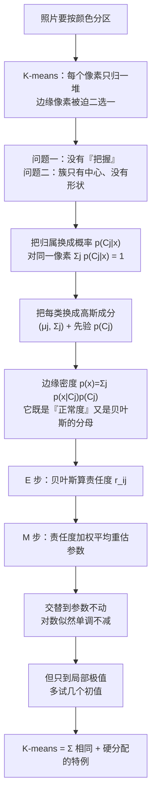

# 第 11 章 · 第 1 讲　EM 算法与高斯混合模型（课堂讲授版）

> [!quote] 本讲开场
> 同学们好。前面第 4 章我们用 K-means 学会了"把一堆没有标签的数据分成几堆"。K-means 很干脆：**每个样本只能属于一堆**，谁也不许脚踏两条船。像素是红的就全归红色那一类，像素是深红的，也只能硬着头皮选一个。
>
> 可是你想想真实情况。一张照片里，一个处在物体边缘的像素，它的颜色一半像天空、一半像树——**它凭什么非得只属于一边？** 硬分配在这种地方会造成的不是"略微判错"，而是**边界上的锯齿**和**噪声点被强行拉进某一类**。
>
> 更要紧的是另一件事。K-means 只会算一个东西：簇中心。它不告诉你"这个像素属于这一类的把握有多大"，也不会告诉你"这一类本身散布得多开"。**光有一个中心，是描述不了一团有形状、有胖瘦的像素分布的。**
>
> 这一讲就是来补这两件事的：
> 1. 把"属于哪一类"从**0 或 1** 换成**一个概率**——这就是**软分配 Soft Assignment**；
> 2. 把"一类"从**一个中心点**升级成**一个带形状的概率分布**——这就是**高斯混合模型 Gaussian Mixture Model**；
> 3. 然后我们会发现，K-means 里那套"先分配、再更新中心"的交替迭代，**本身就是这个新算法的一个特例**。多出来的那一步，叫 **EM 算法 Expectation–Maximization**。
>
> 这一讲的主线只有一句：**从"这个像素是哪一类"，走到"这个像素有多少把握是哪一类"。** 好，我们从一张要分割的照片开始。

> [!info] 怎么读这份讲义
> 前置内容是 [[C4.1 无监督学习与 K-means 算法]]（簇中心、距离、交替迭代）与 [[C5.1 异常检测的问题设定、高斯分布与参数估计]]、[[C5.4 多元高斯分布与它的异常检测]]（一元与多元高斯密度、均值与协方差的含义）。第 3 章的 [[C3.2 条件概率、链式法则与贝叶斯定理]] 是这一讲的核心工具——整讲的 E 步就是一次贝叶斯公式。
>
> 目前没有本学期对应转写稿。标有 **（拓展）** 或 **【拓展】** 的部分是课堂上未展开、由教材与通行讲法延伸补充的内容；复习时先掌握未标注的主干。本篇凡是出现的数值都用程序复算过，手算步骤全部写了出来。

---

## 一、问题：一张照片，怎么按颜色分区

### 1.1 先把图像分割这件事说清楚

**图像分割 Image Segmentation** 要干的事，用一句话讲：**把一张照片切成若干块，每块内部在某个意义上"是同一类东西"。** 本章要做的切片依据是最简单的一种——**颜色**。

做法也简单到可以手撸：

1. 把图像里的每个像素看成一个点。彩色图的三通道 $R,G,B$ 正好就是三维坐标，所以第 $i$ 个像素就是

   $$x_i=\{r_i,\ g_i,\ b_i\}\in\mathbb{R}^3 .$$

2. 在这一堆三维点里找 $K$ 个"颜色簇"；
3. 把每个像素按它的颜色归到某一簇，同一簇的像素在输出图上涂同一个颜色。

于是问题变成：**给你一堆三维点，找出 $K$ 个簇。** 这正是第 4 章 K-means 已经解决过的问题。

> [!question] 停一下，先自己想想
> 如果一张照片里的天空占了 60% 的像素、草地占 30%、一小片红花占 10%。直接问 K-means 要 3 个簇，它会均匀地把像素分成三份吗？

> [!question] 课堂追问：颜色聚类和我们平时说的"阈值分割"有什么不同？
> 阈值分割要先定一条线（比如"红色通道大于 200 就算天空"），这条线是人拍的。颜色聚类不需要人拍线：**它只要求你说出 K，剩下的成群方式由数据自己决定**。代价是 K 也得你选——这一点和 [[C4.2 K-means 的优化目标、随机初始化与选 K]] 里讨论的选 $K$ 是同一件事。

不会均分，但也不完全按面积走。K-means 只会照"离谁近"来分，**它没有"这一类的像素本来就该多一些"这种概念**。而现实中"天空占大头"是这类照片的常态，这种常识恰恰可以写进模型——第 4 章开头也提过，K-means 的随机初始化让结果不稳定，簇的规模完全由初始位置和距离决定。这一点在第 5 节会以"先验概率 $p(C_j)$"的形式回来。

### 1.2 K-means 是怎么做的：复习一遍关键两步

把第 4 章的做法压缩成一张流程：给定 $K$ 个初始均值 $m_1(1),\dots,m_K(1)$，设迭代计数 $ic=1$，然后反复做两件事：

1. **分配**：对每个向量 $x_i$，算它到每个均值的距离 $D(x_i,m_k(ic))$，**把它归给距离最小的那个簇 $C_j$**；
2. **更新**：把 $ic$ 加 1，用每个簇里现有成员重新算均值。

停下来条件写得很具体：**直到所有簇的成员不再变化**，即

$$C_k(ic)=C_k(ic+1)\quad\text{对全部 }k\text{ 成立}.$$

![[C11-Kmeans迭代过程.png]]

上图是四个点、两个簇的三轮迭代。第一轮从 $m_1=(0,0)$、$m_2=(5,0)$ 出发，虚线是两均值连线的垂直平分线——它把平面切成两半，**每个点看自己在哪一半，这就是"分配"**；然后两个叉分别挪到自己那一半成员的质心，这就是"更新"。第二轮起边界跟着均值一起转，到第三轮均值不再移动，迭代结束。

有两个细节值得盯住：

- **边界是一条硬线**。垂直平分线两侧的点待遇完全不同，落在线上偏一毫米就换阵营。这就是"硬分配"的几何长相。
- **均值一起动、边界一起转**。所以 K-means 的结果对初始位置敏感：初始均值放得不好，可能停在两个都别扭的位置上，而且它自己走不出来。第 5 节末尾会拿这一点和 EM 对照。

### 1.3 硬分配在哪里不够用

现在把 K-means 用回照片上，问题立刻出现：

**问题一：边缘像素被强行二选一。** 一个处在蓝天和绿树交界处的像素，颜色是 $(120,150,110)$，偏蓝一点也偏绿一点。K-means 说"你归蓝色簇"，输出图上这个像素就被涂成纯蓝。整条边界上几百个这样的像素各选各的，结果就是**锯齿状的边界**，还夹着孤零零的错分点。

**问题二：簇的形状完全没被描述。** K-means 对每个簇只说了一句话："它的中心在这里。" 它**不知道**这团像素是紧实地挤在中心附近，还是松松地摊开一大片；也不知道这团像素在 $R$ 方向长、$G$ 方向短（**各向异性**）。可在颜色空间里，不同物体的颜色分布形状差得远：一片天空的蓝色可以很宽，一朵花的红可能很窄。

**问题三：没有"把握"这个概念。** 一个像素离两个簇心一样远，K-means 也只能随便挑一个，而且它对"我这次挑得很勉强"这件事一个字都不说。

一句话总结：**K-means 把"属于某一类"当成是非题，而它其实是个程度问题。**

---

## 二、把归属从 0/1 换成概率

### 2.1 从"归给谁"到"有多少把握归给它"

先把问题一解决。我们不再问"$x_i$ 属于哪一堆"，改问：

> **$x_i$ 属于第 $j$ 类的概率是多少？** 记作 $p(C_j\mid x_i)$。

这个记号读作"在已经看到像素 $x_i$ 的条件下，它来自第 $j$ 类这件事的概率"。它一定落在 $[0,1]$，而且对同一个像素，**属于所有类的概率加起来是 1**：

$$\sum_{j=1}^{K}p(C_j\mid x_i)=1 .$$

对比一下就清楚两者的关系了：

| | K-means | 软分配 |
|---|---|---|
| 一个像素的输出 | 一个簇号 $C(x_i)$ | $K$ 个数 $p(C_1\mid x_i),\dots,p(C_K\mid x_i)$ |
| 归属强度 | 全是 0 或 1 | $[0,1]$ 里的任意值 |
| 边界上的像素 | 被迫选一边 | $0.5/0.5$，两边都认 |
| 输出图的边界 | 锯齿状 | 过渡色，平滑 |

![[C11-硬分配到软分配.png]]

上图把三种情况并排放在 RGB 平面上（横轴 $R$、纵轴 $G$，颜色只是为了看清，实际是三维）。左图是三个真实颜色簇，中间那个黑圈是"骑墙"的像素；中图是 K-means 的结果：**每个点只有一种颜色，黑圈里的点被硬塞给最近的簇**；右图是软分配的结果：**每个点的颜色是三个簇颜色的加权混合**——离三个簇心都远的骑墙点，颜色就明显偏灰，一眼能看出"它自己也不知道该归谁"。

> [!important] 软分配的回报
> 一个像素不再"选一个簇、丢掉其余信息"，而是**带着一份完整的成分表**：$0.7$ 的天空、$0.25$ 的树、$0.05$ 的花。
>
> 这份成分表在后面有用：分割图可以按最大概率上色（得到平滑的硬边界），也可以保留混合色（得到过渡边界）；而在第 3 节它会直接决定参数怎么更新——**属于得越多的像素，说话越有分量**。

### 2.2 光有概率还不够：模型在哪儿

现在有个问题被绕过去了。要算 $p(C_j\mid x_i)$，得先知道**第 $j$ 类长什么样**。而"长什么样"这件事，正是问题二说的：K-means 只给了一个中心。

所以我们得先造一个模型。假设第 $j$ 类是这样一团数据：**它以 $\mu_j$ 为中心、以某个散布程度摊开**。最容易想到、也最经得起推敲的描述，是**高斯分布 Normal / Gaussian Distribution**——第 5 章已经用过它两次（一元高斯的异常检测、多元高斯的异常检测）。

于是每个簇有自己的一套参数：

- $\mu_j$：第 $j$ 类的**中心**（均值），一个和 $x$ 同维的向量。颜色空间里就是 $(r,g,b)$ 三个数；
- $\Sigma_j$：第 $j$ 类的**散布形状**（协方差矩阵），一个方阵。它同时说了三件事：**摊得多开**（对角线上的 $\sigma^2$）、**在哪个方向摊得开**（特征向量的方向）、**不同通道之间有没有联动**（非对角线元素）。

再加上一个描述"这类本来占多少"的量：

- $p(C_j)$：第 $j$ 类的**先验概率 Prior Probability**，也就是"不看这个像素，我就认为它属于第 $j$ 类的可能性"。$\sum_j p(C_j)=1$。

一组 $(C_j,\ \mu_j,\ \Sigma_j)$ 就定义了一个**成分 Component**；把它们按先验加权加起来，就得到一个**混合模型 Mixture Model**。整件事的正式名字是：

> [!important] 高斯混合模型 Gaussian Mixture Model（GMM）
> 数据由 $K$ 个高斯成分按权重混合生成。第 $i$ 个点 $x_i$ 的**边缘密度**是
> $$p(x_i)=\sum_{j=1}^{K}p(x_i\mid C_j)\cdot p(C_j),$$
> 其中 $p(x_i\mid C_j)$ 是第 $j$ 个成分的高斯密度，$p(C_j)$ 是它的先验权重。

**这里的 $p(x_i)$ 必须记住它的两个身份。** 它是这个点在模型下"有多正常"的分数（这正是 [[C5.1 异常检测的问题设定、高斯分布与参数估计]] 里那个角色），而同时——**它是 E 步那个贝叶斯公式的分母**。第 3 节立刻会用到。

> [!note] 【拓展】为什么偏偏用高斯，而不是别的分布
> 三条理由，从弱到强：
> 1. **习惯与便利**：$\mu$ 和 $\Sigma$ 两个量就能把一个"团"描述完，参数少、公式干净。
> 2. **它是连续型里最"没有额外主张"的选择**：在只给定均值和方差的前提下，高斯是熵最大的分布。换句话说，**你几乎没往模型里塞私货**。
> 3. **中心极限定理**：把很多独立小因素叠加起来，极限就是高斯。一个物体的颜色受光源、材质、阴影、噪声共同影响，这些因素叠加的净效果接近高斯是合理的。
>
> 反过来说，当数据明显不是椭球团（比如"颜色只沿一条曲线分布"，或取值被卡在 $[0,255]$ 顶到边界），高斯就不合适了，那时要换别的成分分布。这属于本课的边界之外。

---

## 三、EM 算法：交替算责任度与参数

### 3.1 E 步：一次贝叶斯，把"把握"算出来

现在把第 2 节两件事接上：**用模型算出归属概率，再用归属概率去改模型。**

先看第一步。已知每个成分的参数 $(\mu_j,\Sigma_j)$ 和先验 $p(C_j)$，问 $p(C_j\mid x_i)$。这是一个标准的条件概率问题，用贝叶斯公式：

$$p(C_j\mid x_i)=\frac{p(x_i\mid C_j)\cdot p(C_j)}{p(x_i)}=\frac{p(x_i\mid C_j)\cdot p(C_j)}{\displaystyle\sum_{k=1}^{K}p(x_i\mid C_k)\cdot p(C_k)} .$$

把等式两端拆开逐项读一遍，这个公式其实一点不吓人：

| 记号 | 名字 | 怎么读 |
|---|---|---|
| $p(x_i\mid C_j)$ | **似然 Likelihood** | "如果这个像素真属于第 $j$ 类，它长成现在这个颜色的可能性有多大" |
| $p(C_j)$ | **先验 Prior** | "还没看这个像素，我就觉得它属于第 $j$ 类的可能性" |
| $p(x_i\mid C_j)\,p(C_j)$ | 分子 | 两句话相乘：**"属于它、并且长这样"的联合可能性** |
| $p(x_i)=\sum_k(\cdots)$ | **边缘似然** | 把所有类的这个联合可能性加总：**"它长成这样的总可能性"** |
| $p(C_j\mid x_i)$ | **后验 Posterior**，即**责任度 Responsibility** | 归一化之后的份额："在它长这样的前提里，第 $j$ 类贡献了多大比例" |

**分母那个求和不是装饰品，它负责让概率归一。** 分子算出来的是"未归一的可能性"，可能远小于 1（比如 $10^{-7}$）；除以所有类之和之后，$K$ 个数才加起来等于 1。这一点在下面手算里看得最清楚。

> [!important] 责任度 Responsibility 这个名字的来头
> $p(C_j\mid x_i)$ 也叫**责任度**：**"第 $j$ 个成分对生成这个数据点要负多大责任。"**
>
> 这个叫法不只是好听的别名，它正好说明了下一步怎么用：一个成分对 $x_i$ 负的责任越大，那么 $x_i$ 在**重估这个成分的位置和形状**时就越有发言权。M 步的公式会把这句话精确写出来。

### 3.2 直观版手算：一个像素的责任度

先别碰协方差，用最简单的一维情形把数算出来。

设只有两个成分，均值 $\mu_1=0$、$\mu_2=4$，两者都是标准差 $\sigma=1$ 的高斯，先验各占一半 $p(C_1)=p(C_2)=0.5$。现在给一个数据点 $x=3$，问它的责任度。

这一步只需要一元高斯密度

$$p(x\mid C_j)=\frac{1}{\sqrt{2\pi\sigma^2}}\exp\!\left(-\frac{(x-\mu_j)^2}{2\sigma^2}\right).$$

**先算分子的两项。** 两个成分的 $\sigma^2$ 相同，所以前面的系数 $\frac{1}{\sqrt{2\pi}}$ 也相同——**它会在相除时整体约掉**，不必算出具体值。于是只要比指数部分：

$$p(3\mid C_1)\propto\exp\!\left(-\frac{(3-0)^2}{2}\right)=e^{-4.5}\approx0.011109,$$
$$p(3\mid C_2)\propto\exp\!\left(-\frac{(3-4)^2}{2}\right)=e^{-0.5}\approx0.606531 .$$

**再乘先验。** 先验都是 $0.5$，一乘还是各乘 $0.5$，比例不变：

$$\text{分子}_1\approx0.0055545,\qquad \text{分子}_2\approx0.303265 .$$

**最后归一。** 分母是两者之和 $0.0055545+0.303265\approx0.3088195$：

$$p(C_1\mid 3)=\frac{0.0055545}{0.3088195}\approx0.018,\qquad p(C_2\mid 3)=\frac{0.303265}{0.3088195}\approx0.982 .$$

验算一下：$0.018+0.982=1$。✓

$x=3$ 离 $\mu_2=4$ 只差 1，离 $\mu_1=0$ 差 3，所以它九成八归第二类。但**注意它不是 1**：还剩 $1.8\%$ 的份额给了第一类。这就是软分配——**"很确定"和"绝对确定"是两件不同的事。**

再代入几个数，看看责任度这条曲线到底什么形状：

| $x$ | 未归一 $0.5\,p(x\mid C_1)$ | 未归一 $0.5\,p(x\mid C_2)$ | $p(C_1\mid x)$ |
|---|---|---|---|
| $-3$ | $0.0055545$ | $1.14\times10^{-11}$ | $1.000000$ |
| $-1$ | $0.303265$ | $1.86\times10^{-6}$ | $0.999994$ |
| $0$ | $0.5$ | $1.68\times10^{-4}$ | $0.999665$ |
| $1$ | $0.303265$ | $0.0055545$ | $0.982014$ |
| $2$ | $0.0676676$ | $0.0676676$ | $0.500000$ |
| $3$ | $0.0055545$ | $0.303265$ | $0.017986$ |
| $4$ | $1.68\times10^{-4}$ | $0.5$ | $0.000335$ |
| $5$ | $1.86\times10^{-6}$ | $0.303265$ | $0.000006$ |

三件事必须看出来：

1. **两个成分正中间的点 $x=2$，责任度正好是 $0.5/0.5$。** 这不是巧合：两个成分参数完全对称，中间点没有理由偏向任何一边。
2. **这个 $0.5$ 和 $\sigma$ 无关。** 只要两个成分等强、位置对称，中点永远是 $0.5/0.5$，$\sigma$ 取多大都一样。$\sigma$ 决定的是**别的点被判得多干脆**。
3. **离开中点以后迅速变硬。** $\sigma=1$ 时，离开 $0.5$ 个标准差（$x=2.5$）责任度就已经是 $0.924/0.076$ 了。所以实践中责任度**往往是接近 0 或接近 1 的数**——软分配并不是"到处都糊成一团"，它只是**在真正模糊的地方**才给出中间值。

$\sigma$ 的影响可以画得更清楚：

![[C11-责任度随方差变化.png]]

左图是六个二维点、两个初始均值 $(0,1)$ 与 $(5,4)$ 下，责任度 $r_1=p(C_1\mid x)$ 随共享方差 $\sigma^2$ 的变化。$\sigma^2$ 很小时（$<2$）每条曲线都死死贴在 0 或 1 上，这时**软分配退化成硬分配**；$\sigma^2$ 涨到 16，横跨中间的曲线被拉向 $0.5$——模型承认"我分不清了"。右图把这个规律推到极端：**恰好落在两均值正中间的那个像素，无论 $\sigma^2$ 取多少，$r_1$ 恒为 $0.5$**；而偏一侧的那个像素，$\sigma^2$ 越大、责任度越向 $0.5$ 靠。

> [!warning] 一个必须避免的直觉错误
> "$\sigma$ 越大，模型越模糊，所以所有点的责任度都趋向 $0.5$"——**前半句对，后半句错**。
>
> 正中间的点**永远**是 $0.5$，这不是"模糊"造成的，是**对称**造成的；同样，一个明显偏在左边的点，$\sigma$ 再怎么大，$r_1$ 也仍然大于 $0.5$。$\sigma$ 调节的是**曲线的陡峭程度**，不是**曲线的中心位置**。这个区别在考试里常以"$\sigma$ 变化时这个点的责任度怎么变"的形式出现。

### 3.3 M 步：按责任度重新估参数

E 步给了我们一堆责任度 $r_{ij}:=p(C_j\mid x_i)$。现在反过来用它们改模型。

先回到 K-means 的更新式，看看它是什么样：

$$m_j=\operatorname{mean}\{x_i\mid x_i\in C_j\}=\frac{\sum_{i\in C_j}x_i}{|C_j|} .$$

读作"把属于第 $j$ 簇的点加起来，除以个数"。**这个式子的隐含前提是"属于"是个是/否问题**——一个点要么在里面（权重 1），要么在外面（权重 0）。

软分配把权重从 0/1 换成了 $r_{ij}$。于是更新式顺理成章地变成**加权平均**：

$$\boxed{\ \mu_j=\frac{\displaystyle\sum_{i=1}^{N}p(C_j\mid x_i)\cdot x_i}{\displaystyle\sum_{i=1}^{N}p(C_j\mid x_i)}\ }$$

这是一个**以责任度为权重的加权平均**。分母的 $\sum_i p(C_j\mid x_i)$ 有一个专门的名字和解释：

$$N_j:=\sum_{i=1}^{N}p(C_j\mid x_i).$$

**$N_j$ 叫"第 $j$ 类的有效样本数"。** 注意它不是整数——如果两个像素各有 $0.5$ 的责任，那它们合起来算"一个"样本。这一点是软分配和硬分配最本质的区别。

同理，另外两个参数也都有直观的加权读法：

$$p(C_j)=\frac{\displaystyle\sum_{i=1}^{N}p(C_j\mid x_i)}{N}=\frac{N_j}{N}\quad\text{（这是"第 }j\text{ 类占多大份额"）},$$

$$\Sigma_j=\frac{\displaystyle\sum_{i=1}^{N}p(C_j\mid x_i)\cdot(x_i-\mu_j)\cdot(x_i-\mu_j)^{T}}{\displaystyle\sum_{i=1}^{N}p(C_j\mid x_i)}\quad\text{（这是"第 }j\text{ 类散布成什么形状"）}.$$

$\Sigma_j$ 的分子是**责任度加权的离差外积之和**——和协方差的定义式一模一样，只是每个样本的离差按它的责任度记分量。权重大的像素把这一类的形状"拉"向自己所在的方向。

> [!important] 一句话记住 E 步与 M 步的分工
> **E 步**：固定参数，算每个像素对每个类的责任度 $p(C_j\mid x_i)$。**先用模型解释数据。**
> **M 步**：固定责任度，用它们重估 $(\mu_j,\Sigma_j)$ 和 $p(C_j)$。**再用数据修正模型。**
>
> 两句话来回，就是 EM。它和 K-means 的"分配 / 更新"是同一个骨架，只是**分配换成了软分配，更新换成了加权更新**。

> [!note] M 步的公式是怎么来的（**拓展**）
> 这三个式子不是凑出来的，是**最大化对数似然**得到的。把全部数据的对数似然写成
> $$\ell(\theta)=\sum_{i=1}^{N}\log p(x_i)=\sum_{i=1}^{N}\log\sum_{j=1}^{K}p(x_i\mid C_j)\,p(C_j),$$
> 然后对 $\mu_j$ 求偏导并令其为 0：$\frac{\partial\ell}{\partial\mu_j}=0$。这里有一个**技术困难**：$\log$ 里面套着对 $j$ 的求和，**这个求和不参与求导**，直接解方程会得到一组互相纠缠的方程，没有闭式解。
>
> EM 的处理办法是**先给一组责任度当"已知"，把求和从 $\log$ 里拆出去**，于是最大化变成一个可以直接求导的加权最小二乘问题，解出来正是上面的 $\mu_j$。$\Sigma_j$ 与 $p(C_j)$ 同理（对 $\Sigma_j$ 求导要用到矩阵求导公式 $\frac{\partial}{\partial\Sigma}\log\det\Sigma=\Sigma^{-1}$）。
>
> 这就是 EM 名字的来历：**Expectation 步给出责任度的期望，Maximization 步在这个期望下最大化似然**。它不是"随便交替一下居然能收敛"，而是"目标函数被替换成了一个保证不超出的下界，并且每轮把这个下界抬到当前值"。详细论证属于本课边界之外，但结论要记住：**每次 EM 迭代都不会让 $\ell(\theta)$ 下降。**

### 3.4 完整版：每个簇有自己的形状

把先验和协方差都放回来，就是完整的高斯混合模型。这一步的关键是写清**第 $j$ 个成分的高斯密度**：

$$p(x_i\mid C_j)=\frac{1}{(2\pi)^{d/2}\,\lvert\Sigma_j\rvert^{1/2}}\exp\!\left(-\frac{1}{2}(x_i-\mu_j)^{T}\Sigma_j^{-1}(x_i-\mu_j)\right),$$

其中 $d$ 是数据维度（颜色空间里 $d=3$），$\lvert\Sigma_j\rvert$ 是协方差矩阵的行列式。

**这个公式的每一块都要能读出来**，因为它直接解释了"协方差到底在干什么"：

| 部件 | 作用 |
|---|---|
| $(x_i-\mu_j)^{T}\Sigma_j^{-1}(x_i-\mu_j)$ | 到中心的**马氏距离平方 Mahalanobis Distance**。它把欧氏距离按协方差的方向和胖瘦重新缩放：$\Sigma$ 大的方向，同样的偏移罚得轻 |
| $\exp(-\frac12\cdot)$ | 距离越远，值越小，永远为正、永不归零 |
| $\lvert\Sigma_j\rvert^{1/2}$ 在分母 | **归一化因子**。散布得越开（$\lvert\Sigma\rvert$ 越大），峰值越低——"摊薄"了。少了它，一个松散的簇会因为"处处都不太小"而永远赢 |
| $(2\pi)^{d/2}$ | 一维时就是熟悉的 $\sqrt{2\pi}$；维度越高，常数越大 |

> [!warning] 最容易漏的是那个行列式
> 很多人在比较两个成分时只看指数里的距离，忘了分母上的 $\lvert\Sigma_j\rvert^{1/2}$。**后果是"胖"的成分会系统地占便宜**：一个散布很宽的成分，即使在远处，密度值也不小。
>
> 举个数：二维各向同性、$\sigma^2=0.25$ 时 $\lvert\Sigma\rvert=0.0625$、$\frac{1}{\sqrt{\lvert\Sigma\rvert}}=4$；$\sigma^2=4$ 时 $\lvert\Sigma\rvert=16$、$\frac{1}{\sqrt{\lvert\Sigma\rvert}}=0.25$。**同样的中心距离下，前者的密度峰值是后者的十几倍。** 这就是归一化的意义：**让"紧凑"和"松散"在同一起跑线上比。**

代入边缘密度 $p(x_i)=\sum_k p(x_i\mid C_k)p(C_k)$，E 步变成

$$p(C_j\mid x_i)=\frac{p(x_i\mid C_j)\cdot p(C_j)}{\displaystyle\sum_{k=1}^{K}p(x_i\mid C_k)\cdot p(C_k)},$$

M 步三个式子照 3.3 节所写。**E 步和 M 步合起来，就是这一讲的主角：**

> [!important] EM 算法（完整流程）
> **Boot Step（初始化）**：初始化 $K$ 个簇 $C_1,\dots,C_K$，给每个簇一组参数
> $$(\mu_j,\ \Sigma_j)\ \text{和}\ p(C_j),\qquad j=1,\dots,K .$$
>
> **Iteration Step（迭代）**：反复做以下两步，直到参数不再变化——
> 1. **Expectation Step（E 步）**：用**当前参数**算每个点对每个簇的责任度
>    $$p(C_j\mid x_i)=\frac{p(x_i\mid C_j)\cdot p(C_j)}{\sum_k p(x_i\mid C_k)\cdot p(C_k)};$$
> 2. **Maximization Step（M 步）**：用**当前责任度**重估参数
>    $$\mu_j=\frac{\sum_i p(C_j\mid x_i)\,x_i}{\sum_i p(C_j\mid x_i)},\quad
>    \Sigma_j=\frac{\sum_i p(C_j\mid x_i)(x_i-\mu_j)(x_i-\mu_j)^{T}}{\sum_i p(C_j\mid x_i)},\quad
>    p(C_j)=\frac{\sum_i p(C_j\mid x_i)}{N}.$$

### 3.5 六个"像素"走一遍完整迭代

公式看多了会麻木，代一次数就清楚了。取 RGB 平面上六个点，看成六个像素的颜色（只看两个通道，便于画图）：

| | $x_1$ | $x_2$ | $x_3$ | $x_4$ | $x_5$ | $x_6$ |
|---|---|---|---|---|---|---|
| 坐标 | $(0,0)$ | $(0,1)$ | $(1,0)$ | $(4,4)$ | $(4,5)$ | $(5,4)$ |

六个像素明显分成两团：左边三个暗色、右边三个亮色。我们要用 $K=2$ 的 GMM 把它们分开。

![[C11-EM一轮数值演示.png]]

上图走的就是下面这套数：第一张是初始位置，第二、三张是两次 M 步之后两个中心的位置（各自朝自己那团数据挪过去，第二次就基本不动了），第四张是责任度——左边三个像素对第二类的责任度几乎为 $0$，右边三个几乎为 $1$。

**为了把注意力留在 EM 的骨架上，先做一个简化：两个成分共用同一个各向同性协方差 $\Sigma_1=\Sigma_2=\sigma^2 I$，并且把它固定在 $\sigma^2=2$；先验也固定为 $p(C_1)=p(C_2)=0.5$。于是这一轮里只有 $\mu_1,\mu_2$ 会被更新**——这正是 K-means 更新的加权版。等看懂了这个，再把协方差放回来。

**Boot Step。** 初始均值取 $\mu_1=(0,1)$、$\mu_2=(5,4)$（故意放得不太准，好看出迭代过程）。

**第一次 E 步。** 因为两个成分的 $\sigma^2$ 和先验完全相同，归一化常数与先验在相除时全部约掉，**责任度只由指数里的距离决定**：

$$p(C_1\mid x_i)\ \propto\ \exp\!\left(-\frac{\lVert x_i-\mu_1\rVert^2}{2\sigma^2}\right),\qquad \sigma^2=2 .$$

逐个算 $x_1=(0,0)$：

$$\lVert x_1-\mu_1\rVert^2=(0-0)^2+(0-1)^2=1,\qquad \lVert x_1-\mu_2\rVert^2=(0-5)^2+(0-4)^2=25+16=41 .$$

未归一的权：$e^{-1/4}=0.778801$ 与 $e^{-41/4}=e^{-10.25}\approx3.55\times10^{-5}$。归一化：

$$p(C_1\mid x_1)=\frac{0.778801}{0.778801+0.0000355}\approx0.999955 .$$

其余五个点同法。全部结果：

| 点 | $\lVert x_i-\mu_1\rVert^2$ | $\lVert x_i-\mu_2\rVert^2$ | $p(C_1\mid x_i)$ | $p(C_2\mid x_i)$ |
|---|---|---|---|---|
| $x_1(0,0)$ | $1$ | $41$ | $0.999955$ | $0.000045$ |
| $x_2(0,1)$ | $0$ | $34$ | $0.999797$ | $0.000203$ |
| $x_3(1,0)$ | $2$ | $32$ | $0.999447$ | $0.000553$ |
| $x_4(4,4)$ | $25$ | $1$ | $0.002473$ | $0.997527$ |
| $x_5(4,5)$ | $32$ | $2$ | $0.000553$ | $0.999447$ |
| $x_6(5,4)$ | $34$ | $0$ | $0.000203$ | $0.999797$ |

（验算：每一行两数之和为 1。$\mu_1$ 与 $\mu_2$ 的列完全镜像对称，因为初始均值互为对方的镜像。）

**第一次 M 步。** 把责任度当权重，算两类的有效样本数：

$$N_1=0.999955+0.999797+0.999447+0.002473+0.000553+0.000203=3.002427,$$
$$N_2=6-N_1=2.997573 .$$

然后加权平均。以 $\mu_1$ 的横坐标为例：

$$\mu_{1,R}=\frac{0.999955\times0+0.999797\times0+0.999447\times1+0.002473\times4+0.000553\times4+0.000203\times5}{3.002427}\approx0.337249 .$$

纵坐标同法，得

$$\mu_1=(0.337249,\ 0.337482),\qquad \mu_2=(4.332650,\ 4.332417).$$

两个中心都朝各自那团数据挪了近 $0.75$——**这一步和 K-means 的"挪到质心"长得一模一样，区别只在权重不再是 0/1**。

**第二次 E 步。** 用新的均值重算责任度：

| 点 | $p(C_1\mid x_i)$ | $p(C_2\mid x_i)$ |
|---|---|---|
| $x_1$ | $0.999911$ | $0.000089$ |
| $x_2$ | $0.999346$ | $0.000654$ |
| $x_3$ | $0.999345$ | $0.000655$ |
| $x_4$ | $0.001290$ | $0.998710$ |
| $x_5$ | $0.000175$ | $0.999825$ |
| $x_6$ | $0.000175$ | $0.999825$ |

**第二次 M 步**给出 $\mu_1=(0.335333,0.335333)$、$\mu_2=(4.331656,4.331656)$，移动量只有 $0.003$ 量级。第三轮移动 $2\times10^{-5}$，第四轮就**完全不动了**——收敛。

> [!example] 这个例子里最值得注意的一件事
> 六个点**从头到尾都在"背叛"它们的邻居**：$x_2$ 明明更靠近 $x_1$，但它对第一类的责任度是 $0.999797$ 而不是 $1$；$x_3$ 每次也把 $0.0006$ 左右的份额分给第二类。
>
> 这些零头非常小，所以**最终结果和 K-means 几乎一样**（K-means 在同样数据上得到 $m_1=(0.333,0.333)$、$m_2=(4.0,3.667)$，失真 $J=4$）。这正是软分配的常态：**当两团数据分得很开时，软分配自己会退化成硬分配。**
>
> 但在两团交界处，这个零头就会变成 $0.3$、$0.4$ 这种量级——**那才是 GMM 真正比 K-means 强的地方**，第 5 节末尾会讲怎么利用它。

### 3.6 EM 为什么会收敛，以及它会卡在哪里

把每次迭代后的对数似然记下来，就能看到 EM 的脾气：

![[C11-EM对数似然单调.png]]

上图的数据就是 3.5 节那六个点。第一轮把 $\ell$ 从 $-5.6548$ 抬到 $-4.8225$，涨了 $0.83$；第二轮只涨 $7\times10^{-6}$；之后完全平掉。这两件事分开记：

**好消息：$\ell(\theta)$ 单调不减。** 每一轮 E 步都在给定参数下算出准确的责任度期望，M 步在这个期望下最大化，可以证明 $\ell$ 不会下降（3.3 节的拓展里说了原因：EM 每轮把一个下界抬到当前值，所以真实目标只会跟着涨）。所以**看到似然下降，一定是代码写错了**，不可能"EM 自己抖下去了"。

**坏消息：它只保证爬到某个山顶，不保证是最高那个。** EM 是一个**爬山法**：只看脚下哪儿更高，不看远处。所以：

- 初值不同，可能停在**不同的局部极大值**上；
- 成分数 $K$ 设得比真实类数多时，两个成分可能**同时塌到同一团数据上**，把它们各自的 $\Sigma_j$ 越缩越小、似然越来越高——这是 GMM 的**退化 Degenerate 解**，是真实存在的失败模式；
- 样本很少、协方差完全自由时，一个成分可以收缩到**单个数据点上**，此时 $\lvert\Sigma_j\rvert\to0$、密度趋向无穷，似然也趋向无穷。**这不是"EM 学得好"，这是过拟合。**（本课数据不会遇到，但自己写代码时会撞上。）

因此实践中要做的两件事，和第 4 章选 $K$ 的处境完全一样：

1. **多跑几次随机初始化，取对数似然最高的那一个**——对应 [[C4.2 K-means 的优化目标、随机初始化与选 K]] 里的多次随机初始化；
2. **限制协方差的自由度**（比如强制 $\Sigma_j=\sigma^2I$ 或共享一个 $\Sigma$）来避免退化，代价是模型表达力下降。

> [!note] 【拓展】K-means 就是 EM 的一个特例
> 这不是"两者很像"，而是**严格包含**。取
> $$\Sigma_j=\sigma^2I\ (\text{所有 }j\text{ 相同}),\qquad p(C_j)=\frac1K\ (\text{先验均匀}),$$
> 再令 $\sigma^2\to0$。此时指数项 $e^{-\lVert x_i-\mu_j\rVert^2/(2\sigma^2)}$ 会由距离最小的那个成分**彻底压倒**其余成分，于是责任度变成
> $$p(C_j\mid x_i)\to\begin{cases}1,&j=\arg\min_k\lVert x_i-\mu_k\rVert,\\[2pt]0,&\text{否则}.\end{cases}$$
> 这正是 K-means 的硬分配"归给最近的簇"。把它代回 M 步，加权平均退化成算术平均，就是 K-means 的更新式。
>
> **所以"K-means → EM"不是把一个算法换成另一个，而是把两个自由度放开**：分配从硬变软（$\sigma$ 由 0 变正），簇形状从等大球形变成各有各的 $\Sigma_j$。**"K-Means → EM"这个箭头说的就是这件事：不是换算法，是放开两个自由度。**

---

## 四、回到照片：分割与检索

### 4.1 用 EM 做图像分割

把第 3 节的算法套回第 1 节的问题，只需要替换两处记号：数据点是像素 $x_i=(r_i,g_i,b_i)$，$K$ 是要分出的颜色类数。流程：

1. **初始化**：给 $K$ 个颜色类各一组 $(\mu_j,\Sigma_j)$ 和先验 $p(C_j)$；
2. **迭代**：E 步算每个像素对每个颜色类的责任度，M 步按责任度重估 $(\mu_j,\Sigma_j,p(C_j)$），直到收敛；
3. **输出**：每个像素得到一串 $\bigl(p(C_1\mid x_i),\dots,p(C_K\mid x_i)\bigr)$。

第 3 步的用法有两种，对应两种不同的图：

- **要一张硬分割图**：取 $\arg\max_j p(C_j\mid x_i)$，每块区域涂成一个纯色。因为责任度已经是"模型消化过颜色分布"之后的判断，**它比直接对像素做 K-means 更不容易在噪声点上翻车**（噪声点会拿到一个接近均匀的责任度，而不是被硬拉进某一类）。
- **要一张软过渡图**：直接把责任度当成混合色比例输出。物体边缘会自然出现过渡带，**这正是第 1 节那个锯齿问题的答案**。

> [!important] 用 GMM 而不是 K-means 的三个实际好处
> | | K-means | GMM（EM） |
> |---|---|---|
> | 簇的形状 | 只有中心，隐含"等大球形" | 每个簇有自己的 $\Sigma_j$：胖瘦、方向都学得出来 |
> | 边界像素 | 硬选一边，产生锯齿 | 输出责任度，边界平滑 |
> | 类别规模 | 不知道"这类本来就该多些" | 先验 $p(C_j)$ 直接学出每类占比 |
> | 噪声鲁棒性 | 离群点被强行拉进最近簇 | 离群点责任度接近均匀，不会强行带动参数 |
>
> 代价是计算量和参数都变多：K-means 每轮只算 $K$ 个均值，GMM 每轮还要估 $K$ 个协方差矩阵（$d\times d$ 个参数，颜色空间里是 $3\times3$ 六个独立数），而且**初始化更敏感**。

### 4.2 目标类识别与 CBIR

EM 分割出来的区域可以再往上垒一层应用：**基于内容的图像检索 Content-Based Image Retrieval（CBIR）** 里的**目标类识别 Object Class Recognition**。

思路是一条直链：

1. 用 EM 把一张图**分割成若干区域**；
2. 每个区域用它的**特征**（颜色直方图、纹理统计、形状描述子等）表示成一个特征向量；
3. 把全库图像的区域特征建成索引；
4. 检索时，对查询图像做同样的分割与特征提取，在库里找特征最相近的图像，返回结果。

**和关键词检索的本质区别**：关键词检索靠人给图片打标签（"猫""沙滩"），标签是人的主观判断，且只覆盖人想到的词；CBIR 靠图像自身的像素统计，**它是"以图搜图"而不是"以词搜图"**。代价是：**"相似"要由特征和度量定义，而颜色相似不一定等于语义相似**——一片绿草地和一件绿衣服在颜色特征上可以非常接近。这就是 CBIR 至今没有被彻底解决的"语义鸿沟 Semantic Gap"。

> [!note] 【拓展】这一讲之后，EM 还会在哪里出现
> EM 不是只为图像分割造的。**只要模型里有"看不见的中间变量"，它就派得上用场**，本课程后续至少有两处：
> - **隐变量视角**：把"这个点属于哪个簇"看成看不见的隐变量 $z_i$。E 步其实是在算 $z_i$ 的后验分布，M 步是在这个后验下更新参数。**"数据不完全，就先把缺的补成一个分布"**是 EM 的一般形态。
> - **与下一讲的联系**：下一讲要做的 Boosting，是把很多"弱"的分类规则加权组合成一个强分类器；而 GMM 是把很多"简单"的高斯成分加权组合成一个复杂的密度。**两者都在做"加权组合零件"，只不过一个是分类器、一个是概率密度。**
>
> 工程上，`sklearn.mixture.GaussianMixture` 就是这套算法，参数 `covariance_type` 的四个取值正对应本讲讨论的几种自由度：`full`（每个簇自己的完整 $\Sigma_j$，本篇公式）、`tied`（所有簇共享一个 $\Sigma$）、`diag`（只学对角，忽略通道间联动）、`spherical`（$\sigma_j^2I$，就是 K-means 的软版本）。

---

## 五、停一下：这一讲的骨架

把这一讲压缩成一条推理链：

请注意这条链的**方向**：不是"先有 EM 这个名字，再去找它能干什么"，而是**从"硬分配不够用"这个具体的疼处长出来的**。两处最容易被跳过、也最值得自己复述一遍的环节：

- **为什么 $p(x_i)$ 会出现在分母里**：因为分子只是"属于它且长这样"的联合可能性，不保证所有类加起来是 1，而概率必须归一。忘了这一条，就会写出"责任度加起来不等于 1"的代码。
- **为什么 M 步是加权平均**：因为责任度的名字就写明了它的用途——它对生成这个点负多大责任，就在重估参数时占多大发言权。

---

## 本讲小结：今天要记住的三件事

> [!important] 三句话
> 1. **软分配把"属于哪一类"从 0/1 换成概率**。$p(C_j\mid x_i)$ 叫**责任度**，由贝叶斯公式给出，分母 $p(x_i)=\sum_k p(x_i\mid C_k)p(C_k)$ 负责归一。同一像素对所有类的责任度加起来恒为 1；两个等强对称成分的正中点永远是 $0.5/0.5$，与 $\sigma$ 无关。
> 2. **GMM 把每个簇升级成一个高斯成分 $(\mu_j,\Sigma_j)$ 加一个先验 $p(C_j)$**。$\mu_j$ 说中心，$\Sigma_j$ 说散布形状与方向，$p(C_j)$ 说每类占多大份额；高斯密度分母上的 $\lvert\Sigma_j\rvert^{1/2}$ 是归一化因子，**少了它，"胖"成分会白占便宜**。
> 3. **EM 交替做两件事**：E 步用当前参数算责任度，M 步用责任度加权重估参数——$\mu_j=\frac{\sum_i p(C_j\mid x_i)x_i}{\sum_i p(C_j\mid x_i)}$，$\Sigma_j$、$p(C_j)$ 同形。对数似然**单调不减**，但**只到局部极值**，要多次随机初始化；**K-means 是它 $\Sigma_j=\sigma^2I$、先验均匀、$\sigma\to0$ 的特例**。

### 速查表（考试前扫一眼）

| 名称 | 公式 / 内容 |
|---|---|
| 边缘密度 | $p(x_i)=\sum_{j}p(x_i\mid C_j)\,p(C_j)$ |
| 高斯成分密度 | $p(x_i\mid C_j)=\frac{1}{(2\pi)^{d/2}\lvert\Sigma_j\rvert^{1/2}}\exp\!\bigl(-\frac12(x_i-\mu_j)^{T}\Sigma_j^{-1}(x_i-\mu_j)\bigr)$ |
| 先验 | $p(C_j)$，$\sum_j p(C_j)=1$ |
| 责任度（E 步） | $p(C_j\mid x_i)=\frac{p(x_i\mid C_j)p(C_j)}{\sum_k p(x_i\mid C_k)p(C_k)}$，$\sum_j p(C_j\mid x_i)=1$ |
| 有效样本数 | $N_j=\sum_i p(C_j\mid x_i)$，一般**不是整数** |
| 均值（M 步） | $\mu_j=\frac{\sum_i p(C_j\mid x_i)\,x_i}{N_j}$ |
| 协方差（M 步） | $\Sigma_j=\frac{\sum_i p(C_j\mid x_i)(x_i-\mu_j)(x_i-\mu_j)^{T}}{N_j}$ |
| 先验（M 步） | $p(C_j)=N_j/N$ |
| 收敛性 | 对数似然**单调不减**；只保证局部极大 |
| K-means 的关系 | $\Sigma_j=\sigma^2I$ 且先验均匀、$\sigma\to0$ 时责任度变 0/1，退化成 K-means |
| 高斯的归一化因子 | $1/\bigl((2\pi)^{d/2}\lvert\Sigma_j\rvert^{1/2}\bigr)$，$d$ 为维数 |
| 中点责任度 | 两个等强对称成分的正中点恒为 $0.5/0.5$，与 $\sigma$ 无关 |
| 本讲手算（六点） | 初值 $\mu_1=(0,1),\mu_2=(5,4)$，$\sigma^2=2$：$x_1$ 的责任度 $0.999955$；一轮后 $\mu_1=(0.337249,0.337482)$ |
| 对数似然轨迹 | $-5.6548\to-4.8225\to-4.8225$（第 1 轮涨幅最大，之后平掉） |
| 责任度手算（一维） | $\mu_1=0,\mu_2=4,\sigma=1$，先验各半：$x=3\Rightarrow p(C_1\mid3)\approx0.018,\ p(C_2\mid3)\approx0.982$ |
| 高斯归一化的影响 | 二维各向同性：$\sigma^2=0.25\Rightarrow1/\sqrt{\lvert\Sigma\rvert}=4$；$\sigma^2=4\Rightarrow0.25$ |
| `sklearn` 对应 | `GaussianMixture(covariance_type=...)`：`full`/`tied`/`diag`/`spherical` |

### 勘误与阅读边界

| 位置 | 说明 |
|---|---|
| 配图清单 | 本讲共 **5 张**图，全部是**自绘复现图**，不是原稿截图：`C11-硬分配到软分配.png`（第 2 节）、`C11-Kmeans迭代过程.png`（1.2 节）、`C11-责任度随方差变化.png`（3.2 节）、`C11-EM一轮数值演示.png`（3.5 节，六像素手算的四个阶段）、`C11-EM对数似然单调.png`（3.6 节，对数似然轨迹）。原稿的示意图是低分辨率位图，裁切后字号不可读，因此**没有裁切任何原图**。 |
| 原稿 E 步/M 步页面 | 原稿把期望步与最大化步各占一页，公式排版为竖排大字。本讲把两条公式写在同一个流程块里，**记号与原稿一致**（$N$ 表示样本总数）。 |
| 原稿的演示链接 | 原稿末页给出两个外部地址（一个 EM 交互演示、一份 CMU 的高斯混合讲义），内容随网络变动，本讲只为完整性列出，正文不依赖它们 |
| 未展开的部分 | 对数似然下界（ELBO）的完整推导、EM 的收敛速度、"EM 一定收敛到驻点"的证明、隐变量视角的形式化表述，均属本课边界之外；本讲只用到结论，并在 3.6 节说明了它在实践中会怎么失效 |

---

## 下一讲预告

这一讲我们一直在做**加权组合**：$K$ 个高斯成分按责任度加权，拼出一个能描述整张图的密度。

下一讲换一个方向做同样的事。不再组合"哪些像素属于哪一团"，而是组合**一堆很笨的分类规则**：

- 每一条规则单独看都可以很弱，弱到**只比瞎猜好一点点**；
- 可它们按各自的可信度加权投票之后，得到的分类器能有多强？

这个问题有一个出乎意料的答案，它的推导只用到对数不等式，却支撑起了今天工业界表格数据上最强的几类模型。下一讲我们从"三个天气预报员"开始。

---
上一讲：[[C10.3 核 SVM 的训练与模型选择]]
下一讲：[[C12.1 集成学习与 Boosting]]
返回：[[机器学习课程 MOC]]
