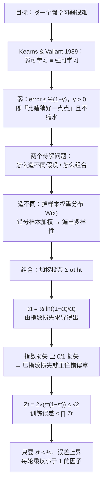

# 第 12 章 · 第 1 讲　集成学习与 Boosting（课堂讲授版）

> [!quote] 本讲开场
> 同学们好。到上一讲为止，我们一直在追求**一个**好模型：一个损失最小的线性回归、一个间隔最大的 SVM、一个似然最高的高斯混合。这一讲换一个思路，而且是换得相当彻底的一个思路。
>
> 想象你要判断明天会不会下雨。你手上没有气象卫星，只有四位**普通**预报员。他们谁都不靠谱：
>
> - CNN 台那位，晴天雨天都报，但十个判断里错三个；
> - ABC 台那位，错得还更多一点；
> - CBS 台那位，只在有把握时才敢下结论，没把握就闭嘴；
> - 还有一位，专挑"大家都说晴天"的日子唱反调。
>
> 单看任何一位，你都不会把伞交给他决定。可**如果把他们四位的话按"谁更可信"加权投票呢？** 出乎意料的事情发生了：这个投票结果比其中任何一位都准，甚至可能一个错都不犯。
>
> 这不是直觉，它是一条**定理**。1990 年前后，Kearns 和 Valiant 问了一个看起来很不划算的问题：**"只比瞎猜好一点点"的学习器，能不能被系统地组合成"要多少准有多少准"的学习器？** 如果能，那机器学习就没有必要去硬造强模型了——**我们只要会造很多笨模型，然后把它们组织起来。**
>
> 这一讲就把这件事讲透，四步走：
> 1. 先把"强"和"弱"这两个词写成不等式，看清"只比瞎猜好一点点"到底是什么意思；
> 2. 造出**加权样本分布** $W(x)$——让模型每轮都盯着自己上一轮做错的那批样本；
> 3. 写出完整的 **AdaBoost 算法**，把这四步背后的"为什么"逐个交代；
> 4. 最后算一遍：**为什么每加一个弱分类器，训练误差就往下掉一个因子。**
>
> 主线一句话：**"没有人是完美的"，所以把一群普通人组织起来。** 好，我们从四位预报员开始。

> [!info] 怎么读这份讲义
> 前置内容是 [[C2.7 过拟合与正则化]]（偏差方差、模型复杂度）与 [[C9.2 模型选择与偏差方差诊断]]（偏差方差诊断、集成模型为什么常比单模型好）。决策树部分是 [[C1.2 决策树的表示与自顶向下归纳]] 与 [[C1.4 过拟合与剪枝]]（本讲末尾的实验结果就是在比较"单棵 C4.5"和"提升后的 C4.5"）。
>
> 目前没有本学期对应转写稿。标有 **（拓展）** 或 **【拓展】** 的部分是课堂上未展开、由教材与通行讲法延伸补充的内容；复习时先掌握未标注的主干。
>
> **两处记号约定先说清楚**：本篇标签统一写成 $y\in\{-1,+1\}$（Boosting 的文献传统，也是加权误差公式 $\mathbf{1}[y_n\ne h(x_n)]$ 需要的写法），与第 2–10 章用的 $y\in\{0,1\}$ 只是换记号，含义相同——注意别和 [[C2.5 逻辑回归]] 里的 $y\in\{0,1\}$ 混用。另外，原文那两份投票表格（天气主播例子、实验结果表）**内部数字对不上**，本篇照原样列出并逐处标出问题，讲解改用我们自己算的例子，详见 3.5 节与篇末勘误表。

---

## 一、"弱"到底有多弱

### 1.1 先把学习问题写成两行

Boosting 的出发点是理论，所以第一件事是把平时含糊说的"学得好不好"写成能比较的式子。

> [!important] 学习问题的形式化（The 'World'）
> - **数据 Data**：$\{(x_n,y_n)\}_{n=1}^{N}$，其中 $x_n\in\mathbf{R}^{d}$，$y_n\in\{\pm1\}$；
> - **未知的目标函数 Unknown target function**：$y=f(x)$（或更一般地 $y\sim P(y\mid x)$）；
> - **未知的分布 Unknown distribution**：$x\sim p(x)$；
> - **目标 Objective**：给定一个新的 $x$，预测 $y$。
>
> **问题 Problem：$P(x,y)$ 是未知的！** 我们手上只有 $N$ 个样本，而真正决定成败的是那个看不见的联合分布。这一行是整门课所有"泛化"讨论的源头。

> [!important] 模型（The 'Model'）
> - **假设类 Hypothesis class**：$\mathcal{H}=\{h\mid h:\mathbf{R}^{d}\to\{\pm1\}\}$；
> - **损失 Loss**：$\ell(y,h(x))$，例如 **0/1 损失** $\mathbf{1}[y\ne h(x)]$；
> - **经验最优假设**：
>   $$\hat{h}_{N}=\min_{h\in\mathcal{H}}\ \frac{1}{N}\sum_{n=1}^{N}\ell\bigl(y_n,h(x_n)\bigr).$$
>
> 最后这行就是"在训练集上犯错最少"。注意它和真实目标 $L(h)=\mathbb{E}_{(x,y)}[\ell(y,h(x))]$ 是两个东西——训练集上的成绩好，不等于新样本上成绩好，这条从 [[C9.1 模型评估与训练测试集]] 一路延续过来。

### 1.2 强学习与弱学习：一个概率不等式里藏着的两句话

现在引进这一讲最关键的一个不等式。它说的是：

$$\mathrm{Pr}\Bigl(S_N:\ L(\hat{h}_{N})-L(h^{*})\ge\epsilon\Bigr)\le\delta .$$

逐块读：

| 记号 | 含义 |
|---|---|
| $S_N$ | 抽到的那 $N$ 个训练样本（它是随机的） |
| $\hat{h}_{N}$ | 在这 $N$ 个样本上训练出来的假设 |
| $h^{*}$ | 假设类里最好的那个假设（我们够不着） |
| $L(\cdot)$ | 真实分布上的期望损失 |
| $L(\hat{h}_{N})-L(h^{*})$ | **"我学到的"离"理论上最好的"差多远**——这就是**超额风险 Excess Risk** |
| $\epsilon$ | 允许的差距（精度） |
| $\delta$ | 允许这种差距被超过的概率（置信度） |

整句话读作：**"这次抽样的运气不好，导致我的模型比最好的那个差出 $\epsilon$ 以上"——这件事发生的概率不超过 $\delta$。**

于是"强"和"弱"的差别就落在**这两个数能不能随便挑**上：

> [!important] 强学习 Strong Learning
> **对任意（任意小的）$\epsilon$ 和 $\delta$**，都存在 $N$ 和算法，使得上式成立。
>
> 换成人话：**无论你要多准（$\epsilon$ 多小）、要多保险（$\delta$ 多小），我都能办到**，代价只是多要一些样本。这就是我们理想中"强学习器"的样子。

> [!important] 弱学习 Weak Learning
> 只要求**存在某个非平凡的 $\epsilon$ 和 $\delta$** 使上式成立。
>
> 二分类下"非平凡"有一个具体的量法：要求错误率
> $$\epsilon\le\frac{1}{2}(1-\gamma)\qquad\text{对某个固定的 }\gamma>0 .$$
>
> 读作：**比乱猜的 $1/2$ 好出至少 $\gamma/2$ 这么多，而且好出的量不随样本数缩到 0。**

$\gamma$ 这个名字取得很准，它就是"**优势 Advantage / 边缘 Margin**"——**比抛硬币领先的那一点点**。$\gamma=0.02$ 意味着错误率 $0.49$，只比瞎猜好 $1\%$，这确实非常弱。

> [!question] 停一下，先自己想想
> $\epsilon=0.5$ 的"学习器"是什么？为什么必须把它排除掉？

$\epsilon=0.5$ 就是抛硬币：它有一半概率对、一半概率错，跟数据没有任何关系。更糟的是，一个**永远和真实标签反着报**的分类器错误率是 $1$——把它的输出取反就得到错误率 $0$。所以"错误率接近 $1/2$"和"错误率接近 $0$"在信息量上是一回事，真正没信息的是**恰好 $1/2$**。$1-\gamma$ 这个因子就是用来把 $1/2$ 这一条线**推开一点**的。

### 1.3 历史：这个问题是怎么被啃下来的

这一族思想按时间走过了四个节点，值得按顺序记住，因为它解释了"为什么最终答案是 AdaBoost"：

| 时间 | 谁 | 做了什么 |
|---|---|---|
| **1989** | Kearns & Valiant | 证明了那个惊人的事实：**每个都只比瞎猜好一点点的学习器，可以被组合成任意好的集成假设**。（注意：他们证明的是"可以"，没有给出多项式时间的构造。） |
| **1990** | Schapire | **第一个可证明多项式时间的 Boosting 算法**。理论上的"存在"变成了"能算出来"。 |
| **1993** | Schapire 等 | 第一次把 Boosting 用到**真实世界的 OCR（光学字符识别）任务**上。理论进入工程。 |
| **1994–1996** | Schapire 等 / Freund & Schapire | **AdaBoost 算法**。实用、简单、几乎不用调参，成为这一族里最著名的那个。 |

> [!note] 【拓展】为什么 1989 年那个结论会被称为"astonishing"
> 因为在它之前，学界的直觉是**反过来的**：如果一个假设类弱到只能勉强比乱猜好，那它似乎"什么都不懂"，组合再多也只是把噪声平均掉。Kearns 和 Valiant 的结论等于说：**"弱可学习"与"强可学习"是等价的**——两者之间没有本质差别，只有计算上的差别。
>
> 这个等价性把机器学习的任务重新定义了一遍：**你不必找到那个好模型，你只需要找到很多"稍微有用"的模型，并且知道怎么组织它们。** 今天工业界大量使用梯度提升树（GBDT、XGBoost、LightGBM、CatBoost）处理表格数据，思想源头就在这里。

### 1.4 一个具体的弱规则长什么样

理论讲完，得落到能动手的东西上。什么叫"弱规则"？

**决策树桩 Decision Stump** 是最标准的例子：只用一个特征、一个阈值就能说清的分类器，形如

$$h(x)=\begin{cases}+1,&x_j>\theta,\\[2pt]-1,&x_j\le\theta.\end{cases}$$

它在二维平面上就是**一条与坐标轴平行的直线**，把平面切成两半。这么简单的规则，在大多数真实数据上错误率都在 $0.3\sim0.45$ 之间——典型的"弱"。

> [!note] 【拓展】为什么偏偏喜欢用决策树桩
> 三个理由，层层递进：
> 1. **它足够弱**：Boosting 要的就是"弱"，强学习器反而没有提升空间（已经接近 0 错误率，没有可学的）。
> 2. **它便宜**：$d$ 个特征、$N$ 个样本，最优树桩可以 $\mathcal{O}(dN\log N)$ 扫出来（每个特征排一次序，扫一遍找最优阈值）。
> 3. **它带权重也照样便宜**：这是关键的一条，见 2.2 节——**加权错误率也可以按排序后线性扫出来**，所以 AdaBoost 每轮找最优桩子的代价和普通训练一样低。换成神经网络之类，就享受不到这个便宜了。

> [!question] 课堂追问：一棵树桩只会"切一刀"，靠它能表达复杂规则吗？
> **单棵不能，一串能。** 下面这张图就是 AdaBoost 在一个特征上的实况：真实规则是"$x$ 落在两段区间里时为正"，也就是一条**方波**。

![[C12-弱规则拼出边界.png]]

图上横轴是特征 $x$，圆点是正类、方块是负类（已经掺了几个标错的点），黑色折线是集成当前给出的**实值分数** $f(x)=\sum_t\alpha_th_t(x)$，背景色是它的判断结果，橙色虚线是每一轮选出来的那个切点。

四张图依次是 1、3、6、8 个树桩的集成。请顺着看这条折线是怎么长出来的：**每个树桩在它的切点处把分数抬上或压下 $\alpha_t$，于是加一个树桩，折线上就多一个台阶。** 一个树桩只能给出"左边一类、右边另一类"，可**几个台阶连起来就能拼出一条方波**——这正是单个树桩表达不了的东西。

训练误差从 $35\%$ 一路落到 $22\%$、$17\%$，而且在 $x\approx0.9$、$3.0$、$5.5$、$7.4$ 这几处，切点自动落在了真实区间的边界附近。这就是 Boosting 用弱规则造出复杂规则的机制：**不是找一个能表达方波的模型，而是把很多"只会切一刀"的模型加权叠加起来。**

"哪一刀该给多大权重、下一个桩子该往哪儿切"——这正是 AdaBoost 要替你决定的事，也是下一节的全部内容。**顺带注意图上那 5 个标错的点：它们把折线在边界处往回收了一点**，这就是 3.4 节要讲的"指数损失罚错分罚得极重"的直接后果。

---

## 二、造出彼此不同的规则：加权样本分布

### 2.1 第一步不是造规则，是造"着眼点"

在写算法之前，先把一个容易被忽略的困难摆上台面。Boosting 的路线是"组合很多规则"，于是有两个问题必须先回答：

> [!question] AdaBoost 要解决的两个问题
> 1. **怎么造出彼此不同的假设？** 如果每轮都在同一批数据上用同一个算法训练，得到的是**同一个模型**（或者几乎一样），组合一堆复制品毫无意义。
> 2. **怎么把它们组合起来？** 每个规则说的话分量应该一样吗？

第一个问题的答案很巧妙，也很朴素：**别改算法，改数据。** 具体地说，**改每个样本的"分量"**。

引入一个**样本权重分布** $W(x)$：给每个训练点配一个正的权重，全体加起来等于 1：

$$\sum_{i}W(x_i)=1 .$$

**初始时刻大家一律平等**：$W_0(x)=1/N$ 对所有 $x$，轮数 $k=0$。

每轮训练完，就**按上一轮的错误调整权重**：被做错的样本加重，被做对的样本减轻。下一轮的学习器于是被迫**把注意力放在上一轮没搞定的那批样本上**——它自然就与前一轮不同了。

> [!important] 为什么用"分布"而不是"权重"这个词
> $W(x)\ge0$ 且 $\sum_iW(x_i)=1$，这在数学上就是一个**概率分布**，说的是"从训练集里随机抽一个样本，抽到 $x_i$ 的概率"。
>
> 好处是它把"注意力"这件事**接到了概率语言上**：加权错误率就写成了
> $$\epsilon_k=\sum_{i:\ h_k(x_i)\ne y_i}W_k(x_i),$$
> 也就是**"按当前分布随机抽一个样本、它会被分错的概率"**——一个真正的概率，可以谈期望、可以谈界。AdaBoost 的整套证明就是建立在这个概率解释上的。

### 2.2 加权错误率可以便宜地算出来

$W$ 不是只为了讲得漂亮，它带来一个实打实的计算好处。

给定权重分布 $W$ 和一个候选树桩（特征 $j$、阈值 $\theta$），它的加权错误率是

$$\epsilon(W,j,\theta)=\sum_{n=1}^{N}W(x_n)\cdot\mathbf{1}\bigl[y_n\ne h_{j,\theta}(x_n)\bigr].$$

**关键观察**：如果按特征 $j$ 的大小把样本**排序**，那么阈值 $\theta$ 从左往右扫过每一个样本间隙时，被划到"$\le\theta$"那一侧的样本集合只会**一个一个地增加**。于是加权错误率可以这样递推：

$$\epsilon_{\text{left}}\leftarrow\epsilon_{\text{left}}+W(x_{(n)})\cdot\mathbf{1}\bigl[y_{(n)}\ne h(x_{(n)})\bigr]\quad\text{（每把一个样本移到左边就更新一次）}.$$

排序 $\mathcal{O}(N\log N)$，扫一遍 $\mathcal{O}(N)$，对 $d$ 个特征各来一次。**总代价和训练一棵普通树桩同阶。** 这就是 1.4 节说的"带权重也照样便宜"。

> [!note] 【拓展】为什么这一条在实践中这么重要
> 如果不带权重地训练树桩，我们用**重采样**也能实现类似效果：按概率分布抽 $N$ 个样本、抽到重复的就复制一份，然后当成普通数据训练。这在数学上等价，但代价是**每轮都要真的抽一遍样本、复制一遍数据**，$N$ 大时开销可观，而且抽样本身带来额外的随机性。
>
> 带权重训练把这个开销彻底消掉了：**权重一直躺在数组里，只有加法**。AdaBoost 之所以能成为"几乎不用调参、跑得又快"的经典算法，这一条是硬件基础。sklearn 里 `DecisionTreeClassifier` 的 `sample_weight` 参数、`AdaBoostClassifier` 的实现都走这条路。

---

## 三、AdaBoost 算法

### 3.1 算法全文与逐行注解

现在可以把算法完整写下来了。以下 $T$ 是**弱分类器的个数**（也就是迭代轮数），是个需要人为给定的超参数。

> [!important] AdaBoost 算法（Freund & Schapire 1996）
> **输入**：$N$ 个样本 $\{(x_1,y_1),\dots,(x_N,y_N)\}$，$y_n\in\{\pm1\}$。
>
> **初始化**：$d_n^{(1)}=1/N$，对全部 $n=1,\dots,N$。
>
> **对** $t=1,\dots,T$ **循环**：
>
> 1. 按当前样本分布 $d^{(t)}$ 训练**基学习器 Base Learner**，得到假设
>    $$h_t:\mathbf{R}^{d}\to\{\pm1\};$$
> 2. 计算**加权错误率**
>    $$\epsilon_t=\sum_{n=1}^{N}d_n^{(t)}\,\mathbf{1}\bigl(y_n\ne h_t(x_n)\bigr);$$
> 3. 计算**假设权重 Hypothesis Weight**
>    $$\alpha_t=\frac{1}{2}\log\frac{1-\epsilon_t}{\epsilon_t};$$
> 4. 更新**样本分布**
>    $$d_n^{(t+1)}=d_n^{(t)}\exp\bigl(-\alpha_ty_nh_t(x_n)\bigr)\big/Z_t,$$
>    其中 $Z_t$ 是归一化因子，使 $\sum_n d_n^{(t+1)}=1$。
>
> **输出**：最终假设
> $$f_{\mathrm{Ens}}(x)=\sum_{t=1}^{T}\alpha_th_t(x),\qquad G(x)=\operatorname{sign}\bigl[f_{\mathrm{Ens}}(x)\bigr].$$

逐行读懂它，比背下来有用得多：

**第 1 行：按分布训练。** 传进去的不只是数据，还有每个样本的权重。任何接受权重的算法都能当基学习器。**第 $t$ 轮的 $h_t$ 是"针对当前这套权重而言最优的那个"**——因为权重变了，最优的桩子也跟着变，这正是 2.1 节要的"彼此不同"。

**第 2 行：加权错误率是个概率。** $d_n^{(t)}$ 加起来是 1，所以 $\epsilon_t\in[0,1]$，可以直接读成"按当前分布抽一个样本、会被 $h_t$ 分错的概率"。

**第 3 行：$\alpha_t$ 是这一整套的心脏。** 先看它的形状：

| $\epsilon_t$ | $\alpha_t=\frac12\ln\frac{1-\epsilon_t}{\epsilon_t}$ | 含义 |
|---|---|---|
| $\to0$ | $\to+\infty$ | 几乎不错，**几乎完全听它的** |
| $0.1$ | $1.0986$ | 很准，权重高 |
| $0.25$ | $0.5493$ | 还不错 |
| $0.4$ | $0.2027$ | 勉强合格，权重低 |
| $0.49$ | $0.0200$ | 只比瞎猜好一点，**几乎不听** |
| $0.5$ | $0$ | 等于瞎猜，**完全不投票** |
| $>0.5$ | $<0$ | 比瞎猜还差——**反着听** |

> [!important] 为什么要用对数，而不是直接用 $1-\epsilon_t$ 当权重
> 这是本讲最值得停下来想的一处。三个层次的理由：
>
> 1. **$\epsilon=0.5$ 必须给权重 0。** 用 $1-\epsilon$ 的话，瞎猜的分类器还能拿到 $0.5$ 的权重，白往票箱里塞票。对数的形式自动在 $\epsilon=1/2$ 处归零。
> 2. **权重应当是可加的。** 我们要的是"投票"：$f=\sum_t\alpha_th_t$。对数把**乘法关系变成了加法**（$\ln\frac{1-\epsilon}{\epsilon}=\ln(1-\epsilon)-\ln\epsilon$）。这条后面在训练误差上界里会变成"乘积 $\prod_tZ_t$"，见 3.5 节。
> 3. **它来自指数损失的最优解。** 3.5 节会证明：在指数损失 $\exp(-yf(x))$ 下，固定 $h_t$ 求最优的 $\alpha_t$，解出来的**恰好**就是这个式子。$\frac12$ 这个系数也是那里定下来的，不是凑的。

**第 4 行：权重更新，写成两段就明白了。** 注意 $y_nh_t(x_n)$ 这个乘积：

$$y_nh_t(x_n)=\begin{cases}+1,&h_t\text{ 把 }x_n\text{ 分对了},\\[2pt]-1,&h_t\text{ 把 }x_n\text{ 分错了}.\end{cases}$$

代进去就得到**分段形式**：

$$d_n^{(t+1)}=\frac{d_n^{(t)}}{Z_t}\times\begin{cases}e^{-\alpha_t},&h_t(x_n)=y_n\ \text{（分对）},\\[4pt]e^{+\alpha_t},&h_t(x_n)\ne y_n\ \text{（分错）}.\end{cases}$$

**分对的权重乘 $e^{-\alpha_t}<1$，分错的乘 $e^{+\alpha_t}>1$。** 再看这两者之比：

$$\frac{\text{错分样本的新权重}}{\text{正确样本的新权重}}=\frac{e^{\alpha_t}}{e^{-\alpha_t}}=e^{2\alpha_t}=\frac{1-\epsilon_t}{\epsilon_t}.$$

> [!example] 这个比值就是它的全部含义
> $\epsilon_t=0.25$ 时，$e^{2\alpha_t}=\frac{0.75}{0.25}=3$：**分错的样本权重变成分对样本的 3 倍。**
>
> 如果 $\epsilon_t\to0.5$（几乎瞎猜），比值 $\to1$，权重几乎不变——**这一轮没什么可学的，也不必大改**。如果 $\epsilon_t\to0$，比值 $\to\infty$，那这一轮本来也不需要再学。
>
> 所以更新式的行为完全符合直觉：**越是被证明做不好的样本，越要加大力度盯着它。** 这就是"Boosting（提升）"这个名字的来处——**被错分的样本被"提升"了重要性。**

**输出行：加权投票，取符号。** $f_{\mathrm{Ens}}$ 是一个实数分数，$\operatorname{sign}$ 把它变成类别。分数绝对值越大，越"确定"。

### 3.2 一轮完整手算

理论到此为止都还抽象，代一遍数就实了。设 $N=8$ 个样本，第一轮弱学习器的加权错误率是 $\epsilon_1=0.25$（也就是错 2 个）。

**第一步，算 $\alpha_1$：**

$$\alpha_1=\frac{1}{2}\ln\frac{1-0.25}{0.25}=\frac{1}{2}\ln 3\approx0.549306 .$$

**第二步，算权重乘子：** 分对的乘 $e^{-0.549306}\approx0.577350$，分错的乘 $e^{+0.549306}\approx1.732051$。两者之比 $1.732051/0.577350=3$。

**第三步，更新并归一化。** 初始权重全是 $1/8=0.125$：

| 样本 | 初始 $d^{(1)}_n$ | 结果 | 乘子 | 未归一 | 归一化后 $d^{(2)}_n$ |
|---|---|---|---|---|---|
| 1 | $0.125$ | 对 | $0.577350$ | $0.072169$ | $0.083333$ |
| 2 | $0.125$ | 对 | $0.577350$ | $0.072169$ | $0.083333$ |
| 3 | $0.125$ | **错** | $1.732051$ | $0.216506$ | $0.250000$ |
| 4 | $0.125$ | 对 | $0.577350$ | $0.072169$ | $0.083333$ |
| 5 | $0.125$ | 对 | $0.577350$ | $0.072169$ | $0.083333$ |
| 6 | $0.125$ | **错** | $1.732051$ | $0.216506$ | $0.250000$ |
| 7 | $0.125$ | 对 | $0.577350$ | $0.072169$ | $0.083333$ |
| 8 | $0.125$ | 对 | $0.577350$ | $0.072169$ | $0.083333$ |

归一化因子 $Z_1=0.866025$，**新分布之和为 $1.000000$** ✓，8 个正确样本各 $0.083333$、2 个错分样本各 $0.250000$——**错分样本的权重正好是正确样本的 3 倍，符合 3.1 节的推导。**

> [!warning] $Z_t$ 不只是"归一化用的分母"
> $Z_1=0.866025<1$ 这件事本身就是个信号：**这一轮之后，分布变得比原来"更容易"了**（$Z_t$ 越小，说明当前 $h_t$ 与标签越一致）。3.5 节会说明，$\prod_tZ_t$ 正是训练误差的上界——**$Z_t$ 每轮小于 1，上界就一路乘小下去。** 所以这个数在实现时值得打日志盯着看，它是"Boosting 还有没有在起作用"的体温计。

### 3.3 四位预报员是怎么被组织起来的

现在回到开场的四位预报员。他们的关键差别不是"准不准"，而是**错在哪些日子**：

- **CNN 台**：整体中等，但对"晴天"有偏爱，阴雨天常常报晴；
- **ABC 台**：整体更弱一些，但错的恰好是 CNN 做对的那几天；
- **CBS 台**：有点像"只在有把握时才发言"，它敢下结论的日子准确率很高，然后大量日子弃权；
- **第四位**：专在众口一词报晴的日子里唱反调——**它的存在价值恰恰在于"和别人不一样"。**

AdaBoost 会做的事正是：**给 CNN 和 ABC 都发中等权重（因为他们各自错率约 $0.25\sim0.3$）；给 CBS 发较高权重（它敢说的部分通常对）；第四位的权重则由它到底准不准决定——如果它确实挑对了那些反调，$\epsilon$ 小、$\alpha$ 大，它就变成关键少数。**

> [!important] 为什么"错得不一样"比"各自很准"更重要
> 假设两位预报员各有 $25\%$ 的错误率。如果他们**同一天错**，那么两人投票的结果**还是错 $25\%$**——A 和 B 一起错，2:0 照样错。可如果他们的错误**相互独立**，那么"两人同时错"的概率只有
> $$0.25\times0.25=0.0625,$$
> 投票的错误率（两人意见不同才需要仲裁）会大幅下降。
>
> 这就是 Boosting 每一轮都要换样本权重的**真正目的**：不是为了"让每个都更准"，而是为了**制造差异**。已经做对的样本减权，就是在说"这些不用再看了，去看别的"。**独立性（在集成学习里常叫多样性 Diversity）是集成能赢的根本原因，不是每个成员的强度。**
>
> 这条也解释了为什么 Boosting 第 3 步用对数而不是别的：它把"多准"和"多独特"折算成同一把尺子上的投票数。

> [!note] 【拓展】关于两份投票表格
> 原稿用"周一至周四、五家电视台投票"的表格来讲这件事，但那份表格**内部对不上**：行标题写的是 CNN / ABC / CBS / FOX，标注的总体投票数却是 $3,2,7/4,1$ 这类值；各列标出的"电视台判断"也数不出对应的票数，MAJORITY 行甚至还出现 $7/4$ 这种既非票数也非比例的写法。
>
> 本讲因此不照抄那份表格，改为按它的设计意图（各家错误模式不同 $\Rightarrow$ 加权投票有效）来说明，并强调**能算清的例子**在 3.2 节与 3.5 节。原稿的问题逐条列在篇末勘误表里。

### 3.4 为什么是"提升"：指数损失与 0/1 损失

Boosting 表面上是一套基于权重的启发式流程——加权训练、算错误率、按错误率定权重、按对错改权重。**但这四步其实是在最小化一个明确的目标函数**，看清这一点，整个算法就从"技巧"变成"必然"。

> [!important] 指数损失 Exponential Loss
> AdaBoost 最小化的是
> $$\ell_{\exp}(y,f(x))=\exp\bigl(-y\,f(x)\bigr),$$
> 其中 $f(x)=\sum_t\alpha_th_t(x)$ 是集成的实值分数（还没取符号）。
>
> 它的自变量是 $z=y\,f(x)$：**$z>0$ 表示分对，$z<0$ 表示分错**；$z$ 越大越"有把握且正确"。

![[C12-指数损失上界.png]]

上图把四种损失画在同一个 $z=yf(x)$ 轴上。指数损失（红）有两条性质，正好对上 AdaBoost 的两个行为：

1. **它永远是 0/1 损失（黑）的上界。** 在 $z<0$ 的区间 $e^{-z}>1=\mathbf{1}[z<0]$；在 $z\ge0$ 的区间 $e^{-z}>0=\mathbf{1}[z<0]$。所以在**任何** $z$ 上都有
   $$\mathbf{1}[yf(x)<0]\le\exp\bigl(-yf(x)\bigr).$$
   **推论：把指数损失压小，就等于在压 0/1 损失的上界。** 我们优化的是一个可导的代理，得到的保证是关于我们真正关心的错误率的。这一招和 [[C2.5 逻辑回归]] 用对数损失代理 0/1 损失是同一个套路，也和 [[C10.1 支持向量机的目标与大间隔]] 用合页损失代理是同一套路——**三种损失是三种不同的代理，形状不同、对"已经很对的样本"的态度也不同**（合页损失在 $z\ge1$ 后直接归零，指数损失永远不归零、越对越奖励，对数损失居中）。
2. **它罚错分罚得极重。** $z=-2$ 时 $e^{2}\approx7.39$，而 0/1 损失只有 $1$。**一个顽固的错分样本会一直把损失往上顶**，逼着算法一轮一轮加权重去盯它。这正是"提升"的动力来源，也解释了后文要提的**对噪声与离群点敏感**这件事。

现在验证 3.1 节第 3 行那个 $\alpha_t$ 是不是最优解。固定前 $t-1$ 轮的集成 $f_{t-1}$，本轮加进 $\alpha_th_t$，只对 $\alpha_t$ 最小化指数损失和：

$$\sum_{n=1}^{N}\exp\bigl(-y_n[f_{t-1}(x_n)+\alpha_th_t(x_n)]\bigr).$$

把与 $\alpha_t$ 无关的 $e^{-y_nf_{t-1}(x_n)}$ 记成权重 $w_n^{(t)}$（这正是"上一轮的分布"的来源），再把样本按 $h_t$ 是否分对拆成两组——记 $W_{\text{cor}}$ 为分对样本的权重之和、$W_{\text{err}}$ 为分错样本的权重之和：

$$\sum_nw_n^{(t)}e^{-\alpha_ty_nh_t(x_n)}=W_{\text{cor}}e^{-\alpha_t}+W_{\text{err}}e^{+\alpha_t}.$$

对 $\alpha_t$ 求导并令其为 0：

$$-W_{\text{cor}}e^{-\alpha_t}+W_{\text{err}}e^{+\alpha_t}=0\ \Longrightarrow\ e^{2\alpha_t}=\frac{W_{\text{cor}}}{W_{\text{err}}}=\frac{1-\epsilon_t}{\epsilon_t},$$

$$\boxed{\ \alpha_t=\frac{1}{2}\ln\frac{1-\epsilon_t}{\epsilon_t}\ }$$

**和算法第 3 行一模一样。** 而且对 $\alpha_t$ 的二阶导恒为正，说明这确实是最小值点。

> [!note] 【拓展】AdaBoost 是"前向分步加法模型"
> 上面这段推导揭示了一个更大的结构。任何形如
> $$f_T(x)=\sum_{t=1}^{T}\alpha_th_t(x)$$
> 的模型，如果不是一次性求出全部 $T$ 项，而是**一项一项往前加、每加一项都只优化这一项的系数和这个基函数**，就叫**前向分步算法 Forward Stagewise Additive Modeling**。
>
> AdaBoost 是它在**指数损失**下的特例，此时的结论特别漂亮：**因为 $\alpha_t$ 有闭式解，连梯度都不用算**。
>
> 把指数损失换成别的损失，就得到别的算法：换成平方损失、每次拟合残差，就得到**前向分步 + 平方损失 ≈ 梯度提升 Gradient Boosting**；把这个过程推广成"每一步沿损失函数的负梯度方向走一步"，就是**梯度提升树 GBDT**（工程实现如 XGBoost、LightGBM、CatBoost）。**所以这一讲不是学了一个 1996 年的老算法，而是学了今天最强的一类表格模型的原型。**

### 3.5 训练误差上界：每加一轮，误差乘一个因子

最后把 3.4 节的结论用起来，回答那个理论问题：**加了 $T$ 个弱分类器，训练误差能保证到多小？**

先算权重更新里那个归一化因子 $Z_t$ 的显式值。用 3.1 节的分段形式，分对样本的 $d_n^{(t)}$ 乘 $e^{-\alpha_t}$、分错的乘 $e^{\alpha_t}$：

$$Z_t=\sum_{n}d_n^{(t)}e^{-\alpha_ty_nh_t(x_n)}=(1-\epsilon_t)e^{-\alpha_t}+\epsilon_te^{\alpha_t}.$$

代入 $e^{\alpha_t}=\sqrt{\frac{1-\epsilon_t}{\epsilon_t}}$、$e^{-\alpha_t}=\sqrt{\frac{\epsilon_t}{1-\epsilon_t}}$：

$$Z_t=(1-\epsilon_t)\sqrt{\frac{\epsilon_t}{1-\epsilon_t}}+\epsilon_t\sqrt{\frac{1-\epsilon_t}{\epsilon_t}}=\sqrt{\epsilon_t(1-\epsilon_t)}+\sqrt{\epsilon_t(1-\epsilon_t)}=2\sqrt{\epsilon_t(1-\epsilon_t)} .$$

而由 $1-\epsilon_t\le1$ 与 $\epsilon_t\le1$ 立刻得到

$$2\sqrt{\epsilon_t(1-\epsilon_t)}\le2\sqrt{\frac{1-\epsilon_t+\epsilon_t}{2}}=2\sqrt{\frac12}=\sqrt2 .$$

**关键一步在这里**：设最终分类器的训练误差为 $E$，可以证明

$$E=\frac{1}{N}\sum_{n=1}^{N}\mathbf{1}\bigl[G(x_n)\ne y_n\bigr]\le\prod_{t=1}^{T}Z_t .$$

把 $Z_t\le\sqrt2$ 代进去，就得到一个**与具体数据无关**的上界：

$$\boxed{\ E\le\prod_{t=1}^{T}Z_t\ =\ \exp\Bigl(\sum_{t=1}^{T}\ln Z_t\Bigr)\le(\sqrt2)^{T}\ }$$

**这个式子读出来就是整讲的结论**：只要每个弱分类器的加权错误率都 $\le1/2$（哪怕只等于 $1/2$，此时 $\ln Z_t=\frac12\ln\frac12<0$），每一轮就把误差上界乘以一个**小于 1** 的因子。于是——

> [!important] 核心结论
> **训练误差随 $T$ 指数下降。** 而且这个结论**不需要每一轮都变好**：即使某个弱学习器只做到 $\epsilon_t=0.49$（几乎和瞎猜一样），$Z_t=2\sqrt{0.49\times0.51}\approx0.9998<1$ 仍然成立，上界照样往下走。**只要不出现 $\epsilon_t\ge0.5$ 的灾难，更多轮次总不会更糟。**
>
> 这句话就是 1.3 节那个"astonishing fact"的可计算版本：**弱学习器不必强，只需要"不退化到瞎猜"。** 累积 $T$ 轮，效果可以任意好。

> [!warning] 这个上界不等于"加得越多越好"
> 三个必须分开说清楚的限制：
> 1. **它是训练误差的上界，不是泛化误差的上界。** 训练误差一路降到 0 之后，模型可能正在过拟合。实践中 AdaBoost 的测试误差常表现为"先降，之后持平甚至回升"，所以 $T$ 仍是一个要靠验证集选的超参数——见 [[C9.2 模型选择与偏差方差诊断]]。
> 2. **上界是"最坏情况"，很松。** $(\sqrt2)^T$ 在 $T=10$ 时已经远大于 1，完全没用；真正有信息的是 $\prod_tZ_t$ 本身（因为每个 $Z_t$ 通常远小于 $\sqrt2$）。所以**实现时要记录 $\prod_tZ_t$，它才是活的体温计**。
> 3. **$\epsilon_t\ge0.5$ 会让算法失稳。** 单轮比瞎猜还差时 $\alpha_t<0$——算法会把它"反着用"。这在理论上还能救（前面证明里 $\ln Z_t$ 仍为负），但实际实现里通常**直接停止或重新采样**，因为这说明基学习器太弱或数据有问题。

### 3.6 实验证据：Boosted C4.5

理论说了上界，还得看真实数据。原稿最后一页给了一张对照表，27 个标准数据集上比较四种方案：

| 方案 | 平均错误率 err(%) |
|---|---|
| **C4.5**（单棵树） | $15.66$ |
| **Bagged C4.5** vs C4.5 | $14.11$ |
| **Boosted C4.5** vs C4.5 | $\mathbf{13.56}$ |
| **Boosting** vs Bagging | $0.930$（倍数，Boosted 仅为 Bagged 的 $93.0\%$） |

三个结论，按重要性排序：

1. **提升确实有用，而且幅度可观**：$15.66\%\to13.56\%$，**相对下降 $13.4\%$**。在机器学习里，把 27 个数据集上的平均错误率压掉一成多，是一个很硬的成绩——这也解释了 AdaBoost 为什么在 2000 年前后成为表格数据的默认选择。
2. **Boosting 比 Bagging 更狠**：$13.56$ 对 $14.11$，比值 $0.930$，也就是 **Boosted 的错误率平均只有 Bagged 的 $93\%$**。这一列里 $w$-$l$ 打平率 $1$-$9$ 说明在 27 个数据集中 Boosted 赢 9 个、平 1 个、其余互有胜负但总体占优。
3. **不是每个数据集都赢**：同一个 "vs C4.5" 列里，$w$-$l$ 打平/胜负数在各行不同，像 `colic`（$+1.262$ 倍）这种数据集上提升是**负作用**。**这提醒我们：Boosting 不是万灵药，它对噪声和离群点敏感**（3.4 节说过指数损失罚错分罚得极重）。数据本来就有标注错误时，Boosting 会拼命去拟合那些错标样本。

> [!note] 【拓展】Bagging 与 Boosting 的根本区别
> 两者都叫"集成学习"，但机制几乎相反，值得并列记住：
>
> | | Bagging | Boosting |
> |---|---|---|
> | 样本怎么用 | **有放回重采样**（Bootstrap）：每轮在原始数据的随机副本上训练 | **重加权**：每轮在同一批数据上训练，但错分样本权重变大 |
> | 基学习器之间 | **并行独立**：互不知情 | **串行依赖**：$h_t$ 依赖前 $t-1$ 轮的结果 |
> | 基学习器强度 | 要求**强**（通常是低偏差的深树），靠平均降方差 | 要求**弱**（树桩、浅树），靠组合降偏差 |
> | 组合方式 | 简单平均 / 多数投票，**权重相等** | **加权投票**，权重 $\alpha_t$ 由错误率决定 |
> | 主要治什么 | **高方差** | **高偏差**（也常同时降方差） |
> | 对噪声 | 较稳健 | **敏感** |
> | 代表 | 随机森林 | AdaBoost、GBDT、XGBoost |
>
> 一句话总结：**Bagging 用"很多独立的强模型投票"来抹平随机波动，Boosting 用"很多串行的弱模型接力"来逼近一个复杂规则。** 前者的数量是平行的，后者的数量是累积的。

---

## 四、停一下：这一讲的骨架

把这一讲压成一条链——注意它和"某个算法的步骤列表"是不同的东西：

两处最值得自己复述一遍的地方：

- **$\alpha_t$ 为什么长成对数**：因为它是**指数损失对 $\alpha_t$ 求导的解**，不是设计者拍出来的。记住这条，3.1 节那张表就不必硬背——$\epsilon=0.5$ 自然给 0，$\epsilon\to0$ 自然爆到无穷。
- **为什么"错得不一样"比"各自很准"更重要**：如果两个 $25\%$ 错误率的模型同一天错，投票还是错 $25\%$。**集成的收益来自多样性，而 Boosting 的权重更新正是在制造多样性。** 这条是理解一切集成方法的钥匙。

---

## 本讲小结：今天要记住的三件事

> [!important] 三句话
> 1. **弱学习器是"错误率 $\epsilon\le\frac12(1-\gamma)$、$\gamma>0$ 且不随样本数缩到 0"的学习器**；Kearns & Valiant（1989）证明弱可学习与强可学习等价，Schapire（1990）给出第一个多项式时间构造，AdaBoost（Freund & Schapire 1996）是它最著名的实用版本。**核心机制是加权样本分布 $W(x)$——每轮把错分样本的权重提升，逼出彼此不同的基学习器。**
> 2. **AdaBoost 每轮三步**：按分布 $d^{(t)}$ 训练 $h_t$ → 算加权错误率 $\epsilon_t=\sum_nd_n^{(t)}\mathbf{1}[y_n\ne h_t(x_n)]$ → 定权重 $\alpha_t=\frac12\ln\frac{1-\epsilon_t}{\epsilon_t}$ 并按对错把权重乘 $e^{\mp\alpha_t}$ 后归一化。**分错与分对的权重之比是 $\frac{1-\epsilon_t}{\epsilon_t}$**（$\epsilon_t=0.25$ 时正好 3 倍）。最终分类器是加权投票 $G(x)=\operatorname{sign}\bigl[\sum_t\alpha_th_t(x)\bigr]$。
> 3. **$\alpha_t$ 是指数损失 $\exp(-yf(x))$ 的最优解**，所以 AdaBoost 等价于最小化 0/1 损失的上界；由此得到训练误差上界 $E\le\prod_tZ_t$，其中 $Z_t=2\sqrt{\epsilon_t(1-\epsilon_t)}\le\sqrt2$。**只要每轮 $\epsilon_t<1/2$，误差上界就每轮乘以一个小于 1 的因子、指数下降**——这就是"弱学习器也能拼出强分类器"的可计算形式。但它是**训练误差**上界，$T$ 仍需用验证集选（Bagging 治方差、Boosting 治偏差；Boosting 对噪声敏感）。

### 速查表（考试前扫一眼）

| 名称 | 公式 / 内容 |
|---|---|
| 弱学习条件 | $\epsilon\le\frac12(1-\gamma)$，$\gamma>0$ 固定 |
| 假设类 | $\mathcal{H}=\{h\mid h:\mathbf{R}^{d}\to\{\pm1\}\}$ |
| 经验最优 | $\hat{h}_{N}=\min_{h\in\mathcal{H}}\frac1N\sum_n\ell(y_n,h(x_n))$ |
| 样本分布 | $W(x)\ge0$，$\sum_iW(x_i)=1$；初始 $d_n^{(1)}=1/N$ |
| 加权错误率 | $\epsilon_t=\sum_{n=1}^{N}d_n^{(t)}\mathbf{1}[y_n\ne h_t(x_n)]$ |
| 假设权重 | $\alpha_t=\frac12\ln\frac{1-\epsilon_t}{\epsilon_t}$；$\epsilon=0.5\Rightarrow\alpha=0$ |
| 权重更新 | $d_n^{(t+1)}=d_n^{(t)}e^{-\alpha_ty_nh_t(x_n)}/Z_t$ |
| 更新式的分段形式 | 分对乘 $e^{-\alpha_t}$，分错乘 $e^{+\alpha_t}$ |
| 错分/正确权重之比 | $e^{2\alpha_t}=\frac{1-\epsilon_t}{\epsilon_t}$ |
| 归一化因子 | $Z_t=(1-\epsilon_t)e^{-\alpha_t}+\epsilon_te^{\alpha_t}=2\sqrt{\epsilon_t(1-\epsilon_t)}\le\sqrt2$ |
| 训练误差上界 | $E\le\prod_{t=1}^{T}Z_t\le(\sqrt2)^T$ |
| 最终分类器 | $f_{\mathrm{Ens}}(x)=\sum_t\alpha_th_t(x)$，$G(x)=\operatorname{sign}[f_{\mathrm{Ens}}(x)]$ |
| 指数损失 | $\ell_{\exp}(y,f(x))=e^{-yf(x)}\ge\mathbf{1}[yf(x)<0]$ |
| 指数损失的最优 $\alpha$ | $\frac{\partial}{\partial\alpha_t}\bigl[W_{\text{cor}}e^{-\alpha}+W_{\text{err}}e^{\alpha}\bigr]=0\Rightarrow\alpha_t=\frac12\ln\frac{1-\epsilon_t}{\epsilon_t}$ |
| $\alpha$ 数值 | $\epsilon=0.1\Rightarrow1.0986$；$0.25\Rightarrow0.5493$；$0.4\Rightarrow0.2027$；$0.5\Rightarrow0$ |
| 一轮手算（$N=8$，$\epsilon_1=0.25$） | $\alpha_1=0.549306$，$Z_1=0.866025$，错分样本权重 $0.250000$、正确样本 $0.083333$ |
| Boosted C4.5 结果 | C4.5 $15.66\%$ → Bagged $14.11\%$ → Boosted $13.56\%$；Boosting/Bagging $=0.930$ |
| 与 Bagging 的对比 | Bagging：重采样、并行、等权平均、治方差；Boosting：重加权、串行、加权投票、治偏差 |

### 勘误与阅读边界

| 位置 | 原稿写的 | 实际 / 处理 |
|---|---|---|
| 投票表格（主题：五家电视台） | 行标题为 CNN / ABC / CBS / FOX，各列标注的"总体投票数"为 $3,2,7/4,1$ 这类值；MAJORITY 行出现 $7/4$ 这种既非票数也非比例的写法 | **表格内部无法自洽**：各列所列的电视台判断数不出对应的票数。本讲不照抄该表，改用能算清的 $N=8$ 手算（3.2 节）与独立性论证说明同一件事 |
| 实验结果表 | 表头第二列写作 "Bagged C4.5 vs C4.5"，第三列 "Boosted C4.5 vs C4.5"，末列 "Boosting vs Bagging"，$w$-$l$ 与 ratio 两行混排在同一列下 | 表头**列名与内容错位**：ratio 一列实际是"相对错误率倍数"。本讲按 $27$ 个数据集的平均行读数（$15.66/14.11/13.56$ 与 $0.930$），并明确说明末列是比值而非错误率 |
| p12 与 p11、p14 与 p13 | 两两为**同一张图片重复嵌入** | 属**导出冗余**，不是内容丢失；两页内容完全相同，本讲按一页处理 |
| 配图清单 | 本讲共 **2 张**图，全部是**自绘复现图**：`C12-弱规则拼出边界.png`（1.4 节，一维方波上 AdaBoost 的阶梯边界逐步成形）、`C12-指数损失上界.png`（3.4 节，指数损失与 0/1、合页、对数损失的对照）。原稿的示意图为低分辨率位图，裁切后字号不可读，因此**没有裁切任何原图** |
| 未展开的部分 | —— | 弱可学习与强可学习等价的**完整证明**、AdaBoost 的**泛化误差界**（需要 VC 维或间隔理论）、AdaBoost 对噪声的**理论敏感性分析**、GBDT/XGBoost 的具体实现细节，均属本课边界之外；本讲只用到结论并说明它们的实践含义 |

> [!note] 手算数值复核
> 本讲所有数字均已用程序独立复算：$\alpha(0.25)=0.549306$、$Z_1=0.866025$、更新后权重 $0.083333/0.250000$（和恰为 $1$）、错误率换算 $15.66\%\to13.56\%$ 相对下降 $13.41\%$、$13.56/14.11=0.9610$、末列 $0.930$ 为 Boosting 相对 Bagging 的平均错误率比值。

---

## 下一讲预告

这一讲我们把"很多弱规则"组合成了一个强分类器，用的是**加权投票**——每个规则说一句，按可信度算票。

可这里一直有个前提：**我们只让每个规则投一票**。如果换成让每个规则**去修正前一轮的残差**——也就是"这一轮没搞定的部分，下一轮专门去补"——那会发生什么？

这就是**梯度提升 Gradient Boosting** 的思路，也是把 AdaBoost 里那个指数损失换成任意可微损失之后的自然推广。今天在结构化数据竞赛里长期霸榜的 XGBoost、LightGBM 都是从这条路走出来的。下一讲我们从"用回归树去拟合残差"开始。

---
上一讲：[[C11.1 EM 算法与高斯混合模型]]
下一讲：[[C13.1 非线性假设与神经元]]
返回：[[机器学习课程 MOC]]
