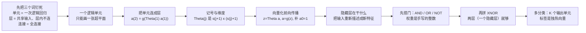

# 第 13 章 · 第 2 讲　神经网络的表示与前向传播（课堂讲授版）

> [!quote] 本讲开场
> 上一讲我们造出了一个零件：一个逻辑单元，$h_\theta(x)=g(\theta^Tx)$。它算的就是逻辑回归，能做的也就是**在空间里放一张平的面**。
>
> 上一讲结尾我已经把它并排放了三个、又叠了一个做裁决，画出了那张三层图。但图上那三个词——**单元、层、连接**——当时只是**用着**，并没有定义。所以这一讲开头先不推公式，**先花一节把它们钉死**：什么叫一个单元、什么叫一层、层与层之间到底怎么连。这三个词没弄清，后面 $\Theta^{(j)}$ 为什么是矩阵、$a^{(j)}_i$ 的下标为什么这么读，全都是天书。
>
> 钉死之后，再回到真正的悬念。假设 $x_1,x_2$ 只能取 0 或 1，要算**同或 XNOR**：两个都为 0 或都为 1 时输出 1，否则输出 0。画在平面上，正例是两个对角、负例是另外两个对角——**一张平的面切不开这种排布**。这不是"参数没调好"，是表达能力不够。
>
> 可如果我说：**给我三层、共七个单元，这件事就能做成，权重还是手写的整数**——你大概会觉得不可能。它不但可能，这一讲还会把三层的权重一个不落地写出来，在真值表上逐行验算。
>
> 关键只有一句话：**上一层的输出，可以当作下一层的输入特征。** 中间那三个单元干的活，就是**重新描述一遍输入**：把原来"切不开"的坐标，换成一个"切得开"的坐标。
>
> 五步走：
> 1. 先把三个词钉死：**单元、层、全连接**；
> 2. 立记号：$a^{(j)}_i$、$\Theta^{(j)}$，以及必须记牢的维度规则；
> 3. 把一层的运算写成一次矩阵乘法（向量化前向传播）；
> 4. 用 0/1 输入搭出**与、或、非**三个门；
> 5. 把三个门拼成**同或**，看清"隐藏层重写了坐标系"这件事。

> [!info] 怎么读这份讲义
> 前置内容是 [[C13.1 非线性假设与神经元]]（逻辑单元、激活函数、偏置单元）与 [[C2.6 高级优化算法与多分类]]（One-vs-all 多分类）。矩阵乘法与向量化在第 2 章已经用过（[[C2.3 多变量线性回归与梯度下降实践]]），这里只是把同一套记号搬到多层。
>
> 目前没有本学期对应转写稿。标有 **（拓展）** 或 **【拓展】** 的部分是课堂未展开、由教材与通行讲法延伸补充的内容。
>
> **一个要提前说清的记账陷阱**：这一讲的 $s_j$ **不含偏置单元**，而 $\Theta^{(j)}$ 的列数是 $s_j+1$（要乘上偏置那一列）。几乎所有手算错误都出在这个 $+1$ 上。



---

## 零、先把三个词说清楚：单元、层、连接

上一讲结尾画的图有三个成分：一排输入、中间并排的三个单元、右边一个做裁决的单元。这一节的任务就是把这张图上的三个词定义清楚。**定义比图重要**——后面所有公式都是这三个词的直接翻译。

### 0.1 单元：最小的零件

> [!important] 单元 Unit（＝神经元 Neuron ＝节点 Node）
> 一个**单元**就是上一讲那个装置：接收若干个输入，每个输入乘一个权重、求和，再过一个激活函数。
> $$a=g\Bigl(\theta_0+\theta_1x_1+\cdots+\theta_nx_n\Bigr)=g(\theta^Tx) .$$
>
> 三个名字说的是同一个东西：**单元 unit**（结构视角）、**神经元 neuron**（仿生视角）、**节点 node**（图论视角）。本讲统一写"单元"。

这个定义里有两处最容易含混，先挑明：

- **"单元"是一个装置，不是一个数。** 它有输入、有参数（那组权重）、有输出；输入变了输出就变。所以"第 2 层的第 1 个单元"指的是**那个装置**，而 $a^{(2)}_1$ 指的是**它在某次输入下的输出值**。
- **一个单元 = 一次逻辑回归。** 这是上一讲的结论：它的本事就是"划一张平的面"，多一点都没有。

记牢第二点，才知道这一讲到底在解决什么：**单元本身没有新东西，新东西全在"怎么把这些单元组织起来"。**

### 0.2 层：把单元并排，让它们吃同一批输入

> [!important] 层 Layer
> 把若干个单元**并排放**在一起，并约定：**同一层的单元之间不互相连接**，它们都只接收**上一层**的输出。这样的一批单元就叫**一层**。

两条约定要划出来，因为所有记号都靠它们：

1. **层内不连。** 第 2 层的三个单元之间没有任何箭头。它们彼此"看不见"，只看第 1 层。
2. **同层共享输入。** 第 2 层的每个单元都拿到**完整的**第 1 层输出，区别只在各自那一行权重。

> [!question] 停一下，先自己想想
> 三个单元并排、吃同一批输入，它们会不会算出同样的结果？
>
> **只要权重不同，就不会。** 三个单元等价于三个不同的分类器同时看同一份数据。**"并排"这件事的意义，就是让同一份输入被不同角度审一遍。**

层的编号用**上标** $(j)$，层内单元编号用**下标** $i$。所以 $a^{(2)}_3$ 读作"第 2 层第 3 个单元的激活值"。这套上下标的完整用法在 1.2 节立起来，这里先有个印象。

### 0.3 连接：全连接，所以权重是矩阵

两层之间有多少条连线？**上一层的单元数 × 下一层的单元数**。比如第 1 层 3 个、第 2 层 3 个，就是 $3\times3=9$ 条——**每条连线一个权重**。

> [!important] 全连接 Fully connected
> 如果第 $j+1$ 层的**每一个**单元都连到第 $j$ 层的**每一个**单元，就叫**全连接**。本课程讲的都是全连接网络。

![[C13-层与全连接.png]]

图里画的是"第 $j$ 层 3 个单元 + 1 个偏置 → 第 $j+1$ 层 2 个单元 + 1 个偏置"，一共 $4\times2=8$ 条连线，也就是 8 个权重。

一层里的权重写成一个个 $\theta$ 就没法看了，所以把它们**整体记成一个矩阵** $\Theta^{(j)}$。**矩阵不是数学装饰，它只是"把一层里所有连线一次写完"**：图里这 8 个权重，正好排成一张 $2\times4$ 的表——一行对应一个目标单元，一列对应一个来源。

至于这张表为什么是 $2\times4$ 而不是 $2\times3$、多出来的那一列是什么，那是一行必须背下来的维度规则，1.3 节专门算。

这也回答了上一讲那个偏置单元为什么值得单独拎出来：有了它，偏置就占矩阵里**普通的一列**，一层的运算才能干净地写成一次矩阵乘法。

### 0.4 五个词连起来

| 词 | 一句话 |
|---|---|
| **单元** unit | 一个逻辑回归，一套权重 |
| **层** layer | 一批共享输入、彼此不连的单元 |
| **全连接** fully connected | 上层每个单元都连下层每个单元（于是权重成矩阵） |
| **前馈** feedforward | 信号只从输入层往输出层走，不回头、不绕圈 |
| **深度** depth | 层数 $L$（本课程的网络只有 3–4 层） |

> [!note] 到这里，"神经网络"这个词就不玄了
> 它没有任何神秘成分：**就是"很多个逻辑回归按层排好，把上一层的输出当作下一层的输入"。** 唯一的额外约定是"层内不连、层间全连"。
>
> 剩下的问题只有两个：**这样搭起来能表达什么**（第 3、4 节用逻辑门回答）、**怎么把一层的运算算得快**（第 2 节回答）。

## 一、把单元连成网络

### 1.1 三层结构

先看最小的、但有代表性的一个网络：**三个输入、三个隐藏单元、一个输出**。

```
Layer 1            Layer 2              Layer 3
 x1 ──┐          ┌── a1(2) ──┐
 x2 ──┼──────────┼── a2(2) ──┼─────── h_Θ(x)
 x3 ──┘          └── a3(2) ──┘
                    （每层还有一个        （输出层同样
                      偏置单元）            带偏置）
```

> [!important] 读这张图的三条规矩
> 1. **每个圆圈代表一个单元**（一个逻辑回归这个装置），圈外的 $a^{(2)}_1$ 才是它在某次输入下的**输出值**。**装置和值不是一回事**——这是本讲最容易混的一处。
> 2. **每根箭头是一个权重**。第一层到第二层有 $3\times3=9$ 根箭头，所以有 9 个权重；第 2 层到第 3 层有 $3\times1=3$ 根。
> 3. **图里没画偏置的连线**（画上去太乱）。每个非输出层都有一个恒为 1 的偏置单元，它的连线权重也算在总数里——这就是 1.3 节那个 $+1$ 的来源。

三层的名字分别是：

| 层 | 名字 | 在这一层发生什么 |
|---|---|---|
| Layer 1 | **输入层 Input layer** | 就是原始特征 $x$，不做任何计算 |
| Layer 2 | **隐藏层 Hidden layer** | 用第一层的输入算出三个**新的数** $a^{(2)}_1,a^{(2)}_2,a^{(2)}_3$ |
| Layer 3 | **输出层 Output layer** | 用隐藏层那三个数算出最终预测 $h_\Theta(x)$ |

> [!important] 为什么叫"隐藏"
> 因为这些单元的值**不在训练集里**。训练集只告诉你输入是什么、输出应该是什么；中间那三个数该是多少，**没人告诉你**，模型要自己找出一个合适的值。这就是"隐藏"的意思——它也是"特征是自己学出来的"这句话的具体含义。

层的总数用 $L$ 记。上面这个网络 $L=3$。

### 1.2 记号：$a^{(j)}_i$ 与 $\Theta^{(j)}$

接下来要频繁写"第几层的第几个单元"，所以必须先把记号定死。这两条要背下来：

> [!important] 两个记号
> - $a^{(j)}_i$ = 第 $j$ 层第 $i$ 个单元的**激活值 "activation"**。"激活"就是"这个单元算出来的值"——它由上一层传来的信号经过 $g$ 得到。
> - $\Theta^{(j)}$ = 控制**从第 $j$ 层映射到第 $j+1$ 层**的**权重矩阵 matrix of weights**。
>
> 注意 $\Theta$ 是大写、带层号上标的**矩阵**，不是第 2 章那个小写向量 $\theta$。一层里有很多条连线，每条线一个权重，合起来自然是个矩阵。

于是那个三层网络的运算可以一项一项写出来（$x_0=1$ 是偏置单元）：

$$
\begin{aligned}
a^{(2)}_1&=g\bigl(\Theta^{(1)}_{10}x_0+\Theta^{(1)}_{11}x_1+\Theta^{(1)}_{12}x_2+\Theta^{(1)}_{13}x_3\bigr),\\
a^{(2)}_2&=g\bigl(\Theta^{(1)}_{20}x_0+\Theta^{(1)}_{21}x_1+\Theta^{(1)}_{22}x_2+\Theta^{(1)}_{23}x_3\bigr),\\
a^{(2)}_3&=g\bigl(\Theta^{(1)}_{30}x_0+\Theta^{(1)}_{31}x_1+\Theta^{(1)}_{32}x_2+\Theta^{(1)}_{33}x_3\bigr),\\
h_\Theta(x)&=a^{(3)}_1=g\bigl(\Theta^{(2)}_{10}a^{(2)}_0+\Theta^{(2)}_{11}a^{(2)}_1+\Theta^{(2)}_{12}a^{(2)}_2+\Theta^{(2)}_{13}a^{(2)}_3\bigr).
\end{aligned}
$$

**这四个式子要多看两眼**，因为里面藏着两件事：

1. **下标读法**：$\Theta^{(1)}_{12}$ 是"从第 1 层的**第 2 个**输入，连到第 1 层的**第 1 个**隐藏单元"的权重。第一个下标是**目标**单元，第二个是**来源**单元。
2. **偏置单元在隐藏层里也有**：$a^{(2)}_0=1$ 出现在最后一个式子里。它不是被算出来的，是**规定成 1 的**——和输入层的 $x_0=1$ 完全一样的道理（参见 [[C13.1 非线性假设与神经元]] 2.4 节）。

### 1.3 维度规则：唯一必须背下来的一条

现在数一数 $\Theta^{(j)}$ 到底有多大。设：

- 第 $j$ 层有 $s_j$ 个单元（**不含偏置**）；
- 第 $j+1$ 层有 $s_{j+1}$ 个单元。

> [!important] 维度规则
> $$\Theta^{(j)}\in\mathbf{R}^{s_{j+1}\times(s_j+1)} .$$
>
> 读法：**行数 = 下一层的单元数**（每个目标单元一行），**列数 = 上一层的单元数 + 1**（多出来的那一列是偏置 $x_0=1$ 或 $a^{(j)}_0=1$ 的权重）。

![[C13.2-板书-权重矩阵的维度.png]]

回到三层那个网络（$s_1=3,s_2=3,s_3=1$）：

- $\Theta^{(1)}\in\mathbf{R}^{3\times4}$ —— 3 个隐藏单元，每个要接 3 个输入 + 1 个偏置；
- $\Theta^{(2)}\in\mathbf{R}^{1\times4}$ —— 1 个输出单元，接 3 个隐藏单元 + 1 个偏置。

> [!question] 停一下，先自己想想
> 如果网络是 **3 个输入、5 个隐藏单元、5 个隐藏单元、4 个输出**（$L=4$），一共有多少个可学参数？**不包括**偏置单元本身的取值。

三个矩阵分别是 $5\times(3+1)=20$、$5\times(5+1)=30$、$4\times(5+1)=24$，合计

$$20+30+24=74 .$$

再看三层网络：$3\times4+1\times4=12+4=16$ 个参数。

> [!warning] 最常见的两个记账错误
> 1. **忘掉 $+1$**。以为 $\Theta^{(1)}$ 是 $3\times3$，实际是 $3\times4$——少算的就是偏置那一列。
> 2. **把 $s_j$ 算进偏置**。$s_j$ 是**不含偏置**的单元数。如果你把偏置也算进去，列数会变成 $s_j+2$，全错。
>
> 检验办法：拿一张纸把 $\Theta^{(1)}$ 的形状和矩阵乘法的形状对一遍——$(s_2)\times(s_1+1)$ 乘 $(s_1+1)\times1$ 得到 $(s_2)\times1$，维度必须能消掉。

---

## 二、向量化前向传播

### 2.1 为什么一定要向量化

1.1 节那四个式子能算，但**千万别那么写代码**。如果每一层都写 $s_{j+1}$ 条独立的式子，网络一大就是几百行重复代码，而且跑得极慢——数值计算库（MATLAB/Octave、NumPy）的优势全在矩阵运算上，循环是把优势扔掉。

把同一层里的所有单元一次算完，就是**前向传播 forward propagation** 的向量形式。

### 2.2 一层的运算只有两行

记 $a^{(1)}=x$（输入层就是原始特征），那么：

$$
\begin{aligned}
z^{(2)}&=\Theta^{(1)}a^{(1)},\\
a^{(2)}&=g\bigl(z^{(2)}\bigr).
\end{aligned}
$$

$g$ 是**逐元素**作用在向量上的——每个分量各自过一遍 sigmoid。

这里有一个很容易漏的细节：$a^{(2)}$ 算出来之后，**要给它补上一个偏置单元** $a^{(2)}_0=1$，再送进下一层。所以完整的链路是：

> [!important] 前向传播的完整链路
> $$
> \begin{aligned}
> &a^{(1)}=x,\\
> &z^{(2)}=\Theta^{(1)}a^{(1)},\qquad a^{(2)}=g\bigl(z^{(2)}\bigr),\qquad \textbf{再补 } a^{(2)}_0=1,\\
> &z^{(3)}=\Theta^{(2)}a^{(2)},\qquad h_\Theta(x)=a^{(3)}=g\bigl(z^{(3)}\bigr).
> \end{aligned}
> $$
>
> 三步的节奏是一样的：**先乘出 $z$，再激活成 $a$，再补偏置。** 层数再多也只是把这三步重复。

![[C13.2-板书-向量化前向传播.png]]

> 上图把"逐条式子"和"矩阵写法"并排放在一起对照：左边一长串 $a^{(2)}_1,a^{(2)}_2,a^{(2)}_3$ 的展开，右边就是 $z^{(2)}=\Theta^{(1)}a^{(1)}$ 一行，再加一句"补 $a^{(2)}_0=1$"。

> [!note] 一个符号习惯
> $z^{(j)}$ 这个记号是专门为向量化引入的：它是**激活之前**的加权和。之所以要给中间量一个名字，是因为下一讲算梯度的时候要用到 $g'(z^{(j)})$——那时你会很庆幸它有个名字。

### 2.3 隐藏层到底在干什么

这是这一讲最重要的一节。**不要把它当成"多了一层就没那么线性"这种模糊说法**，它有一个很具体的解释。

把这个网络按层切开看：

- **最后一层**（$\Theta^{(2)}$ 那部分）拿到手的是 $a^{(2)}_1,a^{(2)}_2,a^{(2)}_3$ 三个数，然后做一次逻辑回归。**它做的事和 [[C2.5 逻辑回归]] 完全一样，没有任何新东西。**
- **前面几层**做的事完全不同：它们把原始输入 $x_1,x_2,x_3$ 变成 $a^{(2)}_1,a^{(2)}_2,a^{(2)}_3$。

所以：

> [!important] 隐藏层 = 自动学出来的特征
> 传统做法是：人先想好特征（"在这里加个 $x_1x_2$"、"在那里加个 $x_1^2x_2$"），再喂给分类器。
>
> 神经网络的做法是：**把特征本身也变成可学的参数。** 网络自己去决定 $a^{(2)}$ 这三个数该是什么——它不需要人来指定"二次项"或"三次项"，它只要求这三个数能让最后的分类做得好。
>
> 这就是上一讲那堵墙的正面突破：**不是找更强的特征模板，而是让特征从数据里长出来。**

【拓展】**在图像上，这三个"特征"往往会有直观的含义。** 现代卷积网络的中间层被大量可视化过，呈现出一种从具体到抽象的顺序：最早几层学出**边缘**（某个方向上的亮暗突变），往上一层把边缘拼成**局部形状**（角、弧、条纹），再往上拼成**物体的部件**（轮子、眼睛、把手），最后才在输出层判断"这是不是车"。这个层级不是人设计的，是训练出来的。

（这里要诚实说明：这一讲只讲到"网络学习自己的特征"这个想法；"像素→边缘→部件→物体"这个层级是后来在卷积网络上被观察到的，属于标准讲法的补充，不在本讲的推导线里。）

### 2.4 其他结构：隐藏层可以不止一层

$L$ 不是固定的 3。可以做成 3 个输入、5 个隐藏、5 个隐藏、1 个输出（$L=4$），也可以更宽、更深。

结构怎么选，第 14 章会专门讲（那时候才需要"默认一个隐藏层、多层就等宽"这类经验规则）。现在只要记住：**层数和每层的宽度都是结构参数，而 $\Theta^{(1)},\Theta^{(2)},\dots$ 是数值参数。**

---

## 三、用网络算出逻辑运算

上一节说"隐藏层换了坐标系"，但那还是一句断言——凭什么相信它换得对？

**接下来两节用一个最小的例子把它算穿**：让网络去做逻辑运算。选这个例子的理由有三条：输入只有两个、取值只有 0/1，可以**手算**；结果是离散的，对错**一看就知道**；而其中最要紧的那个例子（同或）恰好是**线性不可分**的最经典代表——单个单元画不出它。所以只要网络算出了同或，"多个单元比一个强"就不再是口号。

### 3.1 先把靶子立起来：XNOR

设 $x_1,x_2\in\{0,1\}$，考虑**同或 XNOR**：

$$y=x_1\ \text{XNOR}\ x_2=\text{NOT}\,(x_1\ \text{XOR}\ x_2).$$

真值表是：

| $x_1$ | $x_2$ | XNOR |
|---|---|---|
| 0 | 0 | **1** |
| 0 | 1 | 0 |
| 1 | 0 | 0 |
| 1 | 1 | **1** |

画在平面上，正例是左下角和右上角两个点，负例是另外两个点。**一条直线切不开这两个正例**（不管你斜着放还是横着放，总会有一个正例和一个负例在同一侧）。这就是 XOR 问题，它是最古老也最有名的"线性不可分"例子。

我们要做的事：**用一堆直线拼出一条折线，围出两块区域。** 分三步——先造单个门，再把门拼起来。

### 3.2 单个逻辑单元的临界点

在动手之前，先把一个逻辑单元的"手感"校准一下。$g(z)=\frac{1}{1+e^{-z}}$ 的取值：

| $z$ | $-30$ | $-10$ | $-4.6$ | $0$ | $4.6$ | $10$ | $30$ |
|---|---|---|---|---|---|---|---|
| $g(z)$ | $\approx0$（$9.4\times10^{-14}$） | $\approx0$（$4.5\times10^{-5}$） | $0.010$ | $0.5$ | $0.990$ | $\approx1$（$0.99995$） | $\approx1$（$1-9.4\times10^{-14}$） |

两个数要记住：

- **$z=0$ 是分界**：$z>0$ 输出大于 0.5（判 1），$z<0$ 小于 0.5（判 0）。
- **超过 $\pm4.6$ 就基本饱和**：$g(4.6)=0.99$、$g(-4.6)=0.01$，再大就更接近 1 和 0。

所以只要把一个单元的权重取成较大的整数（比如 $\pm20$、$\pm30$），它的行为就非常接近一个**硬阈值**：加权和大于 0 输出 1，否则输出 0。**这正是"算出一个逻辑门"所需要的**——门是离散的，而 sigmoid 是连续的，用大权重把连续函数"压"成离散的。

### 3.3 与门 AND

取权重 $\Theta^{(1)}_{10}=-30,\ \Theta^{(1)}_{11}=20,\ \Theta^{(1)}_{12}=20$：

$$h_\Theta(x)=g(-30+20x_1+20x_2).$$

逐个输入代进去：

| $x_1$ | $x_2$ | $-30+20x_1+20x_2$ | $h_\Theta(x)$ |
|---|---|---|---|
| 0 | 0 | $-30$ | $g(-30)\approx0$ |
| 0 | 1 | $-10$ | $g(-10)\approx0$ |
| 1 | 0 | $-10$ | $g(-10)\approx0$ |
| 1 | 1 | $10$ | $g(10)\approx1$ |

**只有两个都是 1 时加权和才转正**——这就是 AND。为什么偏置取 $-30$、每个输入取 $20$？因为要让"只有两项都到齐"才够 $30$，一项只有 $20$，凑不够。

![[C13.2-板书-逻辑单元的sigmoid阈值.png]]

> 上图把 $g(z)$ 的曲线和那张真值表放在一起：权重取 $\pm20$/$\pm30$ 之后，$z$ 只落在 $-30,-10,10$ 这三个位置上，而前两个已经在 $g$ 的饱和区（$\approx0$），最后一个在另一侧饱和区（$\approx1$）。所以连续的 sigmoid 在这里表现得像一个离散的门。

### 3.4 或门 OR

把偏置放宽到 $-10$：

$$h_\Theta(x)=g(-10+20x_1+20x_2).$$

| $x_1$ | $x_2$ | $-10+20x_1+20x_2$ | $h_\Theta(x)$ |
|---|---|---|---|
| 0 | 0 | $-10$ | $\approx0$ |
| 0 | 1 | $10$ | $\approx1$ |
| 1 | 0 | $10$ | $\approx1$ |
| 1 | 1 | $30$ | $\approx1$ |

**只要有一个到齐就够了**——这就是 OR。和 AND 的差别只在偏置：$-30$ 要求"两个都到"，$-10$ 要求"一个就行"。

### 3.5 非门 NOT

单个输入 $x_1$，取偏置 $+10$、权重 $-20$：

$$h_\Theta(x)=g(10-20x_1).$$

| $x_1$ | $10-20x_1$ | $h_\Theta(x)$ |
|---|---|---|
| 0 | $10$ | $\approx1$ |
| 1 | $-10$ | $\approx0$ |

**权重取负号就把判断反过来了**——这就是 NOT。

> [!note] 到这里，"门"这件事就通了
> 三个门，三种取权重的思路：
> - **AND**：偏置负得够多（$-30$），必须两个输入都到才够本；
> - **OR**：偏置负得少（$-10$），一个输入就够；
> - **NOT**：权重取负，值越大反而越否。
>
> 记住这三条，XNOR 的拼装就不用硬背——它是**先用 AND 和 NOT 造出两个"局部条件"，再用 OR 把它们并起来**。

---

## 四、把门拼成 XNOR

三个门都造好了，现在把它们当积木用。**拼装的目标是一件具体的事：让网络自己算出同或。**

### 4.1 先造两个局部条件

同或的定义可以改写成

$$x_1\ \text{XNOR}\ x_2=(x_1\ \text{AND}\ x_2)\ \text{OR}\ \bigl((\text{NOT}\,x_1)\ \text{AND}\ (\text{NOT}\,x_2)\bigr).$$

这句话读作：**"两个都是 1"或者"两个都是 0"**。两个极端情形各自是一个 AND，最后用 OR 并起来。

于是要三个隐藏单元，分别负责三件事：

| 隐藏单元 | 负责判断 | 权重（偏置, $x_1$, $x_2$） | 表达式 |
|---|---|---|---|
| $a^{(2)}_1$ | $x_1$ AND $x_2$ | $(-30,\ 20,\ 20)$ | $g(-30+20x_1+20x_2)$ |
| $a^{(2)}_2$ | $(\text{NOT}\,x_1)$ AND $(\text{NOT}\,x_2)$ | $(10,\ -20,\ -20)$ | $g(10-20x_1-20x_2)$ |
| 输出 | $a^{(2)}_1$ OR $a^{(2)}_2$ | $(-10,\ 20,\ 20)$ | $g(-10+20a^{(2)}_1+20a^{(2)}_2)$ |

第二个单元值得单独看一眼：它要同时满足"$x_1=0$"和"$x_2=0$"。**把 NOT 的权重（$10,-20$）和 AND 的结构（偏置要负得够多）合在一起**，得到 $10-20x_1-20x_2$：

- $x_1=x_2=0$ → $10$ → 输出 1 ✔
- $x_1=1,x_2=0$ → $-10$ → 输出 0 ✔
- $x_1=0,x_2=1$ → $-10$ → 输出 0 ✔
- $x_1=x_2=1$ → $-30$ → 输出 0 ✔

正好就是"两个都是 0"。**注意这里的偏置是 $+10$，符号和 AND 相反**：因为要判断的是"没有输入"这件事，基准要往上抬。

### 4.2 逐行验算

现在把两层串起来，四个输入全算一遍（第三层用 $(-10,20,20)$ 对 $a^{(2)}_1,a^{(2)}_2$ 做 OR）：

| $x_1$ | $x_2$ | $a^{(2)}_1$（AND） | $a^{(2)}_2$（都非） | $-10+20a^{(2)}_1+20a^{(2)}_2$ | $h_\Theta(x)$ | 应为 XNOR |
|---|---|---|---|---|---|---|
| 0 | 0 | $\approx0$ | $\approx1$ | $10$ | $\approx1$ | **1** ✔ |
| 0 | 1 | $\approx0$ | $\approx0$ | $-10$ | $\approx0$ | 0 ✔ |
| 1 | 0 | $\approx0$ | $\approx0$ | $-10$ | $\approx0$ | 0 ✔ |
| 1 | 1 | $\approx1$ | $\approx0$ | $10$ | $\approx1$ | **1** ✔ |

四行全对。**三层、七个单元、权重全是手写的整数，算出了同或。**

![[C13.2-板书-XNOR的三层拼装.png]]

> 上图把这套拼装完整画出来了：三个门各自的权重、$a^{(2)}_1$ 与 $a^{(2)}_2$ 的分工、第三层怎么把它们"或"起来，右下角是逐行的真值对照。

### 4.3 为什么非要多一层

到这里必须回答一个问题：**这种拼装，单层做不到吗？**

做不到。理由是几何上的：

> [!important] 一层 vs 两层
> - **一层**（直接 $x\to h$）：决策边界是 $g(\Theta x)$ 的零点集，在二维输入下就是**一条直线**。一条直线**永远**切不开"两个对角正例"这种排布。
> - **两层**（$x\to a^{(2)}\to h$）：隐藏层把每个输入 $x$ **映射成了一个新坐标** $(a^{(2)}_1,a^{(2)}_2)$，而第三层是在**这个新坐标系**里画一条直线。
>
> XNOR 的四组输入在新坐标里的位置是：
>
> | $x=(x_1,x_2)$ | $(a^{(2)}_1,a^{(2)}_2)$ | 应该输出 |
> |---|---|---|
> | $(0,0)$ | $\approx(0,1)$ | 1 |
> | $(0,1)$ | $\approx(0,0)$ | 0 |
> | $(1,0)$ | $\approx(0,0)$ | 0 |
> | $(1,1)$ | $\approx(1,0)$ | 1 |
>
> 看这张表：在**新坐标**里，正例落在 $(0,1)$ 和 $(1,0)$，负例**两个都堆在原点**。而"输出 1"的条件是 $a^{(2)}_1+a^{(2)}_2>0.5$——也就是**一条斜线**。
>
> 原来切不开的排布，被隐藏层重新摆过一次之后，**一条直线就切开了。**

**这就是隐藏层的全部秘密。** 它不"增加复杂度"这种含糊的说法，而是**换了一套坐标，让原来非线性可分的问题在新坐标里线性可分**。之后所有的深度网络都在重复这件事：一层换一次坐标，越往上换得越接近"能一刀切开"。

> [!question] 课堂追问：那多堆几层是不是总能解决？
> 表达能力上是的（更深的网络能表示更复杂的边界），但这**不等于**更深的网络一定训练得更好：参数更多、更容易过拟合（[[C2.7 过拟合与正则化]]）、优化更难。而且这一讲的所有门都是**手工指定**的权重——真实的训练中我们并不知道这些整数，要**让梯度下降把它们找出来**。这正是第 14 章要做的事。
>
> 换句话说：**这一讲证明的是"网络有能力表达 XNOR"，不是"网络能学会 XNOR"。** 这两件事差得很远。

### 4.4 一个真实的例子：手写数字

理论讲完，看一个当年真实的成果：LeNet 系统做手写数字识别。输入是一张手写的数字图（比如"9"），网络输出识别结果。图里还有一排"被识别成什么"的分支，说明内部不同单元对同一个输入给出了不同的候选判断。

这个系统的意义在于：**没有人手工告诉它"要去哪里找笔画"，它自己从像素里学出了能区分 0–9 的特征。** 这正是 2.3 节讲过的那件事第一次在真实任务上成功了。

---

## 五、多分类：K 个输出单元

### 5.1 从"是不是"到"是哪一类"

前面所有网络的输出都是一个数，回答一个是非问题。要回答"四个类别里是哪一类"，最直接的做法是把输出层做成 **$K$ 个单元**：

$$\text{pedestrian}\quad\text{car}\quad\text{motorcycle}\quad\text{truck}$$

每个输出单元各自回答一个问题："是不是这一类？"于是

$$h_\Theta(x)\in\mathbf{R}^4 .$$

### 5.2 目标输出是独热向量

训练的时候，标签不能是一个数（$1,2,3,4$），而必须是一个**向量**，其中只有对应类别那一位是 1：

| 类别 | 期望的 $h_\Theta(x)$ |
|---|---|
| 行人 pedestrian | $[1,0,0,0]^T$ |
| 汽车 car | $[0,1,0,0]^T$ |
| 摩托车 motorcycle | $[0,0,1,0]^T$ |
| 卡车 truck | $[0,0,0,1]^T$ |

> [!important] 训练集的形式
> 每个样本是 $(x^{(i)},y^{(i)})$，其中 $y^{(i)}$ **本身是一个四维向量**，取上面四者之一。
>
> 这叫**独热编码 one-hot encoding**。要特别注意的是：**这与第 2 章 One-vs-all 的做法长得像，但训练方式不同**——One-vs-all 是训练 $K$ 个独立的二分类器，每个只关心自己那一类；这里的 $K$ 个输出单元是**在同一个网络里联合训练**的，共享同一个隐藏层，所以它们的特征是共享的（[[C2.6 高级优化算法与多分类]]）。

![[C13.2-板书-多分类的独热输出.png]]

> 上图把四类图像、四个输出单元、以及"每个训练样本的 $y^{(i)}$ 是四个独热向量之一"这三件事放在一张图里，右下角点明了"预测 $h_\Theta(x^{(i)})$ 应当逼近 $y^{(i)}$"。

---

## 本讲小结：今天要记住的三件事

> [!important] 三句话
> 1. **先有三个词**：**单元**＝一次逻辑回归（＝神经元＝节点）；**层**＝一批共享输入、层内不连的单元；**全连接**＝上层每个单元连下层每个单元。**记号与维度**：$a^{(j)}_i$ 是第 $j$ 层第 $i$ 个单元的激活值，$\Theta^{(j)}$ 是从第 $j$ 层到第 $j+1$ 层的权重矩阵，且 $\Theta^{(j)}\in\mathbf{R}^{s_{j+1}\times(s_j+1)}$。**$s_j$ 不含偏置，列数要 $+1$。** 前向传播三步循环：$z=\Theta a$ → $a=g(z)$ → 补偏置 $a_0=1$（$a^{(1)}=x$，$h_\Theta(x)=a^{(L)}$）。
> 2. **一个逻辑单元 = 一个门**：权重取大整数时 sigmoid 饱和成硬阈值（$g(\pm4.6)=0.99/0.01$，$z=0$ 是分界）。$g(-30+20x_1+20x_2)$ 是 AND、$g(-10+20x_1+20x_2)$ 是 OR、$g(10-20x_1)$ 是 NOT；XNOR $=(x_1$ AND $x_2)$ OR $((\text{NOT}x_1)$ AND $(\text{NOT}x_2))$，用 $(-30,20,20)$、$(10,-20,-20)$、$(-10,20,20)$ 三片权重在三层网络里算出。
> 3. **隐藏层在换坐标**：一层网络的边界是一条直线，切不开对角排布；两层网络先用隐藏层把输入映射到新坐标，在那里负例被堆到原点、正例分开，**一条直线就切开了**。这就是"网络学习自己的特征"的确切含义。多分类时输出层放 $K$ 个单元，标签用独热向量。

### 速查表（考前扫一眼）

| 名称 | 内容 |
|---|---|
| 单元 | 一次逻辑回归；也叫神经元 neuron、节点 node |
| 层 | 并排的一批单元：共享同一批输入、**层内彼此不连** |
| 全连接 / 前馈 | 上层每个单元连下层每个单元；信号只往输出方向走 |
| 层号与总数 | $L$ = 总层数；$s_j$ = 第 $j$ 层单元数（**不含偏置**） |
| 激活值 | $a^{(j)}_i$，$a^{(1)}=x$，$a^{(L)}=h_\Theta(x)$ |
| 权重矩阵 | $\Theta^{(j)}\in\mathbf{R}^{s_{j+1}\times(s_j+1)}$；第一个下标=目标单元，第二个=来源 |
| 偏置单元 | $x_0=1$，$a^{(j)}_0=1$（$j=2,\dots,L-1$），不学 |
| 前向传播 | $z^{(j)}=\Theta^{(j-1)}a^{(j-1)}$，$a^{(j)}=g(z^{(j)})$ |
| 参数个数 | $\sum_{j=1}^{L-1}s_{j+1}(s_j+1)$；3-3-1 为 16，3-5-5-4 为 74 |
| sigmoid 临界点 | $g(0)=0.5$；$g(4.6)=0.99$，$g(-4.6)=0.01$；$\pm30$ 已是 $1-10^{-13}$ 级 |
| AND | $g(-30+20x_1+20x_2)$ |
| OR | $g(-10+20x_1+20x_2)$ |
| NOT | $g(10-20x_1)$ |
| $(\text{NOT}x_1)$ AND $(\text{NOT}x_2)$ | $g(10-20x_1-20x_2)$ |
| XNOR | $(x_1\text{ AND }x_2)$ OR $((\text{NOT}x_1)\text{ AND }(\text{NOT}x_2))$ |
| XNOR 的权重 | 隐藏层 $(-30,20,20)$、$(10,-20,-20)$；输出层 $(-10,20,20)$ |
| 单层能力 | 决策边界是一条超平面，切不开 XOR/XNOR |
| 多分类 | 输出层 $K$ 个单元，$h_\Theta(x)\in\mathbf{R}^K$，标签用独热向量 |
| 训练集写法 | $(x^{(i)},y^{(i)})$，$y^{(i)}$ 是 $K$ 维独热向量 |

### 勘误与阅读边界

| 位置 | 原稿写的 | 实际 / 处理 |
|---|---|---|
| 神经元解剖细节 | 髓鞘、郎飞结、施万细胞等 | 对建模无用，本讲只保留"树突=输入、轴突=输出、胞体=汇总"；解剖名不做考点 |
| 参数展开页（第 14 章 p18）的层宽 | 写 $s_1=10,s_2=10,s_3=1$，却给出 **三片**权重 $\Theta^{(1)},\Theta^{(2)},\Theta^{(3)}$ | **内部矛盾**：三片权重要求 $L=4$，中间层必须是 10 而不是 1。仅中间层取 10 时三片元素数才等于 $110+110+11=231$。详见 [[C14.1 代价函数与反向传播]] 的对应小节 |
| XNOR 的权重约定 | 原稿用 $(-30,20,20)$、$(10,-20,-20)$、$(-10,20,20)$ 这组整数 | 数值已逐行复算，四个输入全部正确；偏置取 $+10$ 的那片（判断"两个都非"）符号与 AND 相反，请不要抄错 |
| 多分类的输出约定 | 原稿标注 $h_\Theta(x)\in\mathbf{R}^4$ 而未说明标签形式 | 本讲补出独热向量，并说明它与第 2 章 One-vs-all 的区别（联合训练 vs 独立二分类） |
| 未展开的部分 | —— | 为什么深层网络更好训练、卷积网络的具体结构、为什么大权重会饱和（梯度消失）、多分类时输出层该不该用 softmax 而不是独立 sigmoid，均超出本讲边界；本讲只用到结论 |

> [!note] 数值复核
> 本讲全部数字已用程序独立复算：$g(-30)=9.36\times10^{-14}$、$g(-10)=4.54\times10^{-5}$、$g(\pm4.6)=0.01/0.99$、$g(10)=0.99995$；AND/OR/NOT/XNOR 四个门的真值表四行全对；参数个数 $3\times4+1\times4=16$、$5\times4+5\times6+4\times6=74$。

---

## 下一讲预告

到这里，网络已经能**算**了：给它一组权重，它能从输入一路算到输出。而且我们亲眼看到，只要权重取得对，它能表达"同或"这种单个逻辑回归永远画不出的边界。

但有一个致命的空白：**那些整数是手写的。**

真实的训练里没人会告诉你 $x_1$ 的权重应该是 $20$ 还是 $-30$。权重必须**从数据里学出来**。而学，就需要两样东西：一个衡量"现在错得多离谱"的**代价函数**，和一个"往哪个方向改权重"的**梯度**。

代价函数还好办——把逻辑回归的对数损失按输出单元加起来就行。难的是梯度：网络的输出要经过好几层才轮到某一个权重，**一个深层权重的偏导，得一路乘回来**。

这就是**反向传播 Backpropagation**。它做的事情，本质上是把链式法则在网络的图上跑一遍。而且跑完之后，一层隐藏层里那几百个"没人告诉过我们该是什么"的数，会开始自己动起来。

---
上一讲：[[C13.1 非线性假设与神经元]]
下一讲：[[C14.1 代价函数与反向传播]]
返回：[[机器学习课程 MOC]]
