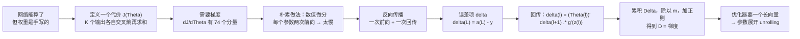

# 第 14 章 · 第 1 讲　代价函数与反向传播（课堂讲授版）

> [!quote] 本讲开场
> 上一讲结束时，我们手里有一个能算的网络：给它权重，它能从像素一路算到"这是不是车"。而且我们证明了它**有能力**表达同或那种复杂的边界。
>
> 但那些权重是我们手写的整数。真实的训练里没有这种好事——**权重必须自己学出来。**
>
> 学，就要回答两个问题：**现在错得多离谱？往哪个方向改？** 第一个问题好办，写一个代价函数就行，无非是把逻辑回归的对数损失按输出单元加起来。第二个问题才是这一讲的分量所在：
>
> 先把名字解释掉：**这件事叫反向传播 Backpropagation**。说白了就一句话——
>
> > **先算出这次预测错得多离谱，再把这份"错"按连线的粗细一层层摊回去，看每个权重该负多少责任。**
>
> 名字里的"反向"只说了一件事：信息的流向和前向传播相反；数学内容其实只有一个——**链式法则 chain rule**。这句话背后站着什么，第三节会拆开讲。
>
> 现在看它为什么值得单独推一遍。想象一个 3-5-5-4 的网络，74 个参数。要求某一个**第一层**参数的偏导——这个参数的影响要走完三层、经过两次 sigmoid、最后才在代价函数上体现出来。**这条链上的每一次乘法都得算对，错一个系数，梯度就全错**，而梯度全错的后果是模型训练几小时后停在原地一动不动。
>
> 这一讲要做两件事：把这个"一路乘回来"的过程推成公式，给它起名叫**反向传播 Backpropagation**；然后用一段 46 秒的动画，把一轮完整的计算——前向、代价、回传、梯度——**一个数一个数地走完**。那段动画用的是 2 输入 2 隐藏 1 输出的迷你网络，每个中间值我都会重新算一遍，你可以对着验。
>
> 五步走：
> 1. 先把代价函数定下来，说清为什么是**两层求和**；
> 2. 说清为什么不能用数值微分硬算梯度（这是引入反向传播的动机）；
> 3. **先不碰公式**，把"反向传播"这个名字和思路讲清：它要解决什么、凭什么快、为什么叫反向；
> 4. 再把那四个公式推出来，重点是 $\delta^{(L)}=a^{(L)}-y$ 这个**漂亮得不像话**的结果；
> 5. 走一遍完整算例，最后说清**参数展开 unrolling** 是干什么用的（把一堆矩阵摊平成一个长向量，好交给优化器）。

> [!info] 怎么读这份讲义
> 前置内容是 [[C13.2 神经网络的表示与前向传播]]（$a^{(j)}_i$、$\Theta^{(j)}$、维度规则、前向传播的向量形式）与 [[C2.5 逻辑回归]]（交叉熵损失、sigmoid 的导数 $g'=g(1-g)$）、[[C2.6 高级优化算法与多分类]]（把 $J$ 与梯度交给 `fminunc` 这类优化器）。
>
> 目前没有本学期对应转写稿。标有 **（拓展）** 或 **【拓展】** 的部分是课堂未展开、由教材与通行讲法延伸补充的内容。
>
> **两处必须先讲清的记账**：第一，代价函数的正则项写成 $\frac{\lambda}{2m}\sum\Theta^2$ 时，它对 $\Theta$ 的梯度是 $\frac{\lambda}{m}\Theta$，而原稿在梯度公式里写成了 $\lambda\Theta$——本讲按**正确的**写出，并在篇末勘误里说明两套约定的差别。第二，$\delta$ 里有一个分量属于**偏置单元**，它在任何一步都不能用，本讲在 4.5 节专门交代怎么把它剔掉。



---

## 一、代价函数：K 个输出各自算账

### 1.1 先数清输出单元有几个

网络做分类时，输出单元的个数由**类别数**决定：

| 任务 | 输出单元数 | 说明 |
|---|---|---|
| 二分类 binary classification | **1 个** | 输出 $h_\Theta(x)\in(0,1)$，与逻辑回归一样 |
| 多分类 $K$ 类 | **$K$ 个** | 输出 $h_\Theta(x)\in\mathbf{R}^K$，第 $k$ 个分量回答"是不是第 $k$ 类" |

记：

- $L$ = 网络的总层数；
- $s_l$ = 第 $l$ 层的单元数（**不含偏置单元**）。

例：4 层网络、每层 3 个单元、最后一层 4 个输出单元，则 $L=4$，$s_1=s_2=s_3=3$，$s_4=K=4$（含 4 个类别：行人、汽车、摩托车、卡车）。

### 1.2 代价函数

逻辑回归的代价函数是

$$J(\theta)=-\frac1m\sum_{i=1}^{m}\Bigl[y^{(i)}\log h_\theta(x^{(i)})+(1-y^{(i)})\log\bigl(1-h_\theta(x^{(i)})\bigr)\Bigr].$$

神经网络的代价函数长得几乎一样，只是**多了一层对输出单元的求和**：

> [!important] 神经网络的代价函数⭐
> $$
> J(\Theta)=-\frac1m\sum_{i=1}^{m}\sum_{k=1}^{K}\Bigl[y^{(i)}_k\log\bigl(h_\Theta(x^{(i)})\bigr)_k+\bigl(1-y^{(i)}_k\bigr)\log\bigl(1-\bigl(h_\Theta(x^{(i)})\bigr)_k\bigr)\Bigr]+\frac{\lambda}{2m}\sum_{l=1}^{L-1}\sum_{i=1}^{s_l}\sum_{j=1}^{s_{l+1}}\bigl(\Theta^{(l)}_{ji}\bigr)^2 .
> $$

**逐块读这个式子**，因为它有六个求和号，很容易看晕：

| 部分 | 含义 |
|---|---|
| $\sum_{i=1}^{m}$ | 对 $m$ 个训练样本求和 |
| $\sum_{k=1}^{K}$ | 对 $K$ 个**输出单元**求和 |
| $y^{(i)}_k$ | 第 $i$ 个样本的标签向量 $y^{(i)}$ 的**第 $k$ 个分量**（独热向量里 0 或 1） |
| $\bigl(h_\Theta(x^{(i)})\bigr)_k$ | 网络对第 $i$ 个样本的第 $k$ 个输出 |
| $\frac{\lambda}{2m}\sum\sum\sum(\Theta^{(l)}_{ji})^2$ | 正则项：把所有层的所有权重平方求和 |

> [!question] 停一下，先自己想想
> 为什么里面要多一层 $\sum_{k=1}^{K}$？
>
> 因为**每一个输出单元都是一个独立的逻辑回归**。第 $k$ 个输出单元在回答"是不是第 $k$ 类"，它有自己的对数损失。$K$ 个单元就有 $K$ 份损失，必须都加起来。
>
> **当 $K=1$ 时，这一层求和只剩下 $k=1$ 一项，整个式子就退化回逻辑回归的代价函数。** 这是个很好的自检：把它代进去看一眼，确认能对上。

### 1.3 为什么不用平方误差

自然会有个疑问：为什么不用我们最熟的平方误差 $J=\frac1m\sum\sum(y_k-h_k)^2$？它在第 2 章讲线性回归时用得挺顺。

> [!warning] 平方误差在这个模型上不合适
> 用平方误差也能训练，但它会让梯度下降**慢得多**。原因在于：平方误差 $+$ sigmoid 的输出层，构成的 $J$ 关于参数是**非凸**的，而且它的梯度里会带一个 $g'(z)$ 因子，当输出已经严重错误、$g$ 进入饱和区时 $g'\to0$，**梯度反而变小**——模型在最该快改的时候，改得最慢。
>
> 对数损失——也就是逻辑回归用的那个损失，常叫**交叉熵 cross-entropy**——在这个位置恰好把 $g'$ 约掉了：见 4.3 节会发现 $\delta^{(L)}=a^{(L)}-y$，**误差多大，梯度就多大**，没有那个讨厌的饱和因子。

【拓展】还有一层更本质的理由：对数损失是伯努利分布的负对数似然。用它做代价函数，等价于对输出做**最大似然估计**，这在统计上是"对"的；平方误差对应的是高斯噪声假设，与 0/1 标签的性质不符。

### 1.4 正则项为什么不惩罚偏置

正则项的三重求和是 $\sum_{l=1}^{L-1}\sum_{i=1}^{s_l}\sum_{j=1}^{s_{l+1}}(\Theta^{(l)}_{ji})^2$。注意 $i$ 从 $1$ 开始，**不是从 $0$**：

- 下标 $i$ 是"来源单元"，$i=0$ 就是**偏置那一列**。从 1 开始意味着**偏置的权重不被惩罚**。
- 下标 $j$ 从 1 到 $s_{l+1}$，覆盖所有输出单元。

**这条要记住**：偏置只负责整体平移，不放大也不缩小任何特征，惩罚它没有正则化的意义（而且会把决策边界硬拽向原点）。这个约定在梯度公式里会再现一次（$j\ne0$ 那个分段）。

---

## 二、要算的是两样东西

代价函数有了，接下来交给优化器。而所有的高级优化器（共轭梯度、BFGS、L-BFGS，见 [[C2.6 高级优化算法与多分类]]）要的接口都只有两样：

$$\text{交出去：}\quad J(\Theta)\quad\text{和}\quad\frac{\partial}{\partial\Theta^{(l)}_{ij}}J(\Theta)\quad\text{（每一个参数都要一份）} .$$

$J(\Theta)$ 好办，把前向传播写一遍就出来了。**难的是那 $74$ 份、或者几百万份偏导。**

> [!important] 关键观察：需要的是"梯度的每一分量"
> 四层网络有 $\Theta^{(1)},\Theta^{(2)},\Theta^{(3)}$ 三个**矩阵**。优化器不认矩阵，它要一个**长向量**，所以每个矩阵都要摊平、拼起来。但首先，我们得先知道每个位置上的偏导是多少。

### 2.1 朴素做法：数值微分

最直接的办法是**定义**：把某个参数挪动一点点，看代价变化多少。

$$\frac{\partial}{\partial\Theta^{(l)}_{ij}}J(\Theta)\approx\frac{J\bigl(\Theta^{(l)}_{ij}+\epsilon\bigr)-J\bigl(\Theta^{(l)}_{ij}-\epsilon\bigr)}{2\epsilon}.$$

这条路**数学上完全正确**，而且下一章（[[C14.2 梯度检验与训练]]）我们还会专门用它来**检查**反向传播有没有写错。

### 2.2 但它不能用来训练

算一个参数的偏导，要**跑两次完整的前向传播**（一次 $+\epsilon$、一次 $-\epsilon$）。那么 $n$ 个参数就要 $2n$ 次前向。

- 三层小网络：$16$ 个参数 → $32$ 次前向。能忍。
- 3-5-5-4：$74$ 个参数 → $148$ 次。开始难受。
- 真实的网络：几十万到上亿个参数 → **$10^5$ 到 $10^8$ 次前向，还只是算一次梯度**。而梯度下降要迭代成百上千次。

$$\text{数值微分：一次梯度}\approx2n\text{ 次前向};\qquad\text{反向传播：一次梯度}\approx1\text{ 次前向}+1\text{ 次回传}.$$

这就是全部动机。**反向传播不是"另一种求导方式"，它是把"同一个梯度的所有分量"用一次前向里已经算过的东西，一次性算出来。**

> [!note] 先记住一句话，第三节展开
> 下面要讲的那个算法，**没有做任何近似**。它算的就是精确的偏导，省下的不是精度，是**重复计算**。
>
> 至于它凭什么能做到这一点、为什么叫"反向"，是第三节的主题——那里不动公式，只讲思路。

---

## 三、反向传播是什么：先把名字和思路讲清，再动公式

上一节把账算出来了：需要 74 份（或者几百万份）偏导。**接下来的算法叫反向传播。** 但在写公式之前，先把三件事说清——它要解决什么、凭什么比数值微分快、为什么叫"反向"。这三件事都没讲就去推公式，公式会变成一堆没有来处的符号。

### 3.1 一句话版本

> [!important] 反向传播 Backpropagation 的一句话
> **先算出这次预测错得多离谱，再把这份"错"按连线的粗细一层层摊回去，看每个权重该负多少责任。**

这句话里没有公式，但它已经包含了后面所有公式的骨架。下面把它拆开。

### 3.2 要回答的问题：每个权重"该挪多少"

所有的偏导都在问同一件事：

> **别的参数都不动，只把**这一个**参数挪一点点，代价会变多少？**

这就是一个**斜率**。知道斜率，就知道"往哪边挪、挪多快"——梯度下降就是拿斜率当方向、乘上一个步长 $\alpha$（[[C2.2 梯度下降]]）。所以"训练网络"这件事，数学上等价于"**把这几百万个斜率都算出来**"。

### 3.3 困难：一个深层权重的影响，要"走好几站"才到代价

考虑最靠前的那个权重 $\Theta^{(1)}_{11}$。它不是直接影响代价的：

$$\Theta^{(1)}_{11}\ \longrightarrow\ z^{(2)}\ \longrightarrow\ a^{(2)}\ \longrightarrow\ z^{(3)}\ \longrightarrow\ \cdots\ \longrightarrow\ a^{(L)}\ \longrightarrow\ J$$

**它的影响要一站一站传过去，每过一站都要按那一站自己的"变化率"折算一下。** 描述这件事的就是链式法则：

> [!important] 链式法则 Chain Rule（整篇的数学地基）
> 若 $J$ 依赖 $u$、$u$ 依赖 $v$、$v$ 依赖 $\theta$，则
> $$\frac{dJ}{d\theta}=\frac{dJ}{du}\cdot\frac{du}{dv}\cdot\frac{dv}{d\theta}.$$
> 一句话：**复合函数的总变化率 = 一路上各段变化率的乘积。**

先抛开所有网络符号，看一个纯机械的例子。三个齿轮串着咬合，传动比分别是 $2$、$3$、$5$：

$$\text{第一格转 }1\text{ 圈}\ \to\ 2\text{ 圈}\ \to\ 6\text{ 圈}\ \to\ 30\text{ 圈}.$$

"最后一格转 30 圈"这个数，正是 $2\times3\times5$。**没有哪一个齿轮单独决定它，是整条链的乘积决定的。** 网络里的 $\Theta\to z\to a\to\cdots\to J$ 就是同一条齿轮链，每个 $\Theta$、每个 $g'$ 都是其中一级的传动比。

> [!question] 停一下，先自己想想
> 按这个思路硬算会怎样？每个参数都要各自走一遍这条链，把沿途所有乘积重算一次。
>
> 那 $n$ 个参数就要重算 $n$ 条链——**这和数值微分的 $2n$ 次前向是同一个量级**，白忙一场。
>
> 有没有办法把链上重复的乘积**攒下来复用**？

有，而且很自然：**从最后一站开始往前算。** 因为所有参数共享同一条"从某一层到代价"的尾段——把尾段先算成一个数，再往前乘一级，就得到上一条链。这就是"反向"这个词的全部含义。

### 3.4 三个直觉：后面的公式就是这三句话的翻译

1. **误差是一笔账，不是一句话。** 输出层只知道"我差了 $0.463$"。这笔账要摊给隐藏层——**谁的连线粗，谁背得多；谁的单元已经饱和（$g'\approx0$，推不动了），谁背得少。** 那个"背了多少"就是 $\delta$。
2. **每一层的账只算一次。** 一个 $\delta^{(l)}$ 算出来，这一层所有的 $\Delta$ 都用它。这就是它比数值微分省下 $2n$ 倍的全部原因——**不是近似，是复用**。
3. **顺序必须是"先前向、后反向"。** 回传时要用 $\Theta$、$a$、$z$，这些全是前向算出来的。所以前向省不掉，而且中间量必须存下来。

### 3.5 为什么叫"反向传播"

| 词 | 说的是什么 |
|---|---|
| **反向** | 信息的流动方向与前向**相反**：前向是"输入 → 输出"，反向是"误差 → 往回" |
| **传播** | 不是一步算完的，而是**一层一层**往回传：$\delta^{(L)}\to\delta^{(L-1)}\to\cdots\to\delta^{(2)}$ |

所以这个名字描述的是**算法的流程**，不是一种新的数学。**它的数学内容只有一个：链式法则。**

名字里没有"近似""估计"这类字眼，因为它是精确的。反过来也要说清：**"精确"不等于"昂贵"**——省掉的只是重复计算。

### 3.6 接下来的路线

下面一节把这四步写成公式。顺序就是"账"的流向：

| 步 | 问的问题 | 这一讲得到的式子 |
|---|---|---|
| 第一步 | 输出层错了多少？ | $\delta^{(L)}=a^{(L)}-y$ |
| 第二步 | 这笔账怎么逐层往回退？ | $\delta^{(l)}=(\Theta^{(l)})^T\delta^{(l+1)}.*g'(z^{(l)})$ |
| 第三步 | 每个权重该背多少？ | $\Delta^{(l)}:=\Delta^{(l)}+\delta^{(l+1)}(a^{(l)})^T$ |
| 第四步 | 平均、加正则之后是多少？ | $D^{(l)}=\frac1m\Delta^{(l)}+\frac{\lambda}{m}\Theta^{(l)}$ |

这四步先认个脸，不必现在就懂。**下一节按这个顺序逐个推出来**，每一步都会说清"为什么长这样"以及"能不能换个样子"。

## 四、反向传播的四个公式

上一节末尾那张表列了四步。现在按那个顺序把它们逐个推出来，**每一步都要说清"为什么长这样"以及"能不能换成别的样子"**。

第一步不是公式：**先把前向的中间量留下来**——因为回传时每一个都要用。

### 4.1 先做一次前向，把所有中间量留下来

给定一个样本 $(x,y)$（先只考虑**一个**样本，第 4.7 节再推广到 $m$ 个）：

$$
\begin{aligned}
a^{(1)}&=x,\\
z^{(2)}&=\Theta^{(1)}a^{(1)}, & a^{(2)}&=g\bigl(z^{(2)}\bigr),\\
z^{(3)}&=\Theta^{(2)}a^{(2)}, & a^{(3)}&=g\bigl(z^{(3)}\bigr),\\
&\vdots\\
z^{(L)}&=\Theta^{(L-1)}a^{(L-1)}, & a^{(L)}&=h_\Theta(x)=g\bigl(z^{(L)}\bigr).
\end{aligned}
$$

（别忘了每层算完要补偏置 $a^{(l)}_0=1$。）

> [!important] 前向要留下什么
> **每一个 $z^{(l)}$ 和每一个 $a^{(l)}$ 都要存下来。** 回传的每一步都要用到它们——特别是 $g'(z^{(l)})$，它现在还没法算，要到回传才知道需要。
>
> 这也是为什么反向传播的内存开销比前向大：前向只要当前层的值，反向要全部层的值。

### 4.2 引入误差项 $\delta$

回传的核心是一个量，叫**"误差"**：

> [!important] 误差项
> $$\delta^{(l)}_j=\text{"error" of node }j\text{ in layer }l .$$
>
> 它精确的定义是：**代价函数对这个单元"激活之前"的那个加权和 $z^{(l)}_j$ 的偏导**：
> $$\delta^{(l)}_j=\frac{\partial}{\partial z^{(l)}_j}\operatorname{cost}(i).$$
>
> 读作：**这个单元把加权和挪动一点点，代价会变多少。** 它衡量的是"这个单元该为当前的错误负多少责任"。

$z$ 而不是 $a$，这个选择非常关键。因为 $z$ 是**参数的线性函数**（$z^{(l)}=\Theta^{(l-1)}a^{(l-1)}$），一旦知道 $\partial\text{cost}/\partial z$，对参数的偏导就只剩一步：

$$\frac{\partial\,\text{cost}}{\partial\Theta^{(l)}_{ij}}=\frac{\partial\,\text{cost}}{\partial z^{(l+1)}_i}\cdot\frac{\partial z^{(l+1)}_i}{\partial\Theta^{(l)}_{ij}}=\delta^{(l+1)}_i\cdot a^{(l)}_j .$$

最后那个等式用了 $z^{(l+1)}_i=\sum_j\Theta^{(l)}_{ij}a^{(l)}_j$，所以对 $\Theta^{(l)}_{ij}$ 求导正好剩下 $a^{(l)}_j$。**这就是"梯度 = 误差 × 激活值"的来历。**

### 4.3 最后一个误差项：$\delta^{(L)}=a^{(L)}-y$

从输出层开始往回推。输出层是 $L$，激活函数是 sigmoid，代价是交叉熵：

$$\operatorname{cost}(i)=-y\log a^{(L)}-(1-y)\log\bigl(1-a^{(L)}\bigr),\qquad a^{(L)}=g\bigl(z^{(L)}\bigr).$$

求 $\partial\text{cost}/\partial z^{(L)}$，用链式法则走两步：

**第一步，对 $a^{(L)}$ 求导：**

$$\frac{\partial\,\text{cost}}{\partial a^{(L)}}=-\frac{y}{a^{(L)}}+\frac{1-y}{1-a^{(L)}} .$$

**第二步，对 $z^{(L)}$ 求导，乘上 sigmoid 的导数。** sigmoid 的导数有一个非常好用的形式，先单独推一遍：

$$g(z)=\frac{1}{1+e^{-z}}\ \Longrightarrow\ g'(z)=\frac{e^{-z}}{(1+e^{-z})^2}=g(z)\bigl(1-g(z)\bigr).$$

> [!important] sigmoid 的导数（要用一辈子的式子）
> $$g'(z)=g(z)\bigl(1-g(z)\bigr)=a\,(1-a).$$
> 它只用到**激活值本身**，不需要重新算指数。这一条在实现代码时省掉大量计算。

把两步合起来：

$$
\begin{aligned}
\delta^{(L)}&=\frac{\partial\,\text{cost}}{\partial a^{(L)}}\cdot g'\bigl(z^{(L)}\bigr)
=\left[-\frac{y}{a^{(L)}}+\frac{1-y}{1-a^{(L)}}\right]a^{(L)}\bigl(1-a^{(L)}\bigr)\\
&=-y\bigl(1-a^{(L)}\bigr)+(1-y)a^{(L)}\\
&=a^{(L)}-y .
\end{aligned}
$$

> [!important] 输出层的误差
> $$\boxed{\ \delta^{(L)}=a^{(L)}-y\ }$$
> 一句话：**误差就是"预测减真值"。** 预测和真值差多少，$\delta$ 就是多少。
>
> 注意这个式子**不是设计出来的，是推出来的**——而且它之所以这么干净，正是因为对数损失和 sigmoid 恰好把 $g'$ 约掉了（1.3 节说过，平方误差没有这个性质）。

### 4.4 回传：从第 $l+1$ 层算第 $l$ 层

现在把 $\delta^{(L)}$ 往回推一层，得到 $\delta^{(L-1)}$，再推下去。

第 $l$ 层的单元 $j$ 会影响下一层所有单元，所以求导要**把下一层所有单元的贡献加起来**：

$$\delta^{(l)}_j=\Bigl(\sum_{k}\Theta^{(l)}_{kj}\delta^{(l+1)}_k\Bigr)\cdot g'\bigl(z^{(l)}_j\bigr).$$

写成向量形式：

> [!important] 回传公式
> $$\delta^{(l)}=\bigl(\Theta^{(l)}\bigr)^T\delta^{(l+1)}\ .*\ g'\bigl(z^{(l)}\bigr).$$
>
> 三个要点：
> - $(\Theta^{(l)})^T$ —— **转置**。因为正向是"第 $l$ 层的 $j$ 分给下一层所有人"，反向就要"把下一层所有人的账**收**回到 $j$"。
> - $.*$ —— **逐元素相乘**，不是矩阵乘法。$g'(z^{(l)})$ 是一个和 $\delta^{(l)}$ 同形状的向量，每个分量各自乘上去。
> - $g'(z^{(l)})=a^{(l)}.*(1-a^{(l)})$ —— 用 4.3 节的式子代入即可，不必另算。

![[C14.1-板书-误差项的回传.png]]

> 上图把这一节的两个公式并排画在同一张网络上：右侧是最后一层的 $\delta^{(L)}=a^{(L)}-y$，中间层是 $(\Theta^{(l)})^T\delta^{(l+1)}$ 与 $g'$ 的相乘，箭头方向与前向传播相反。

**逐项检查这个式子**（这也是查错的最快办法）：$\Theta^{(l)}$ 的形状是 $s_{l+1}\times(s_l+1)$，转置之后是 $(s_l+1)\times s_{l+1}$，乘上 $s_{l+1}\times1$ 的 $\delta^{(l+1)}$，得到 $(s_l+1)\times1$——正好和 $\delta^{(l)}$ 需要的形状对上（含偏置那一格）。

### 4.5 偏置那一格怎么剔掉

上面算出来的 $\delta^{(l)}$ 长度是 $s_l+1$，**第一格对应偏置单元**。

但偏置单元的激活值**永远是 1**，它不是什么被算出来的东西，也不该有"误差"。这个 $\delta^{(l)}_0$ 在数学上是 $\partial\text{cost}/\partial z^{(l)}_0$ 中偏置的那一维，没有被使用，**必须在乘 $a^{(l)}$ 之前把它去掉**：

- $\delta^{(l)}$（用于回传的版本）取 $j=1,\dots,s_l$ 那些分量；
- 累积矩阵 $\Delta^{(l)}$ 的列数仍然是 $s_l+1$（对齐 $\Theta^{(l)}$ 的列数，因为要乘上 $a^{(l)}$ 里的偏置那一列）。

在 5 节的算例里会看到，那个分量确实算出来是 0——但在实现里不能指望它恰好为 0，**要显式丢掉**。

### 4.6 累积梯度：$\Delta$ 与 $D$

对**一个**样本，把刚才得到的 $\delta$ 和激活值做**外积**：

$$\Delta^{(l)}:=\Delta^{(l)}+\delta^{(l+1)}\bigl(a^{(l)}\bigr)^T .$$

$\delta^{(l+1)}$ 是 $s_{l+1}\times1$，$a^{(l)}$ 是 $(s_l+1)\times1$，外积出来的 $\Delta^{(l)}$ 是 $s_{l+1}\times(s_l+1)$——**与 $\Theta^{(l)}$ 完全同形**。

把 $m$ 个样本跑完、$\Delta$ 累加完毕之后，除以 $m$、再加上正则项：

> [!important] 从 $\Delta$ 到梯度 $D$
> $$
> D^{(l)}_{ij}:=
> \begin{cases}
> \dfrac1m\Delta^{(l)}_{ij}+\dfrac{\lambda}{m}\Theta^{(l)}_{ij}, & j\ne0\quad(\text{非偏置})\\[2mm]
> \dfrac1m\Delta^{(l)}_{ij}, & j=0\quad(\text{偏置})
> \end{cases}
> $$
> 于是 $\dfrac{\partial}{\partial\Theta^{(l)}_{ij}}J(\Theta)=D^{(l)}_{ij}$。

> [!warning] 这里有一处原稿的系数错误，务必看清
> 代价函数的正则项是 $\dfrac{\lambda}{2m}\sum(\Theta^{(l)}_{ji})^2$，对它求偏导得到的是 $\dfrac{\lambda}{m}\Theta^{(l)}_{ij}$——**分母上有 $m$**。
>
> 而原稿在梯度公式里写的是 $+\lambda\Theta^{(l)}_{ij}$，少了一个 $1/m$。这两者只在 $m=1$ 时相同（5 节的算例正好是 $m=1$，所以那个例子看不出问题）。
>
> 用哪个？
> - 若正则项写成 $\dfrac{\lambda}{2m}\sum\Theta^2$（原稿的代价函数）→ 梯度必须是 $\dfrac{\lambda}{m}\Theta$；
> - 若正则项写成 $\dfrac{\lambda}{2}\sum\Theta^2$（不含 $m$）→ 梯度才是 $\lambda\Theta$。
>
> 两套写法各自自洽，**但不能混用**。本讲统一用前者（分母带 $m$），因为代价函数是这么写的。

### 4.7 完整的反向传播算法

现在把上面所有零件拼成一个算法。

> [!important] 反向传播算法（一次完整训练迭代）
> **给定**训练集 $\{(x^{(1)},y^{(1)}),\dots,(x^{(m)},y^{(m)})\}$。
>
> 1. **清零累积**：对所有 $l,i,j$，令 $\Delta^{(l)}_{ij}:=0$。
> 2. **对每个样本** $i=1$ 到 $m$：
>    1. 令 $a^{(1)}=x^{(i)}$；
>    2. **前向传播**算出 $a^{(l)}$（$l=2,3,\dots,L$），把中间的 $z^{(l)}$ 存下来；
>    3. 用 $y^{(i)}$ 算输出层误差 $\delta^{(L)}=a^{(L)}-y^{(i)}$；
>    4. **回传**算出 $\delta^{(L-1)},\delta^{(L-2)},\dots,\delta^{(2)}$；
>    5. **累积**：$\Delta^{(l)}_{ij}:=\Delta^{(l)}_{ij}+a^{(l)}_j\delta^{(l+1)}_i$。
> 3. **取平均并加正则**，得到
>    $$D^{(l)}_{ij}=\frac1m\Delta^{(l)}_{ij}+\frac{\lambda}{m}\Theta^{(l)}_{ij}\ (j\ne0),\qquad D^{(l)}_{ij}=\frac1m\Delta^{(l)}_{ij}\ (j=0).$$

![[C14.1-板书-反向传播的完整流程.png]]

> 上图把这个算法的每一行都展开了，右下角是"$D$ 就是梯度"这一句结论；左下角框出来的分段写法就是 $j\ne0$ 与 $j=0$ 两种情形。

**这个算法的循环结构要看懂**：外层对样本循环（$m$ 次），内层每一轮做"一次前向 + 一次回传"。所以把训练集整个过一遍（一个 **epoch**）的总开销是 $m$ 次前向加 $m$ 次回传，**和"只算前向"是同一量级**——这就是它相对数值微分的全部优势。

---

## 五、46 秒走完一轮：一个 2-2-1 网络的完整数值

这一节的数字全部来自那段嵌入的演示动画。它用的是最小的、能体现全部环节的网络：

- **结构**：2 输入 → 2 隐藏 → 1 输出（$L=3$），激活函数全是 sigmoid；
- **样本**：$x=[0.40,0.70]$，标签 $y=1$；
- **正则**：$\lambda=0$（为了看清主线），且 $m=1$；
- **数值是教学示例**，不是真实训练数据——它的用途只是把计算顺序走通。

![[C14-反向传播一轮的数值流.png]]

### 5.1 参数与输入

$$
\Theta^{(1)}=\begin{bmatrix}0.50&-0.80&0.30\\-0.20&0.60&0.90\end{bmatrix},\qquad
\Theta^{(2)}=\begin{bmatrix}0.400&-1.200&0.700\end{bmatrix},
$$

$$a^{(1)}=\begin{bmatrix}1\\0.40\\0.70\end{bmatrix}\quad(x_0=1\text{ 是偏置}).$$

### 5.2 前向：算 $z^{(2)}$ 和 $a^{(2)}$

$$
\begin{aligned}
z^{(2)}_1&=0.50\times1+(-0.80)\times0.40+0.30\times0.70=0.50-0.32+0.21=0.390,\\
z^{(2)}_2&=(-0.20)\times1+0.60\times0.40+0.90\times0.70=-0.20+0.24+0.63=0.670,\\
a^{(2)}_1&=g(0.390)=0.5963,\\
a^{(2)}_2&=g(0.670)=0.6615 .
\end{aligned}
$$

补上偏置 $a^{(2)}_0=1$，再算输出层：

$$
z^{(3)}=0.400\times1+(-1.200)\times0.5963+0.700\times0.6615=0.400-0.7156+0.4631=0.1475,
$$
$$h_\Theta(x)=a^{(3)}=g(0.1475)=0.5368 .$$

### 5.3 代价值

$$J=-\bigl[y\log a^{(3)}+(1-y)\log(1-a^{(3)})\bigr]=-\log 0.5368=0.6221 .$$

**读一下这个数**：预测 $0.537$，真值 $1$，差得不小（模型还没训练），所以代价 $0.622$ 也不算小。如果预测是 $0.99$，代价会是 $0.01$ 左右。

### 5.4 反向：从 $\delta^{(3)}$ 到 $\delta^{(2)}$

输出层只有一项：

$$\delta^{(3)}=a^{(3)}-y=0.5368-1=-0.4632 .$$

乘 $\Theta^{(2)}$ 的转置（注意 $\Theta^{(2)}$ 是行向量，转置后是列向量，每个分量各乘 $-0.4632$）：

$$\bigl(\Theta^{(2)}\bigr)^T\delta^{(3)}=\begin{bmatrix}0.400\\-1.200\\0.700\end{bmatrix}\times(-0.4632)=\begin{bmatrix}-0.1853\\0.5558\\-0.3242\end{bmatrix}.$$

$g'$ 用 $a(1-a)$ 算，**只算两个隐藏单元**：

$$g'\bigl(z^{(2)}_1\bigr)=0.5963\times(1-0.5963)=0.2407,\qquad g'\bigl(z^{(2)}_2\bigr)=0.6615\times(1-0.6615)=0.2239 .$$

逐元素相乘，得到两个隐藏单元的误差（第一格属于偏置，丢弃）：

$$\delta^{(2)}=\begin{bmatrix}0.5558\times0.2407\\-0.3242\times0.2239\end{bmatrix}=\begin{bmatrix}0.1338\\-0.0726\end{bmatrix}.$$

**读一下这两个数**：第一个隐藏单元要"往上加"（$+0.134$），第二个要"往下减"（$-0.073$）。这就是"责任的分配"——同一个 $-0.463$ 的总误差，被两个隐藏单元按各自的连线权重和各自的敏感度分走了。

### 5.5 汇总：$\Delta^{(2)}$ 与 $\Delta^{(1)}$

$$\Delta^{(2)}=\delta^{(3)}\bigl(a^{(2)}\bigr)^T=(-0.4632)\times\begin{bmatrix}1&0.5963&0.6615\end{bmatrix}=\begin{bmatrix}-0.4632&-0.2762&-0.3064\end{bmatrix},$$

$$\Delta^{(1)}=\delta^{(2)}\bigl(a^{(1)}\bigr)^T=\begin{bmatrix}0.1338\\-0.0726\end{bmatrix}\begin{bmatrix}1&0.40&0.70\end{bmatrix}=\begin{bmatrix}0.1338&0.0535&0.0937\\-0.0726&-0.0290&-0.0508\end{bmatrix}.$$

形状验证：$\Delta^{(2)}$ 是 $1\times3$，等于 $\Theta^{(2)}$ 的形状；$\Delta^{(1)}$ 是 $2\times3$，等于 $\Theta^{(1)}$ 的形状。**两条都对上了**，说明整个流程没有搞错维度。

因为 $m=1$ 且 $\lambda=0$，所以 $D^{(1)}=\Delta^{(1)}$、$D^{(2)}=\Delta^{(2)}$，**这两个矩阵就是梯度本身**，可以直接交给优化器。

> [!example] 数值验证（我们自己复算的）
> 把梯度检验的手段用在这里：对 $\Theta^{(1)}_{11}$（第一行第二列，即 $0.50$ 那个位置）做数值微分，取 $\epsilon=10^{-4}$：
> $$\frac{J(\Theta+\epsilon)-J(\Theta-\epsilon)}{2\epsilon}=0.133804 .$$
> 而反向传播给出的 $D^{(1)}_{11}=0.133804$。**两者在第七位上仍然一致。**
>
> 这就是下一讲整套"梯度检验"方法的雏形——先把公式写好，再用数值微分抓错。

### 5.6 这一轮到底改了什么

走完一轮，回头看一眼这 46 秒实际完成了什么：

1. **前向**算出了 $a^{(3)}=0.537$，发现它离 $y=1$ 还差得远；
2. **代价** $0.622$ 把这个差距量化；
3. **反向**把"差多少"这个标量，拆成"每个隐藏单元该负多少责任"（$\delta^{(2)}$），再拆成"每个权重该改多少"（$D$）；
4. $\Theta:=\Theta-\alpha D$ 之后，网络会朝"预测更接近 1"的方向走一点。

**这就是训练的全部。** 剩下的问题只有两个：$\alpha$ 取多少、走多少轮——这两个问题在第 2 章（[[C2.2 梯度下降]]）已经解决过了。

---

## 六、反向传播到底在做什么

### 6.1 从 $J$ 看回去

把正则项去掉、只看**一个**样本、**一个**输出单元的情形，代价函数是

$$\operatorname{cost}(i)=y^{(i)}\log h_\Theta(x^{(i)})+(1-y^{(i)})\log h_\Theta(x^{(i)})$$

（这个式子原稿在这一页有个笔误，见篇末勘误）

它衡量的是**"网络在第 $i$ 个样本上表现得多差"**。而每个 $\delta^{(l)}_j$ 是

$$\delta^{(l)}_j=\frac{\partial}{\partial z^{(l)}_j}\operatorname{cost}(i),\qquad j\ge0 .$$

所以：**$\delta^{(l)}_j$ 就是"这个单元对第 $i$ 个样本的代价负责多少"。** 正的 $\delta$ 表示"把它往上推会让代价变大"，负的表示"往上推会让代价变小"。

### 6.2 为什么"误差"这个词是准的

把它和 $\delta^{(L)}=a^{(L)}-y$ 对照：输出层的 $\delta$ 就是预测误差本身。往回收的时候，$\delta^{(l)}$ 由两部分决定：

- **下一层把多少账退回来**：$(\Theta^{(l)})^T\delta^{(l+1)}$——连线权重越大，退回来的责任越多；
- **这个单元本身有多"敏感"**：$g'(z^{(l)})$——如果这个单元已经饱和（$g'\to0$），它就算收了账也改不动，所以分给它的责任要打折。

> [!important] 一句话概括
> **反向传播是把"总代价"，按连线的权重和每个单元的敏感度，逐层摊回到每个参数上。**
>
> 它不是"把梯度传回去"，而是"把**责任**传回去"——这个说法在做调参诊断时非常有用：如果模型训练不动，先看哪一层的 $\delta$ 已经是 0。那是饱和。

### 6.3 一个经常被问的问题

> [!question] 课堂追问：反向传播算的是"整个训练集的梯度"还是"一个样本的"？
> **都是一个样本的。** 算法里的外层循环 `for i = 1:m`，每一轮为单个样本算出 $\delta$、累加到 $\Delta$，最后才 $\frac1m\sum$ 一次。
>
> 所以反向传播天然支持**批量**和**随机**两种用法：想用批量梯度下降就累加完 $m$ 个再用；想用随机梯度下降就每算完一个样本就更新一次（第 8 章 [[C8.1 大数据集与随机梯度下降]] 那套东西）。
>
> 反过来说：**如果你发现自己的实现里每个样本都更新一次参数，但代价计算用的是 $m$ 个样本的平均，那就是混用了**——梯度尺度会对不上，$\alpha$ 要重新调。

---

## 七、参数展开：为什么优化器要一个长向量

### 7.1 问题在哪

第 2 章里，优化器的接口是这样的：

```matlab
function [jVal, gradient] = costFunction(theta)
optTheta = fminunc(@costFunction, initialTheta, options)
```

$\theta$ 是 $\mathbf{R}^{n+1}$ 里的一个**向量**。

可神经网络的参数是**一堆矩阵**：$\Theta^{(1)},\Theta^{(2)},\Theta^{(3)}$（$L=4$ 时的三片），梯度也是三片 $D^{(1)},D^{(2)},D^{(3)}$。

![[C14.1-板书-参数展开与索引.png]]

### 7.2 摊平的写法

解决办法很朴素：**把所有矩阵按列摊开、首尾相接，拼成一个长向量**。

```matlab
thetaVec = [ Theta1(:); Theta2(:); Theta3(:)];
DVec     = [ D1(:); D2(:); D3(:)];
```

函数内部再拆回来：

```matlab
Theta1 = reshape(thetaVec(1:110), 10, 11);
Theta2 = reshape(thetaVec(111:220), 10, 11);
Theta3 = reshape(thetaVec(221:231), 1, 11);
```

> [!important] 展开与还原的契约
> 展开和还原必须**使用同一个顺序**。展开时按 $\Theta^{(1)},\Theta^{(2)},\Theta^{(3)}$ 的顺序接，还原时就必须按同样的顺序切；用 `(:)` 是按列展平，`reshape` 按列填充，两者正好互逆。
>
> **这个契约一旦写错，后果非常隐蔽**：程序不报错，只是梯度"对不上"，训练完全不走。这也正是下一讲梯度检验要解决的问题。

### 7.3 数字怎么来的

以一个 $L=4$、三层隐藏/输出均为 10、最终 1 个输出的网络为例：

| 矩阵 | 形状 | 元素个数 | 在 `thetaVec` 里的位置 |
|---|---|---|---|
| $\Theta^{(1)}$ | $10\times11$ | $110$ | $1\!:\!110$ |
| $\Theta^{(2)}$ | $10\times11$ | $110$ | $111\!:\!220$ |
| $\Theta^{(3)}$ | $1\times11$ | $11$ | $221\!:\!231$ |
| 合计 | | $\mathbf{231}$ | |

**这里有一处原稿的矛盾要说清**：那一页上写的是 $s_1=10,\ s_2=10,\ s_3=1$，但又给出了**三片**权重。三层网络只有两片权重；既然有三片，就必然是四层，中间层必须是 $10$。三个数字 $110+110+11=231$ 也印证了这一点（若中间层是 1，只有 $110+11=121$）。

正确的说法是：这个例子的层宽是 **$s_1=10,\ s_2=10,\ s_3=10,\ s_4=1$**。

### 7.4 学习算法的主循环

展开之后，整个训练过程变成一个干净的循环：

1. 有初始参数 $\Theta^{(1)},\Theta^{(2)},\Theta^{(3)}$；
2. 展开成 `initialTheta`，交给 `fminunc(@costFunction, initialTheta, options)`；
3. `costFunction(thetaVec)` 内部：
   1. 从 `thetaVec` 用 `reshape` 取回 $\Theta^{(1)},\Theta^{(2)},\Theta^{(3)}$；
   2. 用前向传播 / 反向传播算出 $D^{(1)},D^{(2)},D^{(3)}$ 和 $J(\Theta)$；
   3. 把 $D$ 展开成 `gradientVec` 返回。

> [!note] 一个实现上的建议（拓展）
> 真实工程里几乎不会自己写 `costFunction` 的展开/还原——现代框架（PyTorch、TensorFlow）的自动微分直接面向张量，不要求展开。但**"参数是矩阵、优化器要向量"这个矛盾**依然存在，只是被框架藏起来了；一旦要写自定义优化器或调用老接口（如 `fminunc`、`scipy.optimize`），展开/还原还是得自己做。所以这一步值得手写过一遍。

---

## 本讲小结：今天要记住的三件事

> [!important] 三句话
> 1. **代价函数是 $K$ 个逻辑回归的交叉熵之和**：$J(\Theta)=-\frac1m\sum_i\sum_k[y_k\log h_k+(1-y_k)\log(1-h_k)]+\frac{\lambda}{2m}\sum\sum\sum\Theta^2$。$K=1$ 时退化回逻辑回归。正则项**从 $i=1$ 开始**，不惩罚偏置。用平方误差会让梯度带上饱和的 $g'$，训练更慢。
> 2. **反向传播就是「先算错多少，再逐层把账摊回去」**，它的数学内容只有链式法则（各段变化率相乘）。核心是误差项 $\delta^{(l)}_j=\partial\,\text{cost}/\partial z^{(l)}_j$**，两个公式：$\delta^{(L)}=a^{(L)}-y$（**推出来的，不是设计的**）和 $\delta^{(l)}=(\Theta^{(l)})^T\delta^{(l+1)}.*g'(z^{(l)})$，其中 $g'(z)=a(1-a)$。累积 $\Delta^{(l)}\mathrel{+}=\delta^{(l+1)}(a^{(l)})^T$，最后 $D=\frac1m\Delta+\frac{\lambda}{m}\Theta$（$j\ne0$）、$D=\frac1m\Delta$（$j=0$）。
> 3. **它比数值微分快 $2n$ 倍且精确无误**：一次前向 + 一次回传就能得到所有分量的梯度，靠的是复用前向时算过的 $a$ 和 $z$。参数是矩阵而优化器要向量，所以需要**展开/还原**，且两者顺序必须严格互逆。

### 速查表（考前扫一眼）

| 名称 | 公式 / 内容 |
|---|---|
| 反向传播是什么 | 先算这次错多少，再把这份错按连线粗细逐层摊回去，看每个权重该负多少责任 |
| 链式法则 | $\dfrac{dJ}{d\theta}=\dfrac{dJ}{du}\cdot\dfrac{du}{dv}\cdot\dfrac{dv}{d\theta}$：总变化率 = 各段变化率之积（齿轮：$2\times3\times5=30$） |
| 名字拆解 | 「反向」= 信息流与前向相反；「传播」= 一层层往回传；数学内容只有链式法则 |
| 输出单元数 | 二分类 $1$；$K$ 分类 $K$ |
| 代价函数 | $J(\Theta)=-\frac1m\sum_{i}\sum_{k}\bigl[y_k\log h_k+(1-y_k)\log(1-h_k)\bigr]+\frac{\lambda}{2m}\sum_l\sum_i\sum_j(\Theta^{(l)}_{ji})^2$ |
| 退化检验 | $K=1$ 时等于逻辑回归的交叉熵 |
| 正则不罚谁 | 偏置（$i$ 从 1 开始） |
| sigmoid 导数 | $g'(z)=g(z)(1-g(z))=a(1-a)$ |
| 输出层误差 | $\delta^{(L)}=a^{(L)}-y$ |
| 回传公式 | $\delta^{(l)}=(\Theta^{(l)})^T\delta^{(l+1)}.*g'(z^{(l)})$ |
| 稀疏/形状 | $\Theta^{(l)}$ 是 $s_{l+1}\times(s_l+1)$；$\delta^{(l)}$ 长度 $s_l+1$，**偏置那格要丢** |
| 累积 | $\Delta^{(l)}:=\Delta^{(l)}+\delta^{(l+1)}(a^{(l)})^T$，形状与 $\Theta^{(l)}$ 相同 |
| 梯度 | $D^{(l)}_{ij}=\frac1m\Delta^{(l)}_{ij}+\frac{\lambda}{m}\Theta^{(l)}_{ij}$（$j\ne0$）；$=\frac1m\Delta^{(l)}_{ij}$（$j=0$） |
| 数值微分的代价 | 一个参数 $2$ 次前向，$n$ 个参数 $2n$ 次 |
| 反向传播的代价 | $1$ 次前向 $+$ $1$ 次回传 |
| 展开示例 | $L=4$，层宽 $10$-10-10-1：$110+110+11=231$ |
| 演示算例 | $\Theta^{(1)}=\begin{bmatrix}.50&-.80&.30\\-.20&.60&.90\end{bmatrix}$，$\Theta^{(2)}=[.4,-1.2,.7]$，$x=[.4,.7]$，$y=1$ → $h=0.5368$、$J=0.6221$、$\delta^{(3)}=-0.4632$、$\delta^{(2)}=(0.1338,-0.0726)$、$D^{(1)}_{11}=0.133804$ |

### 勘误与阅读边界

| 位置 | 原稿写的 | 实际 / 处理 |
|---|---|---|
| 梯度公式的正则项（p9） | $D^{(l)}_{ij}:=\frac1m\Delta^{(l)}_{ij}+\lambda\Theta^{(l)}_{ij}$ | **少了一个 $1/m$**。与代价函数里的 $\frac{\lambda}{2m}\sum\Theta^2$ 配套的梯度是 $\frac{\lambda}{m}\Theta$。本讲用 $\frac{\lambda}{m}\Theta$，并说明两套约定不能混用 |
| 单样本代价（p13） | $\operatorname{cost}(i)=y^{(i)}\log h_\Theta(x^{(i)})+(1-y^{(i)})\log h_\Theta(x^{(i)})$ | **印刷笔误**：第二项的 $\log$ 里应是 $1-h_\Theta(x^{(i)})$，漏了 $1-$。本讲在 6.1 节按原样引出后随即更正 |
| 参数展开的例子（p18） | 写 $s_1=10,s_2=10,s_3=1$，却给出三片权重 $\Theta^{(1)},\Theta^{(2)},\Theta^{(3)}$，元素总数为 231 | **内部矛盾**：三片权重要求 $L=4$，层宽应为 $10$-$10$-$10$-$1$。若 $s_3=1$ 则只有两片权重、共 $121$ 个元素。详见 7.3 节 |
| 反向传播算法（p9，蓝色框） | $D^{(l)}_{ij}:=\frac1m\Delta^{(l)}_{ij}+\lambda\Theta^{(l)}_{ij}$，同时把 $\Delta$ 的下标写作 $\Delta^{(l)}_{ij}$ | 下标约定与 4.6 节一致（$i$ 为目标单元、$j$ 为来源单元）；系数问题同上 |
| 演示动画的数值 | 页脚注明"示例数值（非真实训练数据）" | 本讲已独立复算全部 12 个中间量，与原片一致（保留四位有效数字时逐项对上），可以放心当练习用 |
| 未展开的部分 | —— | 反向传播的**矩阵级推导**（把 $m$ 个样本一次算完）、梯度消失/爆炸的成因与缓解、动量/Adam 等优化器、自动微分的实现原理，均属本课边界之外；本讲只用到结论 |

> [!note] 手算数值复核
> 本讲全部数字已用程序独立复算：$z^{(2)}=(0.390,0.670)$、$a^{(2)}=(0.5963,0.6615)$、$z^{(3)}=0.14751$、$h=0.53681$、$J=0.62211$、$\delta^{(3)}=-0.46319$、$(\Theta^{(2)})^T\delta^{(3)}=(-0.18528,0.55583,-0.32423)$、$g'(z)=(0.24073,0.22388)$、$\delta^{(2)}=(0.13380,-0.07260)$、$\Delta^{(2)}=(-0.46319,-0.27619,-0.30640)$、$\Delta^{(1)}=\begin{bmatrix}0.13380&0.05352&0.09366\\-0.07260&-0.02904&-0.05082\end{bmatrix}$；数值微分数值 $0.133804$ 与解析值 $D^{(1)}_{11}=0.133804$ 一致。

---

## 下一讲预告

到这里，我们已经有了一个**能训练**的网络：代价函数、反向传播、参数展开，三样齐了。理论上把 `fminunc` 一接，权重就会自己动。

但实现过的人都碰到过同一件事：**代码不报错，损失就是不降。**

原因往往不是思路错，而是某个下标写反了、某个 $1/m$ 漏了、某个转置忘了。而这类错误**肉眼看不出来**——它只表现为"训练得很慢"或者"结果差一点"。

有一个办法能在**几分钟之内**确定"我的反向传播到底对不对"，它不需要重新推导任何公式，只要拿数值微分当尺子去量：如果两种算法给出的梯度差在小数点后好几位上，代码就是对的；差得远，就是错的。

这就是**梯度检验 Gradient checking**。它还有两个必须知道的注意事项：$\epsilon$ 取多大、算完之后**为什么必须立刻关掉它**。

再往后，还有一个更隐蔽的坑等着我们：**如果所有权重都初始成 0 会怎样？** 答案不是"训练得慢一点"，而是"**永远学不会**"——所有隐藏单元会一直保持完全相同。

---
上一讲：[[C13.2 神经网络的表示与前向传播]]
下一讲：[[C14.2 梯度检验与训练]]
返回：[[机器学习课程 MOC]]
