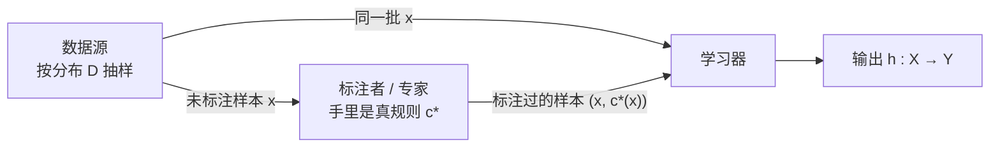
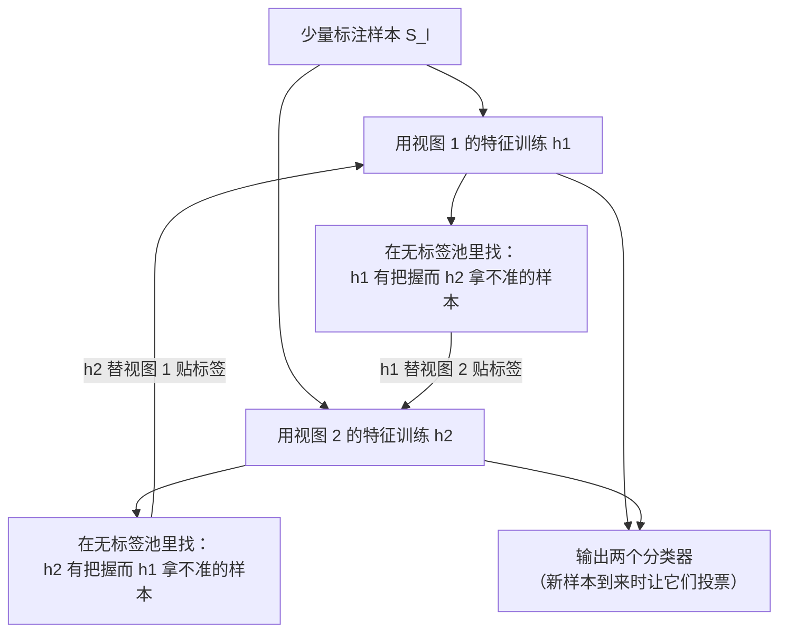

# C15.1 半监督学习与协同训练

> [!abstract] 这一讲要解决什么
> 前面十四讲有一个没被说破的前提：**手上这批样本都带着标签**。可标签是这条链上最贵的一环——一张网页算不算教师主页、一条蛋白质序列属于哪个家族、一张照片里有没有猫，认出来都要人来看。这一讲问的是：**如果只标得起 12 个样本，剩下 1000 个没标，那 1000 个能不能也用上？** 能，但要付一个代价：你得相信"标签和数据的分布形状之间有关系"。整讲就围着这一个信念转——先看它为什么是必需的（「关键洞察」那节），再看一个把它用得最漂亮的算法**协同训练 Co-training**（「协同训练」到「学习区间」），最后看这个信念写成数学是什么样（「两个理论保证」与「直接优化一致」）。学完你应当能判断：手里的任务该不该上协同训练，以及它会在哪儿翻车。

---

## 全监督的协议，以及它的两件核心事

### 先把三个角色摆出来

任何监督学习都能拆成三方：一个**数据源**、一个**标注者**、一个**学习器**。数据源不停地吐出样本；标注者手里握着那条真规则，负责给样本贴上答案；学习器看到的却是已经贴好答案的那一批。



这里的 `<P,T,E>` 只剩两个字母：任务 `T` 就是"学一个从 $X$ 打到 $Y$ 的函数"，性能 `P` 是"它在没见过的样本上错得少不少"，经验 `E` 就是**标注过的**那批样本。注意最后这一点——"经验"这个词在这门课里一直等于"带标签的数据"。这一讲要松动的正是这个等式。

### 把它写成式子

把图上的东西逐一对上符号：

$$S_l=\{(x_1,y_1),\dots,(x_{m_l},y_{m_l})\},\qquad x_i\ \text{i.i.d.}\ \sim D,\qquad y_i=c^*(x_i)$$

- $D$：$X$ 上的**边缘分布**，只描述"样本长得怎么样"，不含任何标签信息。这一点现在看着不起眼，后面整讲都靠它——无标签数据能提供的，恰好就是 $D$ 的形状。
- $c^*:X\to Y$：真规则，也叫目标概念。它存在但看不见，标注者只是"能对某个 $x$ 问出 $c^*(x)$"的人。
- $S_l$ 里的下标 $l$ 是 labeled。$m_l$ 是标注样本数——在这门课里它通常小得可怜。

要优化的是

$$\mathrm{err}_D(h)=\Pr_{x\sim D}\bigl(h(x)\neq c^*(x)\bigr),$$

即"按 $D$ 抽一个新样本，$h$ 答错的概率"。注意期望是对**输入分布** $D$ 取的，不是对训练集取的。这个区别在后面会变成一个大麻烦：主动学习会把训练集搞得不再服从 $D$。

### 两件核心事，以及它们各自靠什么

监督学习要成功，得同时做到两件性质完全不同的事：

| 要解决的问题 | 靠什么 | 课件给的例子 |
|---|---|---|
| **算法设计**：怎么把规则从数据里算出来 | 计算（Computation） | 朴素贝叶斯、逻辑回归、SVM、AdaBoost |
| **置信与泛化**：凭什么相信它对未来的数据也管用 | （标注）数据 | VC 维、复杂度、基于间隔的界 |

这两行看着像常识，但它们划出了这门课所有"改进方向"的地盘：

- 想改进第一行，靠的是**更聪明的算法**——这门课从第 2 章到第 14 章几乎都在干这个。
- 想改进第二行，靠的是**更多标注**。而标注不能靠写代码变出来，只能花钱、花人、花时间。

于是有了这一讲的切入点：**既然数据那一侧贵，那就换一种方式去用数据。** 不是不要数据，是别再要求每一条都带标签。

> [!important] 记住这句话
> 泛化能力只能被"带标签的数据"买到。半监督学习的全部野心，就是**想办法让不带标签的数据也能部分抵扣这笔账**——而这笔账只有在满足特定信念时才允许抵扣。

---

## 标注为什么成了瓶颈

### 三个把标注压垮的领域

现代应用的第一特征是**原始数据多到用不完，而其中能被人工标注的只是极小的一部分**。三个典型场景：

- **蛋白质序列**：一条序列的"标签"通常是它属于哪个功能家族，而这个答案要靠湿实验验证，一条序列可能要几周。可测序仪一天能吐出成千上万条。
- **几十亿张网页**：网页本身随手就有，可"这一页是不是在讲某个实体""这一页属于什么主题"，得有人读。
- **图像**：每张图都要人看一遍才能标。而摄像头一年产生的图，一个人一辈子也看不完。

三个场景的共同结构是：**无标签的样本几乎是免费的，带标签的样本是奢侈品**。这也解释了为什么在这一类问题上，"多找一个带标签样本"的成本远高于"多算一百万次"。

### 两条出路

顺着上面那个结构，只有两条路可走，而且它们的方向正好相反：

- **半监督学习 Semi-Supervised Learning（SSL）**：**一句话，不开口问。** 手上已经有一小撮带标签的样本，再配上堆成山的无标签样本，想办法让后者也参与训练。它的赌注是"数据自己的形状里藏着关于标签的线索"。
- **主动学习 Active Learning（AL）**：**一句话，挑着问。** 学习器自己决定"下一条该标哪个"，然后只向标注者要这一条的答案。它的赌注是"有些样本的信息量比另一些大得多"。

两者要对付的是同一个对手——**对人工干预的依赖**——只是手段相反：一个假装标注者不存在，一个把标注者当成有限次数的查询接口。这一讲讲前者，下一讲讲后者。

> [!note] 先把量级摆出来
> 「原始实验」里的数据是 **12 个标注 + 1000 个未标注**：带标签的只占 $12/1012\approx1.2\%$。也就是说 98.8% 的数据在标准监督学习里被直接扔掉了。这个比例就是半监督学习的战场。

---

## 半监督学习：多出来的那一堆没标签的样本

### 协议只改一处

把「先把三个角色摆出来」里那张图拿过来，只加一条箭头：数据源除了给标注者，还**直接**给学习器一批没标注的样本。

$$S_u=\{x_1,\dots,x_{m_u}\},\qquad x_i\ \text{i.i.d.}\ \sim D$$

$S_l$ 和 $S_u$ 的样本来自**同一个分布** $D$——这是整个半监督学习的前提，也是它和"迁移学习"的分界线。学习器现在同时拿到 $S_l$ 和 $S_u$，要输出的还是同一个 $h$，要小的还是同一个 $\mathrm{err}_D(h)$。

> [!warning] 一个容易看漏的地方
> 那张图上，未标注样本的箭头是**两条**：一条指向学习器，一条指向标注者。后者不代表标注者拿到了标签，它只表示"标注者本来就看得到全部数据"。协议上真正改变的只有一处——**学习器的输入多了 $S_u$**。别把"数据源给标注者送样本"读成"标注者偷偷标了一部分"。

### 三个流派

围绕"怎么让 $S_u$ 起作用"，历史上形成了三条技术路线。三个名字都值得拆开看，因为它们各自暗示了一种不同的信念。

**（1）直推式支持向量机 Transductive SVM**（Joachims 1999）

`trans-` 是"横跨、转移到另一边"，`ductive` 来自 deduce（引导、推出）。**直推式**的意思是：训练的时候就把**测试样本**一起放进优化目标，让分隔面同时照顾"已知标签"和"未标注样本要落在哪一侧"。

它和标准 SVM 的差别只有一句话：标准 SVM 假设自己学的是一个**通用**的 $h$，学完拿去做任何新样本都行；直推式承认"我只关心手上这一批样本各自的答案"，所以干脆把这一批也写进目标函数。

> [!note] 直推与归纳的区别（名字之外的那层意思）
> **归纳 inductive**：从具体样本推出一般规则，$h$ 要能回答任意 $x$。**直推 transductive**：只回答"手上这批 $x$ 各是什么"，不承诺泛化到别处。半监督的三大流派里，直推式 SVM 和图方法都更偏直推，协同训练偏归纳。

**（2）协同训练 Co-training**（Blum & Mitchell 1998）

这一条是本节后半段的主角。**一句话先给它**：**同时养两个只看到样本不同侧面的分类器，让它们互相把对方最有把握的判断当成答案，去补对方没有标签的样本。** 名字里的 `co-` 是"共同、互相"，`training` 是训练——不是"一起训练一个模型"，是"两个模型互相训练对方"。

**（3）基于图的方法 Graph-based methods**（Blum & Chawla 2001；Zhu, Ghahramani & Lafferty 2003）

**一句话**：把每个样本当成图上的一个点，把"两个样本长得像"当成一条边，标签就像水一样沿着边往外渗。有标签的点是水源，渗到哪儿，哪儿的点就跟着变成那个标签。最小割（min-cut）版本问的是"要切断多少条边才能把正负分开"，标签传播（label propagation）版本问的是"每一点从各个水源分到多少水"。

> [!note] 关于这两条引用
> 原稿只给了缩写 `[B&CO1]` 与 `[ZGLO3]`。按半监督文献的通行指认，它们分别是 Blum & Chawla (2001) 的图最小割与 Zhu, Ghahramani & Lafferty (2003) 的标签传播。**这一步指认是我的，原稿没写全称**——查文献时以缩写为准去核对，不要把我的展开当成原文。

### 这不是小众话题

- **ICML 的 test-of-time 奖**里出现过半监督的工作，说明它经得起十年检验。
- 从 ICML 2003 起连着办过专题 workshop；成体系的书至少两本：Chapelle、Schölkopf、Zien 编的 *Semi-Supervised Learning*（MIT Press, 2006），以及 Zhu & Goldberg 的 *Introduction to Semi-Supervised Learning*（Morgan & Claypool, 2009）。
- 这些方法**既有大量落地应用，也有扎实的理论基础**——两条腿都在，这也是它值得单独讲一讲的理由。

### 这一讲的路线

三种方法有一个共同点，也是这一讲真正想让你看见的东西：**它们榨取无标签数据的方式各不相同，而且都相当有创造性。** 也就是说，半监督学习没有一个统一算法，只有一组"怎么让无标签数据开口说话"的思路。这一讲挑其中最优雅、也最容易讲清的一个——协同训练——把它的每一步拆开。

---

## 关键洞察：无标签数据凭什么有用

### 一个让人不安的问题

半监督学习听起来有点不讲道理。一个样本之所以是"样本"，靠的就是那个标签；现在你把手上的样本全撕掉标签，只留下输入 $x$，然后说"这堆东西能帮我学得更好"？

**它缺的恰恰是最重要的那一位信息。** 一堆没写答案的习题，怎么可能提高你的考试成绩？

这就是"两张面孔"里那张让人迟疑的脸。这个疑问值得原样摆出来：*a bit puzzling; unclear what unlabeled data can do for us... It is missing the most important info. How can it help us in substantial ways?*

### 答案：无标签数据携带的不是标签，是分布的形状

关键在于分清两件事：

- 标签信息全在 $c^*$ 里，只藏在 $S_l$ 中，$S_u$ 里一点都没有。
- $S_u$ 里真正有的是**$D$ 的形状**：样本在哪儿密、在哪儿稀、分成几团、边界在哪儿空着。

所以无标签数据要能帮忙，只有一条路：**让"$c^*$ 的样子"和"$D$ 的样子"被同一个信念绑在一起。** 信念一旦成立，$S_u$ 就把 $c^*$ 的形状也约束住了；信念不成立，$S_u$ 一点信息都不提供。

> [!important] 这一讲的第一句结论
> 无标签数据本身不含任何关于标签的信息。它之所以有用，是因为我们**额外相信**了"标签的形状跟数据的形状有关系"。这个信念必须由人来提供，算法提供不了。

### 用一张图把这件事讲明白（补充）

最常见的一种信念叫**簇假设 cluster assumption**：**如果两片数据之间空着一段，那真正的分界线多半就在那段空白里。** 换句话说，分界线不该穿过密集的地方。

下图是它的一个示意（数据为补充构造，只为把机制画清楚）：

![[C15.1-关键洞察-分布形状决定边界.png]]

左图只有两个标注点，一正一负。**能同时容纳这两个点的分界线有无穷多条**——图上随便画的两条虚线（水平的那条、斜的那条）都跟两个标签相容，可它们都从密集区中间穿了过去。只凭这两个标签，你没有任何理由排除它们。

右图把 1000 个未标注点补上，事情立刻变了：数据明显分成两团，中间空着一条带子。这时候那条**竖着穿过空白**的线（绿色）成了唯一自然的选择。注意，这条线的位置不是从标签里读出来的——两个标签点在哪条线上都相容——**它是从"数据在哪儿稀"里读出来的。**

### 这个信念长什么样，决定了方法长什么样

同一个"标签形状与数据形状相关"的信念，换个说法就是另一种方法：

- 说成"**分界线要走空白处**"，就是上面那个簇假设，对应图方法、直推式 SVM。
- 说成"**同一个物体的两套描述应该给出同一个答案**"，就是**一致性假设**，对应这一讲的主线协同训练（「协同训练」那节）。
- 说成"**同一个簇里的点多半同类**"，就是聚类式的半监督（把第 4 章的 K-means 和标签接起来）。

名字不同，作用一样：**都是往问题里注入一条"标签之外的信息"，让无标签数据有资格发言。**

### 反过来：信念错了会怎样

如果两个簇其实是同一个类（比如"猫的正面"和"猫的背影"），簇假设就会把分界线画到两团中间，把一半的猫判成负类。更糟的是，半监督方法会**用自己被污染的判断继续训练自己**——「学习区间」那个例子会把这个过程画出来。所以这一讲后半段有一半篇幅在讲"什么条件下它才不会翻车"（「两个理论保证」那节）。

---

## 协同训练：两个视图互相教

### 名字先拆开

**协同训练 Co-training**：`co-` 是拉丁语前缀，意思是"共同、互相"；`training` 是训练。合起来不是"合起来训练一个模型"，而是**两个模型互相训练对方**。中文译作"协同训练"或"联合训练"。

它和上一节那些方法的区别在于**信念的形态**：不问"边界该画在哪儿"，而问"两套互相独立的描述是不是给了同一个答案"。

### 它依赖的那个信念：两个"视图"

先把**视图 view** 这个词说清。**一句话**：同一个样本身上抽出来的**两套特征**，每一套都足以单独做出判断，而且两套之间"看的东西不一样"。

形式上：$x=\langle x_1,x_2\rangle$，两个视图各自完整，且

$$\exists\,c_1,c_2\quad\text{s.t.}\quad c_1(x_1)=c_2(x_2)=c^*(x).$$

这句话读作：**存在两个函数，各自只看自己那一半特征，给出的答案都等于真答案。** 注意它说的是"存在"——不是"我们知道它们是什么"，而是"这个东西确实存在，所以值得去找"。

### 先补一个前置工具：条件独立

协同训练的理论版（「两个理论保证」那节）会加一条更硬的要求：**给定标签，两个视图条件独立**。这个工具在第 3 章讲过，这里用一句人话回顾，并换一个不带课程符号的例子。

**条件独立**说的是：一旦知道了那件"共同原因"，两件事之间就再没有信息可以互相提供。

> [!note] 用目击证人来理解
> 两个人分别看到了一场车祸。**给定"当时到底发生了什么"**，甲的说法对乙的说法没有任何额外信息——因为两人看到的是同一件事的后果，原因一旦定下，后果就各自独立了。这叫"给定真相后条件独立"。
> 但如果两人**事先串过供**，那就不是条件独立了：甲一开口，你就能猜到乙会说什么。串供就是"两个视图之间还有一条直接的通道"——协同训练怕的正是这个。

放到网页例子上（下一小节）：正文里的"I am teaching"和导航栏里的"my advisor"，**给定"这一页是不是教师主页"之后**，两者互不提供信息；而且它们是由不同的人、为不同的目的写下来的，谁也不会顺着谁写。这就是"两套渠道"的价值。

### 网页的例子：同一页的两种读法

要判断一个网页"是不是某位教师的主页"，同一页能提供两套完全不同的证据：

![[C15.1-网页分类-文本视图与链接视图.png]]

- **$x_1$：文本视图。** 页面正文里写的东西。教师主页的正文里常出现 "I am teaching"、"my research interests"、"publications" 这类句子。
- **$x_2$：链接视图。** 指向这一页的**锚文本**。别人在别的页面上写"Prof. Avrim Blum"、"My Advisor"、"my advisor" 这样的链接指向它——这些字不在这一页上，而是**别人对这一页的描述**。

这个例子漂亮在三点：

1. **两套都很便宜**：都在网页里，不需要额外问人。
2. **单独任一套都不够强**：只看正文，会漏掉那些正文很短的页面；只看锚文本，会漏掉没人链接的页面。
3. **两者犯的错不一样**：正文写得好但没人链接的页面，文本视图抓得住；链接文字很标准但正文空的页面（图上最右那一栏就是这个情形——标题链接写着 "Prof. Avrim Blum / My Advisor"，正文框是空的），链接视图抓得住。

第 3 点是关键。协同训练能从"都不够强"里拼出一个"够强"，靠的就是**两个视图的错误不重叠**。

---

## 迭代协同训练：把学到的信息传出去

### 两个"想法"

算法只有两个想法，都很朴素：

**想法一：先用少量的标注样本学出初始规则。** 比如从 12 个标注样本里就能学到："页面上出现 *my advisor* 这种指向的，多半是教师主页"；"页面上写着 *I am teaching* 的，多半也是"。

**想法二：用无标签数据把学到的信息传播出去。** 传播 propagate 这个词用得很准——不是"再学一遍"，而是"已经学到的那一点，顺着无标签样本往外扩"。

### 传播的那一个动作

整讲最核心的一句话在这里：**在无标签池里找那些"一个视图很有把握、另一个视图却拿不准"的样本；让有把握的那一个，替另一个给它贴标签。**

为什么偏偏要挑这种样本？三种情形分开看就明白了：

- **两个都没把握**：标出来的东西基本是噪声，等于拿自己的错误喂自己。
- **两个都有把握而且答案一致**：这条样本不提供任何新信息——两个视图本来就都答对了，加进去只是重复劳动。
- **一个有把握、一个没把握**：**这正好是那个"没把握"的视图的缺口。** 它自己判断不了，但有另一个独立渠道替它做了判断，这条标注就是它可以白拿的经验。

用一句话概括这个动作：**每个视图都负责当另一个视图的"免费标注者"，但只在自己有把握的时候开口。**

循环起来看更清楚：



### 算法全文

把上图写成伪代码，只有五行：

```
输入：两个视图的特征、标注集 S_l、无标签池 S_u
在两个视图上各有一个学习算法 A1、A2
1. 用 S_l 分别在两个视图上训练，得到初始假设 h1、h2
2. 重复：
3.     在 S_u 中找出「h_i 有把握、h_{3-i} 没把握」的样本
4.     让有把握的那个 h_i 给它贴标签，把这个 (x, 标签) 加进 A_{3-i} 的训练集
5.     在扩充后的训练集上重新训练 h_i（或只做增量更新），继续循环
```

> [!warning] 停一下，看清楚这个下标
> $A_{3-i}$ 不是"另一个算法"，是"**除了 $i$ 之外的那一个**"：
> - $i=1$ 时，$A_{3-i}=A_2$：**视图 1 给视图 2 贴标签。**
> - $i=2$ 时，$A_{3-i}=A_1$：**视图 2 给视图 1 贴标签。**
>
> 用 $3-i$ 只是省了一个 `if`。读的时候不要被这个 $3$ 绕进去，它跟"第 3 个视图"没有任何关系。

### 三件真会绊住你的事（补充）

**（1）每轮加多少、加到什么时候停？** 算法没有给出。实践上要么固定轮数（比如 30–40 轮，「原始实验」的曲线就画到 40 轮），要么用一小份验证集盯着，误差不再降就停。**没有停止条件，它一定会在某一轮开始变坏**——「原始实验」那节那条曲线在第 7 轮就上演了一次。

**（2）"有把握"怎么量？** 这里没有给定义。对产生概率的分类器，最常用的是"预测概率够高"；对间隔模型，是"离边界够远"。这个阈值本身就是个超参数，设得太松就会把噪声灌进去，设得太紧就一条也学不到。

**（3）加进去的标签是错的怎么办？** 这是最要命的一条。错标签会变成下一轮训练数据的一部分，下一轮又用它去判断"哪些样本有把握"，于是**自己的错误被自己确认，越滚越大**。这条机制叫自我确认偏差（self-confirmation bias），它直接解释了「两个理论保证」为什么要一个"能容忍噪声的学习器"。

一句话收尾：协同训练把"两个视图的一致性"当成了一个**免费的标注者**。它便宜，但它也会撒谎。

---

## 原始实验：12 个标注与 1000 个没标注

### 任务与规模

原始论文做的任务就是「网页的例子」里那个：判断网页是不是教师主页。数据集规模是 **12 个带标签 + 1000 个不带标签**。注意 12 这个数字——远少于做标准监督学习的常规做法，这就是要展示的卖点：**标注可以少到这种程度。**

表里三行是三种做法，三列是三种分类器用的特征：

| 做法 | 只用正文（Page-based） | 只用链接（Hyperlink-based） | 两者合用（Combined） |
|---|---|---|---|
| 标准监督学习（只用那 12 个标注） | 12.9 | 12.4 | 11.1 |
| **协同训练** | **6.2** | **11.6** | **5.0** |
| 全部判成负类（基线） | 22 | 22 | 22 |

数字是**测试集上的错误率（%）**，越低越好。最后一行是个必须有的对照：如果什么都不学、把所有网页都判成"不是教师主页"，错误率就是正类的占比 22%。

### 这张表怎么读

**（1）先看每一列自己比自己。** 同样的特征、同样的 12 个标注，加了协同训练之后：

- 只用正文：$12.9\to6.2$，错误率**砍掉一半多**（相对下降 51.9%）。
- 只用链接：$12.4\to11.6$，只挪了 0.8 个百分点。
- 两者合用：$11.1\to5.0$，相对下降 55.0%，几乎是原错误率的一半以下。

**（2）再看"提升从哪儿来"。** 提升的大头全在**正文视图**上。链接视图只从 12.4 挪到 11.6，几乎没动——这跟直觉相反吗？不。链接视图本身弱：12.4 这个数字跟"全判负"的 22 比好不了太多，说明它单独拿不出多少有把握的判断。**一个自己都拿不准的视图，既给不出好标注，也不太接收得到别人的标注。**

**（3）最值得看的是最后一列。** 标准监督下"两者合用"是 11.1，比单用正文的 12.9 只好一点点；而协同训练把"两者合用"拉到 5.0——**比任何一个单视图都好**。这才是协同训练真正许诺的东西：两个视图不只是"平均一下"，而是**互相补上了对方的缺口**。

### 那条曲线（原图标注 sample run）

![[C15.1-网页分类实验-错误率曲线.png]]

横轴是协同训练的迭代轮次（0–40），纵轴是测试集错误率（%）。三条线：绿 = 只用链接视图，蓝 = 只用正文视图，红虚线 = "全判负"基线（0.22）。

读这条曲线要看三件事：

- **起点**：第 0 轮（只用 12 个标注）时，正文视图在 0.16 上下，链接视图在 0.11 上下。
- **第 7 轮那个尖峰**：正文视图一路爬到了 **0.235**，比"全判负"还差。这是协同训练最真实的一幕——**自己给自己贴的标签污染了训练集，它会先变坏再变好。**
- **终点**：第 40 轮时正文视图落到 0.07 附近，链接视图在 0.09 附近。两条线交叉之后，正文视图反超成为更好的那个。

> [!warning] 别拿曲线上的读数去核表里的数字
> 原图明确标了 **（sample run）**——这是**一次**运行。表格里的 6.2 / 5.0 是实验报告的数值，曲线是另一次抽样下的走势。两者不该逐点对上。看曲线看**形状**（先坏后好、不单调），看表看**水平**。

---

## 一个能画出来的例子：学习区间

### 设定

网页那个例子是文本的，不方便画。下面这个二维玩具例子把"传播"的过程画了出来。

样本是平面上的点 $x=\langle x_1,x_2\rangle$。要学的概念是一个**轴对齐的矩形框**：落在框里是正类，框外是负类。这个框可以拆成两个视图：

- **视图 1**：只看 $x_1$，它的假设是 $x_1$ 方向上的一个**区间**（一条竖带）。
- **视图 2**：只看 $x_2$，它的假设是 $x_2$ 方向上的一个**区间**（一条横带）。

两套都足以判断——一个点是不是正类，等价于"它的 $x_1$ 在带内"且"它的 $x_2$ 在带内"。

![[C15.1-协同训练-学习区间.png]]

### 第一轮：只用标注数据（右上）

原来那批 + 点集中在中上位置，− 点分布在左右两侧。用标注数据学出来：

- $h_1^1$：$x_1$ 方向上的一条**窄带**（图上两条靠得很近的蓝色虚线）。
- $h_2^1$：$x_2$ 方向上的一条**窄带**（图上那个括号标出的窄区间）。

两条带都很窄，原因很直接：**看到的正例就那么几个，带子只要能包住它们就够了。** 而 $x_2$ 方向几乎没有负例（左右两侧的 − 在 $x_2$ 上和正例差不多高），所以 $x_2$ 方向的约束特别松——它是"蒙"出来的。

### 第二轮：未标注数据把带子撑开（下两格）

把未标注点（浅蓝色小点）加进来看，两条带都**往外扩**了：

- $h_1^2$ 的两条竖线比 $h_1^1$ 分得更开。
- $h_2^2$ 的括号比 $h_2^1$ 更宽。

为什么会往外扩？因为协同训练的动作是"用一个视图有把握的判断，去给另一个视图贴标签"。$x_2$ 那条带子很窄但横跨整个平面——它把一批未标注点都判成了正类；这些点里有一些落在 $x_1$ 原来的窄带**之外**，于是 $x_1$ 的区间必须放宽才能容纳它们。反过来也一样。

> [!note] 这一步只讲方向，不编细节
> 图上能读出的只有"扩张"这个**结果**：两条带都比第一轮宽。至于每一轮具体把哪些未标注点判成了正类、阈值卡在哪儿，图里没有画。**这种细节图里没有，我不会替它编**——你只要记住扩张的方向和它的代价。

### 这个例子暴露的风险

扩张是**双向**的。如果第一步不小心把一个本该是负类的点收进了正例区，那么下一轮它会撑着边界继续往外走，再下一轮带着更多错点一起走。这和 6.4 说的自我确认偏差是同一件事，只是画出来了。

所以"用未标注数据撑开区间"这个操作，只有在**数据本身真的这么长**的时候才对。「两个理论保证」的两条，说的就是"什么时候数据真的这么长"。

---

## 什么时候它真能奏效：两个理论保证

### 要假设的只有两件事

要让协同训练有保证，需要假设的东西其实只有两类：

1. **数据分布本身**的形状（$c^*$ 和 $D$ 的关系）。
2. **两侧的学习算法**的性质。

这两条覆盖了全部答案：协同训练不是无条件有效的，它的有效性完全建立在这两组假设上。历史上给出过的两套最著名的假设是这样：

### Blum & Mitchell（COLT 1998）：独立 + 抗噪

1. **给定标签条件独立**（independence given the label）：两个视图的条件独立，见「条件独立」那节。这条保证了"另一个视图的标注"确实带了新信息——没这条，两个视图只是在重复对方的话。
2. **存在一个能从随机噪声里学习的算法**（learning from random noise）。

第二条容易被略过，但它是这套证明真正吃力的地方。**"从随机噪声里学习"一句话说**：给你的教科书里，有相当一部分（比如 10%–20%）的答案被随手改成了错的，你要在这样的书上把这门课学出来。

它为什么必须？因为协同训练里贴上去的标签**天生带噪**：一个视图标错了，另一个视图就把错答案当成了标准答案。如果那个学习器假定"标签都是对的"，它会把噪声当真相去拟合，越学越偏。反过来，只要学习器能扛住固定比例的随机噪声，协同训练的误差就能被控制住。

> [!note] 噪声为什么"只是让样本变多"【拓展】
> 在 PAC 框架里，"对随机分类噪声鲁棒"通常表现为：所需的样本量比无噪声时多个常数倍（$\tilde{O}(d/\epsilon^2)$ 量级，具体常数取决于噪声率）。直觉是——噪声把学习器需要的样本数撑大了，但只要噪声率低于 1/2 且固定，可学性本身不会被破坏。完整的噪声容忍学习理论不在这门课的范围里，这里只需要知道**"标签有错"是一个可以被算法吸收的量，不是致命的**。

### Balcan, Blum & Yang（NIPS 2004）：分布扩张 + 只用正例

这一套换了两个假设：

1. **分布扩张**（distributional expansion）。
2. **存在一个只从正例学习的算法**（learning from positive data only）。

这两条的动机是"标注少到什么程度"的极端版本：如果连负例都几乎没有，还能不能学？

**"分布扩张"一句话说**：任何一个质量不大的区域，**往外扩一圈之后，外面的质量明显比里面大**。换成直观画面：正例区在数据里表现为一块**又小又密**的团，而它周围是稀的。这样一来，"离正例团很近的点多半也是正例"就成了可靠的判断——因为往外扩，密度不升反降。

**"只用正例学习的算法"一句话说**：只告诉你"这些是正例"，不告诉你"哪些不是"，你要把正例区圈出来。有了上面的扩张假设，这件事就成了：正例团是数据里唯一一块密的地方，从它往外走几步就到了稀的地方，边界自然浮出来。

> [!note] 这两条假设的形式化不展开【拓展】
> "扩张"的严格版本是对**边缘分布**的一个条件（任何概率不大于某阈值的集合，它的 $\epsilon$-邻域的概率质量至少是它的若干倍），而"只用正例学习"在文献里有一套独立的形式化（positive-only learning）。本课只用到它们的**作用**：把"无标签数据有用"这件事，换成一个关于 $D$ 的可检验条件。

### 这两节真正要说的事

回头看这两套假设，会发现一个共同的结构：

- 「关键洞察」说"无标签数据有用，前提是你有一个信念"。
- 「两个理论保证」说"把那个信念写精确，就是这两组假设"。

也就是说，**半监督学习并不比监督学习更'便宜'地凭空变出信息**：它只是把你本来就有的、但说不出来的信念，变成了一条可以计算、也可以被反驳的约束。信念成立时它是免费的午餐，不成立时它比没有更糟。

---

## 换个写法：直接优化"一致"

### 从"算法层面"到"目标函数层面"

「迭代协同训练」的迭代法是在**算法层面**实现一致：把对方的判断当成硬标签，塞进训练集。还有另一条路，在**目标函数层面**实现：不要硬标签，直接把"两个视图的判断差多少"写成损失里的一项，让它去拉。

### 目标函数逐项读

$$\arg\min_{h_1,h_2}\ \underbrace{\sum_{l=1}^{2}\sum_{i=1}^{m_l}\ell\bigl(h_l(x_i),\,y_i\bigr)}_{\text{每个视图在自己的标注上都要对}}\ +\ C\underbrace{\sum_{i=1}^{m_u}\mathrm{agreement}\bigl(h_1(x_i),\,h_2(x_i)\bigr)}_{\text{在未标注样本上，两个视图的看法之差}}$$

输入还是那两批：$S_l=\{(x_1,y_1),\dots,(x_{m_l},y_{m_l})\}$ 与 $S_u=\{x_1,\dots,x_{m_u}\}$。逐项说：

- **第一项**：每个视图（$l=1,2$）在自己那份标注上的经验损失之和。"各自都得对"。
- **第二项**：在**未标注**样本上，两个视图给出的答案差多少。这是无标签数据**真正进入目标函数**的地方——它连一个标签都没用到，只要求"两个视图在这批点上的看法要一致"。
- **$C$**：两项的交换比。$C$ 大，更强调一致（可能牺牲对标注的拟合）；$C$ 小，退回"两个视图各学各的"；$C\to0$ 就完全退化成两个独立的监督学习。

注意 $\mathrm{agreement}$ 是要**最小化**的差异量，不是相似度：两个视图越像，它越小。

### 损失与"一致"的取法

**损失 $\ell$** 常用的有两个：

- **平方损失** $\ell(h(x),y)=(y-h(x))^2$。适合回归，也适合"输出是实数"的软判断。
- **0/1 损失** $\ell(h(x),y)=\mathbf{1}[y\neq h(x)]$。分类的原生损失。

**"一致" $\mathrm{agreement}$** 的具体形式留空，因为它怎么取决定了问题难不难解：

- **平方差** $(h_1(x)-h_2(x))^2$：光滑、好求导。
- **内积的负值** $-h_1(x)h_2(x)$（输出取 $\pm1$ 时）：两视图同号则贡献负值，异号则贡献正值。这一项和 SVM 的合页损失是同一个味道。

> [!note] 这一行工作真正在解决的问题【拓展】
> 把 0/1 损失和"一致"一起写进目标，得到的是一个**离散的、组合的**优化问题，直接解不动。所以这类工作（Bartlett & Rosenberg, AISTATS 2007；Sridharan & Kakade, COLT 2008）主要在做一件事：找到它的**凸松弛**或可解的上界，使它变成能跑的东西。本课不展开数学，但从这里能看出套路：**"一致"这件事，越写成软约束越好算，越写成硬标签越像迭代法。**

### 两条路放在一起看

| | 迭代法（「迭代协同训练」那节） | 目标函数法（本节） |
|---|---|---|
| 一致的处理 | **硬**：把对方的判断当标签 | **软**：把差异当惩罚项 |
| 训练方式 | 交替、增量、要停止条件 | 一次性解一个联合优化 |
| 代价 | 便宜，但会自我强化错误 | 可控，但需要能解的松弛 |
| 出问题的样子 | 「原始实验」的尖峰 | $C$ 选大了会牺牲标注拟合 |

两条路的信念完全一样，只是"怎么把信念变成计算"的顺序不同。

---

## 后来的应用与它留下的东西

### 图像里的物体检测（Levin-Viola-Freund 2003）

同一张图做**两种不同的预处理**，各抽一套特征，就成了两个视图。经典的做法是一路取边缘/梯度类的特征，一路取颜色/纹理类的特征——两套特征对"这里有没有一辆车"各自都有判断力，但看的东西不一样。这正是「两个视图」里那个"两套特征、各足以判断、互不包含"的模板。

### 命名实体识别（Collins & Singer 1999）

任务是从句子里认出实体名，例子是 "I arrived in **London** yesterday" 里的 London。两个视图是：

- **词本身**：把"这个词是不是人名/地名"直接当成特征。
- **它所在的上文下文**：把前一个词、后一个词、词性、位置当成特征。

于是两个分类器互相确认：上下文说"这里像地名"，词本身说"这个词常见于地名"，两个都对，就贴标签。**这也是协同训练第一次在自然语言处理里大规模成功。**

### NELL：把它做成一个永不停止的循环

这一节最后一句 "Central to NELL!!!" 指的是 CMU 那个 **Never-Ending Language Learning** 项目：让机器不停从网页里自学事实。它之所以离不开这套方法，是因为**没有任何人会去标注那些网页**——它只能靠已有的那点种子（比如已知的若干"城市"名）出发，让不同类别的抽取器互相给对方提供新样本、互相校验，一轮一轮滚下去。这就是协同训练的自举循环，被推到了工程规模。

### 这一讲要带走的东西

这一讲没有"必须背下来"的算法模板，要带走的是一个**判断力**。三个问题按顺序问：

1. **我的数据里有没有天然的"两套描述"？** 有的（正文 + 链接、词 + 上下文、两种预处理）才谈得上协同训练；没有就别硬凑——凑出来的两个视图不条件独立，效果会比单视图更差。
2. **两套描述是不是各自都过得去？** 「原始实验」已经说了：太弱的那个视图既学不到什么，也给不出好标注。
3. **我的信念成立吗？** 两个视图真的会同意吗？如果它们本来就经常冲突（比如正文和链接在故意互相矛盾），「独立 + 抗噪」那节那条"给定标签条件独立"就不成立，协同训练会把冲突放大。

---

## 课堂实录

> [!note] 本节没有课堂转写稿
> 这一讲没有对应的课堂语音记录。正文里标了 **（补充）** 或 **【拓展】** 的段落，是按教材与通行讲法补出来的，不是课堂记录；引用的两篇原始文献（Blum & Mitchell 1998、Balcan-Blum-Yang 2004）的结论已核对，但证明没有写进讲义。

---

## 勘误

| 位置 | 原稿写的 | 实际 / 处理 |
|---|---|---|
| p17 与 p22 | 两页内容**完全相同**（同一页被放进了两次） | 属导出冗余，不是内容丢失；按一页处理，本讲不重复讲 |
| p20、p21 目标函数 | 内层求和的上限印成 $m_1$；求和号上方印 $2$、下方印 $l=1$ | 按上下文应为 $\sum_{l=1}^{2}\sum_{i=1}^{m_l}$——$m_l$ 是第 $l$ 个视图的标注数。若真是 $m_1$，第二个视图的项就没有意义了。本讲按 $m_l$ 写，并在此说明这是**原稿的印刷问题**，不是数学修改 |
| p20 文字 | "Regularizer to encourage agreement over unlabeled dat"（缺 a） | 排版截断，按 *data* 理解 |
| p19 文字 | "positve" | 拼写错误，按 *positive* |
| p8 引用 | 只给缩写 `[B&CO1]`、`[ZGLO3]` | 本讲展开为 Blum & Chawla (2001)、Zhu-Ghahramani-Lafferty (2003)，**这一步指认是我的**，见「三个流派」那节的注 |
| p18 四格图 | 只画了"扩张后的结果"，没有画每一轮具体给哪些点贴了标签 | 本讲只讲扩张方向，不补细节，见「第二轮」那节的注 |

---

## 速查

| 名称 | 内容 |
|---|---|
| 协议 | 输入 $S_l=\{(x_i,y_i)\}$ 与 $S_u=\{x_i\}$，两者同分布 $D$；输出 $h$，目标 $\min\mathrm{err}_D(h)$ |
| 半监督的信念 | 标签的形状与输入分布的形状相关；信念不成立则无标签数据无用甚至有害 |
| 簇假设 | 分界线应走低密度区（对应图方法、直推式 SVM） |
| 一致性假设 | 同一物体的两套描述应给出同一答案（对应协同训练） |
| 视图 view | $x=\langle x_1,x_2\rangle$，两套特征各自足以判断，且给定标签后条件独立 |
| 充分性 | $\exists c_1,c_2$ 使 $c_1(x_1)=c_2(x_2)=c^*(x)$ |
| 协同训练的动作 | 找"一个有把握、一个没把握"的无标签样本，让有把握的那个替另一个贴标签 |
| 算法下标 | $A_{3-i}$：$i=1$ 指 $A_2$，$i=2$ 指 $A_1$（不是第 3 个视图） |
| 抗噪要求 | 需要能"从随机噪声中学习"的算法，因为传播的标签天生带噪 |
| 目标函数 | $\arg\min_{h_1,h_2}\sum_{l=1}^{2}\sum_{i=1}^{m_l}\ell(h_l(x_i),y_i)+C\sum_{i=1}^{m_u}\mathrm{agreement}(h_1(x_i),h_2(x_i))$ |
| 损失例子 | 平方损失 $(y-h(x))^2$；0/1 损失 $\mathbf{1}[y\neq h(x)]$ |
| 网页实验设定 | 12 个标注 + 1000 个未标注，判断是否教师主页 |
| 网页实验错误率（%） | 标准监督 12.9 / 12.4 / 11.1；协同训练 **6.2 / 11.6 / 5.0**；全判负 22 |
| 相对下降 | 正文视图 51.9%；合用 55.0%；链接视图仅 6.5% |
| 曲线要点 | 40 轮内先坏后好：正文视图第 7 轮冲到 0.235（比基线 0.22 还差），第 40 轮落到约 0.07 |
| 两条理论线 | Blum & Mitchell 1998（独立 + 抗噪）；Balcan-Blum-Yang 2004（分布扩张 + 只用正例） |

---

## 下一讲

这一讲从头到尾有一个前提：**我们不开口问人。** 手上有什么就用什么，实在不够就靠信念去补。

下一讲把这条前提翻过来。既然标注那么贵，那**就只买最值钱的几条**——学习器自己挑"下一条该标哪个"，然后拿着这个答案回来继续。听上去只是省了几次提问，但在一类最简单的问题上，它能把需要的标注数从 $1/\varepsilon$ 压到 $\log(1/\varepsilon)$：**精度提高十倍，提问次数只多三次。**

代价是另一个坑：你自己挑的样本，会把训练集挑歪。下一讲讲的就是这两件事——**主动学习**。

---

## 相关笔记 Related Notes

上一讲：[[C14.2 梯度检验与训练]]
下一讲：[[C15.2 主动学习与不确定性采样]]
相关：[[C3.3 联合分布与推断]]（条件独立，「条件独立」那节用到）、[[C10.1 支持向量机的目标与大间隔]]（直推式 SVM 的对照）、[[C1.2 决策树的表示与自顶向下归纳]]（协同训练的初始规则就是一棵小决策树）
返回：[[机器学习课程 MOC]]
