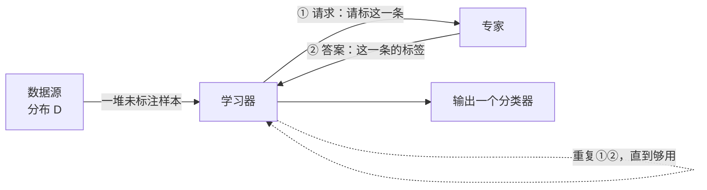
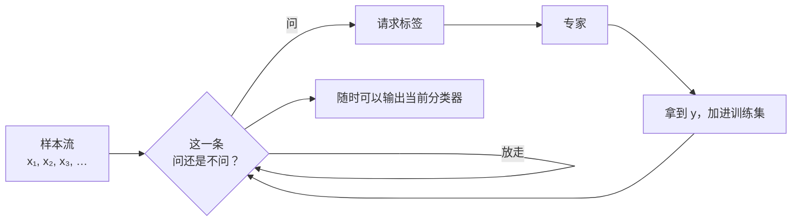

# C15.2 主动学习与不确定性采样

> [!abstract] 这一讲要解决什么
> 上一讲从头到尾有一个前提：**我们不开口问人。** 手上有什么数据就用什么，不够就靠信念去补。这一讲把前提翻过来：既然标注那么贵，那就**只买最值钱的几条**——学习器自己决定"下一条该标哪个"，拿着答案回来继续。 这一讲讲三件事：为什么挑着问能省（「阈值问题」那节，一个能算清的例子）、实践里怎么挑（「不确定性采样」那节，怎么判断哪条样本最值钱）、以及它会怎么把自己坑掉（「会反噬的坑」那节，采样偏差）。学完你应当能回答：**我的任务上，主动学习大概能省几倍标注，以及什么时候它反而有害。**

---

## 从"有多少学多少"到"挑着问"

### 名字先拆开

**主动学习 Active Learning**：`active` 在这里不是"主动学习"的"勤快"，而是**学习器主动发起查询**。与之相对的是**被动学习 passive learning**——数据给你什么你就学什么，样本怎么来由别人决定。

它还有一个更直白的名字：**查询学习 query learning**。这个名字把关键点点明了：**这个算法的输出里，除了分类器，还有"下一个问题"。**

**一句话定义**：**学习器自己挑出"最值得标注的那一条样本"，只向专家要这一条的答案，然后把这条带着标签的样本收回训练集。** 其余样本不问，不给标签就留着当无标签数据。

### 两种问法，对应两种真实场景

这件事分成两种协议，差别在"什么时候决定问谁"。

**（1）批量式主动学习 Batch Active Learning**

先把一堆未标注样本放到手上，然后学习器**自由挑选**——想先问哪条就问哪条，可以对整个池子做全局比较。



要点是**两头都有选择权**：学习器选样本，专家只负责答。

**（2）选择性采样 Selective Sampling（在线式，p4）**

样本像流水一样一条一条来，每一刻学习器只面对**当前这一条**，要当场决定：问，还是放它走？



图上那个判断框里的原话是 *Request for label or let it go?*——**放它走**（let it go）是这个协议里最容易被忽略的动作：它意味着这条样本从此没有标签，也不再回来。

**（3）两者的实际差别**：批量式能全局挑最值得问的，但要求你能把整批数据先攒在手上；选择性采样只能在"流过眼前的那一刻"决定，更像是真实部署的样子（数据是流式的，人的注意力是单线程的）。「不确定性采样与 Active SVM」那一节讲的是批量式，两个数据集上的实测也都是批量式。

### 延伸阅读

这一讲之外还有三篇值得读，各自代表一种视角：

| 文献 | 视角 |
|---|---|
| Dasgupta, *Two faces of active learning* (2011) | 把主动学习分成"两张面孔"：一张是**激进**的（利用数据里的簇结构，一次问一大片），一张是**保守**的（只在"该问"的时候开口，其余时候沉默）。「会反噬的坑」里那个 "safe" 的说法就是从这张保守的脸来的 |
| Settles, *Active Learning* (2012) | 综述，把各种挑选准则（不确定性、委员会、期望误差下降）系统排了一遍 |
| Balcan & Urner, *Active Learning*, Encyclopedia of Algorithms (2015) | 百科条目式，偏理论：**标注复杂度 label complexity**——"把误差压到 $\varepsilon$ 以内需要多少个标注"——这一支的入口 |

> [!note] 为什么先提这三篇
> 它们不是装饰。「阈值问题」那个"对数级"的结论，源头就在 Dasgupta 那条线上；「会反噬的坑」那节"安全策略"的说法，也来自同一处。**先记住"两张脸"这个说法**，讲到最后会回来用它。

---

## 一个好的主动学习算法要达到什么

要满足的只有三条，而且这三条彼此拉扯：

1. **对大多数学习问题，都能保证输出一个还不错的分类器。**
2. **不要问太多次。**（原文还补了一句：最好比被动学习和半监督学习都少得多。）
3. **要仔细挑查询，让拿到的标签是有信息量的。**

**为什么这三条会打架？** 第 1 条要求"稳"：不能因为挑样本挑得太激进，把模型带进沟里。第 3 条要求"贪"：要专挑那些能让模型进步最大的样本，而这类样本通常正好在边界附近、也就是模型最没底的地方。**稳和贪是反的**——太贪就会一直在边界附近问，把训练集问成一个只包含"难例"的畸形集合（「会反噬的坑」那节）；太稳就退化成随机采样，什么也没省。

第 2 条那句"比半监督还少"值得单看一眼：**主动学习的比较对象不只是"随机标"，还有"干脆别问，去用半监督"。** 因为两条路的成本结构不同——主动学习要付"人回答一次"的钱，半监督要付"算法更复杂"的钱。哪个更划算，取决于人贵还是算力贵。

---

## 它真的比随机采样强吗：阈值问题上的答案

### 先给结论

先给答案：**会——有时候。**

- 我们常常只需要**远少于被动的标注**就能达到同样的精度。
- 这件事**理论上被预测过，实践上也观察到了**。

"有时候"这三个字是重点。这一节要给的就是那个"什么时候"：在一个**能算清**的最简问题上，把账算出来。

### 最干净的例子：一维阈值

设样本是实数 $x\in\mathbf{R}$，要学的规则是

$$h_w(x)=\mathbf{1}(x\ge w),\qquad C=\{h_w:\ w\in\mathbf{R}\}.$$

逐符号说：

- $\mathbf{1}(\cdot)$ 是**指示函数**：括号里的条件成立取 1，不成立取 0。所以 $h_w$ 的含义是"**$x$ 不小于 $w$ 就判正类**"。
- $w$ 是一个实数，就是那条分界线的坐标。**整个假设空间就由这一个数决定。**
- 数轴上：$w$ 左边全是负类（画成一条粉色线），$w$ 右边全是正类（蓝色线）。所以这个"分类器"其实只是"在数轴上找一个点"。

问题：**要学到什么程度才算学会？** 精度要求是误差不超过 $\varepsilon$——$\mathrm{err}_D(h_w)\le\varepsilon$。也就是说，你找到的点 $w'$ 与真值 $w$ 之间夹着的那段概率质量不能超过 $\varepsilon$。

就这么一个问题，被动与主动的差别可以算得干干净净。

### 被动：为什么至少要 $1/\varepsilon$ 个标注

先想"只准随机抽样本、然后问标签"的做法。

- 一个随机样本只有在**落在 $w$ 附近那一小段**时，它的标签才提供关于"$w$ 在哪儿"的信息。落在远处的样本，无论答什么，都只能说"$w$ 在我另一边"，对你的定位帮助极小。
- 那一小段有多长？大概就是 $\varepsilon$ 那么长——因为你要的精度是 $\varepsilon$。
- 一个样本落进去的概率约等于 $\varepsilon$，所以**要让至少一个样本落在里面，期望需要 $1/\varepsilon$ 个标注**。

反过来，$1/\varepsilon$ 个也够了：均匀地铺一张间距为 $\varepsilon$ 的网格，总能找到一个点落在 $w$ 的 $\varepsilon$-邻域里。**所以被动学习既需要、也只需要 $\Theta(1/\varepsilon)$ 量级的标注。**

写成渐进记号，就是**被动至少需要 $\Omega(1/\varepsilon)$**——注意 $\Omega$ 只说了下界的方向；配套的上界同样是 $1/\varepsilon$，两者合起来是 $\Theta(1/\varepsilon)$。

### 主动：二分，为什么只要 $\log(1/\varepsilon)$

主动的做法只有一句：**每次在候选区间的中点问一次。**

- 答"+"：说明 $w\le$ 中点，**左端点可以推上去**。
- 答"−"：说明 $w>$ 中点，**右端点可以压下来**。

每问一次，候选区间的长度减半。问 $q$ 次之后长度是 $2^{-q}$。要它不超过 $\varepsilon$：

$$2^{-q}\le\varepsilon\iff q\ge\log_2\frac{1}{\varepsilon}.$$

这是一个**和二分查找完全同构**的过程——二分查找是第 3 章之外的东西，这里用一个不带任何课程符号的例子确认你熟悉它：

> [!note] 猜数字：二分法的原型
> 我心里想一个 1 到 100 之间的整数，你每次猜一个数，我只回答"大了"或"小了"。猜几次必中？
> 每次猜中点，范围减半：$100\to50\to25\to13\to7\to4\to2\to1$，**7 次**。而 $\log_2 100=6.64$，向上取整正是 7。如果改成"从 1 开始一个一个问"，最坏要 100 次。
> **6.64 与 100 的差距，就是这一整节要讲的全部内容。**

下表是两边的对照（数字都是我算的）：

| 目标精度 $\varepsilon$ | 被动：$\approx1/\varepsilon$ | 主动：$\lceil\log_2(1/\varepsilon)\rceil$ |
|---|---|---|
| 0.1 | 10 | **4** |
| 0.05 | 20 | **5** |
| 0.01 | 100 | **7** |
| 0.001 | 1000 | **10** |

![[C15.2-阈值查询-区间减半与标签复杂度.png]]

左图画的就是上面那个过程：真值 $w=0.37$（为了让数好读，把区间归一化成 $[0,1]$）。第 1 次问 $0.50$ 答"+"，候选区间缩成 $[0,0.50]$；第 2 次问 $0.25$ 答"−"，缩成 $[0.25,0.50]$；第 3 次问 $0.375$ 答"+"，缩成 $[0.25,0.375]$。**每问一次，粉色和蓝色之间那条线就窄一半。**

右图把两种做法的成本画在同一张对数坐标上：红实线是被动的 $1/\varepsilon$（斜率 $-1$），蓝虚线是主动的 $\log_2(1/\varepsilon)$（几乎是水平的）。**精度要求越苛刻，两条线离得越远。** 在 $\varepsilon=0.01$ 处：100 条 vs 6.6 条。

### 一个隐藏的约束：你只能在手上的样本里问

上面"每次问中点"其实做不到——中点不一定是个真实存在的样本。现实中你手上只有 $N$ 个未标注样本，**能问的只有这 $N$ 个**。

于是真正的流程是两步：

1. 先取 $N$ 个未标注样本；
2. 在这 $N$ 个点组成的网格上二分，$\log_2 N$ 次查询就能把这 $N$ 个的标签全弄对；
3. 输出一个与这 $N$ 个标签**一致**的分类器。

这时候 $N$ 要多大？关键在于：这 $N$ 个点把 $[0,1]$ 切成 $N+1$ 段，**真值 $w$ 落在其中一段里**；任何与这 $N$ 个标签都一致的分类器，其误差不超过这一段的质量。而"含 $w$ 的那一段"的期望长度可以算出来——正好是

$$\mathbf{E}[\text{含 }w\text{ 的那段长度}]=\frac{2}{N+1}.$$

> [!example] 这个数是怎么来的（可用程序验证）
> 均匀撒 $N$ 个点，$w$ 落在某个小段里。$w$ 左右各有一个最近的样本点，两者的间距就是那一段。因为 $N$ 个点均匀分布，$w$ 左右两侧的"最近距离"各自服从同一分布，而**两个距离之和的期望恰好是 $2/(N+1)$**（这和"最大间隔"的期望不同，别混）。
> 我用 $N=100$ 跑 2 万次：含 $w$ 那段的平均长度 **0.01981**，而 $2/101=0.01980$；$N=1000$ 时是 0.00198 对 $0.0020$。

所以要让误差期望不超过 $\varepsilon$，取 $N\approx2/\varepsilon$，也就是 **$N=O(1/\varepsilon)$**。再配上 $\log_2N=O(\log(1/\varepsilon))$ 次查询，总账是：**$O(1/\varepsilon)$ 个未标注样本 + $O(\log(1/\varepsilon))$ 次查询。**

> [!warning] "guaranteed" 这个词要按期望读
> 原话是 "*N = O(1/ε), we are guaranteed to get a classifier of error ≤ ε*"。严格说，这里保证的是**期望误差**（或带常数因子的版本）：那 $2/(N+1)$ 本身是个期望值，单次抽样会有波动，要让它在**高概率**下成立还得再乘一个 $\log$ 因子。本讲按期望口径讲，这个差别在考试里通常不追究，但你自己要知道它在那儿。

### 为什么这叫"指数级改进"

$O(\log 1/\varepsilon)$ 旁边写着 **Exponential improvement**。这个说法容易被误读，先把范围划清：

- 它说的是**标注数量的增长方式**：精度要求从 $\varepsilon$ 缩到 $\varepsilon/2$ 时，被动要**翻倍**标注，主动只要**多问一次**。
- 它**不是**说运行时间指数级变快，也不是说任何任务上都有这个收益（「两个数据集上的实测」里的图像实验就没有）。

一句话：**"省"的程度随精度要求放大——精度越苛刻，主动学习越划算。**

---

## 实践里最常用的做法：不确定性采样与 Active SVM

### 不确定性采样一句话

**不确定性采样 Uncertainty Sampling**：**挑模型自己最没底的那一条去问。**

理由很朴素：一条模型已经很有把握的样本，答案它自己就能写出来，问了等于白问；一条模型在两个答案之间摇摆的样本，一旦拿到答案，模型对边界的认识就变了。

这个准则之所以流行，是因为**几乎不需要额外计算**——大多数分类器本来就会输出"把握"（概率、间隔、熵），直接拿来排序就行。

### 前置工具：点到分隔面的距离

要把"最没底"写成一个可排序的数，得先有一个**距离**。回指 [[C10.1 支持向量机的目标与大间隔]]：分隔面是 $w\cdot x=0$，$w$ 是它的法向量。

> [!note] 距离 = 往法向量上投影
> 把一个点 $x$ 投影到 $w$ 的方向上，投影长度是 $\frac{|w\cdot x|}{\|w\|}$。**这就是点到分隔面的垂直距离**（$\|w\|$ 是法向量的长度，用来把"每单位法向量的坐标差"归一化成真正的长度）。
> 拿一张纸和一支笔就能验：在纸上画一条线（分隔面），在线上取一点作垂线，那条垂线就是最短路径——**"离边界多远"就是"垂线多长"**，而不是"两点之间的直线距离"。

对 SVM 来说这个量格外重要，因为 **SVM 的解只由支持向量决定**：离分隔面最近的那几个点撑起了整个间隔。所以"离分隔面最近的点"就是"最可能一动就改变分隔面的点"。

### 算法全文

```
输入：未标注池 S_u = {x1, …, x_mu}，从底层分布 D 独立同分布抽出
开始：先随机问几条的标签（冷启动）
对 t = 1, 2, …：
    ① 用目前已标注的点，求最大间隔分隔面 w_t
    ② 在池子里找使 |x_i · w_t| 最小的那一条，问它的标签
    ③ 把它加进标注集
```

两个要点：

**（1）为什么要"先随机问几条"。** 没有标签就没有 $w_t$，"最接近分隔面"这个判据无从谈起。冷启动那一小批必须是随机的，不能挑——**这时候你还没有任何依据去挑。**

**（2）为什么是 $|x_i\cdot w_t|$ 而不是除以 $\|w_t\|$。** 严格的距离是 $|x_i\cdot w_t|/\|w_t\|$，但**每一轮 $\|w_t\|$ 是固定的常数**，除不除它，谁最小的排序完全不变。所以那个除法可以直接省掉——这不是笔误，是"排序不受正常数缩放影响"。

### 把这两步真算一遍（补充）

上面那张图是示意图，没有具体数字。这里补一个小算例，只为把两步的**动作**演一遍（数值是我算的）。

**标注点（4 正 4 负，二维，分隔面强制过原点所以没有偏置项）：**

| 标签 | 点 |
|---|---|
| $+$ | $(2.0,-0.4)$、$(1.4,-0.9)$、$(2.6,-0.2)$、$(1.8,-0.1)$ |
| $-$ | $(-0.8,2.0)$、$(-0.3,1.6)$、$(-1.2,1.4)$、$(-0.5,2.6)$ |

**第一步：求最大间隔分隔面。** 解出来是 $w=(0.5263,-0.5263)$，方向是"右下 45°"，分隔面正好是直线 $x_2=x_1$；$\|w\|=0.7443$，所以间隔宽度是 $1/\|w\|=1.3435$。

**验一下它是最大间隔**：两个支持向量的 $|x\cdot w|$ 都正好等于 1（$(1.8,-0.1)$ 给出 $0.5263\times1.9=1.0$；$(-0.3,1.6)$ 给出 $0.5263\times1.9=1.0$），其余点都大于 1。这正是 SVM 的定义——**支撑住间隔的那两点恰好在边界上。**

**第二步：在池子里找最近的。** 池里 6 条未标注点，距离 $|x\cdot w|/\|w\|$ 如下：

| 未标注点 | 距离 | 排位 |
|---|---|---|
| $(0.8,\,0.6)$ | **0.1414** | **1（下一条问它）** |
| $(1.6,\,0.9)$ | 0.4950 | 2 |
| $(-1.5,\,0.2)$ | 1.2021 | 3 |
| $(2.2,\,0.4)$ | 1.2728 | 4 |
| $(0.5,-1.5)$ | 1.4142 | 5 |
| $(-0.9,\,1.4)$ | 1.6263 | 6 |

![[C15.2-active-SVM-最近点查询.png]]

图上绿色箭头是 $w$，实线是当前分隔面，两条虚线是间隔边界（$w\cdot x=\pm1$），橙圈就是被选中的 $(0.8,0.6)$。它几乎贴在分隔面上——**模型对它到底在线的哪一侧几乎没有把握**，所以问它最值。

> [!warning] 这个准则有一个盲点
> 分隔面过原点，于是**离原点近的点天然"离任何过原点的分隔面都近"**。如果池里有一条几乎在原点上的点，它会被判成"最不确定"，尽管它可能没什么价值。换成带偏置的分隔面（$w\cdot x+b=0$）能缓解，但也只是把盲点挪到别处。
> 这类"准则在最简情形下失效"的地方，正是「会反噬的坑」那个警告的具体形态。

### 不确定性采样的三个失效方式

先把坑列出来，「会反噬的坑」会给出"安全"版本怎么绕：

- **模型本身偏了。** 模型偏，它"最没底的地方"就在偏的方向上，你越问它越自信地错。
- **在已经确定的区域反复问。** 如果剩下的候选假设在某条样本上答案都一样，那条的标签已经被决定了，问了不提供信息（甚至引入偏差）。这就是"两张脸"里那张**保守的脸**要说的事。
- **挑出来的标注不再代表整体分布。** 这是最根本的一条，下一节展开。

---

## 两个数据集上的实测

### 先看清图的坐标轴

两张图的纵轴都是 **AUROC improvement（%）**，不是错误率，越**高**越好。

> [!note] AUROC 是什么
> ROC 曲线画的是"把阈值从严格挪到宽松时，真正例率与假正例率怎么一起变"；**AUROC 就是这条曲线下的面积**，取值范围 0.5（瞎猜）到 1（完美）。也可以读成：**随机取一个正例与一个负例，模型把正例排在前面的概率。**
> 所以纵轴的"improvement"是**相对某个基线提升了多少**（按轴上标的 % 读作百分点）——不是 AUROC 本身的值。图上四条线全部从 0 出发，就是这个意思。

横轴都是**挑选轮次**（0–300），也就是"总共问了多少条"。

### Newsgroups：20000 篇文档，20 类

![[C15.2-Newsgroups-学习曲线.png]]

四条线是四种**挑选策略**，不是四个模型：

- **Random**（黑）：随机挑，对照组。
- **Exhaustive**（青）：在池子里把每个候选都试着算一遍，挑"最有价值"的那个（最贵、理论上最好）。
- **EH-Hash**（蓝）、**H-Hash**（红）：两种用哈希做的近似策略（省计算）。

读数（约数，从曲线上读的）：

| 轮次 | Random | EH-Hash | Exhaustive |
|---|---|---|---|
| 100 | ≈ 0.08 | ≈ 0.19 | ≈ 0.22 |
| 300 | ≈ 0.15 | ≈ 0.25 | ≈ 0.27 |

**三个观察：**

1. **主动明显赢随机**：300 轮时 0.25 对 0.15，差了约 1.7 倍。
2. **两条近似策略贴着"穷举"走**：EH-Hash 只比 Exhaustive 低一点点，说明"把每个候选都算一遍"这件事的收益，用哈希近似就能拿到大半——**这个结论在工程上比算法本身更值钱。**
3. **曲线始终向上但斜率在减**：第 0–100 轮涨得最快，之后越来越平。**收益递减**是这类方法的通性。

### CIFAR-10：60000 张图，10 类

![[C15.2-CIFAR10-学习曲线.png]]

同样的四种策略，换成图像数据。读数：

| 轮次 | Random | H-Hash | EH-Hash |
|---|---|---|---|
| 100 | ≈ 0.07 | ≈ 0.06 | ≈ 0.10 |
| 300 | ≈ 0.10 | ≈ 0.11 | ≈ 0.13 |

**三个观察，其中一个是坏消息：**

1. **主动仍然赢随机，但赢得很小**：0.13 对 0.10，约 1.3 倍。比起文本上的 1.7 倍，落差明显。
2. **H-Hash 在早期甚至不如 Random**（100 轮时 0.06 对 0.07），红色曲线开头还有一段跌到负值的区间（有一次运行一开始 AUROC 反而下降了）。**主动学习不是"永远更好"**——它挑的样本太集中，模型可能先被带偏，再慢慢纠回来。
3. **Exhaustive 在图像上不如 EH-Hash**（青色线低于蓝色）。也就是说，"更聪明的挑选"在这个任务上未必更有效，**挑选准则本身的假设（边界附近最值得问）在高维图像上不那么成立。**

> [!important] 这两张图放在一起要说的事
> 理论上"从 $1/\varepsilon$ 到 $\log(1/\varepsilon)$"是个漂亮得不像话的结论，实践里拿到的是**百分之几十的提升，偶尔还是负的**。原因不难想：§3 那个推导假设了**无噪声、假设空间极简（一维阈值）**。真实任务里这两条都不满足，收益自然打折。**拿理论结论去承诺工程效果，是这个领域最常见的夸大。**

---

## 三件事，和一个会反噬的坑

### 三件事

1. **它可能真的很有用。** 标注复杂度上的指数级改进，理论上被证明过，实践上也反复被观察到。
2. **实践里最常用的是启发式**，核心就是不确定性采样那一类。它们便宜、好实现。
3. **但要非常小心采样偏差**（sampling bias）。

### 警告展开：为什么"自己挑的标注"会出问题

这是整讲最该讲透的一句。标准监督学习的所有保证，都建立在一个前提上：**训练样本是从 $D$ 里独立同分布抽的。** 主动学习亲手打破了这个前提——**它专挑"边界附近"的样本，训练集的分布被刻意扭歪了。**

这一条会连带出三个后果：

- **泛化界不再直接适用。** 那些 PAC/VC 的界假设 i.i.d.，主动采样出来的样本不满足，需要重推（这正是 Dasgupta 那条研究线在做的事）。
- **用这批标注估的误差会偏乐观。** 你手上那批"难例"上的错误率，不能代表整体错误率——**评估用的验证集必须是随机抽的，不能是主动选出来的。**
- **越问越自信的错觉。** 模型在自己挑的样本上进步很快，但这个进步可能只发生在"边界附近那一圈"，整体没动。

### 出路："安全"的分歧型主动学习

解法的名字叫 **Safe Disagreement Based Active Learning Schemes**（\"安全\"的分歧型方案），并且附加了一条要求：**要在无噪声情形下把它们的工作方式精确理解清楚。**

**分歧型 disagreement-based** 一句话：**只在"剩下的候选假设仍然有分歧"的地方问。**

- 如果所有还在考虑中的假设在某条样本上答案**都一样**，那这条样本的标签其实**已经被决定了**——问了不提供任何信息，还可能把偏差引进来。**这时候要忍住不问。**
- 只有当候选假设分成两派、答案不一致时，才值得花一次查询。

这条准则为什么叫"安全"？因为它在问之前先确认"这次问确实能减少不确定性"。它不追求让模型进步最快，只追求**不引入无谓的偏差**——这就是 Dasgupta 说的那张"保守的脸"。

> [!important] 和「阈值问题」那个阈值例子对上
> 二分法只问**候选区间内部**的点——区间外的点，无论什么答案都不改变"$w$ 在区间里"这个事实，问了白问。所以二分法本身就是一次"分歧型"选择：**它问的每一条，都正好落在"两派假设答案不同"的位置上。**
> 反过来，不确定性采样常常在区间外的噪声点上反复问（因为那里的模型输出接近 0.5）。**这就是为什么"对数级"只在无噪声、且分歧区域被正确计算时才成立。**

---

## 课堂实录

> [!note] 本节没有课堂转写稿
> 这一讲没有对应的课堂语音记录。正文里标了 **（补充）** 的段落（「把这两步真算一遍」的算例、「被动：为什么至少要 $1/\varepsilon$ 个标注」与「一个隐藏的约束」的推导）是按标准讲法补的；标 **【拓展】** 的部分没有展开。

---

## 勘误

| 位置 | 原稿写的 | 实际 / 处理 |
|---|---|---|
| p7 | "N = O(1/ε), we are guaranteed to get a classifier of error ≤ ε" | 这里保证的是**期望**误差（或带常数因子的版本）；高概率成立还需多一个 $\log$ 因子。见「一个隐藏的约束」 |
| p7 | "Passive supervised: $\Omega(1/\varepsilon)$ labels" | $\Omega$ 只给了下界方向（被动至少要这么多）；配套上界也是 $1/\varepsilon$，合起来是 $\Theta$。见「被动：为什么至少要 $1/\varepsilon$ 个标注」 |
| p9 | "minimizing $\lvert x_i\cdot w_t\rvert$" | 严格的距离是 $\lvert x_i\cdot w_t\rvert/\lVert w_t\rVert$；因每轮 $\lVert w_t\rVert$ 固定，最小值的排序不变。不算错，见「算法全文」 |
| p8 | "Jain, Vijayanasimhan & Grauman, NIPS 2010" | 姓氏拼写应为 **Vijayanarasimhan** |
| p10–p11 | 纵轴写 "AUROC Improvement (%)"，但四条线都从 0 起 | 这是**相对基线的提升量**，不是 AUROC 本身；按轴上 % 读作百分点。见「先看清图的坐标轴」 |

---

## 速查

| 名称 | 内容 |
|---|---|
| 主动学习 | 学习器自选样本、向专家只问这一条的标签；也称查询学习 |
| 两种协议 | 批量式（在池子里全局挑）／选择性采样（流式，来一条决定问不问） |
| 好的主动学习算法 | ①大多数问题都能保证不错 ②问得少 ③挑得有信息量（三者互相拉扯） |
| 一维阈值 | $h_w(x)=\mathbf{1}(x\ge w)$，$C=\{h_w:w\in\mathbf{R}\}$ |
| 被动标注复杂度 | $\Theta(1/\varepsilon)$（下界见「被动：为什么至少要 $1/\varepsilon$ 个标注」） |
| 主动标注复杂度 | $O(\log(1/\varepsilon))$（二分：$q\ge\log_2(1/\varepsilon)$） |
| 具体数值 | $\varepsilon=0.1\to4$ 次；$0.05\to5$；$0.01\to7$；$0.001\to10$ |
| 未标注样本量 | $N=O(1/\varepsilon)$，因为含 $w$ 的那段期望长 $2/(N+1)$ |
| 查询总数 | $O(\log N)=O(\log(1/\varepsilon))$ 次 |
| 不确定性采样 | 挑 $\lvert x\cdot w_t\rvert$ 最小的（即离分隔面最近的）去问 |
| Active SVM 冷启动 | 先随机问几条，没有 $w_t$ 就无法排序 |
| 距离与排序 | 真距离 $=\lvert x\cdot w_t\rvert/\lVert w_t\rVert$；$\lVert w_t\rVert$ 固定，排序不变 |
| Newsgroups 实验 | 20000 文档 / 20 类；300 轮时 Random≈0.15、EH-Hash≈0.25 |
| CIFAR-10 实验 | 60000 图 / 10 类；300 轮时 Random≈0.10、EH-Hash≈0.13 |
| 主要风险 | 采样偏差：训练集不再 i.i.d.，泛化界失效、误差估计偏乐观 |
| 安全策略 | 分歧型：只在"剩余候选假设仍有分歧"处查询，否则沉默 |
| 关键文献 | Dasgupta 2011（两张脸）、Settles 2012（综述）、Balcan-Urner 2015（条目）、Tong-Koller 2000（Active SVM） |

---

## 下一讲

这一讲和上一讲合起来，是"标签不够用"的两条出路：**不问**（半监督）和**少问**（主动）。

它们的共同点值得最后说一句：两条路都不是"凭空变出信息"，而是**往问题里注入一条人给的信念**——半监督注入"标签的形状与数据的形状相关"，主动学习注入"边界附近最值得问"。信念对了，省下的标注是实打实的；信念错了，两者都会把错误放大。

这条线上还有别的主题（比如用更少的标签去学一个更好的表示），本课目前还没有对应材料。等拿到再补。

---

## 相关笔记 Related Notes

上一讲：[[C15.1 半监督学习与协同训练]]
下一讲：（暂无；本课尚未提供对应材料）
相关：[[C10.1 支持向量机的目标与大间隔]]（间隔与点到分隔面的距离）、[[C9.1 模型评估与训练测试集]]（为什么验证集必须是随机抽的）、[[C1.1 机器学习概述与课程导航]]（PAC 界，泛化保证的前提是 i.i.d.）
返回：[[机器学习课程 MOC]]
