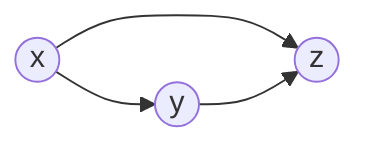
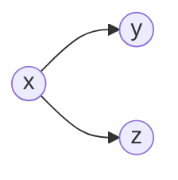
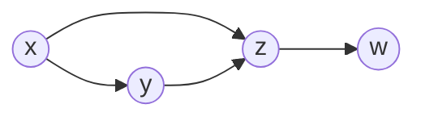

# 第 16 章 · 第 2 讲　因子分解与有向图模型

> [!abstract] 这一讲要解决什么
> 上一讲算完账：$M$ 个二值变量的联合分布要 $2^M-1$ 个数，存不下。这一讲给出那个“更少的东西”：**一个节点一个因子，因子只认自己的父节点**，把这串因子摊开画在纸上，就是一张有向无环图。图不是示意图，它**就是**那个联合分布的另一种写法——从图上能一眼读出分解式、读出哪些变量之间独立、读出到底要存多少个数。学会读图，这一讲就算完成；写图（怎么从数据或知识里造出这张图）留到第 6 节。

---

## 一个因子，就是节点加它头上的箭头

先从最简单的情形看：三个变量，链式法则给出

$$p(x,y,z)=p(x)\,p(y\mid x)\,p(z\mid x,y).$$

这条式子说：$y$ 的条件集里有 $x$，$z$ 的条件集里有 $x$ 和 $y$。把这句话画出来——**条件集里的变量画成指向它的箭头**——就是 $x\to y$、$x\to z$、$y\to z$ 三个箭头：

一张完全图。三个因子，三个箭头，一个数也没省。

现在假设“给定 $x$ 后 $y$ 与 $z$ 无关”，$p(z\mid x,y)$ 变成 $p(z\mid x)$，$y\to z$ 这条箭头就不该画了：

**箭头少一条，条件集就少一个变量，参数就少一半。** 这就是整个概率图模型的全部秘密：图上的每条缺失的边，都对应一条被用上的独立性假设。

> [!important] 有向图模型的读法
> $$p(x_1,\dots,x_D)=\prod_{i=1}^{D}p\bigl(x_i\mid \mathrm{pa}_i\bigr)$$
> 其中 $\mathrm{pa}_i$ 是 $x_i$ 的**父节点**（指向它的那些节点）。**一个节点贡献一个因子，因子的条件集就是它的父节点集合。** 式子右边没有任何一项包含“非父节点”，所有省下来的数字都在这里。

注意这条乘法对**任何**有向无环图都成立——它是“读图”的规则，不是“某个模型”的规则。图上写了什么，乘积就是什么。

---

## 有向图与无向图：两套写法，同一件事

图模型分两支，区别只在“怎么把局部的东西拼成全局的”。

| | 有向图 directed | 无向图 undirected |
|---|---|---|
| 拼法 | 条件概率连乘 | 势函数连乘再除以配分函数 |
| 公式 | $p(x_1,\dots,x_D)=\prod_i p(x_i\mid \mathrm{pa}_i)$ | $p(\mathbf x)=\dfrac1Z\prod_{C}\psi_C(\mathbf x_C)$ |
| 局部量 | 条件概率表（每行加起来是 1） | 势函数 $\psi_C\ge0$（**不必**归一，也没有概率含义） |
| 归一化 | 自动归一（每个因子是条件概率） | 需要 $Z=\sum_{\mathbf x}\prod_C\psi_C$ 兜底 |
| 典型模型 | 贝叶斯网络 Bayes net、隐马尔可夫模型 HMM | 马尔可夫随机场 MRF |
| 这一章 | **主讲** | 只认个脸 |

无向图里那个 $Z$ 叫**配分函数 partition function**，它把“乘出来的相对大小”变成“加起来等于 1 的概率”。$Z$ 要遍历全部配置才能算，这本身就是无向图推断贵的原因之一。

两套图的推断方法是一样的：**消息传递 message passing**，具体算法叫置信传播 belief propagation，求和版本叫 sum-product，取最大值的版本叫 max-product（在对数域里变成 min-sum）。这是下一讲的内容，这一讲先把图本身看明白。

> [!warning] “有向图能表示的东西，无向图表示不了”、“反之亦然”——这两句话都不准确
> 两族图在表达能力上各有对方做不到的地方（有向图的 v 结构、无向图的循环依赖），但本课不展开。现在只需要记住：**这一章讲的是有向的那一支。**

---

## 三件套：节点、边、每个节点一张表

一个具体例子能把这套记号一次讲全。五个二值变量，字母含义不必深究（原例就是拿字母当名字），关系如下：

![[C16-图模型-SMLRT网络与条件概率表.png]]

- **节点 = 随机变量**（$S,M,L,R,T$，各取 0/1）；
- **边 = 直接依赖**：$S\to L$、$M\to L$、$M\to R$、$L\to T$；
- **每个节点挂一张条件概率表 CPT**，表的行是“父节点的取值组合”，列是这个节点取 1 / 取 0 的概率。

四个因子写出来就是：

$$P(S)=0.3,\quad P(M)=0.6,\quad
P(L\mid M,S)=\begin{cases}0.05 & M{=}1,S{=}1\\ 0.1 & M{=}1,S{=}0\\ 0.1 & M{=}0,S{=}1\\ 0.2 & M{=}0,S{=}0\end{cases},\quad
P(R\mid M)=\begin{cases}0.3 & M{=}1\\ 0.6 & M{=}0\end{cases},\quad
P(T\mid L)=\begin{cases}0.3 & L{=}1\\ 0.8 & L{=}0\end{cases}.$$

> [!warning] 表的每一行是一个分布，不是一列
> $P(L\mid M,S)$ 那张表有四行（两个父节点各有两种取值），**每一行**满足 $P(L{=}1\mid\cdot)+P(L{=}0\mid\cdot)=1$。反过来**列的四个数加起来不必是 1**：$P(T{=}1\mid L{=}1)+P(T{=}1\mid L{=}0)=0.3+0.8=1.1\ne1$。
>
> 这个错很常见：把“给定父节点时子变量的分布”误读成“给定子变量时父节点的分布”。前者每行归一，后者每一列才归一，而且两张表是不一样的表（那就是贝叶斯定理在做的事）。

顺带说清楚一个名字：**“graphical” 指的是模型底下那张图结构，不是“这模型能画出一张好看的图”**。任何用图结构编码依赖关系的模型都叫图模型，跟画得好不好看无关。

---

## 无环：为什么箭头不能绕圈

有向图模型要求图是**有向无环图 DAG**：顺着箭头走，永远回不到起点。链、树都是 DAG；下面这种“看着像菱形”的也是——只要没有环。

为什么非要无环？因为 $\prod_i p(x_i\mid \mathrm{pa}_i)$ 是一串**条件概率**相乘，它要能被解释成“先按某个顺序生成数据”：先生成图里没有父节点的，再生成“父节点都已生成”的那些。**DAG 保证总存在这样一个顺序**（拓扑排序），于是乘积自动归一、自动是一个合法的联合分布。一旦有环，就可能出现“$A$ 要等 $B$、$B$ 要等 $A$”的循环，乘积不再对应任何生成过程。

---

## 四个小图，把“读”练成反射

把图放大到两个节点，四种情形一次认完。

| 图 | 分解 | 说了什么 |
|---|---|---|
| $x\to y$ | $p(x,y)=p(x)\,p(y\mid x)$ | $y$ 依赖 $x$ |
| $y\to x$ | $p(x,y)=p(y)\,p(x\mid y)$ | 方向反过来而已，**联合分布不变**，但生成过程变了 |
| $x\quad y$（无箭头） | $p(x,y)=p(x)\,p(y)$ | 两者独立 |
| $R\to L\leftarrow M$ | $p(L,R,M)=p(L\mid R,M)\,p(R)\,p(M)$ | $R$ 与 $M$ **无箭头**，所以**边缘独立**；但一旦观测到 $L$，两者就相关 |

前两行值得停一下：**“$x\to y$” 与 “$y\to x$” 描述的是同一个联合分布**，只是把链式法则从不同的变量开始写。所以箭头不代表“因果”这个强断言，它只代表“我把哪个变量放进谁的条件集里”。第三行是“删掉箭头”的极限。

第四行是这一节真正的新东西。

![[C16-解释消除-两因一果.png]]

### 解释消除 explaining away

$R$ 和 $M$ 都指向 $L$：**两个原因共同导致一个结果**。按分解，$p(L\mid R,M)$ 里两者都在，所以 $R,M$ 之间没有箭头，**边缘上独立**：

$$p(R,M)=p(R)\,p(M).$$

可是**观测到 $L$ 之后**，$R$ 和 $M$ 就变成相关的了。给一组具体的数算一遍（这是补充的算例，图结构和数都是同一套机制）：

> [!example] 草地为什么湿
> 下雨 $R$ 与洒水器 $S$ 互相独立：$P(R)=0.3$，$P(S)=0.1$。草地湿 $W$ 由两者共同决定：
> $$P(W{=}1\mid R{=}1,S{=}1)=0.9,\quad P(W\mid R{=}1,S{=}0)=0.9,\quad P(W\mid R{=}0,S{=}1)=0.8,\quad P(W\mid R{=}0,S{=}0)=0.$$
>
> **没看草地之前**，$P(R)=0.3$，跟洒水器开不开毫无关系。
>
> **看到草地湿了**，四种组合各贡献：
> $$0.3\times0.1\times0.9=0.027,\quad 0.3\times0.9\times0.9=0.243,\quad 0.7\times0.1\times0.8=0.056,\quad 0.7\times0.9\times0=0,$$
> $$P(W)=\textstyle\sum=0.326,\qquad P(R\mid W)=\frac{0.027+0.243}{0.326}=0.828.$$
> 雨的可能性从 $0.3$ 涨到 $0.83$——合理，湿的草地是雨的证据。
>
> **再告诉你“洒水器也开着”**：
> $$P(R\mid W,S)=\frac{0.027}{0.027+0.056}=0.325.$$
> 雨的嫌疑从 $0.83$ 掉回 $0.33$，几乎回到没看草地时的 $0.3$。**洒水器把“草地湿”这件事解释掉了**，雨就不再需要为它负责。

这就是“解释消除”：**两个原因边缘独立，但观察到共同结果后互相竞争解释，于是相关。** 它和“$A$ 影响 $B$”是两种完全不同方向的相关性，也是判断“这条边该不该画”时最容易错的地方——$R$ 与 $M$ 之间确实没有直接依赖，可它们并不是“永远独立”。

> [!warning] 条件独立的方向不能反着用
> “无箭头 ⇒ 独立”这句只在**边缘**意义上成立。$R\perp M$ 是对的，$R\perp M\mid L$ 是**错**的。反过来也有陷阱：链条 $x\to y\to z$ 里 $x\not\perp z$（边缘相关），但 $x\perp z\mid y$。
>
> 换句话说：**“独立”与“条件独立”是两个互不包含的断言**，谁都不能从对方推出来。[[C16.4 条件独立与贝叶斯网络的定义]] 会给出图上的判据，这里先记住 $v$ 结构（两因一果）是唯一的例外位置。

---

## 把五个变量拼起来，再数一遍

回到那张五节点图。按读图规则，联合分布是五个因子相乘：

$$P(L,M,R,S,T)=P(S)\,P(M)\,P(L\mid S,M)\,P(R\mid M)\,P(T\mid L).$$

想验证它真的能算，随便代一组取值：

$$P(S{=}1,M{=}1,L{=}1,R{=}1,T{=}1)=0.3\times0.6\times0.05\times0.3\times0.3=8.1\times10^{-4}.$$

**一次乘法，五个查表**——这就是图模型在“算”这一侧的便宜之处，[[C16.5 图上的推断与从数据学表]] 会正式用。

现在数参数。每个节点要存的数 = 父节点组合数 $\times$（取值数 $-1$）：

| 节点 | 父节点 | 行数 | 每行自由参数 | 合计 |
|---|---|---|---|---|
| $S$ | 无 | 1 | 1 | 1 |
| $M$ | 无 | 1 | 1 | 1 |
| $L$ | $S,M$ | 4 | 1 | 4 |
| $R$ | $M$ | 2 | 1 | 2 |
| $T$ | $L$ | 2 | 1 | 2 |

一共 $1+1+4+2+2=10$ 个数。五个二值变量的联合分布本来要 $2^5-1=31$ 个。**十个替代三十一个**，而且没有一个数是被近似掉的——这十个数的乘积**精确地**等于那张三十一个数的表所描述的分布，前提是你接受“$R$ 只依赖 $M$、$T$ 只依赖 $L$、$L$ 只依赖 $S,M$”这三条独立性假设。

### 一张七节点的图，账更明显

![[C16-七节点有向无环图-参数计数.png]]

这张图的分解按父节点读：

$$p(x_1,\dots,x_7)=p(x_1)\,p(x_2)\,p(x_3)\,p(x_4\mid x_1,x_2,x_3)\,p(x_5\mid x_1,x_3)\,p(x_6\mid x_4)\,p(x_7\mid x_4,x_5).$$

数参数（都当二值变量）：

$$\underbrace{1+1+1}_{\text{三个根}}+\underbrace{2^3}_{x_4\text{ 三个父}}+\underbrace{2^2}_{x_5\text{ 两个父}}+\underbrace{2^1}_{x_6\text{ 一个父}}+\underbrace{2^2}_{x_7\text{ 两个父}}=3+8+4+2+4=21.$$

三个参照点放在一起看，这张图的“节俭程度”就一目了然：

| 情形 | 参数个数 |
|---|---|
| 七个变量全连接（等于直接写联合分布） | $2^7-1=127$ |
| 这张图的连接方式 | $21$ |
| 七个变量两两独立 | $7$ |

**从 127 到 21，靠的全是缺掉的那些箭头；从 21 再到 7，靠的是把所有箭头都删掉。** 图就站在“什么都不知道”和“什么依赖都没有”这两个极端之间，你想省多少，就按你的知识删多少边。

> [!important] 通用的数法（$K$ 种取值）
> 一个节点若取 $K$ 种值、有 $m$ 个父节点、每个父节点也取 $K$ 种值，它要存
> $$K^{m}\,(K-1)$$
> 个数。二值（$K=2$）时正好是 $2^m$，也就是本节的用法。整张图的参数总量是各节点之和。

---

## 课堂实录

（待补：本节暂无转写稿）

---

## 速查

| 名称 | 内容 |
|---|---|
| 读图规则 | $p(x_1,\dots,x_D)=\prod_i p(x_i\mid \mathrm{pa}_i)$，一个节点一个因子 |
| 有向图局部量 | 条件概率表，每行（父组合）在子变量上归一 |
| 无向图局部量 | 势函数 $\psi_C\ge0$，不必归一；整体除配分函数 $Z$ |
| 归一化 | 有向：自动；无向：$Z$ 兜底 |
| 典型有向模型 | 贝叶斯网络、HMM |
| 典型无向模型 | MRF（马尔可夫随机场） |
| 无环的意义 | 存在拓扑序，乘积才对应一个生成过程、才自动归一 |
| 两条边的三种情形 | $x\to y$：$p(x)p(y\mid x)$；$y\to x$：$p(y)p(x\mid y)$；无边：$p(x)p(y)$ |
| $v$ 结构 | $R\to L\leftarrow M$：$R\perp M$ 但 $R\not\perp M\mid L$（解释消除） |
| 解释消除算例 | $P(R)=0.3\to P(R\mid W)=0.828\to P(R\mid W,S)=0.325$ |
| 五节点例 | 分解 $P(S)P(M)P(L\mid S,M)P(R\mid M)P(T\mid L)$，$10$ 个数（全表 31） |
| 七节点例 | $3+8+4+2+4=21$ 个数（全连接 127，全独立 7） |
| 一般参数个数 | 节点取 $K$ 值、$m$ 个父：$K^m(K-1)$；二值即 $2^m$ |

---

## 下一讲

图和乘积是等价的，那**乘积里每个因子从哪来**？两个答案：从数据里数出来（学），从人的知识里问出来（构造）。在这之前先看一个把图用到极致的场景——**时间序列**：同一个联合分布，按“都不依赖 → 全依赖 → 只依赖前一个 → 再藏一层隐状态”四级走下来，就依次得到独立模型、链式法则、马尔可夫链、HMM 与卡尔曼滤波。

---

## 相关笔记 Related Notes

上一讲：[[C16.1 联合分布的规模账]]
下一讲：[[C16.3 时间序列与状态空间模型]]
相关：[[C3.3 联合分布与推断]]（联合表与边缘化）、[[C1.2 决策树的表示与自顶向下归纳]]（另一种“把假设写进结构”的模型）、[[C11.1 EM 算法与高斯混合模型]]（隐变量模型，后面 HMM 的同一套思路）
返回：[[机器学习课程 MOC]]
