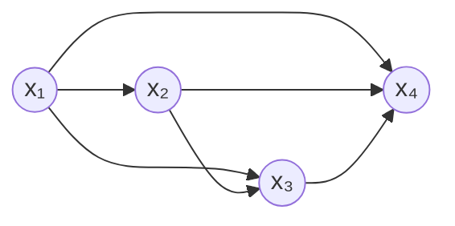
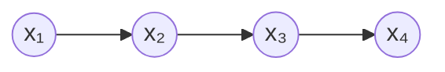

# 第 16 章 · 第 3 讲　时间序列与状态空间模型

> [!abstract] 这一讲要解决什么
> 前面两个讲次把“联合分布 + 图”这套机器装好了。这一讲拿它跑一遍最经典的一类数据：**按时间排好的一串观测**。同一个联合分布，只要对“哪些箭头保留”做四次不同的取舍，就依次得到四个模型——全部独立、全连接（等价于什么假设都不加）、一阶马尔可夫链、状态空间模型（HMM 与卡尔曼滤波）。四个模型共用一条读图规则，区别只在图长什么样、参数量差多少。学完你应当能：给出一个序列任务的规模，直接报出这四个模型各要多少参数，并说清为什么 HMM 比“把前 $n-1$ 步都当条件”便宜得多。

---

## 序列数据长什么样

一串按时间到达的观测 $x_1,x_2,\dots,x_N$。四个例子代表了四类任务：

- **被跟踪物体的位置**——目标跟踪，观测是带噪声的坐标；
- **每天的天气**——气象记录；
- **语音信号的频谱系数**——每一帧是一组系数，帧与帧强相关；
- **人体运动时的关节角**——动作捕捉，几十个关节同时随时间变化。

它们的共同点是：**顺序携带信息**。第 $n$ 个观测和它前后的观测有关，打乱顺序，数据就废了。所以模型必须对“顺序”有表示能力，而联合分布天然有——只要你别假设“各步独立”。

---

## 四级台阶：从“什么都不假设”到“藏一层隐状态”

### 第一级：所有观测独立

$$P(x_1,x_2,x_3,x_4,\dots)=P(x_1)\,P(x_2)\,P(x_3)\,P(x_4)\cdots$$

参数最少（二值变量 $N$ 个），但**它根本没把序列当序列**：把这个乘积里各因子交换位置，结果一模一样。也就是说，模型对“$x_1$ 之后才出现 $x_2$”这件事一无所知。对抛硬币正合适——每次抛掷确实与前后无关；对语音、对轨迹就完全错了。

### 第二级：全连接（什么假设都不加）

链式法则的本来面目：每一步依赖前面所有步。

$$P(x_1,x_2,x_3,x_4,\dots)=P(x_1)\,P(x_2\mid x_1)\,P(x_3\mid x_1,x_2)\,P(x_4\mid x_1,x_2,x_3)\cdots$$

每个节点都连到前面所有节点，参数量爆炸：二值情形第 $n$ 步要 $2^{n-1}$ 个，$N$ 步合计 $2^N-1$——**和直接写联合分布一样贵，等于没做任何压缩**。

这就是搜索的区间：第一级 $N$ 个参数但没建模顺序，第二级建模了顺序但要 $2^N-1$ 个。**要找的是中间那一档。**

### 第三级：一阶马尔可夫链

假设“给定前一步，更早的历史都不再有用”：

> [!important] 马尔可夫假设 Markov assumption
> $$P\bigl(x_n\mid x_1,x_2,\dots,x_{n-1}\bigr)=P\bigl(x_n\mid x_{n-1}\bigr)$$
> 即：**条件集从“前面所有步”缩成“上一步”**。

$$P(x_1,x_2,x_3,x_4,\dots)=P(x_1)\,P(x_2\mid x_1)\,P(x_3\mid x_2)\,P(x_4\mid x_3)\cdots$$

参数：初始 $P(x_1)$ 一个，加上 $N-1$ 张 $P(x_n\mid x_{n-1})$ 的表，二值情形每张 2 个，合计 $1+2(N-1)=2N-1$。

> [!important] 一处必须说清的细节
> 马尔可夫假设说的是**“给定 $x_{n-1}$ 之后，$x_n$ 与更早的不独立无关”**，不是“$x_n$ 与更早的无关”。在链 $x_1\to x_2\to x_3$ 里，$x_1$ 与 $x_3$ 是**边缘相关**的（$P(x_3\mid x_1)\ne P(x_3)$），只是 $P(x_3\mid x_1,x_2)=P(x_3\mid x_2)$。
>
> 换成一句更好记的：**马尔可夫假设删的是“条件集里的变量”,不是“依赖”。** 它说历史只通过“最后一步”起作用，所以把更早的划掉不损失信息——但信息本身还在，是从 $x_2$ 递过去的。

### 第四级：状态空间模型

再往前一步。实时的观测（麦克风的波形、GPS 的坐标）往往**不是**我们真正关心的量，我们关心的是背后那个看不见的状态（正在发哪个音素、物体真实的位置和速度）。于是把变量分成两层：

- **隐状态** $x_1,x_2,\dots$：看不见，自己按马尔可夫链演化；
- **观测** $y_1,y_2,\dots$：每一步由当前隐状态生成。

![[C16-状态空间模型-隐状态与观测.png]]

**目标**：给定一串观测 $y_1,\dots,y_n$，推断那串看不见的状态 $x_1,\dots,x_n$——具体说，是找让联合概率最大的那串：

$$\hat x_{1:n}=\arg\max_{x_{1:n}}P\bigl(x_{1:n}\mid y_{1:n}\bigr).$$

这条式子就是**状态空间模型**的定义式，两个子类按“状态和观测是什么分布”分工：

| 模型 | 隐状态 | 观测 | 典型场景 |
|---|---|---|---|
| 隐马尔可夫模型 HMM | 离散（有限个符号） | 离散或连续 | 语音识别（状态=音素，观测=频谱系数） |
| 卡尔曼滤波 Kalman filter | 连续、高斯 | 连续、高斯（线性） | 目标跟踪（状态=位置+速度，观测=带噪测量） |

两者是同一个图上的两种参数化：**图一样，因子的形式不一样**。

---

## 从图上把联合分布读出来

按读图规则，每个 $x_n$ 的父节点是 $x_{n-1}$，每个 $y_n$ 的父节点是 $x_n$：

$$P(x_1,y_1,x_2,y_2,\dots)=P(x_1)\,P(y_1\mid x_1)\,P(x_2\mid x_1)\,P(y_2\mid x_2)\,P(x_3\mid x_2)\,P(y_3\mid x_3)\cdots$$

于是整串数据只用**三张表**：

| 表 | 记号 | 含义 |
|---|---|---|
| 初始分布 | $P(x_1)$ | 第一步处在哪个状态 |
| 转移表 | $P(x_n\mid x_{n-1})$ | 状态怎么一步步演化 |
| 发射表 | $P(y_n\mid x_n)$ | 某个状态会发出什么样的观测 |

**序列有多长都不增加表的数量**——第 100 步和第 2 步用的是同一张转移表、同一张发射表（这叫参数共享，是 HMM 能用的根本原因）。

数一下参数。设隐状态 $K$ 种、观测 $M$ 种取值：

$$(K-1)+K(K-1)+K(M-1).$$

三个括号依次是初始、转移、发射。举个数：$K=3$ 个状态、$M=10$ 种观测符号，一共 $2+6+27=35$ 个参数。**跟序列长度无关**——一万帧的语音和十帧的语音，参数一样多。对比一下“全连接”那一级：$N$ 帧、每帧 10 种取值，全连接要 $10^N-1$ 个，$N=100$ 时是 $10^{100}$ 量级。**从“不能算”到“35 个”**，这就是马尔可夫假设加上隐状态结构买来的东西。

---

## 这一讲的两个提醒

> [!warning] 记号陷阱：别人的书里 $x$ 可能是观测
> 本章一直用 **$x$ 表示（隐）状态、$y$ 表示观测**。但有些教材（例如 Prince 的 *Computer Vision: Models, Learning and Inference*，那页插图就出自该书）恰恰相反：**$w$ 表示状态、$x$ 表示观测**。
>
> 读别的书之前先看它的记号表。这条不是废话——同一张图上“$x$”指哪一层，直接决定你写出来的分解式对不对。

> [!note] 推断的三件事，这一讲只给出目标
> 给定观测求隐状态，按“用了几步数据”分三种问法：**滤波 filtering**（只用到现在）、**平滑 smoothing**（用到全部）、**解码 decoding / Viterbi**（求整条最可能的路径）。本课只把“目标”写成上面的 $\arg\max$，算法（前向-后向、Viterbi）不在这一讲的范围内；那条线上真正的难点是“求和要遍历指数多条路径”，与 [[C16.6 构造贝叶斯网络与推断的代价]] 里说的困难是同一个。

---

## 课堂实录

（待补：本节暂无转写稿）

---

## 速查

| 名称 | 内容 |
|---|---|
| 独立模型 | $P=\prod_n P(x_n)$，$N$ 个参数，**不区分顺序** |
| 全连接 | $P=\prod_n P(x_n\mid x_{1:n-1})$，$2^N-1$ 个参数，等于没压缩 |
| 一阶马尔可夫链 | $P(x_n\mid x_{1:n-1})=P(x_n\mid x_{n-1})$，$2N-1$ 个参数 |
| 马尔可夫假设删的是 | 条件集里的变量，不是依赖本身 |
| 状态空间模型 | 隐状态马尔可夫链 + 每步一个观测 |
| 联合分解 | $P(x_1)P(y_1\mid x_1)\prod_{n\ge2}P(x_n\mid x_{n-1})P(y_n\mid x_n)$ |
| 三类参数 | 初始 $K-1$、转移 $K(K-1)$、发射 $K(M-1)$ |
| 例（$K=3,M=10$） | $2+6+27=35$，与序列长度无关 |
| HMM | 隐状态离散；语音状态=音素、观测=频谱系数 |
| 卡尔曼滤波 | 状态与观测都高斯、线性；跟踪位置与速度 |
| 目标 | $\arg\max_{x_{1:n}}P(x_{1:n}\mid y_{1:n})$（Viterbi 解码） |
| 记号 | 本章 $x$=状态、$y$=观测；Prince 等书用 $w$=状态、$x$=观测 |

---

## 下一讲

图能表示依赖，也能表示独立——但“图上没画箭头”到底等于什么？是“边缘独立”还是“给定某些变量后独立”？第 4 讲把这个问题问成两个定义（条件独立、边缘独立），再用一个八变量的医学诊断网络，把“从图上一眼看准独立性”的规则立起来。

---

## 相关笔记 Related Notes

上一讲：[[C16.2 因子分解与有向图模型]]
下一讲：[[C16.4 条件独立与贝叶斯网络的定义]]
相关：[[C11.1 EM 算法与高斯混合模型]]（隐变量模型：看不见的变量怎么估）、[[C1.1 机器学习概述与课程导航]]（课程内容里点名的 HMM 与贝叶斯网络，就是本章这两处）、[[C3.2 条件概率、链式法则与贝叶斯定理]]（链式法则的原始形式）
返回：[[机器学习课程 MOC]]
