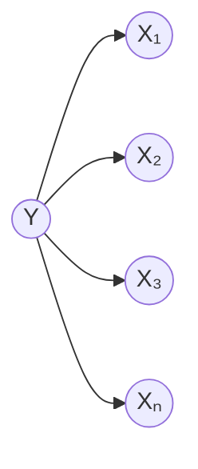

# 第 16 章 · 第 4 讲　条件独立与贝叶斯网络的定义

> [!abstract] 这一讲要解决什么
> 前面三讲用图解释“联合分布怎么被拆成乘积”。这一讲把话说死：**贝叶斯网络 = 一张有向无环图 + 每个节点一张条件概率分布表**，联合分布就是这些表的乘积，仅此而已。剩下的篇幅都花在一个问题上——**这张图能告诉你哪些变量之间独立、哪些不独立**。规则只有一条（每个节点给定父节点后与非后代独立），但它能替你把一张 255 个数的表读成 18 个数，也能提前告诉你“这个推断要遍历多少变量”。同时这一讲要把“朴素贝叶斯”放回图里：它不过是一张所有箭头都从类别射出去的星形图，极端得不能再极端。

---

## 先看朴素贝叶斯有多极端

朴素贝叶斯 naive Bayes 把“条件独立”用到了极致：**给定类别 $Y$，各个特征 $X_i$ 相互独立**。写成图，就是所有箭头从 $Y$ 射向每个 $X_i$：

这张图能用的唯一理由，是“条件独立假设让乘积分开、参数从指数级掉到线性级”。但它假设得太狠了：**任意两个特征，只要给了类别，就必须无关**。文本分类里“两个词总是一起出现”是家常便饭，这个假设直接就把这类结构抹掉了；图像里相邻像素的相关性更不可能被忽略。

> [!important] 图模型要做的事
> **把“哪些变量之间独立”这件事，从“全有或全无”变成一张可以逐条选择的清单**：想留的依赖留一条箭头，想假设掉的独立就不画。图结构 + 参数 = 联合分布，而参数量的多少，正好由你画了多少箭头决定。
>
> 两支：**有向图 = 贝叶斯网络**，**无向图 = 马尔可夫随机场 MRF**。这一章讲有向的。

顺带说清“为什么值得学”（原话里的三条理由）：图模型能同时吃进**三类知识**——变量之间依赖/独立的结构性知识、参数上的先验、以及观测到的数据；它给出的是**成体系的推断与学习算法**，不是某个任务的特例；落地的地方很多：故障诊断、帮助系统、文本分析、时间序列。

---

## 两个定义，一个特例关系

### 条件独立

> [!important] 定义：$X$ 在给定 $Z$ 时与 $Y$ 条件独立
> 若对一切取值
> $$P(X=x_i\mid Y=y_j,Z=z_k)=P(X=x_i\mid Z=z_k),$$
> 就记作 $X\perp Y\mid Z$。等价写法：$P(X\mid Y,Z)=P(X\mid Z)$、$P(X,Y\mid Z)=P(X\mid Z)P(Y\mid Z)$。

一句人话：**知道 $Z$ 之后，$Y$ 的取值不再改变你对 $X$ 的判断。** 例子里那句 $P(\text{Thunder}\mid\text{Rain},\text{Lightning})=P(\text{Thunder}\mid\text{Lightning})$ 说的就是“打雷只跟闪电有关，跟下没下雨无关”——这正是后面那张风暴网络里 $T$ 只有 $L$ 一个父节点的意思。

### 边缘独立

> [!important] 定义：$X$ 与 $Y$ 边缘独立
> 若对一切取值 $P(X=x_i,Y=y_j)=P(X=x_i)P(Y=y_j)$，记作 $X\perp Y$。三个等价说法：上面的乘积式；$P(X\mid Y)=P(X)$；$P(Y\mid X)=P(Y)$。

两者是同一个概念的两个位置：**边缘独立就是“给定空集合”的条件独立**，$Z=\varnothing$。

> [!warning] 这两个断言互不包含，别互相推
> - **独立不蕴含条件独立**：$v$ 结构 $R\to L\leftarrow M$ 里 $R\perp M$，但 $R\not\perp M\mid L$（第 2 讲那笔“解释消除”的账）。
> - **条件独立也不蕴含独立**：链 $x\to y\to z$ 里 $x\perp z\mid y$，但 $x\not\perp z$——$x$ 的信息会顺着 $y$ 传过去。
>
> 做题时最常见的错，是看到图上没箭头就写“独立”，忘了问一句：**是在什么条件下？**

---

## 一个八变量的例子：亚洲网络

先看规模问题。八个二值变量，各是一句医学事实：

![[C16-亚洲网络-八变量的三层分组.png]]

| 变量 | 含义 |
|---|---|
| $X_1$ | 去过亚洲 Visit to Asia |
| $X_2$ | 吸烟 Smoking |
| $X_3$ | 肺结核 Tuberculosis |
| $X_4$ | 肺癌 Lung Cancer |
| $X_5$ | 支气管炎 Bronchitis |
| $X_6$ | 肺结核或肺癌 Tuberculosis or Cancer |
| $X_7$ | 胸透结果 XRay Result |
| $X_8$ | 呼吸困难 Dyspnea |

八行一列地排成一张表，就是 $P(X_1,\dots,X_8)$：$2^8=256$ 行，自由参数 $255$ 个。这张表**没人真的填过**——它太大了，而且绝大多数组合在现实里根本不会出现。

但这八句话里的依赖关系其实很稀疏，而且分三层：**病人信息**（$X_1,X_2$，你问不问都在那儿）→ **医学病变**（$X_3,X_4,X_5$，由前一层引起）→ **检查结果**（$X_7,X_8$，由病变引起）。照着这张图画箭头，联合分布就变成：

$$P(X_1,\dots,X_8)=P(X_1)\,P(X_2)\,P(X_3\mid X_1)\,P(X_4\mid X_2)\,P(X_5\mid X_2)\,P(X_6\mid X_3,X_4)\,P(X_7\mid X_6)\,P(X_8\mid X_5,X_6).$$

数参数：$1+1+2+2+2+4+2+4=18$。

**255 变成 18**。而且这 18 个数每一个都有明确含义，医生可以直接给（“吸烟者得肺癌的概率”这种），不需要从数据里拟合一张 256 行的表。

---

## 定义：图 + 表

> [!important] 贝叶斯网络 Bayesian network
> 一个贝叶斯网络 = **一张有向无环图** + **每个节点一张条件概率分布 CPD**
> - 每个节点是一个随机变量；
> - 每条边表示依赖；
> - 节点 $X_i$ 的 CPD 给出 $P\bigl(X_i\mid \mathrm{Pa}(X_i)\bigr)$，其中 $\mathrm{Pa}(X)$ 是 $X$ 的**直接父节点**；
> - 全体的联合分布**定义为**
> $$P(X_1,\dots,X_n)=\prod_{i=1}^{n}P\bigl(X_i\mid \mathrm{Pa}(X_i)\bigr).$$

最后那句“**定义为**”是这一章最重要的一处措辞。它不是定理、不是近似，而是**模型的定义**：你说这个网络长这样，那这个网络所代表的分布就是右边这个乘积。所以后面所有推断、所有学习，都是在这个乘积上做算术。

![[C16-风暴网络-五变量的依赖结构.png]]

看一个五变量的具体网络：风暴云 $S$ 导致闪电 $L$ 和下雨 $R$，闪电导致打雷 $T$，而“去不去冲浪” $W$ 由闪电与下雨共同决定。它的父节点最多（两个），所以这张 CPD 表最能说明“表长什么样”：

| 父节点取值 | $P(W{=}1\mid \mathrm{Pa})$ | $P(W{=}0\mid \mathrm{Pa})$ |
|---|---|---|
| $L{=}1,\ R{=}1$ | 0 | 1.0 |
| $L{=}1,\ R{=}0$ | 0 | 1.0 |
| $L{=}0,\ R{=}1$ | 0.2 | 0.8 |
| $L{=}0,\ R{=}0$ | 0.9 | 0.1 |

四个父组合，四行。

> [!warning] 行归一，不是列归一
> 每一行加起来是 1（给定父母之后，$W$ 取 1 或 0 各占多少），**每一列加起来不必是 1**。这跟第 2 讲说过的那个坑是同一个：CPD 是“给定父节点时子变量的分布”，不是“给定子变量时父节点的分布”。
>
> 顺带一个观察：$L{=}1$ 的两行都是 $(0,1)$——**只要有闪电，就绝不去冲浪**，$W$ 的取值被父节点**确定**了。CPD 允许这种退化，它照样是合法的分布（只是每行有一个 0）。

联合分布就是五个因子相乘：

$$P(S,L,R,T,W)=P(S)\,P(L\mid S)\,P(R\mid S)\,P(T\mid L)\,P(W\mid L,R).$$

---

## 从图上读出独立性

图模型最实用的能力在这条规则：

> [!important] 每个节点给定父节点后，与自己的**非后代**独立
> $$X_i\perp \{\text{非后代 of } X_i\}\ \big|\ \mathrm{Pa}(X_i)$$
> 注意条件集**只有父节点**，不包括祖先、不包括其他。

在风暴网络里逐个数一遍：

| 节点 | 父节点 | 非后代 | 读出来的独立性 |
|---|---|---|---|
| $T$（打雷） | $L$ | $S,R,W$ | $T\perp S,R,W\mid L$ |
| $L$（闪电） | $S$ | $R$ | $L\perp R\mid S$ |
| $R$（下雨） | $S$ | $L,T$ | $R\perp L,T\mid S$ |
| $W$（冲浪） | $L,R$ | $S,T$ | $W\perp S,T\mid L,R$ |

以 $T$ 为例：它的父节点是 $L$，没有后代，所以非后代是 $S,R,W$。于是“给定闪电，打雷与风暴云、下雨、风浪都无关”。

**这条规则为什么成立？说来只有一行。** 联合分布是乘积，而**只有第 $i$ 个因子含有 $X_i$**：

$$P\bigl(X_i\mid \text{非后代},\mathrm{Pa}(X_i)\bigr)
=\frac{p(X_i\mid \mathrm{Pa})\cdot\prod_{j\ne i}p(X_j\mid \mathrm{Pa}_j)}{\prod_{j\ne i}p(X_j\mid \mathrm{Pa}_j)}
=p\bigl(X_i\mid \mathrm{Pa}(X_i)\bigr).$$

分子分母里除第 $i$ 个之外的所有因子**都不含 $X_i$**（一个非后代节点的父节点必然也是非后代，所以那些因子确实不含 $X_i$），整块约掉，只剩第 $i$ 个因子。约掉这一步，就是“图上那条规则”的全部理由。

这也解释了为什么 $P(T\mid S,L,R)=P(T\mid L)$：把 $S,R$ 塞进条件里，对 $T$ 而言只是多了几个会被约掉的因子。

> [!warning] 这不是独立性的完整清单
> 这条规则只给出一部分独立性，**而且给的往往不是最紧的那一批**。完整的判据叫 **d-分离 d-separation**，会在后续讲次给出（其中会正式处理“解释消除”那种两因一果的情形）。
>
> 现在就按这条规则读，够用；遇到 v 结构时记得它读不出来（$R\perp M\mid L$ 不是它给的，事实恰好相反）。

### 一组术语，问答时常混

![[C16-图模型-SMLRT网络与条件概率表.png]]

| 术语 | 定义 | 风暴网络里的例子 |
|---|---|---|
| 父节点 parents | 直接指向它的节点 | $\mathrm{Pa}(W)=\{L,R\}$ |
| 祖先 antecedents | 父、父的父……一直到根 | $W$ 的祖先：$L,R,S$ |
| 子节点 children | 它直接指向的节点 | $L$ 的子节点：$T,W$ |
| 后代 descendants | 子、子的子……一直到叶 | $S$ 的后代：$L,R,T,W$（即除自己以外全部） |

---

## 链式法则与贝叶斯网络：差在哪

同一张五变量图，两种写法摆在一起：

$$\underbrace{P(S)P(L\mid S)P(R\mid S,L)P(T\mid S,L,R)P(W\mid S,L,R,T)}_{\text{链式法则：}1+2+4+8+16=31}
\quad\text{vs}\quad
\underbrace{P(S)P(L\mid S)P(R\mid S)P(T\mid L)P(W\mid L,R)}_{\text{贝叶斯网络：}1+2+2+2+4=11}$$

**31 与 11 的差别，全在条件集里删掉的变量**：$L$ 的条件集从 $\{S\}$ 不变；$R$ 从 $\{S,L\}$ 删成 $\{S\}$（删掉 $L$）；$T$ 从 $\{S,L,R\}$ 删成 $\{L\}$（删掉 $S,R$）；$W$ 从 $\{S,L,R,T\}$ 删成 $\{L,R\}$（删掉 $S,T$）。

每删掉一个变量，对应的表就小一半（二值情形），这就是“箭头少一条，参数少一截”的具体账。

> [!important] 什么时候贝叶斯网络省不了
> 如果图上每个节点都连到前面所有节点（全连接），删不掉任何变量，参数就是 $2^n-1$，和直接写联合分布一模一样。**贝叶斯网络只通过“缺的箭头”省数字**——没有缺失的箭头，它什么也没给你。

---

## 两个常被误解的名字

> [!warning] “贝叶斯网络”不是“贝叶斯方法”
> 名字里的“贝叶斯”指的是**它用贝叶斯定理做推断**（条件概率、后验），不是“它必须是贝叶斯学派、必须带先验”。同一个网络，参数可以用最大似然估（下一讲就是这么做的），也可以用最大后验估。二者都合法，区别只在有没有加先验。

> [!warning] 箭头不是“因果”的证明
> 箭头表示“直接依赖”，常常和因果同向（吸烟→肺癌），但图模型本身不检验因果：同一张图换个箭头方向，只要条件独立的集合相同，它描述的还是同一族分布。**把图当因果图用，是需要额外假设的另一件事。**

---

## 课堂实录

（待补：本节暂无转写稿）

---

## 速查

| 名称 | 内容 |
|---|---|
| 条件独立 | $P(X\mid Y,Z)=P(X\mid Z)$，即 $X\perp Y\mid Z$ |
| 边缘独立 | $Z=\varnothing$ 的条件独立；$P(X,Y)=P(X)P(Y)$ |
| 关系 | 互不包含：独立 ⇏ 条件独立，条件独立 ⇏ 独立 |
| 贝叶斯网络 | 有向无环图 + 每节点一张 CPD |
| 联合分布 | $P(X_1,\dots,X_n)=\prod_i P(X_i\mid \mathrm{Pa}(X_i))$，**定义**而非近似 |
| CPD | 一行一个父组合，**行内**在子变量上归一 |
| 读独立性 | 每节点 $\perp$ 非后代 $\mid$ 父节点 |
| 没读到的情况 | $v$ 结构（解释消除）不给独立性，完整判据是 d-分离 |
| 亚洲网络 | $2^8-1=255$ 个数 → $18$ 个 |
| 风暴网络 | 链式法则 31 → 贝叶斯网络 11 |
| 术语 | 父/祖先/子/后代 |
| 朴素贝叶斯的位置 | 星形图（$Y\to$ 全部 $X_i$），条件独立假设的极端情形 |

---

## 下一讲

定义立住了，接下来两个最自然的问题：**怎么算**（给一堆观测，问某个配置的概率，或者问某个变量的分布）与**怎么学**（图已知、数据齐全，表里的数从哪来）。第一个问题的答案出人意料地便宜——完全赋值时一次查表加 $n-1$ 次乘法；第二个问题也一样便宜——似然按节点分裂，每一行都是一枚独立的硬币。

---

## 相关笔记 Related Notes

上一讲：[[C16.3 时间序列与状态空间模型]]
下一讲：[[C16.5 图上的推断与从数据学表]]
相关：[[C3.2 条件概率、链式法则与贝叶斯定理]]（条件独立的原始定义与贝叶斯定理）、[[C2.5 逻辑回归]]（朴素贝叶斯之外的另一个“给定 $Y$ 的模型”）、[[C16.2 因子分解与有向图模型]]（读图规则的第一次出场）
返回：[[机器学习课程 MOC]]
