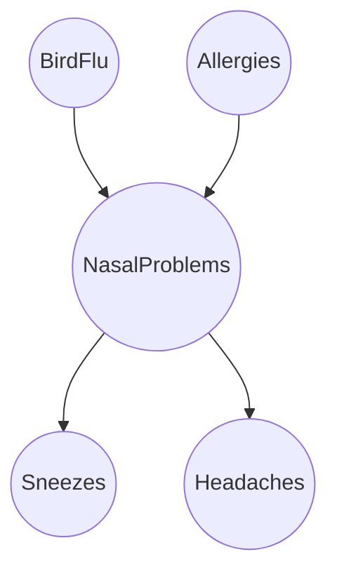

# 第 16 章 · 第 6 讲　构造贝叶斯网络与推断的代价

> [!abstract] 这一讲要解决什么
> 前面把“读图”练熟了，但图是别人给的。这一讲补上最后两块：**怎么画**——一个可以机械执行的构造算法，按变量顺序逐个加入、给每个变量挑“最小的父集合”；以及**画好之后能算到什么程度**——完全赋值是线性的，一般情况下求和是 NP 完全的，只有单连通的图能靠消息传递做到线性。这一讲结束时，这一章的五句话应当都能自己说出来。

---

## 构造：一个可以照着做的算法

问题是：手上有一堆变量，知道它们之间的联合分布（或者至少知道它长什么样），怎么把它画成一张尽可能稀疏的有向图？

> [!important] 构造算法
> 1. 选定一个变量顺序 $X_1,X_2,\dots,X_n$；
> 2. 对 $i=1$ 到 $n$：
>    - 把 $X_i$ 加进网络；
>    - 从 $\{X_1,\dots,X_{i-1}\}$ 里挑**最小的子集** $\mathrm{Pa}(X_i)$，使得
>      $$P\bigl(X_i\mid \mathrm{Pa}(X_i)\bigr)=P\bigl(X_i\mid X_1,\dots,X_{i-1}\bigr).$$
>
> 也就是：前面的变量里，**凡是“删掉之后条件分布会变”的，都得留作父节点**；删掉不影响的一个都不留。

这个算法为什么对？两行：

$$P(X_1,\dots,X_n)\overset{\text{链式法则}}{=}\prod_{i}P\bigl(X_i\mid X_1,\dots,X_{i-1}\bigr)\overset{\text{构造保证}}{=}\prod_{i}P\bigl(X_i\mid \mathrm{Pa}(X_i)\bigr).$$

第一步恒成立；第二步是算法每一步都刻意保证了等式。于是乘积既要等于链式法则的结果，又符合贝叶斯网络的读图规则——**两件事说的是同一个分布**。

注意两个小地方：

- $i=1$ 时没有前面的变量，$\mathrm{Pa}(X_1)=\varnothing$，只需 $P(X_1)$；
- “最小子集”是这一算法**唯一需要判断**的地方，判断依据是条件分布是否相等——**不是“看起来有没有关系”**。这一点很实际：你凭直觉画的图，和你严格做一遍加法得到的图，经常不一样。

---

## 例子：禽流感、过敏与鼻塞

> [!example] 题目（原样）
> - 禽流感与过敏都会引起鼻腔问题；
> - 鼻腔问题会导致打喷嚏与头痛。
>
> 画出贝叶斯网络，写出联合分布的分解式。

两个病因、中间夹一层鼻塞、再往下是两个症状，画出来是一棵树：

题目没给数据，靠常识补三条假设，每条对应一条**缺失的边**：

| 假设 | 含义 | 少掉的边 |
|---|---|---|
| $F\perp A$ | 禽流感与过敏互不相干 | $F$ 与 $A$ 之间没有边 |
| $S\perp F,A,H\mid N$ | 给定鼻塞后，打喷嚏与病因、头痛都无关 | 不画 $F\to S$、$A\to S$、$H\to S$ |
| $H\perp F,A,S\mid N$ | 给定鼻塞后，头痛与病因、打喷嚏都无关 | 不画 $F\to H$、$A\to H$、$S\to H$ |

于是分解式与参数：

$$P(F,A,N,S,H)=P(F)\,P(A)\,P(N\mid F,A)\,P(S\mid N)\,P(H\mid N),$$

$$\underbrace{1}_{F}+\underbrace{1}_{A}+\underbrace{4}_{N\mid F,A}+\underbrace{2}_{S\mid N}+\underbrace{2}_{H\mid N}=10 .$$

五个二值变量的全表要 $2^5-1=31$ 个，这里只要 **10** 个。省下来的 21 个数，全在没画的那六条边上（五个节点的完全有向图共 $5\times4/2=10$ 条边，这棵树只画了 4 条）。

---

## 反向的例子：一条假设都不加

问：如果**什么独立性都不假设**，图长什么样？

答案是把构造算法跑到极限：删掉任何一个前面的变量，条件分布都会变，所以一个也删不掉，$\mathrm{Pa}(X_i)=\{X_1,\dots,X_{i-1}\}$，图变成一条“每一对前后都相连”的全连接图：

![[C16-无独立性假设-链式法则的全连接图.png]]

$$P(X_1,X_2,X_3,X_4)=P(X_1)\,P(X_2\mid X_1)\,P(X_3\mid X_1,X_2)\,P(X_4\mid X_1,X_2,X_3).$$

这正是**链式法则本身**，参数 $1+2+4+8=15=2^4-1$。

> [!important] 这一章最该记住的一句
> **贝叶斯网络只通过它缺掉的箭头省数字。** 一条箭头都不缺，它就是链式法则、就是那张 $2^n-1$ 的表；箭头全删光，它就是“所有变量独立”。图站在两个极端之间，你有多确定哪些依赖可以去掉，它就有多小。

---

## 顺序是有讲究的

算法第 1 步“选一个顺序”看起来是随手的事，其实它决定了你能画出什么图。

用第 2 讲那三个变量（下雨 $R$、洒水器 $S$、草地湿 $W$；$R\perp S$，$W$ 由两者共同决定）比一比：

| 顺序 | 每步留下的父集合 | 边数 | 参数 |
|---|---|---|---|
| $R,S,W$ | $\mathrm{Pa}(R)=\varnothing,\ \mathrm{Pa}(S)=\varnothing,\ \mathrm{Pa}(W)=\{R,S\}$ | 2 | $1+1+4=6$ |
| $W,R,S$ | $\mathrm{Pa}(W)=\varnothing,\ \mathrm{Pa}(R)=\{W\},\ \mathrm{Pa}(S)=\{W,R\}$ | 2+1=3 | $1+2+4=7$ |

两种顺序都**正确**（两个乘积都精确等于同一个联合分布），但第一种画出了 $R$ 与 $S$ 之间没有边——**它把“雨和洒水器独立”这件事写进了图里**；第二种画的是 $W\to R$、$W\to S$、$R\to S$ 三条边，$R$ 与 $S$ 之间连上了，也就是说它**没有**把那条真实成立的独立性表达出来，还多了一个参数。

> [!warning] 顺序的选法
> **把“原因”排在“结果”前面。** 顺序把原因放在后面时，为了让条件分布相等，算法不得不补上一堆边去“反向解释”，图就更密、参数更多，能表达的独立性也更少。
>
> 严格地说，同一分布可以对应多张不同的贝叶斯网络图（它们表达同一族条件独立性，或者互相“更紧”）；这一章只要求你会按给定顺序执行算法、会数参数。

---

## 推断的代价：线性的一半，NP 完全的另一半

最后一页把“能算到什么程度”分成两栏，这一栏的划分值得背下来。

> [!important] 可算的情形
> - **完全赋值**：所有变量都有观测，只问这个配置的概率——每个节点查一次表，$n-1$ 次乘法，$O(n)$；
> - **只有一个变量未观测**：把它的每种取值各算一次、归一化即可，代价是这个变量的取值数；
> - **单连通图 singly connected**（没有无向环，也叫多树 polytree）：**置信传播 belief propagation** 在图上跑两遍消息传递就能精确算出所有边缘分布，代价与图的规模成线性。

> [!warning] 不可算的情形
> 一般的贝叶斯网络推断是 **NP 完全的**（Cooper 1990 的结果）。直觉很简单：条件概率的分母要把**所有隐藏变量**加起来，如果隐藏变量有 $h$ 个、每个 $k$ 种取值，那就是 $k^h$ 项。$h=50$、$k=2$ 时是 $10^{15}$ 项——这不是常数因子的问题，是指数。
>
> 注意“单连通可算、多连通不可算”这个界线不是绝对的（有些多连通图也能凑巧变小），但它抓住了本质：**环让求和项之间无法复用**，一旦成环，动态规划就断了。

工程上的四条出路，按“精确/近似”排：

| 方法 | 类型 | 一句话 |
|---|---|---|
| 联结树 junction tree | 精确 | 把图三角化、聚成团，在树上做消息传递；很多实际网络能压到可算 |
| 蒙特卡洛 Monte Carlo | 近似 | 按网络的分布采样很多次，数结果；样本越多越准 |
| 变分方法 variational | 近似 | 用一个可算的分布去逼近后验，优化一个下界 |
| 消息传递/置信传播 | 精确（限单连通） | 上一讲次的内容，也是“单连通为什么能线性”的答案 |

---

## 收束：这一章要能自己说出的五句话

> [!important] 五句话（对应五处细节）
> 1. **贝叶斯网络 = 图 + 参数**：图的节点是随机变量、边是直接依赖；每个节点一张 CPD 给出 $P(X_i\mid \mathrm{Pa}(X_i))$；联合分布**定义为** $\prod_i P(X_i\mid \mathrm{Pa}(X_i))$。
> 2. **它比全表省，省在缺的箭头上**：亚洲网络 $255\to18$，风暴网络 $31\to11$，七节点 $127\to21$；一条箭头都不缺时等于链式法则。
> 3. **从图上能读出独立性**：每个节点给定父节点后与自己的非后代独立（$T\perp S,R,W\mid L$）；这不是完整清单，完整判据是 d-分离。
> 4. **“解释消除”是图上最容易判错的位置**：两因一果时，两个原因边缘独立、给定结果后相关。
> 5. **算得起的是完全赋值，算不起的是一般推断**：完全赋值 $O(n)$；一般情形 NP 完全；单连通可用置信传播，多连通用联结树或近似方法。

---

## 课堂实录

（待补：本节暂无转写稿）

---

## 速查

| 名称 | 内容 |
|---|---|
| 构造算法 | 定顺序 → 逐个加入 → 取“删了就变”的最小父集合 |
| 正确性 | 链式法则 = 构造保证 = 读图规则 |
| 最小父集合的判据 | $P(X_i\mid \mathrm{Pa})=P(X_i\mid X_1,\dots,X_{i-1})$ 是否成立 |
| 禽流感例 | $P(F)P(A)P(N\mid F,A)P(S\mid N)P(H\mid N)$，10 个参数（全表 31） |
| 无假设 | 全连接 = 链式法则，$2^n-1$ 个参数 |
| 顺序的影响 | 原因在前更稀疏；例：$R,S,W$ 序 6 个参数，$W,R,S$ 序 7 个 |
| 完全赋值推断 | $O(n)$，$n-1$ 次乘法 |
| 一般推断 | NP 完全，求和项数 $\prod_{\text{隐藏}}k_i$ |
| 单连通 | 置信传播/消息传递，线性 |
| 多连通 | 联结树（精确）、蒙特卡洛（采样）、变分（近似） |

---

## 下一讲

这一章到此为止。它留下两个明确的接口：**d-分离**（完整的独立性判据，本课没有发到对应材料）与**消息传递/置信传播**（第 15 讲的内容，本课同样没有拿到）。两处都是这一章自然的下一步，等材料到了可以按 [[C16.1 联合分布的规模账]] 的账本继续往下算。

---

## 相关笔记 Related Notes

上一讲：[[C16.5 图上的推断与从数据学表]]
下一讲：（暂无；本章到此结束）
相关：[[C16.2 因子分解与有向图模型]]（解释消除的完整算例）、[[C16.4 条件独立与贝叶斯网络的定义]]（读独立性规则与 d-分离的伏笔）、[[C11.1 EM 算法与高斯混合模型]]（另一种“隐变量让求和变难”的场合）
返回：[[机器学习课程 MOC]]
