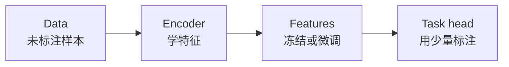
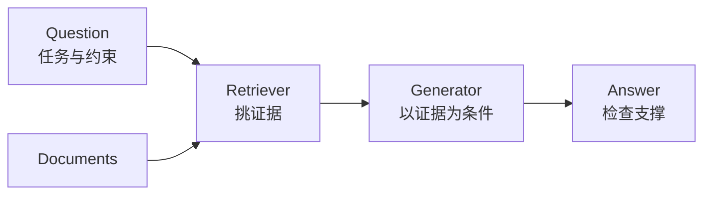

# C18.2 展望：表示、注意力、生成与系统

> [!abstract] 这一讲要解决什么
> 主干讲完了，这一讲往外看四步：**特征从手工指定变成学出来的**、**模型从看一条输入变成看整段上下文**、**任务从判断变成生成**、**模型从单打独斗变成一个系统的一环**。这四个方向看似换了学科，其实用的是同一套原料——梯度、链式法则、正则、验证协议，都是前面十八讲的东西。这一讲的任务不是让你会用它们，而是让你能认出"新东西里的旧零件"，并且知道每一个方向各自的评测陷阱在哪。

---

## 把特征也学出来

第 13 章有一句话："隐藏层在学自己的特征。"但那里学的特征只服务于**同一个任务**——任务换了，特征作废。这一讲要往下推一层：**能不能学出一套能搬到别的任务上的特征？**

原稿画的是四格流水线：



四个格子里，前三格都不看标签，只有最后一格需要标注。于是省下来的正是最贵的那一段：**标注**。

三条要点：

- **自监督 self-supervision**：从数据本身造出学习信号。原稿给的例子是"匹配两个增广视图"——同一张图做两种随机变换，让编码器把两者映到相近的位置。"标签"由变换过程免费生成，不需要人。
- **迁移 transfer**：把编码器搬过来，接一个任务头（只训最后一层），或者整体微调。
- **评测在下游**：看下游任务的表现，**不是预训练损失**。

最后一条值得多停一句。原稿把整页的警句放在这里：**预训练与下游评测的目标不一样。** 预训练在优化"两个视图像不像"，下游要的是"能不能分对类"。这两个目标相关，但不相等——预训练损失降得漂亮、下游不动，是常见的结果。这与第 9 章"训练误差与测试误差是两个目标"是同一句话，只是把"数据集"换成了"任务"。

> [!note] 与第 13 章的接口
> 第 13 章的网络末端是分类输出、特征是副产品；这一讲的网络末端什么都不是（编码器），**特征才是产品**。同一套反向传播，优化的对象换了。

延伸阅读：SimCLR（Chen et al., 2020），原稿引作这一类方法的代表。

---

## 注意力：一次带权重的平均

一句话定义：**每个位置该输出什么，取决于它该看哪里。** 用当前的位置去和所有位置比相似度，把相似度变成一组权重，再把这些位置上的信息加权求和。

写成式子：

$$\text{Attention}(Q,K,V)=\text{softmax}\!\left(\frac{QK^\top}{\sqrt{d_k}}\right)V$$

三个角色，不是三个变量：

| 记号 | 角色 | 一句话 |
|---|---|---|
| $Q$ query | "我在找什么" | 当前这个位置发出的询问 |
| $K$ key | "我是什么" | 每个位置用来被匹配的标签 |
| $V$ value | "我有什么" | 每个位置实际贡献的内容 |

名字本身就是解释：**注意力 attention ＝ 把注意力分配给谁**。$QK^\top$ 给出的是一张"谁该看谁"的分数表，$d_k$ 是 key 的维度。

> [!example] 把一次注意力算完
> 一个 query $Q=(1,0)$，两个 key $K_1=(1,0)$、$K_2=(0,1)$，对应两个 value $V_1=(1,2)$、$V_2=(3,4)$，$d_k=2$。
>
> 1. 打分：$QK_1^\top/\sqrt{2}=0.707$，$QK_2^\top/\sqrt{2}=0$；
> 2. softmax：$e^{0.707}=2.028$，$e^{0}=1$，归一化得权重 $(0.670,\ 0.330)$；
> 3. 加权求和：$0.670\cdot(1,2)+0.330\cdot(3,4)=(1.66,\ 2.66)$。
>
> 输出的第一个分量从 $1$ 被拉到 $1.66$——**它借了第二个位置的信息**，借多少由那张分数表决定。整段序列就是这样逐位置地互相"借"。

三个实现要点，每一个都能在原稿那一页找到一句话：

- **除以 $\sqrt{d_k}$**：点积的方差随 $d_k$ 线性增长，不除就会让 softmax 饱和（最大权重逼近 $1$，其余逼近 $0$），梯度随之消失。除以 $\sqrt{d_k}$ 是把方差拉回 $O(1)$。
- **位置信息要外加**：加权求和与顺序无关——把序列打乱，输出还是同一组。所以顺序必须**显式编码** 进去（位置编码），否则"猫追狗"与"狗追猫"对模型是同一件事。
- **因果掩码 causal mask**：训练"预测下一个词"时，每个位置只能看它之前的词。做法是在打分表上把未来位置的分数置为 $-\infty$，softmax 之后那些权重就是 $0$。

原稿还提醒了一件容易被忽略的事：**这套架构不改变学习方式。** 前馈层、残差连接、归一化只是把网络加深加稳；训练用的还是反向传播，优化用的还是梯度下降。新东西是**结构的排列方式**，不是新的学习原理。

延伸阅读：Vaswani et al., *Attention Is All You Need*（2017）。

---

## 从预测到生成

第 1 章问的是"这段话是垃圾邮件吗"，这一讲问的是"下一句该写什么"。听上去换了一个任务，其实只换了一个式子。

**自回归 autoregressive** 用的就是第 16 章那条链式法则：

$$P_\theta(x_1,\dots,x_T)=\prod_{t=1}^{T}P_\theta(x_t\mid x_{<t})$$

一个 $T$ 项序列的联合分布，被拆成 $T$ 个"给定前文，下一个是什么"。**这和第 16 章把联合分布拆成一串条件分布是同一个恒等式**，区别只在于：那里用它来数参数，这里用它来**生成**——从 $x_1$ 开始逐个采样，每一步都把已生成的部分喂回去当作条件。

**扩散模型 diffusion** 走反方向：训练时把已知强度的噪声一步步加到数据上，让网络学"这一步加了什么噪声"；生成时从纯噪声出发，一步步减去学到的噪声。

```text
训练： 数据 x₀  →  加噪声 x_t  →  纯噪声 x_T
生成： 数据 x₀  ←  去噪 x_t    ←  纯噪声 x_T
```

两边都在学"相邻两步之间差的那个变换"，只是一个学加法、一个学减法。这条思路与自回归的不同在于：**它不是逐个词往前写，而是一次一次把整张图变清楚。**

原稿在这里放了一句必须记住的警告：

> [!warning] 看起来合理，不等于真实
> 生成模型的目标是"像数据"，不是"是真的"。一个通顺的句子、一张合理的图，都可以完全虚构。所以**评生成要按它的用途来评**：辅助写作看可用性，问答看事实性，药物设计看可验证性。用似然或"人看着像不像"当唯一指标，会把这类系统夸到它们做不到的地方。

延伸阅读：Ho, Jain & Abbeel, *Denoising Diffusion Probabilistic Models*（2020）。

---

## 模型不是一个函数，而是一个系统

前面所有章节都默认：输入进来，模型输出，结束。真实系统里，模型只是中间一环。



- **检索增强生成 RAG**：先把相关文档检索出来，再让生成模型**在这些文档的条件下** 作答。好处是答案有出处；坏处是错的检索会把生成带偏。
- **工具调用 tool use**：模型可以要求一次搜索或一次计算，然后拿回观测继续。这一步把一个"语言模型"变成了一个**带外部动作的决策者**。
- **分开评测**：检索质量、答案有没有被证据支撑、任务是否完成、延迟——**这四件事必须分别量**。合成一个总分，等于把"检索错了"和"生成错了"混成同一种病，之后无从改起。

原稿的收尾一句是：对**每一个部件和整个系统** 都做误差分析。这正是第 6 章那套系统设计的思路，只是从"垃圾邮件过滤器的误差分析"搬到了"生成系统的误差分析"。

延伸阅读：Lewis et al., *Retrieval-Augmented Generation for Knowledge-Intensive NLP Tasks*（2020）；Yao et al., *ReAct: Synergizing Reasoning and Acting in Language Models*（2023）。

---

## 四个还没解决的问题，和一个能上手的实验

原稿列了四个方向，每个都配一句"为什么它现在还没解决"：

| 方向 | 在问什么 |
|---|---|
| 稳健性 robustness | 换时间、换用户、换环境之后，性能还在不在？要把分布偏移**显式** 测出来 |
| 隐私与信任 privacy and trust | 模型会泄漏什么？什么时候该说"我不确定"，什么时候该请人来判断 |
| 高效学习 efficient learning | 固定的标注、内存、算力、延迟预算下，能达到什么质量 |
| 序列决策 sequential decisions | 动作会改变后面的数据与回报——这是通往强化学习的门 |

配一句原稿的判词：**光是模型更大，回答不了这四个问题。** 前三个都是"约束下的取舍"，第四个是"目标本身随时间变化"，两者都不是加参数能解决的。

那从哪里开始？原稿给了一个小实验的处方，恰好把第 18 章第一节那个学习环走一遍：

| 步 | 动作 |
|---|---|
| 1 | 选一个数据集与一个部署问题；**先把划分、指标、资源预算固定下来** |
| 2 | 拿一个**经典基线**、一个**冻结的预训练表示**、以及在可行时的**微调** 三者比 |
| 3 | 一次只改一个因素：标签预算、正则强度、表示、数据偏移 |
| 4 | 报告三样东西：学习曲线、失败分析、质量—成本曲线；并写下"什么结果会改变你的结论" |

最后那一句是整个课程里最像"科研方法"的一句：**动手之前先说清什么会推翻你的结论。** 否则你会不自觉地只找支持自己的证据。

原稿在页脚把这件事的定位写清楚了：这是一个**建议的后续项目**（a suggested follow-up project），而不是指定的作业；也**不预设任何排名或数值结果**。同页底部收束的三句是整门课的浓缩：陈述假设、建一个基线、测量并检查错误、然后改进。

延伸阅读：Koh et al., *WILDS: A Benchmark of in-the-Wild Distribution Shifts*（2021）。

最后是来源。原稿分两组列：**课程基础**是 Mitchell／Balcan／Moore 的 CMU 10-601、Andrew Ng 的机器学习课程，以及 L1–L29 用到的本地参考材料；**延伸阅读**是六篇论文，按出现顺序是 SimCLR（Chen et al., 2020）、*Attention Is All You Need*（Vaswani et al., 2017）、DDPM（Ho, Jain & Abbeel, 2020）、RAG（Lewis et al., 2020）、ReAct（Yao et al., 2023）、WILDS（Koh et al., 2021）。原稿在这个位置还写了两句限定：讲次与文献的对应关系在配套教学笔记里（就是本 vault），以及**这些读物只标示方向，不构成对模型的排名**。

---

## 课堂实录

（待补：本节暂无转写稿。）

---

## 勘误

| 位置 | 原稿写的 | 实际情况 |
|---|---|---|
| p16 的方框 | 框内文字的首字母被切掉："Data $x_0$" 显示成 "ata $x_0$"，"Noisy $x_t$" 显示成 "oisy $x_t$" | 原稿的字距与框宽不匹配，导出件里被截断。文字层完好，正文按完整词写 |
| p17 的方框 | 同样问题："Question" 显示成 "uestion"，"Select evidence" 显示成 "elect e idence"，"Check support" 显示成 "hec support" | 同上，属排版截断，不是缺字 |
| p14、p16、p17 的示意图 | 方框里同时有标题词与解释词，两类文字混排，容易看错谁是谁 | 笔记按"标题＝环节名、浅色小字＝该环节做什么"重述，并用 mermaid 还原结构 |
| p20 的来源页 | 分两组：课程基础（Mitchell／Balcan／Moore 的 CMU 10-601、Andrew Ng 的课）与六篇延伸阅读 | 编号 1–6 与正文引用一一对应，笔记把六篇按出现顺序列在正文各节末尾 |

---

## 速查

| 名称 | 内容 |
|---|---|
| 表征学习流水线 | 未标注数据 → 编码器 → 特征（冻结或微调）→ 任务头（少量标注） |
| 自监督 | 从数据本身造学习信号；例：两个增广视图互相匹配 |
| 迁移的两条路 | 冻结编码器只训任务头；或整体微调 |
| 评测位置 | 在下游任务上评，**不是** 在预训练损失上评 |
| 注意力 | $\text{softmax}(QK^\top/\sqrt{d_k})V$ |
| Q／K／V | 我在找什么／我是什么／我有什么 |
| 除以 $\sqrt{d_k}$ | 把点积方差拉回 $O(1)$，避免 softmax 饱和与梯度消失 |
| 位置编码 | 加权求和本身与顺序无关，顺序必须显式编进去 |
| 因果掩码 | 未来位置的分数置 $-\infty$，权重为 $0$，只能看前文 |
| 自回归 | $P(x_1,\dots,x_T)=\prod_t P(x_t\mid x_{<t})$，就是链式法则 |
| 扩散模型 | 训练学"加了什么噪声"，生成从纯噪声逐步去噪 |
| 生成的陷阱 | 合理 ≠ 真实；按用途评 |
| 系统四件套 | 检索质量、答案支撑、任务成功、延迟，分别评测 |
| 四个未解问题 | 稳健性、隐私与信任、高效学习、序列决策 |
| 实验处方 | 固定划分／指标／预算 → 基线 vs 冻结表示 vs 微调 → 一次改一个 → 报曲线、失败分析、质量—成本 |

---

## 下一讲

没有下一讲了。**课到这里结束。**

最后留一句原稿放在封面上的问题，它比任何一页公式都值得带走：

> **是什么让这个模型在新数据上有用？**

三十讲里所有的方法都在从不同角度回答它：正则化回答"怎么别把噪声背下来"，交叉验证回答"怎么诚实地量"，图模型回答"哪些假设让参数变少"，主动学习回答"哪些标签最值钱"。而这一讲那四个方向之所以还没解决，正因为这个问题还没有一个一劳永逸的答案。

---

## 相关笔记 Related Notes

上一讲：[[C18.1 一门课一个学习环]]
相关：[[C13.2 神经网络的表示与前向传播]]（"网络在学自己的特征"的起点）、[[C14.1 代价函数与反向传播]]（新架构里仍然用的那套训练）、[[C16.1 联合分布的规模账]]（链式法则，自回归生成用的就是它）、[[C6.1 系统设计的起点：垃圾邮件分类与误差分析]]（把"误差分析"搬到生成系统）
返回：[[机器学习课程 MOC]]
