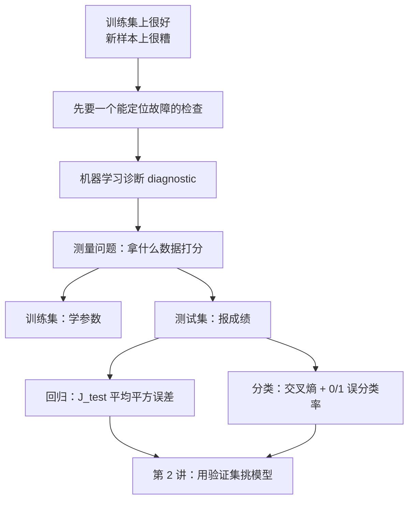
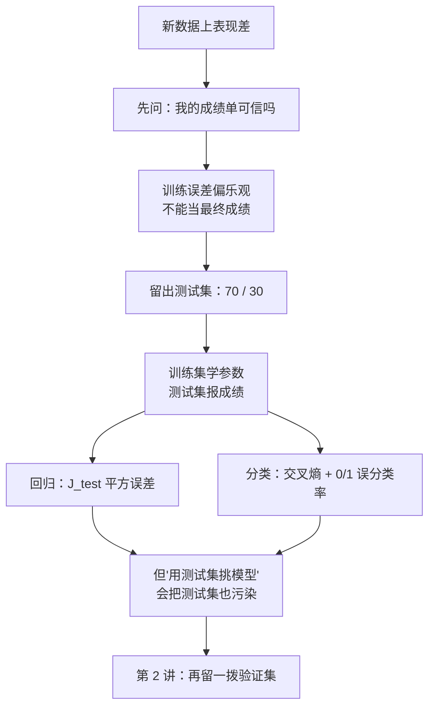

# 第 9 章 · 第 1 讲　模型评估与训练测试集（课堂讲授版）

> [!quote] 本讲开场
> 同学们好。前面八章我们把算法学了一遍：决策树、线性回归、逻辑回归、K-means、异常检测，还聊过怎么在海量数据上训练。可真到了自己接手一个项目，最让人卡住的往往不是"该选哪个算法"，而是另一件事——**模型在新数据上错得离谱，我下一步到底该干什么？**
>
> 朋友让你用房屋面积估房价。你写了一个带正则化的线性回归，训练集上拟合得挺好。他随口报了三套房子，你的预测全偏，而且偏得离谱。这时候桌上摆着六条建议：多收数据、删掉一些特征、想办法加新特征、加 $x_1^2,x_2^2,x_1x_2$ 这类多项式特征、减小 $\lambda$、增大 $\lambda$。
>
> 六条建议，一半听起来正好相反。**加特征和删特征都可能是对的——它们治的是不同的病。** 随便挑一条，很可能白忙一整周，最后才发现药不对症。
>
> 所以这一讲先不忙着改模型，先做一件更基础的事：**把"体温计"造出来**。今天回答三件事：
> 1. **机器学习诊断**是什么，它凭什么比盲试省时间？
> 2. 为什么**训练集上的成绩不能当最终成绩**？
> 3. 数据怎么分、回归和分类各自拿什么数字打分？
>
> 好，我们从朋友那三套房子说起。

> [!info] 怎么读这份讲义
> 前置内容是 [[C2.4 多项式回归与正规方程]]、[[C2.5 逻辑回归]]、[[C2.7 过拟合与正则化]]。本篇只用训练集与测试集两拨数据；**第三拨（验证集）要到下一讲才出现**，因为"拿测试集挑模型会把它污染"这件事必须先把测试集讲清楚才说得通。
>
> 目前没有本学期的语音转写稿，本篇内容全部来自课件与教材整理。标有 **（拓展）** 或 **【拓展】** 的部分是课堂上未展开、由课件和教材延伸补充的内容，复习时先掌握未标注的主干。

---

## 一、训练集上很好，新样本上很糟

### 1.1 六条互相矛盾的建议

先把场景写清楚。你手上的模型是**带正则化的线性回归**，代价函数是

$$J(\theta)=\frac{1}{2m}\left[\sum_{i=1}^{m}\Big(h_\theta(x^{(i)})-y^{(i)}\Big)^2+\lambda\sum_{j=1}^{n}\theta_j^2\right],\qquad h_\theta(x)=\theta^Tx,\ x_0=1 .$$

你把训练集上的 $J(\theta)$ 压得很低。然后拿几套**没参与训练**的房子做测试，误差大得不能接受。接下来可以尝试的方向是：

- Get more training examples（多收训练样本）
- Try smaller sets of feature（删掉一部分特征）
- Try getting additional features（去找新特征）
- Try adding polynomial features（加 $x_1^2,x_2^2,x_1x_2$ 等）
- Try decreasing $\lambda$（减小正则化强度）
- Try increasing $\lambda$（增大正则化强度）

![[C9.1-板书-六个改进方向与诊断2.png]]

这张图右侧那串 $x_1,x_2,x_3,\dots,x_{100}$ 是在提醒你：这里的特征有 100 个（面积、卧室数、楼层数、房龄、邻里平均收入、厨房大小……）。**这个问题已经开始变得没办法用眼睛看了**——一个特征时你还能画个图看看曲线怪不怪，一百个特征时你连"过拟合长什么样"都想象不出来。

> [!question] 停一下，先自己想想
> 六条建议里，哪两条是明确互相矛盾的？把它们配成对，各自猜一猜"它治的是什么病"。

先给一半答案。矛盾确实存在，而且是三对：

| 一对 | 一个方向治 | 另一个方向治 |
| --- | --- | --- |
| 加训练样本 vs 加特征 | 模型**太复杂**，需要更多数据把它压住 | 模型**太简单**，需要更强的表达能力 |
| 删特征 vs 加特征 | 特征**太多**、噪声混进来了 | 特征**不够**，重要的量根本没进模型 |
| 增大 $\lambda$ vs 减小 $\lambda$ | 参数被放得太野 | 参数被压得太死，模型退化成常数 |

只看这张表，你会觉得"那我全都试一遍不就行了"。问题是**每一条都要花时间**：多收数据可能意味着几周的数据采集，加特征意味着重新做特征工程。真正省时间的做法不是把六条都试一遍，而是**先花半天做一个有针对性的检查，判断模型到底哪儿出了问题，再只做该做的那一条**。这个检查就是下一节要讲的东西。

### 1.2 机器学习诊断

> [!important] 定义　机器学习诊断 Machine Learning Diagnostic
> **诊断**是一个你可以运行的测试，用来获得"学习算法哪部分在正常工作、哪部分没有"的洞察，并给出"怎样最好地改进它的性能"的指导。
>
> 诊断本身要花时间去实现，但这件事通常**非常值得**。

为什么值得？注意这里的成本对比：诊断要花的是**半天到一天的实现时间**，而一条错建议要花的是**一到两周的试错时间**。诊断的收益是把"六选一的赌博"变成"照着仪表盘读数"。

> [!note] 一个更好用的类比
> 车开着不对劲，你不会直接换发动机，也不会把四个轮胎全换掉。你会先看仪表盘、再读故障码，然后才动手。**诊断就是机器学习里的故障码**：它不修车，它告诉你哪儿坏了。

"你刚才做的，就是一次诊断选型"：从"想一个改法"转向"先确认哪里出了问题"。这个转向是本章所有内容的地基。

## 二、为什么训练成绩不能当最终成绩

### 2.1 穿过已有点，不等于会预测新点

假设你只有很少几套房的记录，却用了一个四次多项式

$$h_\theta(x)=\theta_0+\theta_1x+\theta_2x^2+\theta_3x^3+\theta_4x^4 .$$

参数有五个，数据点只有六七个，你完全可以让曲线从每一个点身上穿过去，连点与点之间的偶然起伏也一起拟合进来。可问题是：**新房子的价格并不保证沿着这些偶然起伏出现。**

![[C9-多项式阶数与训练误差的假象2.png]]

左边一次多项式欠拟合，训练集上的平均平方误差是 $0.016$；右边五次多项式把六个点全部插值过去，训练误差是 $0.000$。**训练误差更小的那个，恰恰是更不靠谱的那个。** 这就是问题的核心：训练误差这个数字，本身不能回答"模型好不好"。

![[C9.1-板书-过拟合与多特征评估2.png]]

这里有个反直觉的地方，值得单独说一句：五次多项式在训练点之间上下摆动，而**我们手上没有任何一个点能证明它摆错了**。它不是"学错了"，而是"把训练集的偶然当成了规律"。你用训练集去检验它，等于用同一套题给自己批卷子——当然全对。

> [!important] 定义　泛化 Generalization
> 模型的**泛化能力**，指它对**未参与训练的**新样本的预测能力。衡量泛化能力的数字必须来自模型没见过的新数据。

一个特征时我们还能画图找异常。一百个特征时，高维曲面是否过拟合，靠看图是看不出来的——所以我们需要**独立数据上的数值指标**，这就是这一讲剩下的全部内容。

### 2.2 训练误差为什么天生偏乐观

再看一层更根本的原因。参数 $\theta$ 是怎么来的？是**最小化训练误差**挑出来的：

$$\hat\theta=\arg\min_\theta J_{train}(\theta),\qquad J_{train}(\theta)=\frac{1}{2m}\sum_{i=1}^{m}\Big(h_\theta(x^{(i)})-y^{(i)}\Big)^2 .$$

$\theta$ 是"在训练集上表现最好"的那一组。你再用同一个训练集去评价它，测到的必然是它**自己刷出来的最高分**。换句话说：

> [!important] 训练误差的乐观偏向
> 参数是在训练集上拟合出来的，因此**在训练集上量到的误差（训练误差 $J(\theta)$）通常低于真实泛化误差**。数据集越小、模型越复杂，这个乐观偏向越严重。

而 $\hat\theta$ 是拟合**随机噪声**挑出来的，所以换一批不同噪声的样本，$J_{test}$ 的波动也更大。这就是"训练集小 + 模型复杂"最危险的地方：训练误差看着漂亮，泛化误差既高又不稳。

> [!question] 停一下，先自己想想
> 如果一个人反复练同一套题直到全对，这套题的成绩能证明他会做没见过的题吗？模型把训练误差压到很低，和这件事差在哪？

差在"题"是不是同一套。解决办法也很朴素：**留一部分数据，从一开始就不让模型看。**

---

## 三、把数据分成两拨：训练集与测试集

### 3.1 七三划分

做法很简单：把手上这批带标签的数据**随机打乱后切成两段**。

- **训练集 Training Set**：占约 70%，用来学参数 $\theta$；
- **测试集 Test Set**：剩下的约 30%，训练时**完全不碰**，只在最后用来报成绩。

用 10 条房屋记录举例（面积/价格）：2104/400、1600/330、2400/369、1416/232、3000/540、1985/300、1534/315、1427/199、1380/212、1494/243。按 7:3 切，前 7 条进训练集，后 3 条进测试集。

![[C9.1-板书-训练与测试的七三划分2.png]]

两拨样本的记号沿用第 2 章的约定，只是加了下标：

$$(x^{(1)},y^{(1)}),\dots,(x^{(m)},y^{(m)})\quad\text{训练集};\qquad (x_{test}^{(1)},y_{test}^{(1)}),\dots,(x_{test}^{(m_{test})},y_{test}^{(m_{test})})\quad\text{测试集}.$$

其中

$$m=\text{训练样本数},\qquad m_{test}=\text{测试样本数}.$$

注意**下标 $test$ 表示"这个样本属于测试集"，上标 $(i)$ 表示"它在测试集里排第几"**，两者别混。10 条数据按 7:3 分就是 $m=7$、$m_{test}=3$。

> [!warning] 三条纪律
> 1. **切分要随机**。如果原始数据是按时间或某种顺序排的，直接取前 70% 会引入系统性偏差（比如测试集全是淡季的房）。
> 2. **测试集一旦定下来就不要动**。不要因为某几套房子预测得太离谱就把它们挪回训练集——那就是在偷看答案。
> 3. **特征缩放等预处理要在训练集上拟合，再套用到测试集**。用全部数据的均值方差做归一化，等于把测试集的信息漏进了训练过程。

**【拓展】** 真实项目里还有两件课件没提但很实用的事。一是**分层抽样 stratified splitting**：如果正负样本比例悬殊（比如垃圾邮件只有 1%），纯随机切分有可能让测试集里一封垃圾邮件都没有，这时要按类别比例分层再切。二是**七十比三十不是规矩**：数据量很小时（比如一共 20 条），留三成做测试会让两边都不够用，"留出法"就不合适了——那类场景要用交叉验证，把每一份数据都轮流当一次验证集。

### 3.2 线性回归的训练/测试流程

流程只有两步，但顺序不能颠倒：

1. **学参数**：只用训练集，最小化训练误差 $J(\theta)$，得到 $\theta$；
2. **报成绩**：把 $\theta$ **固定住**，在测试集上算测试误差

$$J_{test}(\theta)=\frac{1}{2m_{test}}\sum_{i=1}^{m_{test}}\Big(h_\theta(x_{test}^{(i)})-y_{test}^{(i)}\Big)^2 .$$

![[C9.1-板书-回归测试误差2.png]]

> [!example] 手算：测试误差到底怎么算
> 设测试集只有 3 套房子，模型给出的残差（预测减真实）依次是 $1,-2,3$。
> - 平方和：$1^2+(-2)^2+3^2=1+4+9=14$；
> - $m_{test}=3$，所以 $J_{test}=\dfrac{14}{2\times 3}=\dfrac{14}{6}=\dfrac73\approx 2.3333$。
>
> **易错点**：分母里的 $2$ 不要漏。如果按"平均平方误差"算，得到的是 $\dfrac{14}{3}\approx 4.6667$——这正是 $J_{test}$ 的两倍。两个数都有人叫"误差"，写答案时看清题目要的是哪一个。

> [!warning] 为什么第 2 步里 $\theta$ 必须固定
> 如果你一边调 $\theta$ 一边看 $J_{test}$ 降不降，测试集就变成了第二个训练集，$J_{test}$ 立刻失去客观性。**先冻结参数，再测。** 下一讲会看到，凡是"要用数据挑东西"的场合，都得再留一拨数据出来。

## 四、分类问题怎么评估

### 4.1 逻辑回归的测试误差

分类不能再用平方误差，沿用 [[C2.5 逻辑回归]] 的对数损失即可。把训练集换成测试集，测试误差就是

$$J_{test}(\theta)=-\frac{1}{m_{test}}\sum_{i=1}^{m_{test}}\left[y_{test}^{(i)}\log h_\theta\big(x_{test}^{(i)}\big)+\big(1-y_{test}^{(i)}\big)\log\Big(1-h_\theta\big(x_{test}^{(i)}\big)\Big)\right].$$

> [!bug] 课件一处印刷缺项（必须自己记住正确写法）
> 课件把第二项印成了 $(1-y)\log h_\theta(x)$，**丢掉了括号里的 $1-\cdot$**，整行也少了一个统一的大方括号。
> 正确写法是上面这条：负例那一项必须是 $\log\big(1-h_\theta(x)\big)$。原因很简单——正例惩罚"预测成 0"，负例当然要惩罚"预测成 1"，所以负例项要盯的是 $1-h_\theta(x)$。照课件印的写，负例会被奖励成 1，模型直接跑反。

> [!example] 手算：4 个测试样本的交叉熵
> 测试集 4 个样本，标签 $y=(1,0,1,0)$，模型输出概率 $h_\theta=(0.8,0.4,0.7,0.1)$。
>
> 逐项算：
> - 正例：$\log 0.8=-0.2231$，$\log 0.7=-0.3567$；
> - 负例：$\log(1-0.4)=\log 0.6=-0.5108$，$\log(1-0.1)=\log 0.9=-0.1054$。
>
> 求和：$-0.2231-0.5108-0.3567-0.1054=-1.1960$，再乘 $-\dfrac{1}{4}$：
>
> $$J_{test}(\theta)=\frac{1.1960}{4}\approx 0.2990 .$$
>
> 四个样本全都以不小心的余量落在正确一侧，所以交叉熵只有约 $0.299$（越接近 0 越好）。

### 4.2 0/1 误分类率

交叉熵是个连续、可导的数字，适合训练和比较。但给人汇报时，"平均对数损失 0.299"没人听得懂，我们需要一个更直白的数字：**分错了几个**。

> [!important] 0/1 误分类率 Misclassification Error（课件此处留空，按定义补全）
> $$\text{err}=\frac{1}{m_{test}}\sum_{i=1}^{m_{test}}\Big[\,h_\theta\big(x_{test}^{(i)}\big)\neq y_{test}^{(i)}\,\Big],$$
> 其中 $[\cdot]$ 是**指示函数**：条件成立取 1，不成立取 0。等价写法是先把概率按阈值 $0.5$ 变成标签再比：
> $$\hat y^{(i)}=\begin{cases}1,& h_\theta\big(x_{test}^{(i)}\big)\ge 0.5\\[2pt]0,&\text{otherwise}\end{cases},\qquad \text{err}=\frac{1}{m_{test}}\sum_{i=1}^{m_{test}}\big[\hat y^{(i)}\neq y_{test}^{(i)}\big].$$

课件只印了标题 `Misclassification error (0/1 misclassification error):`，后面的公式是空的——它不是"没有内容"，而是这一页公式没导出来。上面这条就是它该有的样子。

用同一组数验算：阈值 $0.5$ 下 $(0.8,0.4,0.7,0.1)$ 被预测成 $(1,0,1,0)$，与真实标签完全相同，所以

$$\text{err}=0 .$$

**交叉熵 0.299 与误分类率 0 并不矛盾**：模型虽然全分对了，但对 0.4 和 0.1 这两个样本并不"自信"。误分类率关心"过没过线"，交叉熵关心"离线有多远"。

> [!warning] 两个容易被扣分的细节
> 1. **误分类率不可导**，不能拿它做梯度下降的损失函数——所以训练用交叉熵，汇报才用误分类率。
> 2. 当某一类极少时（比如 1% 的垃圾邮件），误分类率会严重低估问题。这个坑属于第 6 章 [[C6.2 偏斜类的评估：精确率、召回率与 F1]]，那里给出了精确率/召回率/F1 的处理办法。

## 五、停一下：这一讲的决策树

把这几步串成一条线：

最后一步是这一讲**故意留下的缺口**。你先回想一下刚才推荐的"用测试集报成绩"——如果模型有 10 个候选（比如 1 到 10 阶多项式），你拿测试集挨个比一遍，挑误差最低的那个，那这个"最低误差"还是客观的吗？显然不是：你已经在测试集上做了选择。下一讲就从这个问题接着往下走。

---

## 本讲小结：今天要记住的三件事

> [!important] 三句话
> 1. 模型在新样本上表现差，第一步不是改模型，而是建立**诊断 Diagnostic**：用能定位故障的检查代替盲试。六条改进建议互相矛盾，是因为它们治的是不同的病。
> 2. 参数是在训练集上最小化误差拟合出来的，所以**训练误差天生低于泛化误差**，不能当最终成绩。做法是把数据随机切成**训练集（约 70%）**与**测试集（约 30%）**：训练集学 $\theta$，测试集报成绩，$\theta$ 一旦进入测试环节就冻结。
> 3. 回归的测试误差 $J_{test}(\theta)=\dfrac{1}{2m_{test}}\sum\big(h_\theta(x_{test}^{(i)})-y_{test}^{(i)}\big)^2$；分类用交叉熵再配一个 **0/1 误分类率**。**测试集只能看最后一眼**——拿它挑模型，它就不再客观。

### 速查表（考试前扫一眼）

| 名称 | 公式 / 内容 |
| --- | --- |
| 机器学习诊断 | 可以运行、用来定位算法哪部分出问题、并指导改进方向的测试；费时但值得 |
| 六条改进建议 | 加数据 / 删特征 / 加特征 / 加多项式特征 / 减小 $\lambda$ / 增大 $\lambda$ |
| 泛化 Generalization | 模型对**未参与训练**的新样本的预测能力 |
| 训练误差的乐观偏向 | 参数在训练集上拟合，故训练误差通常低于真实泛化误差 |
| 训练/测试划分 | 约 70% / 30%，随机切分；10 条数据 → $m=7,\ m_{test}=3$ |
| 线性回归测试误差 | $J_{test}(\theta)=\frac{1}{2m_{test}}\sum_{i=1}^{m_{test}}\big(h_\theta(x_{test}^{(i)})-y_{test}^{(i)}\big)^2$ |
| 回归手算（残差 $1,-2,3$） | 平方和 $14$；$J_{test}=\frac{14}{6}=\frac73\approx2.3333$；MSE $=\frac{14}{3}\approx4.6667$ |
| 逻辑回归测试误差 | $J_{test}(\theta)=-\frac{1}{m_{test}}\sum\big[y\log h_\theta(x)+(1-y)\log(1-h_\theta(x))\big]$ |
| 分类手算（$y=1,0,1,0$；$h=0.8,0.4,0.7,0.1$） | 交叉熵 $\approx0.2990$；阈值 0.5 下误分类率 $0$ |
| 0/1 误分类率 | $\text{err}=\frac{1}{m_{test}}\sum\big[h_\theta(x_{test}^{(i)})\neq y_{test}^{(i)}\big]$ |
| 两个指标的分工 | 交叉熵可导 → 训练与比较；误分类率不可导 → 最终汇报 |
| 课件勘误 | 逻辑回归测试误差第二项印成 $\log h_\theta(x)$，应为 $\log(1-h_\theta(x))$；误分类率公式整条空缺 |

## 下一讲预告

你已经能给模型打出一个可信的分了。但新的麻烦马上来：手上有一堆候选——1 阶、2 阶、…、10 阶多项式，到底挑哪个？顺着刚才那条线想下去，你会很自然地想"拿测试集挑一个误差最低的"。可一旦这么做，**测试集就变成了训练集的一部分**，你最后报出去的那个"最低测试误差"其实是个被自己挑出来的乐观数字。

解决办法是再留一拨数据出来：**验证集 Cross Validation Set**。下一讲会用它把"挑模型"和"报成绩"这两件事彻底分开，还会给出这节课留下的那份作业的答案——六条建议到底各自治什么病，靠的是一对概念：**偏差 Bias** 与 **方差 Variance**。

---
上一讲：[[C8.3 在线学习与 MapReduce]]
下一讲：[[C9.2 模型选择与偏差方差诊断]]
返回：[[机器学习课程 MOC]]
