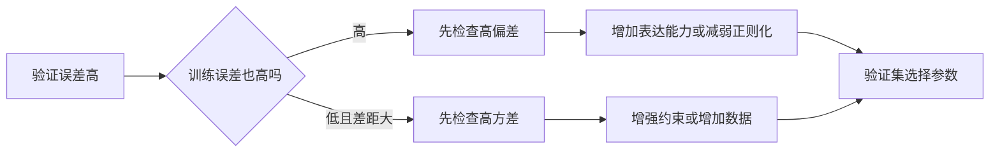

# C9.2 偏差方差诊断与正则化选择

> [!abstract] 本讲任务
> 验证成绩不好，可以是根本没学会，也可以是只会做原题。两种问题需要相反的改法：前者要释放模型的表达能力，后者要约束它。
>
> 我们先用训练误差与验证误差区分偏差和方差，再把同一套判断用到正则化参数 $\lambda$ 上，得到一套可执行的选参流程。

> [!info] 怎么读这份讲义
> 先读 [[C9.1 模型评估与训练验证测试集]]，并回顾 [[C2.7 过拟合与正则化]]。本篇只有课件，没有本学期对应转写稿；“拓展”用于明确超出课件展开程度的推导，不表示已经核实课堂没有讲授。p20–23 正则项的求和上限有笔误，正文统一使用特征数 $n$。

---

## 1. 同样考得差，有的人没学会，有的人只记住原题

仍然考虑房价预测。面积与价格有弯曲关系，你硬用一条直线拟合，训练点都贴不上；另一个模型用高阶曲线，几乎穿过所有训练点，却在点与点之间乱弯。两者预测新房子都可能不好，但原因完全不同。

一次多项式可能太僵硬，二次多项式可能适中，四次多项式在少量样本上可能过度灵活。这里的阶数只是这组示意数据的例子，不能记成“四次一定过拟合”。

![[C9.2-板书-多项式的偏差与方差.png]]

**偏差 Bias** 在这里帮助我们描述模型的系统性表达限制：例如只能画直线，怎么训练也表达不了弯曲趋势。**方差 Variance** 帮助我们描述模型对训练数据变化的敏感性：换一批训练点，拟合结果可能变化很大。对应的典型现象分别是欠拟合 Underfitting 与过拟合 Overfitting。

> [!note] 名词不要混在一起
> 本章“高方差”不是说输入 $x$ 的数值方差很大；它指学习结果对数据采样的敏感性。本章用误差曲线作实用诊断，没有直接估计概率论意义上的完整偏差—方差分解。

## 2. 把两个成绩一起看，故障才显形

### 2.1 横轴是多项式阶数时，怎样读图

固定训练集和验证集，分别训练不同阶数 $d$ 的模型。横轴为 $d$，纵轴为**不含正则项**的预测误差：

$$J_{train}(\theta)=\frac1{2m}\sum_i(h_\theta(x^{(i)})-y^{(i)})^2,\qquad J_{cv}(\theta)=\frac1{2m_{cv}}\sum_i(h_\theta(x_{cv}^{(i)})-y_{cv}^{(i)})^2.$$

在理想的未正则化最小二乘拟合中，$d$ 增大，最佳训练误差不会升高。为什么？高阶模型可以把新增系数设为 0，从而完整模仿低阶模型；候选范围只扩大，不缩小。

验证集没有参与训练，因而没有这种保证。它常呈现先降后升的形状：开始时更复杂的模型学到了原来学不到的趋势，后来则开始追逐训练数据里的偶然噪声。

![[C9.2-板书-阶数与误差曲线.png]]

### 2.2 看绝对高度，再看差距

假设 $J_{cv}$ 已经高到不能接受，比较两项：

| 现象 | 典型诊断 | 直观理由 |
|---|---|---|
| $J_{train}$ 高，$J_{cv}$ 与它接近 | 高偏差 | 连原题都没学好，主要障碍不只是泛化 |
| $J_{train}$ 低，$J_{cv}\gg J_{train}$ | 高方差 | 已有样本拟合得好，新样本却差得多 |
| 两者都低且接近 | 目前表现较好 | 还需按最终流程用测试集评估 |
| 训练误差高，验证误差还明显更高 | 可能两种问题并存 | 不必强迫每个任务只归入一个框 |

![[C9.2-板书-偏差方差诊断.png]]

> [!question] 停一下，先自己想想
> 两个模型的验证误差都为 10，第一个训练误差为 9，第二个为 1。应该对它们采用同一个改法吗？

不应该。第一个连训练集都解释不好，要先检查特征、模型能力以及是否训练到位；第二个的训练—验证差距为 9，表现出更明显的泛化问题。这里的 9、1、10 是演示诊断逻辑的假设误差，不是房价表的实测结果。

**“高”必须相对于任务目标和可达到的基准判断。** 验证误差和训练误差一样大，不能直接断定模型优秀；两者可能一样差。反过来，存在一点差距也不是自动判定过拟合的充分证据，有限样本本来就有波动。

**【拓展】** 在作模型能力诊断之前，先排除没有收敛、标签或实现错误、训练和验证分布不一致等问题。“训练误差高”只是观察结果，不会自动证明只能靠更大的模型解决。

## 3. 不改多项式阶数，只调正则化会怎样

### 3.1 同一个模型也能从灵活变得僵硬

固定四次多项式，最小化

$$J_\lambda(\theta)=\underbrace{\frac1{2m}\sum_{i=1}^m(h_\theta(x^{(i)})-y^{(i)})^2}_{\text{拟合训练数据}}+\underbrace{\frac\lambda{2m}\sum_{j=1}^{n}\theta_j^2}_{\text{约束系数大小}}.$$

这里 $m$ 是训练样本数，$n$ 是非偏置特征数，四次多项式中 $n=4$。$\theta_0$ 不受惩罚，因为我们不想仅因整体房价不为零就惩罚截距。

$\lambda$ 很小，例如为 0 时，模型主要追求训练拟合，较容易过拟合。$\lambda$ 增大后，使用大系数的代价变高，曲线更受约束。非常大的 $\lambda$ 会压低 $\theta_1,\ldots,\theta_4$，使预测近似常数 $h_\theta(x)\approx\theta_0$，于是又会欠拟合。$\lambda=10000$ 是“大正则化”的示例，其强弱仍取决于特征尺度与损失的归一化方式。

![[C9.2-板书-正则化强弱与拟合.png]]

> [!warning] 原课件 p20–23 的正则项上限
> 这些页把 $\sum_j\theta_j^2$ 的上限印成了 $m$。本段仍使用原始多项式特征，应该是特征数 $n$，在四次模型中为 4；样本数量 $m$ 出现在数据项求和与归一化分母中。不要把它和后面“每个训练样本成为一个核地标”时特征数恰好变为 $m$ 的情况混淆。

### 3.2 为什么评估误差不含正则项

训练目标问的是：“综合拟合质量与系数大小，怎样选参数？”评估问的是：“已经选定的参数，预测这份数据错得有多大？”问题不同，公式也要分开。

因此，虽然 $\hat\theta_\lambda$ 由含正则项的 $J_\lambda$ 学得，但计算 $J_{train}(\hat\theta_\lambda)$、$J_{cv}(\hat\theta_\lambda)$、$J_{test}(\hat\theta_\lambda)$ 时都只计算预测误差。

![[C9.2-板书-训练目标与评估误差.png]]

如果给每个候选 $\lambda$ 的验证误差再加上各自的 $\lambda\lVert\theta\rVert^2$，就不再是在用同一把尺量预测效果。验证集不负责执行正则化；它负责检查正则化的结果是否改善泛化。

## 4. 怎样挑选 $\lambda$

### 4.1 每换一次 $\lambda$，必须重新训练

可以先建立一个由小到大的候选列表：

$$0,\ 0.01,\ 0.02,\ 0.04,\ 0.08,\ 0.16,\ 0.32,\ 0.64,\ 1.28,\ 2.56,\ 5.12,\ 10.24.$$

从非零项开始依次翻倍，是为了探索不同数量级。训练得到 $\hat\theta^{(1)},\ldots,\hat\theta^{(12)}$，逐个计算验证误差，取最低者。假如第五组最好，就选 $\lambda=0.08$ 对应的参数，再计算最终测试误差。

![[C9.2-板书-正则化参数候选.png]]

p22 的末项印为 10，手写给出 10.24。**连续翻倍得到的精确值是 $0.01\times2^{10}=10.24$**；将最后一个候选取整为 10 也能做搜索，但不应把它说成严格翻倍所得。第五组胜出只是流程示例，没有给出实测误差数值。

> [!warning] 不是在旧参数上换个系数算一次就结束
> $\lambda$ 改变的是训练问题。固定旧 $\theta$，仅改变计算代价时的 $\lambda$，不能得到新正则化强度应有的模型。每个候选都需要训练，再在同一验证集上评估。

### 4.2 横轴换成 $\lambda$ 后，趋势方向也换了

多项式阶数 $d$ 增大，模型一般更灵活；$\lambda$ 增大，模型反而更受约束。因此别把两种图的左右两端背反。

$\lambda$ 小时，训练误差低，验证误差可能高，典型问题是高方差。$\lambda$ 适中时，验证误差可能达到较低值。$\lambda$ 过大时，训练与验证误差都变高，典型问题是高偏差。

![[C9.2-板书-正则化与误差曲线.png]]

![[C9-模型复杂度与正则化的诊断曲线.png]]

上面的补画是趋势示意，不是课件数据的拟合结果。两个面板纵轴都是预测误差；左横轴是模型阶数，右横轴是正则化强度，**右移的含义正好不同**。

### 4.3 训练误差为何随 $\lambda$ 增大而不降（拓展）

记 $E(\theta)=J_{train}(\theta)$，$R(\theta)=\frac1{2m}\sum_{j=1}^n\theta_j^2$。取 $0\le\lambda_a<\lambda_b$，两组全局最优参数分别为 $\theta_a,\theta_b$。由最优性，

$$E_a+\lambda_aR_a\le E_b+\lambda_aR_b,\qquad E_b+\lambda_bR_b\le E_a+\lambda_bR_a.$$

两式相加可得 $(\lambda_b-\lambda_a)(R_b-R_a)\le0$，所以 $R_b\le R_a$：惩罚加强，最优参数的平方范数不增。

再代入第一式，得到

$$E_a-E_b\le\lambda_a(R_b-R_a)\le0,$$

即 $E_a\le E_b$：**模型越受约束，最优的纯训练误差不会更低**。这要求固定同一数据与特征，并真正求得相应全局最优解；实际数值训练的波动不必严格符合示意曲线。

验证误差没有参加这些最小化不等式，因而不受同样的单调性保证。这正是必须用验证集实际测量的理由。

## 5. 小结

> [!important] 这一讲的三句话
> 1. 验证误差高时，训练误差也高提示高偏差，训练误差低而差距大提示高方差；两种问题可以同时存在。
> 2. 增大 $\lambda$ 通常加强约束，偏向高偏差、低方差；减小 $\lambda$ 则相反，方向与增加模型阶数不同。
> 3. 每个候选 $\lambda$ 都重新训练，使用不含正则项的验证误差选择，最后用测试集评估。

### 速查表

| 操作或现象 | 解释 |
|---|---|
| 训练高、验证高且相近 | 先检查偏差与优化是否到位 |
| 训练低、验证显著更高 | 先检查方差与数据划分 |
| $d\uparrow$ | 表达能力通常增强 |
| $\lambda\uparrow$ | 正则化增强，表达受到约束 |
| 训练目标 | $J_\lambda=J_{train}+\frac\lambda{2m}\sum_{j=1}^n\theta_j^2$ |
| CV / Test / 诊断用 Train | 只计算预测误差 |
| 选参 | $k^*=\arg\min_kJ_{cv}(\hat\theta^{(k)})$ |

> [!abstract] 下一讲预告
> 如果想花一周收集更多数据，怎样提前判断这周值不值？下一讲固定模型，把横轴换成训练样本数，从学习曲线判断增加数据有没有希望。

---
上一讲：[[C9.1 模型评估与训练验证测试集]]
下一讲：[[C9.3 学习曲线与改进方向]]
返回：[[机器学习课程 MOC]]
