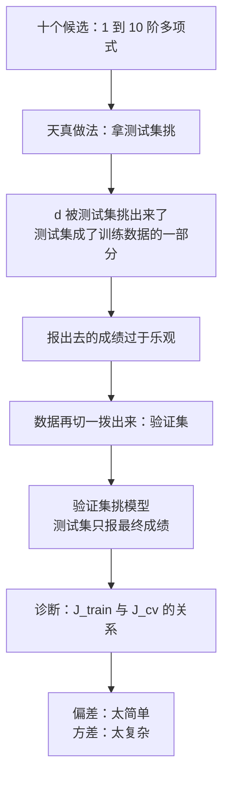
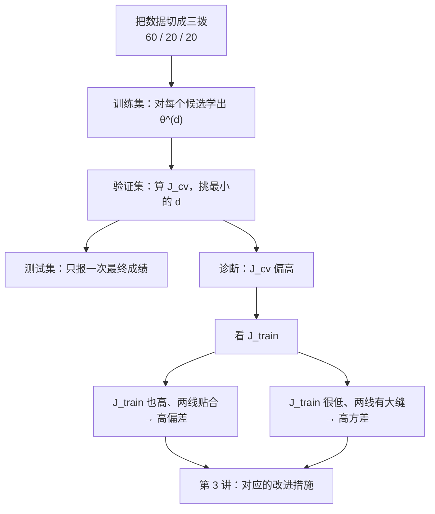

# 第 9 章 · 第 2 讲　模型选择与偏差方差诊断（课堂讲授版2）

> [!quote] 本讲开场
> 同学们好。上一讲我们给模型造好了"体温计"：留出 30% 的数据当测试集，训练集学参数，测试集报成绩。可你只要真的动一次手，马上会撞上一个新问题。
>
> 手上的候选模型有十个：一次、二次、…、十次多项式。**到底挑哪个？** 最自然的想法是——拿测试集挨个比一遍，谁误差最低就选谁，顺便把这个最低误差当成最终成绩报出去。听起来一步到位，实际上这一步把上一讲辛苦建立的客观性全毁了。
>
> 今天回答三件事：
> 1. 为什么"用测试集挑模型"会让那个成绩**变得过于乐观**？
> 2. 正确做法是什么？数据要分成几拨、各拨干什么？
> 3. 判断"模型太简单"还是"太复杂"，应该看**哪两个数字的什么关系**？
>
> 最后这个问题引出一对贯穿整个机器学习的概念：**偏差 Bias** 与 **方差 Variance**。它们不是公式，是一副眼镜——戴上它，六条改进建议哪条对哪条错，一眼就能分清。
>
> 好，我们先从一个看着很聪明、其实是陷阱的做法开始。

> [!info] 怎么读这份讲义
> 前一篇 [[C9.1 模型评估与训练测试集2]] 建立了训练集/测试集的分工，本篇把它扩成三拨。前置知识是 [[C2.4 多项式回归与正规方程]] 与 [[C2.7 过拟合与正则化]]。
>
> 目前没有本学期的语音转写稿，本篇内容全部来自课件与教材整理。标有 **（拓展）** 或 **【拓展】** 的部分是课堂上未展开、由课件和教材延伸补充的内容，复习时先掌握未标注的主干。

---

## 一、挑模型本身也是一次学习

### 1.1 十个候选，怎么挑

还是那批房价数据。假设我们决定用多项式回归，但**阶数 $d$ 还没定**。于是把 $d=1,2,\dots,10$ 全试一遍：

1. 对每个 $d$，在**训练集**上最小化 $J(\theta)$，得到一组参数 $\theta^{(d)}$（上标 $(d)$ 表示"这是 $d$ 阶模型学出来的参数，不是第 $d$ 个样本"）；
2. 把每个 $\theta^{(d)}$ 拿到**测试集**上算 $J_{test}(\theta^{(d)})$；
3. 谁的 $J_{test}$ 最小，就选谁。

![[C9.2-板书-用测试集选阶数的问题2.png]]

比如最后发现五次多项式的测试误差最小，于是选定

$$h_\theta(x)=\theta_0+\theta_1x+\dots+\theta_5x^5,$$

并把 $J_{test}(\theta^{(5)})$ 当作"这个模型泛化误差的估计"报出去。

看着很顺，但它有一个致命的漏洞。

### 1.2 为什么这个数字不能信

注意 $d$ 是怎么定下来的：**它是在测试集上比出来的**。也就是说，测试集不只被用来"评分"，还被用来"挑选"了。挑选这个动作，等于把测试集的信息吃进了模型里。

> [!important] 这一讲的核心判断
> 一旦某个量是**用某批数据挑出来的**，就不能再用**同一批数据**去评价它。它的误差必然是乐观的。

再看一层：上一讲的结论是"参数 $\theta$ 是在训练集上拟合出来的，所以训练误差偏乐观"。现在把 $d$ 也看成参数——它确实是一个参数，只不过不在梯度下降里更新，而是在外面用测试误差挑。**$d$ 是在测试集上拟合出来的，所以 $J_{test}(\theta^{(5)})$ 也偏乐观**，机制一模一样，只是换了一批数据被污染。

> [!warning] 这叫"在测试集上调参"
> 同一件事换几个马甲你都要认得出来：用测试集选多项式阶数、选正则化参数 $\lambda$、选核宽度 $\sigma^2$、选学习率、early stopping 时看测试集决定停在第几轮……**只要决策看了测试集一眼，测试集就不再是干净的成绩单。**

> [!question] 停一下，先自己想想
> 手上有 100 个候选模型，全都在测试集上比过一遍，最后挑出的那个测试误差特别低。这个数字更可能是"模型真的很好"，还是"我挑出来的幸运儿"？如果候选从 100 个变成 10000 个，这个数字会怎么变？

答案是后者：候选越多，挑出来的"最低值"越偏离真实水平——这就是**多重比较**的代价。所以必须再留一拨完全没参与挑选的数据出来。

---

## 二、把数据分成三拨

### 2.0 先给三拨数据起名字

| 数据 | 常见比例 | 干什么 |
| --- | --- | --- |
| 训练集 Training Set | 60% | 学参数 $\theta$ |
| 交叉验证集 Cross Validation Set（也叫验证集 Validation Set） | 20% | **挑模型**：选阶数、选 $\lambda$、选特征 |
| 测试集 Test Set | 20% | **只报最终成绩**，全程不能用来做任何决定 |

用 10 条房屋记录举例：60% / 20% / 20% 切出来就是 **6 条训练、2 条验证、2 条测试**。注意比例可以调整（数据量大时验证与测试各留 10% 甚至更少也够），关键是**三拨数据的职责必须分开**。

![[C9.2-板书-训练验证测试三集划分2.png]]

三拨样本的记号只靠下标区分：

$$(x^{(i)},y^{(i)})\ \text{训练};\qquad (x_{cv}^{(i)},y_{cv}^{(i)})\ \text{验证};\qquad (x_{test}^{(i)},y_{test}^{(i)})\ \text{测试}.$$

$$m=\text{训练样本数},\qquad m_{cv}=\text{验证样本数},\qquad m_{test}=\text{测试样本数}.$$

**易错点**：$x^{(i)}$ 的上标永远是"在这一拨内部的编号"，$x_{cv}^{(i)}$ 是"验证集里的第 $i$ 个样本"，不是"第 $i$ 个验证集"。10 条数据按 60/20/20 切时，$m=6,\ m_{cv}=2,\ m_{test}=2$。

### 2.1 三个误差，各算一次

三个误差的公式长得几乎一样，只有求和范围和分母不同：

$$J_{train}(\theta)=\frac{1}{2m}\sum_{i=1}^{m}\Big(h_\theta(x^{(i)})-y^{(i)}\Big)^2,$$

$$J_{cv}(\theta)=\frac{1}{2m_{cv}}\sum_{i=1}^{m_{cv}}\Big(h_\theta(x_{cv}^{(i)})-y_{cv}^{(i)}\Big)^2,$$

$$J_{test}(\theta)=\frac{1}{2m_{test}}\sum_{i=1}^{m_{test}}\Big(h_\theta(x_{test}^{(i)})-y_{test}^{(i)}\Big)^2 .$$

**三个要点**：

1. **三个公式里都没有正则项**。$J(\theta)$（带 $\lambda\sum\theta_j^2$ 的那个）是**训练时最小化的目标**；$J_{train}$ 是**不带正则项的纯平方误差**，用来观察拟合程度。两者的差别在下一讲看 $\lambda$ 曲线时非常关键。
2. **分母别抄错**：$2m$、$2m_{cv}$、$2m_{test}$ 三个分母各自对应自己那拨数据的样本数。
3. **分类问题**把平方误差换成对数损失即可，误分类率同样可以按三拨分别算。

### 2.2 用验证集挑模型，用测试集报成绩

现在把 §1.1 的流程改一个字：把"测试集"换成"**验证集**"。

1. 对每个 $d$，在训练集上最小化 $J(\theta)$，得到 $\theta^{(d)}$；
2. 算 $J_{cv}(\theta^{(d)})$；
3. 挑 $J_{cv}$ **最小**的那个 $d$；
4. **回头**用测试集算一次 $J_{test}(\theta^{(d)})$，把它当作泛化误差的估计。

![[C9.2-板书-验证集选模型2.png]]

在这一轮里，$d=4$ 的验证误差最低，于是选定

$$h_\theta(x)=\theta_0+\theta_1x+\theta_2x^2+\theta_3x^3+\theta_4x^4,$$

然后用测试集报出 $J_{test}(\theta^{(4)})$。**注意第 4 步只用一次**，用完测试集就作废，不许回头再调。

> [!example] 一张选模型的表长什么样（示例数值）
> 把每个阶数对应的验证误差列成表，挑最小的一行：
>
> | $d$ | 1 | 2 | 3 | **4** | 5 | 6 | 7 | 8 | 9 | 10 |
> | --- | --- | --- | --- | --- | --- | --- | --- | --- | --- | --- |
> | $J_{cv}(\theta^{(d)})$ | 4.9 | 3.2 | 2.3 | **1.9** | 2.0 | 2.3 | 2.75 | 3.3 | 3.95 | 4.7 |
>
> 最小值出现在 $d=4$，所以选 4 阶。**读取方式要注意**：不要只看"哪个数字最小"，还要看它两边是**在往下走还是往上走**——左边一路下降说明模型还不够复杂，右边一路上升说明模型已经开始记噪声。这张表的形状就是下一节那张曲线。

> [!warning] 三个常见的错法
> 1. **拿训练误差选模型**：训练误差一定随复杂度单调下降，永远会选出最复杂的那一个。
> 2. **拿测试误差选模型**：本篇开头讲的陷阱，成绩会偏乐观。
> 3. **在验证集上反复试几百次**：验证集也会被慢慢污染。真要做大规模超参搜索，还得再切一拨或改用交叉验证。**【拓展】** 数据量小的时候常用的做法是 $k$-折交叉验证：把训练数据切成 $k$ 份，轮流让其中一份当验证集，把 $k$ 次的验证误差平均起来，这样每一份数据都既当过训练也当过验证，不必额外牺牲 20% 的数据。

## 三、偏差与方差：诊断的语言

### 3.1 三种拟合，三个名字

同一批点，用不同阶数的多项式去拟合，会出现三种典型状态：

![[C9.2-板书-偏差方差的三种拟合2.png]]

- **$d=1$ 高偏差 High Bias（欠拟合 underfit）**：直线太"硬"，无论怎么调参数都弯不过来，连训练点都对不上。
- **$d=2$ "Just right"**：贴着数据的整体趋势走，又不追逐个别点的起伏。
- **$d=4$ 高方差 High Variance（过拟合 overfit）**：曲线软到能把每个训练点都照顾到，代价是点与点之间开始上下摆动。

> [!important] 偏差与方差的分工
> **偏差 Bias** 来自模型的表达能力不足（假设空间太小），它导致训练误差本身就高；
> **方差 Variance** 来自模型对训练集的随机噪声过于敏感（假设空间太大），它导致换一批训练数据，学出来的模型就变一个样。
> 两者是同一枚硬币的两面：**模型复杂度上升，偏差降、方差升**。

> [!note] 为什么这个分解值得记
> 期望泛化误差可以写成"偏差$^2$ + 方差 + 不可约噪声"三项之和（**【拓展】**，属统计学习理论的结论）。课堂上不推这个式子，但它解释了为什么曲线一定是先降后升：左边由偏差主导，右边由方差主导，中间是两者之和最小的位置。"不可约噪声"那一项无论模型多好都消不掉——这也是任何模型都不可能把测试误差压到 0 的原因。

### 3.2 阶数与误差曲线的读法

把 $d$ 从 1 数到 10，每个 $d$ 都算出 $J_{train}$ 和 $J_{cv}$，画在同一张图上：

![[C9-阶数与训练交叉验证误差2.png]]

读图三步：

1. **蓝线（训练误差）单调下降**。这是必然的：阶数越高，模型能表达的函数越多，训练误差只会更低——**所以训练误差单独看不能判断好坏**，它只会告诉你"模型有没有能力拟合"。
2. **红线（验证误差）先降后升**，是一个 U 形。左边下降是因为模型还不够复杂，右边上升是因为模型开始记噪声。
3. **最低点对应的 $d$ 就是答案**（这里是 $d=4$）。最低点左边叫高偏差区，右边叫高方差区。

![[C9.2-板书-偏差方差诊断判据2.png]]

> [!warning] 两个最爱考的混淆
> 1. **"训练误差低"不等于"模型好"**。高方差模型的训练误差几乎是最低的，它恰恰是最差的候选。
> 2. **"交叉验证误差高"不等于"过拟合"**。高偏差模型的验证误差也很高——它的问题是相反方向。必须**两个数字一起看**才知道是哪一种。

### 3.3 诊断判据：看 $J_{train}$ 和 $J_{cv}$ 的关系

现在可以回答那个诊断问题了：模型表现不如预期（$J_{cv}$ 或 $J_{test}$ 偏高），到底是偏差问题还是方差问题？**看 $J_{train}$。**

> [!important] 诊断对照表
> | | $J_{train}$ | $J_{cv}$ 与 $J_{train}$ 的关系 | 结论 |
> | --- | --- | --- | --- |
> | **高偏差（欠拟合）** | 高 | $J_{cv}\approx J_{train}$，两条线贴合，**中间没有缝** | 模型太简单，加数据的用处有限 |
> | **高方差（过拟合）** | 低 | $J_{cv}\gg J_{train}$，两条线之间**有一道大缝** | 模型太复杂，加数据有用 |
>
> 判据的本质是**两条线之间的间隔**：没缝说明模型"学到的和没学到的差不多"，那是能力不够；有缝说明"训练时很好、出门就废"，那是记性太好。

> [!example] 两组数字，你来判
> - 情形 A：$J_{train}=0.90$，$J_{cv}=1.00$。两条线贴在一起、且都停在很高处 → **高偏差**。加 10 倍数据大概率也停在 1.0 附近。
> - 情形 B：$J_{train}=0.20$，$J_{cv}=3.60$。中间缝宽达 $3.4$，训练误差只有验证误差的十八分之一 → **高方差**。这种情况下加数据是有效的。
>
> **易错点**：不要用"$J_{cv}$ 的绝对值大不大"来判断。A 的 $J_{cv}=1.0$ 比 B 的 $J_{train}=0.2$ 大得多，但 A 是高偏差。**要看的是两个数字之间的差**。

> [!question] 课堂追问：如果 $J_{train}$ 低、$J_{cv}$ 也低，但 $J_{test}$ 很高呢？
> 那说明**选择和最终报告用的是两拨不同分布的数据**，最可能的原因是切分没做随机化（比如按时间切、按地区切），或者验证集太小、方差太大。这时该怀疑的是评估流程，不是模型。

## 四、停一下：这一讲建立的诊断流程

流程里有一个位置是空的：诊断完知道是高偏差还是高方差了，**具体该动哪个旋钮**？加数据？加特征？调 $\lambda$？这正是下一讲的内容——而且下一讲还会回收第 1 讲开头那六条互相矛盾的建议，用今天这副眼镜把它们一对一对拆开。

---

## 本讲小结：今天要记住的三件事

> [!important] 三句话
> 1. **挑模型也是一次学习**。用测试集挑阶数（或 $\lambda$、$\sigma^2$、学习率），测试集就变成了训练数据的一部分，报出的成绩必然偏乐观——候选越多越乐观。
> 2. 正确做法是**三拨数据**：训练集（约 60%）学参数、**验证集**（约 20%）挑模型、测试集（约 20%）只报最终成绩且只用一次。$J_{train}$、$J_{cv}$、$J_{test}$ 三者只有求和范围和分母不同，**都不含正则项**。
> 3. 诊断只看两个数字的关系：**$J_{train}$ 高且 $J_{cv}\approx J_{train}$（两线贴合）→ 高偏差**；**$J_{train}$ 低且 $J_{cv}\gg J_{train}$（两线有大缝）→ 高方差**。模型越复杂，偏差越低、方差越高。

### 速查表（考试前扫一眼）

| 名称 | 公式 / 内容 |
| --- | --- |
| 三拨数据 | 训练 60% / 验证（交叉验证）20% / 测试 20%；10 条数据 → $6/2/2$ |
| 各自的职责 | 训练集学 $\theta$；验证集选阶数、$\lambda$、特征；测试集只报最终成绩 |
| 训练误差 | $J_{train}(\theta)=\frac{1}{2m}\sum_{i=1}^{m}\big(h_\theta(x^{(i)})-y^{(i)}\big)^2$ |
| 验证误差 | $J_{cv}(\theta)=\frac{1}{2m_{cv}}\sum_{i=1}^{m_{cv}}\big(h_\theta(x_{cv}^{(i)})-y_{cv}^{(i)}\big)^2$ |
| 测试误差 | $J_{test}(\theta)=\frac{1}{2m_{test}}\sum_{i=1}^{m_{test}}\big(h_\theta(x_{test}^{(i)})-y_{test}^{(i)}\big)^2$ |
| 别搞混 | 带正则项的 $J(\theta)$ 是训练目标；$J_{train}$ 不带正则项 |
| 选模型流程 | 每个 $d$：训练 → $\theta^{(d)}$ → $J_{cv}(\theta^{(d)})$；取 $J_{cv}$ 最小的 $d$；最后报一次 $J_{test}$ |
| 曲线形状 | $J_{train}$ 随 $d$ 单调下降；$J_{cv}$ 先降后升（U 形），最低点即所选复杂度 |
| 高偏差判据 | $J_{train}$ 高，且 $J_{cv}\approx J_{train}$（两线贴合、中间没缝） |
| 高方差判据 | $J_{train}$ 低，且 $J_{cv}\gg J_{train}$（中间有大缝） |
| 手算示例 | A：$0.90$ 与 $1.00$ → 高偏差；B：$0.20$ 与 $3.60$ → 高方差 |
| 复杂度与偏差方差 | 复杂度上升 → 偏差下降、方差上升 |

## 下一讲预告

你现在能诊断了。可诊断结果落到手上，问题才真正开始：说"高偏差"，到底该加特征还是该减小 $\lambda$？说"高方差"，加数据有用还是加正则化有用？第 1 讲开头那六条互相矛盾的建议，今天已经可以拆开一半了，剩下那一半要靠一件新工具——**学习曲线 Learning Curves**。

下一讲还会算一次 $\lambda$ 的账：把 $\lambda$ 从 $0$ 一路试到 $10$，每个值都单独画一条 $J_{train}$ 和 $J_{cv}$，你会看到一个和"阶数曲线"长得很像、但横轴换成 $\lambda$ 的 U 形。然后我们把六条建议一条一条对到偏差/方差上，给第 1 讲那份作业收尾。

---
上一讲：[[C9.1 模型评估与训练测试集2]]
下一讲：[[C9.3 正则化选择与学习曲线2]]
返回：[[机器学习课程 MOC]]
