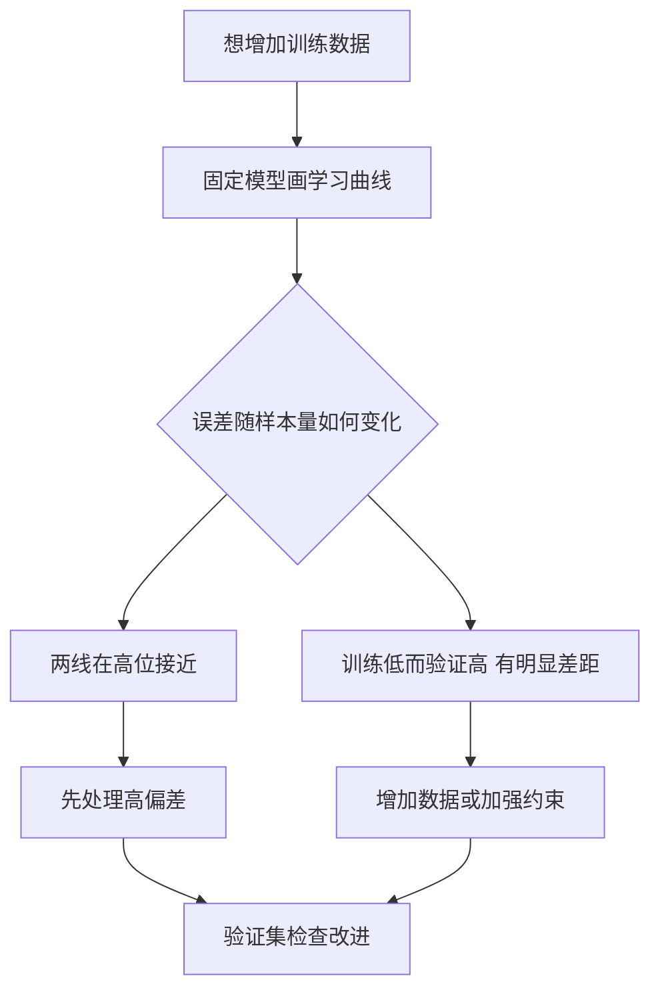
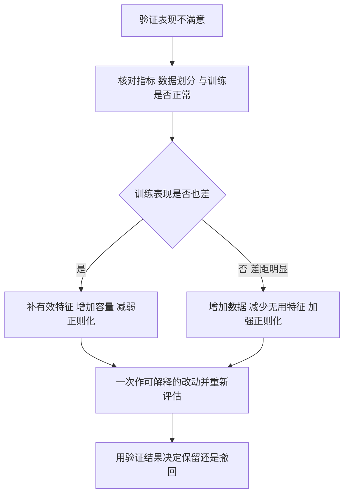

# C9.3 学习曲线与改进方向

> [!abstract] 本讲任务
> 你准备再收集一批房价数据，但采集和清洗要花很长时间。怎样先判断这些工作有没有希望改善模型？
>
> 这一讲用学习曲线观察“数据变多时会发生什么”，再把加数据、删特征、加特征和调正则化放回同一张诊断表，回答项目出问题时下一步该做什么。

> [!info] 怎么读这份讲义
> 本篇接 [[C9.2 偏差方差诊断与正则化选择]]，也补全 [[C8.1 大数据集与随机梯度下降]] 中先前用过的学习曲线方法。目前没有本学期对应转写稿；标为“拓展”的部分是作图与应用细节的进一步展开。

---

## 1. 收集更多数据之前，先做一个小实验

房价模型在新房子上误差很高。你可以联系中介收集更多记录，也可以先从现有训练数据中取少量样本，再逐渐增加，看成绩怎么变。

这不是简单地把同一个模型多训练几轮。我们改变的是**参与训练的样本数**，每个样本量都重新得到一套模型参数。你刚才设计的这个实验，就是**学习曲线 Learning Curve**。

### 1.1 横轴到底是什么

设已有训练池共 $M$ 个样本，选择其中 $s$ 个组成 $S_s$，使用固定的模型类型、特征与既定超参数训练出 $\hat\theta_s$，计算

$$E_{train}(s)=\frac1{2s}\sum_{i\in S_s}(h_{\hat\theta_s}(x^{(i)})-y^{(i)})^2,$$

$$E_{cv}(s)=\frac1{2m_{cv}}\sum_{i=1}^{m_{cv}}(h_{\hat\theta_s}(x_{cv}^{(i)})-y_{cv}^{(i)})^2.$$

横轴是 $s$，也就是这次训练用了多少样本；纵轴是训练误差与验证误差。我们用 $s$ 区分子集大小和训练池总量；它就是课件横轴标出的 $m$。

> [!warning] 三种曲线别混淆
> - $J$ 对迭代次数：检查优化算法是否收敛，见 [[C2.3 多变量线性回归与梯度下降实践]]。
> - 误差对阶数 $d$ 或正则化强度 $\lambda$：选择模型复杂度，见上一讲。
> - 误差对训练样本量：这才是本讲用来诊断数据是否足够的学习曲线。

### 1.2 为什么小训练集的训练误差反而低

想象使用二次多项式。只有一个训练点时，找到一条穿过它的曲线很容易；两个点也容易；三个横坐标不同的点可以由二次多项式精确插值。再增加样本，多个点通常不能同时被这条曲线穿过，平均训练误差便会从很低的位置上升。

这不表示学习退步，而是考试更有代表性了：模型不能再只照顾少数几个点。

> [!example] 用直线看同一件事
> 两点 $(0,0),(1,1)$ 可由 $h(x)=x$ 精确拟合，训练误差为 0。再加入 $(2,0)$，这三个点不共线；最佳直线为 $h(x)=1/3$，平方残差之和为 $2/3$，所以 $J_{train}=(2/3)/(2\times3)=1/9$。
> 这个例子只说明“增加约束后不能继续精确拟合”，不保证每次追加一个样本都严格增加平均误差。

同时，小训练集容易让模型被个别样本牵着走，所以验证误差较高。数据增加后，模型对总体规律的估计往往更稳定，验证误差便有机会下降。

![[C9.3-板书-学习曲线的来路.png]]

**【拓展】** 曲线是典型趋势，不是每一点都必须单调的定律。实际作图时可对每个样本量重复抽样、取平均，并观察波动范围；验证集应保持固定且不参与训练。不要每个点都更换验证集，否则曲线变化里混进了“考题变了”的影响。

## 2. 高偏差：两条曲线在高位会合

如果真实房价趋势是弯的，却只允许模型使用直线，增加训练数据并不能让直线突然有弯曲能力。

很小时训练误差可能接近 0，因为两三个点容易碰巧被拟合；样本增多以后，表达能力不足暴露出来，训练误差升高。验证误差开始较高，随后降低，但最终和训练误差在**较高水平**接近。

![[C9.3-板书-高偏差学习曲线.png]]

> [!question] 停一下，先自己想想
> 假如两条线已经几乎贴在一起，而且误差仍明显不能接受，把训练集再扩大很多，能解决“直线表达不了弯曲关系”吗？

通常不能。新数据仍然只能帮我们挑选一条直线；若目前已经找到了很有代表性的直线，主要障碍就是模型限制，不是缺少更多点。因此**单靠更多同类训练数据，通常不能显著解决高偏差**。

更合适的方向可能是加入有用的新特征、构造多项式特征，或减弱过强的正则化。先把表达能力释放出来，再考虑数据规模。

注意“高位”是关键。两线在低位接近，可能已经是好模型，不能仅凭“间隙小”就判为高偏差。

## 3. 高方差：训练成绩很好，新样本成绩仍有差距

现在改用非常灵活的模型，例如高阶多项式且 $\lambda$ 很小。模型可以记住少量训练点，训练误差很低，却无法准确判断点之间的走势，因此验证误差高。

随着更多训练点加入，曲线必须同时照顾更多位置，乱弯的空间受到限制，验证误差通常下降；训练误差可能升高一点，两条曲线之间的差距逐渐缩小。

![[C9.3-板书-高方差学习曲线.png]]

这时继续增加**来自目标分布、有代表性**的训练数据，往往值得尝试。“往往”不能省：如果新数据质量差、标签噪声严重，或者验证数据来自另一种分布，简单扩大数量未必奏效。也不能从当前曲线保证加到某个样本数就一定够好。

![[C9-高偏差与高方差学习曲线.png]]

补画的左右两图使用相同坐标含义：横轴为训练样本量，纵轴为误差。左图两条线在高位贴合，右图两条线有较大差距并随数据增加收窄；均为诊断示意，不代表某次实际训练的观测。

停一下，我们刚才做了什么：用现有数据模拟“数据更多以后”的变化，检查主要瓶颈是模型表达受限，还是模型太依赖有限样本。这也就是第 8 章在动用海量数据之前先作小规模检查的理由。

## 4. 回到开头的六个选择

现在可以回答“房价预测很差，下一步试什么”了。

| 候选措施 | 主要针对的典型问题 | 为什么可能有效 |
|---|---|---|
| Get more training examples：增加训练样本 | 高方差 | 减少模型对有限样本的依赖 |
| Try smaller sets of features：减少特征 | 高方差 | 降低可自由拟合的维度，减少追逐噪声的机会 |
| Try getting additional features：获取更多有用特征 | 高偏差 | 补上原输入无法解释的重要因素 |
| Try adding polynomial features：加入多项式特征 | 高偏差 | 用原输入的组合表达非线性关系 |
| Try decreasing $\lambda$：减小正则化强度 | 高偏差 | 放松对参数的约束 |
| Try increasing $\lambda$：增大正则化强度 | 高方差 | 约束过度灵活的拟合 |

![[C9.3-板书-六种改进措施的归类.png]]

“更多特征”应理解为**更多有用信息或恰当表达**，不是随便拼接噪声列。“减少特征”也不是越少越好：删掉决定价格的关键因素，可能加剧偏差。表格是诊断后的试验方向，每个改动仍需用验证集检查。

一个具体的区分：原模型只知道面积，却不知道地段。新增地段特征是在补信息；加 $x^2$ 是让面积—价格关系允许弯曲。二者都可能处理欠拟合，但解决的缺口不同。已有输入根本没有的信息，不会因为无限提高多项式阶数就自动出现。

### 4.1 可执行的排查顺序

这与 [[C6.1 系统设计的起点：垃圾邮件分类与误差分析]] 的逐例误差分析互补：偏差方差诊断告诉我们**大方向**，检查错样本告诉我们**具体应该补哪些信息**。例如图像误判主要集中在夜间样本，下一批数据就应针对夜间场景，而不是继续重复收集白天照片。

## 5. 换成神经网络，判断逻辑仍然成立

小网络参数较少，计算便宜，但更容易因表达能力不足而欠拟合。大网络参数较多，计算更贵，也更可能在有限数据上过拟合。选大网络后，可以用正则化约束参数，而不是只靠把网络缩小。

![[C9.3-板书-神经网络规模与正则化.png]]

网络规模与 $\lambda$ 都可以成为待选择的超参数，仍由验证集比较，不由测试集试到满意为止。

**【拓展】** 在 CNN 或 PyTorch 项目中也可沿用这条思路：若训练集都学不好，先检查优化、输入信息与模型容量；若训练好而验证差，再检查划分、数据代表性与正则化。不要仅凭“大网络”三个字断言一定过拟合，实际结果由模型、优化、数据和约束共同决定。

## 6. 小结

> [!important] 这一讲的三句话
> 1. 学习曲线的横轴是训练样本量，每个点都重新训练；它不同于随迭代次数变化的收敛曲线。
> 2. 两线在高位贴合提示高偏差，单靠加数据帮助有限；训练低而验证高、有明显差距时，加数据更可能有效。
> 3. 改进必须对症：高偏差通常需要信息或容量，高方差通常需要更多有效数据或更强约束，最终由验证结果检验。

### 速查表

| 诊断 | 候选方向 |
|---|---|
| 高偏差 | 加有效特征、加多项式特征、减小 $\lambda$、增加模型容量 |
| 高方差 | 加数据、减少无用特征、增大 $\lambda$ |
| 小网络 | 计算较便宜，更需留意欠拟合 |
| 大网络 | 计算较昂贵，可用正则化控制过拟合 |
| 误差口径 | 训练与验证都不加正则化惩罚 |
| 作图纪律 | 固定验证集，改变训练子集大小，逐次重新训练 |

> [!abstract] 下一讲预告
> 诊断工具已经齐了。接下来回到分类器本身：如果两条直线都能把训练样本分对，为什么还要偏爱其中一条？支持向量机的回答是：给两类样本之间留出更宽的间隔。

---
上一讲：[[C9.2 偏差方差诊断与正则化选择]]
下一讲：[[C10.1 支持向量机的目标与大间隔]]
返回：[[机器学习课程 MOC]]
