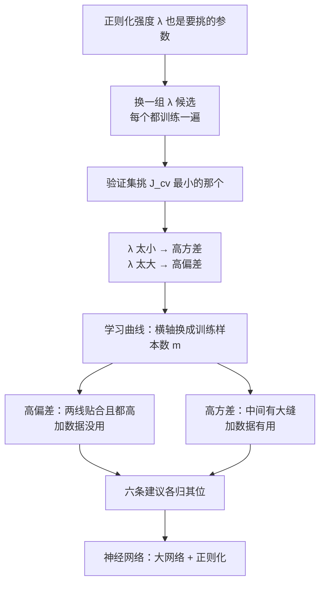
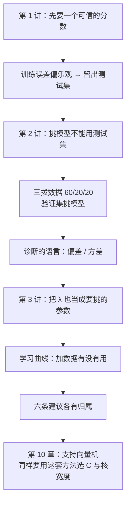

# 第 9 章 · 第 3 讲　正则化选择与学习曲线（课堂讲授版）

> [!quote] 本讲开场
> 同学们好。上一讲我们学会了诊断：看 $J_{train}$ 和 $J_{cv}$ 之间有没有缝，就知道模型是"太简单"还是"太复杂"。可诊断报告拿到手，真正的麻烦才刚开始——**报告说"高方差"，我到底该加数据，还是加正则化？**
>
> 这一讲先把第 1 讲那份作业做完。回头看你当时的朋友：他随便报三套房，你的模型预测全偏了，桌上有六条建议：多收数据、删特征、加特征、加多项式特征、减小 $\lambda$、增大 $\lambda$。今天我们会把这六条**一条一条对到偏差和方差上**，从此不必靠猜。
>
> 中间需要两件工具：
> 1. **$\lambda$ 的账怎么算**——它和阶数一样，也是"用验证集挑出来的参数"；
> 2. **学习曲线 Learning Curves**——横轴换成训练样本数，它能直接回答"加数据到底有没有用"。
>
> 最后再看一个实践里的常见选择：神经网络该用小网络还是大网络。
>
> 好，我们从 $\lambda$ 说起。

> [!info] 怎么读这份讲义
> 前两篇 [[C9.1 模型评估与训练测试集]]、[[C9.2 模型选择与偏差方差诊断]] 是本篇的直接前置；公式上还要用到 [[C2.7 过拟合与正则化]]。
>
> 目前没有本学期的语音转写稿，本篇内容全部来自课件与教材整理。标有 **（拓展）** 或 **【拓展】** 的部分是课堂上未展开、由课件和教材延伸补充的内容，复习时先掌握未标注的主干。

---

## 一、$\lambda$ 也要挑，而且挑法和阶数一模一样

### 1.1 $\lambda$ 的三档：太小、刚好、太大

沿用四次多项式模型

$$h_\theta(x)=\theta_0+\theta_1x+\theta_2x^2+\theta_3x^3+\theta_4x^4,\qquad J(\theta)=\frac{1}{2m}\sum_{i=1}^{m}\Big(h_\theta(x^{(i)})-y^{(i)}\Big)^2+\frac{\lambda}{2m}\sum_{j=1}^{n}\theta_j^2 .$$

> [!bug] 课件的一处下标笔误
> 课件把正则项的求和上限印成了**样本数 $m$**，正确写法是**特征数 $n$**（求和变量是 $j$，走遍每一个参数）。
> 对四次多项式来说 $n=4$，所以这一项是 $\frac{\lambda}{2m}(\theta_1^2+\theta_2^2+\theta_3^2+\theta_4^2)$；$\theta_0$ 按惯例**不参与惩罚**。把小节的 $m$ 当成上限，参数一多就会算错。

$\lambda$ 只改一个数，模型的性格却会整个变掉：

![[C9.3-板书-正则化强弱与拟合2.png]]

- **$\lambda$ 太大**（比如 $\lambda=10000$）：惩罚项把参数压得死死的，最省事的办法是让 $\theta_1\approx\theta_2\approx\theta_3\approx\theta_4\approx0$，于是 $h_\theta(x)\approx\theta_0$——**一条水平直线**。这就是**高偏差（欠拟合）**。
- **$\lambda$ 取中间值**：数据项和惩罚项势均力敌，"Just right"。
- **$\lambda$ 太小**（极端情况 $\lambda=0$）：等于完全不正则化，四次多项式想怎么弯就怎么弯。这就是**高方差（过拟合）**。

> [!question] 停一下，先自己想想
> 为什么 $\lambda$ 一大，参数就都变成 0 了？"惩罚"到底是怎么起作用的？拿一个参数试试。

看最简单的单参数玩具问题，只保留数据项和惩罚项：

$$J(\theta_1)=(\theta_1-3)^2+\lambda\theta_1^2 .$$

令导数为 0：$2(\theta_1-3)+2\lambda\theta_1=0$，解得

$$\hat\theta_1=\frac{3}{1+\lambda}.$$

代进去看：

| $\lambda$ | 0 | 1 | 4 | 100 | 10000 |
| --- | --- | --- | --- | --- | --- |
| $\hat\theta_1$ | 3 | 1.5 | 0.6 | 0.0297 | 0.0003 |

$\lambda$ 越大，$\hat\theta_1$ 越靠近 0，模型的输出就越接近常数。**惩罚项不是"减参数"，而是"让参数变大变得不划算"**——每把 $\theta_j$ 从 0 挪开一点，都要额外付 $\lambda\theta_j^2$ 的代价，$\lambda$ 就是这个代价的单价。

### 1.2 挑 $\lambda$ 的标准流程

既然 $\lambda$ 决定模型性格，它就必须像阶数一样被"挑"出来，而且流程一字不差：

1. **列出候选**：$\lambda\in\{0,\ 0.01,\ 0.02,\ 0.04,\ 0.08,\ 0.16,\ 0.32,\ 0.64,\ 1.28,\ 2.56,\ 5.12,\ 10\}$，共 12 个，**每一步翻倍**；
2. 对每个候选 $\lambda^{(k)}$，在**训练集**上最小化 $J(\theta)$（注意这个 $J$ 是**带正则项的**），得到 $\theta^{(k)}$；
3. 用**验证集**算 $J_{cv}(\theta^{(k)})$（这个 $J_{cv}$ **不带正则项**）；
4. 取 $J_{cv}$ 最小的那个 $\lambda$，本例落在第 5 个候选 $\lambda=0.08$；
5. 最后用**测试集**报一次成绩 $J_{test}(\theta^{(5)})$。

![[C9.3-板书-正则化参数候选与筛选2.png]]

> [!warning] 课件最后一个候选印的是 10，不是 10.24
> 按"每次翻倍"的规则，从 $0.01$ 出发翻 10 次是 $0.01\times2^{10}=10.24$。课件第 12 个候选印成 $10$（手写补注了 $10.24$）。
> 两种都能用——搜索本来就是取一个覆盖数量级的粗网格，最后还要在最小值附近细化。但**如果题目说"每次翻倍"，你要算的是 10.24**；写 10 就属于没严格按规则。

**【拓展】** 为什么候选要按倍数走？因为 $\lambda$ 的影响是**乘性**的：$0.01$ 和 $0.02$ 的区别，跟 $1$ 和 $2$ 的区别一样大。按倍数取点相当于在对数刻度上均匀铺点，能用十几个候选覆盖六七个数量级。如果按等差取点（$0,1,2,3,\dots$），小 $\lambda$ 那一段会被完全跳过。

### 1.3 $\lambda$ 与训练/验证误差曲线

把 12 个候选的 $J_{train}$ 和 $J_{cv}$ 各画一条曲线：

![[C9-正则化强度与误差曲线2.png]]

读图三步，和"阶数曲线"几乎一样，**但左右方向正好相反**：

1. **横轴向右 = $\lambda$ 变大 = 模型被压得越来越死**；
2. **$J_{train}$ 单调上升**：正则项把训练目标改了，$\lambda$ 越大越难拟合训练集；
3. **$J_{cv}$ 先降后升**，最低点就是"刚好"。

> [!warning] 最容易记反的一处
> | 曲线 | 右端 | 左端 |
> | --- | --- | --- |
> | 阶数 $d$ 增大 → | **高方差**（过拟合） | 高偏差 |
> | $\lambda$ 增大 → | **高偏差**（欠拟合） | 高方差 |
>
> 两条曲线的形状都是 U 形，但**右端代表的东西是反的**。考试常在这里设陷阱：题目说"$\lambda$ 很大，$J_{train}$ 高、$J_{cv}$ 也高"，答案是**高偏差**，不是高方差。

![[C9.3-板书-正则化与误差曲线2.png]]

## 二、学习曲线 Learning Curves

### 2.1 怎么画

诊断到这一步，还有一个问题没回答：**加数据到底有没有用？** 阶数曲线和 $\lambda$ 曲线的横轴都是模型复杂度，看不到样本量的影响。要把这件事看清楚，换一个横轴：**训练集大小 $m$**。

画法固定成四步：

1. **固定模型**（比如就用二次多项式）和**固定的验证集**；
2. 取训练集的前 $m$ 个样本（$m=1,2,3,\dots$），训练得到 $\theta^{(m)}$；
3. 算两个数：$J_{train}(\theta^{(m)})$ 在**这 $m$ 个样本上**、$J_{cv}(\theta^{(m)})$ 在**验证集上**；
4. 横轴放 $m$，纵轴放误差，把两条曲线画在一起。

$$J_{train}(\theta)=\frac{1}{2m}\sum_{i=1}^{m}\Big(h_\theta(x^{(i)})-y^{(i)}\Big)^2,\qquad J_{cv}(\theta)=\frac{1}{2m_{cv}}\sum_{i=1}^{m_{cv}}\Big(h_\theta(x_{cv}^{(i)})-y_{cv}^{(i)}\Big)^2 .$$

![[C9.3-板书-学习曲线的来路2.png]]

**两条曲线为什么会这样走**：

- **$J_{train}$ 随 $m$ 上升**。==$m=1$ 时模型可以穿过那一个点，训练误差是 0；样本越多，用同一个固定复杂度的模型去贴合就越难，平均误差自然上升。==
- **$J_{cv}$ 随 $m$ 下降**。训练数据越多，学出来的模型越稳定、越接近真实规律，验证误差就下降。

> [!question] 停一下，先自己想想
> 如果 $m$ 一直加大到无穷，这两条曲线最终会走到哪里？它们会无限分开，还是会贴到一起？

它们必然**趋于同一个值**：当训练数据足够多时，训练集本身就能代表真实分布，训练误差和验证误差都逼近"这个模型能达到的最好水平"。所以两条线的**最终高度**和**中间的缝**才是关键信息。

### 2.2 高偏差的学习曲线：两条线贴着，而且都高

![[C9.3-板书-高偏差学习曲线2.png]]

看过拟合的模型（比如一条直线去拟合明显弯曲的数据）：

- $J_{cv}$ 一开始很高，很快降到一条平台上，**降不下去**；
- $J_{train}$ 从很低升上来，最后**和 $J_{cv}$ 贴在一起**；
- 两条线之间**几乎没有缝**，但整体停在**很高的误差**上。

![[C9-高偏差与高方差学习曲线2.png]]

> [!important] 结论一
> 模型遭受**高偏差**时，**增加训练数据本身帮不上什么忙**——你只是把同一个太简单的模型喂给更多数据，它早就"学到头"了，两条线在很远的地方就已经汇合。这时该做的是**提高模型能力**（加特征、加多项式特征、换更强模型），或者**解除过度约束**（减小 $\lambda$）。

### 2.3 高方差的学习曲线：中间始终有一道大缝

![[C9.3-板书-高方差学习曲线2.png]]

看一个明显过复杂的模型（比如 100 阶多项式配一个很小的 $\lambda$）：

- $J_{train}$ 一直很低，缓慢上升；
- $J_{cv}$ 一直远高于 $J_{train}$，降得很慢；
- 两条线之间**始终有一道明显的缝**，$J_{cv}$ 还远没有降到位。

> [!important] 结论二
> 模型遭受**高方差**时，**增加训练数据很可能有用**——缝还在，说明验证误差还有下降空间，而它下降的唯一途径就是更多数据。

### 2.4 怎么用：三分钟决定"要不要去收数据"

把两节合起来就是一条**动手之前先做的检查**：

1. 从现有数据里随机抽一小份（比如 1000 条）训练一次，画学习曲线；
2. 如果长得像**高偏差**（两线贴合且都高）：加数据白费，先去**加特征/加模型容量**；
3. 如果长得像**高方差**（中间有大缝）：加数据有救，放心去收数据；
4. 只有在确认是高方差之后，"多收训练样本"这条建议才值得花几周时间。

这个检查的成本是**一次小模型训练**，收益是不做无用的数据采集。第 6 章 [[C6.1 系统设计的起点：垃圾邮件分类与误差分析]] 讲的"三步走"里的第 2 步——画学习曲线——在大数据场景下就是这个用法。

## 三、神经网络：规模与过拟合

神经网络身上，"模型复杂度"这件事有一个特别直观的旋钮：**网络有多大**。

![[C9.3-板书-神经网络规模与正则化2.png]]

- **"小"神经网络**（参数少，比如隐藏层单元很少）：表达能力弱，**更容易欠拟合**；好处是**计算便宜**。
- **"大"神经网络**（参数多，隐藏层又宽又深）：表达能力强，**更容易过拟合**；代价是**计算更贵**。
- 大网络过拟合了怎么办？**用正则化 $\lambda$ 去压**——这正是本节 $\lambda$ 曲线的用武之地：把 $\lambda$ 当成减压阀，一边保留大网络的表达能力，一边控制它的方差。

> [!tip] 实践里的取舍
> 别一上手就纠结"我该用多大的网络"。先随便训练一个小网络确认整条流水线能跑通，再逐步加大规模、同时用验证集调 $\lambda$。**大网络 + 合适的正则化**通常比"精心设计的小网络"效果更好，因为前者的假设空间包含了更多可能，而后者一旦太小就再也补不回来。

**【拓展】** 神经网络里还有一个很像正则化的技巧叫 **early stopping**：训练误差一直在降，但验证误差往往先降后升，于是"验证误差开始上升"就停手。这相当于把"训练轮数"也当成了一个由验证集挑出来的参数——注意它同样**不能用测试集来定**。

## 四、回到第 1 讲：六条建议各自治什么病

现在可以给第 1 讲那份作业收尾了。诊断出高偏差还是高方差之后，六条建议各有归属：

![[C9.3-板书-六种措施的归类2.png]]

> [!important] 六条建议对照表
> | 建议 | 治什么 | 为什么 |
> | --- | --- | --- |
> | Get more training examples | **高方差** | 缝还在，数据能把验证误差拉下来；对高偏差无效 |
> | Try smaller sets of features | **高方差** | 砍掉噪声特征，降低模型复杂度，方差降 |
> | Try getting additional features | **高偏差** | 补充信息量，提高模型能力 |
> | Try adding polynomial features | **高偏差** | 同上，扩大假设空间（$x_1^2,x_2^2,x_1x_2,\dots$） |
> | Try decreasing $\lambda$ | **高偏差** | 解除过度约束，让参数能长起来 |
> | Try increasing $\lambda$ | **高方差** | 收紧约束，把参数压小 |
>
> 记住这张表的关键不是背六行，而是抓住那个判据：**$J_{cv}\approx J_{train}$ 但都高 → 高偏差 → 加特征 / 减小 $\lambda$；$J_{cv}\gg J_{train}$ → 高方差 → 加数据 / 删特征 / 增大 $\lambda$。**

> [!warning] 三个反直觉的结论（考试爱考）
> 1. **"加特征"和"删特征"都可能是对的**——取决于你面对的是高偏差还是高方差。
> 2. **"增大 $\lambda$" 和 "减小 $\lambda$" 都可能是对的**——同理。
> 3. **"加数据"不是万能药**。高偏差模型加数据几乎不会改善泛化误差，这是最容易白花时间的一条。

## 五、停一下：第 9 章三讲的主线

三讲连起来其实只做了一件事：**把"模型好不好"和"下一步做什么"变成可测量的判断**。
第 1 讲解决"分数可不可信"，第 2 讲解决"怎么挑不污染分数"，第 3 讲解决"挑完之后怎么动手"。第 10 章的支持向量机有两个新旋钮 $C$ 和 $\sigma^2$，你会看到这套方法被原样搬过去用。

---

## 本讲小结：今天要记住的三件事

> [!important] 三句话
> 1. **$\lambda$ 是要挑的参数**，流程和挑阶数完全一样：列一组按倍数递增的候选，对每个候选在训练集上最小化**带正则项的 $J(\theta)$** 得到 $\theta^{(k)}$，用验证集算**不带正则项的** $J_{cv}(\theta^{(k)})$，取最小者，最后用测试集报一次成绩，例如 $\lambda=0.08$。
> 2. **$\lambda$ 曲线的左右方向和阶数曲线相反**：$\lambda$ 太小 → 高方差（过拟合），$\lambda$ 太大 → 高偏差（欠拟合）；$J_{train}$ 随 $\lambda$ 单调上升，$J_{cv}$ 先降后升。
> 3. **学习曲线回答"加数据有没有用"**：两线贴合且都高是**高偏差**，加数据没用，该加特征/减小 $\lambda$；中间始终有大缝是**高方差**，加数据有用。由此六条建议各归其位。

### 速查表（考试前扫一眼）

| 名称 | 公式 / 内容 |
| --- | --- |
| 带正则的训练目标 | $J(\theta)=\frac{1}{2m}\sum\big(h_\theta(x^{(i)})-y^{(i)}\big)^2+\frac{\lambda}{2m}\sum_{j=1}^{n}\theta_j^2$（上限是特征数 $n$，$\theta_0$ 不惩罚） |
| $\lambda$ 候选序列 | $0,0.01,0.02,0.04,0.08,0.16,0.32,0.64,1.28,2.56,5.12,10.24$（每次翻倍） |
| 挑 $\lambda$ 五步 | 列候选 → 每个在训练集上最小化 $J(\theta)$ → 验证集算 $J_{cv}$ → 取最小 → 测试集报一次 |
| 单参数手算 | $\min_{\theta_1}(\theta_1-3)^2+\lambda\theta_1^2\Rightarrow\hat\theta_1=\frac{3}{1+\lambda}$；$\lambda=0,1,4,10000$ 时为 $3,1.5,0.6,0.0003$ |
| $\lambda$ 太大 | $\theta_1\approx\theta_2\approx\dots\approx0$，$h_\theta(x)\approx\theta_0$ → **高偏差** |
| $\lambda$ 太小（$=0$） | 完全不正则化 → **高方差** |
| $J_{train}$ / $J_{cv}$ 随 $\lambda$ | $J_{train}$ 单调上升；$J_{cv}$ 先降后升（U 形） |
| 方向记忆 | 阶数 $d$ 增大 → 右端高方差；$\lambda$ 增大 → 右端高偏差（**相反**） |
| 学习曲线 | 横轴 $m$（训练样本数）；$J_{train}$ 上升、$J_{cv}$ 下降，最终趋于同一水平 |
| 高偏差学习曲线 | 两线很快贴合且都停在**很高**处 → 加数据没用 → 加特征 / 减小 $\lambda$ |
| 高方差学习曲线 | 两线之间**始终有大缝** → 加数据有用 → 加数据 / 删特征 / 增大 $\lambda$ |
| 神经网络 | 小网络：便宜、易欠拟合；大网络：贵、易过拟合 → 用 $\lambda$ 正则化 |
| 六条建议 | 加数据/删特征/增大 $\lambda$ → 方差；加特征/加多项式特征/减小 $\lambda$ → 偏差 |
| 课件勘误 | 正则项求和上限印成 $m$（应为 $n$）；最后一个 $\lambda$ 候选印成 10（翻倍应为 10.24） |

## 下一讲预告

第 9 章到此收束。你已经有了完整的"测量—诊断—改进"工具链：三拨数据、三个误差、两条曲线。

第 10 章换一个新算法：**支持向量机 Support Vector Machine**。它和我们熟悉的逻辑回归长得很像——同一个 $\theta^Tx$ 分数、同一个 sigmoid，但它把损失函数换成了**合页损失 Hinge Loss**，于是"分对"之外多出一条要求：**还要离分界线足够远**。这一换，代价函数就变成了大间隔分类器；再往前一步，用**核 Kernel** 把特征换成"和地标的相似度"，就能画出逻辑回归画不出的非线性边界。

到那时你会发现，本章这套方法一个字都没浪费：支持向量机的两个旋钮 $C$（相当于 $1/\lambda$）和核宽度 $\sigma^2$，照样要用验证集挑、要用偏差方差诊断。

---
上一讲：[[C9.2 模型选择与偏差方差诊断]]
下一讲：[[C10.1 支持向量机的目标与大间隔]]
返回：[[机器学习课程 MOC]]
