# 机器学习零基础复习提纲（全 18 章）

> [!abstract] 使用说明与学习路线
> 本提纲专为 **零基础 / 几乎没听课** 的高效自学与考前冲刺设计，不照搬原课件顺序，而是按 **知识依赖** 重排为 6 个模块，覆盖全课程全部 18 章知识点（零遗漏），所有专业术语均附规范英文对照。
>
> - **阅读体例**：每个知识点按「为什么需要它 → 核心直觉与配图 → 完整公式 → 手算走查 → 避坑与勘误」展开。
> - **优先级标注**：未标注的为课件主干必考内容；标有 **（拓展）** 的为教材与通行讲法的补充延伸，时间紧可先跳过。
> - **当前进度**：已全部完工，完整覆盖 **全 6 个模块（C1–C18 全部 18 章）** 与 **文末四大考前冲刺附录**。

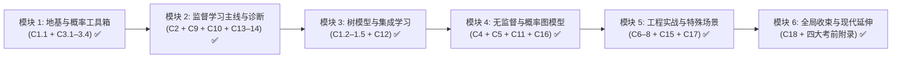

---

# 模块 1：地基与概率工具箱（C1.1 + C3.1–3.4）

> [!tip] 本模块解决什么问题？
> 在学任何具体算法之前，先拿下两块底层地基：
> 1. **机器学习的统一语言（C1.1）**：把“机器学习”翻译成可落地的三元组 $\langle P,T,E\rangle$、函数逼近（Function Approximation）坐标系，以及用样本量换泛化承诺的 PAC 界。
> 2. **处理不确定性的数学工具（C3.1–3.4）**：建立“可能世界 = 面积”的直觉，吃透概率公理、条件概率、贝叶斯定理（Bayes' Rule）、联合分布（Joint Distribution）以及期望/方差/协方差/相关系数。后面第 5 章异常检测、第 11 章 EM 算法、第 16 章贝叶斯网络全部长在这块地基上。

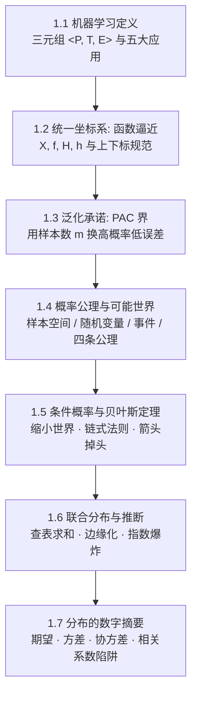

---

## 1.1 机器学习的问题定义与学科版图（C1.1）

### 为什么需要形式化定义？
面对复杂决策（例如医院里有 **9714 份产妇病历**、每份含 **215 个特征**，要判断新入院产妇是否需要紧急剖宫产），人类记忆装不下几百个指标的交互规律。想让机器帮忙，必须先把模糊需求拆成三个能动手填的空：**有什么数据、要做什么判断、怎么算做得好**。

### 核心定义：良定义学习任务（Well-defined Learning Task）
Mitchell 给出的标准定义：机器学习（Machine Learning）研究的是这样一类算法——它们在 **任务（Task）** $T$ 上的 **性能（Performance）** $P$，会随着 **经验（Experience）** $E$ 的增加而提升。一个良定义的学习问题就是一个三元组：
$$\langle P,\ T,\ E\rangle$$

| 字母 | 英文与含义 | 工程落地问法 | 紧急剖宫产案例 | 预测次日股价涨跌案例 |
| :--- | :--- | :--- | :--- | :--- |
| $E$ | **经验（Experience）** | 手上有多少条数据、每条含什么 | 9714 份病历（215 维特征 + 结局） | 历史日频行情 + 次日真实涨跌 |
| $T$ | **任务（Task）** | 输入什么，输出什么 | 新病人病历 $\to$ 紧急剖宫产概率 | 截至今日行情特征 $\to$ 次日涨/跌 |
| $P$ | **性能（Performance）** | 在 **哪批数据** 上、用什么指标 | **未见病例** 上的预测准确率 | **未来交易日** 准确率（若求盈利则看跑赢基准收益） |

- **经验 = 数据**：机器没有身体，一条 **样本（Sample）** 由描述部分的 **特征（Feature）** 和答案部分的 **标签（Label）** 组成。“数据是燃料，算法只是发动机”，三个字母彼此牵制——改了 $P$（例如从分类准确率改成概率校准或策略收益），$T$ 的输出形式与算法选择全都要跟着换。

> [!warning] 考场与工程铁律：性能 $P$ 必须在未见数据上度量
> 训练集上刷出 99% 准确率叫 **记忆力**，不叫 **性能**（模型可能只是背下了样本里的噪声与巧合，这就是后面要重点学的 **过拟合 Overfitting**）。性能必须在 **未参与训练的数据** 上评估。

### 应用全景与学科位置
五个经典案例本质上是把 $\langle P, T, E\rangle$ 填了五次空：

| 应用领域 | 一句话任务 $T$ | 课程案例要点 |
| :--- | :--- | :--- |
| **数据挖掘（Mining Databases）** | 从历史表学出规则预测个体结局 | 剖宫产学出 18 条规则；某条含 3 条件的规则在训练集 $26/41=0.63$、测试集 $12/20=0.60$，两者接近说明抓到真规律而非死记 |
| **文本分析（Text Analysis）** | 文本 $\to$ 标签/实体/关系 | 垃圾邮件分类（Spam vs. Not Spam）；最简特征为 **词袋（Bag-of-Words）**（拓展：丢掉词序，分不清 `not good` 与 `good`） |
| **物体识别（Object Recognition）** | 图像 $\to$ 目标框 + 类别 | 人脸/物体检测按朝向（正脸、侧脸）分别训练检测器 |
| **语音识别（Speech Recognition）** | 声波 $\to$ 文字 | 序列信号映射 |
| **控制学习（Control Learning）** | 观测 $\to$ 控制指令 | 直升机悬停；以及 **脑机接口（Brain–Computer Interface, BCI）** 两条线：fMRI 体素（Voxel）时间序列解码语义词、运动皮层神经植入体驱动机械臂抓取 |

- **能否使用机器学习的双判据**：只要同时满足 **① 能清晰定义问题（$\langle P,T,E\rangle$）** 且 **② 能采到带特征的数据**，就可以引入机器学习。
- **在计算机科学中的位置**：目前在全部软件应用中仍只占一小块，但因 **算法进步、在线数据激增、对自适应软件的需求增加** 而持续扩张。它位于计算机科学、统计学、经济学与组织行为学、动物学习（认知/心理/神经科学）、自适应控制理论与进化论的交集处：

![[C1.1-机器学习与相关学科关系.png]]

> [!note]- 课程成绩构成与教材速查（点击展开）
> - **成绩构成**：课堂表现（Class Performance）10% + 平时项目作业（Regular Project Assignments，含课堂内编程与书面作业）30% + 期末考试（Exam）60%。另有期末项目（常以股票数据检验策略）。
> - **四本参考书**：Bishop *PRML*（百科字典）、周志华《机器学习方法》（中文体系全）、李航《统计学习方法》（推导精炼）、Tom Mitchell *Machine Learning*（决策树记号与 PlayTennis 算例直接沿用此书）。

---

## 1.2 贯穿全课的统一坐标系：函数逼近（C1.1）

### 核心直觉
“学出一条规则”在数学上就是找一个函数，把输入映射成输出。后面全部算法的差别，只落在 **表示（Representation）、优化（Optimization）、泛化（Generalization）** 三件事上。

### 四个核心对象与上下标规范
- **实例空间（Instance Space）** $X$：一条样本所有可能长成的样子（题目长什么样）。
- **目标函数（Target Function）** $f: X \to Y$：客观存在但不可见的真实规律（标准答案）。
- **假设空间（Hypothesis Space）** $H = \{h \mid h: X \to Y\}$：允许模型交出的答案集合（答卷格式，例如所有决策树、所有直线、所有三层神经网络）。
- **假设（Hypothesis）** $h \in H$：算法根据训练集 $\{\langle x^{(i)}, y^{(i)}\rangle\}_{i=1}^{m}$ 从 $H$ 里挑出来的那一个具体模型（你交上的答卷）。

$$\text{学习（Learning）} = \text{在假设空间 } H \text{ 中搜索一个最好地逼近 } f \text{ 的假设 } h$$

- **$H$ 大小的权衡（偏差与方差的伏笔）**：
  - $H$ 选得太小（例如真规律是曲线却只允许画直线）$\Rightarrow$ **近似误差（Approximation Error）** 大，对应 **高偏差（High Bias）**。
  - $H$ 选得太大（例如允许任意查表记忆）$\Rightarrow$ 训练集 100% 正确但新数据极差，**估计误差（Estimation Error）** 大，对应 **高方差（High Variance）**。

> [!warning] 极易丢分的符号约定：上标样本，下标特征
> - $x^{(i)}$：第 $i$ 条训练样本（一整个特征向量，圆括号防与次方混淆）。
> - $x_j$：第 $j$ 个特征维度（全数据中的第 $j$ 列）。
> - $x^{(i)}_j$：第 $i$ 条样本的第 $j$ 个特征值。例如剖宫产数据中，$x^{(3)}_2$ 表示第 3 位病人的第 2 个指标。

---

## 1.3 泛化承诺：PAC 学习理论（C1.1）

### 为什么需要 PAC？
当 $H$ 足够大时，总能找到训练误差为 $0$ 的假设 $h$，但它在未见样本上可能像瞎猜。我们要一个定量的概率承诺：**至少需要多少样本 $m$，才能以高概率保证学出来的模型真实误差足够小？**

### PAC 界公式与直觉
**PAC（Probably Approximately Correct，大概近似正确）** 包含两个参数：
- **允许的真实误差上界** $\epsilon$（Approximately：误差不超过 $\epsilon$）。
- **允许的失败概率上界** $\delta$（Probably：至少以 $1-\delta$ 的把握成立）。

对于 **有限假设空间** $H$ 的监督概念学习，所需训练样本数 $m$ 满足：
$$m \ge \frac{1}{\epsilon}\left(\ln\lvert H\rvert + \ln\frac{1}{\delta}\right)$$

**逐项读出三条直觉**：
1. **精度最贵（反比 $1/\epsilon$）**：误差要求减半（例如 $0.1 \to 0.05$），所需样本量直接 **翻倍**。
2. **复杂度很便宜（对数 $\ln\lvert H\rvert$）**：假设空间扩大一千倍（$10^3 \to 10^6$），$\ln\lvert H\rvert$ 只翻一倍。
3. **置信度更便宜（对数 $\ln(1/\delta)$）**：把失败概率压低十倍（$0.05 \to 0.005$），样本量只增加很少。

> [!example] 手算走查：PAC 样本量计算
> 取 $\lvert H\rvert = 1000$、$\epsilon = 0.1$、$\delta = 0.05$：
> $$m \ge \frac{\ln 1000 + \ln 20}{0.1} = \frac{6.9078 + 2.9957}{0.1} = 99.04 \implies \text{至少 } 100 \text{ 条样本}$$
> - 若精度翻倍至 $\epsilon = 0.05$：$m \ge 198.07 \implies 199$ 条（几乎正好翻倍）。
> - 若假设空间扩到 $\lvert H\rvert = 10^6$（其余不变）：$m \ge \frac{13.8155 + 2.9957}{0.1} = 168.1 \implies 169$ 条（空间扩千倍，样本只多 69 条）。

> [!warning] PAC 界的三个边界与常见误区
> 1. **最坏情况界（通常很松）**：它对 $H$ 里所有假设一视同仁，因此只用于判断“问题本质上可行不可行”，不是工程调参配方。
> 2. **仅适用于有限离散 $H$**：线性回归的 $H$ 是连续无穷的，$\ln\lvert H\rvert$ 无定义（连续模型需用 VC 维替代）。
> 3. **切勿偷换概念**：PAC 保证的是“样本够多时，以高概率真实误差 $\le \epsilon$”，**绝不是**“训练误差小 $\implies$ 真实误差小”。

---

## 1.4 随机变量、事件与概率公理（C3.1）

### 核心视角：把概率看成“可能世界的面积”
为什么能说“这个具体的肿瘤有 70% 的概率是恶性”？概率有两种诠释：
- **可能世界视角（贝叶斯派 Bayesian）**：在所有与当前观测一致的 **可能世界（Possible Worlds）** 中，$A$ 为真的世界所占的面积比例（描述信念程度）。
- **重复实验视角（频率派 Frequentist）**：重复进行随机实验，$A$ 发生的长期频率。

![[C3-概率-维恩图三联.png]]

### 三个必分清的基础概念

| 概念 | 数学类型 | 含义与例子 | 常见误区 |
| :--- | :--- | :--- | :--- |
| **样本空间（Sample Space）** $S$ | **集合** | 所有可能世界的集合，总面积 $= 1$（如全班学生） | —— |
| **随机变量（Random Variable, RV）** | **函数** | 定义在 $S$ 上的映射，如布尔型 $A:S\to\{0,1\}$、离散型 $\text{Gender}:S\to\{m,f\}$、连续型 $\text{Height}:S\to\mathbb{R}$ | 随机变量不是事件，写 $P(\text{Gender})$ 无意义 |
| **事件（Event）** | **$S$ 的子集** | 满足某条件的可能世界集合，如 $\{s\in S:\text{Gender}(s)=f\}$ 或复合事件（如两人生日相同，引出 **生日悖论** 拓展：23 人超 50%，60 人超 99%） | 概率只对事件有定义，必须写 $P(\text{Gender}=f)$ |

> [!note] 离散 vs 连续（拓展）
> 本章核心演算均针对 **离散随机变量（Discrete RV）**（用 $\sum$ 求和）。对于 **连续随机变量（Continuous RV）**，需把求和换成积分 $\int$、概率换成 **概率密度（Probability Density）**，且任意单点的概率恒为 $0$。

### 四条概率公理（Axioms of Probability）与两大推论
课件核心句：**“这四条规则就是我们的全部，本章其余一切都由它们推导而来。”**

1. **非负与有界**：$0 \le P(A) \le 1$
2. **必然事件**：$P(\text{True}) = 1$
3. **不可能事件**：$P(\text{False}) = 0$
4. **容斥原理（Inclusion–Exclusion Principle）**：
   $$P(A \vee B) = P(A) + P(B) - P(A \wedge B)$$

> [!note] 记号对照（同一份答卷保持统一即可）
> “且”：$A \wedge B$ / $A\text{ and }B$ / $A \cap B$；“或”：$A \vee B$ / $A\text{ or }B$ / $A \cup B$；“非”：$\sim A$ / $\bar{A}$ / $A^c$。

由四条公理直接推出两条最常用的推论：
- **推论 1（补事件）**：$P(A) + P(\sim A) = 1$。
  - *推导*：$A \wedge \sim A = \text{False}$ 且 $A \vee \sim A = \text{True}$，代入公理 4 得 $1 = P(A) + P(\sim A) - 0$。
  - *实战技巧*：“至少有一个……”正算困难时，算反面再用 $1 - P(\sim A)$。
- **推论 2（全概率雏形 / 边缘化 Marginalization）**：
  $$P(A) = P(A \wedge B) + P(A \wedge \sim B)$$
  - *直觉*：看上面维恩图三联的中间格，$A$ 被 $B$ 的边界切成互斥的两块，要么在 $B$ 内，要么在 $B$ 外，不重不漏。

> [!warning] 易错点：只有互斥时才能直接相加
> $P(A \vee B) = P(A) + P(B)$ **仅在 $A$ 与 $B$ 互斥（Mutually Exclusive，即 $P(A \wedge B) = 0$）时成立**。若两椭圆有重叠，直接相加会把重叠区域算两次。

---

## 1.5 条件概率、链式法则与贝叶斯定理（C3.2）

### 条件概率（Conditional Probability）：换分母、缩小世界
$$P(A \mid B) = \frac{P(A \wedge B)}{P(B)} \qquad (P(B) > 0)$$

- **直觉（看 1.4 节三联图右格）**：已知 $B$ 发生，相当于把 $B$ 以外的世界全部删掉，样本空间从面积 $1$ 缩小成了 $B$。条件概率只是把分母换成了 $P(B)$。
- **核心提醒**：分子 $P(A \wedge B)$ 对称，但分母不对称，因此 **$P(A \mid B) \ne P(B \mid A)$**（除非 $P(A) = P(B)$）。

### 链式法则（Chain Rule）与独立性（Independence）
将条件概率的分母乘过去，即得 **链式法则**（用于从条件概率构造联合概率）：
$$P(A \wedge B) = P(A \mid B)\,P(B) = P(B \mid A)\,P(A)$$
推广到 $n$ 个变量（第 16 章概率图模型的出发点）：
$$P(X_1, X_2, \ldots, X_n) = \prod_{i=1}^{n} P(X_i \mid X_1, \ldots, X_{i-1})$$

- **独立事件（Independent Events）**：知道 $B$ 不改变 $A$ 的概率，即 $P(A \mid B) = P(A) \iff P(A \wedge B) = P(A)P(B)$。

> [!warning] 严辨概念：独立（Independent）vs 互斥（Mutually Exclusive）
> 两者几乎相反！
> - **互斥**：$P(A \wedge B) = 0$，发生 $A$ 就必然不发生 $B$，这是极强的依赖。
> - **独立**：$P(A \wedge B) = P(A)P(B)$，互不影响。
> 结论：**两个概率都大于 0 的互斥事件，一定不独立。**

### 贝叶斯定理（Bayes' Rule）：把条件箭头掉头
为什么需要它？现实中 **能查到的统计方向** 往往和 **你想推理的方向** 相反（医学统计给的是 $P(\text{咳嗽}\mid\text{流感})$，而病人是带着咳嗽来问 $P(\text{流感}\mid\text{咳嗽})$）。

用链式法则把 $P(A \wedge B)$ 拆两次并令其相等，两行即得 **贝叶斯定理**：
$$\underbrace{P(A \mid B)}_{\text{后验 Posterior}} = \frac{\overbrace{P(B \mid A)}^{\text{似然 Likelihood}} \cdot \overbrace{P(A)}^{\text{先验 Prior}}}{\underbrace{P(B)}_{\text{证据 Evidence}}}$$

- **两种高频变形**：
  1. **全概率展开分母**（分母 $P(B)$ 通常查不到，需把产生证据 $B$ 的所有途径相加）：
     $$P(A \mid B) = \frac{P(B \mid A)\,P(A)}{P(B \mid A)\,P(A) + P(B \mid \sim A)\,P(\sim A)}$$
     （多分类时分母为 $\sum_k P(B \mid A_k)P(A_k)$）
  2. **带固定背景条件 $X$**（把整个世界先缩小到 $X$ 里，用于多步证据的序列/在线更新）：
     $$P(A \mid B \wedge X) = \frac{P(B \mid A \wedge X)\,P(A \wedge X)}{P(B \wedge X)} = \frac{P(B \mid A \wedge X)\,P(A \mid X)}{P(B \mid X)}$$

> [!example] 必考经典算例：流感与咳嗽（基础比率谬误 Base Rate Fallacy）
> **已知**：$A =$ 得流感，$B =$ 咳嗽；先验 $P(A) = 0.05$，似然 $P(B \mid A) = 0.80$，假阳性率 $P(B \mid \sim A) = 0.20$。求 $P(A \mid B)$。
>
> 1. 补齐反面先验：$P(\sim A) = 1 - 0.05 = 0.95$。
> 2. 算分母两条路径：
>    - 流感且咳嗽：$0.80 \times 0.05 = 0.04$
>    - 非流感但咳嗽：$0.20 \times 0.95 = 0.19$
> 3. 总咳嗽概率：$P(B) = 0.04 + 0.19 = 0.23$。
> 4. 后验概率：
>    $$P(A \mid B) = \frac{0.04}{0.23} \approx \mathbf{0.1739\ (17.4\%)}$$
>
> **考场自查神器（1000 人头法）**：假设 1000 人中 50 人得流感（其中 $50\times 0.8 = 40$ 人咳嗽），950 人没得流感（其中 $950\times 0.2 = 190$ 人咳嗽）。咳嗽总计 $40+190=230$ 人，真得流感的占 $40/230 \approx 17.4\%$。
>
> **直觉警示**：似然高达 80%，但后验不到 18%，因为 **没得流感的基数太大（95%）**——这就是 **基础比率谬误（Base Rate Fallacy）**。*（拓展：若病人独立地连续咳嗽 3 天，把前一天后验当新先验迭代更新，概率将从 $17.4\% \to 45.7\% \to 77.1\%$。）*

![[C3-贝叶斯-流感与咳嗽的可能世界.png]]

### 与机器学习的桥梁：判别式 vs 生成式
课件专页发问：“这一切跟函数逼近有什么关系？”答案是：
- **判别式模型（Discriminative Model）**：直接从数据学条件分布 $P(Y \mid X)$（如第 2 章逻辑回归）。
- **生成式模型（Generative Model）**：先学似然 $P(X \mid Y)$ 和先验 $P(Y)$，再用贝叶斯定理翻过来求 $P(Y \mid X)$（如朴素贝叶斯、高斯判别分析）。

---

## 1.6 联合分布与推断（C3.3）

### 造表三步配方：联合概率分布（Joint Probability Distribution, JD）
当变量不止两个时，可以把所有变量的所有取值组合一次性列成一张“万能查询表”：
1. **列真值表**：$M$ 个布尔变量有 $2^M$ 行（一般地，若变量 $X_i$ 有 $k_i$ 个取值，共 $\prod_{i=1}^M k_i$ 行）。
2. **赋概率**：给每一行指定该组合发生的概率。
3. **归一化检查**：所有行的概率之和必须严格等于 $1$。

![[C3-联合分布-三变量维恩图.png]]
*（三圆将大矩形切成 8 块互不重叠的区域，恰好对应三布尔变量真值表的 8 行，面积之和为 1。）*

### 查表两条规则（考场必会手算）
- **规则一（任意逻辑表达式的概率）**：挑出所有满足事件 $E$ 的行，把概率相加；**不关心的变量将其所有取值全部加起来**，这就是 **边缘化（Marginalization）**。
  $$P(E) = \sum_{\text{rows matching }E} P(\text{row})$$
- **规则二（推断 Inference / 条件概率）**：
  $$P(E_1 \mid E_2) = \frac{P(E_1 \wedge E_2)}{P(E_2)} = \frac{\sum_{\text{rows matching }E_1 \wedge E_2} P(\text{row})}{\sum_{\text{rows matching }E_2} P(\text{row})}$$

> [!example] 课件原题走查：美国人口普查联合表
> 三个变量：`gender`（Female/Male）、`hours_worked`（40.5− / 40.5+）、`wealth`（poor/rich），共 8 行（注：课件原表 8 行之和为 $0.9999991$，系 6 位有效数字四舍五入误差，做题按 $1$ 处理）。
>
> - $P(\text{Poor} \wedge \text{Male}) = 0.331313 + 0.134106 = 0.465419 \approx \mathbf{0.4654}$（`hours_worked` 两种取值全加）
> - $P(\text{Poor}) = 0.253122 + 0.0421768 + 0.331313 + 0.134106 = 0.7607178 \approx \mathbf{0.7607}$（4 行全加）
> - $P(\text{Male} \mid \text{Poor}) = \dfrac{0.4654}{0.7607} \approx \mathbf{0.612}$（穷人里男性占 61.2%）
> - **反方向对比**：$P(\text{Poor} \mid \text{Male}) = \dfrac{0.465419}{0.6684815} \approx \mathbf{0.696}$（男性里穷人占 69.6%，分母不同！）
> - **检验独立性**：$P(\text{Male})P(\text{Rich}) = 0.6685 \times 0.2393 \approx 0.1599 \ne P(\text{Male} \wedge \text{Rich}) = 0.2031$，故性别与贫富 **不独立**。

- **条件独立（Conditional Independence）**（拓展）：在已知 $C$ 的条件下，$A$ 与 $B$ 独立：
  $$P(A \wedge B \mid C) = P(A \mid C)\,P(B \mid C)$$
  *直觉*：冰淇淋销量与溺水人数强相关，但固定“季节”后两者无关。它是朴素贝叶斯和贝叶斯网络的基石。

### 联合分布的致命弱点与两条出路
既然联合分布无所不能，为什么实践里几乎造不出来？
1. **指数爆炸**：$M$ 个布尔变量需要 $2^M$ 行（$M=10 \Rightarrow 1024$，$M=20 \Rightarrow \approx 10^6$，$M=100 \Rightarrow 1.27\times 10^{30}$），1 万词词表需要 $2^{10000}$ 行，宇宙原子都装不下。
2. **数据稀疏（Data Sparsity）**：就算存得下，有限样本摊到几十亿行里，绝大多数行频数为 0，根本估不准。

**两条出路（贯穿整门课）**：
- **压缩联合分布**：引入独立 / 条件独立假设，把一张大表拆成若干小表相乘 $\to$ **朴素贝叶斯、贝叶斯网络 / 概率图模型（第 16 章）**。
- **绕开联合分布**：只学预测所需的条件分布 $P(Y \mid X)$ $\to$ **判别式模型（逻辑回归、SVM、神经网络）**。

> [!important] 课件划重点（"You Should Know" 清单）
> 课件专门列出了必须掌握的 6 项：Events（离散/连续/复合事件）、Axioms of probability、Conditional probabilities、Chain rule、Bayes rule、以及 **Joint distribution 及如何从联合分布手算各种概率**。

---

## 1.7 期望、方差、协方差与相关系数（C3.4）

### 为什么需要数字摘要？
有时不需要一整张分布表，只需要几个数字概括它的 **中心位置、波动幅度、两变量联动方向**。代价是 **有损压缩**——知道每个量“丢掉了什么信息”比背公式更重要。

### 期望（Expected Value）：以概率为权的加权平均
$$E[X] = \sum_{x} x\,P(X = x), \qquad E[f(X)] = \sum_{x} f(x)\,P(X = x)$$
- **注意**：大写 $X$ 是随机变量，小写 $x$ 是具体取值；期望是长期平均，**不必是 $X$ 能取到的值**（如掷骰子期望为 $3.5$）。
- **核心性质**：
  - **线性性**：$E[aX + b] = aE[X] + b$，$E[X + Y] = E[X] + E[Y]$（**不要求 $X, Y$ 独立**）。
  - **乘积**：$E[XY] = E[X]E[Y]$ **仅在 $X, Y$ 独立时成立**。

### 方差（Variance）与标准差（Standard Deviation）
为防止正负偏差抵消，对偏离均值的距离取平方再求期望：
$$\mathrm{Var}(X) = E\big[(X - E[X])^2\big] = \sum_{x} (x - E[X])^2 P(X = x) = E[X^2] - E[X]^2$$
$$\sigma_X = \sqrt{\mathrm{Var}(X)} \quad (\text{与 } X \text{ 同量纲})$$

- **速算口诀**：**平方的期望 减 期望的平方**（恒有 $\mathrm{Var}(X) \ge 0$，算成负数一定是减反了）。
- **与后续章节的联系**：均值归一化 $x \leftarrow \frac{x-\mu}{\sigma}$ 把特征变成期望 $0$、标准差 $1$，消除量纲差异。

> [!example] 课件原题手算走查
> 已知 $P(X=0)=0.3,\ P(X=1)=0.2,\ P(X=2)=0.5$：
> - $E[X] = 0(0.3) + 1(0.2) + 2(0.5) = \mathbf{1.2}$
> - $E[X^2] = 0^2(0.3) + 1^2(0.2) + 2^2(0.5) = \mathbf{2.2}$
> - $\mathrm{Var}(X) = 2.2 - 1.2^2 = 2.2 - 1.44 = \mathbf{0.76}$
> - $\sigma_X = \sqrt{0.76} \approx \mathbf{0.87}$

### 协方差（Covariance）与相关系数（Correlation Coefficient）
- **协方差**（方差的两变量推广，满足 $\mathrm{Cov}(X, X) = \mathrm{Var}(X)$）：
  $$\mathrm{Cov}(X, Y) = E\big[(X - E[X])(Y - E[Y])\big] = E[XY] - E[X]E[Y]$$
  - $\mathrm{Cov} > 0$ 同向变动；$\mathrm{Cov} < 0$ 反向变动；$\mathrm{Cov} = 0$ 称为 **不相关（Uncorrelated）**。
  - **协方差矩阵（Covariance Matrix）** $\Sigma$（拓展）：$\Sigma_{ij} = \mathrm{Cov}(X_i, X_j)$，对称半正定，对角线为各维度方差——第 5 章多元高斯异常检测与 PCA 降维的核心对象。
- **相关系数**（除以 $\sigma_X\sigma_Y$ 去掉量纲，由 **柯西–施瓦茨不等式 Cauchy–Schwarz** 保证落在 $[-1, 1]$）：
  $$\rho_{XY} = \frac{\mathrm{Cov}(X, Y)}{\sigma_X \sigma_Y} \in [-1, 1]$$
  - $\lvert \rho_{XY} \rvert = 1 \iff Y = aX + b$（严格线性关系；特例 $\rho_{XX} = 1$）。

![[C3-相关系数-四组散点.png]]

> [!danger] 本节最大考点与反例：$\rho = 0$ 不等于独立！
> - **独立 $\implies$ 不相关（$\rho = 0$）**：恒成立（因为独立时 $E[XY] = E[X]E[Y]$）。
> - **不相关（$\rho = 0$）$\nRightarrow$ 独立**：**一般不成立**！（仅当 $(X, Y)$ 服从联合高斯分布时才等价，拓展。）
>
> **必背反例手算**：设 $X$ 在 $\{-1, 0, 1\}$ 上均匀分布（各占 $1/3$），令 $Y = X^2$（$Y$ 完全由 $X$ 决定，强依赖）：
> 1. $E[X] = (-1 + 0 + 1)/3 = 0$
> 2. $E[Y] = E[X^2] = (1 + 0 + 1)/3 = 2/3$
> 3. $E[XY] = E[X^3] = (-1 + 0 + 1)/3 = 0$
> 4. $\mathrm{Cov}(X, Y) = E[XY] - E[X]E[Y] = 0 - 0 \cdot \frac{2}{3} = \mathbf{0} \implies \rho_{XY} = 0$
>
> **本质原因**：$\rho$ 只能看见 **线性关系**；抛物线左右对称，正负线性贡献完全抵消。
> **两个对偶坑**：① 别把 $\rho = 0$ 当成“没关系”而误删非线性强特征；② 别把 $\lvert \rho \rvert$ 很大当成“有因果”（**Correlation does not imply causation**）。

---

## 模块 1 公式与核心结论速查表

| 概念 | 公式 / 核心判据 | 关键提醒 |
| :--- | :--- | :--- |
| 良定义任务 | $\langle P, T, E\rangle$：性能 / 任务 / 经验 | $P$ 必须在未见数据上测 |
| 函数逼近 | $f:X\to Y$，$H=\{h\mid h:X\to Y\}$，搜索 $h\in H$ | $x^{(i)}_j$：上标样本，下标特征 |
| PAC 样本界 | $m \ge \frac{1}{\epsilon}\left(\ln\lvert H\rvert + \ln\frac{1}{\delta}\right)$ | 仅限有限离散 $H$；$\epsilon$ 线性贵，$\lvert H\rvert,\delta$ 对数便宜 |
| 概率四公理 | $0\le P(A)\le 1$；$P(\text{True})=1$；$P(\text{False})=0$；$P(A\vee B)=P(A)+P(B)-P(A\wedge B)$ | 仅互斥时 $P(A\vee B)=P(A)+P(B)$ |
| 补事件与边缘化 | $P(A)+P(\sim A)=1$；$P(A)=P(A\wedge B)+P(A\wedge\sim B)$ | 正算难时用补事件 |
| 条件概率与链式 | $P(A\mid B)=\dfrac{P(A\wedge B)}{P(B)}$；$P(A\wedge B)=P(A\mid B)P(B)$ | $P(A\mid B)\ne P(B\mid A)$ |
| 贝叶斯定理 | $P(A\mid B)=\dfrac{P(B\mid A)P(A)}{P(B\mid A)P(A)+P(B\mid\sim A)P(\sim A)}$ | 先验小防基础比率谬误；用 1000 人头自查 |
| 联合分布查询 | $P(E)=\sum_{\text{符合}E}P(\text{row})$；$P(E_1\mid E_2)=\dfrac{\sum_{E_1\wedge E_2}}{\sum_{E_2}}$ | 布尔 $2^M$ 行易指数爆炸与数据稀疏 |
| 独立与条件独立 | 独立：$P(A\wedge B)=P(A)P(B)$；条件独立：$P(A\wedge B\mid C)=P(A\mid C)P(B\mid C)$ | 概率非零的互斥事件一定不独立 |
| 期望与方差 | $E[X]=\sum_x x P(X=x)$；$\mathrm{Var}(X)=E[X^2]-E[X]^2$；$\sigma_X=\sqrt{\mathrm{Var}(X)}$ | 期望线性不需独立；方差恒 $\ge 0$ |
| 协方差与相关系数 | $\mathrm{Cov}(X,Y)=E[XY]-E[X]E[Y]$；$\rho_{XY}=\dfrac{\mathrm{Cov}(X,Y)}{\sigma_X\sigma_Y}\in[-1,1]$ | 独立 $\Rightarrow \rho=0$，反之不成立（反例 $Y=X^2$） |

---

# 模块 2：监督学习主线与模型诊断

## 第 2 章 线性模型：回归、分类与正则化（C2.1–C2.7）

> [!tip] 本章解决什么问题？
> 本章建立现代机器学习最核心的参数化范式：**定义模型（Model） $\to$ 定义代价函数（Cost Function） $\to$ 用优化算法最小化代价 $\to$ 用正则化控制过拟合**。你会依次掌握：
> 1. **回归（Regression）**：从单变量直线拟合出发，推导平方误差、梯度下降、多变量向量化、特征缩放、多项式特征与正规方程闭式解。
> 2. **分类（Classification）**：看清线性回归做分类为何失败，通过 Sigmoid 与对数损失（交叉熵）构建逻辑回归，再用高级优化器与 One-vs-all 扩展到多分类。
> 3. **防过拟合**：用 L2 正则化（权重衰减）把参数压小，顺手根治矩阵不可逆问题。

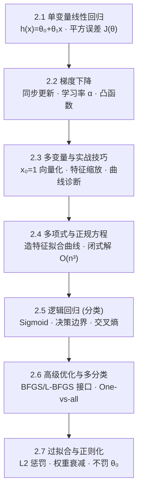

---

### 2.1 单变量线性回归与代价函数（C2.1）

#### 为什么需要它？
给定 47 套 Portland 成交房屋的「面积 $x$ — 价格 $y$」历史数据，要预测一套未出现过的 1250 平方英尺房子的售价。每个样本都带正确答案（成交价），这是 **监督学习（Supervised Learning）**；输出是连续实数且“预测得接不接近”有明确大小之分，这是 **回归问题（Regression Problem）**（相对地，只有对/错之分的离散输出叫 **分类问题 Classification Problem**）。

![[C2.1-房价数据与拟合直线-课件标注.png]]

#### 核心记号与假设函数（Hypothesis）
- $m$：训练样例个数（本例 $m=47$）；$(x^{(i)}, y^{(i)})$：第 $i$ 条训练样例（**注意 $x^{(2)}$ 是第 2 个样本，不是平方**）。
- **单变量线性回归（Univariate Linear Regression）** 假设函数：
  $$h_\theta(x) = \theta_0 + \theta_1 x$$
  其中 $\theta_0$ 是 **截距（Intercept）**，$\theta_1$ 是 **斜率（Slope）**，统称为模型 **参数（Parameters）** 或 **权重（Weights）**。

#### 代价函数（Cost Function / Squared Error Function）
为了把“直线贴合数据点”变成可计算的优化目标，计算每个样本的 **残差（Residual）** $h_\theta(x^{(i)}) - y^{(i)}$。直接求和会正负抵消，因此取平方（恒非负、放大大误差且处处可导），再取平均并多除以 2：
$$J(\theta_0, \theta_1) = \frac{1}{2m} \sum_{i=1}^{m} \big(h_\theta(x^{(i)}) - y^{(i)}\big)^2, \qquad \text{目标：}\min_{\theta_0, \theta_1} J(\theta_0, \theta_1)$$

- **分母为什么是 $2m$ 而不是 $m$？** 纯粹为了求导时约掉平方掉下来的系数 $2$；给 $J$ 乘任意正常数都不改变最小值点 $\theta^*$ 的位置。
- **概率视角（拓展）**：假设噪声服从高斯分布 $y = \theta_0 + \theta_1 x + \varepsilon,\ \varepsilon \sim \mathcal{N}(0,\sigma^2)$ 时，**极大似然估计（MLE）** 等价于最小化平方误差。

#### 几何直觉：抛物线、碗状曲面与等高线
- **简化模型（令 $\theta_0 = 0$，只剩 $\theta_1$）**：直线钉死在原点。若训练集为 $(1,1), (2,2), (3,3)$，则 $J(\theta_1) = \frac{7}{3}(\theta_1 - 1)^2$ 是一条开口向上的抛物线，手算三点：$J(1) = 0$、$J(0.5) = \frac{3.5}{6} \approx 0.58$、$J(0) = \frac{14}{6} \approx 2.33$。

![[C2.1-代价函数-简化模型J曲线.png]]

- **完整模型（放开 $\theta_0, \theta_1$）**：$J(\theta_0, \theta_1)$ 是三维 **碗状曲面（Bowl-shaped）**，从正上方俯视得到 **等高线图（Contour Plot）**——同一圈上 $J$ 相同，越往中心 $J$ 越小，圈越密坡越陡。

![[C2.1-代价函数-三维碗状与等高线.png]]

> [!warning] 本节两个高频概念坑
> 1. **$J$ 是参数 $\theta$ 的函数，不是 $x$ 的函数**：训练数据 $(x^{(i)}, y^{(i)})$ 都是已知常数，唯有 $\theta$ 是变量。左图（$x$-$y$ 平面）的一个点是一套房子，右图（$\theta_0$-$\theta_1$ 等高线）的一个点是一整条直线（一整个模型）。
> 2. **线性回归的 $J$ 是凸函数（Convex Function）**：只有一个最低点，即全局最小值，没有局部极小陷阱。

---

### 2.2 梯度下降（C2.2）

#### 核心直觉：大雾天下山
站在半山腰看不见谷底，每次环顾脚下，朝 **最陡的下坡方向（负梯度方向）** 迈一步，反复迭代直到收敛：
$$\text{Repeat until convergence } \left\{\quad \theta_j := \theta_j - \alpha \frac{\partial}{\partial \theta_j} J(\theta_0, \theta_1) \quad (\text{for } j = 0, 1) \quad\right\}$$

- **$:=$ 是赋值符号**，不是数学等号。
- **为什么是减号？** 站在最低点右侧时导数 $>0$，减正数使 $\theta$ 左移；站在左侧时导数 $<0$，减负数使 $\theta$ 右移——**无论在哪一侧，减去导数都朝最低点走**。

#### 两个必考实现细节
1. **必须同步更新（Simultaneous Update）**：
   所有 $\theta_j$ 的偏导必须用 **本轮开始时的旧参数** 一起算完存进临时变量（`temp0`, `temp1`），最后再统一赋值。如果先改了 $\theta_0$ 再算 $\theta_1$ 的偏导，两个分量不属于同一点，算法就不再是梯度下降（变成了坐标下降）。
2. **学习率（Learning Rate） $\alpha > 0$ 的影响**：
   - $\alpha$ 太小 $\implies$ 每次挪一丁点，收敛极慢。
   - $\alpha$ 太大 $\implies$ 一步跨过最低点（**Overshoot**），可能来回震荡不收敛，甚至 **发散（Diverge）**。
   - **重要反直觉结论**：**即使固定 $\alpha$ 不衰减，普通梯度下降也能收敛**——因为越接近最低点，导数绝对值越小，实际步长 $\alpha \lvert \text{导数} \rvert$ 会自动变小；恰好在最优点时导数为 $0$，参数纹丝不动。

![[C2.2-梯度下降-学习率过大过小.png]]

> [!example] 手算直觉：为什么 $\alpha$ 稍大一点就会发散？
> 对 $J(\theta) = (\theta - 1)^2$，导数为 $2(\theta - 1)$，更新式整理为 $(\theta - 1) := (1 - 2\alpha)(\theta - 1)$。每一步离最优点的距离乘以 $(1 - 2\alpha)$：$\alpha = 0.1$ 时乘 $0.8$ 稳步收敛；$\alpha = 0.5$ 时一步到位；$\alpha = 0.9$ 时乘 $-0.8$ 震荡收敛；$\alpha = 1.0$ 时原地横跳；$\alpha = 1.2$ 时每步放大 $1.4$ 倍直接发散。

#### 局部极小与凸性
一般非凸函数（如神经网络）有多个山谷，梯度下降只保证到达 **某个局部最小值（Local Minimum）**，终点依赖初始值；而线性回归的 $J$ 是 **凸函数**（Hessian 矩阵半正定，拓展），从任何初值出发都必达 **全局最小值（Global Minimum）**。

![[C2.2-梯度下降-非凸函数与局部极小.png]]

#### 代入线性回归：批量梯度下降（Batch Gradient Descent）
用链式法则求偏导（平方掉下来的 $2$ 与 $\frac{1}{2m}$ 约掉）：
$$\theta_0 := \theta_0 - \alpha \frac{1}{m} \sum_{i=1}^{m} \big(h_\theta(x^{(i)}) - y^{(i)}\big)$$
$$\theta_1 := \theta_1 - \alpha \frac{1}{m} \sum_{i=1}^{m} \big(h_\theta(x^{(i)}) - y^{(i)}\big) x^{(i)}$$

- **为什么叫“批量（Batch）”？** 因为求和号从 $i=1$ 加到 $m$，**每走一步都要扫遍全部训练样本**。当 $m$ 极大（如千万级）时单步极慢，因此工程中会衍生出 **随机梯度下降（SGD，每步 1 个样本）** 与 **小批量梯度下降（Mini-batch GD，每步 32–256 个样本）**（详见第 8 章；完整扫遍一遍训练集叫一个 **轮次 Epoch**，拓展）。

---

### 2.3 多变量线性回归与梯度下降实践（C2.3）

#### 多变量推广与 $x_0 = 1$ 的向量化技巧
当特征从 1 个扩到 $n$ 个（如面积、卧室数、楼层、房龄，$n=4$），记号严格区分：**上标数样本，下标数特征**（$x^{(i)}$ 是第 $i$ 个样本向量，$x^{(i)}_j$ 是第 $i$ 个样本的第 $j$ 个特征值）。

为了消灭 $\theta_0$ 这个常数项特例，人为约定给每个样本补一维 **$x_0^{(i)} = 1$**，令 $\theta, x \in \mathbb{R}^{n+1}$：
$$h_\theta(x) = \theta_0 x_0 + \theta_1 x_1 + \cdots + \theta_n x_n = \theta^T x$$

此时，$n+1$ 条梯度下降更新式 **统一合并为一条**（同步更新 $j = 0, 1, \ldots, n$）：
$$\theta_j := \theta_j - \alpha \frac{1}{m} \sum_{i=1}^{m} \big(h_\theta(x^{(i)}) - y^{(i)}\big) x_j^{(i)}$$

- **向量化（Vectorization）**：写代码用矩阵/向量内积代替 `for` 循环，既天然保证同步更新，又能调用底层 BLAS/GPU 加速几十倍。

#### 实战技巧 I：特征缩放（Feature Scaling）与均值归一化（Mean Normalization）
**痛点**：面积 $x_1 \in [0, 2000]$ 而卧室数 $x_2 \in [1, 5]$，尺度差 400 倍。$\theta_1$ 稍微一动 $J$ 就剧变，导致等高线被压成 **极扁的椭圆（病态 Ill-conditioning）**，负梯度方向几乎垂直于通往中心的路径，梯度下降剧烈“之”字震荡、极难收敛。

![[C2.3-特征缩放-等高线对比.png]]

- **目标**：把每个特征大致缩放到 **$[-1, 1]$**（经验可接受范围约 $[-3, 3]$ 到 $[-\frac{1}{3}, \frac{1}{3}]$；差一两个数量级如 $[-100, 100]$ 或 $[-0.0001, 0.0001]$ 必须缩放）。
- **均值归一化通式**：
  $$x_i \leftarrow \frac{x_i - \mu_i}{s_i}$$
  其中 $\mu_i$ 为该特征均值，$s_i$ 为范围（$\max - \min$）或标准差 $\sigma_i$（用标准差即 **Z-score 标准化**，结果均值 0、方差 1，拓展）。

> [!warning] 两个必须牢记的缩放铁律
> 1. **绝对不能对 $x_0 = 1$ 做均值归一化**：$x_0$ 均值也是 $1$，减完后整列变成 $0$，截距项 $\theta_0 x_0 \equiv 0$ 彻底失效，模型被迫过原点。
> 2. **测试集与新样本必须复用训练集的 $\mu_i, s_i$**（拓展）：不可单独用测试集算均值（数据泄漏），上线预测时也必须做同一套缩放。

#### 实战技巧 II：调试与选择学习率 $\alpha$
画出 **$J(\theta)$ 随迭代次数变化的曲线（损失曲线 Loss Curve）**——注意横轴是 **迭代次数**，别和 2.1 节横轴为 $\theta$ 的抛物线搞混：

![[C2.3-学习率-收敛曲线诊断.png]]

- **诊断判据**：只要梯度代码无错，足够小的 $\alpha$ 必然让 $J$ 每轮严格下降。
  - 曲线 **上升** 或 **锯齿震荡** $\implies \alpha$ 太大，调小。
  - 曲线稳步下降但极其缓慢 $\implies \alpha$ 太小，调大（**注意**：$\alpha$ 太大剧烈震荡也可能表现为收敛慢，两边都要看曲线形状）。
- **为何不推荐自动收敛测试（如单步下降 $< 10^{-3}$）？** 合适阈值高度依赖 $J$ 本身的量级，换个问题就失灵，直接看曲线最可靠。
- **选 $\alpha$ 的步长策略**：按约 **3 倍** 递增试探（$\ldots, 0.001, 0.003, 0.01, 0.03, 0.1, 0.3, 1, \ldots$，因为 $\sqrt{10} \approx 3.16$，两步跨一个数量级），找到 **能稳定下降的最大 $\alpha$**。

---

### 2.4 多项式回归与正规方程（C2.4）

#### 特征工程（Feature Engineering）与多项式回归（Polynomial Regression）
原始数据列只是原材料。例如地块给了临街宽 `frontage` 和进深 `depth`，线性叠加表达不出乘积，直接造新特征 $\text{area} = \text{frontage} \times \text{depth}$ 反而更准。

![[C2.4-房屋临街宽与进深-图示.png]]

同理，把 $x^2, x^3, \sqrt{x}$ 伪装成新特征 $x_2, x_3$，就能用完全相同的线性回归代码拟合曲线：
$$h_\theta(x) = \theta_0 + \theta_1 (\text{size}) + \theta_2 (\text{size})^2 + \theta_3 (\text{size})^3$$

- **关键澄清**：“线性回归”的线性指 **对参数 $\theta$ 线性**，不是对特征 $x$ 线性。
- **两大注意事项**：
  1. **特征缩放变成强制项**：若 $\text{size} \in [1, 1000]$，则 $\text{size}^2$ 达 $10^6$、$\text{size}^3$ 达 $10^9$，尺度差 6 个数量级，不缩放根本跑不动。
  2. **看数据范围外的外推（Extrapolation）行为**：二次曲线 $\theta_0 + \theta_1 x + \theta_2 x^2$ 有顶点，外推到更大面积会掉头向下（房子越大越便宜）；而 $\theta_0 + \theta_1 x + \theta_2 \sqrt{x}$ 单调递增且边际递减，更符合先验常识。

![[C2.4-多项式回归-不同特征选择.png]]

#### 正规方程（Normal Equation）：一步求闭式解
对线性回归的二次型代价 $J(\theta) = \frac{1}{2m}\lVert X\theta - y \rVert^2$，直接令所有偏导为零 $\nabla_\theta J(\theta) = \frac{1}{m}(X^TX\theta - X^Ty) = 0$，一步解出最优参数：
$$\theta = (X^T X)^{-1} X^T y$$
其中 $X \in \mathbb{R}^{m \times (n+1)}$ 称为 **设计矩阵（Design Matrix）**，**第一列全为 $1$**（对应 $x_0=1$），$y \in \mathbb{R}^m$。*（拓展：几何本质是把 $y$ 正交投影到 $X$ 的列空间，残差 $y - X\theta$ 垂直即 normal 于列空间。）*

#### 梯度下降 vs 正规方程选型对照

| 维度 | 梯度下降（Gradient Descent） | 正规方程（Normal Equation） |
| :--- | :--- | :--- |
| 学习率 $\alpha$ 与迭代 | 需要选 $\alpha$、需要多轮迭代 | **不需要 $\alpha$、无需迭代** |
| 特征缩放 | 需要 | **不需要**（直接解方程，不走等高线） |
| 特征规模 $n$ | $n$ 极大（如 $10^6$）仍高效 | 求 $(n+1)\times(n+1)$ 矩阵逆需 **$O(n^3)$**，**$n \gtrsim 10^4$ 时极慢**（注意：瓶颈是特征数 $n$，不是样本数 $m$） |
| 模型通用性 | **通用**（逻辑回归、神经网络全靠它） | **仅限线性回归**（模型非线性时无闭式解） |

#### 如果 $X^T X$ 不可逆（Non-invertible / Singular / Degenerate）怎么办？
两大常见成因与对策：
1. **冗余特征（线性相关 Linearly Dependent）**：如同时放入「平方英尺面积」和「平方米面积」$\implies$ 删掉重复特征。
2. **特征过多（$m \le n$）**：样本数比特征数少，方程少于未知数导致解不唯一 $\implies$ 删减特征，或使用 **正则化**（2.7 节根治），工程上也可用伪逆 `pinv` 绕过。

---

### 2.5 逻辑回归（C2.5）

#### 为什么不能直接拿线性回归做分类？
二分类标签 $y \in \{0, 1\}$（0 为负类、1 为正类，仅是编号无大小之分）。若直接拟合直线并以 $h_\theta(x) \ge 0.5$ 为阈值判 1，会遭遇 **两次惨败**：
1. **一个远处正常样本就毁掉阈值**：在右侧很远处加一个极大恶性肿瘤，平方误差嫌它残差 $(3-1)^2$ 太大，拼命把直线压平右移，导致原本分对的中等肿瘤全被错判成良性（**根本原因**：平方误差惩罚离 $0/1$ 的距离，而分类只在乎落在阈值哪一侧）。
2. **输出越界**：直线可输出 $>1$ 或 $<0$，无法解释成概率。

> [!warning] 高频概念题
> **逻辑回归（Logistic Regression）是分类算法，不是回归算法！** 名字带 Regression 是历史遗留（对概率做回归，用于分类）。

#### Sigmoid 函数与概率解释
在线性组合 $\theta^T x$ 外套一层 **Sigmoid / Logistic 函数**，把任意实数压进 $(0, 1)$：
$$h_\theta(x) = g(\theta^T x) = \frac{1}{1 + e^{-\theta^T x}}, \qquad g(z) = \frac{1}{1 + e^{-z}}$$

![[C2.5-sigmoid函数.png]]

- **Sigmoid 五条核心性质**：① 值域 $(0, 1)$；② $g(0) = 0.5$；③ $z \to +\infty$ 时 $g \to 1$，$z \to -\infty$ 时 $g \to 0$；④ 关于 $(0, 0.5)$ 中心对称：$g(-z) = 1 - g(z)$；⑤ 导数极其优雅：**$g'(z) = g(z)\big(1 - g(z)\big)$**。（不用阶跃函数是因为阶跃函数在 0 处不可导、其余处导数为 0，梯度下降完全瘫痪。）
- **概率解释**：$h_\theta(x) = P(y = 1 \mid x; \theta)$，且 $P(y = 0 \mid x; \theta) = 1 - h_\theta(x)$。

#### 决策边界（Decision Boundary）
由 Sigmoid 单调性及 $g(0)=0.5$，预测规则大幅化简，**判断类别只需看 $\theta^T x$ 的正负号**：
$$h_\theta(x) \ge 0.5 \iff \theta^T x \ge 0 \implies \text{预测 } y = 1; \qquad h_\theta(x) < 0.5 \iff \theta^T x < 0 \implies \text{预测 } y = 0$$

分界线 **$\theta^T x = 0$** 即 **决策边界**。
- **线性边界例**：$\theta = [-3, 1, 1]^T \implies -3 + x_1 + x_2 = 0$（直线 $x_1 + x_2 = 3$）。
- **非线性边界例**：加入多项式特征 $x_1^2, x_2^2$，若 $\theta = [-1, 0, 0, 1, 1]^T \implies x_1^2 + x_2^2 = 1$（单位圆，圆内判 0、圆外判 1）；继续加交叉高次项可画出任意复杂闭合边界。

![[C2.5-决策边界-线性与非线性.png]]

> [!warning] 必考概念辨析
> **决策边界是假设函数与参数 $\theta$ 的性质，不是训练集的性质。** 只要 $\theta$ 确定，边界 $\theta^T x = 0$ 就完全确定；训练集的作用只是帮我们挑出这组 $\theta$。

#### 为什么不用平方误差？改用对数损失（交叉熵 Cross-Entropy）
把非线性的 Sigmoid 塞进平方误差里，代价函数 $J(\theta)$ 会变成 **非凸函数（Non-convex）**，布满局部极小坑，梯度下降会卡住（且梯度会残留 $h(1-h)$ 导致两端饱和梯度消失）。

因此改用 **对数损失（Log Loss / 交叉熵）**：
$$\mathrm{Cost}\big(h_\theta(x), y\big) = \begin{cases} -\log\big(h_\theta(x)\big) & \text{if } y = 1 \\[4pt] -\log\big(1 - h_\theta(x)\big) & \text{if } y = 0 \end{cases}$$

![[C2.5-逻辑回归代价函数-两种情形.png]]

- **直觉**：完全答对时代价为 $0$；若“极其自信地犯错”（如 $y=1$ 但 $h=0.01$），对数损失罚 $-\ln 0.01 \approx 4.61$（趋向 $+\infty$），而平方误差最多只罚 $0.5$，太轻。且它保证了 **$J(\theta)$ 是凸函数**。
- **开关合并技巧**（利用 $y \in \{0, 1\}$ 必有一项乘 0）：
  $$J(\theta) = -\frac{1}{m} \sum_{i=1}^{m} \Big[ y^{(i)} \log h_\theta(x^{(i)}) + (1 - y^{(i)}) \log\big(1 - h_\theta(x^{(i)})\big) \Big]$$
  *（拓展：该式等价于伯努利分布假设下的负对数似然，来自 MLE，且在信息论上正是交叉熵。）*

#### 逻辑回归的梯度下降：外壳相同、内核不同
求导时，对数损失对 $h$ 求导出来的分母 $\frac{1}{h(1-h)}$ 与 Sigmoid 导数 $h(1-h)$ **完美约掉**，得到与线性回归外壳一模一样的更新式：
$$\theta_j := \theta_j - \alpha \frac{1}{m} \sum_{i=1}^{m} \big(h_\theta(x^{(i)}) - y^{(i)}\big) x_j^{(i)} \qquad (j = 0, 1, \ldots, n \text{ 同步更新})$$

> [!warning] 切勿混淆
> 外壳长得一样，但 **不是同一个算法**：线性回归里 $h_\theta(x) = \theta^T x$，逻辑回归里 $h_\theta(x) = \frac{1}{1+e^{-\theta^T x}}$。好消息是特征缩放、损失曲线诊断、3 倍挑 $\alpha$ 等实战技巧全部原样复用。

---

### 2.6 高级优化算法与多分类（C2.6）

#### 优化器抽象接口与高级算法
不想手动折腾学习率 $\alpha$？把「模型」与「优化」解耦：你只需写一个函数，给定 $\theta$ 返回 **$J(\theta)$** 和 **全部偏导 $\frac{\partial J}{\partial \theta_j}\ (j=0,\ldots,n)$**，剩下交给现成优化库。

| 算法分组 | 代表算法 | 优点 | 缺点 |
| :--- | :--- | :--- | :--- |
| 基础一阶法 | **梯度下降（Gradient Descent）** | 简单、直观 | 需手调 $\alpha$、常较慢 |
| 高级优化器 | **共轭梯度（Conjugate Gradient, CG） / BFGS / L-BFGS** | **内置线搜索，无需手调 $\alpha$**；通常收敛更快 | 实现复杂（直接调库，不手写） |

- **重要提醒**：换优化器 **不会改变凸问题的最终最优解 $\theta^*$ 和决策边界**，变的只是路径与速度。
- **Octave/MATLAB `fminunc` 两个易错点**：
  1. 要求参数向量维度 $d \ge 2$（不接受标量）。
  2. **下标差 1**：数学从 $0$ 编起，数组从 $1$ 编起 $\implies \theta_0 \leftrightarrow \texttt{theta(1)}$、`gradient(j+1)` 对应 $\frac{\partial J}{\partial \theta_j}$。

#### 多分类：一对多（One-vs-all / One-vs-rest）
现实任务往往有 $K$ 类（如邮件分 4 个文件夹、天气分 4 类），$y \in \{1, 2, \ldots, K\}$ 只是名义编号（无大小顺序），一条决策边界切不开 $K$ 簇数据。

![[C2-多分类-二分类与多分类对比.png]]

- **拆解训练**：为每个类别 $i = 1, \ldots, K$ 独立训练一个二分类逻辑回归 $h_\theta^{(i)}(x) = P(y = i \mid x; \theta)$——训练时把第 $i$ 类标为 $1$，其余所有类合在一起标为 $0$。

![[C2-多分类-One-vs-all三个分类器.png]]

- **预测合并**：新样本 $x$ 同时喂给 $K$ 个分类器，取输出最大的类别编号：
  $$\hat{y} = \arg\max_i\; h_\theta^{(i)}(x)$$

> [!warning] 高频考点：$K$ 个输出加起来不一定等于 $1$
> 因为 $K$ 个分类器各自独立训练、彼此无约束，例如三个输出分别为 $0.7, 0.3, 0.2$（和为 $1.2$），这完全正常——它们是 **置信度（Confidence Score）** 而非联合归一化的概率分布。若需总和严格为 $1$ 的真概率分布，须用 **Softmax 回归**。

---

### 2.7 过拟合与正则化（C2.7）

#### 认识病症：欠拟合 vs 刚刚好 vs 过拟合
模型太简单抓不住规律叫 **欠拟合（Underfitting / 高偏差 High Bias）**；特征太多、多项式次数太高，曲线为了强行穿过每个训练点而剧烈扭动，训练集误差 $J(\theta) \approx 0$ 但新样本预测离谱，叫 **过拟合（Overfitting / 高方差 High Variance）**。线性回归与逻辑回归皆如此：

![[C2-过拟合-线性回归三种拟合.png]]

![[C2-过拟合-逻辑回归三种决策边界.png]]

#### 两条对策与正则化直觉
1. **减少特征数量**：人工挑选或用模型选择算法自动筛选——代价是永久丢弃被删特征的信息。
2. **正则化（Regularization）**：**保留全部特征，但压小参数 $\theta_j$ 的量级**。特别适合特征很多、每个特征都贡献一点点信息的场景。

*直觉*：在四次多项式的代价后面加上 $1000\theta_3^2 + 1000\theta_4^2$，优化器为了压低总代价被迫把 $\theta_3, \theta_4$ 压到接近 $0$，四次曲线自动平滑回二次曲线。推而广之，不知道该压哪几个时，把所有特征参数一起放进 **L2 惩罚项**（线性回归中又称 **岭回归 Ridge Regression**；若用 $\lvert \theta_j \rvert$ 则为 L1 / LASSO，可产生稀疏解但在 0 处不可导，拓展）：

- **正则化线性回归**：
  $$J(\theta) = \frac{1}{2m} \left[ \sum_{i=1}^{m} \big(h_\theta(x^{(i)}) - y^{(i)}\big)^2 + \lambda \sum_{j=1}^{n} \theta_j^2 \right]$$
- **正则化逻辑回归**：
  $$J(\theta) = -\frac{1}{m} \sum_{i=1}^{m} \Big[ y^{(i)} \log h_\theta(x^{(i)}) + (1 - y^{(i)}) \log\big(1 - h_\theta(x^{(i)})\big) \Big] + \frac{\lambda}{2m} \sum_{j=1}^{n} \theta_j^2$$

> [!danger] 本节第一铁律：求和从 $j = 1$ 开始，永远不惩罚 $\theta_0$！
> $\theta_0$ 是截距项，只管整体上下平移，与曲线抖不抖无关。惩罚 $\theta_0$ 反而会把预测值强行往 0 拖。这一规矩贯穿代价函数、梯度下降、正规方程和代码实现（`theta(1)` 不罚）。

#### 正则化参数 $\lambda$ 的天平效应
- **$\lambda = 0$ 或太小**：约束失效，仍会 **过拟合**。
- **$\lambda$ 太大（如 $10^{10}$）**：$\theta_1, \ldots, \theta_n$ 全被压成 $\approx 0$，只剩未被惩罚的截距，模型退化为水平直线 **$h_\theta(x) \approx \theta_0$**，变成 **欠拟合（高偏差）**。

![[C2-正则化-lambda过大退化为常数.png]]

#### 正则化梯度下降与权重衰减（Weight Decay）
对线性回归与逻辑回归，正则化后的梯度下降外壳依然一模一样（注意 $h_\theta(x)$ 不同）：
- $j = 0$（不变）：$\theta_0 := \theta_0 - \alpha \frac{1}{m} \sum_{i=1}^{m} \big(h_\theta(x^{(i)}) - y^{(i)}\big) x_0^{(i)}$
- $j \ge 1$（偏导多 $+\frac{\lambda}{m}\theta_j$）：
  $$\theta_j := \theta_j - \alpha \left[ \frac{1}{m} \sum_{i=1}^{m} \big(h_\theta(x^{(i)}) - y^{(i)}\big) x_j^{(i)} + \frac{\lambda}{m} \theta_j \right] = \theta_j \left(1 - \alpha \frac{\lambda}{m}\right) - \alpha \frac{1}{m} \sum_{i=1}^{m} \big(h_\theta(x^{(i)}) - y^{(i)}\big) x_j^{(i)}$$
  由于 $1 - \alpha \frac{\lambda}{m}$ 略小于 $1$（如 $0.99$），每轮更新相当于 **先把参数缩水一点点，再照常走一步梯度**——这就是深度学习中 **权重衰减（Weight Decay）** 的由来。

#### 正则化正规方程：顺手根治不可逆
$$\theta = \left( X^T X + \lambda \begin{bmatrix} 0 & & & \\ & 1 & & \\ & & \ddots & \\ & & & 1 \end{bmatrix}_{(n+1)\times(n+1)} \right)^{-1} X^T y$$

- **必考细节**：对角阵左上角是 **$0$**（对应 $\theta_0$ 不罚），**不是单位矩阵 $I$**。
- **白送的好处**：只要 $\lambda > 0$，括号内的矩阵 **一定可逆**（即使 $m \le n$ 或有冗余特征），直接根治奇异问题（区别于无正则化时用 `pinv` 伪逆绕过）。

> [!warning] 原课件勘误避坑（考试按正确公式写！）
> 1. **正则化高级优化页笔误**：原课件（印刷与板书）把 `gradient(2)` 及之后的正则梯度错写成了 **$-\frac{\lambda}{m}\theta_j$**，**正确必为 $+\frac{\lambda}{m}\theta_j$**（减号会导致每轮放大参数，与正则化完全相反）。
> 2. **两处漏印已补全**：原 PDF 在正则化线性回归梯度页漏印 $+\frac{\lambda}{m}\theta_j$，在正则化逻辑回归代价页漏印 $+\frac{\lambda}{2m}\sum_{j=1}^n \theta_j^2$，以上正文均已按数学严谨补全。

---

### 第 2 章公式与核心结论速查表

| 概念 | 公式 / 核心判据 | 关键提醒 |
| :--- | :--- | :--- |
| 线性回归假设与代价 | $h_\theta(x)=\theta^T x$；$J(\theta)=\frac{1}{2m}\sum_{i=1}^m(h_\theta(x^{(i)})-y^{(i)})^2$ | 补 $x_0=1$；$J$ 是凸函数，无局部极小 |
| 梯度下降更新式 | $\theta_j:=\theta_j-\alpha\frac{1}{m}\sum_{i=1}^m(h_\theta(x^{(i)})-y^{(i)})x_j^{(i)}$ | 必须同步更新；固定 $\alpha$ 也能收敛 |
| 特征缩放与归一化 | $x_i \leftarrow \dfrac{x_i-\mu_i}{s_i}$，大致压到 $[-1,1]$ | 严禁对 $x_0=1$ 做归一化；多项式回归必做 |
| 学习率 $\alpha$ 调试 | 画 $J$–迭代次数曲线；按 $3\times$ 递增试探 | 上升/锯齿 $\Rightarrow \alpha$ 太大；震荡也可能慢 |
| 正规方程 | $\theta=(X^TX)^{-1}X^Ty$，$X\in\mathbb{R}^{m\times(n+1)}$ 首列全 1 | 无需缩放/$\alpha$/迭代；$O(n^3)$ 怕 $n$ 大；仅限线性回归 |
| Sigmoid 与逻辑回归 | $h_\theta(x)=g(\theta^Tx)=\dfrac{1}{1+e^{-\theta^Tx}}=P(y=1\mid x;\theta)$ | $g(0)=0.5$；$g'=g(1-g)$；逻辑回归是分类算法 |
| 决策边界 | $\theta^T x = 0$；$\theta^T x \ge 0 \iff h \ge 0.5$ 判 $1$ | 由参数 $\theta$ 决定，不是训练集的性质 |
| 逻辑回归代价（交叉熵） | $J(\theta)=-\frac{1}{m}\sum_i[y^{(i)}\log h+(1-y^{(i)})\log(1-h)]$ | 保证凸性；线性回归平方误差套 Sigmoid 会非凸 |
| One-vs-all 多分类 | 训练 $K$ 个二分类器，预测 $\hat{y}=\arg\max_i h_\theta^{(i)}(x)$ | $K$ 个输出和不必为 1（需真概率分布用 Softmax） |
| 正则化代价（L2） | 原 $J(\theta) + \dfrac{\lambda}{2m}\sum_{j=1}^n \theta_j^2$ | 求和从 $j=1$ 起，**永不罚 $\theta_0$**；$\lambda$ 过大欠拟合 |
| 权重衰减更新（$j\ge 1$） | $\theta_j:=\theta_j(1-\alpha\frac{\lambda}{m})-\alpha\frac{1}{m}\sum(h-y)x_j^{(i)}$ | 课件高级优化页误印 $-\frac{\lambda}{m}\theta_j$，须写 $+$ |
| 正则化正规方程 | $\theta=\big(X^TX+\lambda\,\mathrm{diag}(0,1,\ldots,1)\big)^{-1}X^Ty$ | 左上角是 $0$ 非 $I$；$\lambda>0$ 时矩阵必可逆 |

---

## 第 9 章 模型评估、诊断与改进方向（C9.1–C9.3）

> [!tip] 本章解决什么问题？
> 模型在测试集上效果不好时，面前摆着六条改进方向（加数据、减特征、加特征、加多项式、增 $\lambda$、减 $\lambda$），盲目试错会浪费数周时间。本章给你一套 **机器学习诊断（Machine Learning Diagnostics）** 体系：用三集划分、偏差–方差判据与学习曲线，精准定位病因后再对症下药。

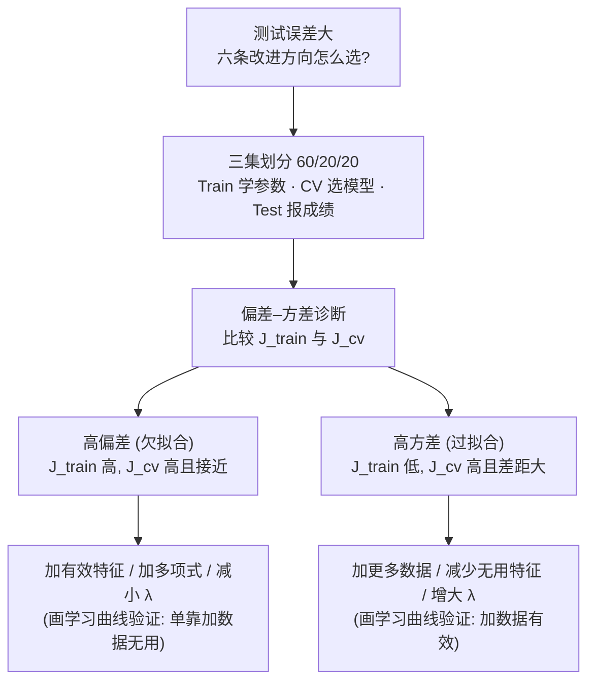

---

### 9.1 模型评估与训练–测试集划分（C9.1）

#### 为什么不能用训练误差评价模型？
用 6 个数据点拟合 1 次与 5 次多项式，1 次多项式训练 MSE 为 $0.016$，5 次多项式直接降到 $0.000$，但曲线在点间疯狂震荡——**训练误差具有乐观偏向（Optimistic Bias）**，它衡量的是记忆力而非泛化能力。

![[C9-多项式阶数与训练误差的假象2.png]]

#### 数据划分与无正则化评估指标
先将数据集随机打乱后按 **70% / 30%** 划分为训练集与测试集。评估模型泛化误差时，**一律不带正则化项**（正则项只用于训练时约束参数）：
- **回归评估误差**：$J_S(\theta) = \dfrac{1}{2\lvert S\rvert} \sum_{i \in S} \big(h_\theta(x^{(i)}) - y^{(i)}\big)^2$（例：残差 $1, -2, 3$ 时 $J = 7/3 \approx 2.3333$，MSE $= 14/3 \approx 4.6667$）。
- **分类交叉熵评估**：$J_S(\theta) = -\dfrac{1}{\lvert S\rvert} \sum_{i \in S} \big[ y^{(i)} \log h_\theta(x^{(i)}) + (1 - y^{(i)}) \log(1 - h_\theta(x^{(i)})) \big]$。
- **0/1 误分类率（Misclassification Error）**：$\dfrac{1}{\lvert S\rvert} \sum_{i \in S} \mathbf{1}[\hat{y}_i \ne y_i]$。

> [!warning] 原课件勘误（what todo p8）
> 原课件将分类交叉熵第二项误印为 $\log h$ 且缺外层方括号，正确应为 $\log(1 - h_\theta(x^{(i)}))$。

---

### 9.2 模型选择与偏差–方差诊断（C9.2）

#### 为什么不能用测试集选超参数？
若在测试集上比较 1–10 次多项式并挑出 $J_{test}$ 最小的阶数 $d$，那么 $d$ 本身就已经拟合了测试集，此时再用该测试集报成绩会产生乐观偏差。因此必须引入 **三集划分（60% Train / 20% Cross-Validation / 20% Test）**：
1. **训练集（Training Set）**：拟合各候选模型的参数 $\hat{\theta}^{(k)}$。
2. **交叉验证集（Cross-Validation Set, CV）**：计算各模型的 $J_{cv}(\hat{\theta}^{(k)})$，挑选最优阶数 $d^*$ 或最优 $\lambda^*$。
3. **测试集（Test Set）**：只在最终模型定型后使用一次，汇报无偏的泛化成绩 $J_{test}$。

![[C9-阶数与训练交叉验证误差2.png]]

#### 偏差–方差诊断判据（Bias vs. Variance）
比较 $J_{train}(\theta)$ 与 $J_{cv}(\theta)$ 的相对高低：
- **高偏差（High Bias / 欠拟合）**：$J_{train}$ 很高，且 $J_{cv} \approx J_{train}$（例：$J_{train}=0.90,\ J_{cv}=1.00$）。模型太简单，连训练集都学不好。
- **高方差（High Variance / 过拟合）**：$J_{train}$ 很低，但 $J_{cv} \gg J_{train}$（例：$J_{train}=0.20,\ J_{cv}=3.60$）。模型死记硬背，泛化崩塌。

---

### 9.3 正则化选择、学习曲线与六条改进归类（C9.3）

#### 如何用 CV 选择正则化参数 $\lambda$？
构造按 2 倍递增的 12 个候选值：$0,\ 0.01,\ 0.02,\ 0.04,\ 0.08,\ 0.16,\ 0.32,\ 0.64,\ 1.28,\ 2.56,\ 5.12,\ 10.24$（注：原课件 what todo p22 末项印 10、手写 10.24；p20–23 多项式正则项求和上限误印为样本数 $m$，应为特征数 $n$）。对每个 $\lambda$ 在训练集求 $\theta$（带正则项），在 CV 集算 $J_{cv}$（**不带正则项**），选 $J_{cv}$ 最小者。

![[C9-正则化强度与误差曲线2.png]]

- $\lambda$ 太小 $\to$ 过拟合（高方差）；$\lambda$ 太大 $\to$ 欠拟合（高偏差）。

![[C9-模型复杂度与正则化的诊断曲线.png]]

#### 学习曲线（Learning Curves）：判断是否该花钱收集更多数据
横轴为训练样本量 $m$（逐个子集规模重新训练），纵轴画 $J_{train}$ 与 $J_{cv}$：

![[C9-高偏差与高方差学习曲线2.png]]

- **高偏差学习曲线**：$m$ 增大时，$J_{train}$ 快速上升并与 $J_{cv}$ 在 **高位水平靠拢** $\implies$ **高偏差时，单靠增加训练数据几乎没有帮助！**
- **高方差学习曲线**：$J_{train}$ 始终很低，$J_{cv}$ 虽下降但两者之间存在 **巨大缝隙（Gap）** $\implies$ **高方差时，增加更多训练数据大概率有效！**

#### 神经网络规模与六条改进方向最终归类
- **神经网络**：小型网络参数少易高偏差（但算得快）；大型网络易高方差，**通常首选较大网络 + 合适正则化 $\lambda$**（比选小网络效果好，代价是计算更慢）。
- **六条改进对症表**：
  - **治高方差（过拟合）**：① 获取更多训练样本；② 减少无用特征；③ 增大 $\lambda$。
  - **治高偏差（欠拟合）**：④ 增加有效新特征；⑤ 增加多项式特征；⑥ 减小 $\lambda$。

### 第 9 章公式与核心结论速查表

| 概念 | 公式 / 判据 | 关键提醒 |
| :--- | :--- | :--- |
| 三集划分 | 60% Train / 20% CV / 20% Test | Train 学 $\theta$，CV 选超参，Test 仅报最终成绩 |
| 评估误差 | $J_S(\theta)=\frac{1}{2\lvert S\rvert}\sum_{i\in S}(h_\theta(x^{(i)})-y^{(i)})^2$ | Train / CV / Test 评估均 **不含正则项** |
| 高偏差 vs 高方差 | 高偏差：$J_{train}$ 高且 $J_{cv}\approx J_{train}$；高方差：$J_{train}$ 低且 $J_{cv}\gg J_{train}$ | 决定后续该往哪 3 条路使劲 |
| 学习曲线 | 横轴为训练样本量 $m$ | 高偏差高位收敛（加数据无用）；高方差大缝隙（加数据有效） |
| $\lambda$ 候选序列 | $0, 0.01, 0.02, 0.04, \ldots, 10.24$（约 2 倍递增） | 原课件 p20 求和上限误印 $m$（应为 $n$） |

---

## 第 10 章 支持向量机与核方法（C10.1–C10.3）

> [!tip] 本章解决什么问题？
> 逻辑回归只要求把两类分开，可能画出一条紧贴着样本点、毫无安全余量的边界。**支持向量机（Support Vector Machine, SVM）** 从改造逻辑回归的对数损失出发，引入 **合页损失（Hinge Loss）**，天然追求 **最大间隔（Large Margin）**，并借助 **核函数（Kernel）** 高效构造复杂的非线性边界。

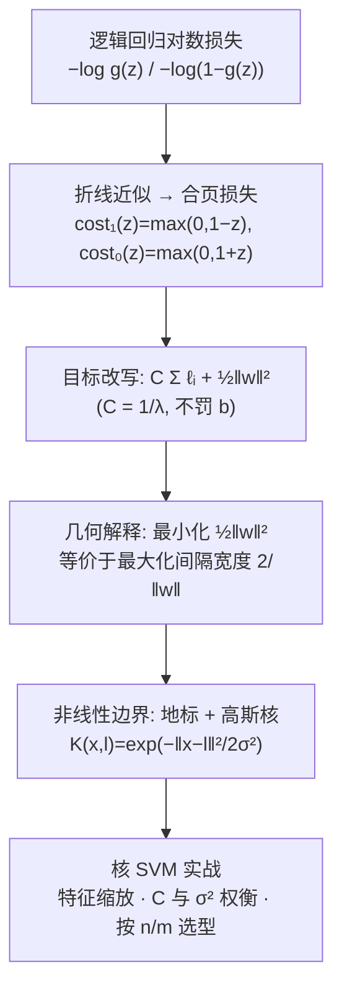

---

### 10.1 优化目标、合页损失与大间隔直觉（C10.1）

#### 从逻辑回归到合页损失（Hinge Loss）
记分类分数 $z = w^T x + b$（注意：$w, x$ 不含偏置坐标，偏置 $b$ 单独写出）。把逻辑回归平滑的 $-\log g(z)$ 与 $-\log(1-g(z))$ 替换为两段折线：
$$\operatorname{cost}_1(z) = \max(0,\ 1 - z), \qquad \operatorname{cost}_0(z) = \max(0,\ 1 + z)$$
若将标签改写为 $t_i = 2y_i - 1 \in \{-1, +1\}$，则统一为 $\ell_i = \max(0,\ 1 - t_i z_i)$。

![[C10-逻辑损失与合页损失2.png]]

#### 目标函数改写与参数 $C$
逻辑回归最小化 $A + \lambda B$，SVM 习惯去掉 $\frac{1}{m}$ 并把权重从正则项移到损失项前面（本课归一化下 $C = 1/\lambda$）：
$$\min_{w, b}\; C \sum_{i=1}^{m} \Big[ y^{(i)} \operatorname{cost}_1(w^T x^{(i)} + b) + (1 - y^{(i)}) \operatorname{cost}_0(w^T x^{(i)} + b) \Big] + \frac{1}{2} \lVert w \rVert^2$$

- **预测规则 vs 零损失要求**：预测仍看 $z \ge 0$ 判 $1$、否则判 $0$（**注意 $z$ 是分数，不是概率**）；但要让合页损失为 $0$，正例必须满足 **$z \ge 1$**、负例必须满足 **$z \le -1$**（原课件 svm p9 负例旁漏写负号、p16 第二约束标签误印 $y=1$ 应为 $y=0$）。这多出来的 $[-1, +1]$ 安全缓冲区，就是 **间隔（Margin）**。
- **离群点与软间隔（Soft Margin）**：$C$ 极大时（硬间隔趋势）为了不放过单个离群点会把边界拉歪导致过拟合；适当减小 $C$ 允许个别离群点违背间隔约束，得到更稳健的大间隔边界。

![[C10-离群点下C的取舍2.png]]

---

### 10.2 间隔的几何解释与高斯核（C10.2）

#### 为什么最小化 $\frac{1}{2}\lVert w \rVert^2$ 等价于最大化间隔？
回顾内积与有符号投影：向量 $v$ 在 $u$ 方向上的有符号投影长度为 $p = \dfrac{u^T v}{\lVert u \rVert}$（例：$u=(3,4), v=(2,1)$ 时内积 $10$、$\lVert u\rVert=5$、投影 $2$）。
样本 $x^{(i)}$ 到超平面 $w^T x + b = 0$ 的几何距离为 $\dfrac{\lvert w^T x^{(i)} + b \rvert}{\lVert w \rVert}$。在硬间隔约束 $t_i(w^T x^{(i)} + b) \ge 1$ 下，距离边界最近的 **支持向量（Support Vectors）** 恰好落在 $w^T x + b = \pm 1$ 上，整条间隔带的宽度就是 **$\dfrac{2}{\lVert w \rVert}$**。因此 **最小化 $\frac{1}{2}\lVert w \rVert^2$ 严格等价于最大化几何间隔宽度 $\dfrac{2}{\lVert w \rVert}$**。

![[C10-最大间隔与间隔宽度2.png]]

#### 用地标与高斯核（Gaussian / RBF Kernel）造非线性边界
给定地标（Landmark）$l$，用 **高斯核（Gaussian Kernel）** 度量样本 $x$ 与 $l$ 的局部相似度：
$$f = K(x, l) = \exp\!\left( -\frac{\lVert x - l \rVert^2}{2\sigma^2} \right) \qquad \Big(\text{常记 } \gamma = \frac{1}{2\sigma^2}\Big)$$
- $x \approx l \implies K \approx 1$；$x$ 远离 $l \implies K \approx 0$。
- **核宽度 $\sigma^2$ 的作用**：$\sigma^2$ 越大，钟形峰越宽越平缓；$\sigma^2$ 越小，峰越尖越窄（例：平方距离为 $1$ 时，$\sigma^2=0.5, 1, 3$ 对应 $K \approx 0.3679,\ 0.6065,\ 0.8465$）。多个局部山峰加权叠加即可拼出任意闭合非线性边界。

![[C10-高斯核截面曲线2.png]]

![[C10-核宽度等值线2.png]]

---

### 10.3 核 SVM 的训练、调参与模型选择（C10.3）

#### 用全部训练样本作地标
直接取 $l^{(1)}=x^{(1)}, \ldots, l^{(m)}=x^{(m)}$，把每个样本映射成 $m$ 维相似度特征向量 $f \in \mathbb{R}^m$。核展开预测分数为 $s(x) = b + \sum_{i=1}^{m} \alpha_i t_i K(x^{(i)}, x)$；注意在标准核 SVM 中，核空间正则项是二次型 **$\frac{1}{2} a^T K a$** 而非普通 $\frac{1}{2} a^T a$（原课件 svm p26 已作说明）。

- **有效核条件（Mercer's Theorem）**：并非任意相似度函数都能当核函数，必须是 **有效核**（对任意有限样本构造的核矩阵 $K$ 必须 **对称半正定**）；常见有效核还有线性核、多项式核、字符串核、卡方核等。
- **使用高斯核前必须做特征缩放（Feature Scaling）**：否则大尺度特征会完全主导欧氏距离 $\lVert x - l \rVert^2$，小尺度特征被彻底淹没。
- **超参数 $C$ 与 $\sigma^2$ 的偏差–方差规律（必考）**：
  - **大 $C$**（对应小 $\lambda$）$\to$ 低偏差、高方差；**小 $C$** $\to$ 高偏差、低方差。
  - **小 $\sigma^2$**（峰极尖，只认极近点）$\to$ 低偏差、高方差；**大 $\sigma^2$**（峰很平缓）$\to$ 高偏差、低方差。
- **多分类**：采用 **一对多（One-vs-all）** 训练 $K$ 个 SVM，预测取最大分类分数 $\arg\max_k (w^{(k)T} x + b^{(k)})$。

![[C10-一对多三分类2.png]]

#### 按特征数 $n$ 与样本数 $m$ 选型（实战口诀）
- **$n$ 很大（相对于 $m$）**（如 $n = 10{,}000,\ m = 10\text{–}1000$）：特征已足够丰富，用 **逻辑回归** 或 **无核（线性核）SVM**。
- **$n$ 小、$m$ 中等**（如 $n = 1\text{–}1000,\ m = 10\text{–}10{,}000$）：用 **高斯核 SVM**。
- **$n$ 小、$m$ 极大**（如 $n = 1\text{–}1000,\ m > 50{,}000$）：核矩阵太大算不动，改用 **手工造特征 + 逻辑回归 / 线性核 SVM**。（神经网络在三种情形都常表现不错，但训练通常更慢。）

### 第 10 章公式与核心结论速查表

| 概念 | 公式 / 判据 | 关键提醒 |
| :--- | :--- | :--- |
| 合页损失与目标 | $\ell_i=\max(0, 1-t_i z_i)$；$\min C\sum \ell_i + \frac{1}{2}\lVert w\rVert^2$ | $C=1/\lambda$，不罚 $b$；预测看 $z\ge 0$（非概率） |
| 间隔宽度 | 几何距离 $\lvert w^Tx+b\rvert/\lVert w\rVert$；间隔带宽 $2/\lVert w\rVert$ | 最小化 $\frac{1}{2}\lVert w\rVert^2 \iff$ 最大化间隔 |
| 高斯核 | $K(x,l)=\exp[-\lVert x-l\rVert^2/(2\sigma^2)]$ | **用前必须做特征缩放**；有效核矩阵须对称半正定 |
| 偏差–方差调参 | 大 $C$ / 小 $\sigma^2 \to$ 高方差；小 $C$ / 大 $\sigma^2 \to$ 高偏差 | 千万别把 $C$ 与 $\lambda$ 方向记反 |
| 模型选型 | $n\gg m$：线性；$n$ 小 $m$ 中：高斯核 SVM；$n$ 小 $m$ 极大：造特征+线性 | SVM 优化问题是凸的，无局部极小 |

---

## 第 13–14 章 神经网络：表示与学习（C13.1–C14.2）

> [!tip] 本章解决什么问题？
> 当输入是图像等高维数据时，手工构造多项式特征会瞬间爆炸。**神经网络（Neural Networks）** 把逻辑回归的神经元层层堆叠，让隐藏层 **自动学习特征表示**；再通过 **前向传播（Forward Propagation）** 算输出、**反向传播（Backpropagation）** 高效求全网梯度，并配合梯度检验与随机初始化完成训练。

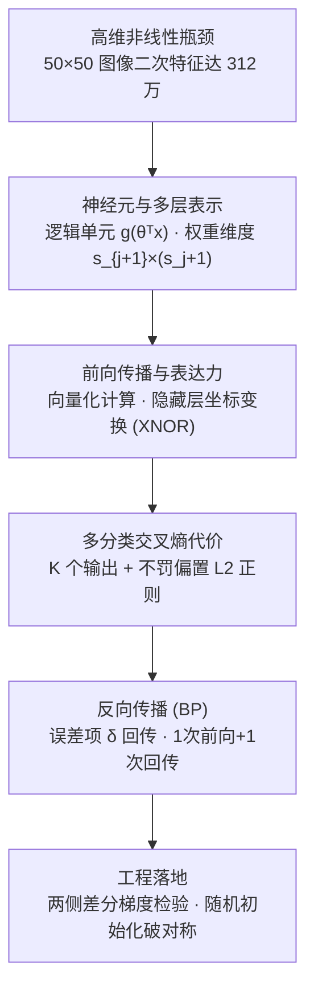

---

### 13.1 为什么必须换模型：特征组合爆炸（C13.1）

若原始特征数 $n = 100$，仅构造二次项就有 $\frac{n(n+1)}{2} = 5{,}050$ 个特征，三次项高达 $\binom{102}{3} = 171{,}700$ 个；对一张 $50 \times 50$ 的灰度图（$n = 2{,}500$ 像素），二次项暴涨到 **$3{,}126{,}250$** 个（RGB 彩色图 $n = 7{,}500$ 则高达 $2{,}812$ 万个），无论计算、内存还是样本量都会彻底撞墙。真正的病因是 **特征形状靠手工指定**；受大脑皮层 **单学习算法假说（One Learning Algorithm Hypothesis）** 与感觉替代实验启发，神经网络让隐藏层自己从数据中学习特征。

---

### 13.2 神经网络的表示与前向传播（C13.2）

#### 记号、维度规则与参数计数（必考手算）
每个神经元就是一个逻辑单元 $g(\theta^T x)$。三层网络分为 **输入层（Input Layer）**、**隐藏层（Hidden Layer）**、**输出层（Output Layer）**，每层（除输出层）额外加一个恒为 $1$ 的 **偏置单元（Bias Unit）** $a_0^{(j)} = 1$：

![[C13-三层网络的记号.png]]

- $a_i^{(j)}$：第 $j$ 层第 $i$ 个单元的 **激活值（Activation）**；$a^{(1)} = x$，$a^{(L)} = h_\Theta(x)$。
- $\Theta^{(j)}$：从第 $j$ 层映射到第 $j+1$ 层的权重矩阵。若第 $j$ 层有 $s_j$ 个单元（**不含偏置**）、第 $j+1$ 层有 $s_{j+1}$ 个单元，则维度严格为：
  $$\Theta^{(j)} \in \mathbb{R}^{s_{j+1} \times (s_j + 1)}$$
- **总参数量**：$\sum_{j=1}^{L-1} s_{j+1}(s_j + 1)$。例：3-3-1 网络为 $3\times 4 + 1\times 4 = \mathbf{16}$；3-5-5-4 网络为 $5\times 4 + 5\times 6 + 4\times 6 = \mathbf{74}$。

#### 向量化前向传播（Forward Propagation）与隐藏层的本质
逐层推进：$z^{(j)} = \Theta^{(j-1)} a^{(j-1)}$，$a^{(j)} = g(z^{(j)})$，然后补上偏置 $a_0^{(j)} = 1$ 送入下一层。

**隐藏层到底在干什么？** 用逻辑门拼装 **同或（XNOR）** 看得最清（利用 $g(4.6)\approx 0.99,\ g(-4.6)\approx 0.01$）：
- `AND`：$g(-30 + 20x_1 + 20x_2)$；`OR`：$g(-10 + 20x_1 + 20x_2)$；`NOT`：$g(10 - 20x_1)$；`(NOT x1) AND (NOT x2)`：$g(10 - 20x_1 - 20x_2)$。
- 两层组合 `XNOR` $= (x_1 \text{ AND } x_2) \text{ OR } (\neg x_1 \text{ AND } \neg x_2)$：隐藏层把原本线性不可分的 4 个点映射到了 **新的特征坐标** $(a_1^{(2)}, a_2^{(2)})$ 中，使它们在新空间里瞬间线性可分！

![[C13-XNOR的坐标变换.png]]

- **多分类输出**：输出层设 $K$ 个单元，标签编码为 **独热向量（One-hot Vector）**（如 4 类分别为 $[1,0,0,0]^T$ 等；经典案例 LeNet-5 手写数字识别）。

![[C13-LeNet5-手写数字.png]]

---

### 14.1 代价函数与反向传播（C14.1）

#### $K$ 分类交叉熵代价函数（$K=1$ 时退化为逻辑回归）
$$J(\Theta) = -\frac{1}{m} \sum_{i=1}^{m} \sum_{k=1}^{K} \Big[ y_k^{(i)} \log \big(h_\Theta(x^{(i)})\big)_k + (1 - y_k^{(i)}) \log \big(1 - (h_\Theta(x^{(i)}))_k\big) \Big] + \frac{\lambda}{2m} \sum_{l=1}^{L-1} \sum_{i=1}^{s_l} \sum_{j=1}^{s_{l+1}} \big(\Theta_{ji}^{(l)}\big)^2$$
*（正则项不惩罚任何一层来自偏置单元 $i=0$ 的权重。）*

#### 反向传播算法（Backpropagation, BP）
为什么不用数值微分求梯度？$n$ 个参数需做 $2n$ 次前向传播，百万参数根本算不动；**反向传播只需 1 次前向 + 1 次反向即可同时算出全网所有参数的精确梯度**。核心是定义第 $l$ 层第 $j$ 个节点的 **误差项（Error Term）** $\delta_j^{(l)} = \dfrac{\partial}{\partial z_j^{(l)}} \operatorname{cost}(i)$：
1. **前向传播**：算出各层激活值 $a^{(1)}, \ldots, a^{(L)}$。
2. **输出层误差**：$\delta^{(L)} = a^{(L)} - y$。
3. **逐层回传（$l = L-1, \ldots, 2$，无 $\delta^{(1)}$）**：
   $$\delta^{(l)} = \big(\Theta^{(l)}\big)^T \delta^{(l+1)} \odot g'(z^{(l)}), \qquad g'(z^{(l)}) = a^{(l)} \odot (1 - a^{(l)})$$
   *（去掉偏置对应的 $\delta_0^{(l)}$。）*
4. **累积与加正则项**：对所有样本累积 $\Delta^{(l)} := \Delta^{(l)} + \delta^{(l+1)} (a^{(l)})^T$，最终梯度：
   $$D_{ij}^{(l)} = \frac{1}{m}\Delta_{ij}^{(l)} + \frac{\lambda}{m}\Theta_{ij}^{(l)}\ (j \ne 0), \qquad D_{ij}^{(l)} = \frac{1}{m}\Delta_{ij}^{(l)}\ (j = 0)$$

![[C14-反向传播一轮的数值流.png]]

> [!example] 2-2-1 算例关键数值走查
> 输入 $x=[0.4, 0.7]$、$y=1$，前向得 $z^{(2)}=(0.390, 0.670)$、$a^{(2)}=(0.5963, 0.6615)$、输出 $h = 0.5368$、代价 $J = 0.6221$；反向得 $\delta^{(3)} = 0.5368 - 1 = -0.4632$、$\delta^{(2)} = (0.1338, -0.0726)$，最终算得解析梯度 $D^{(1)}_{11} = 0.133804$。

- **参数展开（Unrolling Parameters）**：调用 `fminunc` 等优化器时，把多个权重矩阵 $\Theta^{(1)}, \Theta^{(2)}, \ldots$ 展平拼成一条长向量传入，在 `costFunction` 内再 `reshape` 回矩阵。

> [!warning] 第 14 章原课件三处勘误避坑
> 1. **Lecturenn1 p9**：梯度公式把正则项写成 $+\lambda\Theta_{ij}^{(l)}$ **漏了 $1/m$**，与代价中的 $\frac{\lambda}{2m}$ 配套必须写 $+\frac{\lambda}{m}\Theta_{ij}^{(l)}$。
> 2. **Lecturenn1 p13**：单样本代价第二项误印为 $\log h$，应为 $\log(1-h_\Theta(x^{(i)}))$。
> 3. **Lecturenn1 p18**：参数展开例写 $s_1=10, s_2=10, s_3=1$ 却列出 3 片权重共 231 个元素（3 片权重要求 4 层网络 10-10-10-1；3 层 10-10-1 只有 2 片共 121 个元素）。

---

### 14.2 梯度检验、随机初始化与训练全流程（C14.2）

#### 梯度检验（Gradient Checking）：确认 BP 没写错
用 **双侧数值差分（Two-sided Difference）** 近似每个参数的导数（取 $\epsilon = 10^{-4}$）：
$$\text{gradApprox}_i \approx \frac{J(\theta_1, \ldots, \theta_i + \epsilon, \ldots) - J(\theta_1, \ldots, \theta_i - \epsilon, \ldots)}{2\epsilon}$$
- **为何用双侧而不用单侧？** 双侧误差阶为 $O(\epsilon^2)$，单侧为 $O(\epsilon)$；$\epsilon=10^{-4}$ 时双侧精度比单侧高约 $2000$ 倍（如 $1.2\times 10^{-10}$ vs $2.5\times 10^{-7}$）。
- **判据与铁律**：对比 `gradApprox` 与 BP 算出的 `DVec`（相对误差 $<10^{-7}$ 极好，$>10^{-3}$ 必有 bug）；**检验通过后，正式训练前必须关闭梯度检验**，否则每次迭代慢到不可用！

![[C14-两侧差分的误差阶.png]]

#### 随机初始化（Random Initialization）：打破对称性
**严禁全零初始化（Zero Initialization）！** 若所有 $\Theta_{ij}^{(l)} = 0$，则同层所有隐藏单元的激活值、误差项和梯度永远完全相同（对称不破缺），无论设多少隐藏单元都等价于只有 1 个冗余特征。
**正确做法**：将每个权重独立随机初始化在 $[-\epsilon, +\epsilon]$ 内（如 $\Theta^{(l)} = \text{rand}(\dots)\cdot 2\epsilon - \epsilon$）。

![[C14.2-板书-零初始化导致两个隐藏单元相同.png]]

#### 网络结构默认值与训练六步流程
- **默认结构**：输入单元数 = 特征维数；输出单元数 = 类别数 $K$；默认 1 个隐藏层，若用多个隐藏层通常设相同宽度（一般略大于输入特征数，但在算力与过拟合约束内，并非无上限越大越好）。
- **训练六步**：① 随机初始化权重 $\to$ ② 前向传播算 $h_\Theta(x^{(i)})$ $\to$ ③ 算代价 $J(\Theta)$ $\to$ ④ 反向传播算梯度 $\to$ ⑤ 梯度检验（验证后立刻关闭） $\to$ ⑥ 用梯度下降或高级优化器最小化 $J(\Theta)$（虽非凸，但在实践中局部最优通常不是主要障碍；经典案例：ALVINN 自动驾驶）。

![[C14.2-板书-非凸代价面与梯度下降.png]]

### 第 13–14 章公式与核心结论速查表

| 概念 | 公式 / 判据 | 关键提醒 |
| :--- | :--- | :--- |
| 权重维度与参数数 | $\Theta^{(j)} \in \mathbb{R}^{s_{j+1}\times(s_j+1)}$；总数 $\sum_{j=1}^{L-1} s_{j+1}(s_j+1)$ | $s_j$ 不含偏置；3-3-1 为 16，3-5-5-4 为 74 |
| 前向传播 | $z^{(j)}=\Theta^{(j-1)}a^{(j-1)}$，$a^{(j)}=g(z^{(j)})$，补 $a_0^{(j)}=1$ | 隐藏层本质是自动学习坐标变换 |
| 反向传播 | $\delta^{(L)}=a^{(L)}-y$；$\delta^{(l)}=(\Theta^{(l)})^T\delta^{(l+1)}\odot a^{(l)}\odot(1-a^{(l)})$ | 1 次前向 + 1 次回传；梯度正则项是 $+\frac{\lambda}{m}\Theta$ |
| 梯度检验 | $\text{gradApprox}=\dfrac{J(\theta+\epsilon)-J(\theta-\epsilon)}{2\epsilon}$，$\epsilon=10^{-4}$ | 双侧 $O(\epsilon^2)$；**训练前必须关闭** |
| 随机初始化 | $\Theta_{ij}^{(l)} \in [-\epsilon, \epsilon]$ 随机采样 | 全零初始化导致对称不破缺，同层单元完全相同 |

# 模块 3：树模型与集成学习（C1.2–1.5 + C12.1）

## 第 1 章（续）决策树：表示、信息增益与剪枝（C1.2–C1.5）

> [!tip] 本章解决什么问题？
> 区别于第 2 章把规律写成连续公式，**决策树（Decision Tree）** 把规律写成一连串可读的 `if-then` 规则。本章聚焦四个核心问题：树怎么表示与贪心生长（TDIDT）、**怎么用熵和信息增益手算最佳分裂属性（期末必考手算）**、树长太深过拟合了怎么剪枝、以及连续值/多值/缺失值怎么扩展。

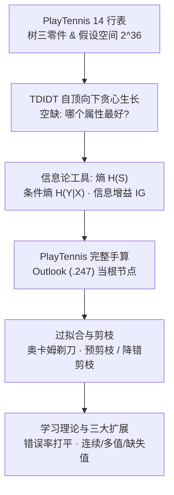

---

### 1.2 决策树的表示与自顶向下归纳（C1.2）

#### 树的三个零件与假设空间规模
以经典的 **PlayTennis（14 条天气记录，9 正 5 负）** 为例，一棵决策树由三部分组成：
- **内部节点（Internal Node）**：对某个属性的测试（如 `Outlook`）。
- **分支（Branch）**：该属性的一个取值（如 `Sunny` / `Overcast` / `Rain`）。
- **叶节点（Leaf Node）**：最终分类结论（`Yes` / `No`）。

在 PlayTennis 的 4 个离散属性（取值数 $3 \times 3 \times 2 \times 2 = 36$ 种输入组合）上，所有可能的布尔函数共有 **$2^{36} = 68{,}719{,}476{,}736$** 种，穷举所有树完全不可行，因此必须用启发式贪心搜索——**TDIDT（Top-Down Induction of Decision Trees，自顶向下归纳决策树，典型算法 ID3）**：
1. 选择当前“最好”的决策属性 $A$ 放到节点上。
2. 为 $A$ 的每个可能取值拉出一条分支。
3. 将训练样本按 $A$ 的取值分流到各子节点。
4. 若某子节点样本已全属同一类（纯节点），标为叶节点停止；否则对子节点递归重复。

---

### 1.3 熵、条件熵与信息增益（C1.3 · 必考手算）

#### 为什么需要熵？
“哪个属性最好”本质是问：**按这个属性切分后，子节点变得有多“纯”？** 信息论用 **熵（Entropy）** 度量不确定性（编码一串符号平均需要的比特数）：
- **一般熵**：$H(X) = -\sum_j p_j \log_2 p_j$（约定 $0\log_2 0 = 0$）。
- **二分类样本熵**：$H(S) = -p_\oplus \log_2 p_\oplus - p_\ominus \log_2 p_\ominus$。
  - 全纯（$p=0$ 或 $1$）时 $H=0$；对半分（$p=0.5$）时最混乱，$H=1$。
  - **考场高频熵值速记**：1:1 $\to 1.000$，3:4 $\to 0.985$，2:3 $\to 0.971$，9:5 $\to 0.940$，1:2 $\to 0.918$，1:3 $\to 0.811$，1:4 $\to 0.722$。

![[C1.3-样本熵曲线-图示.png]]

#### 条件熵、信息增益与相对信息增益
- **特定条件熵（Specific Conditional Entropy）**：固定 $X = v$ 后 $Y$ 的熵：
  $$H(Y \mid X = v) = -\sum_i P(Y = i \mid X = v) \log_2 P(Y = i \mid X = v)$$
- **条件熵（Conditional Entropy）**：按各分支样本占比加权平均：
  $$H(Y \mid X) = \sum_v P(X = v)\, H(Y \mid X = v)$$
- **信息增益（Information Gain, IG）**：分裂前后熵的减少量，越大越好：
  $$IG(Y \mid X) = H(Y) - H(Y \mid X), \qquad \text{即 } Gain(S, A) = H(S) - \sum_{v \in \text{Values}(A)} \frac{\lvert S_v \rvert}{\lvert S \rvert} H(S_v)$$
- **相对信息增益（Relative Information Gain, RIG）**：
  $$RIG(Y \mid X) = \frac{H(Y) - H(Y \mid X)}{H(Y)}$$
  *（勘误提醒：原课件 12.pdf p19 漏印了分子括号写成 $H(Y) - H(Y\mid X)/H(Y)$，必须加上分子括号！）*

![[C1.3-信息增益例-年龄段与财富.png]]

> [!example] 必考手算走查：PlayTennis 根节点四个属性的信息增益
> 根节点 $S = [9+, 5-]$，总熵 $H(S) = -\frac{9}{14}\log_2\frac{9}{14} - \frac{5}{14}\log_2\frac{5}{14} = \mathbf{0.940}$。
> 1. **Outlook**：Sunny $[2+,3-]$ ($H=0.971$)、Overcast $[4+,0-]$ ($H=0$)、Rain $[3+,2-]$ ($H=0.971$)：
>    $$Gain(S, \text{Outlook}) = 0.940 - \Big(\frac{5}{14}\cdot 0.971 + \frac{4}{14}\cdot 0 + \frac{5}{14}\cdot 0.971\Big) = \mathbf{0.247}$$
> 2. **Humidity**：High $[3+,4-]$ ($0.985$)、Normal $[6+,1-]$ ($0.592$) $\implies Gain = \mathbf{0.152}$（精确值 $0.1518$，课件按取整算 $0.151$）。
> 3. **Wind**：Weak $[6+,2-]$ ($0.811$)、Strong $[3+,3-]$ ($1.000$) $\implies Gain = \mathbf{0.048}$。
> 4. **Temperature**：Hot $[2+,2-]$、Mild $[4+,2-]$、Cool $[3+,1-]$ $\implies Gain = \mathbf{0.029}$。
>
> **结论**：Outlook 增益最大（$0.247$），选作根节点；其 `Overcast` 分支直接纯为 `Yes`，`Sunny` 子集再算得 Humidity 增益 $0.971$ 最大，`Rain` 子集算得 Wind 增益 $0.971$ 最大，整棵树长成！

---

### 1.4 过拟合、归纳偏置与剪枝（C1.4）

#### 归纳偏置与奥卡姆剃刀（Occam's Razor）
ID3 从空树出发逐层加深，它的 **归纳偏置（Inductive Bias）** 是偏好 **较短的树**（以及高信息增益属性靠上的树）——这对应 **奥卡姆剃刀原理**：如无必要，勿增实体，优先选择能解释数据的最简单假设。

![[C1.4-ID3假设空间搜索-图示.png]]

#### 过拟合的正式定义与两条剪枝对策
当数据中混入 **噪声样本**（如把一条 Sunny 样本的标签误标）或样本太少产生巧合相关时，树会继续分裂去死记噪声：若存在另一假设 $h' \in H$ 使 $error_{train}(h) < error_{train}(h')$ 但 $error_{true}(h) > error_{true}(h')$，则 $h$ **过拟合（Overfitting）**，过拟合程度为 $error_{true}(h) - error_{train}(h)$。

![[C1.4-过拟合-树规模与精度曲线.png]]

- **预剪枝（Pre-pruning）**：在树生长过程中提前叫停（如信息增益低于阈值、节点样本数太少）。缺点：很难精准判断何时停，可能视野太短错过后续好分裂。
- **后剪枝 / 降错剪枝（Reduced-Error Pruning）**：先让树充分长完，再留出一份独立的 **验证集（Validation Set）**，自底向上尝试把每个内部节点替换为多数类叶节点，**只要验证集准确率不下降就剪掉**，直到无法继续改进。

![[C1.4-降错剪枝效果曲线.png]]

---

### 1.5 学习理论视角与决策树三大扩展（C1.5）

#### 监督学习形式化与为什么不用“错误率”当分裂准则？
真实误差定义为 $err(h) = \Pr_{x \sim D}(h(x) \ne c^*(x))$。寻找与训练集一致的最小决策树是 **NP-hard** 问题，所以只能贪心。
**为什么不能直接用“分裂后误分类率下降”替代信息增益？** 在 PlayTennis 根节点 $[9+, 5-]$（错误率 $5/14$），无论按 Outlook、Humidity、Wind 还是 Temperature 切分，按各子节点多数类投票算出的加权错误率 **全部等于 $5/14 = 0.3571$，四个属性全面打平**！因为错误率是分段线性的，而熵是严格凹函数，能敏锐奖励纯度提升。

#### 决策树的三大工程扩展
1. **连续属性（Continuous-Valued Attributes）**：先将样本按该属性值排序，**只在相邻样本标签发生变化的位置取中点** 作为候选阈值 $t$，转化为二元属性 $A > t$ 后选信息增益最大者。
   *（原课件勘误 13.pdf p17：课件示例写 $Temperature > 72.3$，但在同页 6 条数据上 72.3 落在两个 Yes 之间，增益为 0；按标签变化处遍历，最优阈值应为 **54**，增益 $0.541$。）*
2. **多值属性偏好与增益率（Gain Ratio）**：信息增益天生偏向取值极多的属性（例如 `Date` 每天一个值，切完每支 1 个样本纯度 100%，信息增益最大但毫无泛化能力！）。C4.5 改用 **增益率**：
   $$GainRatio(S, A) = \frac{Gain(S, A)}{SplitInformation(S, A)}, \qquad SplitInformation(S, A) = -\sum_{i=1}^{c} \frac{\lvert S_i \rvert}{\lvert S \rvert} \log_2 \frac{\lvert S_i \rvert}{\lvert S \rvert}$$
   对 `Date` 而言 $SplitInformation = \log_2 14 = 3.807$，直接拉低其得分。
3. **缺失值（Missing Values）**：可用该节点/同类别中最常见属性值填补，或按该属性已知取值的比例将样本 **按权重分流** 到所有分支。

### 第 1 章（决策树）公式与核心结论速查表

| 概念 | 公式 / 判据 | 关键提醒 |
| :--- | :--- | :--- |
| 熵与条件熵 | $H(X)=-\sum p_j\log_2 p_j$；$H(Y\mid X)=\sum_v P(X=v)H(Y\mid X=v)$ | 1:1 熵为 1；纯节点熵为 0 |
| 信息增益与 RIG | $IG=H(Y)-H(Y\mid X)$；$RIG=\dfrac{H(Y)-H(Y\mid X)}{H(Y)}$ | 12.pdf p19 漏分子括号；PlayTennis 根选 Outlook (0.247) |
| 增益率 | $GainRatio = Gain / SplitInformation$ | 抑制 `Date` 等多值属性作弊 |
| 错误率准则缺陷 | PlayTennis 根结点四个属性切完错误率全是 $5/14$ | 全面打平，无法选属性 |
| 连续属性与剪枝 | 排序后仅在标签变化处取中点；降错剪枝依赖验证集 | 13.pdf p17 最优阈值是 54 而非 72.3 |

---

## 第 12 章 集成学习与 Boosting（C12.1）

> [!tip] 本章解决什么问题？
> 造一个一步到位的“超级强分类器”往往很难，但造一堆略强于瞎猜的“弱规则”（如单层决策树桩）却极其便宜。**集成学习（Ensemble Learning）** 回答：能不能把多个弱分类器组合起来，拼成一个极强的分类器？本章重点剖析 **AdaBoost** 的权重更新机制、指数损失本质及与 **Bagging** 的对照。

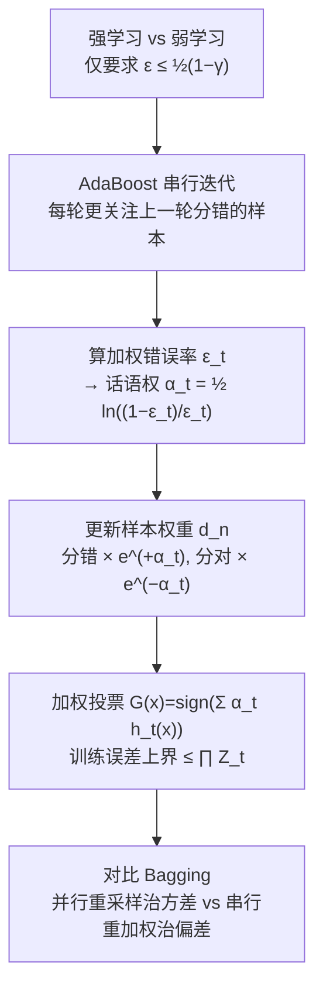

---

### 12.1 强弱学习等价性与 AdaBoost 全流程（C12.1）

#### 弱学习（Weak Learning）与样本加权
标签取 $y \in \{-1, +1\}$。如果一个廉价算法在任意样本分布 $W(x)$ 下总能找到错误率 $\epsilon \le \frac{1}{2}(1 - \gamma)$（$\gamma > 0$，即只比抛硬币好一点点）的假设，就称它为 **弱学习器（Weak Learner）**。Schapire & Freund 证明：**弱可学习等价于强可学习**，桥梁就是 **Boosting**。

#### AdaBoost 算法完整步骤（必背必会手算）
给定 $N$ 个样本 $(x_n, y_n)$，初始化均匀权重 $d_n^{(1)} = \frac{1}{N}$。对 $t = 1, \ldots, T$：
1. 在当前分布 $d^{(t)}$ 下训练弱分类器 $h_t$，计算其 **加权错误率**：
   $$\epsilon_t = \sum_{n=1}^{N} d_n^{(t)} \mathbf{1}[y_n \ne h_t(x_n)]$$
2. 计算该弱分类器的 **投票权重（话语权）** $\alpha_t$：
   $$\alpha_t = \frac{1}{2} \ln \frac{1 - \epsilon_t}{\epsilon_t}$$
   - $\epsilon_t = 0.5$（瞎猜）$\implies \alpha_t = 0$（剥夺发言权）；$\epsilon_t$ 越小，$\alpha_t$ 越大；$\epsilon_t > 0.5$ 时 $\alpha_t < 0$（反着投）。
3. **更新样本权重**（分错的放大、分对的缩小，再除以归一化因子 $Z_t$ 使和为 1）：
   $$d_n^{(t+1)} = \frac{d_n^{(t)} \exp\big(-\alpha_t y_n h_t(x_n)\big)}{Z_t}, \qquad Z_t = 2\sqrt{\epsilon_t(1 - \epsilon_t)}$$
   - **快捷结论**：分错样本权重乘 $e^{+\alpha_t}$，分对样本乘 $e^{-\alpha_t}$；错分与正确样本权重放大之比恰为 $e^{2\alpha_t} = \dfrac{1 - \epsilon_t}{\epsilon_t}$。
4. **最终强分类器**（加权投票）：
   $$G(x) = \operatorname{sign}\!\left( \sum_{t=1}^{T} \alpha_t h_t(x) \right)$$

![[C12-弱规则拼出边界.png]]

> [!example] 必考一轮完整手算（$N = 8,\ \epsilon_1 = 0.25$）
> 1. 初始权重：每个样本 $d_n^{(1)} = 1/8 = 0.125$；假设第 1 轮分错 2 个、分对 6 个，故 $\epsilon_1 = 2/8 = 0.25$。
> 2. 算 $\alpha_1$：$\alpha_1 = \frac{1}{2} \ln \frac{0.75}{0.25} = \frac{1}{2} \ln 3 \approx \mathbf{0.5493}$。
> 3. 算 $Z_1$：$Z_1 = 2\sqrt{0.25 \times 0.75} = \frac{\sqrt{3}}{2} \approx \mathbf{0.8660}$。
> 4. 更新权重：
>    - 分错样本（2 个）：$0.125 \times \sqrt{3} / (\sqrt{3}/2) = \mathbf{0.2500}$（合计占 0.5）；
>    - 分对样本（6 个）：$0.125 \times (1/\sqrt{3}) / (\sqrt{3}/2) = \mathbf{0.0833}$（合计占 0.5）。
>    - **自查规律**：更新后，**被上一轮分错的样本总权重恒为 $0.5$，分对的样本总权重恒为 $0.5$**！单个错分样本权重是正确样本的 $\frac{1-0.25}{0.25} = \mathbf{3}$ 倍。

---

### 12.2 理论保证、指数损失与 Bagging 对比（C12.1）

#### 为什么训练误差呈指数下降？
**指数损失（Exponential Loss）** $\ell_{\exp} = e^{-y f(x)}$ 处处大于等于 0/1 损失 $\mathbf{1}[y f(x) < 0]$，是其光滑凸上界；最小化上界对 $\alpha$ 求导正好推出 $\alpha_t = \frac{1}{2}\ln\frac{1-\epsilon_t}{\epsilon_t}$！最终强分类器的训练错误率满足上界：
$$E_{\text{train}}(G) \le \prod_{t=1}^{T} Z_t = \prod_{t=1}^{T} 2\sqrt{\epsilon_t(1 - \epsilon_t)}$$
只要每轮弱分类器满足 $\epsilon_t = \frac{1}{2} - \gamma_t < \frac{1}{2}$，就有 $Z_t < 1$，连乘使训练误差以 **指数速率** 趋向 0！

![[C12-指数损失上界.png]]

#### Boosting vs Bagging 核心对比与实验结果
在 27 个基准数据集上，单棵 C4.5 平均错误率 $15.66\% \to$ Bagged C4.5 $14.11\% \to$ Boosted C4.5 $13.56\%$（相对下降 $13.41\%$），但遇到噪声大数据集（如 `colic`）时 Boosting 反而劣于 Bagging（因为 Boosting 会疯狂放大噪声样本的权重导致过拟合）。*（勘误：原课件 Boosting_us 投票表数据不自洽，p11/p12 与 p13/p14 为同图重复嵌入，p18 实验表表头错位，ratio 列实际为相对错误率倍数 $0.930$。）*

| 对比维度 | Bagging（装袋法，如随机森林） | Boosting（提升法，如 AdaBoost） |
| :--- | :--- | :--- |
| 数据机制 | **有放回重采样（Bootstrap）** | **样本重加权（Reweighting）** |
| 训练方式 | 各基学习器 **并行独立** 训练 | **串行依赖**，后一轮专攻前一轮错题 |
| 聚合方式 | 等权投票 / 简单平均 | **按准确率 $\alpha_t$ 加权投票** |
| 主要治什么病 | **降方差（Variance）**（适合高方差深树） | **降偏差（Bias）**（适合高偏差弱树桩） |
| 对噪声敏感度 | 较稳健 | **较敏感**（易死磕噪声点） |

### 第 12 章公式与核心结论速查表

| 概念 | 公式 / 判据 | 关键提醒 |
| :--- | :--- | :--- |
| 弱学习条件 | $\epsilon_t \le \frac{1}{2}(1-\gamma)$ | 只需略好于瞎猜即可被提升 |
| 分类器权重 | $\alpha_t = \frac{1}{2}\ln\dfrac{1-\epsilon_t}{\epsilon_t}$ | $\epsilon_t=0.5 \Rightarrow \alpha_t=0$ |
| 样本权重更新 | $d_n^{(t+1)} = d_n^{(t)} e^{-\alpha_t y_n h_t(x_n)} / Z_t$，$Z_t = 2\sqrt{\epsilon_t(1-\epsilon_t)}$ | 更新后错分/正确总权重各占 $0.5$ |
| 训练误差上界 | $E_{\text{train}} \le \prod_{t=1}^{T} Z_t$ | 来自指数损失 $e^{-yf(x)}$ 上界，呈指数下降 |
| Bagging vs Boosting | Bagging 并行治方差；Boosting 串行治偏差 | Boosting 对标签噪声更敏感 |

# 模块 4：无监督学习与概率图模型（C4 + C5 + C11 + C16）

## 第 4 章 聚类与 K-means 算法（C4.1–C4.2）

> [!tip] 本章解决什么问题？
> 从这里跨入 **无监督学习（Unsupervised Learning）**——训练集只有输入 $\{x^{(1)}, \ldots, x^{(m)}\}$，没有标签 $y$（**注意：聚类和异常检测中彻底丢掉偏置 $x_0 = 1$**）。**K-means** 回答“如何把一堆无标签数据自动分成 $K$ 堆”，并展示最经典的 **坐标下降（Coordinate Descent）** 收敛机制。

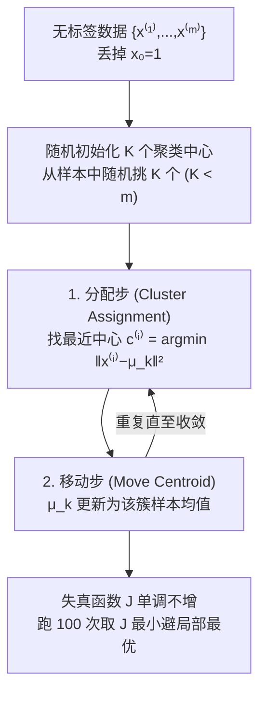

---

### 4.1 K-means 算法两步循环（C4.1）

输入聚类数 $K$ 与训练集 $\{x^{(1)}, \ldots, x^{(m)}\} \subset \mathbb{R}^n$：
1. **簇分配步（Cluster Assignment Step）**：对每个样本 $i=1,\ldots,m$，归入距离最近的聚类中心：
   $$c^{(i)} := \arg\min_{k \in \{1,\ldots,K\}} \lVert x^{(i)} - \mu_k \rVert^2$$
2. **移动中心步（Move Centroid Step）**：对每个簇 $k=1,\ldots,K$，把中心 $\mu_k$ 移到该簇所有样本的均值处：
   $$\mu_k := \frac{1}{\lvert S_k \rvert} \sum_{i \in S_k} x^{(i)}, \qquad S_k = \{i \mid c^{(i)} = k\}$$
   *（若某簇空了，通常直接删掉该簇或重新随机初始化该中心。）*

![[C4-Kmeans迭代九帧.png]]

![[C4-Kmeans手算例三次迭代.png]]

- **非分离簇的应用**：即使数据没有明显界线（如人的身高体重连续分布），K-means 依然能做 **市场细分 / T 恤分档（S / M / L）**。

---

### 4.2 优化目标、随机初始化与选 $K$（C4.2）

#### 失真函数（Distortion Function）与收敛性
K-means 最小化的目标函数叫 **失真函数**：
$$J(c^{(1)}, \ldots, c^{(m)}, \mu_1, \ldots, \mu_K) = \frac{1}{m} \sum_{i=1}^{m} \lVert x^{(i)} - \mu_{c^{(i)}} \rVert^2$$
- **坐标下降**：分配步固定 $\mu$ 对 $c$ 最小化 $J$；移动步固定 $c$ 对 $\mu$ 最小化 $J$。因为 $J \ge 0$ 有下界且划分状态有限，**$J$ 必然单调不增并在有限步内收敛**——**如果代码跑出 $J$ 上升，一定是有 bug！**

![[C4-失真函数随迭代单调下降.png]]

#### 随机初始化与避开局部最优
- 要求 $K < m$；**最佳实践**：直接从训练样本中随机挑选 $K$ 个不同样本作为初始 $\mu_1, \ldots, \mu_K$。
- K-means 的 $J$ 是非凸的，容易陷入较差的 **局部最优（Local Optima）**。对策：当 $K$ 较小（如 $2$–$10$）时，**随机初始化重复跑 50–100 次，取最终 $J$ 最小的那次结果**。

#### 如何选择 $K$？
1. **肘部法（Elbow Method）**：画 $J$ 随 $K$ 变化的曲线，找下降速度突然变缓的“手肘”拐点——但实践中曲线往往平滑下降，**常常根本没有明显的肘**。
2. **按下游业务目的选 $K$（更实用）**：比如 T 恤分 3 码（S/M/L）还是 5 码（XS–XL），看哪种能更好满足商业成本与合身度。

![[C4.2-板书-肘部法.png]]

### 第 4 章公式与核心结论速查表

| 概念 | 公式 / 判据 | 关键提醒 |
| :--- | :--- | :--- |
| 分配步与移动步 | $c^{(i)}=\arg\min_k \lVert x^{(i)}-\mu_k\rVert^2$；$\mu_k=\frac{1}{\lvert S_k\rvert}\sum_{i\in S_k} x^{(i)}$ | **无监督训练集丢掉 $x_0=1$** |
| 失真函数 | $J = \frac{1}{m}\sum_{i=1}^m \lVert x^{(i)} - \mu_{c^{(i)}}\rVert^2$ | 坐标下降单调不增；$J$ 上升必有 bug |
| 初始化与选 $K$ | 从样本随机挑 $K$ 点，跑 100 次选 $J$ 最小；肘部法或按下游目的 | 肘部法常无明显拐点 |

---

## 第 5 章 异常检测（C5.1–C5.4）

> [!tip] 本章解决什么问题？
> 飞机引擎出厂质检、机房服务器监控、金融欺诈识别都有一个共同特点：正常样本成千上万，异常样本极少且形态千奇百怪。**异常检测（Anomaly Detection）** 不直接学“异常长什么样”，而是用大量正常样本拟合概率密度 $p(x)$，一旦新样本落入低密度区（$p(x) < \varepsilon$）就报警。

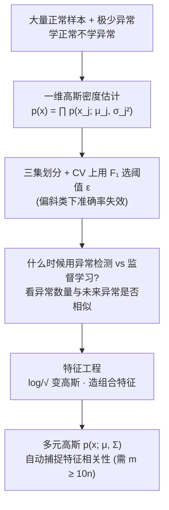

---

### 5.1 高斯分布、密度估计与算法三步（C5.1–C5.2）

#### 一维高斯分布与参数估计
$x \sim \mathcal{N}(\mu, \sigma^2)$ 的概率密度函数（峰高 $\frac{1}{\sqrt{2\pi}\sigma}$）：
$$p(x; \mu, \sigma^2) = \frac{1}{\sqrt{2\pi}\,\sigma} \exp\!\left( -\frac{(x - \mu)^2}{2\sigma^2} \right)$$
给定 $m$ 个正常样本，MLE 参数估计为 $\mu_j = \frac{1}{m}\sum_{i=1}^m x_j^{(i)}$，$\sigma_j^2 = \frac{1}{m}\sum_{i=1}^m (x_j^{(i)} - \mu_j)^2$（机器学习习惯用 $\frac{1}{m}$；统计学无偏估计用 $\frac{1}{m-1}$，$m$ 大时差别极小）。

#### 原模型（各特征独立假设）与评估
假设各特征独立，联合密度为连乘：
$$p(x) = \prod_{j=1}^{n} p(x_j; \mu_j, \sigma_j^2), \qquad \text{判据：} p(x) < \varepsilon \implies \text{异常}$$
*（防浮点下溢技巧：取对数变连加 $\log p(x) = \sum_j \log p(x_j; \mu_j, \sigma_j^2) < \log\varepsilon$。）*

- **三集划分（飞机引擎例：10000 正常 + 20 异常）**：
  - **训练集**：只放正常样本（6000 正常），用来拟合 $\mu_j, \sigma_j^2$（无监督）。
  - **CV 集**：2000 正常 + 10 异常，用于调整阈值 $\varepsilon$（在对数网格上选使 **$F_1$ 分数** 最大者）。
  - **测试集**：2000 正常 + 10 异常，仅报最终成绩。
- **偏斜类警示**：正常占 99.5%，全报“正常”准确率都有 99.5%，因此 **绝不能用准确率**，必须用精确率 $P$、召回率 $R$ 与 **$F_1 = \frac{2PR}{P+R}$**。

![[C5-阈值epsilon的权衡.png]]

---

### 5.2 异常检测 vs 监督学习 & 特征选择（C5.3）

#### 选型核心判据：未来的异常像不像见过的异常？

![[C5.3-板书-异常检测vs监督学习.png]]

- **选异常检测**：正例（异常）极少（通常 **2–50 个**）、负例（正常）极多；**异常类型多种多样，未来可能出现从未见过的新故障形态**（如欺诈检测、制造质检、数据中心监控）。
- **选监督学习（逻辑回归/SVM/NN）**：正负样本都较多；**未来的正例与训练集中见过的正例高度相似**（如垃圾邮件分类、天气预测、癌症分类）。

#### 特征变换与误差分析
- **把非高斯特征变高斯**：画直方图若明显右偏，做变换 $\log(x)$、$\log(x+c)$、$x^{1/2}$、$x^{1/3}$（压缩尾部力度：$\log > x^{1/3} > x^{1/2}$）。
- **误差分析造组合特征**：如果某异常样本（如 CPU 极高但网络流量极低，机房卡死）在单维分布里都正常，导致原模型漏报，可手工造比值特征 $x_5 = \frac{\text{CPU 负载}}{\text{网络流量}}$ 或 $x_6 = \frac{\text{CPU}^2}{\text{网络流量}}$。

---

### 5.3 多元高斯分布与异常检测（C5.4）

#### 为什么需要多元高斯？
原模型假设特征独立，等高线永远是 **轴对齐的正椭圆**，无法捕捉“CPU 高时网络通常也高”的相关性，会把斜对角线外的组合异常误判为正常（如算例中原模型给出 $p=0.0888$，多元高斯给出 $p=0.000059$ 精准报警）。

![[C5-原模型与多元高斯的等高线对比.png]]

#### 多元高斯公式与协方差矩阵 $\Sigma$ 读图
$$p(x; \mu, \Sigma) = \frac{1}{(2\pi)^{n/2} \lvert \Sigma \rvert^{1/2}} \exp\!\left( -\frac{1}{2} (x - \mu)^T \Sigma^{-1} (x - \mu) \right)$$
参数拟合：$\mu = \frac{1}{m}\sum_{i=1}^m x^{(i)}$，$\Sigma = \frac{1}{m}\sum_{i=1}^m (x^{(i)} - \mu)(x^{(i)} - \mu)^T$（外积平均）。
- **$\Sigma$ 读图字典**：对角线元素控制各轴胖瘦；非对角线 $>0$ 椭圆斜向右上（正相关），$<0$ 斜向左上（负相关）；$\mu$ 控制中心平移。

![[C5.4-板书-多元高斯例子4-正相关.png]]

- **两模型关系与选型**：原模型严格等价于多元高斯中 **$\Sigma = \mathrm{diag}(\sigma_1^2, \ldots, \sigma_n^2)$**（轴对齐）的特例。多元高斯自动捕获相关性，但 $\Sigma$ 有 $\frac{n(n+1)}{2} \approx \frac{n^2}{2}$ 个参数且需算 $\Sigma^{-1}$：**必须满足 $m > n$（实践要求 $m \ge 10n$）**，且不能有冗余/线性相关特征（如 $x_1=x_2$ 或 $x_3=x_4+x_5$ 会导致 $\Sigma$ 奇异不可逆）。特征极大（$n=10^5$）或样本少时用原模型+手工组合特征。

### 第 5 章公式与核心结论速查表

| 概念 | 公式 / 判据 | 关键提醒 |
| :--- | :--- | :--- |
| 原模型 | $p(x)=\prod_{j=1}^n p(x_j;\mu_j,\sigma_j^2) < \varepsilon$ 报异常 | 取对数防下溢；等价于 $\Sigma$ 对角的多元高斯 |
| 多元高斯 | $p(x;\mu,\Sigma)=\frac{1}{(2\pi)^{n/2}\lvert\Sigma\rvert^{1/2}}\exp(-\frac{1}{2}(x-\mu)^T\Sigma^{-1}(x-\mu))$ | **必须 $m>n$（实践 $m\ge 10n$）**；冗余特征致 $\Sigma$ 奇异 |
| 评估与选型 | CV 集用 $F_1$ 选 $\varepsilon$；异常仅 2–50 个且形态多变时选异常检测 | 偏斜类下禁止用准确率 |

---

## 第 11 章 EM 算法与高斯混合模型（C11.1）

> [!tip] 本章解决什么问题？
> K-means 强行把每个样本“非此即彼”地塞进一个簇（硬分配），且默认所有簇都是等大圆球，面对重叠分布、椭圆簇或不确定边界就会失灵。**高斯混合模型（Gaussian Mixture Model, GMM）** 配合 **EM 算法（Expectation–Maximization）** 将硬分配升级为带概率的 **软分配（Soft Assignment）**，用“猜归属 → 重估参数”的交替迭代保证对数似然单调不减。

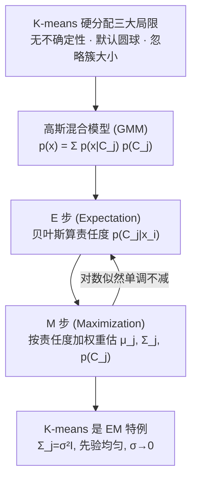

---

### 11.1 从硬分配到软分配与 E 步 / M 步（C11.1）

![[C11-硬分配到软分配.png]]

#### 高斯混合模型（GMM）
假设数据由 $K$ 个高斯成分混合生成，边缘密度为：
$$p(x_i) = \sum_{j=1}^{K} p(x_i \mid C_j)\, p(C_j), \qquad \sum_{j=1}^{K} p(C_j) = 1$$
其中 $p(C_j)$ 是第 $j$ 个成分的 **混合先验（Mixing Weight）**，$p(x_i \mid C_j) = \mathcal{N}(x_i; \mu_j, \Sigma_j)$。

#### EM 算法两步交替迭代（必背公式）
- **E 步（Expectation Step，算责任度 Responsibility）**：固定当前参数，用贝叶斯定理算样本 $x_i$ 属于成分 $C_j$ 的后验概率（对 $j$ 求和恒为 1）：
  $$p(C_j \mid x_i) = \frac{p(x_i \mid C_j)\, p(C_j)}{\sum_{k=1}^{K} p(x_i \mid C_k)\, p(C_k)}$$
  *（两个等强对称成分的正中点，责任度恒为 $0.5/0.5$，与方差 $\sigma^2$ 无关；但偏离中点时，方差越小责任度越趋近非 0 即 1 的硬分配。）*

![[C11-责任度随方差变化.png]]

- **M 步（Maximization Step，按责任度加权重估参数）**：先算第 $j$ 个成分的 **有效样本数** $N_j = \sum_{i=1}^{N} p(C_j \mid x_i)$（一般不是整数），再更新：
  $$\mu_j = \frac{\sum_{i=1}^{N} p(C_j \mid x_i)\, x_i}{N_j}, \qquad \Sigma_j = \frac{\sum_{i=1}^{N} p(C_j \mid x_i)(x_i - \mu_j)(x_i - \mu_j)^T}{N_j}, \qquad p(C_j) = \frac{N_j}{N}$$

![[C11-EM一轮数值演示.png]]

> [!example] 手算与收敛性验证
> - **一维责任度例**：$\mu_1=0, \mu_2=4, \sigma=1$、先验各 $0.5$，样本 $x=3$ 的未归一值分别约 $0.00555$ 与 $0.30327$ $\implies p(C_1\mid 3)\approx 0.018,\ p(C_2\mid 3)\approx 0.982$。
> - **六像素演示**：对数似然由 $-5.6548 \to -4.8225$，**每轮严格保证对数似然单调不减**，但只保证收敛到 **局部极大值**（同样依赖初始化）。
> - **K-means 是 EM 的极限特例**：当 $\Sigma_j = \sigma^2 I$、先验均匀且令 $\sigma \to 0$ 时，E 步的责任度退化为 0/1 硬分配，M 步退化为算术均值——即 K-means！应用包括图像颜色分割与基于内容的图像检索（CBIR）。

![[C11-EM对数似然单调.png]]

### 第 11 章公式与核心结论速查表

| 概念 | 公式 / 判据 | 关键提醒 |
| :--- | :--- | :--- |
| E 步（责任度） | $p(C_j\mid x_i)=\dfrac{p(x_i\mid C_j)p(C_j)}{\sum_k p(x_i\mid C_k)p(C_k)}$ | 对所有成分 $j$ 求和为 1 |
| M 步（重估参数） | $N_j=\sum_i p(C_j\mid x_i)$；$\mu_j=\frac{\sum p(C_j\mid x_i)x_i}{N_j}$；$p(C_j)=\frac{N_j}{N}$ | $N_j$ 一般不是整数 |
| 收敛与退化 | 对数似然单调不减，局部极大；$\Sigma_j=\sigma^2 I, \sigma\to 0$ 退化为 K-means | 协方差归一化因子含 $1/\sqrt{\lvert\Sigma\rvert}$ |

---

## 第 16 章 概率图模型与贝叶斯网络（C16.1–C16.6）

> [!tip] 本章解决什么问题？
> 第 3 章留下了一个大坑：$M$ 个二值变量的完整联合分布需要 $2^M - 1$ 个独立参数（$M=100$ 时高达 $1.27\times 10^{30}$），根本存不下也学不动。**概率图模型（Probabilistic Graphical Models）** 用一张图把变量之间的 **条件独立（Conditional Independence）** 结构画出来，把指数级巨表拆成一堆小条件概率表的乘积。

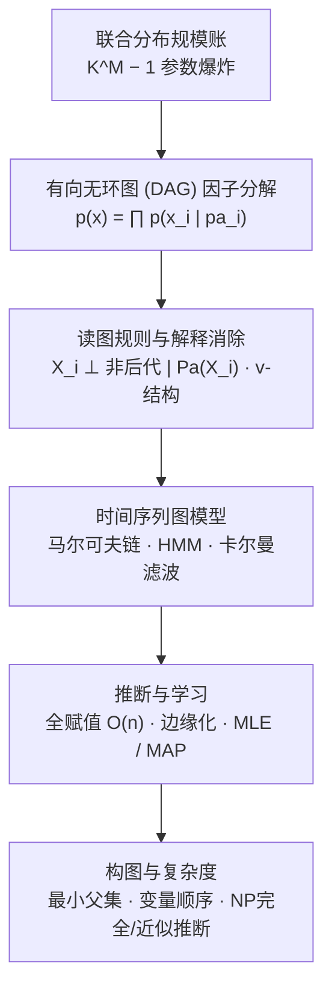

---

### 16.1 规模账与有向图因子分解（C16.1–C16.2）

#### 为什么是 $2^M - 1$ 而不是 $2^M$？
归一化条件（所有行之和为 1）消耗掉 $1$ 个自由度，因此 $M$ 个 $K$ 值变量的联合分布需要 **$K^M - 1$** 个独立参数（二值即 $2^M - 1$）。单纯套链式法则 $p(x_1,\ldots,x_M)=\prod_i p(x_i\mid x_{1:i-1})$ **一个参数都省不了**（对应全连接图），**真正省参数唯一靠的是删掉条件集里的无关变量（引入条件独立）**！

#### 有向图（贝叶斯网络）vs 无向图（马尔可夫网络）
- **有向图模型（Directed Graphical Model / 贝叶斯网络 Bayesian Network）**：由 **有向无环图（DAG）** + 每个节点的 **条件概率表（CPT / CPD）** 构成，联合分布直接因子分解为：
  $$p(x_1, \ldots, x_D) = \prod_{i=1}^{D} p(x_i \mid \mathrm{pa}_i)$$
  *（CPD 的每一行是在 **子变量取值上归一**，而不是在父节点上归一！如 $P(T\mid L)+P(T\mid\neg L)=0.3+0.8\ne 1$ 完全正常。）*
- **无向图模型（Undirected Graphical Model）**：$p(\mathbf{x}) = \frac{1}{Z} \prod_C \psi_C(\mathbf{x}_C)$，需计算全局归一化 **配分函数（Partition Function）** $Z = \sum_{\mathbf{x}} \prod_C \psi_C(\mathbf{x}_C)$。

![[C16-图模型-SMLRT网络与条件概率表.png]]

#### 参数计数公式（必考手算）
一个取 $K$ 个值、有 $m$ 个父节点的变量，其 CPT 需要 **$K^m(K - 1)$** 个独立参数（二值变量即 **$2^m$** 个）：
- **五节点 $S,M,L,R,T$**：$10$ 个参数（全表 $31$）。
- **七节点 DAG**：$3+8+4+2+4 = \mathbf{21}$ 个参数（全连接 $127$，全独立 $7$）。
- **亚洲网络（Asia Network，8 二值变量）**：从 $2^8 - 1 = 255$ 暴降到 $1+1+2+2+2+4+2+4 = \mathbf{18}$！
- **风暴网络（5 二值变量）**：从 $31$ 降到 $1+2+2+2+4 = \mathbf{11}$。

![[C16-亚洲网络-八变量的三层分组.png]]

---

### 16.2 条件独立、解释消除与时间序列模型（C16.2–C16.4）

#### 图上读独立性与 v-结构的解释消除（Explaining Away）
- **局部马尔可夫性质**：在贝叶斯网络中，给定父节点集合 $\mathrm{Pa}(X_i)$ 后，每个节点与它的 **所有非后代节点（Non-descendants）** 条件独立：
  $$X_i \perp \text{NonDescendants}(X_i) \mid \mathrm{Pa}(X_i)$$
- **条件独立与边缘独立互不包含**！最著名的反例就是 **v-结构（两因一果 $R \to W \leftarrow S$）**：下雨 $R$ 与开洒水器 $S$ 原本边缘独立，但一旦观测到草地湿了 $W=1$，两者瞬间变得 **条件相关**！

![[C16-解释消除-两因一果.png]]

> [!example] 必考算例：解释消除（Explaining Away）
> 先验下雨概率 $P(R) = 0.30$。
> 1. 观测到草地湿了（$W=1$）：$P(W)=0.326 \implies P(R \mid W) = \mathbf{0.8282}$（大概率下雨了）。
> 2. 此时又看见洒水器开着（$S=1$）：$P(R \mid W, S) = \mathbf{0.3253}$——洒水器把草湿“解释掉了”，下雨的后验概率立刻回落！

#### 时间序列与状态空间模型（C16.3）
序列建模的四级台阶：全独立（忽略时间）$\to$ 全连接（$2^N - 1$ 爆炸）$\to$ **一阶马尔可夫链** $P(x_n\mid x_{1:n-1})=P(x_n\mid x_{n-1})$（参数仅 $2N-1$）$\to$ **状态空间模型（State-Space Model）**（引入隐状态 $x_t$ 与观测 $y_t$）。

![[C16-状态空间模型-隐状态与观测.png]]

- **隐马尔可夫模型（HMM）**：隐状态离散（$K$ 态）、观测离散（$M$ 值）；由 **初始分布（$K-1$）+ 转移矩阵（$K(K-1)$）+ 发射矩阵（$K(M-1)$）** 构成（例：$K=3, M=10 \Rightarrow 2 + 6 + 27 = \mathbf{35}$ 个参数）。求最可能隐状态序列用 **Viterbi 算法**。
- **卡尔曼滤波（Kalman Filter）**：隐状态与观测均为连续高斯变量。
- *（记号提醒：Prince 教材用 $w$ 表隐状态、$x$ 表观测，与本课 $x$ 隐状态 / $y$ 观测相反，勿混。）*

---

### 16.3 推断、从数据学表与构图代价（C16.5–C16.6）

#### 图上推断（Inference）与复杂度
- **完全赋值推断**：每个变量都给了具体取值，直接把各节点查表值相乘 $\prod_i P(x_i\mid \mathrm{pa}_i)$，只需 $n$ 次查表、$n-1$ 次乘法，复杂度 **$O(n)$**（例：五节点全 1 概率 $= 0.3\times 0.6\times 0.05\times 0.3\times 0.3 = 8.1\times 10^{-4}$）。
- **部分观测推断**：对未观测的隐藏变量 $H$ 求和边缘化 $P(Q \mid E) = \dfrac{\sum_H P(Q,E,H)}{\sum_{Q,H} P(Q,E,H)}$（例：$P(L=1)=0.119$，$P(L=1\mid T=1)=0.0482$）。
- **计算复杂度**：单连通树结构用 **置信传播（Belief Propagation）** 线性时间精确求解；一般有环图精确推断是 **NP 完全（NP-complete）** 的，需改用 **联结树（Junction Tree）** 或近似推断（**蒙特卡洛采样 MCMC / 变分推断 Variational Inference**）。

#### 从数据学习 CPT 与构图顺序
- **完整数据 MLE**：直接计数相除 $\hat{P}(x_i=1 \mid \mathrm{Pa}) = \dfrac{\#(x_i=1, \mathrm{Pa})}{\#(\mathrm{Pa})}$（对数似然按节点自动分裂，各表独立估计）。
- **MAP + Beta 先验**：加伪样本防零概率：$\hat{P} = \dfrac{c_1 + \beta_1 - 1}{c_1 + c_0 + \beta_1 + \beta_0 - 2}$；若有缺失数据，则须上 **EM 算法**。
- **构图算法与变量顺序**：按选定变量序逐个加入节点，取使 $P(X_i \mid \mathrm{Pa}) = P(X_i \mid X_{1:i-1})$ 的 **最小父集合**。**顺序强烈影响图的稀疏度**：按因果序 $R, S, W$ 构图只需 **6** 个参数，倒序 $W, R, S$ 则需 **7** 个参数。

### 第 16 章公式与核心结论速查表

| 概念 | 公式 / 判据 | 关键提醒 |
| :--- | :--- | :--- |
| 有向图分解 | $p(x_1,\ldots,x_D)=\prod_i p(x_i\mid \mathrm{pa}_i)$ | CPD 在 **子变量** 取值上归一，不在父节点归一 |
| 参数计数 | 节点 $K$ 值、$m$ 个父：$K^m(K-1)$（二值 $2^m$） | 亚洲网络 $255 \to 18$；风暴网络 $31 \to 11$ |
| 读图与 v-结构 | $X_i \perp \text{非后代} \mid \mathrm{Pa}(X_i)$；v-结构观测子节点引发解释消除 | 边缘独立与条件独立互不包含 |
| HMM 参数 | $(K-1) + K(K-1) + K(M-1)$ | $K=3, M=10 \Rightarrow 35$；最优路径用 Viterbi |
| 推断复杂度与学习 | 全赋值 $O(n)$、单连通线性、一般 NP 完全；MLE 直接计数相除 | 构图按因果序最稀疏；缺数据用 EM |

# 模块 5：工程实战与特殊场景（C6–8 + C15 + C17）

## 第 6 章 机器学习系统设计（C6.1–C6.3）

> [!tip] 本章解决什么问题？
> 真实工程不是考场算公式，而是决定“下周把宝贵时间花在哪件事上”。本章给出以 **误差分析（Error Analysis）** 和 **单一数值指标** 驱动迭代的系统设计流程，讲透 **偏斜类（Skewed Classes）** 下的精确率/召回率/$F_1$ 权衡，以及为什么“数据多往往比微调算法更有威力”。

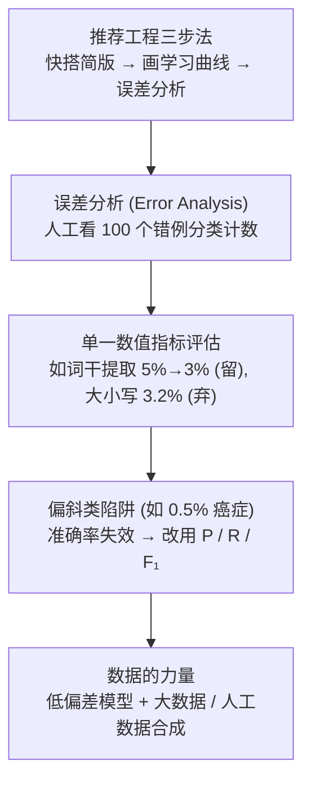

---

### 6.1 误差分析与单一数值评估指标（C6.1）

#### 系统设计推荐三步法
面对垃圾邮件分类（用最常见 1–5 万词建 **词袋特征 Bag-of-Words**），不要一上来就憋大招，而应：
1. **快速搭一个简单粗糙的原型**（24 小时内），在 CV 集上跑出基线。
2. **画学习曲线**，诊断高偏差还是高方差，决定是否需要更多数据或特征。
3. **误差分析（Error Analysis）**：人工翻看 CV 集上分错的样本（如 500 个 CV 中错 100 个），统计错因分布（钓鱼 53 / 卖药 12 / 仿冒 4 / 其他 31），立刻发现应主攻“钓鱼邮件”特征而非浪费时间在“仿冒”上。

- **单一实数评估指标（Single Real-number Metric）**：快速判断改动好坏。例：加词干提取（Stemming）让 CV 误差从 $5\% \to 3\%$（保留），区分大小写让误差 $3\% \to 3.2\%$（果断放弃）。

---

### 6.2 偏斜类评估：精确率、召回率与 $F_1$（C6.2）

#### 为什么偏斜类下准确率（Accuracy）会彻底失效？
癌症患病率仅 **$0.5\%$**。你的模型错误率 $1\%$（准确率 $99\%$），听起来很棒；但一个什么都不学、**永远预测 $y=0$（没病）** 的傻瓜分类器错误率只有 $0.5\%$（准确率 $99.5\%$）！因此必须拆开 **混淆矩阵（Confusion Matrix）**（TP / FP / FN / TN）：

![[C6.2-板书-混淆矩阵与精确率召回率.png]]

$$\text{精确率（Precision）}\; P = \frac{TP}{TP + FP} \quad (\text{预测为 1 的里面多少真为 1})$$
$$\text{召回率（Recall）}\; R = \frac{TP}{TP + FN} \quad (\text{真正为 1 的里面抓出了多少})$$

#### 阈值权衡与 $F_1$ 分数
预测规则 $h_\theta(x) \ge \text{threshold}$ 判 $1$：
- **提高阈值（如 0.7 / 0.9）**：只在极有把握时才报正类 $\implies$ **高 $P$、低 $R$**（宁缺毋滥）。
- **降低阈值（如 0.3）**：宁可错杀绝不漏网 $\implies$ **低 $P$、高 $R$**（如重病初筛）。

![[C6-阈值与精确率召回率.png]]

为了把 $P$ 和 $R$ 合成单一指标，不能用算术平均 $\frac{P+R}{2}$（全判 1 时 $R=1, P=0.02$，算术平均仍有 $0.51$ 虚高！），而必须用 **调和平均——$F_1$ 分数（$F_1$ Score）**：
$$F_1 = 2 \frac{P R}{P + R}$$
只要 $P$ 或 $R$ 任一接近 $0$，$F_1$ 就立刻趋近 $0$，专治极端短板（例：三算法 $F_1$ 为 $0.444 / 0.175 / 0.039$，而算术平均误把全判 1 的第三算法评最高 $0.51$）。

---

### 6.3 数据的力量与人工数据合成（C6.3）

**Banko & Brill 易混词实验** 表明：随着数据量从百万增至十亿，不同算法的性能差距迅速缩小，**“胜出的往往不是算法最好的人，而是数据最多的人”**。但大数据发挥威力需要 **两个前提**：
1. **特征包含足够信息**（专家测试：人类专家仅凭输入 $x$ 能否有把握预测 $y$？）。
2. **使用低偏差模型**（参数够多，如多特征逻辑回归/大型神经网络），再用大数据压低方差 $\implies J_{train}$ 小且 $J_{cv} \approx J_{train} \implies J_{test}$ 小。

- **人工数据合成（Artificial Data Synthesis）**：以 **照片 OCR** 为例，可将真实字体叠加随机背景，或对真实样本引入 **有代表性的畸变（Distortion）**（仿射扭曲、音频加真实街道背景噪音），但 **不要加无意义的纯随机高斯像素噪声**。

![[C6.3-真实数据与合成数据.png]]

### 第 6 章公式与核心结论速查表

| 概念 | 公式 / 判据 | 关键提醒 |
| :--- | :--- | :--- |
| $P / R / F_1$ | $P=\frac{TP}{TP+FP}$；$R=\frac{TP}{TP+FN}$；$F_1=\frac{2PR}{P+R}$ | 偏斜类严禁用准确率；$F_1$ 用调和平均防短板作弊 |
| 阈值权衡 | 阈值 $\uparrow \implies P \uparrow,\ R \downarrow$；阈值 $\downarrow \implies P \downarrow,\ R \uparrow$ | 医疗防漏诊调低阈值；防误报调高阈值 |
| 大数据两前提 | ① 专家凭 $x$ 能预测 $y$；② 低偏差模型 | 人工合成畸变必须贴近真实测试分布 |

---

## 第 7 章 推荐系统（C7.1–C7.3）

> [!tip] 本章解决什么问题？
> 给用户推荐电影或商品，如果不知道每部电影有多少“爱情成分”或“动作成分”，怎么预测用户打分？本章从 **基于内容的推荐（Content-based）** 过渡到自动同时学习用户偏好与物品特征的 **协同过滤（Collaborative Filtering / 低秩矩阵分解）**，并用 **均值归一化** 解决新用户冷启动问题。

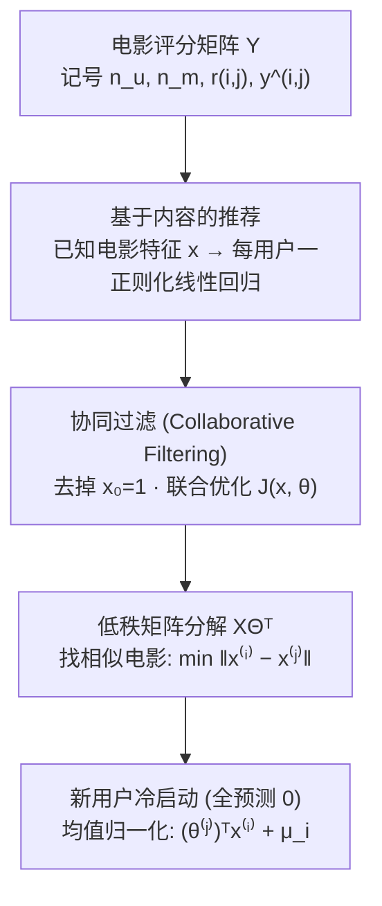

---

### 7.1 基于内容的推荐与协同过滤（C7.1–C7.2）

#### 核心记号
$n_u$：用户数；$n_m$：电影数；$r(i,j)=1$ 表示用户 $j$ 给电影 $i$ 评过分，$y^{(i,j)}$ 为该评分；用户 $j$ 对电影 $i$ 的预测评分为 $(\theta^{(j)})^T x^{(i)}$（例：$[0, 5, 0]\cdot[1, 0.99, 0] = 4.95$）。

- **基于内容的推荐（Content-based Recommendations）**：假设已人工标注电影特征 $x^{(i)}$（如爱情度、动作度），则每个用户 $j$ 就是一个独立的正则化线性回归（去掉无影响的 $1/m^{(j)}$）。
- **协同过滤（Collaborative Filtering）**：现实中很难给海量电影手工标特征。先想“鸡生蛋蛋生鸡”：已知 $\theta$ 可反推 $x$，已知 $x$ 可反推 $\theta$。更优雅的做法是 **把两个目标合成一个联合代价函数，同时优化所有 $x^{(i)}$ 与 $\theta^{(j)}$**：
  $$J(x^{(1)},\ldots,x^{(n_m)}, \theta^{(1)},\ldots,\theta^{(n_u)}) = \frac{1}{2} \sum_{(i,j):r(i,j)=1} \Big( (\theta^{(j)})^T x^{(i)} - y^{(i,j)} \Big)^2 + \frac{\lambda}{2} \sum_{i=1}^{n_m} \sum_{k=1}^{n} (x_k^{(i)})^2 + \frac{\lambda}{2} \sum_{j=1}^{n_u} \sum_{k=1}^{n} (\theta_k^{(j)})^2$$
  - **两个关键细节**：① **彻底去掉 $x_0 = 1$ 与 $\theta_0$**（因为模型可以自己学出恒为 1 的特征维度）；② **必须用小随机值初始化 $x, \theta$**（打破对称性，与神经网络同理）。

![[C7-协同过滤补全评分矩阵.png]]

---

### 7.2 低秩矩阵分解、相似推荐与均值归一化（C7.3）

- **低秩矩阵分解（Low Rank Matrix Factorization）**：把所有电影特征按行堆成 $X$、用户参数按行堆成 $\Theta$，整个预测评分矩阵就是 **$X \Theta^T$**（矩阵秩不超过特征维数 $n$）。
- **找相似电影**：要找和电影 $i$ 最像的电影 $j$，只需找特征向量欧氏距离 **$\lVert x^{(i)} - x^{(j)} \rVert$** 最小者。
- **新用户冷启动与均值归一化（Mean Normalization）**：
  - **痛点**：新用户 Eve 没给任何电影评过分，损失项为空，只剩正则项 $\frac{\lambda}{2}\lVert \theta^{(5)} \rVert^2$，优化结果必然是 $\theta^{(5)} = \mathbf{0}$，对所有电影都预测 $0$ 分，没法推荐！
  - **解法**：先算每部电影已评用户的平均分向量 $\mu$，将评分矩阵每行减去对应 $\mu_i$ 后再跑协同过滤；预测时把均值加回来：
    $$\hat{y}^{(i,j)} = (\theta^{(j)})^T x^{(i)} + \mu_i$$
    此时新用户 Eve 虽仍得 $\theta^{(5)} = \mathbf{0}$，但预测分变成各电影的客观平均分 $\mu_i$，合理得多！

![[C7.3-板书-均值归一化.png]]

> [!warning] 原课件勘误（lec_rec.pdf）
> 表格中 Dave 对第 5 部电影评分为 `?`，但矩阵 $Y$（p17/18/21/22）误写成 `0`，导致课件算 $\mu_5 = 1.25$，按原表 3 人评分应为 $5/3 \approx 1.67$；另 p2 印刷“1–5 星”，板书已改为“0–5 星”。

### 第 7 章公式与核心结论速查表

| 概念 | 公式 / 判据 | 关键提醒 |
| :--- | :--- | :--- |
| 协同过滤目标 | $\frac{1}{2}\sum_{r(i,j)=1}((\theta^{(j)})^Tx^{(i)}-y^{(i,j)})^2 + \frac{\lambda}{2}\sum\lVert x^{(i)}\rVert^2 + \frac{\lambda}{2}\sum\lVert\theta^{(j)}\rVert^2$ | **去掉 $x_0=1$**；小随机值初始化 |
| 向量化与相似 | 预测矩阵 $= X\Theta^T$；相似电影看 $\min \lVert x^{(i)} - x^{(j)}\rVert$ | 低秩矩阵分解 |
| 均值归一化 | 预测 $(\theta^{(j)})^T x^{(i)} + \mu_i$ | 解决新用户预测全 0 问题 |

---

## 第 8 章 大规模机器学习（C8.1–C8.3）

> [!tip] 本章解决什么问题？
> 当训练样本量 $m = 10^8$ 时，普通批量梯度下降每挪一小步就要扫描 1 亿条数据，彻底跑不动。本章先教你用学习曲线确认是否真需要大数据，再依次给出 **随机梯度下降（SGD）**、**小批量梯度下降（Mini-batch）**、**在线学习（Online Learning）** 与 **MapReduce 分布式并行** 四把利器。

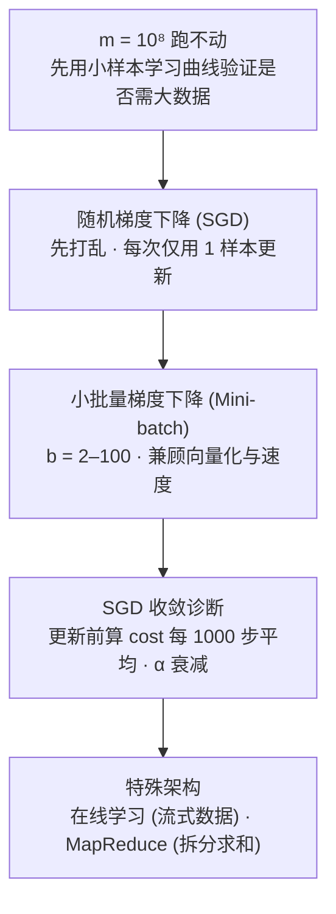

---

### 8.1 SGD 与小批量梯度下降（C8.1–C8.2）

#### 先做 Sanity Check
拿到海量数据前，先抽 1000 条样本画学习曲线：若是高偏差模型，直接上 1 亿条纯属浪费时间（应先增特征/增模型复杂度）；确认高方差后再上大数据。

#### 三种梯度下降核心对比
定义单样本代价 $\operatorname{cost}(\theta, (x^{(i)}, y^{(i)})) = \frac{1}{2}(h_\theta(x^{(i)}) - y^{(i)})^2$（注意 $J_{train} = \frac{1}{m}\sum \operatorname{cost}$；**勘误**：原课件 lecbig p15–16 误多写了一个 $\frac{1}{2}$ 写成 $\frac{1}{2m}$）。
- **批量梯度下降（BGD）**：每步扫全部 $m$ 条，路径笔直但极慢。
- **随机梯度下降（SGD）**：**第一步先随机打乱数据集**，然后逐条样本更新：
  $$\theta_j := \theta_j - \alpha \big(h_\theta(x^{(i)}) - y^{(i)}\big) x_j^{(i)}$$
  每步极快，但路径带噪声，最终会在 **全局最优附近来回徘徊** 而不会停死在一点。
- **小批量梯度下降（Mini-batch GD）**：每步取 $b$ 个样本（典型 $b = 2\text{–}100$，如 $b=10, m=1000$ 每遍 100 步），既快又能利用 **向量化并行**。

![[C8-三种梯度下降的轨迹.png]]

#### 检查 SGD 收敛与学习率衰减
- **怎么画收敛曲线？** 绝不能每步算全量 $J_{train}$！正确做法是 **在用第 $i$ 个样本更新 $\theta$ 之前** 先算它的 $\operatorname{cost}(\theta, (x^{(i)}, y^{(i)}))$，**每 1000 步取一次平均** 画点。
- **读图技巧**：曲线噪声太大看不清趋势 $\to$ 增大平均窗口（如从 1000 增到 5000）；曲率变平后调小 $\alpha$ 可收敛到更贴近最优点的更低谷底；曲线上升 $\to$ 调小 $\alpha$。
- **学习率衰减（可选）**：若希望 SGD 彻底停在最优点而非附近徘徊，令 $\alpha = \dfrac{\text{const}_1}{\text{iterationNumber} + \text{const}_2}$ 随迭代缓慢衰减（代价是多两个超参数要调，实践中常保持常数 $\alpha$）。

![[C8-SGD收敛曲线的平均窗口.png]]

---

### 8.2 在线学习与 MapReduce（C8.3）

- **在线学习（Online Learning）**：面向永不枯竭的实时数据流（如快递定价选承运商、商品搜索预测点击率 CTR）：来一条 $(x, y)$ 就做一次 SGD 更新，然后 **直接丢弃该样本**，不再保存。最大优势：能 **自动适应用户偏好的动态漂移**。
- **MapReduce 与多核并行**：
  - **适用判据**：只要算法的核心计算能写成 **“对训练集求和”** 的形式（如 BGD、逻辑回归梯度、正规方程的 $X^TX$），就能把训练集切成 $K$ 份分给 $K$ 台机器（或单机多核）各自算局部和 $\text{temp}^{(k)}$，最后在中心节点汇总更新！
  - *（勘误：原课件 lecbig p23 逻辑回归代价函数中间误印成减号且缺括号，应为加号。）*

![[C8.3-多核并行.png]]

### 第 8 章公式与核心结论速查表

| 概念 | 公式 / 判据 | 关键提醒 |
| :--- | :--- | :--- |
| SGD 更新 | 先打乱；$\theta_j := \theta_j - \alpha(h_\theta(x^{(i)})-y^{(i)})x_j^{(i)}$ | 在最优点附近徘徊；可令 $\alpha=\frac{c_1}{\text{iter}+c_2}$ 衰减 |
| 小批量与收敛 | $b=2\text{–}100$；更新前算 cost 每 1000 步取平均 | 噪声大调大平均窗口；发散调小 $\alpha$ |
| 在线与 MapReduce | 在线学完即丢，适应分布变化；MapReduce 拆分求和 | 判断能否 MapReduce：看能否写成训练集求和 |

## 第 15 章 半监督学习与主动学习（C15.1–C15.2）

> [!tip] 本章解决什么问题？
> 前面 14 章都默认“样本自带标签”，但在网页分类、医疗影像、语音识别中，**未标注数据海量且廉价，标注却极其昂贵**。本章给出“标签不够用”的两条经典出路：**不问（半监督学习 Semi-supervised Learning）** 与 **少问、专挑最值的问（主动学习 Active Learning）**。

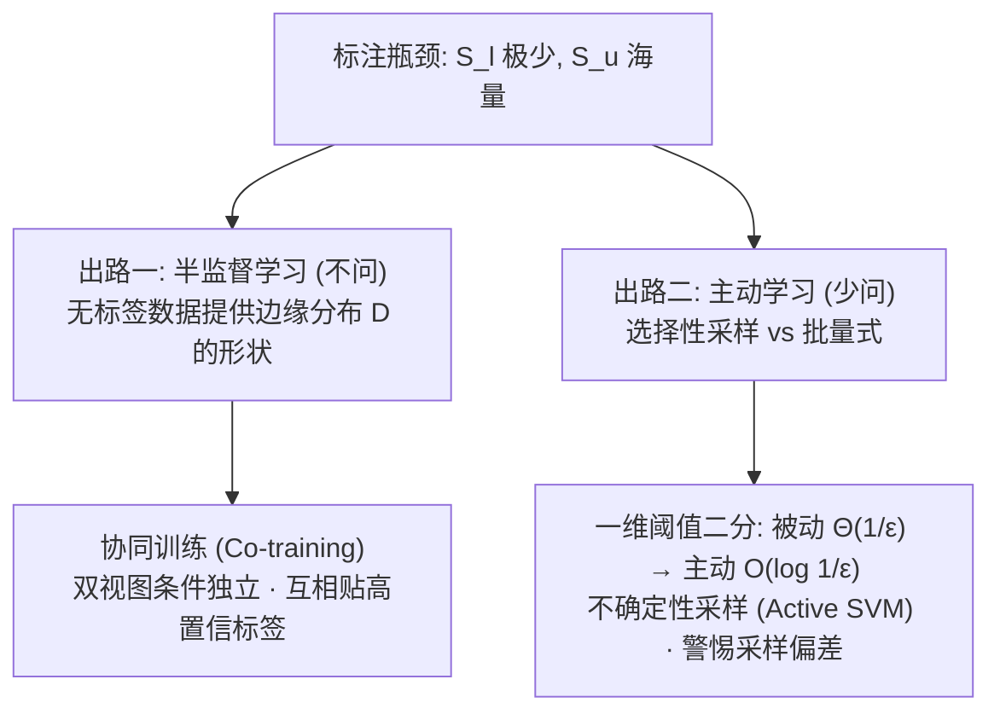

---

### 15.1 半监督学习与协同训练（C15.1）

#### 关键洞察：无标签数据到底提供了什么？
输入为少量有标签数据 $S_l = \{(x_i, y_i)\}$ 与大量无标签数据 $S_u = \{x_i\}$（同分布 $D$），目标仍是最小化真实误差 $\mathrm{err}_D(h) = \Pr_{x\sim D}(h(x) \ne c^*(x))$。
**核心洞察**：无标签数据不含 $y$，它提供的只是 **输入边缘分布 $D$ 的几何形状**（例如两团数据中间的稀疏低密度谷底）。因此半监督必须依赖某种 **连接分布 $D$ 与目标函数 $c^*$ 的先验假设**（三大流派：直推式 SVM / 协同训练 / 图方法）。

![[C15.1-关键洞察-分布形状决定边界.png]]

#### 协同训练（Co-training）
假设每个样本天然有两个充分视图 $x = \langle x_1, x_2 \rangle$（如网页的「正文文本」与「指向它的超链接锚文本」），各自都能独立完成分类，且 **给定标签后两视图条件独立**。
- **迭代做法**：分别用 $S_l$ 训练 $h_1, h_2$ $\to$ 让各自挑出在 $S_u$ 上 **最有把握** 的若干样本贴上伪标签，喂给对方扩充训练集 $\to$ 循环。
- **网页分类实验**：仅 12 条标注 + 1000 条未标注，标准监督错误率 $12.9\%/12.4\%/11.1\%$，协同训练降至 **$6.2\%/11.6\%/5.0\%$**（拓展应用：CMU 永不停止语言学习系统 NELL）。
- **正则化一致性目标**（把“两视图在无标签数据上应一致”写进损失）：
  $$\arg\min_{h_1, h_2} \sum_{l=1}^{2} \sum_{i=1}^{m_l} \ell(h_l(x_i), y_i) + C \sum_{i=1}^{m_u} \mathrm{agreement}\big(h_1(x_i), h_2(x_i)\big)$$
  *（勘误：原课件 semi p20–21 内层求和上限误印为 $m_1$，应为各视图标注数 $m_l$；另 p17 与 p22 为重复页。）*

![[C15.1-协同训练-学习区间.png]]

---

### 15.2 主动学习与不确定性采样（C15.2）

#### 指数级省标签：一维阈值二分算例
主动学习分为 **批量式（Pool-based）** 与 **选择性采样（Selective Sampling）**。在一维阈值分类 $h_w(x) = \mathbf{1}(x \ge w)$ 上：
- **被动学习**：要保证误差 $\le \varepsilon$，需标注 **$\Theta(1/\varepsilon)$** 个点（$\varepsilon=0.01 \Rightarrow 100$ 个）。
- **主动学习**：先拿 $N = O(1/\varepsilon)$ 个未标注点排序（含真实阈值 $w$ 的小区间期望长度 $2/(N+1)$），再做 **二分查找** 每次只问中点标签，仅需 **$O(\log(1/\varepsilon))$** 次查询（$\varepsilon=0.01 \Rightarrow 7$ 次，$\varepsilon=0.001 \Rightarrow 10$ 次 vs 被动 1000 次）！

![[C15.2-阈值查询-区间减半与标签复杂度.png]]

#### 不确定性采样（Uncertainty Sampling）与采样偏差
- **Active SVM**：每轮选离当前超平面最近（最拿不准）的无标签点询问标签：$\arg\min_i \lvert x_i \cdot w_t \rvert$（8 点算例中算出 $w=(0.5263, -0.5263)$，优先询问距离最小仅 $0.1414$ 的点 $(0.8, 0.6)$）。
- **致命风险——采样偏差（Sampling Bias）**：主动挑出来的样本不再服从原分布 $D$，贪心不确定性采样可能一直盯死局部边界而错过另一团数据！“安全（Safe）”的改进是 **分歧型方案（Disagreement-based）**：只在剩余候选假设仍有分歧的区域查询，无分歧则沉默。

![[C15.2-active-SVM-最近点查询.png]]

### 第 15 章公式与核心结论速查表

| 概念 | 公式 / 判据 | 关键提醒 |
| :--- | :--- | :--- |
| 半监督核心 | 无标签数据只提供边缘分布 $D$ 的形状 | 须依赖分布与标签的兼容假设 |
| 协同训练 | 双视图充分 + 给定标签条件独立；互相替对方贴高置信伪标签 | semi p20 求和上限误印 $m_1$（应为 $m_l$） |
| 标注复杂度 | 一维阈值：被动 $\Theta(1/\varepsilon)$ vs 主动 $O(\log(1/\varepsilon))$ | 靠二分实现指数级节省 |
| 不确定性采样 | Active SVM 选 $\arg\min_i \lvert x_i \cdot w_t\rvert$ | 警惕 **采样偏差**；安全法看候选假设分歧 |

---

## 第 17 章 时间序列监测（Biosurveillance, C17.1–C17.4）

> [!tip] 本章解决什么问题？
> 公共卫生监测（Biosurveillance）每天盯着急诊量、退烧药销量等计数时间序列，想在传染病爆发（如炭疽/流感）刚露头时第一时间报警，同时不能天天误报。本章完整演练了 **基线预测 → 半合成评测 → 日历与 CUSUM 累积 → 分母发病率建模** 的实战升级路线。

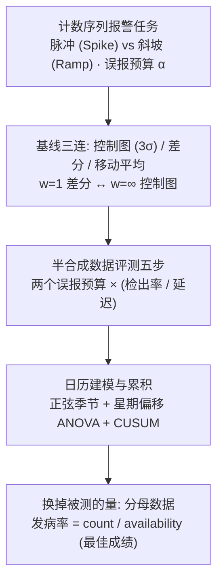

---

### 17.1 报警任务、基线方法与半合成评测（C17.1–C17.2）

- **两种爆发形态**：**脉冲型（Spike）**（单日骤升）与 **斜坡型（Ramp）**（连续多日缓慢爬坡）。
- **误报预算（False Alarm Budget）**：报警规则 $a_t > h$ 的阈值 $h$ 由可容忍的日误报率 $\alpha$ 反解——两周一次 $\alpha = 1/14 \approx 0.0714$（松预算），六周一次 $\alpha = 1/42 \approx 0.0238$（严预算）。
- **三种基础报警器（同一家族的连续谱）**：
  1. **控制图（Control Chart）**：用历史全局均值 $\bar{x}_{1:t-1}$ 与标准差 $\sigma_{1:t-1}$ 算 $z$-score，超 $3\sigma$ 报警（正态双边 $0.0027$，切比雪夫界 $\le 1/9$）。**三种失灵**：遇到季节趋势、星期几周期或非高斯偏态就彻底失效。
  2. **差分法（Differencing）**：$\hat{y}_t = x_{t-1},\ d_t = x_t - x_{t-1}$，对昨日噪声过度敏感，面对缓慢斜坡几乎失明。
  3. **移动平均（Moving Average）**：$\hat{y}_t = \frac{1}{w}\sum_{i=1}^{w} x_{t-i}$，$w$ 是唯一旋钮（$w=1$ 即差分，$w\to\infty$ 即控制图）。

![[C17.1-控制图在两年序列上.png]]

![[C17.1-移动平均的预测线.png]]

- **半合成数据评测（Semi-synthetic Evaluation）**：纯真实爆发太少、纯仿真失真，折中做法是把人工斜坡爆发叠加到真实历史正常序列上，重复 1000 次评测「松/严预算 × 检出率/平均延迟」四格成绩单；**第 4 步巧妙绕开手调阈值**：在所有非爆发日里数“分数 $\ge$ 爆发日分数”的比例，直接反推出触发该次报警所需的误报率。

---

### 17.2 日历回归、CUSUM 与发病率模型（C17.3–C17.4）

- **把日历写进预测**：
  - **季节项**：用正弦函数或日照长度拟合“正常水平”随月份的起伏。
  - **星期几模型（单因子七水平 ANOVA）**：$E[\text{Signal}] = a + \delta_{\text{day}}$（周一高、周末暴跌 $-12.2, -23.42$；注意原课件 7 个 $\delta$ 之和为 $-17.55 \ne 0$，存在截距与偏移的参数化不可辨识问题；且哑变量加过头会导致过拟合——检出率微升但延迟退步）。

![[C17.3-正弦季节基线.png]]

- **累计和（CUSUM）**：专治“单日不显眼但连涨多天”的斜坡爆发！把每天超出基线加容忍度 $k$ 的正残差 **累加** 起来，跌破 0 就清零，超过阈值 $h$ 报警后清零：
  $$S_t = \max\big(0,\ S_{t-1} + x_t - \hat{y}_t - k\big)$$
  > [!example] CUSUM 六天玩具算例
  > 预测基线 $\hat{y}_t = 10$、松弛项 $k = 1$、观测序列 $x = (10, 12, 11, 14, 13, 16)$：单日最大增量仅 $5$，但累计量一路冲到 $S_t = \mathbf{0,\ 1,\ 1,\ 4,\ 6,\ 11}$，稳稳抓出斜坡！

![[C17.3-CUSUM的累计量.png]]

- **分母数据与发病率模型（Sickness / Availability Model）**：
  计数不仅反映生病人数（需求），还受当天门诊开放率/在岗人数（供给）影响：$\text{count} = \text{需求} \times \text{供给}$。改测 **发病率（Sickness Rate）**：
  $$\text{sickness}_t = \frac{\text{count}_t}{\text{availability}_t}$$
  加入分母调整后，全表 16 种方法里表现飞跃：`sa-mav-7` 拿下最高检出率 **$0.87$**，`sa-mav-14` 拿下最短延迟 **$1.27$ 天**（严预算 $1.62$ 天）。后续四条进阶去路：小波分析、变点检测、卡尔曼滤波、HMM。

![[C17.4-发病率模型的预测与上界.png]]

### 第 17 章公式与核心结论速查表

| 概念 | 公式 / 判据 | 关键提醒 |
| :--- | :--- | :--- |
| 误报预算与基线 | 两周 $\alpha=1/14\approx 0.0714$；六周 $1/42\approx 0.0238$；MA 统一差分与控制图 | 控制图遇季节/星期几失灵 |
| CUSUM | $S_t = \max(0,\ S_{t-1} + x_t - \hat{y}_t - k)$ | 专抓缓慢斜坡爆发；报警后清零 |
| 发病率模型 | $\text{sickness}_t = \text{count}_t / \text{availability}_t$ | 剔除供给波动，全表成绩最优（0.87 / 1.27 天） |

---

# 模块 6：全局收束与现代延伸（C18）

## 第 18 章 课程总结与现代展望（C18.1–C18.2）

> [!tip] 本章解决什么问题？
> 把整学期散落的 17 章穿成一条 **六环节学习环**，揭示最小二乘、正则化与概率估计（MLE / MAP）的深层大一统，并把经典机器学习无缝桥接到现代深度学习与大语言模型的核心构件（表征学习、Self-Attention、生成模型与 RAG）。

---

### 18.1 一门课一个学习环与核心大一统（C18.1）

#### 通用目标函数与概率大一统（必考跨章综合）
整门课绝大多数监督模型都归结为同一个模板：
$$\hat{\theta} = \arg\min_{\theta} \left[ \frac{1}{m} \sum_{i=1}^{m} \ell\big(f_\theta(x_i), y_i\big) + \lambda \Omega(\theta) \right]$$
- **高斯噪声 + MLE $\iff$ 最小二乘损失**：$\frac{1}{2\sigma^2}\sum (y_i - f_\theta(x_i))^2 + \text{常数}$。
- **高斯先验 $\theta \sim \mathcal{N}(0, \tau^2 I)$ + MAP $\iff$ $\ell_2$ 正则化**：对应正则化强度 $\lambda = \dfrac{1}{2\sigma^2 \tau^2}$（先验方差 $\tau^2$ 越小，惩罚 $\lambda$ 越重）。

#### 跨章必知细节
- **学习曲线的不可约下限**：即使数据无限多、模型完美，测试误差也无法低于数据本身的 **噪声方差下限（Irreducible Error）**。

![[C18.1-学习曲线与噪声水平.png]]

- **阈值抬高时精确率不保证单调上升（经典反例）**：按预测分数降序排列的 4 个样本真标签为 `1, 0, 1, 0`。依次保留前 $k = 1, 2, 3, 4$ 个判正类，召回率 $R$ 单调不降（$0.50, 0.50, 1.00, 1.00$），但精确率 $P$ 为 **$1.00 \to 0.50 \to 0.67 \to 0.50$（非单调！）**。
- **图模型三件事**：表示（DAG/马尔可夫毯 Markov Blanket：父节点 + 子节点 + 子节点的其他父节点）、推断、学习。

---

### 18.2 现代展望：表征、注意力、生成与系统（C18.2）

#### 表征学习（Representation Learning）
现代范式不再手工造特征，而是 **大规模自监督预训练（Self-supervised Pretraining）** 学出通用表示 $\to$ **冻结（Freeze）** 主干只训线性头或全量 **微调（Fine-tuning）** $\to$ 下游评测。

#### 缩放点积自注意力（Scaled Dot-Product Self-Attention）
$$\mathrm{Attention}(Q, K, V) = \mathrm{softmax}\!\left( \frac{Q K^\top}{\sqrt{d_k}} \right) V$$
- **为什么要除以 $\sqrt{d_k}$？** 维数 $d_k$ 较大时，点积 $Q K^\top$ 的方差按 $d_k$ 增长，值过大把 softmax 推入饱和区导致 **梯度消失**；除以 $\sqrt{d_k}$ 把方差拉回 $1$。
- **位置编码（Positional Encoding）** 补回注意力丢失的词序信息；**因果掩码（Causal Mask）** 遮住未来 token，防止解码时偷看答案。
- *（算例复核：$Q=(1,0), K_1=(1,0), K_2=(0,1), d_k=2 \implies$ 缩放点积 $(0.7071, 0) \implies$ softmax 权重 $(0.6698, 0.3302)$，若 $V_1=(1,2), V_2=(3,4)$ 则输出 $(1.6605, 2.6605)$。）*

#### 生成模型与现代 AI 系统
- **自回归模型（Autoregressive，如 LLM）**：直接应用概率链式法则 $P_\theta(x_1, \ldots, x_T) = \prod_{t=1}^{T} P_\theta(x_t \mid x_{<t})$ 逐 token 生成。
- **扩散模型（Diffusion Models）**：前向逐步加噪破坏数据，反向学习去噪网络从纯噪声还原样本。
- **核心警示与系统架构**：“**合理 $\ne$ 真实**”（高似然文本仍可能产生幻觉）；现代系统通过 **检索增强生成（RAG）** 与 **工具调用（Tool Use）** 补足外部事实，并必须做 **分部件评测**（检索召回、证据忠实度、端到端正确率分开测）。

### 第 18 章公式与核心结论速查表

| 概念 | 公式 / 判据 | 关键提醒 |
| :--- | :--- | :--- |
| 通用目标与概率统一 | $\min \frac{1}{m}\sum \ell + \lambda\Omega(\theta)$；MLE=最小二乘，MAP=$\ell_2$ | $\lambda = 1/(2\sigma^2\tau^2)$ |
| 阈值单调性反例 | 标签 `1,0,1,0`：保留前 $k$ 个时 $P$ 为 $1.00, 0.50, 0.67, 0.50$ | 阈值抬高时 $R$ 单调不增，**$P$ 无单调保证** |
| 自注意力与自回归 | $\mathrm{softmax}(QK^\top/\sqrt{d_k})V$；$P(x_{1:T})=\prod P(x_t\mid x_{<t})$ | 除 $\sqrt{d_k}$ 防 softmax 饱和梯度消失 |

---

# 考前冲刺四大附录

## 附录 A：全课核心概念与算法横向对比总表

### A.1 五大监督学习模型族对照

| 模型族 | 假设形式与边界 | 损失函数与凸性 | 核心调参 / 防过拟合 | 适用场景 |
| :--- | :--- | :--- | :--- | :--- |
| **线性回归** | $h_\theta(x)=\theta^T x$（可加多项式） | 平方误差（**凸**，有正规方程闭式解） | 特征选择、L2 正则 $\lambda$ | 连续值预测；$n$ 小用正规方程，$n$ 大用 GD |
| **逻辑回归** | $g(\theta^T x)$，线性/多项式边界 | 交叉熵 / 对数损失（**凸**） | L2 正则 $\lambda$；多分类用 One-vs-all | 二分类/概率输出；$n\gg m$ 时首选 |
| **支持向量机（SVM）** | 大间隔超平面 / 核展开非线性边界 | 合页损失 + $\frac{1}{2}\lVert w\rVert^2$（**凸**） | $C$（$=1/\lambda$）与高斯核 $\sigma^2$；**用核前须缩放** | $n$ 小 $m$ 中等时高斯核 SVM 极强 |
| **神经网络（NN）** | 多层非线性复合，隐藏层自动学特征 | $K$ 分类交叉熵 + L2（**非凸**） | 网络宽度/深度、$\lambda$、随机初始化 | 图像/语音等高维复杂非线性问题 |
| **决策树 / AdaBoost** | 轴对齐阶梯划分 / 弱分类器加权投票 | 熵/信息增益 / 指数损失 | 预剪枝、降错剪枝、增益率；树深与轮数 $T$ | 表格数据、需可解释性；Boosting 治偏差 |

### A.2 无监督与概率建模对照

| 维度 | K-means（第 4 章） | 异常检测（第 5 章） | GMM + EM（第 11 章） | 贝叶斯网络（第 16 章） |
| :--- | :--- | :--- | :--- | :--- |
| 解决的问题 | 硬划分 $K$ 个簇 | 判新样本是否异常 $p(x)<\varepsilon$ | 软概率聚类与密度估计 | 压缩多变量联合分布与条件推断 |
| 核心机制 | 分配步 + 移动步（坐标下降） | 拟合正常样本一维/多元高斯 | E 步算责任度 + M 步加权重估 | DAG 因子分解 $\prod p(x_i\mid \mathrm{pa}_i)$ |
| 关键前提/限制 | 默认圆球簇、丢 $x_0=1$、需选 $K$ | 异常极少（2–50）；多元需 $m\ge 10n$ | 局部极大、依赖初始化 | 无环 DAG；一般有环图推断 NP 完全 |

### A.3 判别式 vs 生成式 & 异常检测 vs 监督学习

| 对比组合 | 左侧路线 | 右侧路线 |
| :--- | :--- | :--- |
| **判别式 vs 生成式** | **判别式**（逻辑回归/SVM/NN）：直接学 $P(Y\mid X)$ 或边界，分类常更准 | **生成式**（朴素贝叶斯/GMM/贝叶斯网络）：学 $P(X\mid Y)$ 与 $P(Y)$，能生成样本与处理缺失值 |
| **异常检测 vs 监督学习** | **异常检测**：异常极少（2–50）且未来故障形态不可预测 | **监督学习**：正负样本都充足且未来正例与历史正例相似 |
| **BGD vs SGD vs Mini-batch** | **BGD**：全量 $m$，平稳但大 $m$ 极慢 | **SGD**（1 条，快但徘徊）/ **Mini-batch**（$b=2\text{–}100$，向量化折中） |

---

## 附录 B：考场高频 7 类手算步骤模板

1. **决策树熵与信息增益手算（C1.3）**
   - 第一步：算根节点样本熵 $H(S) = -p_\oplus\log_2 p_\oplus - p_\ominus\log_2 p_\ominus$。
   - 第二步：对候选属性 $A$ 的每个取值 $v$，数出该分支的正负样本数，算子熵 $H(S_v)$。
   - 第三步：按分支占比 $\frac{\lvert S_v\rvert}{\lvert S\rvert}$ 加权求和得条件熵 $H(S\mid A)$，相减得 $Gain(S,A)=H(S)-H(S\mid A)$。
   - *验算*：若题目考增益率，再算 $SplitInformation$ 相除；若考连续属性，先排序并只在 **标签变化处** 取中点。

2. **贝叶斯定理与联合表推断（C3.2–C3.3）**
   - 贝叶斯题：写出先验 $P(A)$、$P(\sim A)=1-P(A)$、似然 $P(B\mid A)$ 与 $P(B\mid\sim A)$ $\to$ 算分母两条路径之和 $P(B)$ $\to$ 相除；**必用“1000 人头法”口算复核**，防基础比率谬误。
   - 联合表题：先确认整列概率之和 $=1$ $\to$ 算 $P(E)$ 把所有符合行相加（不关心的变量全加）$\to$ 算 $P(E_1\mid E_2)$ 用“同时符合两者的行之和”除以“符合 $E_2$ 的行之和”（先用中文念清分母是谁！）。

3. **K-means 与 EM 一轮迭代手算（C4.1 / C11.1）**
   - K-means：算每点到各中心平方距离 $\lVert x^{(i)}-\mu_k\rVert^2$ 判归属 $\to$ 按簇求算术均值更新 $\mu_k$ $\to$ 核对失真函数 $J$ 必须下降。
   - EM（GMM）：E 步代高斯密度乘先验，按行归一得责任度 $p(C_j\mid x_i)$（确认每行和为 1）$\to$ M 步算有效样本数 $N_j$，用责任度加权求新 $\mu_j, \Sigma_j$ 和 $p(C_j)=N_j/N$。

4. **AdaBoost 一轮权重更新（C12.1）**
   - 算加权错误率 $\epsilon_t$ $\to$ 算 $\alpha_t = \frac{1}{2}\ln\frac{1-\epsilon_t}{\epsilon_t}$ 与 $Z_t = 2\sqrt{\epsilon_t(1-\epsilon_t)}$ $\to$ 分错乘 $e^{+\alpha_t}/Z_t$、分对乘 $e^{-\alpha_t}/Z_t$。
   - *快捷验算*：更新后 **所有分错样本权重之和必等于 $0.5$，所有分对样本权重之和必等于 $0.5$**，总和必为 $1$！

5. **神经网络参数计数与前向/反向传播（C13.2 / C14.1）**
   - 参数计数：层宽 $s_1, s_2, \ldots, s_L$（不含偏置）$\implies$ 总参数 $\sum_{j=1}^{L-1} s_{j+1}(s_j + 1)$。
   - 前向：每层补 $a_0=1$，算 $z=\Theta a$ 与 $a=g(z)$。
   - 反向：先算 $\delta^{(L)}=a^{(L)}-y$，回传 $\delta^{(l)}=(\Theta^{(l)})^T\delta^{(l+1)}\odot a^{(l)}\odot(1-a^{(l)})$（去偏置项），梯度对非偏置项加 $+\frac{\lambda}{m}\Theta$。

6. **贝叶斯网络参数计数与边缘化推断（C16.2–C16.5）**
   - 参数计数：逐节点数父节点个数 $m$，单节点参数 $K^m(K-1)$（二值即 $2^m$），全网相加。
   - 完全赋值：沿拓扑序直接查每节点表相乘。部分观测：列出隐藏变量所有组合，每组算完全赋值后求和，最后除以证据总概率。

7. **混淆矩阵 $P / R / F_1$ 与 CUSUM 手算（C6.2 / C17.3）**
   - $P/R/F_1$：先填清 TP / FP / FN / TN 四格，算 $P=\frac{TP}{TP+FP}$、$R=\frac{TP}{TP+FN}$、$F_1=\frac{2PR}{P+R}$。
   - CUSUM：逐日算 $S_t = \max(0, S_{t-1} + x_t - \hat{y}_t - k)$，注意小于 0 立刻截断归零，超阈值 $h$ 报警后清零。

---

## 附录 C：全课原课件勘误避坑总清单

以下均为核实过的原课件印刷或板书笔误，**考试一律按右侧正确版本书写**：

| 章节与原课件位置 | 原课件错误写法 | 正确写法与说明 |
| :--- | :--- | :--- |
| **C1.3**（12.pdf p19） | $RIG = H(Y) - H(Y\mid X)/H(Y)$ | 漏分子括号，应为 $\dfrac{H(Y) - H(Y\mid X)}{H(Y)}$ |
| **C1.5**（13.pdf p17） | 连续属性示例阈值 $Temperature > 72.3$ | 72.3 落在两 Yes 间增益为 0；该表最优阈值为 **54**（增益 $0.541$） |
| **C2.7**（log reg2 高级优化页） | 正则逻辑回归梯度写成 $-\frac{\lambda}{m}\theta_j$ | **必须为加号 $+\frac{\lambda}{m}\theta_j$**（减号会放大参数！） |
| **C2.7**（log reg2 梯度/代价页） | PDF 漏印 $+\frac{\lambda}{m}\theta_j$ 与 $+\frac{\lambda}{2m}\sum\theta_j^2$ | 已按数学推导补全；切记永远不罚 $\theta_0$ |
| **C7.3**（lec_rec p17–22） | Dave 评分表为 `?`，矩阵 $Y$ 误写为 `0` | 导致 $\mu_5$ 课件算 $1.25$，按原表应为 $5/3 \approx 1.67$ |
| **C8.2 / C8.3**（lecbig p15–16, p23） | $J_{train}$ 多写了 $\frac{1}{2}$；逻辑回归代价中间误印减号 | $J_{train}=\frac{1}{m}\sum\text{cost}$；逻辑回归代价两项间为加号且带括号 |
| **C9.1 / C9.3**（what todo p8, p20, p22） | 交叉熵第二项印 $\log h$；正则求和上限印 $m$；末项印 10 | 应为 $\log(1-h)$；求和上限应为特征数 $n$；翻倍序列末项为 $10.24$ |
| **C10.1 / C10.2**（svm p9, p16） | 负例间隔手写 $z\le 1$；第二约束标签印 $y=1$ | 应为 $z\le -1$；第二约束对应 $y=0$ |
| **C12.1**（Boosting_us 投票表 & p18） | 投票表票数出现 $7/4$ 不自洽；p18 表头错位 | 手算改用 $N=8, \epsilon_1=0.25$；ratio 列是相对错误率倍数 |
| **C14.1**（Lecturenn1 p9, p13, p18） | 梯度正则项漏 $1/m$；代价第二项漏 `1-`；10-10-1 给 3 片权重 | 应为 $+\frac{\lambda}{m}\Theta$；$\log(1-h)$；3 片权重对应 4 层 10-10-10-1 |
| **C15.1**（semi p20–21） | 协同训练目标内层求和上限印 $m_1$ | 应为各视图标注数 $m_l$ |
| **C17.3**（time_series p38） | 星期七个偏移 $\delta$ 之和为 $-17.55 \ne 0$ | 参数化不可辨识（与截距 $a$ 混叠），需加和为零约束 |

---

## 附录 D：全 18 章核心公式速查墙

| 模块 | 核心公式 |
| :--- | :--- |
| **模块 1 地基与概率** | $\langle P,T,E\rangle$；$m \ge \frac{1}{\epsilon}(\ln\lvert H\rvert + \ln\frac{1}{\delta})$；$P(A\vee B)=P(A)+P(B)-P(A\wedge B)$；$P(A\mid B)=\frac{P(B\mid A)P(A)}{P(B\mid A)P(A)+P(B\mid\sim A)P(\sim A)}$；$\mathrm{Var}(X)=E[X^2]-E[X]^2$；$\rho_{XY}=\frac{\mathrm{Cov}(X,Y)}{\sigma_X\sigma_Y}$ |
| **模块 2 监督主线** | $h_\theta(x)=\theta^T x$；$\theta=(X^TX+\lambda\,\mathrm{diag}(0,1,\ldots,1))^{-1}X^Ty$；$g(z)=\frac{1}{1+e^{-z}}$；$J_{\text{CE}}=-\frac{1}{m}\sum[y\log h+(1-y)\log(1-h)]+\frac{\lambda}{2m}\sum_{j=1}^n\theta_j^2$；$\theta_j:=\theta_j(1-\alpha\frac{\lambda}{m})-\alpha\frac{1}{m}\sum(h-y)x_j^{(i)}$；SVM $\min C\sum\max(0,1-t_i z_i)+\frac{1}{2}\lVert w\rVert^2$；$K(x,l)=\exp(-\lVert x-l\rVert^2/2\sigma^2)$；BP $\delta^{(L)}=a^{(L)}-y,\ \delta^{(l)}=(\Theta^{(l)})^T\delta^{(l+1)}\odot a^{(l)}\odot(1-a^{(l)})$ |
| **模块 3 树与集成** | $H(X)=-\sum p_j\log_2 p_j$；$IG=H(Y)-H(Y\mid X)$；$GainRatio=Gain/SplitInfo$；AdaBoost $\alpha_t=\frac{1}{2}\ln\frac{1-\epsilon_t}{\epsilon_t}$，$d_n^{(t+1)}=d_n^{(t)}e^{-\alpha_t y_n h_t(x_n)}/Z_t$，$Z_t=2\sqrt{\epsilon_t(1-\epsilon_t)}$，$E\le\prod Z_t$ |
| **模块 4 无监督与图** | K-means $J=\frac{1}{m}\sum\lVert x^{(i)}-\mu_{c^{(i)}}\rVert^2$；多元高斯 $\frac{1}{(2\pi)^{n/2}\lvert\Sigma\rvert^{1/2}}\exp(-\frac{1}{2}(x-\mu)^T\Sigma^{-1}(x-\mu))$；EM 责任度 $p(C_j\mid x_i)=\frac{p(x_i\mid C_j)p(C_j)}{\sum_k p(x_i\mid C_k)p(C_k)}$；BN $p(\mathbf{x})=\prod_i p(x_i\mid\mathrm{pa}_i)$，单节点参数 $K^m(K-1)$ |
| **模块 5 工程与特殊** | $P=\frac{TP}{TP+FP},\ R=\frac{TP}{TP+FN},\ F_1=\frac{2PR}{P+R}$；推荐 $\hat{y}=(\theta^{(j)})^Tx^{(i)}+\mu_i$；SGD $\alpha=\frac{c_1}{\text{iter}+c_2}$；主动阈值 $O(\log\frac{1}{\varepsilon})$；CUSUM $S_t=\max(0, S_{t-1}+x_t-\hat{y}_t-k)$；发病率 $\text{count}_t/\text{availability}_t$ |
| **模块 6 总结与现代** | 通用目标 $\min[\frac{1}{m}\sum\ell+\lambda\Omega(\theta)]$；MAP $\ell_2$: $\lambda=\frac{1}{2\sigma^2\tau^2}$；$\mathrm{Attention}(Q,K,V)=\mathrm{softmax}(\frac{QK^\top}{\sqrt{d_k}})V$；自回归 $\prod_t P_\theta(x_t\mid x_{<t})$ |
