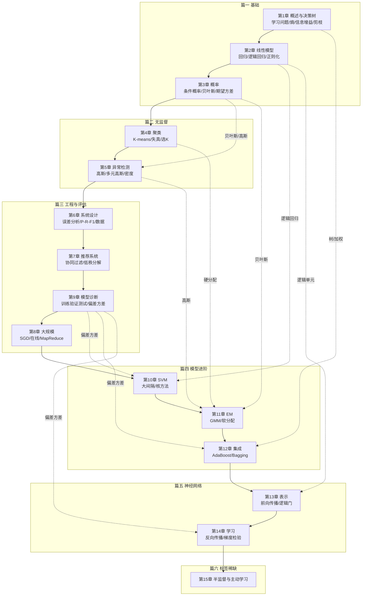

# 机器学习总复习：从决策树到主动学习

这份提纲把 15 章重新排成 **6 篇**，排序依据是**知识依赖**而不是上课顺序：凡是"后面某章要用到前面某个工具"的，工具先出现；凡是"两章在讲同一件事的两面"的，放在一起对照。章号保持不变，方便回查原笔记。

每一章只回答三个问题：

1. **它在解决什么问题**——这一章补上了前面哪块缺口；
2. **公式长什么样**——给到能直接默写、能直接代数进去算的程度；
3. **考场上会死在哪**——符号、阈值、分母、归一化这些真正扣分的地方。

配图全部复用讲义 `attachments/` 里的现成图片，不重复造图；标【拓展】的是课件没有展开、由教材与通行讲法补充的内容，优先级排在主干活之后。

> [!tip] 三遍用法
> - **第一遍（半天）**：只读第 0 节的地图与总表，再读每章的「知识主线」。目标是合上书能说出"这一章有哪几步"。
> - **第二遍（两三天）**：逐章读「核心知识点」，遇到公式先遮住自己写，写完再对照。写不出的回原篇，不要在这份提纲里硬背。
> - **第三遍（考前）**：附录 B 的手算模板各做一道，附录 C 的易错清单逐条自查，最后看附录 E 的三轮安排。

---

## 0. 先看全局

### 0.1 一张表定全局：问题—数据—模型—损失—评估

机器学习这门课的所有算法，都可以用同一组问题定位：**手里是什么数据、要输出什么、拿什么当目标、最后拿什么判好坏。** 把这张表背下来，选择题里给出一个场景，你至少能排除掉一半选项。

| 问题类型 | 数据形态 | 本课的代表算法 | 目标函数 / 判据 | 评估指标 |
|---|---|---|---|---|
| **回归** | $(x^{(i)},y^{(i)})$，$y$ 连续 | 线性回归、多项式回归、正则化线性回归 | 平方误差 $J(\theta)=\frac1{2m}\sum(h_\theta(x)-y)^2$ | $J_{test}$、MSE |
| **二分类** | $(x,y)$，$y\in\{0,1\}$ | 逻辑回归、决策树、SVM、神经网络、AdaBoost | 交叉熵 / 信息增益 / 合页损失 / 指数损失 | 误分类率；偏斜类用 $P,R,F_1$ |
| **多分类** | $y\in\{1,\dots,K\}$ | 逻辑回归一对多、神经网络多输出单元（独热标签）、SVM 一对多 | $K$ 个输出/分类器，取分数最大 | 同上，按类或宏平均 |
| **聚类** | 只有 $x^{(i)}$，无 $y$ | K-means | 失真 $J=\frac1m\sum\lVert x^{(i)}-\mu_{c^{(i)}}\rVert^2$ | $J$ 随 $K$ 的曲线、下游任务 |
| **密度估计 / 异常检测** | 大量正常样本，极少或没有异常标签 | 高斯模型、多元高斯、GMM + EM | 似然 $p(x)$，判 $p(x)<\varepsilon$ | $F_1$（在 CV 上选 $\varepsilon$） |
| **推荐** | 稀疏评分矩阵 $r(i,j)$ | 基于内容的推荐、协同过滤、低秩矩阵分解 | 只在已评分项上算的正则化平方误差 | 测试集上的平方误差 / 排序质量 |
| **标签稀缺** | 少量 $(x,y)$ + 大量 $x$ | 半监督（协同训练）、主动学习 | 一致性正则 / 不确定性采样 | 达到同样误差所需标注数 |
| **大规模训练** | $m$ 很大 | SGD、小批量、在线学习、MapReduce | 同上，换成单样本/小批量近似 | 学习曲线、$J$ 的滑动平均 |

三条贯穿全课的主线：

1. **假设空间 + 损失函数 + 优化算法**。监督学习的一切都是这三件套：先限定 $h$ 长什么样（线性？树？核展开？网络？），再定义"错多少"（平方、交叉熵、合页、指数），最后挑一个优化办法（正规方程、梯度下降、坐标下降、EM、前向分步）。**换算法往往只是换了其中一件**，例如逻辑回归→SVM 换的是损失，K-means→GMM 换的是"归属"的表示。
2. **偏差—方差**。所有"模型表现不好"最终都落到这两个诊断上：高偏差是"模型太笨/特征不够"，高方差是"模型太灵/数据太少"。第 2、9、10、12、14 章反复用它来解释 $\lambda$、$C$、$\sigma^2$、树深、网络规模、 boosting 轮数。
3. **数据与标签的成本**。第 1–14 章默认标签白送；第 4、5 章先去掉标签，第 15 章把"标注要花钱"摆到台面上——半监督是"不问"，主动学习是"少问"。

### 0.2 课程地图



### 0.3 与上课顺序的两处不同

| 位置 | 上课顺序 | 本提纲顺序 | 为什么 |
|---|---|---|---|
| 第 8、9 章 | 先大规模（8）再诊断（9） | **先诊断（9）再大规模（8）** | 第 8 章开篇就要用学习曲线判断"要不要更多数据"，而学习曲线是第 9 章建立的；先有诊断语言，第 8 章的取舍才有依据 |
| 第 7 章 | 在系统设计（6）之后、大规模（8）之前 | 仍紧跟第 6 章，但归入「工程与评估」篇 | 推荐系统是一个完整的"从问题到目标函数到评估"的系统案例，和第 6 章连读最顺 |

其余各章保持原顺序。第 3 章概率虽然编号在决策树之后，但第 1 章的熵是用"编码长度"独立推出来的，不依赖第 3 章，所以不强行提前。

### 0.4 考前必须能默写的十件事

1. 熵、条件熵、信息增益的定义，以及 PlayTennis 四个属性的增益（Outlook .247 / Humidity .152 / Wind .048 / Temperature .029）。
2. 线性回归的 $J$、梯度下降更新式（含同步更新）、正规方程。
3. 逻辑回归的 sigmoid、交叉熵损失、梯度（形式与线性回归相同）。
4. 正则化的 $J$、梯度、正规方程，以及 $\lambda$ 过大/过小的表现。
5. K-means 两步与失真 $J$，以及"$J$ 上升就是 bug"。
6. 高斯/多元高斯的密度公式、参数估计、$p(x)<\varepsilon$ 判据。
7. 精确率、召回率、$F_1$ 的定义与偏斜类下准确率失效的理由。
8. 三集划分、三个误差、高偏差/高方差的判据、学习曲线的两种形状。
9. SVM 的合页损失、$C$ 与 $\lambda$ 的关系、间隔 $2/\lVert w\rVert$、高斯核。
10. 反向传播的四个公式、梯度检验、随机初始化；以及 AdaBoost 的 $\alpha_t$ 与权重更新。

---

# 第一篇　基础：学习问题、决策树、线性模型与概率

> 这一篇的三章回答三个层次的问题：**第 1 章**把"学习"定义成一个可计算的问题，并用决策树走完"表示—搜索—准则—过拟合"的全程；**第 2 章**把假设空间换成线性函数，得到回归与分类的两大主力；**第 3 章**补上概率语言，为第 4、5 章的密度估计和第 11 章的 EM 做准备。

## 第 1 章｜概述与决策树：第一个完整的学习闭环

> **这一章解决什么**：把"机器学习"从一句口号变成 $\langle P,T,E\rangle$ 三元组 + "在假设空间 $H$ 里搜 $h$"的数学问题，再用决策树把这件事从头到尾做一遍。
> **对应笔记**：[[C1.1 机器学习概述与课程导航]]、[[C1.2 决策树的表示与自顶向下归纳]]、[[C1.3 熵与信息增益]]、[[C1.4 过拟合与剪枝]]、[[C1.5 学习理论视角与决策树扩展]]

### 1.1 学习问题：三个字母与三个对象

**定义（Mitchell）**：一个良定义的学习问题是一个三元组 $\langle P,T,E\rangle$——算法在任务 $T$ 上的性能 $P$ 随经验 $E$ 提升。

| 字母 | 含义 | 必须问清的事 |
|---|---|---|
| $E$ 经验 | 就是数据 | 多少条、每条有哪些特征、标签怎么来 |
| $T$ 任务 | 输入什么、输出什么 | 分类还是回归、输出类别还是概率 |
| $P$ 性能 | 好坏怎么量 | **在哪批数据上**、用什么指标 |

> [!note] 课程坐标（了解即可，不是考点）
> 成绩构成：课堂表现 10%、项目作业 30%、期末 60%。教材四本：Bishop *PRML*、周志华《机器学习方法》、李航《统计学习方法》、Mitchell *Machine Learning*（决策树记号与 PlayTennis 沿用此书）。
> 五个应用案例共用同一个句式"现实问题 → 写成 $T$ → 找 $E$ → 定 $P$ → 学规则"：剖宫产（病历→紧急剖宫产概率）、垃圾邮件（文本→spam/not spam）、人脸与物体检测（图像→框+类别）、fMRI 读词（脑活动→语义类别）、神经假肢（神经信号→动作指令）。它们说明机器学习处理的是**输入到输出的映射**，不是某种特定格式的数据。
> 学科版图上，它位于计算机科学、统计学、经济学与组织行为学、认知科学/神经科学、自适应控制理论、进化论的交集——每个圈都对"什么叫学习"给过一套答案（估计与置信、反馈与收敛、突触可塑性、选择与变异）。

> [!warning] 全课第一条规矩
> **$P$ 必须在没有参与训练的数据上度量。** 训练集上的高分叫"记忆力"，不叫性能。这条规矩在第 1.4 节变成 $error_{true}$ 与 $error_{train}$ 的落差，在第 9 章变成训练/验证/测试三集划分。

**函数逼近的四个对象**（这是全课的统一坐标系）：

- **实例空间** $X$：一条数据可能长成的所有样子；
- **目标函数** $f:X\to Y$：真实规律，存在但看不到；
- **假设空间** $H=\{h\mid h:X\to Y\}$：我们允许自己交出的答案的集合；
- **假设** $h\in H$：训练后交出的那一个。

学习 = 给一堆 $\langle x^{(i)},y^{(i)}\rangle$，在 $H$ 里搜一个 $h$ 逼近 $f$。于是所有算法的差别只剩三件事：

1. **$H$ 是什么**（表示）：所有直线／所有决策树／所有核展开／所有神经网络；
2. **"最好"怎么定义**（损失）：训练误差最小／间隔最大／似然最大；
3. **怎么搜**（优化）：闭式解／梯度下降／贪心分裂／坐标下降／前向分步。

> [!important] $H$ 的大小对应两种误差
> - $H$ 太小 → **近似误差**（approximation error）大：真规律根本不在你的答卷格式里，怎么搜都错。对应**偏差**。
> - $H$ 太大 → **估计误差**（estimation error）大：总能找到一个在训练集上全对的 $h$，但它在新数据上乱猜。对应**方差**。
>
> 一句话：**$H$ 太小偏差大，$H$ 太大方差大。** 这是第 9 章偏差—方差诊断的源头。

**记号约定（最容易丢分的地方）**：

- $x^{(i)}$：第 $i$ **条样本**，一个向量；上标圆括号是为了和平方区分；
- $x_j$：一条样本里的第 $j$ **个特征**；
- $x^{(i)}_j$：第 $i$ 条样本的第 $j$ 个特征；
- $m$：样本数；$n$：特征数。

**PAC 界**（只适用于**有限**假设空间）：

$$m\ \ge\ \frac{1}{\epsilon}\Big(\ln|H|+\ln\frac{1}{\delta}\Big).$$

读法：以至少 $1-\delta$ 的把握，真实误差不超过 $\epsilon$。三个直觉——$\epsilon$ 在分母（精度翻倍，数据翻倍）；$|H|$ 在对数里（假设空间翻很多倍，数据只要多一点点）；$\delta$ 也在对数里。

> [!warning] 两句话不能混
> PAC 说的是"**以高概率**真实误差 $\le\epsilon$"，**不是**"训练误差小 ⟹ 真实误差小"。后者还要 i.i.d.、$H$ 不太大等假设。另外，线性回归的 $H$ 是连续无穷集，$\ln|H|$ 无定义，这个公式**不能直接套**。

### 1.2 决策树：三个零件、一次贪心搜索、一个空格

**三个零件**：

- **内部结点**：对某个属性做一次测试；
- **分支**：属性的一个取值；
- **叶结点**：输出类别，或输出"正类概率"（叶里正负样本的比例）。

**完备性**：任意一个可能的 $x$ 都必须能沿分支走到某个叶。所以每个内部结点的分支要覆盖该属性的全部取值；连续属性要先离散化成"$>t$ / $\le t$"。

**$H$ = 所有决策树有多大**：PlayTennis 有 4 个属性，取值数 $3,3,2,2$，组合数 $3\times3\times2\times2=36$；每个"格子"可标正或负，于是有 $2^{36}\approx6.87\times10^{10}$ 个不同的 $f$。**14 条样本远不足以确定这 687 亿个候选中的哪一个**，穷举也不可能。

**TDIDT（自顶向下归纳）五步**：

1. 若当前子集的样本全属同一类 → 建叶，标该类，返回；
2. 若没有属性可再分（或样本用完）→ 建叶，标**多数类**，返回；
3. 否则，用某个准则从剩余属性中选"最好"的一个；
4. 按该属性的每个取值把子集切开，建分支；
5. 对每个分支递归调用。

> [!important] 它是贪心的，而且必须贪心
> 每层只选当前最好的属性，**不回溯**。为什么不穷举所有树取最小？因为**找最小的一致决策树是 NP-hard 的**（Hyafil & Rivest, 1976）。理论说"小树泛化好"，但那个最优目标算不动，所以退而求其次用贪心——代价是可能卡在局部最优、可能为一条噪声多长一层。**ID3 不是因为简单好写才被采用，而是因为理论上正确的目标算不动。**

第 3 步那个"最好"就是本章的**空格**：第 1.3 节用熵来填它。

**一个真实例子**：在 1000 例剖宫产数据上，根结点选的是**胎位**——胎位 $=2$ 时 $[3+,29-]$（约 89% 需要剖宫产），胎位 $=1$ 时 $88\%$ 顺产，**一个属性就把人群切成风险完全相反的两群**。这就是"好属性"长什么样。

### 1.3 熵、条件熵、信息增益：全章唯一的大量手算

**从编码长度理解熵**：若一个随机变量取 $k$ 个值、概率为 $p_1,\dots,p_k$，用二进制编码传递它，平均最短码长就是

$$H(X)=-\sum_{j}p_j\log_2 p_j .$$

**推导直觉（编码长度）**：最有效的编码给取值 $i$ 分配 $-\log_2 p_i$ 个比特——越罕见码越长。于是平均码长 $\sum_i p_i(-\log_2 p_i)$ 正是熵。**熵就是"最优编码下的平均码长"**。

- 四种等概率：$H=2$ bit（正好两位编码）；
- 三种等概率：$H=\log_2 3\approx1.585$ bit（不是整数，但把多个符号打包编码可以逼近；例如 3 个符号共 27 种，用 5 bit 传 3 个，平均 1.67 bit）；
- 越集中越小，越均匀越大；$k$ 个取值时最大为 $\log_2 k$。
- 手算例：$P(A)=\frac12,P(B)=\frac14,P(C)=\frac18,P(D)=\frac18$ → $H=\frac12(1)+\frac14(2)+\frac18(3)+\frac18(3)=1.75$ bit；常出现的给短码、罕见的给长码。

**样本熵**（二分类，$p_\oplus$ 为正例比例）：

$$H(S)=-p_\oplus\log_2 p_\oplus-p_\ominus\log_2 p_\ominus .$$

约定 $0\log_2 0=0$。常用值必须背：

| 分布 $[n_+,n_-]$ | 熵 | 分布 | 熵 |
|---|---|---|---|
| 纯（如 $[4+,0-]$） | 0 | $1:2$ | 0.918 |
| $1:5$ | 0.650 | $2:3$ | 0.971 |
| $1:4$ | 0.722 | $3:4$ | 0.985 |
| $1:3$ | 0.811 | $1:1$ | 1.000 |

![[C1.3-样本熵曲线-图示.png]]

**条件熵**：先算每个取值内部的熵，再**按样本比例加权**：

$$H(Y\mid X=v)=-\sum_i P(Y=i\mid X=v)\log_2 P(Y=i\mid X=v),$$
$$H(Y\mid X)=\sum_v P(X=v)\,H(Y\mid X=v)=\sum_v\frac{|S_v|}{|S|}H(S_v).$$

> [!warning] 权重是 $|S_v|/|S|$，不是 $1/(\text{取值个数})$
> 三个取值若分别有 7、4、3 条样本，权重就是 $7/14,4/14,3/14$，绝不是各 $1/3$。这是手算第一大错。

**信息增益**：

$$IG(Y\mid X)=H(Y)-H(Y\mid X),\qquad Gain(S,A)=H_S(Y)-H_S(Y\mid A).$$

它非负（$H(Y\mid X)\le H(Y)$），且**对称**：$IG(X\to Y)=IG(Y\to X)$，所以也叫**互信息**。在决策树里读作"按 $A$ 分拣后，$Y$ 的期望熵下降了多少比特"。

**PlayTennis 全表演算**（14 条，$[9+,5-]$，$H(S)=0.940$）：

| 属性 | 各枝分布 | 各枝熵 | 加权条件熵 | $Gain$ |
|---|---|---|---|---|
| **Outlook** | Sunny $[2+,3-]$ / Overcast $[4+,0-]$ / Rain $[3+,2-]$ | .971 / 0 / .971 | .694 | **.247** |
| Humidity | High $[3+,4-]$ / Normal $[6+,1-]$ | .985 / .592 | .789 | .152（精确 .1518） |
| Wind | Weak $[6+,2-]$ / Strong $[3+,3-]$ | .811 / 1.000 | .892 | .048 |
| Temperature | Hot $[2+,2-]$ / Mild $[4+,2-]$ / Cool $[3+,1-]$ | 1.000 / .918 / .811 | .911 | .029 |

根选 **Outlook**。第二层要**在子集上重算**：

- **Sunny** $[2+,3-]$，$H=.971$：Humidity 切出 $[0+,3-]$ 与 $[2+,0-]$，增益 **.971**（一刀切纯）；Temperature .571；Wind .020 → 选 Humidity。
- **Rain** $[3+,2-]$，$H=.971$：Wind 切出 $[3+,0-]$ 与 $[0+,2-]$，增益 **.971**；Humidity .420；Temperature .020 → 选 Wind。
- **Overcast** $[4+,0-]$ 已纯，停。

最终树：`Outlook = Sunny → Humidity`；`Overcast → Yes`；`Rain → Wind`。**Temperature 一次都没被选上**——不是它没用（在 Sunny 上 .571 排第二），而是它从未排过第一；信息增益是"选美"，只取第一名。

> [!warning] 属性排名是局部的
> 在全集上 Humidity 排第二、Temperature 垫底；到 Sunny 子集上 Humidity 变成压倒性第一。**每到一个新结点，必须用该结点的子数据重新算一遍**，抄父结点的排名是这类题最常见的失分。

**相对信息增益**（跨数据集比较才有意义）：

$$RIG(Y\mid X)=\frac{H(Y)-H(Y\mid X)}{H(Y)}.$$

课件把分子括号印丢了，按带括号的写法为准；同一结点上所有候选共享分母 $H(Y)$，所以**选属性时用绝对值与相对值结果完全一样**。

**增益率**（对付"取值很多"的属性）：

$$GainRatio(S,A)=\frac{Gain(S,A)}{SplitInformation(S,A)},\qquad SplitInformation(S,A)=-\sum_{i=1}^{c}\frac{|S_i|}{|S|}\log_2\frac{|S_i|}{|S|}.$$

$SplitInformation$ 只看属性自己的取值分布，**与标签无关**：二值均分为 1，$n$ 个取值均匀为 $\log_2 n$。日期型属性每条一个值 → $SplitInformation=\log_2 14=3.807$，增益率 $0.940/3.807=0.247$，仍高于 Outlook 的 $0.247/1.577=0.157$——所以它只是"罚款"，不是"禁止"；样本越多罚得越狠。C4.5 的做法是两步：先按信息增益筛掉低于平均的，再比增益率。

> [!warning] 增益率的反向坑
> 若某属性 99% 的样本取同一个值，$SplitInformation\approx0$，$GainRatio\to\infty$，反而会选中一个几乎不分割数据的废属性。所以不能单独用。

### 1.4 过拟合与剪枝：为什么要"最小的可接受树"

**"最小的可接受树"是什么意思**：ID3 的停止规则是**长到第一次能把训练数据全分对的那一层就停**；"可接受"= 能拟合训练数据，"最小"= 在这条贪心路径上最早停。**这本身就已经是一次"偏好小树"的注入**，只是藏在停止条件里。

**为什么偏好小树**：同样能拟合训练数据的树有很多，数据本身无法在它们之间选择；必须注入偏好，这就是**归纳偏置**。奥卡姆剃刀是它的通俗版：短假设少，不容易碰巧拟合噪声。理论上，小树有更好的泛化保证（Occam 界／PAC 一族）；工程上，小树可读、可维护。

决策树的归纳偏置有两条：

1. **偏好小的树**（结点少、深度浅）；
2. **偏好把高信息增益的属性放在靠近根部**（贪心顺序）。

**过拟合的形式定义**：

$$error_{true}(h)>error_{train}(h),\qquad \text{过拟合量}=error_{true}(h)-error_{train}(h).$$

$error_{true}$ 拿不到，只能估计。**完美分类不等于好**：若 $H$ 大到能给每条样本单独造一个叶子，训练误差必然为 0，真实误差可能很糟。

**那条必须会读的曲线**（横轴树规模，纵轴精度）：

- 左侧：树太小，训练与测试都差 → **欠拟合**（高偏差）；
- 中间：测试精度最高 → **合适的规模**；
- 右侧：训练精度还在升，测试精度下降 → **过拟合**（高方差）。

![[C1.4-过拟合-树规模与精度曲线.png]]

**两条剪枝路线**：

| | 预剪枝 pre-pruning | 后剪枝 post-pruning |
|---|---|---|
| 做法 | 生长时提前停：增益不显著、结点样本太少、深度到限 | 先长满，再自底向上砍 |
| 优点 | 快、树小 | 不会因为"当前看不出来"而错过后面的好划分，通常更准 |
| 缺点 | **贪心短视**：当前增益小未必后面没用；容易欠拟合 | 计算量大；需要额外数据 |
| 判据 | 统计显著性检验（如 $\chi^2$）、验证集精度 | 验证集精度不下降才保留 |

**降错剪枝（reduced-error pruning）**：

1. 把数据划成**训练集**与**验证集**（不是测试集）；
2. 用训练集长满整棵树；
3. 自底向上考察每个内部结点：把它替换成叶（标该结点多数类），若**验证集精度不下降**（或提升）就剪，否则保留；
4. 重复直到不能再剪。

> [!warning] 三份数据各干一件事
> 训练集学参数/长树；验证集做剪枝与选模型；测试集只在最后报成绩。**用测试集剪枝，等于提前泄题**，最后报出的数字是乐观的。

数据少时，可用**交叉验证**估计剪枝效果，或用**悲观剪枝**（用训练误差加一个惩罚项代替验证集，C4.5 的做法，属拓展）。

### 1.5 学习理论视角：两大议题与一个被否掉的准则

**形式化框架**：数据来自分布 $D$，真实目标函数 $c^*$，学出的假设 $h$，真实误差

$$err(h)=\Pr_{x\sim D}\big(h(x)\ne c^*(x)\big).$$

训练样本 $\langle x^{(i)},c^*(x^{(i)})\rangle$ 独立同分布（i.i.d.）地抽自 $D$。**i.i.d. 不是废话**：若换了一个分布（同一模型换医院、换年份），$err(h)$ 的定义都变了，理论不再保证任何事——这时该说"分布变了"，而不是"模型坏了"。

**机器学习的两大核心议题**：

1. **算法设计：如何优化？** 关键词是**计算**——在已观测数据上把规则算出来（梯度下降、EM、反向传播都在这一侧）。
2. **置信界与泛化**：关键词是**（带标注的）数据**——规则在未来数据上有效的置信度（PAC、VC、偏差方差、交叉验证都在这一侧）。

理论说：**若能找到与数据一致的小决策树，就有很好的泛化保证**；但**找最小的一致树是 NP-hard** ——这就是 ID3 用贪心启发式的理由，闭环是"小树 ⟹ 泛化好 → 但最优算不动 → 所以贪心逼近"。

**为什么不用错误率当划分准则**：在 PlayTennis 上，根结点 $[9+,5-]$ 的错误率是 $5/14$；四个属性各切一刀后的**加权错误率全都还是 $5/14$**：

| 属性 | 各枝错误率 | 加权 |
|---|---|---|
| Outlook | $3/5,\ 0,\ 2/5$ | $\frac5{14}\cdot\frac35+0+\frac5{14}\cdot\frac25=\frac5{14}$ |
| Humidity | $4/7,\ 1/7$ | $\frac7{14}\cdot\frac47+\frac7{14}\cdot\frac17=\frac5{14}$ |
| Wind | $2/8,\ 3/6$ | $\frac8{14}\cdot\frac28+\frac6{14}\cdot\frac36=\frac5{14}$ |
| Temperature | $2/4,\ 2/6,\ 1/4$ | $\frac4{14}\cdot\frac24+\frac6{14}\cdot\frac26+\frac4{14}\cdot\frac14=\frac5{14}$ |

错误率只数"错了几个"，是**分段线性**的；只要没有哪一枝的多数类被翻过来，它就完全不变，搜索停在平原上。熵是**严格凹**的，对"往纯的方向挪一点"也有反应，所以能看见部分进步。基尼指数 $Gini(S)=1-\sum_k p_k^2$ 同样严格凹、同样能用，且不用算对数；三者效果接近，**关键不是"叫熵"，而是"连续、凹"**。

> [!warning] "熵一定比错误率好"是有条件的
> 若数据是 XOR 型（两刀才能分干净），贪心的错误率准则会卡住；极端情形下连熵也救不了，需要多变量划分或换模型。

### 1.6 三个工程缺口：真实数据不会长得像教科书

**（1）连续值属性**：树的结点只能测离散取值，所以把连续属性变成布尔测试 $(A>t)$。

- 候选阈值只在**标签发生变化的相邻两点之间**取中点（可证明最优阈值必在此处），至多 $n-1$ 个；
- 例：Temperature 为 $40,48,60,72,80,90$，标签 No,No,Yes,Yes,Yes,No；变化在 $48\to60$ 与 $80\to90$，候选 $54$ 与 $85$；增益 $0.541$ 与 $0.191$，**选 54**。
- 课件上的 $72.3$ 只是示意值，按这张表它不是最优阈值。

**（2）取值很多的属性**：极端如日期，每条样本一个取值，每个子结点熵为 0，$Gain=H(S)$ 取最大，但树没有泛化能力。办法是增益率（见 1.3），但增益率也有反向坑；实践中最稳的是**建树前直接删掉 ID 类属性**（编号、日期、流水号）。

**（3）缺失属性值**：不要直接删样本（丢量，且"缺失"本身可能带信息）。三种策略：

1. 用**分拣到该结点的其他样本**中 $A$ 的最常见值填（简单，忽略标签）；
2. 用**分拣到该结点且标签相同**的样本中最常见值填（更精细）；
3. 给 $A$ 的每个取值一个概率 $p_i$，**把这条样本按比例拆成几份**分给后继结点（C4.5 的做法，信息损失最小）。

策略 3 会在结点里留下 $[201+,10.6-]$ 这样的**小数计数**——看到小数，就知道用了按比例分配。

### 1.7 考场提醒

> [!warning] 第 1 章最容易丢分的八处
> 1. **$x^{(i)}$ 与 $x_j$ 写反**：上标样本、下标特征，$x^{(2)}$ 不是平方。
> 2. **熵的权重写成 $1/k$**：必须按 $|S_v|/|S|$ 加权。
> 3. **$0\log 0$ 不敢写 0**：纯结点熵直接写 0。
> 4. **在新结点沿用旧排名**：每个结点都要用子集重算。
> 5. **$RIG$ 漏括号**：是 $\frac{H(Y)-H(Y\mid X)}{H(Y)}$，不是 $H(Y)-\frac{H(Y\mid X)}{H(Y)}$。
> 6. **连续属性阈值乱取**：只在标签变化处取中点；本题是 54，不是 72.3。
> 7. **把"错误率准则"说成"效果差"**：它是在这份数据上**完全没有增益**（四个 $5/14$），原因是分段线性、看不见部分进步。
> 8. **预剪枝与后剪枝的判据混用**：预剪枝看当前增益/显著性，后剪枝看验证集精度是否下降；测试集不参与剪枝。

### 1.8 一张图记住第 1 章

![[C1.4-ID3假设空间搜索-图示.png]]

> 从"所有树"的假设空间里，用贪心一次选一个属性往下切；准则用熵/信息增益（或增益率），切完要防过拟合（剪枝），最后用真实误差而不是训练误差评判。这条链就是后面所有模型的模板：**表示 → 损失 → 优化 → 泛化**。

---

## 第 2 章｜线性模型：回归、分类与正则化

> **这一章解决什么**：把假设空间从"所有决策树"换成"所有直线/超平面"，于是"最好"可以用平方误差或交叉熵写成一个可微的标量函数，"怎么搜"可以用梯度下降或正规方程。**这是全课第一次把"表示—损失—优化"三件套完整跑通。**
> **对应笔记**：[[C2.1 单变量线性回归与代价函数]]、[[C2.2 梯度下降]]、[[C2.3 多变量线性回归与梯度下降实践]]、[[C2.4 多项式回归与正规方程]]、[[C2.5 逻辑回归]]、[[C2.6 高级优化算法与多分类]]、[[C2.7 过拟合与正则化]]

### 2.1 线性回归：假设、代价、两种解法

**假设函数**（单变量 → 多变量统一写法）：

$$h_\theta(x)=\theta_0+\theta_1x_1+\cdots+\theta_nx_n=\theta^Tx,\qquad x_0\equiv1 .$$

**平方误差代价**：

$$J(\theta)=\frac{1}{2m}\sum_{i=1}^{m}\big(h_\theta(x^{(i)})-y^{(i)}\big)^2 .$$

三个细节：

- $m$ 让代价与样本数无关，换数据集也能比较；
- $2$ 是为了求导时与平方的 $2$ 约掉，让梯度干净；
- $J$ 是**凸函数**（碗状），所以局部最小就是全局最小——这是线性回归能用梯度下降放心跑的根本原因。

![[C2.1-代价函数-三维碗状与等高线.png]]

> [!warning] $J$ 是 $\theta$ 的函数，不是 $x$ 的函数
> 训练数据 $x^{(i)},y^{(i)}$ 在 $J$ 里全是**已知常数**，唯一变量是 $\theta$。左图一个点是一条样本，右图一个点是一整个模型（一组参数）——把这两个坐标系搞混，后面所有图都看不懂。

**两种解法**：

| | 梯度下降 | 正规方程 |
|---|---|---|
| 做法 | 迭代：$\theta_j:=\theta_j-\alpha\frac{\partial J}{\partial\theta_j}$ | 解方程 $\nabla J=0$：$\theta=(X^TX)^{-1}X^Ty$ |
| 需要选 $\alpha$ | 要 | 不要 |
| 需要迭代 | 要 | 不要，一次算完 |
| 复杂度 | 每步 $O(mn)$，乘迭代次数 | $O(n^3)$（矩阵求逆） |
| 适合 | $n$ 很大（$>10^4$） | $n$ 不太大 |
| 特征缩放 | **必须** | 不需要 |

其中 $X\in\mathbb{R}^{m\times(n+1)}$ 是设计矩阵（第一列全 1），$y\in\mathbb{R}^m$。

> [!warning] 正规方程的来路
> 不是"背下来的公式"，而是把 $J$ 对 $\theta$ 求导令为零：$\nabla_\theta J=0\Rightarrow X^TX\theta=X^Ty$。矩阵求逆那一步要求 $X^TX$ 可逆。

**$X^TX$ 不可逆的两种情形**：$m\le n$（样本不多于特征），或特征之间线性相关（含冗余特征）。这时用伪逆 `pinv` 绕过；加了正则化后矩阵一定可逆（见 2.6）。

### 2.2 梯度下降：同步更新、学习率与诊断

**算法**：

$$\theta_j:=\theta_j-\alpha\frac{\partial}{\partial\theta_j}J(\theta)\qquad(j=0,1,\dots,n).$$

对线性回归，偏导可算到底：

$$\frac{\partial J}{\partial\theta_j}=\frac{1}{m}\sum_{i=1}^{m}\big(h_\theta(x^{(i)})-y^{(i)}\big)x_j^{(i)},$$

$$\theta_j:=\theta_j-\alpha\frac{1}{m}\sum_{i=1}^{m}\big(h_\theta(x^{(i)})-y^{(i)}\big)x_j^{(i)} .$$

> [!warning] 同步更新（必考）
> 算 $\theta_0$ 的新值时用的必须是**旧的** $\theta_0,\theta_1,\dots$；不能先更新 $\theta_0$ 再用新的 $\theta_0$ 去算 $\theta_1$。正确做法是先把所有偏导算出来存着，再一起更新。写成 `temp0 = ...; temp1 = ...; θ0 = temp0; θ1 = temp1`。

**学习率 $\alpha$**：

- 太小：每步挪一点点，收敛慢；
- 太大：可能越过最低点，$J$ 反而上升，甚至发散；
- 合适：$J$ 单调下降并趋于平台。

**为什么减去导数就是往下走**：导数指向 $J$ 上升最快的方向，减一个正数倍就是往下降最快的方向走；$\alpha$ 是步长。

**到局部最优点会怎样**：导数为 0，更新量 0，参数不再变——算法自动停在原地，不需要手动"发现收敛"。

**用 $J$–迭代次数曲线诊断**：

| 曲线 | 诊断 |
|---|---|
| $J$ 单调下降后趋平 | 正常，接近收敛 |
| $J$ 上升 | $\alpha$ 太大（或代码 bug） |
| $J$ 下降极慢 | $\alpha$ 太小 |
| 上下震荡 | $\alpha$ 太大 |

"自动收敛测试"（$J$ 下降小于 $10^{-3}$ 就停）不推荐：阈值因问题而异，容易误判。

**批量梯度下降（Batch GD）**：每一步都用全部 $m$ 条样本算梯度。优点是稳定、对凸问题能到全局最小；缺点是 $m$ 大时每步都太贵——这直接引出第 8 章的 SGD。

### 2.3 多变量、特征缩放与特征工程

**记号**：$x^{(i)}$ 第 $i$ 条样本，$x_j$ 第 $j$ 个特征，$x^{(i)}_j$ 两者组合；$x_0=1$ 是人为补的偏置坐标，**不对它做缩放**。

**为什么要特征缩放**：若 $x_1$ 是面积（0–2000），$x_2$ 是卧室数（1–5），$J$ 的等高线会被拉成极扁的椭圆，梯度下降要来回震荡很久；缩放后等高线接近圆，收敛快得多。

![[C2.3-特征缩放-等高线对比.png]]

**两种做法**：

- **除以范围**：$x_j\leftarrow x_j/\big(\max x_j-\min x_j\big)$，把量级压到 1 附近；
- **均值归一化**：$x_j\leftarrow\dfrac{x_j-\mu_j}{s_j}$，$\mu_j$ 是均值，$s_j$ 可以是范围或标准差。

目标范围**大致 $[-1,1]$**（或 $[-0.5,0.5]$），不用很精确；$x_0$ 不动。

**多项式回归**：把 $x_1,x_2$ 造成 $x_1^2,x_1x_2,x_2^2$ 等，线性模型就能拟合曲线。代价是特征数爆炸（$n$ 个特征的二次项有 $n(n+1)/2$ 个），且**外推危险**：训练集外的区域，高次项会把预测拉飞。

**特征选择**：造哪个特征比"拟合得多好"更重要。例：房屋的临街宽度 + 进深，不如直接造"面积 = 宽 × 深"这一维。

### 2.4 逻辑回归：从回归到分类

**为什么线性回归不能直接做分类**：

1. 加一个远离边界的样本，拟合直线会被拉偏，决策边界随之移动；
2. 输出可以远大于 1 或小于 0，无法解释成概率。

**修补：sigmoid 把输出压进 $(0,1)$**：

$$g(z)=\frac{1}{1+e^{-z}},\qquad h_\theta(x)=g(\theta^Tx)=\frac{1}{1+e^{-\theta^Tx}} .$$

性质（必须记）：

$$g(0)=0.5,\quad g'(z)=g(z)\big(1-g(z)\big),\quad g(z)\to1\ (z\to+\infty),\quad g(z)\to0\ (z\to-\infty).$$

![[C2.5-sigmoid函数.png]]

**概率解释**：$h_\theta(x)=P(y=1\mid x;\theta)$。预测规则：$h_\theta(x)\ge0.5$ 判 1，否则判 0；等价于 $\theta^Tx\ge0$ 判 1。

**决策边界**：$\theta^Tx=0$ 这条线/面。它由参数决定，不由数据点决定；多项式特征可以给出非线性边界。

![[C2.5-决策边界-线性与非线性.png]]

**为什么不能用平方误差**：$J=\frac1m\sum(h_\theta(x)-y)^2$ 对 sigmoid 复合后**非凸**，有许多局部极小，梯度下降不保证到全局。换成**对数损失**（交叉熵）：

$$J(\theta)=-\frac{1}{m}\sum_{i=1}^{m}\Big[y^{(i)}\log h_\theta(x^{(i)})+\big(1-y^{(i)}\big)\log\big(1-h_\theta(x^{(i)})\big)\Big].$$

逐项读：

- $y=1$ 时只剩 $-\log h$：$h\to1$ 代价 →0，$h\to0$ 代价 →∞；
- $y=0$ 时只剩 $-\log(1-h)$：$h\to0$ 代价 →0，$h\to1$ 代价 →∞。

所以"自信地犯错"会被罚到无穷大，这正是我们想要的。

**梯度**：

$$\frac{\partial J}{\partial\theta_j}=\frac{1}{m}\sum_{i=1}^{m}\big(h_\theta(x^{(i)})-y^{(i)}\big)x_j^{(i)} .$$

> [!warning] 形式与线性回归一模一样，但不是同一个算法
> 线性回归的 $h_\theta(x)=\theta^Tx$，逻辑回归的 $h_\theta(x)=g(\theta^Tx)$。**更新式长得一样，是因为两者都用各自的"自然损失"，梯度恰好化简成 (预测−真实)×特征**；把 $h$ 换掉，算法就完全不同。

### 2.5 高级优化算法与多分类

**优化器接口**：你交给库两样东西——给定 $\theta$ 返回 $J(\theta)$ 和梯度向量 $\partial J/\partial\theta_j$；库负责迭代。常用：梯度下降、共轭梯度（CG）、BFGS、L-BFGS。

- 优点：不用手选 $\alpha$，通常比手写梯度下降快、更鲁棒；
- 缺点：实现/调试更复杂，内部有时更"黑箱"。

**`fminunc` 的下标坑**：MATLAB/Octave 的向量下标从 1 开始，所以 `theta(1)` 对应 $\theta_0$，`theta(2)` 对应 $\theta_1$，……，`theta(n+1)` 对应 $\theta_n$。"不罚 $\theta_0$"落到代码里就是"不罚 `theta(1)`"。

**多分类：One-vs-all（One-vs-rest）**：

1. 对每个类 $i$，把"是类 $i$"当正例、其余所有类当负例，训练一个逻辑回归 $h^{(i)}_\theta(x)\approx P(y=i\mid x;\theta)$；
2. 预测时算 $K$ 个分数，取最大：$\hat y=\arg\max_i h^{(i)}_\theta(x)$。

> [!warning] 取 max 的是"分数"，不是"概率之和为 1"
> $K$ 个分类器各自独立训练，输出不保证加和为 1；one-vs-all 只比较大小，不做归一化。若需要概率分布，要用 softmax（拓展）。

### 2.6 正则化：把过拟合按回去

**两条路**：减少特征（人工挑或模型选择算法）vs **保留全部特征、压小参数**。前者是硬开关，后者是软旋钮；当"特征很多、每个都贡献一点点"时，正则化明显更合适。

**代价函数**：

$$J(\theta)=\frac{1}{2m}\Big[\sum_{i=1}^{m}\big(h_\theta(x^{(i)})-y^{(i)}\big)^2+\lambda\sum_{j=1}^{n}\theta_j^2\Big].$$

- 数据拟合项逼模型贴合训练数据；
- 正则项逼参数变小（模型更"简单"）；
- $\lambda$ 是两者拔河的权重。

> [!warning] 求和从 $j=1$ 开始，$\theta_0$ 不罚（第一考点）
> $\theta_0$ 只负责整体平移，与曲线"抖不抖"无关；罚它会把预测硬拖向 0。公式必须写 $j=1$ 到 $n$。这个约定在梯度、正规方程、逻辑回归里会反复出现。

**为什么用平方而不是绝对值**：$\theta_j$ 可正可负，不能直接罚本身（负数会被奖励）；平方非负、处处可导、求导干净。平方对应 L2（岭回归），绝对值对应 L1（LASSO，会把参数压到恰好 0、产生稀疏性，但 0 点不可导）。

**$\lambda$ 的四个档**：

| $\lambda$ | 结果                                           |
| --------- | -------------------------------------------- |
| $0$       | 无正则化，可能过拟合                                   |
| 太小        | 约束弱，仍过拟合                                     |
| 合适        | 平滑且贴合，泛化好                                    |
| 太大        | 参数全被压死，$h_\theta\approx\theta_0$，**欠拟合/高偏差** |

![[C2-正则化-lambda过大退化为常数.png]]

**正则化线性回归的梯度下降**：

$$\theta_0:=\theta_0-\alpha\frac{1}{m}\sum_i\big(h_\theta(x^{(i)})-y^{(i)}\big)x_0^{(i)},$$
$$\theta_j:=\theta_j-\alpha\Big[\frac{1}{m}\sum_i\big(h_\theta(x^{(i)})-y^{(i)}\big)x_j^{(i)}+\frac{\lambda}{m}\theta_j\Big]\quad(j\ge1).$$

整理成"先缩水再走一步"：

$$\theta_j:=\theta_j\Big(1-\alpha\frac{\lambda}{m}\Big)-\alpha\frac{1}{m}\sum_i\big(h_\theta(x^{(i)})-y^{(i)}\big)x_j^{(i)} .$$

$1-\alpha\lambda/m$ 略小于 1，所以每轮先把参数乘一个小数——这就是 **weight decay（权重衰减）** 的名字来源。

**正则化正规方程**：

$$\theta=\Big(X^TX+\lambda\,\mathrm{diag}(0,1,1,\dots,1)\Big)^{-1}X^Ty .$$

> [!warning] 括号里不是单位矩阵
> 对角线上第一个是 **0**（对应 $\theta_0$ 不罚），其余是 1。写成 $\lambda I$ 是最常见的错。$\lambda>0$ 还顺手保证了矩阵可逆，解决了 2.1 的奇异问题。

**正则化逻辑回归**：对数损失后面加**完全相同**的 $\frac{\lambda}{2m}\sum_{j=1}^n\theta_j^2$；梯度也是 $j\ge1$ 时多 $+\frac{\lambda}{m}\theta_j$。

> [!warning] 课件笔误：梯度里是加号
> 课件把 $\partial J/\partial\theta_j$ 的正则项印成 $-\frac{\lambda}{m}\theta_j$，**应为 $+\frac{\lambda}{m}\theta_j$**。三条证据：求导得正；同课件 5.2 的梯度下降页写的是加号；若是减号，更新式会变成参数每轮被放大，与正则化目的相反。**考试按加号写。**

### 2.7 考场提醒

> [!warning] 第 2 章最容易丢分的十处
> 1. **同步更新写成异步**：所有偏导用旧的 $\theta$ 算完再一起更新。
> 2. **正则项从 $j=0$ 开始**：必须从 $j=1$ 开始，$\theta_0$ 不罚。
> 3. **正规方程的正则矩阵写成 $\lambda I$**：左上角必须是 0。
> 4. **逻辑回归梯度里把 $h$ 当成 $\theta^Tx$**：$h=g(\theta^Tx)$。
> 5. **说"逻辑回归和线性回归是同一个算法"**：更新式同形，$h$ 不同。
> 6. **用平方误差训逻辑回归**：非凸；要用对数损失。
> 7. **特征缩放对正规方程也必要**：不需要；只对梯度下降必要。
> 8. **$\lambda$ 越大越好**：错，太大欠拟合。
> 9. **`theta(1)` 当成 $\theta_1$**：它是 $\theta_0$。
> 10. **多分类取 max 后还归一化**：one-vs-all 只比大小。

---

## 第 3 章｜概率基础：从"可能世界"到贝叶斯

> **这一章解决什么**：前两章的算法都在确定性框架里，但真实数据有噪声、有不确定性；第 4、5 章的密度估计和第 11 章的 EM 都要用概率语言。这一章把"概率"从直觉变成可计算的规则：公理 → 条件概率 → 贝叶斯 → 联合分布 → 期望方差。
> **对应笔记**：[[C3.1 随机变量、事件与概率公理]]、[[C3.2 条件概率、链式法则与贝叶斯定理]]、[[C3.3 联合分布与推断]]、[[C3.4 期望、方差、协方差与相关系数]]

### 3.1 三个词与四条公理

**三个层次，别混**：

- **样本空间** $\Omega$：所有"可能世界"的集合，一次试验的所有可能结果；
- **随机变量** $X$：把每个可能世界映射成一个数，$X:\Omega\to\mathbb{R}$；
- **事件** $A$：样本空间的一个子集，$A\subseteq\Omega$；"$X=x$"就是一个事件。

**概率的两种读法**：频率派（长期重复的频率）与贝叶斯派（对不确定性的信念程度）。本课两种都用，做题时看语境。

**四条公理**：

$$P(A)\ge0,\qquad P(\text{True})=1,\qquad P(\text{False})=0,\qquad P(A\vee B)=P(A)+P(B)-P(A\wedge B).$$

前三条定住取值范围与归一化，第四条是"容斥"：两个事件有重叠时，重叠部分被加了两次，要减掉一次。

**两条推论**：

$$P(A)+P(\sim A)=1,\qquad P(A)=P(A\wedge B)+P(A\wedge\sim B).$$

第二条叫**边缘化**（marginalization）：把 $B$ 的两种情况加起来，就把 $B$"消掉"了。

![[C3-概率-维恩图三联.png]]

> [!warning] 概率是"面积"
> 把样本空间画成一个面积为 1 的矩形，事件就是其中的区域，概率就是面积。容斥、补事件、边缘化，全都是面积加减。**画图比记公式可靠。**

### 3.2 条件概率、链式法则与贝叶斯

**条件概率 = 把世界缩小到 $B$ 里**：

$$P(A\mid B)=\frac{P(A\wedge B)}{P(B)}\qquad(P(B)>0).$$

读法：已知 $B$ 发生，样本空间从 $\Omega$ 缩成 $B$；在这个新世界里，$A$ 占的比例就是 $P(A\mid B)$。

**链式法则**（把定义反过来用）：

$$P(A\wedge B)=P(A\mid B)P(B)=P(B\mid A)P(A).$$

多个变量时：$P(A_1\wedge\cdots\wedge A_n)=P(A_1)P(A_2\mid A_1)P(A_3\mid A_1\wedge A_2)\cdots$。

**贝叶斯定理**：

$$P(A\mid B)=\frac{P(B\mid A)P(A)}{P(B)}=\frac{P(B\mid A)P(A)}{P(B\mid A)P(A)+P(B\mid\sim A)P(\sim A)}.$$

四个词的分工：

| 名称 | 是什么 |
|---|---|
| 先验 prior | $P(A)$：看到证据之前对 $A$ 的信念 |
| 似然 likelihood | $P(B\mid A)$：$A$ 成立时，证据 $B$ 出现的概率 |
| 证据 evidence / 归一化常数 | $P(B)$：证据本身出现的总概率 |
| 后验 posterior | $P(A\mid B)$：看到证据之后更新过的信念 |

![[C3-贝叶斯-流感与咳嗽的可能世界.png]]

**流感—咳嗽例**：$P(\text{流感})=0.05$，$P(\text{咳嗽}\mid\text{流感})=0.8$，$P(\text{咳嗽}\mid\text{无流感})=0.2$。

$$P(\text{咳嗽})=0.8\times0.05+0.2\times0.95=0.04+0.19=0.23,$$
$$P(\text{流感}\mid\text{咳嗽})=\frac{0.8\times0.05}{0.23}=\frac{0.04}{0.23}\approx0.174 .$$

> [!warning] 基础比率谬误 base rate fallacy
> 咳嗽的人里只有约 17.4% 是流感，因为流感本身很罕见（先验 0.05）。**只盯着似然 $P(\text{咳嗽}\mid\text{流感})=0.8$、忽略先验，就会直接拿 0.8 当答案，而正确值是 0.174**——这是医学检测、垃圾邮件、异常检测里最常见的错误。

### 3.3 联合分布：一张万能表与它的指数爆炸

**联合分布**给出一组变量的所有取值组合的概率。$M$ 个二值变量有 $2^M$ 行；每行一个概率，所有行加起来等于 1。

**造表三步**：确定变量与取值 → 列出所有组合 → 给每行填概率（从数据统计或领域知识）。

**两类查询**：

1. **任意事件的概率**：$P(E)=\sum_{\text{符合 }E\text{ 的行}}P(\text{row})$——把满足 $E$ 的行加起来。
2. **条件概率（推断）**：

$$P(E_1\mid E_2)=\frac{P(E_1\wedge E_2)}{P(E_2)}=\frac{\sum_{\text{符合 }E_1\wedge E_2}P(\text{row})}{\sum_{\text{符合 }E_2}P(\text{row})}.$$

**人口普查例**（三个变量：Poor、Male、Census 等，8 行）：

- $P(\text{Poor}\wedge\text{Male})=0.4654$；
- $P(\text{Poor})=0.7607$（把 Poor 的所有行加起来，不管性别）；
- $P(\text{Male}\mid\text{Poor})=0.4654/0.7607\approx0.612$。

（八行之和为 $0.9999991$，是四舍五入所致，不是错误；做题前先把整列加一遍，差得多才是题目/抄写有问题。）


![[C3-联合分布-三变量维恩图.png]]

**独立与条件独立**：

$$P(A\wedge B)=P(A)P(B)\iff P(A\mid B)=P(A),$$
$$P(A\wedge B\mid C)=P(A\mid C)P(B\mid C).$$

- **独立**：知道 $B$ 不影响对 $A$ 的判断；
- **条件独立**：在已知 $C$ 的前提下，$B$ 不再影响 $A$；但**无条件时可能强相关**（例如"鞋码"和"识字能力"在"年龄"给定后近似独立）。

**致命弱点：指数爆炸**。$M$ 个二值变量要存 $2^M$ 个数；$M=30$ 就是十亿行，存不下也算不动。出路是**用条件独立性把联合分布分解成小的因子**（贝叶斯网络），这是后续图模型的内容——本课只点到这里。

### 3.4 期望、方差、协方差与相关系数

**期望**（加权平均）：

$$E[X]=\sum_x x\,P(X=x),\qquad E[f(X)]=\sum_x f(x)P(X=x).$$

一般地 $E[f(X)]\ne f(E[X])$；只有 $f$ 是线性时等号成立。

**方差与标准差**：

$$\operatorname{Var}(X)=E\big[(X-E[X])^2\big]=E[X^2]-E[X]^2,\qquad \sigma_X=\sqrt{\operatorname{Var}(X)}.$$

方差衡量"波动有多大"；标准差与 $X$ 同量纲，更好解释。

**协方差**：衡量两个变量"共同起落"：

$$\operatorname{Cov}(X,Y)=E\big[(X-E[X])(Y-E[Y])\big]=E[XY]-E[X]E[Y],\qquad \operatorname{Cov}(X,X)=\operatorname{Var}(X).$$

- $\operatorname{Cov}>0$：一个偏大时另一个也偏大；
- $\operatorname{Cov}<0$：一个偏大时另一个偏小；
- $\operatorname{Cov}=0$：没有线性共同趋势。

多个变量时排成**协方差矩阵** $\Sigma$，对角元是各自的方差，非对角元是两两协方差，且对称。第 5 章的多元高斯就靠它描述形状。

**相关系数**：把量纲除掉，压到 $[-1,1]$：

$$\rho_{XY}=\frac{\operatorname{Cov}(X,Y)}{\sigma_X\sigma_Y}\in[-1,1],\qquad |\rho|=1\iff Y=aX+b\ (a\ne0).$$

![[C3-相关系数-四组散点.png]]

> [!warning] $\rho=0$ **不**等于独立
> 课件反例：$X\sim U\{-1,0,1\}$（各 $1/3$），$Y=X^2$。$E[X]=0$，$E[Y]=2/3$，$E[XY]=E[X^3]=0$，所以 $\operatorname{Cov}(X,Y)=0$、$\rho=0$。但 $Y$ 完全由 $X$ 决定，显然不独立。
>
> **$\rho$ 只度量线性关系。** 有强非线性关系时 $\rho$ 可以接近 0。反过来，$\rho$ 大也只说明线性趋势强，不说明因果。

**手算例**：$P(0)=0.3,P(1)=0.2,P(2)=0.5$：

$$E[X]=0\times0.3+1\times0.2+2\times0.5=1.2,\quad E[X^2]=0+0.2+2=2.2,$$
$$\operatorname{Var}(X)=2.2-1.44=0.76,\qquad \sigma_X\approx0.87 .$$

### 3.5 考场提醒

> [!warning] 第 3 章最容易丢分的七处
> 1. **$P(A\mid B)$ 与 $P(B\mid A)$ 写反**：贝叶斯的分母是 $P(B)$，分子是 $P(B\mid A)P(A)$。
> 2. **分母忘了展开**：$P(B)=P(B\mid A)P(A)+P(B\mid\sim A)P(\sim A)$，漏掉第二项是常见错。
> 3. **条件概率的分母用了全样本**：$P(A\mid B)$ 的分母是 $P(B)$，不是 1。
> 4. **把"独立"与"条件独立"混为一谈**：条件独立不蕴含独立，反之亦然。
> 5. **$\rho=0$ 就断言独立**：错，$\rho$ 只测线性关系；反例 $Y=X^2$。
> 6. **$E[f(X)]$ 写成 $f(E[X])$**：只有线性 $f$ 才能这么换。
> 7. **联合分布行数算错**：$M$ 个二值变量是 $2^M$ 行，不是 $M$ 行或 $2M$ 行。

---

# 第二篇　无监督：聚类与异常检测

> 从这里开始，数据里**没有 $y$**。聚类问"这堆数据能分成几堆"，异常检测问"这一个新样本正不正常"。两章的共同点是都要先定义"什么叫好"，而这个"好"只能从数据本身的分布里找。

## 第 4 章｜K-means 聚类

> **这一章解决什么**：把"分堆"变成一个可优化的目标函数（失真 $J$），于是"会不会停""哪个结果算数""$K$ 取几"三个问题都能用同一个 $J$ 回答。
> **对应笔记**：[[C4.1 无监督学习与 K-means 算法]]、[[C4.2 K-means 的优化目标、随机初始化与选 K]]

### 4.1 无监督学习与算法流程

**数据形态**：只有 $\{x^{(1)},\dots,x^{(m)}\}$，$x^{(i)}\in\mathbb{R}^n$，**没有标签**；并且**丢掉 $x_0=1$**——没有 $y$ 就没有"偏置"这回事，截距项在这里没有意义。

**典型应用**：市场分割（把顾客分成几群）、社交网络分析（找圈子）、计算集群组织（把机器分组）、天文数据分析（找星体类型）、T 恤尺码（S/M/L 是从人群里聚出来的）。

**算法**：

1. 输入簇数 $K$ 与训练集；
2. **随机初始化** $K$ 个聚类中心 $\mu_1,\dots,\mu_K$；
3. 重复：
   - **分配步（cluster assignment）**：对每个 $i$，$c^{(i)}:=\arg\min_k\lVert x^{(i)}-\mu_k\rVert^2$；
   - **移动步（move centroid）**：对每个 $k$，$\mu_k:=\dfrac{1}{|S_k|}\sum_{i\in S_k}x^{(i)}$，其中 $S_k=\{i\mid c^{(i)}=k\}$；
4. 直到归属不再变化（或达到迭代上限）。

![[C4-Kmeans迭代九帧.png]]

**手算例**（7 点、$K=2$、初始 $(1,1)$ 与 $(5,7)$）：第 1 轮 $\mu_1\approx(1.833,2.333)$、$\mu_2=(4.125,5.375)$；第 2 轮 $(3,4)$ 改投第 2 簇，$\mu_1=(1.25,1.5)$、$\mu_2=(3.9,5.1)$；第 3 轮归属不变，收敛。**中心一动，归属就可能翻盘——这正是要重复的原因。**

> [!note] 空簇怎么办
> 某簇一个点都没分到时平均的分母是 0。常见处理：**删掉这个簇**（$K$ 变 $K-1$），或重新随机放一个中心（如放到离现有中心最远的数据点上）。$K$ 取得偏大时并不少见。

> [!note] 两个记号
> $c^{(i)}$ 是第 $i$ 个样本**当前被分到的簇号**（$1,\dots,K$）；$\mu_k$ 是第 $k$ 个簇的**中心位置**。$\mu_{c^{(i)}}$ 是嵌套读法：先查 $i$ 属于哪簇，再取那簇的中心——若 $c^{(i)}=5$，则 $\mu_{c^{(i)}}=\mu_5$。

**非分离簇**：数据本来就没有清晰的"堆"（比如人群身高连续分布），K-means 仍会硬分成 $K$ 堆。这不是算法失败——**"分几堆"本来就是人为定的**，T 恤分 S/M/L 还是 XS–XL，取决于生意，不取决于数据。

### 4.2 失真函数：两步都在最小化同一个 $J$

$$J\big(c^{(1)},\dots,c^{(m)},\mu_1,\dots,\mu_K\big)=\frac{1}{m}\sum_{i=1}^{m}\big\lVert x^{(i)}-\mu_{c^{(i)}}\big\rVert^2 .$$

这个 $J$ 叫**失真（distortion）**：每个点到它所属中心的距离平方的平均。$J$ 小，说明点都紧紧围在中心周围。

**关键洞察**：

- **分配步** = 固定 $\mu$，对 $c$ 最小化 $J$；
- **移动步** = 固定 $c$，对 $\mu$ 最小化 $J$（对 $\mu_k$ 求导令零，解出来正是均值）。

所以 K-means 是**坐标下降（交替最小化）**，不是拍脑袋的启发式。

**为什么一定会停**：$J$ 只降不升（每步都在最小化同一个 $J$），$J\ge0$ 有下界；归属只有有限多种（$K^m$ 种），给定归属后 $\mu$ 唯一确定，所以状态有限 → **有限步内收敛**。

![[C4-失真函数随迭代单调下降.png]]

> [!warning] $J$ 上升 = 代码有 bug
> 实现时把每轮 $J$ 打印出来：只要看到 $J$ 上升，一定是写错了——最常见的是移动步用了旧归属，或分配步用了更新到一半的中心。

### 4.3 随机初始化、局部最优与选 $K$

**随机初始化**：要求 $K<m$；从训练集里**随机挑 $K$ 个样本**直接当初始中心。为什么必须 $K<m$？$K=m$ 时每点自成一簇、$J=0$，完美但无意义；$K>m$ 连 $K$ 个不同样本都挑不出来。

**局部最优**：$J$ 非凸，不同起点可能停在不同局部最优（两个中心挤在同一团、另一团被一个中心硬管）。标准解法：**跑 100 次，取 $J$ 最小的那一次**。

> [!note] 跑几次合适
> $K$ 小（2–10）时多次初始化收益大，跑 50–1000 次常明显改善；$K$ 很大（几百）时收益小，第一次通常就不差。（拓展）

**选 $K$**：

1. **肘部法（elbow method）**：画 $J$–$K$ 曲线，找下降速度的转折点。注意 $J$ 必然随 $K$ 单调下降（$K=m$ 时 $J=0$），所以**不能选"$J$ 最小的 $K$"**，只能找"拐点"；而且曲线常常**没有明显肘部**。
2. **按下游目的**：聚类通常不是终点。T 恤分 3 个尺码还是 5 个，看"多卖的钱"与"多开的产线成本"哪个净收益高——**这个问题数据里没有答案，生意里有**。

> [!warning] 选 $K$ 的两条纪律
> 每个 $K$ 都要**多次初始化取最小 $J$**，否则曲线会被局部最优搅出假肘；有明确下游目的时优先用它，没有才退回肘部法看一眼。

### 4.4 考场提醒

> [!warning] 第 4 章最容易丢分的六处
> 1. **保留 $x_0=1$**：无监督没有偏置，必须丢掉。
> 2. **$\mu_{c^{(i)}}$ 读错**：先查簇号再取中心，不是 $\mu_i$。
> 3. **说 K-means 一定会到全局最优**：只保证收敛到局部最优；$J$ 非凸。
> 4. **用"$J$ 最小"选 $K$**：$J$ 随 $K$ 单调降，$K=m$ 时为 0；肘部法找的是转折不是最小值。
> 5. **初始中心在空间里乱撒**：标准做法是从训练样本里挑。
> 6. **忘了几何意义**：$J$ 是"点到中心距离平方的平均"，不是"簇间距离"。

---

## 第 5 章｜异常检测

> **这一章解决什么**：只有大量"正常"样本、几乎没有异常标签时，怎么判断一个新样本正不正常。答案是**学正常样本的密度 $p(x)$**，而不是学"异常长什么样"。
> **对应笔记**：[[C5.1 异常检测的问题设定、高斯分布与参数估计]]、[[C5.2 异常检测算法与系统评估]]、[[C5.3 异常检测 vs 监督学习与特征选择]]、[[C5.4 多元高斯分布与它的异常检测]]

### 5.1 问题设定与高斯密度

**场景**：飞机引擎生产线，上万台正常引擎，新来一台落在"正常团"外面——**多远才算外面？**

两种朴素想法都走不通：

- 训练一个"正常/异常"分类器：异常样本只有几十个、而且坏法各不相同，监督学习学不到共同的"异常模式"；
- 人工定阈值：特征一多，阈值组合爆炸。

**正确思路**：**不学"坏"，学"正常"**——用正常样本估计密度 $p(x)$，新样本的 $p(x)$ 小于阈值 $\varepsilon$ 就判异常。

**一维高斯**：

$$p(x;\mu,\sigma^2)=\frac{1}{\sqrt{2\pi}\,\sigma}\exp\left(-\frac{(x-\mu)^2}{2\sigma^2}\right).$$

- 峰值在 $x=\mu$，峰高 $\dfrac{1}{\sqrt{2\pi}\sigma}$；
- $\sigma$ 越大，曲线越矮越宽；
- $\mu$ 平移，$\sigma$ 缩放。

**参数估计（最大似然）**：

$$\mu_j=\frac{1}{m}\sum_{i=1}^{m}x_j^{(i)},\qquad \sigma_j^2=\frac{1}{m}\sum_{i=1}^{m}\big(x_j^{(i)}-\mu_j\big)^2 .$$

> [!warning] 除以 $m$ 还是 $m-1$
> 课件用 $\frac1m$（MLE，**有偏**）；无偏估计是 $\frac{1}{m-1}$。大数据下差别可忽略，但**公式要按题目要求写**：问 MLE 就写 $\frac1m$，问无偏就写 $\frac1{m-1}$。

**手算例**：$\{1,2,3,4,5\}$，$\mu=3$，$\sigma^2=2$（无偏 $2.5$）；$p(3)=0.2821$，$p(5)=0.1038$，$p(7)=0.0052$。

### 5.2 多维情形与完整算法

**独立性假设**（朴素贝叶斯式）：

$$p(x)=\prod_{j=1}^{n}p(x_j;\mu_j,\sigma_j^2).$$

**算法三步**：

1. 选特征 $x_j$，认为它们能区分正常/异常；
2. 用**正常训练集**拟合 $\mu_1,\dots,\mu_n$ 与 $\sigma_1^2,\dots,\sigma_n^2$——**训练集只放正常样本，异常样本留给交叉验证/测试当考卷**；少量异常混进训练集时，只要占比极低，对参数影响也很小；
3. 对新样本 $x$，算 $p(x)$；若 $p(x)<\varepsilon$ 判异常，否则正常。

**数值例**：$\mu_1=5,\sigma_1=2$；$\mu_2=3,\sigma_2=1$；$\varepsilon=0.02$。$x=(6,4)$：$p=0.0426$ 正常；$x=(7,0.5)$：$p=0.0021$ 异常。

> [!warning] 连乘会下溢
> $n$ 大时 $\prod p(x_j)$ 会小到浮点数下溢。实际实现取对数：$\log p(x)=\sum_j\log p(x_j;\mu_j,\sigma_j^2)$，判据改成 $\log p(x)<\log\varepsilon$。**单调变换不改变判定结果。**

### 5.3 系统评估：偏斜类下准确率会骗人

**数据划分**（飞机引擎例：10000 正常 + 20 异常）：

| 集合 | 正常 | 异常 | 用途 |
|---|---|---|---|
| 训练集 | 6000 | 0 | 只拟合 $\mu,\sigma$ |
| 交叉验证集 | 2000 | 10 | 选 $\varepsilon$、选特征 |
| 测试集 | 2000 | 10 | 只报最终成绩 |

异常样本的典型数量是 **2–50 个**（经验值）。

**为什么不能看准确率**：异常只占很小比例时（本节例子是 $20/10020\approx0.2\%$），全判"正常"就有约 $99.8\%$ 准确率，但它一个异常都抓不到。

**精确率、召回率、$F_1$**：

$$P=\frac{TP}{TP+FP},\qquad R=\frac{TP}{TP+FN},\qquad F_1=\frac{2PR}{P+R}.$$

- 精确率：报出来的异常里，真的有多少；
- 召回率：真的异常里，抓到了多少；
- $F_1$ 是调和平均：$P$ 或 $R$ 有一个接近 0，$F_1$ 就接近 0；算术平均做不到这一点。

**手算例**：$TP=8,FN=2,FP=40,TN=1960$ → $P=8/48=0.1667$，$R=8/10=0.80$，$F_1=2\times0.1667\times0.8/(0.9667)=0.2759$；准确率 $97.91\%$，而全判正常可达 $99.50\%$。

**选 $\varepsilon$**：在**交叉验证集**上试一串候选（常按对数网格），选 $F_1$ 最大的那个；测试集只在最后报成绩。

![[C5-阈值epsilon的权衡.png]]

### 5.4 异常检测 vs 监督学习，以及特征工程

**判据不是"有没有标签"，而是"未来的异常像不像见过的异常"**：

| | 异常检测 | 监督学习 |
|---|---|---|
| 正例数量 | 极少（2–50） | 较多，两类都有 |
| 异常类型 | 未来可能出现**没见过的**新类型 | 未来的正例与训练集**同类型** |
| 做法 | 只学正常，用密度判 | 学决策边界 |
| 典型任务 | 欺诈检测、制造缺陷、机房监控 | 垃圾邮件、癌症诊断、天气预测 |

**特征不是钟形怎么办**：画直方图，用变换把它掰成钟形：

$$\log(x),\quad \log(x+c),\quad \sqrt{x}=x^{1/2},\quad x^{1/3}.$$

压缩力度：$\log > x^{1/3} > x^{1/2}$（对右偏长尾）。

**算法漏掉异常怎么办**：做**误差分析**——看漏掉的样本，问"它哪个特征其实不正常"；最常见的原因是**特征不够**，于是造组合特征，例如机房监控里 $x_5=\dfrac{\text{CPU 负载}}{\text{网络流量}}$、$x_6=\dfrac{(\text{CPU 负载})^2}{\text{网络流量}}$。单个量都正常、比值异常，正是组合特征能抓的。

### 5.5 多元高斯：让特征之间"相关"

**原模型的缺口**：独立性假设下，$p(x)$ 的等高线是**轴对齐的椭圆**；若两个特征正相关（$x_1$ 大时 $x_2$ 也大），正常样本沿斜向分布，而"$x_1$ 很大、$x_2$ 很小"这种组合会被原模型判成正常——**组合异常抓不到**。

**多元高斯**：

$$p(x;\mu,\Sigma)=\frac{1}{(2\pi)^{n/2}\lvert\Sigma\rvert^{1/2}}\exp\left(-\frac12(x-\mu)^T\Sigma^{-1}(x-\mu)\right).$$

**参数拟合**：

$$\mu=\frac{1}{m}\sum_{i=1}^{m}x^{(i)},\qquad \Sigma=\frac{1}{m}\sum_{i=1}^{m}\big(x^{(i)}-\mu\big)\big(x^{(i)}-\mu\big)^T .$$

（$\Sigma$ 是外积的平均，$n\times n$ 对称矩阵。）

**$\Sigma$ 的读图字典**：

| 改动 | 图形 |
|---|---|
| 对角线整体变大 | 椭圆整体变大 |
| 只改一个对角元 | 只在那一个方向拉长/压扁 |
| 非对角元 $>0$ | 椭圆**斜向右上**（正相关） |
| 非对角元 $<0$ | 椭圆**斜向左上**（负相关） |
| 改 $\mu$ | 整体平移 |

![[C5-原模型与多元高斯的等高线对比.png]]

**原模型是特例**：当 $\Sigma=\mathrm{diag}(\sigma_1^2,\dots,\sigma_n^2)$（非对角全 0）时，多元高斯退化成连乘形式。

**同一个点，两个模型**：$\mu=(1,1)$、$\Sigma=\begin{bmatrix}0.25&0.20\\0.20&0.25\end{bmatrix}$、$x_{test}=(1.75,0.35)$：原模型 $p=0.0888$（正常），多元高斯 $p=0.000059$（异常）。差别就在"斜向的窄椭圆"把角落判成了异常。

**怎么选**：

| | 原模型（独立假设） | 多元高斯 |
|---|---|---|
| 参数个数 | $2n$ | $\frac{n(n+1)}{2}\approx\frac{n^2}{2}$ |
| 样本要求 | $m$ 可以不大 | **必须 $m>n$，实践取 $m\ge10n$** |
| 能抓组合异常 | 不能 | 能 |
| 计算 | 便宜 | 贵（要算 $\Sigma^{-1}$ 与行列式） |
| 冗余特征 | 无所谓 | $\Sigma$ 奇异，算不了 |

> [!warning] 冗余特征会让 $\Sigma$ 不可逆
> 若 $x_1=x_2$，或 $x_3=x_4+x_5$，$\Sigma$ 线性相关、行列式为 0，$p(x)$ 算不出来。要么删掉冗余特征，要么退回原模型。

### 5.6 考场提醒

> [!warning] 第 5 章最容易丢分的八处
> 1. **$\frac1m$ 与 $\frac1{m-1}$ 混用**：MLE 用 $\frac1m$，无偏用 $\frac1{m-1}$。
> 2. **连乘忘取对数**：$n$ 大时下溢；判据用 $\log p<\log\varepsilon$。
> 3. **用准确率评估**：偏斜类下无意义，要用 $P/R/F_1$。
> 4. **用测试集选 $\varepsilon$**：必须在 CV 上选，测试集只报成绩。
> 5. **$F_1$ 写成算术平均**：$(P+R)/2$ 不会因一个为 0 而变 0。
> 6. **多元高斯忘了 $m\ge10n$**：参数有 $n^2/2$ 个，样本不够估不准。
> 7. **$\Sigma$ 的非对角元读反**：正相关是"斜向右上"。
> 8. **把异常检测当成监督学习**：未来异常可能是没见过的类型，监督学习没有对应的正例。

---

# 第三篇　工程与评估：系统设计、推荐、诊断与规模化

> 这一篇从"算法"转向"项目"：**时间有限时下一步该做什么**（第 6 章）、**评分矩阵怎么补全**（第 7 章）、**模型到底坏在哪**（第 9 章）、**数据太大怎么训**（第 8 章）。四章合起来是一套"把模型做上线"的判断流程。注意顺序：**第 9 章排在第 8 章前**，因为第 8 章要用第 9 章的学习曲线来判断"要不要更多数据"。

## 第 6 章｜机器学习系统设计

> **这一章解决什么**：给你一个垃圾邮件分类器，一堆改进方向（多收数据、加特征、删特征、换算法）看起来都对，**先做哪个**？答案不是拍脑袋，而是**误差分析 + 一个单一数值指标**。
> **对应笔记**：[[C6.1 系统设计的起点：垃圾邮件分类与误差分析]]、[[C6.2 偏斜类的评估：精确率、召回率与 F1]]、[[C6.3 数据的力量与人工数据合成]]（均以讲授版为准）

### 6.1 从一封邮件到特征向量

**任务**：垃圾邮件 $y=1$，正常邮件 $y=0$；逻辑回归即可，前提是把邮件变成 $x$。

**词袋模型（bag-of-words）**：

$$x_j=\begin{cases}1,&\text{第 }j\text{ 个词出现在邮件里}\\0,&\text{否则}\end{cases}\qquad x\in\mathbb{R}^{100}.$$

词表取**最常见的 1–5 万词**；只记"出现没出现"，不管词序、不管次数。

> [!note] 垃圾邮件的"拼写变异"
> 邮件里的 w4tchs、Med1cine、M0rgages 是发送者**故意**拼错，绕开关键词过滤。这直接说明：**特征要能覆盖对手的变异**，否则模型再好也抓不到。

**改进方向（六条，彼此矛盾）**：多收样本、加特征（邮件头、发件人域名）、删特征、词干提取（stemming）、大小写归一、换更复杂的模型。**每条都要花时间**（多收数据是几周，重做特征是几天），所以不能全试。

**推荐流程（三步）**：

1. **先做一个快速原型**：哪怕只有 100 个词、逻辑回归，先在交叉验证集上跑出一个数；
2. **画学习曲线**：高方差 → 收数据有用；高偏差 → 收数据没用，去加特征；
3. **误差分析**：看交叉验证集里**错的那批**，按错误类型计数，挑最大的一类先修。

### 6.2 误差分析：把"错在哪"数出来

**做法**：取交叉验证集的 500 封邮件，模型错 100 封；逐封看，按错误类型打标签：

| 错误类型 | 数量 |
|---|---|
| 钓鱼邮件（phishing） | 53 |
| 卖药（medicine） | 12 |
| 仿冒（forged） | 4 |
| 其他 | 31 |

**结论**：53 封是钓鱼 → 先做"识别钓鱼邮件的特征"（如链接、域名），而不是去优化卖药那一类。**误差分析的价值是把"凭感觉"变成"按数量排序"。**

**单一数值指标**：词干提取把错误率从 5% 降到 3%，再区分大小写降到 3.2%——三个数一比就知道该做哪个。**没有一个统一的数，就无法比较两个改进谁更好。**

### 6.3 偏斜类：准确率为什么会骗人

**癌症分类例**：患病率 0.5%，模型误差 1%。听起来很好？——**全判"没病"的模型误差只有 0.5%**，比它还好。**准确率在偏斜类下完全失效。**

**混淆矩阵**：

| | 预测 1 | 预测 0 |
|---|---|---|
| **实际 1** | TP | FN |
| **实际 0** | FP | TN |

**精确率与召回率**：

$$P=\frac{TP}{TP+FP}\quad(\text{报出来的正例里，真的有多少}),\qquad R=\frac{TP}{TP+FN}\quad(\text{真的正例里，抓到多少}).$$

**阈值权衡**：阈值高 → 只报很有把握的 → $P$ 高、$R$ 低；阈值低 → 报得多 → $R$ 高、$P$ 低。

![[C6-阈值与精确率召回率.png]]

**$F_1$**：

$$F_1=2\frac{PR}{P+R}.$$

**为什么用调和平均**：$P=0$ 或 $R=0$ 时 $F_1=0$（算术平均会给出 $0.5$，把"完全没用"说成"还不错"）。

**手算例**：患病率 0.5%、模型误差 1%，三个算法：

| 算法 | $P$ | $R$ | $F_1$ | 算术平均 |
|---|---|---|---|---|
| A | 0.50 | 0.40 | **0.444** | 0.45 |
| B | 0.20 | 0.80 | **0.175** | 0.40 |
| C | 0.02 | 0.80 | **0.039** | 0.51 |

算术平均把 C 排第一，$F_1$ 把 C 排最后——**C 的精确率只有 0.02，报出来的几乎全是误报，显然最差**。这就是必须用调和平均的理由。

### 6.4 数据的力量与人工合成

**Banko & Brill 易混词实验**（to / too / two）：训练样本从 $10^3$ 到 $10^9$，准确率随数据量**近似对数线性**上升，**在 10 亿词级别上仍未见顶**。

**"数据为王"的两个前提**：

1. **特征里要有足够的信息**：专家只看 $x$ 也能有把握地预测 $y$（如判断"这个词该用 to 还是 two"，看上下文就能定）；
2. **模型要"装得下"这么多数据**：低偏差、足够复杂；高偏差模型喂再多数据也会很快停在平台。

> [!important] 推理链
> **低偏差 + 大数据 ⟹ $J_{test}$ 小。** 两个条件缺一不可：特征没信息，专家也标不对；模型太简单，数据多了也学不进去。

**数据不够怎么办：人工合成**。以照片 OCR 为例：

- **从零合成**：用不同字体、字号、颜色渲染字符，贴到随机背景上；
- **给已有样本加畸变**：旋转、缩放、透视、加噪声、改变亮度。

![[C6.3-真实数据与合成数据.png]]

> [!warning] 畸变必须"像真的"
> 合成数据的分布要**接近测试时的真实分布**。如果只加"理想化的旋转"，而真实照片还有镜头畸变、光照不均、纸张纹理，模型在真实数据上仍然会垮。**合成数据不是越多越好，是越像越好。**

### 6.5 考场提醒

> [!warning] 第 6 章最容易丢分的七处
> 1. **在训练集上做误差分析**：要在**交叉验证集**上看错例，训练集的错已经被拟合掉了。
> 2. **没有单一指标就比较改进**：5%→3%→3.2% 必须统一成同一个数。
> 3. **偏斜类看准确率**：0.5% 患病率下，全判负就有 99.5%。
> 4. **混淆矩阵四格写反**：FP 是"实际 0 预测 1"，FN 是"实际 1 预测 0"。
> 5. **$F_1$ 用算术平均**：必须是调和平均。
> 6. **以为数据越多一定越好**：要先满足"特征有信息 + 模型低偏差"。
> 7. **合成数据不看分布**：畸变不真实，等于给模型喂错分布。

---

## 第 7 章｜推荐系统

> **这一章解决什么**：一张几乎全空的评分矩阵，怎么把空格补出来。两条路——**基于内容**（电影有特征）与**协同过滤**（特征也不知道，从评分反推），后者把"用户"和"电影"放进同一个低维空间。
> **对应笔记**：[[C7.1 推荐问题与基于内容的推荐]]、[[C7.2 协同过滤]]、[[C7.3 低秩矩阵分解、相似推荐与均值归一化]]（均以讲授版为准）

### 7.1 记号与基于内容的推荐

**记号**：

- $n_u$：用户数；$n_m$：电影数；
- $r(i,j)=1$：用户 $j$ 给电影 $i$ 评过分；否则 0；
- $y^{(i,j)}$：用户 $j$ 给电影 $i$ 的评分（**0–5 星**；课件原文写 "one to five"，但表中确有 0 分）；
- $\theta^{(j)}\in\mathbb{R}^{n}$：用户 $j$ 的参数向量；$x^{(i)}\in\mathbb{R}^{n}$：电影 $i$ 的特征向量。

**预测**：$\big(\theta^{(j)}\big)^Tx^{(i)}$。

**基于内容**：假设每部电影已有特征（如浪漫度、动作度），则**每个用户就是一个独立的线性回归**：

$$J\big(\theta^{(j)}\big)=\frac12\sum_{i:r(i,j)=1}\Big(\big(\theta^{(j)}\big)^Tx^{(i)}-y^{(i,j)}\Big)^2+\frac{\lambda}{2}\sum_{k=1}^{n}\big(\theta_k^{(j)}\big)^2 .$$

所有用户合起来：$J(\theta^{(1)},\dots,\theta^{(n_u)})=\sum_{j=1}^{n_u}J(\theta^{(j)})$。

> [!note] 为什么没有 $1/m^{(j)}$
> 单个用户评了几部电影（$m^{(j)}$）是常数，乘不乘不影响最优 $\theta$；为了式子干净，直接省掉。

**手算例**：$\theta=[0,5,0]$、$x=[1,0.99,0]$ → 预测 $4.95$。

**致命前提**：**电影特征 $x$ 得先有**。真实场景里没人给每部电影标"浪漫度 0.7、动作度 0.3"，所以这条路走不远——于是有了协同过滤。

### 7.2 协同过滤：鸡生蛋，蛋生鸡

**把问题反过来**：如果已知所有用户的 $\theta$，就能反推每部电影的特征：

$$J\big(x^{(i)}\big)=\frac12\sum_{j:r(i,j)=1}\Big(\big(\theta^{(j)}\big)^Tx^{(i)}-y^{(i,j)}\Big)^2+\frac{\lambda}{2}\sum_{k=1}^{n}\big(x_k^{(i)}\big)^2 .$$

**但 $\theta$ 也不知道**——这就是"鸡生蛋，蛋生鸡"。解法：**先随机初始化 $\theta$，交替优化 $x$ 与 $\theta$**（坐标下降）。

**联合目标**（把两个目标合并，注意两边的正则项都在）：

$$J(x,\theta)=\frac12\sum_{(i,j):r(i,j)=1}\Big(\big(\theta^{(j)}\big)^Tx^{(i)}-y^{(i,j)}\Big)^2+\frac{\lambda}{2}\sum_{i=1}^{n_m}\sum_{k=1}^{n}\big(x_k^{(i)}\big)^2+\frac{\lambda}{2}\sum_{j=1}^{n_u}\sum_{k=1}^{n}\big(\theta_k^{(j)}\big)^2 .$$

> [!warning] 协同过滤里没有 $x_0=1$，也没有 $\theta_0$
> 因为 $x$ 与 $\theta$ 都是待学的：截距可以被吸收进特征或参数里，人为再加一列恒为 1 的特征没有额外信息，反而让参数不可辨识。**这是与第 2 章线性回归最大的记号差别。**

**梯度**：

$$x_k^{(i)}:=x_k^{(i)}-\alpha\Big(\sum_{j:r(i,j)=1}\big((\theta^{(j)})^Tx^{(i)}-y^{(i,j)}\big)\theta_k^{(j)}+\lambda x_k^{(i)}\Big),$$
$$\theta_k^{(j)}:=\theta_k^{(j)}-\alpha\Big(\sum_{i:r(i,j)=1}\big((\theta^{(j)})^Tx^{(i)}-y^{(i,j)}\big)x_k^{(i)}+\lambda\theta_k^{(j)}\Big).$$

**初始化**：**小的随机值**。若全零，所有用户/电影在同一位置，梯度对称，学不出差异（和第 14 章"零初始化对称"是同一个道理）。

### 7.3 低秩矩阵分解、相似推荐与均值归一化

**向量化**：把所有 $x^{(i)}$ 叠成 $X\in\mathbb{R}^{n_m\times n}$，所有 $\theta^{(j)}$ 叠成 $\Theta\in\mathbb{R}^{n_u\times n}$，则预测矩阵

$$\text{Prediction}=X\Theta^T .$$

**为什么叫"低秩"**：$X\Theta^T$ 的秩最多是 $n$（潜在特征数，通常远小于 $n_m,n_u$）。也就是说，**一个 $n_m\times n_u$ 的大矩阵，被两个"瘦长"矩阵的乘积近似**——这就是低秩矩阵分解（low-rank matrix factorization）。

![[C7-协同过滤补全评分矩阵.png]]

**找相似电影**：$\big\lVert x^{(i)}-x^{(j)}\big\rVert$ 最小的若干部。

**新用户问题**：一个没评过任何电影的用户，$\theta=0$，预测全是 0（或全是最低分）——不合理。

**均值归一化**：

1. 算每部电影的平均分 $\mu_i$；
2. 把评分减去 $\mu_i$ 再训练；
3. 预测时加回来：$\big(\theta^{(j)}\big)^Tx^{(i)}+\mu_i$。

于是新用户 $\theta=0$ 时预测 $\mu_i$（该电影的平均分），而不是 0。

**手算例**：$\mu=[2.5,2.5,2,2.25,\tfrac53]$（课件末项写 1.25，按表格应为 $\tfrac53\approx1.67$）。

### 7.4 考场提醒

> [!warning] 第 7 章最容易丢分的七处
> 1. **协同过滤还保留 $x_0=1$**：没有偏置项，$x,\theta$ 都是 $n$ 维。
> 2. **联合目标漏掉一个正则项**：$x$ 和 $\theta$ 都要罚。
> 3. **初始化成全零**：必须小随机值。
> 4. **预测写成 $\theta^T\theta$ 或 $x^Tx$**：是 $(\theta^{(j)})^Tx^{(i)}$。
> 5. **均值归一化只在训练时减、预测时忘了加**：预测要 $+\mu_i$。
> 6. **把"低秩"理解成"矩阵很小"**：是秩小（潜在维度 $n$ 小），矩阵本身可以很大。
> 7. **相似度用 $\lVert x^{(i)}-\theta^{(j)}\rVert$**：是电影与电影比，$\lVert x^{(i)}-x^{(j)}\rVert$。

---

## 第 9 章｜模型评估、诊断与改进方向

> **这一章解决什么**：模型在训练集上很好、新数据上很糟时，桌上有六条互相矛盾的建议（加数据/删特征/加特征/加多项式/增大 $\lambda$/减小 $\lambda$）。这一章给出一套**诊断流程**：用验证集挑模型，用 $J_{train}$ 与 $J_{cv}$ 的关系判断是高偏差还是高方差，再对照选择该做哪一条。
> **对应笔记**：[[C9.1 模型评估与训练测试集]]、[[C9.2 模型选择与偏差方差诊断]]、[[C9.3 正则化选择与学习曲线]]

### 9.1 为什么训练误差不能当最终成绩

**六条改进方向**（每条都花时间，不能全试）：

1. 收集更多训练样本；
2. 减少特征；
3. 增加特征；
4. 增加多项式特征（$x_1^2,x_2^2,x_1x_2$）；
5. 减小 $\lambda$；
6. 增大 $\lambda$。

它们其实分成**三对矛盾**：

| 矛盾 | 各自治什么 |
|---|---|
| 加样本 ↔ 加特征 | 加样本治**高方差**；加特征治**高偏差** |
| 删特征 ↔ 加特征 | 删特征治**高方差**（砍噪声）；加特征治**高偏差**（补信息） |
| 增大 $\lambda$ ↔ 减小 $\lambda$ | 增大治**高方差**；减小治**高偏差** |

**机器学习诊断（diagnostic）**：一个可以运行的测试，告诉你"算法的哪一部分在正常工作、哪一部分没有"。实现诊断要花半天到一天，但能省下一到两周的盲目试错。

**训练误差天生偏乐观**：$\hat\theta=\arg\min_\theta J_{train}(\theta)$，$\theta$ 是"在训练集上表现最好"的那一组；再用同一训练集评价它，测到的必然是它自己刷出来的最高分。数据集越小、模型越复杂，乐观偏向越严重。

**手算例**：同一批 6 个点，一次多项式欠拟合，训练 MSE $=0.016$；五次多项式穿过所有点，训练误差 $=0.000$。**训练误差更小的那个，恰恰更不靠谱。**

**70/30 划分**（最简单的两拨分法；一旦要用数据挑模型，就得分三拨，见 9.2）：

- 训练集 $m$ 个样本学参数；
- 测试集 $m_{test}$ 个样本只在最后报成绩；
- 回归的测试误差：$J_{test}(\theta)=\dfrac{1}{2m_{test}}\sum_{i=1}^{m_{test}}\big(h_\theta(x_{test}^{(i)})-y_{test}^{(i)}\big)^2$。

**手算**：3 个测试样本残差 $1,-2,3$ → 平方和 $14$ → $J_{test}=\frac{14}{2\times3}=\frac73\approx2.3333$。注意它与 MSE 差一个因子 2：MSE $=\frac{14}{3}\approx4.6667$。

**分类的测试误差**：

$$J_{test}(\theta)=-\frac{1}{m_{test}}\sum_{i=1}^{m_{test}}\Big[y_{test}^{(i)}\log h_\theta(x_{test}^{(i)})+\big(1-y_{test}^{(i)}\big)\log\big(1-h_\theta(x_{test}^{(i)})\big)\Big].$$

**0/1 误分类率**：

$$\text{err}=\frac{1}{m_{test}}\sum_{i=1}^{m_{test}}\mathbf{1}\big[\hat y^{(i)}\ne y_{test}^{(i)}\big],\qquad \hat y^{(i)}=1\ \text{若}\ h_\theta(x_{test}^{(i)})\ge0.5 .$$

**手算**：标签 $1,0,1,0$，概率 $0.8,0.4,0.7,0.1$，阈值 0.5 下预测 $1,0,1,0$ → 误分类率 $0$；交叉熵约 $0.2990$。两者不矛盾：**误分类率关心"过没过线"，交叉熵关心"离线有多远"。**

> [!warning] 三条纪律
> 1. **随机切分**：原始数据按时间/顺序排时，直接取前 70% 会引入系统性偏差。
> 2. **测试集一旦定下就不要动**：把预测离谱的样本挪回训练集，就是偷看答案。
> 3. **预处理只在训练集上拟合**：均值、方差、缩放参数都只能用训练集估计，再套用到测试集；用全量数据算均值再归一化，等于把测试集信息漏进训练。

### 9.2 模型选择：为什么必须再留一拨验证集

**问题**：10 个候选阶数，如果拿测试集挨个比、挑误差最低的那个，这个"最低误差"已经不客观——**$d$ 是在测试集上挑出来的**，测试集被用来"选择"而不只是"评分"。

**三集划分**：

| 集合 | 比例 | 职责 |
|---|---|---|
| 训练集 | 60% | 学参数 $\theta$ |
| 交叉验证集（验证集） | 20% | 挑模型（阶数、$\lambda$、特征、核参数） |
| 测试集 | 20% | 只报最终成绩，全程不参与任何决定 |

**三个误差**（都**不含正则项**）：

$$J_{train}=\frac{1}{2m}\sum_{i=1}^{m}\big(h_\theta(x^{(i)})-y^{(i)}\big)^2,$$
$$J_{cv}=\frac{1}{2m_{cv}}\sum_{i=1}^{m_{cv}}\big(h_\theta(x_{cv}^{(i)})-y_{cv}^{(i)}\big)^2,$$
$$J_{test}=\frac{1}{2m_{test}}\sum_{i=1}^{m_{test}}\big(h_\theta(x_{test}^{(i)})-y_{test}^{(i)}\big)^2 .$$

> [!warning] 为什么都不含正则项
> $J(\theta)$（带 $\lambda\sum\theta_j^2$）是**训练时最小化的目标**；$J_{train}$ 是**纯平方误差**，用来观察拟合程度。看 $\lambda$ 曲线时这个区别非常关键，混用会读错方向。

**正确流程**：每个 $d$ 在训练集上学 $\theta^{(d)}$ → 算 $J_{cv}(\theta^{(d)})$ → 选 $J_{cv}$ 最小的 $d$ → 用测试集算**一次** $J_{test}$ 报成绩。

**例（选模型表）**：$d=1..10$ 的 $J_{cv}$ 为 $4.9,3.2,2.3,\mathbf{1.9},2.0,2.3,2.75,3.3,3.95,4.7$ → 选 $d=4$。读表不只看最小值，还要看两边趋势：左边一路下降说明模型还不够复杂，右边一路上升说明开始记噪声。

**偏差与方差**：

| 拟合 | 名称 | 表现 |
|---|---|---|
| 太简单 | **高偏差 / 欠拟合** | 训练误差本身就高，$J_{cv}\approx J_{train}$ |
| 刚好 | just right | 两线接近且都低 |
| 太复杂 | **高方差 / 过拟合** | 训练误差很低，$J_{cv}\gg J_{train}$ |

![[C9-高偏差与高方差学习曲线.png]]

**阶数—误差曲线**：$J_{train}$ 随阶数**单调下降**，$J_{cv}$ 先降后升呈 **U 形**；最低点对应最优阶数，左边是高偏差区，右边是高方差区。

> [!warning] 两个最爱考的混淆
> 1. **"训练误差低"不等于"模型好"**：高方差模型训练误差几乎最低，却恰恰最差。
> 2. **"验证误差高"不等于"过拟合"**：高偏差模型的验证误差也很高，方向相反。
> **必须两个数字一起看**，看的是**它们之间的差**。

**诊断判据**：

$$\text{高偏差：}J_{train}\text{ 高，且 }J_{cv}\approx J_{train};$$
$$\text{高方差：}J_{train}\text{ 低，且 }J_{cv}\gg J_{train}.$$

**例**：A：$J_{train}=0.90$、$J_{cv}=1.00$ → 两线贴合且都高 → **高偏差**，加十倍数据大概率仍停在 1.0 附近。B：$J_{train}=0.20$、$J_{cv}=3.60$ → 缝宽 3.4 → **高方差**，加数据有效。

### 9.3 正则化选择与学习曲线

**$\lambda$ 的三档**：

| $\lambda$ | 结果 |
|---|---|
| $0$ | 无正则化，过拟合 |
| 合适 | 平滑且贴合 |
| 太大 | 参数被压死，$h_\theta\approx\theta_0$，**欠拟合/高偏差** |

**单参数玩具问题**：$\min_{\theta_1}(\theta_1-3)^2+\lambda\theta_1^2$ → $\hat\theta_1=\dfrac{3}{1+\lambda}$。$\lambda=0,1,4,100,10000$ → $3,1.5,0.6,0.0297,0.0003$。

**挑 $\lambda$ 的五步**（与挑阶数完全同构）：

1. 列候选：$0,0.01,0.02,0.04,0.08,0.16,0.32,0.64,1.28,2.56,5.12,10.24$（每步翻倍；课件末项印 10，按翻倍应为 10.24）；
2. 对每个 $\lambda^{(k)}$ 在**训练集**上最小化**带正则项的** $J$，得 $\theta^{(k)}$；
3. 用**验证集**算**不带正则项的** $J_{cv}(\theta^{(k)})$；
4. 取 $J_{cv}$ 最小的 $\lambda$；
5. 用**测试集**报一次成绩。

**$\lambda$ 曲线**：横轴向右是 $\lambda$ 变大（模型被压得越来越死）；$J_{train}$ **单调上升**，$J_{cv}$ 先降后升。

> [!warning] 别把方向记反
> 阶数 $d$ 增大 → 右端是**高方差**；$\lambda$ 增大 → 右端是**高偏差**。两条曲线都是 U 形，但右端代表的东西**相反**。

**学习曲线**：固定模型与验证集，取训练集前 $m$ 个样本训练，横轴 $m$，纵轴误差，画 $J_{train}$（在这 $m$ 个上）与 $J_{cv}$。

- $J_{train}$ 随 $m$ **上升**（$m=1$ 时可穿过那一点，误差 0）；
- $J_{cv}$ 随 $m$ **下降**；
- $m\to\infty$ 时两条线趋于同一个值。

**两种形状**：

| 形状 | 诊断 | 加数据有用吗 |
|---|---|---|
| 两线很快贴合，且都停在**很高的平台** | 高偏差 | **没用**，去加特征/加容量/减小 $\lambda$ |
| 中间**始终有一道大缝**，$J_{cv}$ 远高于 $J_{train}$ | 高方差 | **有用**，缝还有下降空间 |

**怎么用**：从现有数据抽一小份（如 1000 条）训练一次、画学习曲线：高偏差 → 别去收数据；高方差 → 放心去收。**成本是一次小模型训练，收益是不做无用采集。**

**神经网络**：

- 小网络：参数少、易欠拟合，计算便宜；
- 大网络：参数多、易过拟合，计算贵；过拟合就用 $\lambda$ 压。
- 实践：**大网络 + 合适正则化**通常比精心设计的小网络更好（前者假设空间更大，后者太小补不回来）。
- **提前停止（early stopping）**：训练误差一直在降，但验证误差往往先降后升；在验证误差开始上升处停手，也是一种正则化——**它相当于把"训练轮数"也当成由验证集挑出来的参数**，同样不能用测试集来定。（拓展）

**六条建议归类**：

| 建议 | 治 |
|---|---|
| 增加训练样本 | 高方差 |
| 减少特征 | 高方差 |
| 增加特征 | 高偏差 |
| 增加多项式特征 | 高偏差 |
| 增大 $\lambda$ | 高方差 |
| 减小 $\lambda$ | 高偏差 |

> [!note] 一个容易被忽略的细节
> 学习曲线里的 $J_{train}$ 要在这 $m$ 个样本上算（不是在整个训练集上算）；否则 $m$ 增大时 $J_{train}$ 不会上升，曲线读不出"数据变多、拟合变难"。

### 9.4 考场提醒

> [!warning] 第 9 章最容易丢分的九处
> 1. **用测试集挑模型**：测试集一旦参与选择，报出的成绩必然乐观。
> 2. **三集比例记成 80/10/10**：课件用 60/20/20，比例可调，关键是职责分开。
> 3. **$J_{train}$ 含正则项**：三个评估误差都不含正则项。
> 4. **分母写错**：$2m$、$2m_{cv}$、$2m_{test}$ 各对应本拨样本数。
> 5. **用 $J_{cv}$ 的绝对值判断过拟合**：要看 $J_{cv}$ 与 $J_{train}$ 的差。
> 6. **$\lambda$ 曲线方向记反**：$\lambda$ 大 → 高偏差，不是高方差。
> 7. **学习曲线横轴是 $\lambda$**：是训练样本数 $m$。
> 8. **高偏差还建议加数据**：高偏差加数据几乎不改善，这是最容易白花时间的一条。
> 9. **把"验证误差高"直接当"过拟合"**：高偏差也会让验证误差高。

---

## 第 8 章｜大规模机器学习

> **这一章解决什么**：$m$ 到几亿时，批量梯度下降每走一步都要扫全部样本，走不起。三条出路：**随机梯度下降**（每步只看一个）、**小批量**（每步看一小撮，向量化）、**在线学习**（来一个学一个）；以及把求和拆给多台机器的 **MapReduce**。
> **对应笔记**：[[C8.1 大数据集与随机梯度下降]]、[[C8.2 小批量梯度下降与 SGD 的收敛]]、[[C8.3 在线学习与 MapReduce]]（均以讲授版为准）

### 8.1 先判断：真的需要这么多数据吗

**动手前先画学习曲线**（用 1000 条样本就够）：

| 曲线形状 | 诊断 | 加数据 |
|---|---|---|
| $J_{train}$ 低、$J_{cv}$ 高，中间有**大缝** | 高方差 | **有用**，放心上大数据 |
| 两线**很快贴合**，且都停在**很高**的位置 | 高偏差 | **没用**，先去加特征/加容量 |

> [!warning] 先花一小时检查，别花一周白练
> 若 1000 条与 1 亿条效果差不多，就别去收集 1 亿条。**高偏差模型加数据几乎不改善**，这是最容易白花时间的一条。

### 8.2 批量梯度下降卡在哪

$$J_{train}(\theta)=\frac{1}{2m}\sum_{i=1}^{m}\big(h_\theta(x^{(i)})-y^{(i)}\big)^2,\qquad \theta_j:=\theta_j-\alpha\frac{1}{m}\sum_{i=1}^{m}\big(h_\theta(x^{(i)})-y^{(i)}\big)x_j^{(i)} .$$

问题出在求和号：**每走一步都要扫全部 $m$ 个样本**。$m=3$ 亿时，数据装不进内存、读一遍很慢，读完只能走**一小步**；要几百上千步才收敛 → 天文数字。

### 8.3 随机梯度下降：每看一个样本走一步

**把代价拆成单样本代价之和**：

$$\operatorname{cost}\big(\theta,(x^{(i)},y^{(i)})\big)=\frac12\big(h_\theta(x^{(i)})-y^{(i)}\big)^2,\qquad J_{train}(\theta)=\frac1m\sum_{i=1}^{m}\operatorname{cost}\big(\theta,(x^{(i)},y^{(i)})\big).$$

**SGD 算法**：

1. **随机打乱**训练集（Randomly shuffle）；
2. Repeat {
   for $i:=1,\dots,m$ { $\theta_j:=\theta_j-\alpha\big(h_\theta(x^{(i)})-y^{(i)}\big)x_j^{(i)}$（对所有 $j$）}
   }

| | 批量梯度下降 | SGD |
|---|---|---|
| 每步用几个样本 | 全部 $m$ | **1** |
| 每步更新量 | $\frac1m\sum_i(\cdot)x_j^{(i)}$ | $(h_\theta(x^{(i)})-y^{(i)})x_j^{(i)}$ |
| 扫一遍走几步 | **1** | **$m$** |

> [!warning] 打乱不能省
> 数据常按时间/类别有序。不打乱，SGD 会先连着看一大片正例、再连着看一大片负例，参数被系统性拽来拽去；每一步**不再是整体梯度的无偏估计**，收敛又慢又差。

**轨迹**：整体趋势对，每一步不一定对；**不会精确收敛到最优点**，而是在最优点附近一小块区域里徘徊。多数时候可接受；要精确收敛就让 $\alpha$ 逐渐减小（见 8.5）。

**外层循环**：整个数据集过 1–10 遍（一个 epoch）通常就够。$m$ 极大时**一遍就够**——一遍已经做了 $m$ 次更新。

### 8.4 小批量：介于两者之间

**每次用 $b$ 个样本**（$b$ = mini-batch size，常用 2–100）：

$$\theta_j:=\theta_j-\alpha\frac{1}{b}\sum_{k=i}^{i+b-1}\big(h_\theta(x^{(k)})-y^{(k)}\big)x_j^{(k)},\qquad i:=i+b .$$

**例**：$b=10$、$m=1000$ → $i=1,11,21,\dots,991$，扫一遍走 $1000/10=100$ 步。

**为什么它可能比 SGD 还快**：10 个样本的梯度可以写成一次矩阵运算 $X_b^T(X_b\theta-y_b)$；线性代数库对矩阵运算高度优化，**算一个 $10\times(n+1)$ 的矩阵乘法往往和算 1 个样本差不多**。于是每步耗时接近 SGD，但**梯度噪声小得多** → 走得更稳、收敛更快。

![[C8-三种梯度下降的轨迹.png]]

### 8.5 SGD 怎么检查收敛

批量法每步能算 $J_{train}$，因为它本来就要扫全量；SGD 不能每步重算（那等于把省下的时间还回去）。

**正确做法**：

1. **在用 $(x^{(i)},y^{(i)})$ 更新 $\theta$ 之前**，先算当前 $\theta$ 在这个样本上的 $\operatorname{cost}$；
2. **每 1000 次迭代**，把最近 1000 个 cost 取平均，画一个点。

> [!warning] 必须在更新之前算
> 若先用这个样本更新、再算它的 cost，$\theta$ 刚被"专门调整过来适应这个样本"，cost 自然偏小——**这是作弊**，曲线会虚低。更新前算，才是诚实的"测试误差"。

**四种典型曲线**：

| 曲线 | 含义 | 动作 |
|---|---|---|
| 下降后走平 | 正常收敛 | 想更低可试更小 $\alpha$（慢但终点略低） |
| 抖得看不清 | 平均窗口太小 | 1000 → 5000 |
| 平的 | 放大窗口后仍平：没在学 | 调 $\alpha$ / 换特征 / 查代码 |
| 上升 | 发散 | **减小 $\alpha$** |

![[C8-SGD收敛曲线的平均窗口.png]]

**学习率**：

- **通常保持常数**：所以会在最优点附近徘徊，但那里每个参数都够好；
- **要精确收敛就衰减**：$\alpha=\dfrac{\text{const1}}{\text{iterationNumber}+\text{const2}}$，$\alpha\to0$；
  - const2 防止第一步 $\alpha$ 过大（起步缓冲）；
  - const1 控制整体步长量级；
  - 代价是多两个超参数。

### 8.6 在线学习：数据是流的时候

**算法**：

$$\text{Repeat forever}\ \{\ \text{取 }(x,y);\quad \theta_j:=\theta_j-\alpha\big(h_\theta(x)-y\big)x_j\ \}$$

**与 SGD 的区别**：

| | SGD | 在线学习 |
|---|---|---|
| 数据 | **固定**训练集，$m$ 个样本 | **源源不断的数据流** |
| 循环 | `for i = 1..m`，外套几遍 | `Repeat forever` |
| 样本编号 | $(x^{(i)},y^{(i)})$ | $(x,y)$，**没有编号** |
| 用完之后 | 留着，下一遍还会用 | **扔掉，永不再用** |

**例（快递定价）**：用户输入起点终点，你报价，用户接受 $y=1$ 或离开 $y=0$；$x$ 含用户属性、起终点属性、**报价**；学 $p(y=1\mid x;\theta)$（逻辑回归），用于优化定价。可用期望利润 $p(y=1\mid x,\text{price})\times(\text{price}-c)$ 选最优报价。

**例（商品搜索 CTR）**：搜索 "Android phone 1080p camera"，100 款手机返回 10 个；$x$ = 手机特征、搜索词与手机名称/描述匹配词数；$y=1$ 表示点击；学 $p(y=1\mid x;\theta)$ 即**预测点击率**，用来展示最可能被点击的 10 款。**一次搜索产生 10 个样本**，用完即弃。

**意外的好处：能跟上变化**。用户偏好在变（经济、竞争、节假日），在线学习一直用最新数据更新，旧数据影响被逐渐冲淡——**去年训练好就不再更新的模型做不到这一点**。

### 8.7 MapReduce：把求和拆给多台机器

**批量梯度下降的求和可以拆**（设 $m=400$，4 台机器各 100 个）：

$$\text{temp}_j^{(1)}=\sum_{i=1}^{100}(\cdot)x_j^{(i)},\quad \text{temp}_j^{(2)}=\sum_{i=101}^{200}(\cdot)x_j^{(i)},\quad\dots$$

**Combine**：

$$\theta_j:=\theta_j-\alpha\frac{1}{400}\Big(\text{temp}_j^{(1)}+\text{temp}_j^{(2)}+\text{temp}_j^{(3)}+\text{temp}_j^{(4)}\Big).$$

> [!important] 这是**精确相等**，不是近似
> $\sum_{i=1}^{400}=\sum_{i=1}^{100}+\sum_{i=101}^{200}+\sum_{i=201}^{300}+\sum_{i=301}^{400}$，加法结合律。理想情况下 4 台机器提速接近 4 倍，**没有精度损失**。

**判据（什么算法能 MapReduce）**：算法里最耗时的那部分，**是不是一个"对训练集求和"**？是 → 能拆；否 → 不能。逻辑回归的 $J$ 与梯度都是求和，所以能拆；**SGD 每步只看一个样本、没有求和可拆，而且每步依赖上一步，天然串行**。

![[C8.3-多核并行.png]]

**多核**：同一台机器的多个核共享内存，**没有网络通信开销**，实际加速比往往比多机更接近理想值；很多线性代数库在做向量化运算时已经自动用了多核。

### 8.8 考场提醒

> [!warning] 第 8 章最容易丢分的八处
> 1. **SGD 不打乱**：每步不再是整体梯度的无偏估计。
> 2. **先更新再算 cost**：曲线虚低，必须**更新前**算。
> 3. **每步都算全量 $J_{train}$**：SGD 白省了；要每 1000 步取最近 1000 个的平均。
> 4. **以为 SGD 必须衰减 $\alpha$**：通常保持常数；要精确收敛才衰减。
> 5. **小批量 $b$ 取 1 或 $m$**：$b=1$ 退化成 SGD，$b=m$ 退化成批量；常用 2–100。
> 6. **在线学习与 SGD 混为一谈**：在线学习的样本是流、用完即弃、没有编号。
> 7. **把 MapReduce 用在 SGD 上**：SGD 没有"对训练集求和"可拆。
> 8. **$J_{train}$ 定义多写 $\frac12$**：$\operatorname{cost}$ 已含 $\frac12$，应是 $\frac1m\sum\operatorname{cost}$；课件 p15–16 多写了 $\frac12$，是笔误。

---

# 第四篇　模型进阶：SVM、EM 与集成

> 这一篇的三个模型各自换掉了一件东西：**SVM 换损失**（对数损失 → 合页损失，追求大间隔），**EM 换归属的表示**（硬分配 → 责任度，把 K-means 推广成概率模型），**Boosting 换组合方式**（单个模型 → 加权投票，把弱学习器拼成强学习器）。

## 第 10 章｜支持向量机与核方法

> **这一章解决什么**：逻辑回归只要求"分对"，SVM 要求"**有把握地分对**"——分数要离 0 足够远，于是得到一条**离两类都最远的边界**（大间隔）。再用地标 + 高斯核，把线性模型变成能画任意曲线、又不用显式造多项式特征的模型。
> **对应笔记**：[[C10.1 支持向量机的目标与大间隔]]、[[C10.2 间隔的几何解释与高斯核]]、[[C10.3 核 SVM 的训练与模型选择]]

### 10.1 从逻辑回归到合页损失

**分数**：$z=\theta^Tx$（也写作 $w^Tx+b$），$h_\theta(x)=g(z)$。

- **分对**：$y=1$ 时 $z\ge0$；$y=0$ 时 $z<0$；
- **有把握地分对**：$y=1$ 时希望 $z$ **远大于 0**，$y=0$ 时希望 $z$ **远小于 0**。

> [!note] $z$ 不是几何距离
> 把 $\theta$ 整体乘 2，所有 $z$ 翻倍，但分界线 $\theta^Tx=0$ 没动。**$z$ 的尺度可以被随意放大**，所以谈"间隔"时必须用范数把尺度固定住（10.2 节）。

**合页损失（hinge loss）**：

$$\operatorname{cost}_1(z)=\max(0,1-z)=\begin{cases}1-z,&z<1\\0,&z\ge1\end{cases}$$
$$\operatorname{cost}_0(z)=\max(0,1+z)=\begin{cases}0,&z\le-1\\1+z,&z>-1\end{cases}$$

![[C10-对数损失与合页损失.png]]

**两个阈值，两种"对"**：

| 比较 | 决定什么 |
|---|---|
| $z$ 与 $0$ | 判对/判错（决策边界） |
| $z$ 与 $\pm1$ | 是否满足间隔要求（损失是否为 0） |

> [!warning] 负例的零损失区是 $z\le-1$
> 不是 $z\le1$。$0<z<1$ 的正例：**分对了，但仍要交罚款**——站得太靠边，参数一动就翻过去。

**手算**：$z=-2,0,0.5,1,2$ → $\operatorname{cost}_1=3,1,0.5,0,0$。$z=-2$ 分错罚最重；$z=0$ 压线罚 1；$z=0.5$ 分对仍罚 0.5；$z=1$ 起停罚。

**从逻辑回归目标到 SVM 目标**：

1. 把对数损失之和换成合页损失之和——**这一步换了算法，不是等价变形**；
2. 对 $\frac1m[A_{hinge}+\lambda B]$ 乘 $\frac{m}{\lambda}$（$\lambda>0$）——**这一步是等价缩放**，最优 $\theta$ 不变。

于是：

$$\boxed{\min_\theta\ C\sum_{i=1}^{m}\Big[y^{(i)}\operatorname{cost}_1(\theta^Tx^{(i)})+(1-y^{(i)})\operatorname{cost}_0(\theta^Tx^{(i)})\Big]+\frac12\sum_{j=1}^{n}\theta_j^2}$$

其中 $C=\dfrac1\lambda$（这一步要求 $\lambda>0$；$\lambda\to0$ 对应 $C\to\infty$，即"完全不正则"）。$\theta_0$ 照旧不进平方惩罚。

> [!warning] $C$ 与 $\lambda$ 的方向
> $C$ 大 = $\lambda$ 小 = **正则化弱** = 违规很贵；$C$ 小 = $\lambda$ 大 = 正则化强 = 愿意容忍违规。
> 这个关系依赖归一化写法：本课是 $\frac1m\sum\ell+\frac{\lambda}{2m}\lVert\theta\rVert^2$，所以 $C=1/\lambda$；若别的资料写 $\frac1m\sum\ell+\frac{\lambda}{2}\lVert\theta\rVert^2$，则 $C=\frac{1}{m\lambda}$。**比两个模型的 $C$ 之前先看清完整目标。**

**预测**：$z\ge0$ 判 1，否则 0。$h_\theta(x)$ **只输出类别，不是概率**；要概率得额外校准（如 Platt scaling）。

### 10.2 大间隔：为什么"分对"还不够

**零损失条件**：

$$y^{(i)}=1:\ \theta^Tx^{(i)}\ge1;\qquad y^{(i)}=0:\ \theta^Tx^{(i)}\le-1 .$$

**把"违规很贵"推到极限**（线性可分 + $C$ 足够大）→ **硬间隔**：

$$\min_\theta\ \frac12\lVert\theta\rVert^2\quad\text{s.t.}\quad\begin{cases}\theta^Tx^{(i)}\ge1,&y^{(i)}=1\\ \theta^Tx^{(i)}\le-1,&y^{(i)}=0\end{cases}$$

**间隔宽度**：

$$\text{margin}=\frac{2}{\lVert\theta\rVert}.$$

![[C10-最大间隔与间隔宽度2.png]]

**几何证明**（10.2 节核心）：

- 内积是有符号投影乘长度：$\theta^Tx^{(i)}=p^{(i)}\lVert\theta\rVert$，$p^{(i)}$ 是样本在 $\theta$ 方向上的有符号投影（也等于到边界的有符号距离，因边界过原点且垂直于 $\theta$）；
- 约束变成 $p^{(i)}\lVert\theta\rVert\ge1$：右端固定为 1 时，$\lVert\theta\rVert$ 越小，$p^{(i)}$ 必须越大 → **样本必须离边界更远 → 走廊变宽**；
- 所以 $\min\lVert\theta\rVert$ 等价于 $\max\dfrac{2}{\lVert\theta\rVert}$；
- $\theta_0$ 只让边界平移，不改方向、不改宽度。

> [!warning] 不能把 $\theta$ 直接缩到 0
> 约束会立刻翻脸：$\theta$ 缩小时分数也缩，很快掉到 $\pm1$ 以下，合页损失暴涨。**约束把尺度钉死了。**

**离群点与 $C$**：

- $C$ 很大：为分对一个落错侧的点，边界被迫明显倾斜，**牺牲其他样本的间隔**；
- $C$ 适中/较小：接受它违规，保住一条宽而平的边界，**通常泛化更好**。

![[C10-离群点下C的取舍2.png]]

> [!warning] SVM 不保证训练零错误
> 有限 $C$ 的目标本来就在取舍；线性不可分时更不可能满足全部硬约束。"间隔宽"与"训练零错误"在有限 $C$ 下会打架，$C$ 就是旋钮。

**软间隔**（拓展）：令 $t_i=2y^{(i)}-1\in\{-1,+1\}$，引入松弛变量 $\xi_i\ge0$：

$$\min_{\theta,\xi}\ \frac12\lVert\theta\rVert^2+C\sum_i\xi_i\quad\text{s.t.}\quad t_i\theta^Tx^{(i)}\ge1-\xi_i,\ \xi_i\ge0 .$$

对固定 $\theta$，最优 $\xi_i=\max(0,1-t_i\theta^Tx^{(i)})$，**代回正是合页损失**——两种写法是同一个问题。$\xi_i$ 读样本处境：$0$ 在间隔外；$0<\xi_i<1$ 在走廊内但仍分对；$\xi_i=1$ 在边界上；$\xi_i>1$ 分错。

### 10.3 高斯核：用地标把线性模型变成非线性

**多项式特征的老路**：$n$ 个特征的 $d$ 次多项式有 $\binom{n+d}{d}$ 个，$n=100,d=5$ 就接近一亿——存不下、算不动、必过拟合。

**新问法**：不问"$x_1,x_2$ 是多少"，而问"**你离这几个地标有多近**"：

$$f_i=\operatorname{similarity}\big(x,l^{(i)}\big)=\exp\left(-\frac{\lVert x-l^{(i)}\rVert^2}{2\sigma^2}\right).$$

**两个端值**：$x=l^{(i)}$ → $f_i=1$；$x$ 离地标很远 → $f_i\approx0$。

![[C10-高斯核截面曲线2.png]]

**$\sigma^2$ 控制"多远算远"**：

- $\sigma^2$ 小：曲线窄而尖，只有贴得很近才算"像"，**非常局部**；
- $\sigma^2$ 大：曲线宽而缓，半个城市都算"像"；
- 半高距离 $\sqrt{2\sigma^2\ln2}$：$\sigma^2=0.5,1,3$ → $0.833,1.177,2.039$。

![[C10-核宽度等值线2.png]]

**几个局部响应拼出弯曲边界**：

$$y=1\ \text{当}\ \theta_0+\theta_1f_1+\theta_2f_2+\theta_3f_3\ge0 .$$

取 $\theta_0=-0.5$、$\theta_1=\theta_2=1$、$\theta_3=0$：

- 落在 $l^{(1)}$ 附近：$-0.5+1=0.5\ge0$ → 判 1；
- 离三个地标都很远：$-0.5<0$ → 判 0。

**$\theta_0=-0.5$ 是枢纽**：没有任何地标"认识"你时判 0；只要落进任意一个被赋正权重的地标附近，就能把 $-0.5$ 顶过 0。**正类区域 = 若干局部小圆盘的并集。**

### 10.4 核 SVM 的训练与模型选择

**地标 = 训练样本**：$l^{(i)}=x^{(i)}$，$i=1,\dots,m$。

$$f_i=\exp\left(-\frac{\lVert x-x^{(i)}\rVert^2}{2\sigma^2}\right),\qquad f=\begin{bmatrix}f_0=1\\f_1\\\vdots\\f_m\end{bmatrix}\in\mathbb{R}^{m+1}.$$

**训练样本自己那个位置必然是 1**：$f_i^{(i)}=\exp(0)=1$。这是免费的单元测试：凡出现 $\ne1$，代码写错了。

> [!warning] 正则项上限从 $n$ 改成 $m$
> 参数 $\theta\in\mathbb{R}^{m+1}$，所以 $\frac12\sum_{j=1}^{m}\theta_j^2$。写成 $n$ 是照抄上一讲的常见错。

**训练目标**：把 $\theta^Tx^{(i)}$ 替换成 $\theta^Tf^{(i)}$。

**$C$ 与 $\sigma^2$ 的偏差方差**：

| 参数 | 方向 | 结果 |
|---|---|---|
| $C$ 大 | 违规很贵、拼命满足每个样本 | 低偏差、高方差（过拟合） |
| $C$ 小 | 正则强、容忍违规 | 高偏差、低方差（欠拟合） |
| $\sigma^2$ 大 | 核宽而缓、特征平滑 | 高偏差、低方差 |
| $\sigma^2$ 小 | 核窄而尖、特征陡 | 低偏差、高方差 |

> [!warning] 高斯核之前必须做特征缩放
> $\lVert x-l\rVert^2$ 把每个特征**平方**：面积差 1000 平方英尺贡献 $10^6$，卧室差 1 间贡献 $1$——面积那一项是卧室的 100 万倍，"像不像"完全由面积决定。更糟的是指数上乘 $10^6/(2\sigma^2)$，$\sigma^2$ 稍小，**所有相似度都变成 0，核矩阵退化成单位阵**，模型只能死记硬背。
> 均值与尺度**只在训练集上估计**，再套用到验证/测试集。

**代码里的 `gamma`**：`libsvm` 用 $\gamma=\dfrac{1}{2\sigma^2}$，与 $\sigma^2$ **反比**。$\sigma^2$ 大 ↔ `gamma` 小 ↔ 边界平滑 ↔ 高偏差。把两个记号搞反，就会得出"$C$ 调大反而欠拟合"这类自相矛盾的结论。

**有效核（Mercer 条件）**：相似度函数必须真的对应某个特征空间里的内积，即**任意有限样本的核矩阵对称半正定**。不满足时求解器没有任何理论保证，实践中可能不收敛或给出胡乱的解——**不要背成"必然发散"**。

**现成的核**：

- 线性核：$f=x$，适合 $n$ 大、$m$ 小；
- 多项式核：$(x^Tl+c)^d$；
- 高斯核：$\exp(-\lVert x-l\rVert^2/(2\sigma^2))$，适合 $n$ 小/中等、$m$ 中等/偏大；
- 字符串核、卡方核、直方图交叉核（备选，先试线性/高斯）。

**多分类**：一对多训练 $K$ 个 SVM，预测 $\hat y=\arg\max_i(\theta^{(i)})^Tx$——**比的是原始分数，不是概率**。

**按 $n$ 与 $m$ 选型**：

| 情形 | 选择 |
|---|---|
| $n$ 大（$n\ge m$） | 逻辑回归或线性核 SVM |
| $n$ 小、$m$ 中等（$10\sim10^4$） | **高斯核 SVM** |
| $n$ 小、$m$ 很大（$\ge5\times10^4$） | 先加特征，再用逻辑回归/线性核 SVM |
| 不确定 | 神经网络（较慢） |

> [!note] 这张表的逻辑
> $n$ 大 $m$ 小 → 特征已够，用线性；$n$ 小 $m$ 中 → 核方法主场；$n$ 小 $m$ 大 → 核矩阵 $m\times m$ 太贵，先造特征把 $n$ 变大，转成第一种情形；神经网络什么都能打，代价是慢、超参数多。**没有"哪个严格更好"，只有"哪个更划算"。**

### 10.5 考场提醒

> [!warning] 第 10 章最容易丢分的九处
> 1. **负例零损失写成 $z\le1$**：是 $z\le-1$。
> 2. **把 $C$ 当成"必须很大"**：有限 $C$ 允许训练错误；$C$ 太大会被离群点牵着走。
> 3. **$C=1/\lambda$ 无条件套用**：依赖归一化写法，先看完整目标。
> 4. **间隔写成 $1/\lVert w\rVert$**：总宽度是 $2/\lVert w\rVert$（半宽才是 $1/\lVert w\rVert$）。
> 5. **$\theta_0$ 进正则项**：不进；$\theta_0$ 只平移边界。
> 6. **核特征维度写成 $n+1$**：是 $m+1$；正则项求和到 $m$。
> 7. **高斯核前不做缩放**：必须做，否则核矩阵退化。
> 8. **`gamma` 与 $\sigma^2$ 同向**：反比，$\gamma=1/(2\sigma^2)$。
> 9. **多分类比概率**：SVM 比原始分数。

---

## 第 11 章｜EM 算法与高斯混合模型

> **这一章解决什么**：K-means 把"属于哪一类"当成是非题（硬分配），也只会用一个中心描述一个簇。EM 把这两件事都放开：归属变成**概率（责任度）**，簇变成一个**带形状的高斯分布**。E 步算责任度、M 步按责任度加权重估参数，交替到收敛。
> **对应笔记**：[[C11.1 EM 算法与高斯混合模型]]

### 11.1 从 K-means 到软分配

**图像分割**：每个像素是 $x_i=(r_i,g_i,b_i)\in\mathbb{R}^3$，按颜色聚成 $K$ 类，同类涂同色。这就是 K-means。

**硬分配的三个局限**：

1. **边缘像素被强行二选一**：蓝天与绿树交界处的像素，判归蓝就涂纯蓝，边界呈锯齿状；
2. **簇的形状完全没被描述**：K-means 只说"中心在这里"，不知道这团是紧实还是松摊、在哪个方向长；
3. **没有"把握"的概念**：离两个中心一样远时也只能随便挑一个，且不告诉你它挑得勉强。

**软分配**：不问"属于哪一堆"，改问"属于第 $j$ 类的概率"：

$$p(C_j\mid x_i)\in[0,1],\qquad \sum_{j=1}^{K}p(C_j\mid x_i)=1 .$$

![[C11-硬分配到软分配.png]]

**回报**：一个像素带着完整的成分表（0.7 天空、0.25 树、0.05 花）；可保留混合色、边界平滑；**属于得越多的像素，在重估参数时说话越有分量**。

### 11.2 高斯混合模型

**每个簇一个高斯成分**：$(\mu_j,\Sigma_j)$ 加先验 $p(C_j)$，$\sum_j p(C_j)=1$。

- $\mu_j$：中心；
- $\Sigma_j$：散布形状（对角线管胖瘦、非对角线管方向与相关性）；
- $p(C_j)$：第 $j$ 类占多大份额。

**边缘密度**：

$$p(x_i)=\sum_{j=1}^{K}p(x_i\mid C_j)\,p(C_j),$$

$$p(x_i\mid C_j)=\frac{1}{(2\pi)^{d/2}\lvert\Sigma_j\rvert^{1/2}}\exp\left(-\frac12(x_i-\mu_j)^T\Sigma_j^{-1}(x_i-\mu_j)\right).$$

> [!warning] 分母上的 $\lvert\Sigma_j\rvert^{1/2}$ 不能漏
> 它是归一化因子：散布越开（$\lvert\Sigma\rvert$ 越大）峰值越低。漏了它，"胖"的成分会系统性地占便宜——即使离得远，密度值也不小。

**$p(x_i)$ 的两个身份**：既是"这个点有多正常"的分数（异常检测里的角色），又是 E 步贝叶斯公式的**分母**。

### 11.3 E 步与 M 步

**E 步**（一次贝叶斯）：

$$p(C_j\mid x_i)=\frac{p(x_i\mid C_j)\,p(C_j)}{p(x_i)}=\frac{p(x_i\mid C_j)\,p(C_j)}{\sum_{k=1}^{K}p(x_i\mid C_k)\,p(C_k)} .$$

$p(C_j\mid x_i)$ 叫**责任度（responsibility）**：第 $j$ 个成分对生成这个点负多大责任。

**M 步**（按责任度加权重估）：

$$N_j=\sum_{i=1}^{N}p(C_j\mid x_i)\quad(\text{有效样本数，一般不是整数}),$$
$$\mu_j=\frac{\sum_i p(C_j\mid x_i)\,x_i}{N_j},\qquad \Sigma_j=\frac{\sum_i p(C_j\mid x_i)(x_i-\mu_j)(x_i-\mu_j)^T}{N_j},\qquad p(C_j)=\frac{N_j}{N}.$$

> [!note] M 步就是加权平均
> K-means 的更新是"把属于第 $j$ 簇的点加起来除以个数"（权重 0/1）；EM 把它换成"按责任度加权"——**责任度越大，这个点对参数的影响越大**。

**完整流程**：

1. 初始化 $K$ 个成分的 $(\mu_j,\Sigma_j)$ 与 $p(C_j)$；
2. 重复：
   - E 步：用当前参数算所有 $p(C_j\mid x_i)$；
   - M 步：用责任度重估 $(\mu_j,\Sigma_j,p(C_j))$；
3. 直到参数不再变化。

**六像素数值例**：$K=2$、$\sigma^2=2$、先验各半；$\mu_1=(0,1)$、$\mu_2=(5,4)$。$x_1=(0,0)$ 的责任度 $0.999955$；一轮 M 步后 $\mu_1=(0.337249,0.337482)$、$\mu_2=(4.332650,4.332417)$；对数似然 $-5.6548\to-4.8225$（单调不减）。

![[C11-EM一轮数值演示.png]]

**收敛性**：

- **好消息**：每轮 EM 都不会让对数似然下降；看到似然下降，一定是代码写错了；
- **坏消息**：只保证爬到某个山顶，不保证最高——**EM 是爬山法**，初值不同可能停在不同的局部极大；
- **退化解**：$K$ 设得比真实类数多时，两个成分可能塌到同一团数据上、$\Sigma_j$ 越缩越小、似然越来越高；样本很少且协方差完全自由时，一个成分可以收缩到单个数据点上，$\lvert\Sigma_j\rvert\to0$、密度趋向无穷——**这不是学得好，是过拟合**。

**对策**：多跑几次随机初始化取似然最高者；限制协方差自由度（如 $\Sigma_j=\sigma^2I$ 或所有簇共享一个 $\Sigma$）。

**K-means 是 EM 的特例**：取 $\Sigma_j=\sigma^2I$（所有 $j$ 相同）、$p(C_j)=1/K$（先验均匀），再令 $\sigma^2\to0$——指数项由距离最小的成分彻底压倒其余，责任度变成 1/0，正是硬分配；代回 M 步，加权平均退化成算术平均。

### 11.4 应用：分割与检索

**图像分割**：

- 硬分割图：取 $\arg\max_j p(C_j\mid x_i)$，每块涂纯色；因为责任度是"模型消化过颜色分布"之后的判断，**比直接对像素做 K-means 更不容易在噪声点上翻车**；
- 软过渡图：直接把责任度当混合色比例输出，边缘自然出现过渡带。

**CBIR（基于内容的图像检索）**：EM 分割成区域 → 每个区域用颜色直方图/纹理/形状表示成特征向量 → 建索引 → 查询图同样处理后找最相近的图像。

**语义鸿沟**：颜色相似不等于语义相似——一片绿草地和一件绿衣服在颜色特征上可以非常接近。

**与 GMM 的三个实际好处**：

| | K-means | GMM（EM） |
|---|---|---|
| 簇形状 | 只有中心，隐含等大球形 | 每个簇有自己的 $\Sigma_j$ |
| 边界像素 | 硬选一边，锯齿 | 责任度，边界平滑 |
| 类别规模 | 不知道"这类本来就该多些" | 先验 $p(C_j)$ 学出占比 |
| 噪声鲁棒性 | 离群点被强行拉进最近簇 | 离群点责任度接近均匀，不会强行带动参数 |

代价是参数与计算量更大、初始化更敏感。

### 11.5 考场提醒

> [!warning] 第 11 章最容易丢分的八处
> 1. **责任度不归一**：同一像素对所有类求和必须为 1；分母 $p(x_i)=\sum_k p(x_i\mid C_k)p(C_k)$ 不能省。
> 2. **M 步忘了除以 $N_j$**：是加权平均，不是加权和。
> 3. **$N_j$ 当成整数**：一般不是；$N_j=\sum_i p(C_j\mid x_i)$。
> 4. **$p(C_j)$ 重估写成 $1/K$**：是 $N_j/N$。
> 5. **高斯密度漏 $\lvert\Sigma_j\rvert^{1/2}$**：归一化因子。
> 6. **说 EM 保证全局最优**：只保证局部极大，要对多次初始化。
> 7. **对称中点责任度随 $\sigma$ 变**：两个等强对称成分的正中点恒为 $0.5/0.5$，与 $\sigma$ 无关。
> 8. **说 K-means 与 EM 无关**：K-means 是 $\Sigma_j=\sigma^2I$、先验均匀、$\sigma\to0$ 的特例。

---

## 第 12 章｜集成学习与 Boosting

> **这一章解决什么**：单个"只比瞎猜好一点点"的弱学习器，能不能拼成"要多准有多准"的强学习器？AdaBoost 给出可计算的答案：**每轮把错分样本的权重调大，逼出彼此不同的弱规则，再按错误率加权投票**。
> **对应笔记**：[[C12.1 集成学习与 Boosting]]

### 12.1 弱学习与强学习

**形式化**：数据 $\{(x_n,y_n)\}_{n=1}^{N}$，$x_n\in\mathbb{R}^d$，$y_n\in\{\pm1\}$；未知分布 $p(x)$、未知目标 $y=f(x)$。

**强学习**：对**任意** $\epsilon,\delta$，存在 $N$ 与算法，使

$$\Pr\big(S_N:\ L(\hat h_N)-L(h^*)\ge\epsilon\big)\le\delta .$$

**弱学习**：只要求**存在**某个非平凡的 $\epsilon,\delta$；二分类下写成

$$\epsilon\le\frac12(1-\gamma),\qquad \gamma>0\ \text{固定}.$$

$\gamma$ 是"比抛硬币领先的那一点点"。

> [!note] 为什么 $\epsilon=1/2$ 必须排除
> $\epsilon=1/2$ 就是抛硬币；更糟的是，一个永远反着报的分类器错误率是 1，取反就得到错误率 0——所以**错误率接近 $1$ 和接近 $0$ 在信息量上是一回事**（取反即可互换），真正没信息的是**恰好 $1/2$**。

**历史四节点**：1989 Kearns & Valiant 证明弱可学习与强可学习等价（只证"可以"，没给多项式时间构造）→ 1990 Schapire 第一个多项式时间 Boosting → 1993 用于 OCR → 1994–1996 AdaBoost。

### 12.2 加权样本分布：制造"不同"

**两个问题**：怎么造出彼此不同的假设？怎么组合？

**答案**：**别改算法，改数据**——给每个样本一个权重，全体加起来等于 1：

$$W(x)\ge0,\qquad \sum_i W(x_i)=1,\qquad W_0(x)=1/N .$$

每轮训练完调权重：**被做错的加重、被做对的减轻**；下一轮的学习器被迫把注意力放在上一轮没搞定的样本上。（下文的 $d_n^{(t)}$ 与这里的 $W$ 是同一个东西的两个记号。）

> [!note] 为什么用"分布"而不是"权重"
> $W(x)\ge0$ 且 $\sum W=1$，数学上就是一个概率分布。加权错误率

$$\epsilon_t=\sum_{n:\,h_t(x_n)\ne y_n}d_n^{(t)}$$

于是读成"按当前分布随机抽一个样本、它会被分错的概率"——一个真正的概率，可以谈期望、可以谈界。

**为什么加权错误率算得便宜**：以决策树桩为例，按特征排序后从左往右扫，阈值每移动一格，只需把新划到左边的那个样本的加权错误率加上去（递推），不必每次重算全部样本。排序 $O(N\log N)$、扫一遍 $O(N)$，**总代价与训练一棵普通树桩同阶**——这是 AdaBoost「几乎不用调参、跑得又快」的硬件基础。

### 12.3 AdaBoost 算法

**输入**：$N$ 个样本，$y_n\in\{\pm1\}$；初始化 $d_n^{(1)}=1/N$。

**对** $t=1,\dots,T$：

1. 按当前分布 $d^{(t)}$ 训练弱学习器 $h_t:\mathbb{R}^d\to\{\pm1\}$；
2. 算加权错误率 $\epsilon_t=\sum_{n=1}^{N}d_n^{(t)}\mathbf 1[y_n\ne h_t(x_n)]$；
3. 算假设权重 $\alpha_t=\dfrac12\ln\dfrac{1-\epsilon_t}{\epsilon_t}$；
4. 更新样本分布 $d_n^{(t+1)}=\dfrac{d_n^{(t)}\exp(-\alpha_ty_nh_t(x_n))}{Z_t}$，$Z_t$ 为归一化因子。

**输出**：$f_{\mathrm{Ens}}(x)=\sum_{t=1}^{T}\alpha_th_t(x)$，$G(x)=\operatorname{sign}[f_{\mathrm{Ens}}(x)]$。

**$\alpha_t$ 的形状**：

| $\epsilon_t$ | $\alpha_t$ | 含义 |
|---|---|---|
| $\to0$ | $\to+\infty$ | 几乎不错，几乎完全听它的 |
| $0.1$ | $1.0986$ | 很准，权重高 |
| $0.25$ | $0.5493$ | 还不错 |
| $0.4$ | $0.2027$ | 勉强合格 |
| $0.49$ | $0.0200$ | 只比瞎猜好一点 |
| $0.5$ | $0$ | 等于瞎猜，完全不投票 |
| $>0.5$ | $<0$ | 比瞎猜还差——反着听 |

**权重更新**：分对乘 $e^{-\alpha_t}$、分错乘 $e^{+\alpha_t}$。**错分/正确的权重之比**：

$$\frac{\text{错分新权重}}{\text{正确新权重}}=e^{2\alpha_t}=\frac{1-\epsilon_t}{\epsilon_t}.$$

$\epsilon_t=0.25$ 时比值正好 3——**分错的样本权重变成分对的 3 倍**。

**手算一轮**（$N=8$、$\epsilon_1=0.25$）：$\alpha_1=\frac12\ln3\approx0.549306$；分对乘 $0.577350$、分错乘 $1.732051$；归一化因子 $Z_1=0.866025$；更新后错分样本 $0.250000$、正确样本 $0.083333$，权重和 $=1$。

### 12.4 为什么是"提升"：指数损失

**指数损失**：

$$\ell_{\exp}(y,f(x))=\exp(-yf(x)),\qquad z=yf(x).$$

- $z>0$ 分对，$z<0$ 分错；
- **它是 0/1 损失的上界**：$\mathbf 1[yf(x)<0]\le\exp(-yf(x))$；
- 罚错分罚得极重：$z=-2$ 时 $e^2\approx7.39$，而 0/1 损失只有 1。

![[C12-指数损失上界.png]]

**$\alpha_t$ 的最优性**：固定前 $t-1$ 轮，对 $\alpha_t$ 最小化

$$\sum_n w_n^{(t)}\exp(-\alpha_ty_nh_t(x_n))=W_{\text{cor}}e^{-\alpha_t}+W_{\text{err}}e^{+\alpha_t},$$

求导令零：

$$e^{2\alpha_t}=\frac{W_{\text{cor}}}{W_{\text{err}}}=\frac{1-\epsilon_t}{\epsilon_t}\Longrightarrow \alpha_t=\frac12\ln\frac{1-\epsilon_t}{\epsilon_t}.$$

**与算法第 3 行一模一样**——$\alpha_t$ 不是拍脑袋定的，是**指数损失的最优解**。

**训练误差上界**：

$$Z_t=2\sqrt{\epsilon_t(1-\epsilon_t)},\qquad E\le\prod_{t=1}^{T}Z_t .$$

只要每轮 $\epsilon_t<1/2$，就有 $Z_t<1$，训练误差上界每轮乘一个小于 1 的因子，**指数下降**。

> [!warning] 关于 $Z_t\le\sqrt2$ 的写法
> 课件写 $Z_t\le\sqrt2$（由 $2\sqrt{\epsilon(1-\epsilon)}\le2\sqrt{\frac12}=\sqrt2$ 推出），但这一步把"均值"放进了根号：按均值不等式 $\sqrt{\epsilon(1-\epsilon)}\le\frac{\epsilon+(1-\epsilon)}2=\frac12$，所以 **$Z_t\le1$**，$\epsilon=1/2$ 时取等。结论 $E\le\prod_tZ_t$ 与"每轮 $<1$ 因子"不受影响，但写 $\sqrt2$ 是不紧的（也是错的）放缩。考试若问 $Z_t$ 的最大值，答 **1**。

### 12.5 实验与 Bagging 对照

**27 个数据集平均错误率**：

| 方案 | 平均错误率 |
|---|---|
| C4.5（单棵树） | $15.66\%$ |
| Bagged C4.5 | $14.11\%$ |
| **Boosted C4.5** | $\mathbf{13.56\%}$ |

相对下降约 $13.4\%$。但不是每个数据集都赢：`colic` 上 Boosting 是负作用（$18.83/14.92=1.2621$）——**Boosting 对噪声和离群点敏感**，数据本来就有标注错误时，它会拼命拟合错标样本。

**Bagging 与 Boosting 的根本区别**：

| | Bagging | Boosting |
|---|---|---|
| 样本怎么用 | **有放回重采样** | **重加权** |
| 基学习器之间 | **并行独立** | **串行依赖** |
| 基学习器强度 | 要求**强**（低偏差深树），靠平均降方差 | 要求**弱**（树桩、浅树），靠组合降偏差 |
| 组合方式 | 简单平均/多数投票，**权重相等** | **加权投票**，权重由错误率决定 |
| 主要治什么 | **高方差** | **高偏差**（也常同时降方差） |
| 对噪声 | 较稳健 | **敏感** |
| 代表 | 随机森林 | AdaBoost、GBDT、XGBoost |

![[C12-弱规则拼出边界.png]]

> [!note] 一句话总结
> **Bagging 用"很多独立的强模型投票"抹平随机波动，Boosting 用"很多串行的弱模型接力"逼近一个复杂规则**；前者的数量是平行的，后者的数量是累积的。

### 12.6 考场提醒

> [!warning] 第 12 章最容易丢分的八处
> 1. **弱学习条件写成 $\epsilon\le1/2$**：是 $\epsilon\le\frac12(1-\gamma)$，$\gamma>0$ 固定。
> 2. **$\alpha_t$ 符号反了**：是 $\frac12\ln\frac{1-\epsilon_t}{\epsilon_t}$，$\epsilon<1/2$ 时为正。
> 3. **权重更新乘反**：分对乘 $e^{-\alpha}$、分错乘 $e^{+\alpha}$。
> 4. **忘了归一化 $Z_t$**：更新后权重要除以 $Z_t$，使和为 1。
> 5. **说 $\epsilon=0.5$ 时 $\alpha$ 很大**：$\alpha=0$，完全不投票。
> 6. **$Z_t$ 最大值写成 $\sqrt2$**：正确是 1（$\epsilon=1/2$ 取等）。
> 7. **说 Boosting 一定提升**：对噪声敏感，colic 上是负作用。
> 8. **Bagging 与 Boosting 治的病搞反**：Bagging 治方差，Boosting 治偏差。

---

# 第五篇　神经网络：表示与学习

> 这一篇回答两个问题：**网络长什么样、怎么算**（第 13 章），以及**参数怎么学**（第 14 章）。前者是后者的地基：第 14 章的每个公式都要用第 13 章的 $a^{(j)}_i$、$\Theta^{(j)}$ 与维度规则。

## 第 13 章｜神经网络：表示与前向传播

> **这一章解决什么**：多项式特征在图像上要三百万个，存不下也算不动；真正的病因是"**特征的形状由人手工指定**"。神经网络把特征本身变成可学的参数——用逻辑单元、层、权重矩阵，让特征从数据里长出来。
> **对应笔记**：[[C13.1 非线性假设与神经元]]、[[C13.2 神经网络的表示与前向传播]]

### 13.1 为什么必须换模型：一笔算得出来的账

**100 维表格数据加二次项**：

$$\frac{n(n+1)}2=\frac{100\times101}{2}=5{,}050,$$

三次项：

$$\binom{n+2}{3}=\frac{100\times101\times102}{6}=171{,}700 .$$

**图像的账**：$50\times50$ 灰度图 → $n=2500$；二次特征

$$\frac{2500\times2501}{2}=3{,}126{,}250,$$

RGB 图 $n=7500$ → 约 2813 万。

**三堵墙**：

| 墙 | 后果 |
|---|---|
| 过拟合 | 三百万个自由度，需要多少标注样本才撑得住 |
| 算不动 | 每步对三百万个参数求偏导、更新 |
| 数值 | 像素到 255，平方到 65025，各项差几个数量级，缩放很脆弱 |

**但三堵墙都不是最要命的**。真正的病因是：**多项式特征是我们手工指定了特征的形状**——是我们决定了"要有二次项、三次项"，然后为这个决定付账。而图像上真正有用的特征长什么样（一条竖直边缘？一个亮斑外圈暗？两种纹理的交界？）**我们不知道**，也写不进 $x_ix_j$ 这个模板。

**出路**：不是找更强的特征模板，而是**让特征从数据里长出来**。

**神经科学的线索**（单学习算法假说）：大脑处理视觉、听觉、触觉的皮层在算法层面可能是同一套东西；决定我们看到/听到/摸到的，不是脑组织本身，而是接进来的那根线。四个感觉替代实验（舌头看东西 BrainPort、人回声定位、触觉腰带方向感、青蛙第三只眼）说明：**信号的物理载体变了，处理它的机制不用变**。

**结论**：不必为每种数据手工设计特征；只要给足够灵活的学习算法和足够多的数据，**特征的形状应该由数据决定**。

### 13.2 一个神经元在数学上是什么

**生物神经元**：树突（dendrite）接收信号，胞体汇总，轴突（axon）送出。建模只取两个词：**树突 = 输入线，轴突 = 输出线**。

**逻辑单元**：

$$h_\theta(x)=g(\theta^Tx),\qquad g(z)=\frac{1}{1+e^{-z}} .$$

> [!warning] 第一眼的泄气与答案
> 这不就是逻辑回归吗？**是的，一模一样。** 网络的新东西不在单元上，而在**连接方式**上——把很多单元并排放进层里。

**偏置**：$x_0=1$，$\theta_0$ 是偏置权重；把偏置伪装成一个恒为 1 的输入，整层运算就能写成一次矩阵乘法。

### 13.3 三层网络与记号

| 名字 | 是什么 |
|---|---|
| 输入层 | 原始特征 $x_1,\dots,x_n$，**不是单元** |
| 隐藏层 | 并排的单元；中间值不在数据里，是模型自己算的，所以叫"隐藏" |
| 输出层 | 最后裁决的单元 |
| 偏置单元 | 每个非输出层补一个恒为 1 的单元 |

**全连接**：上一层的每个单元都连到下一层的每个单元。

**记号**：

- $a^{(j)}_i$：第 $j$ 层第 $i$ 个单元的**激活值**；
- $\Theta^{(j)}$：控制从第 $j$ 层到第 $j+1$ 层的**权重矩阵**（大写、带层号，不是第 2 章的小写向量 $\theta$）。

![[C13-三层网络的记号.png]]

**维度规则（唯一必须背下来的一条）**：

$$\Theta^{(j)}\in\mathbb{R}^{s_{j+1}\times(s_j+1)},$$

$s_j$ 是第 $j$ 层单元数（**不含偏置**）。

**参数个数**：

$$\sum_{j=1}^{L-1}s_{j+1}(s_j+1).$$

- 3-3-1：$3\times4+1\times4=16$；
- 3-5-5-4：$5\times4+5\times6+4\times6=20+30+24=74$。

> [!warning] 两个最常见的记账错误
> 1. **忘掉 $+1$**：以为 $\Theta^{(1)}$ 是 $3\times3$，实际是 $3\times4$；
> 2. **把 $s_j$ 算进偏置**：$s_j$ 不含偏置；若算进去，列数会变成 $s_j+2$。
> **检验办法**：$(s_{j+1})\times(s_j+1)$ 乘 $(s_j+1)\times1$，维度必须消掉。

### 13.4 前向传播

$$a^{(1)}=x,$$
$$z^{(2)}=\Theta^{(1)}a^{(1)},\quad a^{(2)}=g(z^{(2)}),\quad \textbf{再补 }a^{(2)}_0=1,$$
$$z^{(3)}=\Theta^{(2)}a^{(2)},\quad h_\Theta(x)=a^{(3)}=g(z^{(3)}).$$

三步一个循环：**先乘出 $z$，再激活成 $a$，再补偏置**。

> [!warning] 补 $a^{(2)}_0=1$ 最容易漏
> 漏掉不会有任何报错，只会让结果悄悄变错。

**隐藏层在学什么**：最后一层拿到 $a^{(2)}$ 做一次逻辑回归（没有新东西）；前面几层把原始输入 $x$ 变成 $a^{(2)}$——**把特征本身也变成可学的参数**。传统做法是人先想好特征再喂给分类器；网络自己决定 $a^{(2)}$ 该是什么，不需要人指定"二次项"或"三次项"。

### 13.5 一个单元就是一个逻辑门

**AND**：

$$h_\Theta(x)=g(-30+20x_1+20x_2)$$

| $x_1$ | $x_2$ | $z$ | $h$ |
|---|---|---|---|
| 0 | 0 | $-30$ | $\approx0$ |
| 0 | 1 | $-10$ | $\approx0$ |
| 1 | 0 | $-10$ | $\approx0$ |
| 1 | 1 | $10$ | $\approx1$ |

**OR**：$g(-10+20x_1+20x_2)$。**NOT**：$g(10-20x_1)$。**"两个都不是"**：$g(10-20x_1-20x_2)$。

**为什么权重取 ±20、±30**：$g(4.6)=0.99$、$g(-4.6)=0.01$，$|z|$ 超过 4.6 就基本饱和，sigmoid 退化成开关。取整十只是让手算干净。

**XNOR**：

$$x_1\ \text{XNOR}\ x_2=(x_1\ \text{AND}\ x_2)\ \text{OR}\ \big((\text{NOT}\,x_1)\ \text{AND}\ (\text{NOT}\,x_2)\big).$$

| 单元 | 权重（偏置, $x_1$, $x_2$） |
|---|---|
| $a^{(2)}_1$（AND） | $(-30,20,20)$ |
| $a^{(2)}_2$（都非） | $(10,-20,-20)$ |
| 输出（OR） | $(-10,20,20)$，输入是 $a^{(2)}$ 而不是 $x$ |

![[C13-XNOR的坐标变换.png]]

**单层为什么做不到**：正例在 $(0,0)$ 与 $(1,1)$，负例在 $(0,1)$ 与 $(1,0)$；任何一条直线都会错一对。

**隐藏层为什么能救**：把四个点按 $a^{(2)}$ 两个式子算出来落到平面上——两个负例被堆到了原点，两个正例分开了；此时"输出 1"的条件是 $a^{(2)}_1+a^{(2)}_2>0.5$，**一条斜线就能切开**。

> [!important] 隐藏层的全部秘密
> 它不"增加复杂度"这种含糊的说法，而是**换了一套坐标，让原来非线性可分的问题在新坐标里线性可分**。之后所有的深度网络都在重复这一件事：**一层换一次坐标**。

**注意**：这一讲所有 XNOR 权重都是**手写的整数**，证明的是"网络有能力表达 XNOR"，不是"网络能学会 XNOR"。

**LeNet 5**：手写数字识别，没有人手工告诉它"去哪里找笔画"，它自己从像素里学出能区分 0–9 的特征。

### 13.6 多分类

输出层 $K$ 个单元，$h_\Theta(x)\in\mathbb{R}^K$；标签是**独热向量**（one-hot）：

$$\text{pedestrian}\to[1,0,0,0]^T,\quad \text{car}\to[0,1,0,0]^T,\quad\dots$$

$$h_\Theta(x^{(i)})\approx y^{(i)} .$$

与 one-vs-all 的差别：one-vs-all 训练 $K$ 个**互相独立**的二分类器；这里 $K$ 个输出单元**在同一个网络里联合训练**，共享隐藏层，参数更少、通常也更好。

### 13.7 考场提醒

> [!warning] 第 13 章最容易丢分的八处
> 1. **$\Theta^{(j)}$ 维度写成 $s_j\times s_{j+1}$**：是 $s_{j+1}\times(s_j+1)$，行是目标层、列是来源层加偏置。
> 2. **参数个数漏偏置列**：3-3-1 是 16 不是 9。
> 3. **前向传播忘了补 $a_0=1$**：每层都要补。
> 4. **把输入层算成单元**：输入层是数据，不是单元。
> 5. **说隐藏层"增加复杂度"**：准确说法是"换坐标，使新坐标下线性可分"。
> 6. **说神经网络能"学会"逻辑门**：这一讲是手写权重，只证明表达能力。
> 7. **多分类标签用标量**：要用独热向量。
> 8. **one-vs-all 与网络多输出混为一谈**：前者独立训练，后者联合训练、共享隐藏层。

---

## 第 14 章｜神经网络：代价函数与反向传播

> **这一章解决什么**：权重怎么学。代价是 $K$ 个输出交叉熵之和；梯度用反向传播——**先算错多少，再按链式法则把责任逐层摊回去**，一次前向加一次回传就能得到所有分量的梯度。
> **对应笔记**：[[C14.1 代价函数与反向传播]]、[[C14.2 梯度检验与训练]]

### 14.1 代价函数

**输出单元数**：二分类 1 个；$K$ 分类 $K$ 个。

$$J(\Theta)=-\frac1m\sum_{i=1}^{m}\sum_{k=1}^{K}\Big[y^{(i)}_k\log\big(h_\Theta(x^{(i)})\big)_k+\big(1-y^{(i)}_k\big)\log\big(1-\big(h_\Theta(x^{(i)})\big)_k\big)\Big]+\frac{\lambda}{2m}\sum_{l=1}^{L-1}\sum_{i=1}^{s_l}\sum_{j=1}^{s_{l+1}}\big(\Theta^{(l)}_{ji}\big)^2 .$$

**为什么多一层 $\sum_{k=1}^{K}$**：每个输出单元都是一个独立的逻辑回归，各有自己的对数损失。

**自检**：$K=1$ 时退化回逻辑回归的交叉熵。

**为什么不用平方误差**：平方误差 + sigmoid 的输出层会让 $J$ 非凸，而且梯度带 $g'(z)$ 因子；输出严重错误、$g$ 饱和时 $g'\to0$，**梯度反而变小**——最该快改的时候改得最慢。对数损失恰好把 $g'$ 约掉（14.3 节得到 $\delta^{(L)}=a^{(L)}-y$）。

**正则项不罚偏置**：$i$ 从 1 开始（$i=0$ 是偏置列）；偏置只负责整体平移，不放大也不缩小任何特征。

### 14.2 为什么需要反向传播

**优化器只要两样**：$J(\Theta)$ 与每个参数的偏导。

**数值微分**：

$$\frac{\partial J}{\partial\Theta^{(l)}_{ij}}\approx\frac{J(\Theta^{(l)}_{ij}+\epsilon)-J(\Theta^{(l)}_{ij}-\epsilon)}{2\epsilon}.$$

数学上完全正确，而且第 14.5 节还会用它**检查**反向传播；但算一个参数要跑**两次完整前向**，$n$ 个参数要 $2n$ 次。

| 规模 | 参数数 | 数值微分次数 |
|---|---|---|
| 三层小网络 | 16 | 32 |
| 3-5-5-4 | 74 | 148 |
| 真实网络 | 几十万到上亿 | $10^5$–$10^8$，**还只是算一次梯度** |

**反向传播：一次前向 + 一次回传**，得到所有分量的梯度。**它没有做任何近似，省下的不是精度，是重复计算。**

**链式法则**：$\dfrac{dJ}{d\theta}=\dfrac{dJ}{du}\cdot\dfrac{du}{dv}\cdot\dfrac{dv}{d\theta}$——复合函数的总变化率 = 一路上各段变化率的乘积。

**三个直觉**：

1. **误差是一笔账**：输出层只知道"我差了 0.463"；这笔账要摊给隐藏层——**谁的连线粗谁背得多，谁的单元饱和（$g'\approx0$）谁背得少**。
2. **每一层的账只算一次**：一个 $\delta^{(l)}$ 算出来，这一层所有 $\Delta$ 都用它——这就是省下 $2n$ 倍的全部原因。
3. **顺序必须先前向后反向**：回传要用 $\Theta,a,z$，全是前向算出来的；中间量必须存下来。

### 14.3 四个公式

**误差项**：

$$\delta^{(l)}_j=\frac{\partial}{\partial z^{(l)}_j}\operatorname{cost}(i).$$

定义在 $z$ 上，因为 $z$ 是参数的线性函数；知道 $\partial\text{cost}/\partial z$ 后，对参数的偏导只剩一步：

$$\frac{\partial\,\text{cost}}{\partial\Theta^{(l)}_{ij}}=\delta^{(l+1)}_i\cdot a^{(l)}_j .$$

**输出层**：

$$\boxed{\delta^{(L)}=a^{(L)}-y}.$$

推导：$\dfrac{\partial\,\text{cost}}{\partial a^{(L)}}=-\dfrac{y}{a^{(L)}}+\dfrac{1-y}{1-a^{(L)}}$，$g'(z)=a(1-a)$，两者相乘，$a(1-a)$ 约掉，得 $a^{(L)}-y$。

> [!important] 这个式子不是设计出来的，是推出来的
> 它之所以这么干净，正是因为**对数损失和 sigmoid 恰好把 $g'$ 约掉**。平方误差没有这个性质。

**回传**：

$$\boxed{\delta^{(l)}=\big(\Theta^{(l)}\big)^T\delta^{(l+1)}\ .*\ g'\big(z^{(l)}\big)},$$

其中 $g'(z^{(l)})=a^{(l)}.*(1-a^{(l)})$，$.*$ 是**逐元素相乘**。

三个要点：

- $(\Theta^{(l)})^T$：正向是"第 $l$ 层的 $j$ 分给下一层所有人"，反向就要"把下一层所有人的账**收**回到 $j$"；
- $.*$：不是矩阵乘法；
- $g'$：用 $a(1-a)$ 直接算，不必重算指数。

**累积与梯度**：

$$\Delta^{(l)}:=\Delta^{(l)}+\delta^{(l+1)}\big(a^{(l)}\big)^T,$$

$$D^{(l)}_{ij}=\frac1m\Delta^{(l)}_{ij}+\frac{\lambda}{m}\Theta^{(l)}_{ij}\ (j\ne0),\qquad D^{(l)}_{ij}=\frac1m\Delta^{(l)}_{ij}\ (j=0).$$

> [!warning] 偏置那一格必须显式丢掉
> $\delta^{(l)}$ 长度是 $s_l+1$，第一格对应偏置；它没有"误差"，在乘 $a^{(l)}$ 之前要丢掉。别指望它恰好算出 0。

> [!warning] 课件笔误：$D$ 的正则项是 $\frac{\lambda}{m}\Theta$
> 课件写成 $+\lambda\Theta$，少了一个 $1/m$。与代价函数的 $\frac{\lambda}{2m}\sum\Theta^2$ 配套的梯度是 $\frac{\lambda}{m}\Theta$。两套约定各自自洽，但不能混用。

### 14.4 完整算法与 2-2-1 算例

**算法**：

1. 清零 $\Delta^{(l)}_{ij}=0$；
2. 对每个样本 $i$：
   - $a^{(1)}=x^{(i)}$；
   - 前向传播算出 $a^{(l)}$，**存下所有 $z^{(l)}$**；
   - $\delta^{(L)}=a^{(L)}-y^{(i)}$；
   - 回传算出 $\delta^{(L-1)},\dots,\delta^{(2)}$；
   - $\Delta^{(l)}_{ij}:=\Delta^{(l)}_{ij}+a^{(l)}_j\delta^{(l+1)}_i$；
3. 取平均并加正则，得 $D$。

**2-2-1 算例**：

$$\Theta^{(1)}=\begin{bmatrix}0.50&-0.80&0.30\\-0.20&0.60&0.90\end{bmatrix},\quad \Theta^{(2)}=\begin{bmatrix}0.400&-1.200&0.700\end{bmatrix},\quad x=\begin{bmatrix}1\\0.40\\0.70\end{bmatrix},\ y=1 .$$

**前向**：

$$z^{(2)}=(0.390,\ 0.670),\qquad a^{(2)}=(0.5963,\ 0.6615),$$
$$z^{(3)}=0.1475,\qquad h=a^{(3)}=0.5368,\qquad J=-\log 0.5368=0.6221 .$$

**反向**：

$$\delta^{(3)}=a^{(3)}-y=0.5368-1=-0.4632,$$
$$(\Theta^{(2)})^T\delta^{(3)}=(-0.1853,\ 0.5558,\ -0.3242),$$
$$g'(z^{(2)})=(0.2407,\ 0.2239),$$
$$\delta^{(2)}=(0.1338,\ -0.0726).$$

**累积**：

$$\Delta^{(2)}=(-0.4632,\ -0.2762,\ -0.3064),$$
$$\Delta^{(1)}=\begin{bmatrix}0.1338&0.0535&0.0937\\-0.0726&-0.0290&-0.0508\end{bmatrix}.$$

**形状验证**：$\Delta^{(2)}$ 是 $1\times3=\Theta^{(2)}$ 的形状；$\Delta^{(1)}$ 是 $2\times3=\Theta^{(1)}$ 的形状。

**数值验证**：$D^{(1)}_{11}=0.133804$，数值微分也是 $0.133804$——第七位一致。

![[C14-反向传播一轮的数值流.png]]

**参数展开（unrolling）**：参数是一堆矩阵，优化器要一个长向量：

```matlab
thetaVec = [Theta1(:); Theta2(:); Theta3(:)];
DVec     = [D1(:); D2(:); D3(:)];
```

函数内部再 `reshape` 回来。**展开与还原必须用同一个顺序**；顺序写错程序不报错，只是梯度"对不上"、训练完全不走。

**数字怎么来的**（$L=4$、层宽 10-10-10-1）：$\Theta^{(1)}$ 是 $10\times11=110$，$\Theta^{(2)}$ 是 $10\times11=110$，$\Theta^{(3)}$ 是 $1\times11=11$，合计 231。

> [!warning] 课件这一页自相矛盾
> 写 $s_1=10,s_2=10,s_3=1$ 却给出三片权重、总数 231。三片权重要求 $L=4$；若 $s_3=1$ 则只有两片、共 121 个元素。正确层宽是 $10$-$10$-$10$-$1$。

### 14.5 梯度检验

$$\text{gradApprox}=\frac{J(\theta+\epsilon)-J(\theta-\epsilon)}{2\epsilon},\qquad \epsilon=10^{-4}.$$

**为什么必须两侧差分**：泰勒展开

$$J(\theta\pm\epsilon)=J(\theta)\pm\epsilon J'(\theta)+\frac{\epsilon^2}{2}J''(\theta)+O(\epsilon^3).$$

- 单侧：误差 $O(\epsilon)$；
- 两侧：$J(\theta)$ 与 $\frac{\epsilon^2}{2}J''$ 都消掉，误差 $O(\epsilon^2)$。

$\epsilon=10^{-4}$ 时两侧误差 $1.19\times10^{-10}$，单侧 $2.51\times10^{-7}$，**差约 2000 倍**。

![[C14-两侧差分的误差阶.png]]

**检验循环**：对每个分量，$\theta_i$ 加/减 $\epsilon$，其余不动，算 $\big(J(\theta^+)-J(\theta^-)\big)/(2\epsilon)$，与 $DVec$ 逐分量比较。

**判据**：

- 先看量级是否相当；
- 再算相对误差 $\dfrac{\lVert DVec-\text{gradApprox}\rVert}{\lVert DVec\rVert+\lVert\text{gradApprox}\rVert}$：
  - $<10^{-7}$ 很好；
  - $10^{-7}\sim10^{-4}$ 可疑，逐项查；
  - $>10^{-3}$ 几乎必有 bug。

**只有部分分量对不上**：更有信息量——全体差一个常数因子 → 大概率 $1/m$ 漏了；只有偏置列错 → 正则项误伤偏置；只有第一层错 → $\delta^{(2)}$ 回传或 $a^{(1)}=x$ 取错。

> [!warning] 算完必须立刻关掉
> 一次检验要 $2n$ 次前向。**梯度检验是调试工具，不是训练的一部分**：写完跑一次，确认无误，关掉，然后再也不看它。

### 14.6 随机初始化、结构与训练流程

**零初始化为什么致命**：若 $\Theta^{(1)}$ 两行完全相同（零初始化满足），则

1. 两个隐藏单元的激活值相同；
2. 误差相同（$g'$ 相同、$(\Theta^{(2)})^T\delta$ 也相同）；
3. 两行梯度相同；
4. 更新后仍然相同。

于是**所有隐藏单元做完全相同的计算，学到的也是完全相同的东西**——100 个隐藏单元等价于 1 个。**问题不在"是 0"，而在"相同"。**

**解法**：

$$\Theta^{(l)}_{ij}\in[-\epsilon,\epsilon]\ \text{随机},\qquad \texttt{rand(10,11)*(2*EPS)-EPS}.$$

`rand` 给 $[0,1)$，乘 $2\epsilon$ 再减 $\epsilon$ 平移到 $[-\epsilon,\epsilon)$。

**初始化 $\epsilon$ 要小**：sigmoid 在 0 附近才近似线性；权重大会让 $z$ 落到饱和区，$g'\to0$，网络一开始就学不动。

> [!warning] 两个 $\epsilon$ 不是一回事
> 梯度检验的 $\epsilon=10^{-4}$ 是差分步长；初始化的 `INIT_EPSILON` 是权重尺度（常取 $10^{-2}$ 量级）。

**网络结构**：

- 输入单元数 = 特征维数；
- 输出单元数 = 类别数（二分类 1，$K$ 分类 $K$）；
- **一个隐藏层是合理默认**；多层则每层等宽；
- 隐藏单元数通常越多越好，但要在"能训得动"的前提下理解（过拟合、计算代价）。

**六步训练流程**：

1. 随机初始化权重；
2. 实现前向传播；
3. 实现代价函数；
4. 实现反向传播（循环 $m$ 个样本累积 $\Delta$）；
5. **梯度检验，确认后关掉**；
6. 用梯度下降或高级优化最小化 $J(\Theta)$。

> [!note] 更稳的调试顺序
> 先用极小的网络、极少的样本（3-3-1、$m=5$）跑通整个流程，确认代价能过拟合这 5 个点；再放大网络、放大数据。小网络上梯度检验便宜、错误容易定位。

**非凸**：$J(\Theta)$ 非凸，梯度下降只能保证局部最优；但实践中**局部最优通常不是主要障碍**——好的局部最优也够用，真正让网络训不动的是学习率、梯度算错、初始化不好、特征没归一化。（更现代的解释是**鞍点**而非局部极小，属拓展。）

**ALVINN**（可选）：$30\times32$ 车前图像展平成 960 维输入，输出 30 个转向方向；训练数据是人开车时录下的"图像—方向盘"对。它不需要人标注"左边线、右边线"，**路怎么走是从图像里学出来的**——早期"端到端学习"的证明，但换环境就会明显变差。

### 14.7 考场提醒

> [!warning] 第 14 章最容易丢分的十处
> 1. **$\delta^{(L)}$ 写成 $y-a$**：是 $a^{(L)}-y$。
> 2. **回传公式漏 $g'(z)$ 或漏转置**：$\delta^{(l)}=(\Theta^{(l)})^T\delta^{(l+1)}.*g'(z^{(l)})$。
> 3. **$g'$ 写成 $g$**：$g'(z)=a(1-a)$。
> 4. **$\Delta$ 用矩阵乘而不是外积**：$\delta^{(l+1)}(a^{(l)})^T$，结果与 $\Theta^{(l)}$ 同形。
> 5. **$D$ 的正则项写成 $\lambda\Theta$**：是 $\frac{\lambda}{m}\Theta$（$j\ne0$）。
> 6. **偏置那一格没丢**：$\delta^{(l)}_0$ 不参与累积。
> 7. **梯度检验用单侧差分**：必须两侧，误差 $O(\epsilon^2)$。
> 8. **梯度检验忘了关**：每次迭代多 $2n$ 次前向。
> 9. **零初始化**：对称不破缺，所有隐藏单元等价。
> 10. **参数展开与还原顺序不一致**：不报错，但训练完全不走。

---

# 第六篇　标签稀缺：半监督学习与主动学习

> 前面十四章都默认"样本自带标签"。这一篇第一次把**标注成本**当成变量：**半监督**是"不问"（用大量无标签样本），**主动学习**是"少问"（自己挑最值得标的样本）。两讲合起来，是"标签不够用"的两条出路。

## 第 15 章｜半监督学习与主动学习

> **这一章解决什么**：无标签数据本身不含标签信息，它凭什么有用？主动学习又凭什么能用更少标注达到同样精度？
> **对应笔记**：[[C15.1 半监督学习与协同训练]]、[[C15.2 主动学习与不确定性采样]]

### 15.1 半监督学习：不问

**全监督协议**：

- 数据源按分布 $D$ 吐样本；
- 专家 $c^*:X\to Y$ 给标签；
- 学习器拿到 $S_l=\{(x_i,y_i)\}_{i=1}^{m_l}$，输出 $h$；
- 目标：$\mathrm{err}_D(h)=\Pr_{x\sim D}(h(x)\ne c^*(x))$ 小。

**标注瓶颈的三个领域**：蛋白质序列（标签靠湿实验，一条几周，测序仪一天吐成千上万条）、几十亿张网页（标签要人读）、图像（摄像头一年产生的图一个人一辈子看不完）。**共同结构：无标签样本几乎免费，带标签样本是奢侈品。**

**两条相反的出路**：

| | 半监督 SSL | 主动学习 AL |
|---|---|---|
| 一句话 | **不开口问** | **挑着问** |
| 数据 | 少量 $S_l$ + 大量 $S_u$ | 学习器决定下一条标哪个 |
| 赌注 | 数据形状里藏着标签线索 | 有些样本信息量远大于另一些 |
| 目标 | 同样精度、更少标注 | 同样精度、更少查询 |

**半监督只改协议一处**：学习器的输入多了 $S_u=\{x_i\}_{i=1}^{m_u}$，且 $S_l$ 与 $S_u$ 来自**同一个分布** $D$（这也是它与迁移学习的分界）。

**三个流派**：

1. **直推式 SVM（Transductive SVM）**：训练时把测试样本也放进优化目标，让分隔面同时照顾已知标签与未标注样本该落在哪一侧；
2. **协同训练（Co-training）**：两个只看到样本不同侧面的分类器，互相把对方最有把握的判断当答案；
3. **图方法（Graph-based）**：样本是点、相似是边，标签像水沿边往外渗（最小割、标签传播）。

**关键洞察**：无标签数据本身不含任何标签信息；它有用，是因为我们**额外相信**了"标签的形状跟数据的形状有关系"。

- **簇假设**：分界线应走低密度区（对应图方法、直推式 SVM）；
- **一致性假设**：同一个物体的两套描述应给出同一个答案（对应协同训练）。

![[C15.1-关键洞察-分布形状决定边界.png]]

**信念错了会怎样**：若两团其实是同一个类（猫的正面与背影），簇假设会把分界线画到两团中间，把一半的猫判成负类；更糟的是，半监督方法会**用被污染的判断继续训练自己**。

**协同训练**：

**视图**：同一个样本身上抽出的两套特征，每一套都足以单独判断，且两套"看的东西不一样"：

$$x=\langle x_1,x_2\rangle,\qquad \exists c_1,c_2\ \text{s.t.}\ c_1(x_1)=c_2(x_2)=c^*(x).$$

**条件独立**：给定标签后两个视图独立——协同训练的理论前提之一。

**迭代动作**（整讲最核心的一句）：**在无标签池里找"一个视图很有把握、另一个视图却拿不准"的样本；让有把握的那个，替另一个给它贴标签。**

判据：

- 两个都没把握：标出来基本是噪声；
- 两个都有把握且一致：不提供新信息；
- **一个有把握、一个没把握**：正好是"没把握"那个视图的缺口。

**算法**：

```
用 S_l 在两个视图上各训练 h1、h2
重复：
    在 S_u 中找「h_i 有把握、h_{3-i} 没把握」的样本
    让 h_i 给它贴标签，加入 A_{3-i} 的训练集
    重新训练（或增量更新）
```

> [!warning] $A_{3-i}$ 不是"第 3 个视图"
> $i=1$ 时是 $A_2$，$i=2$ 时是 $A_1$；用 $3-i$ 只是省一个 `if`。

**三件真会绊住你的事**：

1. **每轮加多少、什么时候停**：算法没给；实践上固定轮数（30–40）或用验证集盯；
2. **"有把握"怎么量**：概率够高、或离边界够远；阈值本身是超参数；
3. **加进去的标签错了怎么办**：错标签变成下一轮训练数据，下一轮又用它判断"哪些有把握"，**自己的错误被自己确认，越滚越大**——**自我确认偏差（self-confirmation bias）**。

**原始实验**：12 个标注 + 1000 个未标注，判断网页是不是教师主页。

| 做法 | 只用正文 | 只用链接 | 两者合用 |
|---|---|---|---|
| 标准监督 | 12.9 | 12.4 | 11.1 |
| **协同训练** | **6.2** | **11.6** | **5.0** |
| 全判负基线 | 22 | 22 | 22 |

读表：正文视图提升最大（12.9→6.2，相对下降 51.9%）；链接视图几乎没动（12.4→11.6，6.5%）——**一个自己都拿不准的视图，既给不出好标注，也不太接收得到别人的标注**；两者合用 11.1→5.0（55.0%），**比任何一个单视图都好**——这才是协同训练真正许诺的东西。

**学习区间例子**：概念是轴对齐矩形，拆成两个一维区间视图；第一轮只用标注数据得到两条窄带；加入未标注点后两条带都往外扩。**扩张是双向的**：第一步收进一个错点，下一轮它会撑着边界继续往外走。

![[C15.1-协同训练-学习区间.png]]

**两个理论保证**：

| 理论 | 假设 |
|---|---|
| Blum & Mitchell（COLT 1998） | 给定标签**条件独立** + 存在**能从随机噪声中学习**的算法 |
| Balcan, Blum & Yang（NIPS 2004） | **分布扩张** + 存在**只从正例学习**的算法 |

**共同结构**：关键洞察说"无标签数据有用，前提是你有一个信念"；理论保证说"把那个信念写精确，就是这两组假设"。**信念成立时它是免费的午餐，不成立时它比没有更糟。**

**把"一致"写进目标函数**：

$$\arg\min_{h_1,h_2}\ \sum_{l=1}^{2}\sum_{i=1}^{m_l}\ell\big(h_l(x_i),y_i\big)+C\sum_{i=1}^{m_u}\mathrm{agreement}\big(h_1(x_i),h_2(x_i)\big).$$

| | 迭代法 | 目标函数法 |
|---|---|---|
| 一致的处理 | **硬**：把对方判断当标签 | **软**：把差异当惩罚项 |
| 训练方式 | 交替、增量、要停止条件 | 一次性解联合优化 |
| 出问题的样子 | 原始实验的尖峰 | $C$ 选大了牺牲标注拟合 |

**应用**：图像物体检测（两种预处理各抽一套特征）、命名实体识别（词本身 vs 上下文）、NELL（让机器不停从网页自学事实，只能靠协同训练自举）。

### 15.2 主动学习：少问

**两种协议**：

- **批量式**：先把一堆未标注样本放手上，学习器自由挑；
- **选择性采样**：样本像流水一条条来，每一刻只面对当前这一条，要当场决定"问，还是放它走"。

**好算法的三条要求**（互相拉扯）：① 对大多数问题都能保证不错；② 不要问太多次（最好比被动学习和半监督都少得多）；③ 仔细挑，让标签有信息量。**稳和贪是反的**：太贪一直在边界附近问，把训练集问成只含"难例"的畸形集合；太稳就退化成随机采样。

**阈值问题**：$h_w(x)=\mathbf 1(x\ge w)$，$C=\{h_w:w\in\mathbb R\}$。

- **被动**：一个随机样本只有在落在 $w$ 附近 $\epsilon$ 长的一小段时，标签才提供关于"$w$ 在哪"的信息；落进去的概率约 $\epsilon$，所以期望需要 $1/\epsilon$ 个标注 → $\Theta(1/\epsilon)$；
- **主动**：每次问中点，候选区间减半，$2^{-q}\le\epsilon\iff q\ge\log_2\frac1\epsilon$ → $O(\log(1/\epsilon))$。

![[C15.2-阈值查询-区间减半与标签复杂度.png]]

| 目标精度 $\epsilon$ | 被动 $\approx1/\epsilon$ | 主动 $\lceil\log_2(1/\epsilon)\rceil$ |
|---|---|---|
| 0.1 | 10 | **4** |
| 0.05 | 20 | **5** |
| 0.01 | 100 | **7** |
| 0.001 | 1000 | **10** |

**一个隐藏约束**：你只能在手上的样本里问。手上有 $N$ 个未标注样本，真值 $w$ 落在其中一段，**含 $w$ 的那段期望长度是 $\frac{2}{N+1}$**；要让误差 $\le\epsilon$，取 $N=O(1/\epsilon)$，再配 $\log_2N=O(\log(1/\epsilon))$ 次查询。

> [!warning] "guaranteed"要按期望读
> 原话 "$N=O(1/\epsilon)$，we are guaranteed to get a classifier of error $\le\epsilon$" 保证的是**期望**误差；要高概率成立还要乘一个 $\log$ 因子。

**不确定性采样**：挑模型自己最没底的那一条。

**点到分隔面的距离**：$\dfrac{\lvert w\cdot x\rvert}{\lVert w\rVert}$。

**Active SVM**：

1. 先随机问几条标签（冷启动）；
2. 用已标注点求最大间隔分隔面 $w_t$；
3. 在池子里找使 $\lvert x_i\cdot w_t\rvert$ 最小的那一条，问它的标签；
4. 加入标注集，重复。

> [!note] 为什么不用除以 $\lVert w_t\rVert$
> 严格距离是 $\lvert x_i\cdot w_t\rvert/\lVert w_t\rVert$；但每轮 $\lVert w_t\rVert$ 固定，除不除它排序不变。

**算例**：8 个标注点解出 $w=(0.5263,-0.5263)$、$\lVert w\rVert=0.7443$、间隔 $1.3435$；被问的点 $(0.8,0.6)$，距离 $0.1414$，次小 $0.4950$。

**两个数据集**：

- Newsgroups（20000 文档、20 类）：300 轮时 Random $\approx0.15$、EH-Hash $\approx0.25$、Exhaustive $\approx0.27$——主动明显赢随机，哈希近似贴着穷举；
- CIFAR-10（60000 图、10 类）：300 轮时 Random $\approx0.10$、EH-Hash $\approx0.13$——**优势缩到约 1.3 倍**，H-Hash 早期甚至不如 Random。

![[C15.2-CIFAR10-学习曲线.png]]

**采样偏差（sampling bias）**：标准监督学习的保证建立在"训练样本 i.i.d. 抽自 $D$"上；主动学习亲手打破它——**专挑边界附近的样本，训练集分布被刻意扭歪**。后果：

1. 泛化界不再直接适用；
2. **用这批标注估的误差会偏乐观**——评估用的验证集必须是随机抽的，不能是主动选出来的；
3. 越问越自信的错觉。

**安全的分歧型方案**：**只在"剩下的候选假设仍然有分歧"的地方问**；如果所有还在考虑中的假设在某条样本上答案都一样，这条样本的标签已经被决定了，问了不提供信息，还可能引入偏差——**这时候要忍住不问**。二分法只问候选区间内部的点，所以它本身就是一次"分歧型"选择。

### 15.3 考场提醒

> [!warning] 第 15 章最容易丢分的八处
> 1. **说无标签数据自带标签信息**：它只提供**分布形状**，有用是因为我们注入了信念。
> 2. **把协同训练的 $A_{3-i}$ 当成第 3 个视图**：是另一个视图。
> 3. **说协同训练一定提升**：会自我确认偏差，实验曲线先坏后好。
> 4. **被动与主动的复杂度写反**：被动 $\Theta(1/\epsilon)$，主动 $O(\log(1/\epsilon))$。
> 5. **说主动学习"无条件指数级更快"**：只在无噪声、假设空间极简时成立；图像上只有约 1.3 倍。
> 6. **用主动选出的样本当验证集**：误差估计偏乐观，验证集必须随机抽。
> 7. **把不确定性采样当成永远安全**：模型偏了，它会在偏的方向上越问越自信。
> 8. **忘了"只能在手上的样本里问"**：这是 $N=O(1/\epsilon)$ 的来源。

---

# 附录

## 附录 A　横向对比：把容易混的概念并排放

### A.1 四种学习范式

| | 监督 | 无监督 | 半监督 | 主动 |
|---|---|---|---|---|
| 数据 | $(x,y)$ | 只有 $x$ | 少量 $(x,y)$ + 大量 $x$ | 少量 $(x,y)$ + 可查询的池子 |
| 目标 | 逼近 $f$ | 找数据自身结构 | 同样精度、更少标注 | 同样精度、更少查询 |
| 评估 | 测试误差、$P/R/F_1$ | $J$、下游任务 | 学习曲线、同样精度所需标注数 | 达到同样误差所需查询数 |
| 代表 | 线性/逻辑回归、树、SVM、网络 | K-means、高斯密度 | 协同训练、直推 SVM、图方法 | 不确定性采样、Active SVM |

### A.2 异常检测 vs 监督学习

| | 异常检测 | 监督学习 |
|---|---|---|
| 正例数量 | 极少（2–50 常见） | 较多，两类都有 |
| 未来正例 | 可能是**没见过的新类型** | 与训练集**同类型** |
| 做法 | 只学正常，$p(x)<\varepsilon$ | 学决策边界 |
| 典型 | 欺诈、制造缺陷、机房监控 | 垃圾邮件、癌症、天气 |

**判据一句话：未来的正例，会不会长得像我见过的正例？**

### A.3 逻辑回归 vs SVM

| | 逻辑回归 | SVM |
|---|---|---|
| 损失 | 对数损失（交叉熵） | 合页损失 |
| 输出 | 概率 $P(y=1\mid x)$ | 原始分数，不是概率 |
| 边界 | $\theta^Tx=0$ | $\theta^Tx=0$，但追求最大间隔 |
| 正则 | $\lambda$ | $C=1/\lambda$（本课归一化下） |
| 非线性 | 手工多项式特征 | 核方法（高斯核） |
| 适合 | $n$ 大 | $n$ 小、$m$ 中等 |

### A.4 Bagging vs Boosting

| | Bagging | Boosting |
|---|---|---|
| 样本 | 有放回重采样 | 重加权 |
| 基学习器 | 并行独立、强 | 串行依赖、弱 |
| 组合 | 等权平均 | 加权投票 |
| 治 | 高方差 | 高偏差 |
| 噪声 | 较稳健 | **敏感** |
| 代表 | 随机森林 | AdaBoost、GBDT |

### A.5 K-means vs GMM/EM

| | K-means | GMM |
|---|---|---|
| 归属 | 硬 0/1 | 责任度 $p(C_j\mid x_i)$ |
| 簇形状 | 等大球形（只有中心） | 各自 $\Sigma_j$ |
| 目标 | 失真 $J$ | 对数似然 |
| 优化 | 坐标下降 | EM |
| 关系 | $\Sigma_j=\sigma^2I$、先验均匀、$\sigma\to0$ 的特例 | 更一般 |

### A.6 偏差 vs 方差

| | 高偏差（欠拟合） | 高方差（过拟合） |
|---|---|---|
| $J_{train}$ | 高 | 低 |
| $J_{cv}$ | 高，且 $\approx J_{train}$ | 高，且 $\gg J_{train}$ |
| 学习曲线 | 两线贴合且都高 | 中间始终有大缝 |
| 加数据 | **没用** | 有用 |
| 对策 | 加特征、加容量、减小 $\lambda$、减小 $C$、增大 $\sigma^2$ | 加数据、删特征、增大 $\lambda$、增大 $C$、减小 $\sigma^2$ |

### A.7 精确率 vs 召回率

| | 精确率 $P$ | 召回率 $R$ |
|---|---|---|
| 问法 | 报出来的正例里，真的有多少 | 真的正例里，抓到多少 |
| 分母 | $TP+FP$（预测为正） | $TP+FN$（实际为正） |
| 阈值调高 | 升 | 降 |
| 阈值调低 | 降 | 升 |

### A.8 三种梯度下降与在线学习

| | 批量 | 小批量 | SGD | 在线 |
|---|---|---|---|---|
| 每步样本 | $m$ | $b$（2–100） | 1 | 1（流式） |
| 扫一遍步数 | 1 | $m/b$ | $m$ | 无限 |
| 能否 MapReduce | 能（求和） | 批内可并行 | 基本不能 | — |
| 典型用途 | 中小数据 | 最常用折中 | 大数据单机 | 数据流、偏好会变 |

### A.9 预剪枝 vs 后剪枝

| | 预剪枝 | 后剪枝 |
|---|---|---|
| 时机 | 生长时提前停 | 长满再砍 |
| 判据 | 增益不显著、样本太少、深度到限 | 验证集精度不下降 |
| 风险 | 贪心短视、欠拟合 | 计算量大 |
| 代表 | 卡方检验、阈值 | 降错剪枝、规则后剪枝 |

### A.10 特征缩放：哪些地方必须做

| 场景 | 是否必须 |
|---|---|
| 梯度下降（线性/逻辑回归） | **必须** |
| 正规方程 | 不需要 |
| 高斯核 SVM | **必须**（量纲被平方放大） |
| 神经网络 | **必须**（否则饱和、学不动） |
| 决策树 | 不需要（只看阈值大小关系） |
| K-means | 建议（距离受量纲影响） |

## 附录 B　手算模板：考试会怎么考、按什么顺序算

### B.1 熵、条件熵、信息增益

**给你**：一张属性—标签表。
**算**：① 数总正负例，算 $H(S)$；② 按属性每个取值分组，数每组正负例、算熵；③ 按 $|S_v|/|S|$ 加权求和得 $H(Y\mid A)$；④ 相减。

**锚点**（PlayTennis）：$H(S)=0.940$；Outlook $.247$、Humidity $.152$、Wind $.048$、Temperature $.029$。

**检查**：增益必须 $\ge0$；纯结点熵写 0；权重不是 $1/k$。

### B.2 梯度下降一步

**公式**：$\theta_j:=\theta_j-\alpha\frac1m\sum_i(h_\theta(x^{(i)})-y^{(i)})x_j^{(i)}$。

**例**：$J(\theta)=(\theta-3)^2$，$\theta=5$，$\alpha=0.1$ → $\theta:=5-0.1\times2(5-3)=4.6$；下一步 $4.28$。离最优点的距离每步乘 $1-2\alpha=0.8$。

### B.3 正规方程

**公式**：$\theta=(X^TX)^{-1}X^Ty$。

**检查**：$X$ 第一列全 1；$X^TX$ 是 $(n+1)\times(n+1)$；$n$ 大时不用它。

### B.4 逻辑回归

$$h=g(\theta^Tx),\qquad J=-\frac1m\sum[y\log h+(1-y)\log(1-h)],\qquad \frac{\partial J}{\partial\theta_j}=\frac1m\sum(h-y)x_j .$$

**锚点**：$g(0)=0.5$、$g(2)=0.881$、$g(-2)=0.119$。

### B.5 K-means 一轮

**给你**：若干点、初始中心。
**算**：① 每点算到各中心距离平方，归最近；② 每簇取平均得新中心；③ 重复到归属不变。

**检查**：$J=\frac1m\sum\lVert x^{(i)}-\mu_{c^{(i)}}\rVert^2$ 必须单调不增。

### B.6 高斯密度与异常判定

$$p(x;\mu,\sigma^2)=\frac{1}{\sqrt{2\pi}\sigma}\exp\left(-\frac{(x-\mu)^2}{2\sigma^2}\right).$$

**锚点**：$\{1,2,3,4,5\}$ → $\mu=3,\sigma^2=2$；$p(3)=0.2821$、$p(5)=0.1038$、$p(7)=0.0052$。

**多维**：$p(x)=\prod_j p(x_j)$；判 $p(x)<\varepsilon$。$n$ 大时取对数。

### B.7 精确率、召回率、$F_1$

$$P=\frac{TP}{TP+FP},\quad R=\frac{TP}{TP+FN},\quad F_1=\frac{2PR}{P+R}.$$

**锚点**：$TP=8,FN=2,FP=40$ → $P=0.1667$、$R=0.80$、$F_1=0.2759$。

### B.8 协同过滤

**预测**：$(\theta^{(j)})^Tx^{(i)}$。
**锚点**：$[0,5,0]\cdot[1,0.99,0]=4.95$。
**检查**：没有 $x_0=1$；$J$ 里 $x$ 与 $\theta$ 都要正则。

### B.9 SVM 间隔与核

**间隔**：$2/\lVert w\rVert$。**例**：$w=(2,0)$ → 宽度 1；$w=(4,0)$ → 宽度 0.5（边界都是 $x_1=0$）。

**高斯核**：$\lVert x-l\rVert^2=1$ 时，$\sigma^2=0.5,1,3$ → $K=0.3679,0.6065,0.8465$。

**检查**：$C$ 大 → 低偏差高方差；$\sigma^2$ 大 → 高偏差低方差。

### B.10 反向传播 2-2-1

**顺序**：前向存 $z,a$ → $\delta^{(3)}=a^{(3)}-y$ → $\delta^{(2)}=(\Theta^{(2)})^T\delta^{(3)}.*a^{(2)}(1-a^{(2)})$ → $\Delta=\delta(a)^T$ → $D=\frac1m\Delta+\frac{\lambda}{m}\Theta$（$j\ne0$）。

**锚点**：$h=0.5368$、$J=0.6221$、$\delta^{(3)}=-0.4632$、$\delta^{(2)}=(0.1338,-0.0726)$、$D^{(1)}_{11}=0.133804$。

### B.11 AdaBoost 一轮

**给你**：$N$、$\epsilon_t$。
**算**：$\alpha_t=\frac12\ln\frac{1-\epsilon_t}{\epsilon_t}$；分对乘 $e^{-\alpha}$、分错乘 $e^{+\alpha}$；归一化 $Z_t$。

**锚点**：$N=8$、$\epsilon_1=0.25$ → $\alpha=0.5493$、$Z_1=0.8660$；错分 $0.25$、正确 $0.0833$。

### B.12 EM 责任度

$$p(C_j\mid x_i)=\frac{p(x_i\mid C_j)p(C_j)}{\sum_k p(x_i\mid C_k)p(C_k)},\qquad \mu_j=\frac{\sum_i p(C_j\mid x_i)x_i}{\sum_i p(C_j\mid x_i)}.$$

**锚点**：$\mu_1=0,\mu_2=4,\sigma=1$、先验各半、$x=3$ → $p(C_1\mid3)\approx0.018$、$p(C_2\mid3)\approx0.982$。

**检查**：责任度和为 1；$N_j$ 一般不是整数。

### B.13 主动学习查询数

**被动**：$\Theta(1/\epsilon)$；**主动**：$\lceil\log_2(1/\epsilon)\rceil$。

**锚点**：$\epsilon=0.1,0.05,0.01,0.001$ → 被动 $10,20,100,1000$；主动 $4,5,7,10$。

## 附录 C　跨章易错二十条

1. **把 $h_\theta(x)$ 当概率**：逻辑回归是概率，SVM 的分数不是，决策树叶子可以是比例。
2. **$C$ 与 $\lambda$ 同向**：$C$ 大 = 正则弱；$\lambda$ 大 = 正则强。
3. **$J_{train}$ 含正则项**：三个评估误差都不含；训练目标才含。
4. **罚 $\theta_0$**：线性/逻辑回归、SVM、神经网络都不罚；协同过滤连 $\theta_0$ 都没有。
5. **特征缩放**：梯度下降与高斯核必须做，正规方程与决策树不需要。
6. **$x_0=1$ 到处加**：K-means 与协同过滤里没有；神经网络里是"每层补 $a_0=1$"。
7. **精确率/召回率分母搞反**：$P$ 的分母是预测为正，$R$ 的分母是实际为正。
8. **偏斜类看准确率**：0.5% 患病率下全判负就有 99.5%。
9. **用测试集挑模型**：挑 $\lambda$、挑阶数、挑 $\varepsilon$、early stopping 都必须在验证集上。
10. **$\lambda$ 曲线方向**：$\lambda$ 大 → 高偏差；阶数大 → 高方差。
11. **学习曲线横轴**：是训练样本数 $m$，不是迭代次数，也不是 $\lambda$。
12. **$J$ 最小选 $K$**：$J$ 随 $K$ 单调降，$K=m$ 时为 0；肘部法找转折。
13. **异常检测当监督学习**：判据是"未来异常像不像见过的"，不是"有没有标签"。
14. **多元高斯不管 $m$**：参数约 $n^2/2$，必须 $m\ge10n$；冗余特征会让 $\Sigma$ 奇异。
15. **责任度不归一 / $N_j$ 当整数**：分母是 $\sum_k p(x_i\mid C_k)p(C_k)$；$N_j=\sum_i p(C_j\mid x_i)$。
16. **AdaBoost 权重乘反**：分对乘 $e^{-\alpha}$，分错乘 $e^{+\alpha}$。
17. **$Z_t\le\sqrt2$**：正确是 $Z_t\le1$（$\epsilon=1/2$ 取等）。
18. **$\delta^{(L)}=y-a$**：是 $a^{(L)}-y$；$D$ 的正则项是 $\frac{\lambda}{m}\Theta$。
19. **零初始化 / 梯检不关**：对称不破缺；梯度检验是调试工具。
20. **主动学习用挑出来的样本当验证集**：误差估计偏乐观，验证集必须随机抽。

## 附录 D　公式墙（考前最后一眼）

| 主题 | 公式 / 判据 |
|---|---|
| 学习问题 | $\langle P,T,E\rangle$；$f:X\to Y$，$H=\{h\}$ |
| PAC | $m\ge\frac1\epsilon(\ln\lvert H\rvert+\ln\frac1\delta)$ |
| 熵 | $H(Y)=-\sum p\log_2p$ |
| 条件熵 | $H(Y\mid X)=\sum_v\frac{\lvert S_v\rvert}{\lvert S\rvert}H(S_v)$ |
| 信息增益 | $IG=H(Y)-H(Y\mid X)$ |
| 增益率 | $Gain/SplitInformation$ |
| 过拟合 | $error_{true}>error_{train}$ |
| 平方误差 | $J=\frac1{2m}\sum(h_\theta(x)-y)^2$ |
| 梯度下降 | $\theta_j:=\theta_j-\alpha\frac1m\sum(h-y)x_j$ |
| 正规方程 | $\theta=(X^TX)^{-1}X^Ty$ |
| 正则化 | $J+\frac{\lambda}{2m}\sum_{j=1}^n\theta_j^2$ |
| 逻辑回归 | $h=g(\theta^Tx)$，$J=-\frac1m\sum[y\log h+(1-y)\log(1-h)]$ |
| 贝叶斯 | $P(A\mid B)=\frac{P(B\mid A)P(A)}{P(B)}$ |
| 方差 | $\mathrm{Var}=E[X^2]-E[X]^2$ |
| 相关系数 | $\rho=\frac{\mathrm{Cov}}{\sigma_X\sigma_Y}\in[-1,1]$ |
| K-means | $J=\frac1m\sum\lVert x^{(i)}-\mu_{c^{(i)}}\rVert^2$ |
| 高斯 | $p=\frac1{\sqrt{2\pi}\sigma}e^{-\frac{(x-\mu)^2}{2\sigma^2}}$ |
| 多元高斯 | $p=\frac1{(2\pi)^{n/2}\lvert\Sigma\rvert^{1/2}}e^{-\frac12(x-\mu)^T\Sigma^{-1}(x-\mu)}$ |
| $F_1$ | $2PR/(P+R)$ |
| 协同过滤 | $J=\frac12\sum_{(i,j):r(i,j)=1}((\theta^{(j)})^Tx^{(i)}-y)^2+\frac\lambda2\sum x^2+\frac\lambda2\sum\theta^2$ |
| 均值归一化 | 预测 $(\theta^{(j)})^Tx^{(i)}+\mu_i$ |
| SGD | $\theta_j:=\theta_j-\alpha(h-y)x_j$ |
| 小批量 | $\theta_j:=\theta_j-\alpha\frac1b\sum_{k=i}^{i+b-1}(h-y)x_j$ |
| 学习率衰减 | $\alpha=\frac{c_1}{\text{iter}+c_2}$ |
| 评估误差 | $J_S=\frac1{2\lvert S\rvert}\sum_{i\in S}(h-y)^2$ |
| 偏差/方差判据 | 高偏差 $J_{train}$ 高且 $J_{cv}\approx J_{train}$；高方差 $J_{train}$ 低且 $J_{cv}\gg J_{train}$ |
| 合页损失 | $\max(0,1-z)$ / $\max(0,1+z)$ |
| SVM 目标 | $C\sum\ell+\frac12\lVert w\rVert^2$ |
| 间隔 | $2/\lVert w\rVert$ |
| 高斯核 | $\exp(-\lVert x-l\rVert^2/(2\sigma^2))$ |
| GMM | $p(x)=\sum_j p(x\mid C_j)p(C_j)$ |
| 责任度 | $p(C_j\mid x)=\frac{p(x\mid C_j)p(C_j)}{\sum_k p(x\mid C_k)p(C_k)}$ |
| EM 均值 | $\mu_j=\frac{\sum_i p(C_j\mid x_i)x_i}{\sum_i p(C_j\mid x_i)}$ |
| AdaBoost $\alpha$ | $\frac12\ln\frac{1-\epsilon}{\epsilon}$ |
| 权重更新 | $d_n\propto d_n e^{-\alpha y_nh_t(x_n)}$ |
| $Z_t$ | $2\sqrt{\epsilon(1-\epsilon)}\le1$ |
| 神经网络维度 | $\Theta^{(j)}\in\mathbb{R}^{s_{j+1}\times(s_j+1)}$ |
| 前向 | $z^{(j)}=\Theta^{(j-1)}a^{(j-1)}$，$a^{(j)}=g(z^{(j)})$ |
| 代价 | $J=-\frac1m\sum_i\sum_k[y_k\log h_k+(1-y_k)\log(1-h_k)]+\frac{\lambda}{2m}\sum\Theta^2$ |
| 输出层误差 | $\delta^{(L)}=a^{(L)}-y$ |
| 回传 | $\delta^{(l)}=(\Theta^{(l)})^T\delta^{(l+1)}.*a^{(l)}(1-a^{(l)})$ |
| 梯度 | $D=\frac1m\Delta+\frac{\lambda}{m}\Theta$（$j\ne0$） |
| 梯度检验 | $\frac{J(\theta+\epsilon)-J(\theta-\epsilon)}{2\epsilon}$，$\epsilon=10^{-4}$ |
| 主动 vs 被动 | $O(\log\frac1\epsilon)$ vs $\Theta(\frac1\epsilon)$ |

## 附录 E　三轮复习安排与考前 30 分钟

### E.1 三轮安排

**第一轮（半天）：默写全局。**

合上笔记，写出：

1. 第 0 节"问题—数据—模型—损失—评估"表；
2. 每章的「知识主线」（3–5 步）；
3. 第 1 章 PlayTennis 四个增益、第 2 章三件套、第 9 章三个误差。

写不出的地方回原篇补，**不要在这份提纲里硬背**。

**第二轮（两三天）：逐章过筛。**

每章按「核心知识点 → 必背公式 → 考场提醒」走一遍；公式先遮住自己写，写完再对照。重点自己推四件事：

- 从链式法则推贝叶斯；
- 从约束 $\theta^Tx\ge1$ 推间隔 $2/\lVert\theta\rVert$；
- 从交叉熵 + sigmoid 推 $\delta^{(L)}=a^{(L)}-y$；
- 从指数损失推 $\alpha_t=\frac12\ln\frac{1-\epsilon}{\epsilon}$。

**第三轮（考前）：手算 + 易错。**

附录 B 每类挑一道动手算，别只看解答；算完用两条自检：结果符号/量级对不对、维度对不对。最后看附录 C 的二十条。

### E.2 考前 30 分钟只看这些

1. **熵/信息增益**：$H=-\sum p\log_2p$，$IG=H(Y)-H(Y\mid X)$，权重按样本比例。
2. **梯度下降**：同步更新；$\theta_j:=\theta_j-\alpha\frac1m\sum(h-y)x_j$。
3. **正则化**：$j=1$ 起、不罚 $\theta_0$、梯度 $+\frac{\lambda}{m}\theta_j$。
4. **逻辑回归**：$g(0)=0.5$、$g'=g(1-g)$、交叉熵、梯度同形。
5. **K-means**：两步、失真、$J$ 不升、跑 100 次、肘部法。
6. **异常检测**：$p(x)<\varepsilon$、$F_1$ 选 $\varepsilon$、$m\ge10n$。
7. **评估**：三集、三误差（不含正则）、高偏差/高方差判据、学习曲线。
8. **SVM**：合页、$C=1/\lambda$、$2/\lVert w\rVert$、高斯核、`gamma` 反比。
9. **EM**：责任度归一、加权平均、$N_j$ 非整数、K-means 特例。
10. **AdaBoost**：$\alpha=\frac12\ln\frac{1-\epsilon}{\epsilon}$、分错乘 $e^{+\alpha}$、$Z_t\le1$。
11. **神经网络**：$\Theta$ 维度、前向补 $a_0$、$\delta^{(L)}=a-y$、回传、$D$、梯检两侧。
12. **半监督/主动**：无标签只给分布形状、协同训练动作、$1/\epsilon$ vs $\log(1/\epsilon)$。

> [!tip] 最后一条建议
> 这份提纲是"压缩包"，不是"替代品"。任何一处你觉得"只记住了结论、推不出来"的地方，回原篇读那一段推导——**考试考的是手算与推导，不是名词解释**。

---

## 相关笔记 Related Notes

- 课程总索引与公式速查：[[机器学习课程 MOC]]
- 第 1 章：[[C1.1 机器学习概述与课程导航]]、[[C1.2 决策树的表示与自顶向下归纳]]、[[C1.3 熵与信息增益]]、[[C1.4 过拟合与剪枝]]、[[C1.5 学习理论视角与决策树扩展]]
- 第 2 章：[[C2.1 单变量线性回归与代价函数]]、[[C2.2 梯度下降]]、[[C2.3 多变量线性回归与梯度下降实践]]、[[C2.4 多项式回归与正规方程]]、[[C2.5 逻辑回归]]、[[C2.6 高级优化算法与多分类]]、[[C2.7 过拟合与正则化]]
- 第 3 章：[[C3.1 随机变量、事件与概率公理]]、[[C3.2 条件概率、链式法则与贝叶斯定理]]、[[C3.3 联合分布与推断]]、[[C3.4 期望、方差、协方差与相关系数]]
- 第 4–5 章：[[C4.1 无监督学习与 K-means 算法]]、[[C4.2 K-means 的优化目标、随机初始化与选 K]]、[[C5.1 异常检测的问题设定、高斯分布与参数估计]]、[[C5.2 异常检测算法与系统评估]]、[[C5.3 异常检测 vs 监督学习与特征选择]]、[[C5.4 多元高斯分布与它的异常检测]]
- 第 6–8 章：[[C6.1 系统设计的起点：垃圾邮件分类与误差分析]]、[[C6.2 偏斜类的评估：精确率、召回率与 F1]]、[[C6.3 数据的力量与人工数据合成]]、[[C7.1 推荐问题与基于内容的推荐]]、[[C7.2 协同过滤]]、[[C7.3 低秩矩阵分解、相似推荐与均值归一化]]、[[C8.1 大数据集与随机梯度下降]]、[[C8.2 小批量梯度下降与 SGD 的收敛]]、[[C8.3 在线学习与 MapReduce]]
- 第 9–10 章：[[C9.1 模型评估与训练测试集]]、[[C9.2 模型选择与偏差方差诊断]]、[[C9.3 正则化选择与学习曲线]]、[[C10.1 支持向量机的目标与大间隔]]、[[C10.2 间隔的几何解释与高斯核]]、[[C10.3 核 SVM 的训练与模型选择]]
- 第 11–12 章：[[C11.1 EM 算法与高斯混合模型]]、[[C12.1 集成学习与 Boosting]]
- 第 13–14 章：[[C13.1 非线性假设与神经元]]、[[C13.2 神经网络的表示与前向传播]]、[[C14.1 代价函数与反向传播]]、[[C14.2 梯度检验与训练]]
- 第 15 章：[[C15.1 半监督学习与协同训练]]、[[C15.2 主动学习与不确定性采样]]
