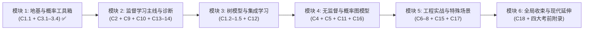
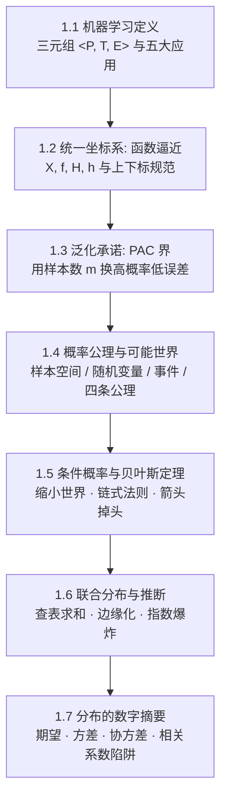

# 机器学习零基础复习提纲（全 18 章）

> [!abstract] 使用说明与学习路线
> 本提纲专为 **零基础 / 几乎没听课** 的高效自学与考前冲刺设计，不照搬原课件顺序，而是按 **知识依赖** 重排为 6 个模块，覆盖全课程全部 18 章知识点（零遗漏），所有专业术语均附规范英文对照。
>
> - **阅读体例**：每个知识点按「为什么需要它 → 核心直觉与配图 → 完整公式 → 手算走查 → 避坑与勘误」展开。
> - **优先级标注**：未标注的为课件主干必考内容；标有 **（拓展）** 的为教材与通行讲法的补充延伸，时间紧可先跳过。
> - **当前进度**：本文件目前为 **模块 1 试写版**（涵盖 [[C1.1 机器学习概述与课程导航]] 与 [[C3.1 随机变量、事件与概率公理]] – [[C3.4 期望、方差、协方差与相关系数]]），确认风格与体量后继续补全模块 2–6 及文末四大附录。

---

# 模块 1：地基与概率工具箱（C1.1 + C3.1–3.4）

> [!tip] 本模块解决什么问题？
> 在学任何具体算法之前，先拿下两块底层地基：
> 1. **机器学习的统一语言（C1.1）**：把“机器学习”翻译成可落地的三元组 $\langle P,T,E\rangle$、函数逼近（Function Approximation）坐标系，以及用样本量换泛化承诺的 PAC 界。
> 2. **处理不确定性的数学工具（C3.1–3.4）**：建立“可能世界 = 面积”的直觉，吃透概率公理、条件概率、贝叶斯定理（Bayes' Rule）、联合分布（Joint Distribution）以及期望/方差/协方差/相关系数。后面第 5 章异常检测、第 11 章 EM 算法、第 16 章贝叶斯网络全部长在这块地基上。

---

## 1.1 机器学习的问题定义与学科版图（C1.1）

### 为什么需要形式化定义？
面对复杂决策（例如医院里有 **9714 份产妇病历**、每份含 **215 个特征**，要判断新入院产妇是否需要紧急剖宫产），人类记忆装不下几百个指标的交互规律。想让机器帮忙，必须先把模糊需求拆成三个能动手填的空：**有什么数据、要做什么判断、怎么算做得好**。

### 核心定义：良定义学习任务（Well-defined Learning Task）
Mitchell 给出的标准定义：机器学习（Machine Learning）研究的是这样一类算法——它们在 **任务（Task）** $T$ 上的 **性能（Performance）** $P$，会随着 **经验（Experience）** $E$ 的增加而提升。一个良定义的学习问题就是一个三元组：
$$\langle P,\ T,\ E\rangle$$

| 字母 | 英文与含义 | 工程落地问法 | 紧急剖宫产案例 | 预测次日股价涨跌案例 |
| :--- | :--- | :--- | :--- | :--- |
| $E$ | **经验（Experience）** | 手上有多少条数据、每条含什么 | 9714 份病历（215 维特征 + 结局） | 历史日频行情 + 次日真实涨跌 |
| $T$ | **任务（Task）** | 输入什么，输出什么 | 新病人病历 $\to$ 紧急剖宫产概率 | 截至今日行情特征 $\to$ 次日涨/跌 |
| $P$ | **性能（Performance）** | 在 **哪批数据** 上、用什么指标 | **未见病例** 上的预测准确率 | **未来交易日** 准确率（若求盈利则看跑赢基准收益） |

- **经验 = 数据**：机器没有身体，一条 **样本（Sample）** 由描述部分的 **特征（Feature）** 和答案部分的 **标签（Label）** 组成。“数据是燃料，算法只是发动机”，三个字母彼此牵制——改了 $P$（例如从分类准确率改成概率校准或策略收益），$T$ 的输出形式与算法选择全都要跟着换。

> [!warning] 考场与工程铁律：性能 $P$ 必须在未见数据上度量
> 训练集上刷出 99% 准确率叫 **记忆力**，不叫 **性能**（模型可能只是背下了样本里的噪声与巧合，这就是后面要重点学的 **过拟合 Overfitting**）。性能必须在 **未参与训练的数据** 上评估。

### 应用全景与学科位置
五个经典案例本质上是把 $\langle P, T, E\rangle$ 填了五次空：

| 应用领域 | 一句话任务 $T$ | 课程案例要点 |
| :--- | :--- | :--- |
| **数据挖掘（Mining Databases）** | 从历史表学出规则预测个体结局 | 剖宫产学出 18 条规则；某条含 3 条件的规则在训练集 $26/41=0.63$、测试集 $12/20=0.60$，两者接近说明抓到真规律而非死记 |
| **文本分析（Text Analysis）** | 文本 $\to$ 标签/实体/关系 | 垃圾邮件分类（Spam vs. Not Spam）；最简特征为 **词袋（Bag-of-Words）**（拓展：丢掉词序，分不清 `not good` 与 `good`） |
| **物体识别（Object Recognition）** | 图像 $\to$ 目标框 + 类别 | 人脸/物体检测按朝向（正脸、侧脸）分别训练检测器 |
| **语音识别（Speech Recognition）** | 声波 $\to$ 文字 | 序列信号映射 |
| **控制学习（Control Learning）** | 观测 $\to$ 控制指令 | 直升机悬停；以及 **脑机接口（Brain–Computer Interface, BCI）** 两条线：fMRI 体素（Voxel）时间序列解码语义词、运动皮层神经植入体驱动机械臂抓取 |

- **能否使用机器学习的双判据**：只要同时满足 **① 能清晰定义问题（$\langle P,T,E\rangle$）** 且 **② 能采到带特征的数据**，就可以引入机器学习。
- **在计算机科学中的位置**：目前在全部软件应用中仍只占一小块，但因 **算法进步、在线数据激增、对自适应软件的需求增加** 而持续扩张。它位于计算机科学、统计学、经济学与组织行为学、动物学习（认知/心理/神经科学）、自适应控制理论与进化论的交集处：

![[C1.1-机器学习与相关学科关系.png]]

> [!note]- 课程成绩构成与教材速查（点击展开）
> - **成绩构成**：课堂表现（Class Performance）10% + 平时项目作业（Regular Project Assignments，含课堂内编程与书面作业）30% + 期末考试（Exam）60%。另有期末项目（常以股票数据检验策略）。
> - **四本参考书**：Bishop *PRML*（百科字典）、周志华《机器学习方法》（中文体系全）、李航《统计学习方法》（推导精炼）、Tom Mitchell *Machine Learning*（决策树记号与 PlayTennis 算例直接沿用此书）。

---

## 1.2 贯穿全课的统一坐标系：函数逼近（C1.1）

### 核心直觉
“学出一条规则”在数学上就是找一个函数，把输入映射成输出。后面全部算法的差别，只落在 **表示（Representation）、优化（Optimization）、泛化（Generalization）** 三件事上。

### 四个核心对象与上下标规范
- **实例空间（Instance Space）** $X$：一条样本所有可能长成的样子（题目长什么样）。
- **目标函数（Target Function）** $f: X \to Y$：客观存在但不可见的真实规律（标准答案）。
- **假设空间（Hypothesis Space）** $H = \{h \mid h: X \to Y\}$：允许模型交出的答案集合（答卷格式，例如所有决策树、所有直线、所有三层神经网络）。
- **假设（Hypothesis）** $h \in H$：算法根据训练集 $\{\langle x^{(i)}, y^{(i)}\rangle\}_{i=1}^{m}$ 从 $H$ 里挑出来的那一个具体模型（你交上的答卷）。

$$\text{学习（Learning）} = \text{在假设空间 } H \text{ 中搜索一个最好地逼近 } f \text{ 的假设 } h$$

- **$H$ 大小的权衡（偏差与方差的伏笔）**：
  - $H$ 选得太小（例如真规律是曲线却只允许画直线）$\Rightarrow$ **近似误差（Approximation Error）** 大，对应 **高偏差（High Bias）**。
  - $H$ 选得太大（例如允许任意查表记忆）$\Rightarrow$ 训练集 100% 正确但新数据极差，**估计误差（Estimation Error）** 大，对应 **高方差（High Variance）**。

> [!warning] 极易丢分的符号约定：上标样本，下标特征
> - $x^{(i)}$：第 $i$ 条训练样本（一整个特征向量，圆括号防与次方混淆）。
> - $x_j$：第 $j$ 个特征维度（全数据中的第 $j$ 列）。
> - $x^{(i)}_j$：第 $i$ 条样本的第 $j$ 个特征值。例如剖宫产数据中，$x^{(3)}_2$ 表示第 3 位病人的第 2 个指标。

---

## 1.3 泛化承诺：PAC 学习理论（C1.1）

### 为什么需要 PAC？
当 $H$ 足够大时，总能找到训练误差为 $0$ 的假设 $h$，但它在未见样本上可能像瞎猜。我们要一个定量的概率承诺：**至少需要多少样本 $m$，才能以高概率保证学出来的模型真实误差足够小？**

### PAC 界公式与直觉
**PAC（Probably Approximately Correct，大概近似正确）** 包含两个参数：
- **允许的真实误差上界** $\epsilon$（Approximately：误差不超过 $\epsilon$）。
- **允许的失败概率上界** $\delta$（Probably：至少以 $1-\delta$ 的把握成立）。

对于 **有限假设空间** $H$ 的监督概念学习，所需训练样本数 $m$ 满足：
$$m \ge \frac{1}{\epsilon}\left(\ln\lvert H\rvert + \ln\frac{1}{\delta}\right)$$

**逐项读出三条直觉**：
1. **精度最贵（反比 $1/\epsilon$）**：误差要求减半（例如 $0.1 \to 0.05$），所需样本量直接 **翻倍**。
2. **复杂度很便宜（对数 $\ln\lvert H\rvert$）**：假设空间扩大一千倍（$10^3 \to 10^6$），$\ln\lvert H\rvert$ 只翻一倍。
3. **置信度更便宜（对数 $\ln(1/\delta)$）**：把失败概率压低十倍（$0.05 \to 0.005$），样本量只增加很少。

> [!example] 手算走查：PAC 样本量计算
> 取 $\lvert H\rvert = 1000$、$\epsilon = 0.1$、$\delta = 0.05$：
> $$m \ge \frac{\ln 1000 + \ln 20}{0.1} = \frac{6.9078 + 2.9957}{0.1} = 99.04 \implies \text{至少 } 100 \text{ 条样本}$$
> - 若精度翻倍至 $\epsilon = 0.05$：$m \ge 198.07 \implies 199$ 条（几乎正好翻倍）。
> - 若假设空间扩到 $\lvert H\rvert = 10^6$（其余不变）：$m \ge \frac{13.8155 + 2.9957}{0.1} = 168.1 \implies 169$ 条（空间扩千倍，样本只多 69 条）。

> [!warning] PAC 界的三个边界与常见误区
> 1. **最坏情况界（通常很松）**：它对 $H$ 里所有假设一视同仁，因此只用于判断“问题本质上可行不可行”，不是工程调参配方。
> 2. **仅适用于有限离散 $H$**：线性回归的 $H$ 是连续无穷的，$\ln\lvert H\rvert$ 无定义（连续模型需用 VC 维替代）。
> 3. **切勿偷换概念**：PAC 保证的是“样本够多时，以高概率真实误差 $\le \epsilon$”，**绝不是**“训练误差小 $\implies$ 真实误差小”。

---

## 1.4 随机变量、事件与概率公理（C3.1）

### 核心视角：把概率看成“可能世界的面积”
为什么能说“这个具体的肿瘤有 70% 的概率是恶性”？概率有两种诠释：
- **可能世界视角（贝叶斯派 Bayesian）**：在所有与当前观测一致的 **可能世界（Possible Worlds）** 中，$A$ 为真的世界所占的面积比例（描述信念程度）。
- **重复实验视角（频率派 Frequentist）**：重复进行随机实验，$A$ 发生的长期频率。

![[C3-概率-维恩图三联.png]]

### 三个必分清的基础概念

| 概念 | 数学类型 | 含义与例子 | 常见误区 |
| :--- | :--- | :--- | :--- |
| **样本空间（Sample Space）** $S$ | **集合** | 所有可能世界的集合，总面积 $= 1$（如全班学生） | —— |
| **随机变量（Random Variable, RV）** | **函数** | 定义在 $S$ 上的映射，如布尔型 $A:S\to\{0,1\}$、离散型 $\text{Gender}:S\to\{m,f\}$、连续型 $\text{Height}:S\to\mathbb{R}$ | 随机变量不是事件，写 $P(\text{Gender})$ 无意义 |
| **事件（Event）** | **$S$ 的子集** | 满足某条件的可能世界集合，如 $\{s\in S:\text{Gender}(s)=f\}$ 或复合事件（如两人生日相同，引出 **生日悖论** 拓展：23 人超 50%，60 人超 99%） | 概率只对事件有定义，必须写 $P(\text{Gender}=f)$ |

> [!note] 离散 vs 连续（拓展）
> 本章核心演算均针对 **离散随机变量（Discrete RV）**（用 $\sum$ 求和）。对于 **连续随机变量（Continuous RV）**，需把求和换成积分 $\int$、概率换成 **概率密度（Probability Density）**，且任意单点的概率恒为 $0$。

### 四条概率公理（Axioms of Probability）与两大推论
课件核心句：**“这四条规则就是我们的全部，本章其余一切都由它们推导而来。”**

1. **非负与有界**：$0 \le P(A) \le 1$
2. **必然事件**：$P(\text{True}) = 1$
3. **不可能事件**：$P(\text{False}) = 0$
4. **容斥原理（Inclusion–Exclusion Principle）**：
   $$P(A \vee B) = P(A) + P(B) - P(A \wedge B)$$

> [!note] 记号对照（同一份答卷保持统一即可）
> “且”：$A \wedge B$ / $A\text{ and }B$ / $A \cap B$；“或”：$A \vee B$ / $A\text{ or }B$ / $A \cup B$；“非”：$\sim A$ / $\bar{A}$ / $A^c$。

由四条公理直接推出两条最常用的推论：
- **推论 1（补事件）**：$P(A) + P(\sim A) = 1$。
  - *推导*：$A \wedge \sim A = \text{False}$ 且 $A \vee \sim A = \text{True}$，代入公理 4 得 $1 = P(A) + P(\sim A) - 0$。
  - *实战技巧*：“至少有一个……”正算困难时，算反面再用 $1 - P(\sim A)$。
- **推论 2（全概率雏形 / 边缘化 Marginalization）**：
  $$P(A) = P(A \wedge B) + P(A \wedge \sim B)$$
  - *直觉*：看上面维恩图三联的中间格，$A$ 被 $B$ 的边界切成互斥的两块，要么在 $B$ 内，要么在 $B$ 外，不重不漏。

> [!warning] 易错点：只有互斥时才能直接相加
> $P(A \vee B) = P(A) + P(B)$ **仅在 $A$ 与 $B$ 互斥（Mutually Exclusive，即 $P(A \wedge B) = 0$）时成立**。若两椭圆有重叠，直接相加会把重叠区域算两次。

---

## 1.5 条件概率、链式法则与贝叶斯定理（C3.2）

### 条件概率（Conditional Probability）：换分母、缩小世界
$$P(A \mid B) = \frac{P(A \wedge B)}{P(B)} \qquad (P(B) > 0)$$

- **直觉（看 1.4 节三联图右格）**：已知 $B$ 发生，相当于把 $B$ 以外的世界全部删掉，样本空间从面积 $1$ 缩小成了 $B$。条件概率只是把分母换成了 $P(B)$。
- **核心提醒**：分子 $P(A \wedge B)$ 对称，但分母不对称，因此 **$P(A \mid B) \ne P(B \mid A)$**（除非 $P(A) = P(B)$）。

### 链式法则（Chain Rule）与独立性（Independence）
将条件概率的分母乘过去，即得 **链式法则**（用于从条件概率构造联合概率）：
$$P(A \wedge B) = P(A \mid B)\,P(B) = P(B \mid A)\,P(A)$$
推广到 $n$ 个变量（第 16 章概率图模型的出发点）：
$$P(X_1, X_2, \ldots, X_n) = \prod_{i=1}^{n} P(X_i \mid X_1, \ldots, X_{i-1})$$

- **独立事件（Independent Events）**：知道 $B$ 不改变 $A$ 的概率，即 $P(A \mid B) = P(A) \iff P(A \wedge B) = P(A)P(B)$。

> [!warning] 严辨概念：独立（Independent）vs 互斥（Mutually Exclusive）
> 两者几乎相反！
> - **互斥**：$P(A \wedge B) = 0$，发生 $A$ 就必然不发生 $B$，这是极强的依赖。
> - **独立**：$P(A \wedge B) = P(A)P(B)$，互不影响。
> 结论：**两个概率都大于 0 的互斥事件，一定不独立。**

### 贝叶斯定理（Bayes' Rule）：把条件箭头掉头
为什么需要它？现实中 **能查到的统计方向** 往往和 **你想推理的方向** 相反（医学统计给的是 $P(\text{咳嗽}\mid\text{流感})$，而病人是带着咳嗽来问 $P(\text{流感}\mid\text{咳嗽})$）。

用链式法则把 $P(A \wedge B)$ 拆两次并令其相等，两行即得 **贝叶斯定理**：
$$\underbrace{P(A \mid B)}_{\text{后验 Posterior}} = \frac{\overbrace{P(B \mid A)}^{\text{似然 Likelihood}} \cdot \overbrace{P(A)}^{\text{先验 Prior}}}{\underbrace{P(B)}_{\text{证据 Evidence}}}$$

- **两种高频变形**：
  1. **全概率展开分母**（分母 $P(B)$ 通常查不到，需把产生证据 $B$ 的所有途径相加）：
     $$P(A \mid B) = \frac{P(B \mid A)\,P(A)}{P(B \mid A)\,P(A) + P(B \mid \sim A)\,P(\sim A)}$$
     （多分类时分母为 $\sum_k P(B \mid A_k)P(A_k)$）
  2. **带固定背景条件 $X$**（把整个世界先缩小到 $X$ 里，用于多步证据的序列/在线更新）：
     $$P(A \mid B \wedge X) = \frac{P(B \mid A \wedge X)\,P(A \wedge X)}{P(B \wedge X)} = \frac{P(B \mid A \wedge X)\,P(A \mid X)}{P(B \mid X)}$$

> [!example] 必考经典算例：流感与咳嗽（基础比率谬误 Base Rate Fallacy）
> **已知**：$A =$ 得流感，$B =$ 咳嗽；先验 $P(A) = 0.05$，似然 $P(B \mid A) = 0.80$，假阳性率 $P(B \mid \sim A) = 0.20$。求 $P(A \mid B)$。
>
> 1. 补齐反面先验：$P(\sim A) = 1 - 0.05 = 0.95$。
> 2. 算分母两条路径：
>    - 流感且咳嗽：$0.80 \times 0.05 = 0.04$
>    - 非流感但咳嗽：$0.20 \times 0.95 = 0.19$
> 3. 总咳嗽概率：$P(B) = 0.04 + 0.19 = 0.23$。
> 4. 后验概率：
>    $$P(A \mid B) = \frac{0.04}{0.23} \approx \mathbf{0.1739\ (17.4\%)}$$
>
> **考场自查神器（1000 人头法）**：假设 1000 人中 50 人得流感（其中 $50\times 0.8 = 40$ 人咳嗽），950 人没得流感（其中 $950\times 0.2 = 190$ 人咳嗽）。咳嗽总计 $40+190=230$ 人，真得流感的占 $40/230 \approx 17.4\%$。
>
> **直觉警示**：似然高达 80%，但后验不到 18%，因为 **没得流感的基数太大（95%）**——这就是 **基础比率谬误（Base Rate Fallacy）**。*（拓展：若病人独立地连续咳嗽 3 天，把前一天后验当新先验迭代更新，概率将从 $17.4\% \to 45.7\% \to 77.1\%$。）*

![[C3-贝叶斯-流感与咳嗽的可能世界.png]]

### 与机器学习的桥梁：判别式 vs 生成式
课件专页发问：“这一切跟函数逼近有什么关系？”答案是：
- **判别式模型（Discriminative Model）**：直接从数据学条件分布 $P(Y \mid X)$（如第 2 章逻辑回归）。
- **生成式模型（Generative Model）**：先学似然 $P(X \mid Y)$ 和先验 $P(Y)$，再用贝叶斯定理翻过来求 $P(Y \mid X)$（如朴素贝叶斯、高斯判别分析）。

---

## 1.6 联合分布与推断（C3.3）

### 造表三步配方：联合概率分布（Joint Probability Distribution, JD）
当变量不止两个时，可以把所有变量的所有取值组合一次性列成一张“万能查询表”：
1. **列真值表**：$M$ 个布尔变量有 $2^M$ 行（一般地，若变量 $X_i$ 有 $k_i$ 个取值，共 $\prod_{i=1}^M k_i$ 行）。
2. **赋概率**：给每一行指定该组合发生的概率。
3. **归一化检查**：所有行的概率之和必须严格等于 $1$。

![[C3-联合分布-三变量维恩图.png]]
*（三圆将大矩形切成 8 块互不重叠的区域，恰好对应三布尔变量真值表的 8 行，面积之和为 1。）*

### 查表两条规则（考场必会手算）
- **规则一（任意逻辑表达式的概率）**：挑出所有满足事件 $E$ 的行，把概率相加；**不关心的变量将其所有取值全部加起来**，这就是 **边缘化（Marginalization）**。
  $$P(E) = \sum_{\text{rows matching }E} P(\text{row})$$
- **规则二（推断 Inference / 条件概率）**：
  $$P(E_1 \mid E_2) = \frac{P(E_1 \wedge E_2)}{P(E_2)} = \frac{\sum_{\text{rows matching }E_1 \wedge E_2} P(\text{row})}{\sum_{\text{rows matching }E_2} P(\text{row})}$$

> [!example] 课件原题走查：美国人口普查联合表
> 三个变量：`gender`（Female/Male）、`hours_worked`（40.5− / 40.5+）、`wealth`（poor/rich），共 8 行（注：课件原表 8 行之和为 $0.9999991$，系 6 位有效数字四舍五入误差，做题按 $1$ 处理）。
>
> - $P(\text{Poor} \wedge \text{Male}) = 0.331313 + 0.134106 = 0.465419 \approx \mathbf{0.4654}$（`hours_worked` 两种取值全加）
> - $P(\text{Poor}) = 0.253122 + 0.0421768 + 0.331313 + 0.134106 = 0.7607178 \approx \mathbf{0.7607}$（4 行全加）
> - $P(\text{Male} \mid \text{Poor}) = \dfrac{0.4654}{0.7607} \approx \mathbf{0.612}$（穷人里男性占 61.2%）
> - **反方向对比**：$P(\text{Poor} \mid \text{Male}) = \dfrac{0.465419}{0.6684815} \approx \mathbf{0.696}$（男性里穷人占 69.6%，分母不同！）
> - **检验独立性**：$P(\text{Male})P(\text{Rich}) = 0.6685 \times 0.2393 \approx 0.1599 \ne P(\text{Male} \wedge \text{Rich}) = 0.2031$，故性别与贫富 **不独立**。

- **条件独立（Conditional Independence）**（拓展）：在已知 $C$ 的条件下，$A$ 与 $B$ 独立：
  $$P(A \wedge B \mid C) = P(A \mid C)\,P(B \mid C)$$
  *直觉*：冰淇淋销量与溺水人数强相关，但固定“季节”后两者无关。它是朴素贝叶斯和贝叶斯网络的基石。

### 联合分布的致命弱点与两条出路
既然联合分布无所不能，为什么实践里几乎造不出来？
1. **指数爆炸**：$M$ 个布尔变量需要 $2^M$ 行（$M=10 \Rightarrow 1024$，$M=20 \Rightarrow \approx 10^6$，$M=100 \Rightarrow 1.27\times 10^{30}$），1 万词词表需要 $2^{10000}$ 行，宇宙原子都装不下。
2. **数据稀疏（Data Sparsity）**：就算存得下，有限样本摊到几十亿行里，绝大多数行频数为 0，根本估不准。

**两条出路（贯穿整门课）**：
- **压缩联合分布**：引入独立 / 条件独立假设，把一张大表拆成若干小表相乘 $\to$ **朴素贝叶斯、贝叶斯网络 / 概率图模型（第 16 章）**。
- **绕开联合分布**：只学预测所需的条件分布 $P(Y \mid X)$ $\to$ **判别式模型（逻辑回归、SVM、神经网络）**。

> [!important] 课件划重点（"You Should Know" 清单）
> 课件专门列出了必须掌握的 6 项：Events（离散/连续/复合事件）、Axioms of probability、Conditional probabilities、Chain rule、Bayes rule、以及 **Joint distribution 及如何从联合分布手算各种概率**。

---

## 1.7 期望、方差、协方差与相关系数（C3.4）

### 为什么需要数字摘要？
有时不需要一整张分布表，只需要几个数字概括它的 **中心位置、波动幅度、两变量联动方向**。代价是 **有损压缩**——知道每个量“丢掉了什么信息”比背公式更重要。

### 期望（Expected Value）：以概率为权的加权平均
$$E[X] = \sum_{x} x\,P(X = x), \qquad E[f(X)] = \sum_{x} f(x)\,P(X = x)$$
- **注意**：大写 $X$ 是随机变量，小写 $x$ 是具体取值；期望是长期平均，**不必是 $X$ 能取到的值**（如掷骰子期望为 $3.5$）。
- **核心性质**：
  - **线性性**：$E[aX + b] = aE[X] + b$，$E[X + Y] = E[X] + E[Y]$（**不要求 $X, Y$ 独立**）。
  - **乘积**：$E[XY] = E[X]E[Y]$ **仅在 $X, Y$ 独立时成立**。

### 方差（Variance）与标准差（Standard Deviation）
为防止正负偏差抵消，对偏离均值的距离取平方再求期望：
$$\mathrm{Var}(X) = E\big[(X - E[X])^2\big] = \sum_{x} (x - E[X])^2 P(X = x) = E[X^2] - E[X]^2$$
$$\sigma_X = \sqrt{\mathrm{Var}(X)} \quad (\text{与 } X \text{ 同量纲})$$

- **速算口诀**：**平方的期望 减 期望的平方**（恒有 $\mathrm{Var}(X) \ge 0$，算成负数一定是减反了）。
- **与后续章节的联系**：均值归一化 $x \leftarrow \frac{x-\mu}{\sigma}$ 把特征变成期望 $0$、标准差 $1$，消除量纲差异。

> [!example] 课件原题手算走查
> 已知 $P(X=0)=0.3,\ P(X=1)=0.2,\ P(X=2)=0.5$：
> - $E[X] = 0(0.3) + 1(0.2) + 2(0.5) = \mathbf{1.2}$
> - $E[X^2] = 0^2(0.3) + 1^2(0.2) + 2^2(0.5) = \mathbf{2.2}$
> - $\mathrm{Var}(X) = 2.2 - 1.2^2 = 2.2 - 1.44 = \mathbf{0.76}$
> - $\sigma_X = \sqrt{0.76} \approx \mathbf{0.87}$

### 协方差（Covariance）与相关系数（Correlation Coefficient）
- **协方差**（方差的两变量推广，满足 $\mathrm{Cov}(X, X) = \mathrm{Var}(X)$）：
  $$\mathrm{Cov}(X, Y) = E\big[(X - E[X])(Y - E[Y])\big] = E[XY] - E[X]E[Y]$$
  - $\mathrm{Cov} > 0$ 同向变动；$\mathrm{Cov} < 0$ 反向变动；$\mathrm{Cov} = 0$ 称为 **不相关（Uncorrelated）**。
  - **协方差矩阵（Covariance Matrix）** $\Sigma$（拓展）：$\Sigma_{ij} = \mathrm{Cov}(X_i, X_j)$，对称半正定，对角线为各维度方差——第 5 章多元高斯异常检测与 PCA 降维的核心对象。
- **相关系数**（除以 $\sigma_X\sigma_Y$ 去掉量纲，由 **柯西–施瓦茨不等式 Cauchy–Schwarz** 保证落在 $[-1, 1]$）：
  $$\rho_{XY} = \frac{\mathrm{Cov}(X, Y)}{\sigma_X \sigma_Y} \in [-1, 1]$$
  - $\lvert \rho_{XY} \rvert = 1 \iff Y = aX + b$（严格线性关系；特例 $\rho_{XX} = 1$）。

![[C3-相关系数-四组散点.png]]

> [!danger] 本节最大考点与反例：$\rho = 0$ 不等于独立！
> - **独立 $\implies$ 不相关（$\rho = 0$）**：恒成立（因为独立时 $E[XY] = E[X]E[Y]$）。
> - **不相关（$\rho = 0$）$\nRightarrow$ 独立**：**一般不成立**！（仅当 $(X, Y)$ 服从联合高斯分布时才等价，拓展。）
>
> **必背反例手算**：设 $X$ 在 $\{-1, 0, 1\}$ 上均匀分布（各占 $1/3$），令 $Y = X^2$（$Y$ 完全由 $X$ 决定，强依赖）：
> 1. $E[X] = (-1 + 0 + 1)/3 = 0$
> 2. $E[Y] = E[X^2] = (1 + 0 + 1)/3 = 2/3$
> 3. $E[XY] = E[X^3] = (-1 + 0 + 1)/3 = 0$
> 4. $\mathrm{Cov}(X, Y) = E[XY] - E[X]E[Y] = 0 - 0 \cdot \frac{2}{3} = \mathbf{0} \implies \rho_{XY} = 0$
>
> **本质原因**：$\rho$ 只能看见 **线性关系**；抛物线左右对称，正负线性贡献完全抵消。
> **两个对偶坑**：① 别把 $\rho = 0$ 当成“没关系”而误删非线性强特征；② 别把 $\lvert \rho \rvert$ 很大当成“有因果”（**Correlation does not imply causation**）。

---

## 模块 1 公式与核心结论速查表

| 概念 | 公式 / 核心判据 | 关键提醒 |
| :--- | :--- | :--- |
| 良定义任务 | $\langle P, T, E\rangle$：性能 / 任务 / 经验 | $P$ 必须在未见数据上测 |
| 函数逼近 | $f:X\to Y$，$H=\{h\mid h:X\to Y\}$，搜索 $h\in H$ | $x^{(i)}_j$：上标样本，下标特征 |
| PAC 样本界 | $m \ge \frac{1}{\epsilon}\left(\ln\lvert H\rvert + \ln\frac{1}{\delta}\right)$ | 仅限有限离散 $H$；$\epsilon$ 线性贵，$\lvert H\rvert,\delta$ 对数便宜 |
| 概率四公理 | $0\le P(A)\le 1$；$P(\text{True})=1$；$P(\text{False})=0$；$P(A\vee B)=P(A)+P(B)-P(A\wedge B)$ | 仅互斥时 $P(A\vee B)=P(A)+P(B)$ |
| 补事件与边缘化 | $P(A)+P(\sim A)=1$；$P(A)=P(A\wedge B)+P(A\wedge\sim B)$ | 正算难时用补事件 |
| 条件概率与链式 | $P(A\mid B)=\dfrac{P(A\wedge B)}{P(B)}$；$P(A\wedge B)=P(A\mid B)P(B)$ | $P(A\mid B)\ne P(B\mid A)$ |
| 贝叶斯定理 | $P(A\mid B)=\dfrac{P(B\mid A)P(A)}{P(B\mid A)P(A)+P(B\mid\sim A)P(\sim A)}$ | 先验小防基础比率谬误；用 1000 人头自查 |
| 联合分布查询 | $P(E)=\sum_{\text{符合}E}P(\text{row})$；$P(E_1\mid E_2)=\dfrac{\sum_{E_1\wedge E_2}}{\sum_{E_2}}$ | 布尔 $2^M$ 行易指数爆炸与数据稀疏 |
| 独立与条件独立 | 独立：$P(A\wedge B)=P(A)P(B)$；条件独立：$P(A\wedge B\mid C)=P(A\mid C)P(B\mid C)$ | 概率非零的互斥事件一定不独立 |
| 期望与方差 | $E[X]=\sum_x x P(X=x)$；$\mathrm{Var}(X)=E[X^2]-E[X]^2$；$\sigma_X=\sqrt{\mathrm{Var}(X)}$ | 期望线性不需独立；方差恒 $\ge 0$ |
| 协方差与相关系数 | $\mathrm{Cov}(X,Y)=E[XY]-E[X]E[Y]$；$\rho_{XY}=\dfrac{\mathrm{Cov}(X,Y)}{\sigma_X\sigma_Y}\in[-1,1]$ | 独立 $\Rightarrow \rho=0$，反之不成立（反例 $Y=X^2$） |

---

*(试写版到此结束。确认结构、详略度、配图密度与排版习惯满意后，即可继续写入模块 2–6 及四大考前附录。)*
