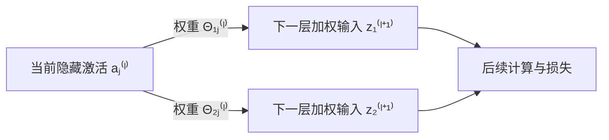

# 第 14 章 · 小节试写　隐藏层的误差从哪里来

本节从一个二分类网络出发，用链式法则推导隐藏层误差，并把它算成一次完整的参数更新。

## 一、输出错了，隐藏单元就该变大吗

你已经会用前向传播算预测：上一层输出乘权重、加偏置，再通过激活函数。现在来了一个正例，网络给出的概率却只有 0.5。最终输出需要提高，隐藏单元的输出是否也应该提高？我们先用最小的三层网络试一次。

先只看一个输入、一个隐藏单元和一个输出单元。输入记为 $x$，标签为 $y\in\{0,1\}$；隐藏单元接收输入的权重为 $w$、偏置为 $b$，它通向输出单元的权重为 $v$，输出单元的偏置为 $c$。两层都使用已经学过的 sigmoid 函数 $g(z)=1/(1+e^{-z})$。

沿用层编号：输入是第 1 层，隐藏层是第 2 层，输出层是第 3 层。隐藏单元的加权输入与激活值分别记为 $z^{(2)}$、$a^{(2)}$，输出单元的加权输入为 $z^{(3)}$，最终预测概率记为 $p$。于是一次前向传播是

$$
z^{(2)}=wx+b,\qquad a^{(2)}=g(z^{(2)}),
$$

$$
z^{(3)}=va^{(2)}+c,\qquad p=g(z^{(3)}).
$$

取一个正例 $x=2,y=1$，当前参数为 $w=1,b=-2,v=2,c=-1$。逐步代入：

$$
z^{(2)}=1\times2-2=0,\qquad a^{(2)}=g(0)=0.5,
$$

$$
z^{(3)}=2\times0.5-1=0,\qquad p=g(0)=0.5.
$$

标签是 1，预测却只有 0.5。输出概率需要提高；隐藏单元也正好输出 0.5，能不能把它也当成一个“本该输出 1”的分类器，直接用 $a^{(2)}-y=-0.5$ 来纠正它？

先把这个做法真的试一下。负的差值会推动我们增大隐藏激活值。假设它从 0.5 增到 0.51，其余参数暂时固定，则输出变为

$$
p=g(2\times0.51-1)=g(0.02)\approx0.5050.
$$

预测确实向正确标签靠近了一点。到这里，这个办法似乎可行。

但现在只把后半段网络换成 $v=-2,c=1$。隐藏单元仍输出 0.5，最终预测也仍是 $g(-2\times0.5+1)=0.5$。同样把隐藏激活值增到 0.51，会发生什么？

$$
p=g(-2\times0.51+1)=g(-0.02)\approx0.4950.
$$

这次反而离标签 1 更远了。**相同的隐藏激活值、相同的最终预测和标签，需要的隐藏层调整方向却可以相反。** 差别来自后面的连接：正权重会把隐藏激活值的增大传成输出的增大，负权重会把它传成输出的减小。

所以，隐藏单元该怎样改，要看它通过后续网络怎样影响最终损失。我们需要沿着后半段计算，把这个影响算回来。

## 二、先算输出端对损失有多大影响

回到 $v=2,c=-1$ 的原网络。我们用二分类交叉熵衡量这一个样本的损失，记为 $\ell$：

$$
\ell=-y\log p-(1-y)\log(1-p),
$$

其中 $\log$ 是自然对数。对当前正例，$y=1$，所以 $\ell=-\log p$；$p$ 越接近 1，损失越接近 0。当前损失为 $-\log0.5\approx0.693147$。

我们先问一个足够具体的问题：输出单元的加权输入 $z^{(3)}$ 增大一点，损失会怎样变？它先改变 $p$，再由 $p$ 改变 $\ell$，链式法则给出

$$
\frac{\partial\ell}{\partial z^{(3)}}
=\frac{\partial\ell}{\partial p}
 \frac{\partial p}{\partial z^{(3)}}.
$$

第一段由损失函数求导：

$$
\frac{\partial\ell}{\partial p}
=-\frac{y}{p}+\frac{1-y}{1-p}
=\frac{p-y}{p(1-p)}.
$$

第二段由 sigmoid 求导。对任意加权输入 $z$，

$$
g'(z)=\frac{e^{-z}}{(1+e^{-z})^2}
=g(z)\bigl(1-g(z)\bigr).
$$

因此 $\partial p/\partial z^{(3)}=p(1-p)$，两段相乘得到

$$
\frac{\partial\ell}{\partial z^{(3)}}
=\frac{p-y}{p(1-p)}\,p(1-p)=p-y.
$$

有限的 sigmoid 输入使 $0<p<1$，这里的分母有定义。我们把这个导数记为 $\delta^{(3)}$，称为输出层的**误差项**：

> [!important] 误差项量的是损失对加权输入的敏感程度
> $$\delta^{(3)}\equiv\frac{\partial\ell}{\partial z^{(3)}}=p-y.$$
> 对当前样本，$\delta^{(3)}=0.5-1=-0.5$：输出加权输入向上微调时，损失向下变化。

这个定义解释了为什么要对 $z$ 求导：连接权重和偏置首先改变的就是加权输入，知道损失对它的反应，才能继续求参数的梯度。

$p-y$ 这一步简化来自 **sigmoid 与交叉熵的配合**。例如改用平方损失 $\ell_{\mathrm{sq}}=(p-y)^2/2$，同样求导会得到 $(p-y)p(1-p)$。在当前 $p=0.5,y=1$ 处，结果是 $-0.125$；继续照抄 $-0.5$ 就把另一种损失的梯度算错了。

## 三、顺着同一条路径，把影响传回隐藏层

现在把问题往前挪一步：隐藏单元的加权输入 $z^{(2)}$ 增大一点，损失会怎样变？这次要依次经过隐藏激活值 $a^{(2)}$、输出加权输入 $z^{(3)}$，才能接上刚才已经算出的损失变化。

这条路径上的三段导数分别是：

$$
\frac{\partial a^{(2)}}{\partial z^{(2)}}
=a^{(2)}\bigl(1-a^{(2)}\bigr),\qquad
\frac{\partial z^{(3)}}{\partial a^{(2)}}=v,\qquad
\frac{\partial\ell}{\partial z^{(3)}}=\delta^{(3)}.
$$

沿路径相乘，就得到隐藏层的误差项 $\delta^{(2)}$：

$$
\begin{aligned}
\delta^{(2)}
&\equiv\frac{\partial\ell}{\partial z^{(2)}}\\
&=\frac{\partial\ell}{\partial z^{(3)}}
  \frac{\partial z^{(3)}}{\partial a^{(2)}}
  \frac{\partial a^{(2)}}{\partial z^{(2)}}\\
&=\delta^{(3)}\,v\,a^{(2)}\bigl(1-a^{(2)}\bigr).
\end{aligned}
$$

代入原网络：

$$
\delta^{(2)}=(-0.5)\times2\times0.5\times(1-0.5)=-0.25.
$$

如果换成开头的负权重网络，输出误差仍是 $-0.5$，但隐藏误差变为 $(-0.5)\times(-2)\times0.25=+0.25$。刚才只能靠试改激活值看出的方向差别，现在由同一个公式算了出来。

这就是“反向传播”这个名字的含义：前向计算从输入走到预测，**求导时先得到靠近损失的一段，再把它用于前一段**。已经算好的 $\delta^{(3)}$ 可以直接复用，不必从损失函数开始重新展开一次。

一个隐藏单元若连向多个后续单元，每条路径都会影响损失。各条路径的影响先相加，再乘上当前激活函数的导数。沿用一般网络的记号：$l$ 是当前隐藏层，$j$ 是其中一个非偏置单元；$s_{l+1}$ 是下一层的非偏置单元数，$k$ 遍历这些单元；$\Theta^{(l)}_{kj}$ 是从当前单元 $j$ 连到下一层单元 $k$ 的权重。于是

$$
\delta_j^{(l)}
=\left(\sum_{k=1}^{s_{l+1}}\Theta^{(l)}_{kj}\delta_k^{(l+1)}\right)
 a_j^{(l)}\bigl(1-a_j^{(l)}\bigr).
$$

这里的求和来自 $z_k^{(l+1)}$ 都依赖 $a_j^{(l)}$：对一个变量经过多条分支产生的总影响，多元链式法则要求把各分支贡献相加。下图把两条分支画开，箭头表示前向计算的依赖；回传沿箭头反方向，沿两条分支各算一次，再在当前单元汇合：

> [!important] 隐藏层的纠正信号由后续影响决定
> **后层误差乘连接权重，各路径求和，再乘当前激活函数的导数。** 对单条连接，求和退化为一个乘积；对 sigmoid，当前导数就是 $a(1-a)$。偏置单元恒等于 1，没有需要求导的激活过程，不为它计算隐藏误差项。

## 四、误差算出来以后，参数怎样更新

误差项还不是参数梯度。以输入权重 $w$ 为例，它通过 $z^{(2)}=wx+b$ 影响损失，所以还要乘上 $\partial z^{(2)}/\partial w=x$：

$$
\frac{\partial\ell}{\partial w}
=\frac{\partial\ell}{\partial z^{(2)}}
 \frac{\partial z^{(2)}}{\partial w}
=\delta^{(2)}x.
$$

偏置 $b$ 对 $z^{(2)}$ 的导数是 1；输出权重 $v$ 对 $z^{(3)}$ 的导数是 $a^{(2)}$，输出偏置 $c$ 的相应导数也是 1。因此四个参数的梯度全部确定：

| 参数 | 梯度怎样得到 | 当前数值 |
|---|---|---|
| 输入权重 $w$ | $\delta^{(2)}x$ | $(-0.25)\times2=-0.5$ |
| 隐藏偏置 $b$ | $\delta^{(2)}$ | $-0.25$ |
| 输出权重 $v$ | $\delta^{(3)}a^{(2)}$ | $(-0.5)\times0.5=-0.25$ |
| 输出偏置 $c$ | $\delta^{(3)}$ | $-0.5$ |

这也解释了一般连接上的梯度为什么是“**目标单元的误差项 × 来源单元的激活值**”：目标端的误差项告诉我们损失如何响应加权输入，来源端的激活值告诉我们这条权重怎样改变该输入。

现在取学习率 $\alpha=0.1$，对这个样本的交叉熵做一次梯度下降。四个梯度都用更新前的同一组参数算出，再同时更新：

$$
\begin{aligned}
w_{\mathrm{new}}&=1-0.1\times(-0.5)=1.05,\\
b_{\mathrm{new}}&=-2-0.1\times(-0.25)=-1.975,\\
v_{\mathrm{new}}&=2-0.1\times(-0.25)=2.025,\\
c_{\mathrm{new}}&=-1-0.1\times(-0.5)=-0.95.
\end{aligned}
$$

用新参数重新前向计算：

$$
z_{\mathrm{new}}^{(2)}=1.05\times2-1.975=0.125,\qquad
 a_{\mathrm{new}}^{(2)}=g(0.125)\approx0.53120937,
$$

$$
z_{\mathrm{new}}^{(3)}=2.025\times0.53120937-0.95\approx0.125699,
\qquad p_{\mathrm{new}}=g(0.125699)\approx0.531383.
$$

标签仍是 1，损失变为 $-\log0.531383\approx0.6323$，低于更新前的 $0.6931$。从前向计算、输出求导、隐藏层回传，到每条权重的梯度和更新后的损失，这一轮已经走完。

现在还有一个实际问题：当网络大到无法逐项手推时，怎样发现程序把某条回传路径的符号、下标或激活函数导数写错了？我们能否暂时绕开回传公式，只微调一个参数、观察损失的变化，独立核对算出的梯度？接下来在 [[C14.2 梯度检验与训练]] 中做这项检验。
