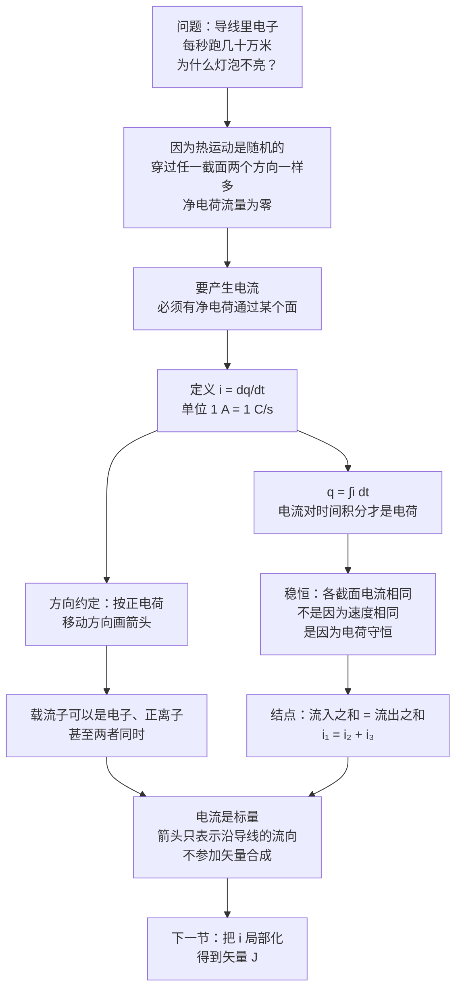

# C26.1 电流 Electric Current

> [!abstract] 这一讲的任务
> 前五章（21–25）里的电荷一直是**站着不动**的：算场、算电势、算电容，电荷分布一旦定下来就不再变。可闪光灯亮起来的那一毫秒、GPU 跑起来的那一秒，电荷在**流**。
> 这一讲把「电流」这个概念从零逼出来：先确认**光有电荷在动还不够**，必须是**净电荷**在通过某个面；再给定义 $i=dq/dt$；再解释为什么稳恒时**每个截面上的电流都一样**；最后说清那个最反直觉的结论——**电流有方向，但电流不是矢量**。
> 这里定义的 $i$ 是整章的地基：$J$、$R$、$\rho$、欧姆定律、电功率全都从它长出来。

---

## 0. 开场：凌晨两点，机房里的 900 安培

你在训一个模型，跑到第 3 个 epoch，机房跳闸了。你去看机柜铭牌：整机 8 张卡，每张卡满血功耗 700 W，工作电压 0.85 V。

请你估一下：**一根给这张卡供电的铜缆里，每秒有多少库仑的电荷通过？**

先把功率除以电压：$i=P/V=700\ \mathrm{W}/0.85\ \mathrm{V}\approx 820\ \mathrm{A}$。八张卡就是六千多安培。

> [!question] 停一下，先自己想想
> 820 A 是什么概念？$1\ \mathrm{A}=1\ \mathrm{C/s}$，而一个电子的电量只有 $1.6\times10^{-19}\ \mathrm{C}$。那么每秒钟要有多少个电子挤过这根电缆的截面？
>
> $$N=\frac{1.00\ \mathrm{A}\times 1.00\ \mathrm{s}}{1.602\times10^{-19}\ \mathrm{C}}\approx 6.24\times10^{18}\ \text{个}$$

六千亿亿个电子，**每秒钟**，穿过一根手指粗的铜线里一个假想的截面。

现在把这件事想得更仔细一点。铜线里本来就全是自由电子，它们以 $10^{5}\ \mathrm{m/s}$ 量级的速度**乱撞**（教材给的自由电子随机运动速率是 $10^{6}\ \mathrm{m/s}$ 量级，那是更热的估法；$10^{5}$ 是常温下的典型均方根值）。既然电子一直在动，而且动得这么快，那么**每一秒钟本来就有无数电子穿过那个截面**——那为什么没插电的时候灯泡不亮？

因为在没插电的导线里，电子从左边穿过截面往右走、和从右边穿过截面往左走，**数目一样多**。往左的和往右的抵消了，净电荷流量是**零**。

所以这一讲一开始就要把一件事抠清楚：**«电荷在动» 和 «有电流» 是两回事。**

你刚才做的那个除法 $i=P/V$，就是一次完整的电流定义的使用。下面我们把它变成严格的物理。

---

## 1. 两种运动：静电学的「不动」与电流的「净动」

先对一下账，看看我们从哪儿出发。

课件 p.4 用两行字划清了这条界：

> [!important] 静电学与电流的分界
> **Electrostatics 静电学：Charges do not move.** 电荷不动。前五章全在这个世界里。
> **Electric current 电流：Charges move.** 电荷在动。

但这句话说得太松了，松到会骗人。「电荷在动」不是电流的充分条件，甚至不是必要条件式的那种「动」。课件紧接着补的那一句才是重点：

> [!important] 电流的定义性说法
> **Electric current is the flow rate of *net* charges through a surface.**
> 电流是**通过一个面的净电荷的流量**。
> 关键词是 **net（净）** 和 **surface（面）**：不谈面就没有电流可言，穿过面的电荷不抵消了才有电流可言。

### 撞墙：为什么「乱动」不行

![[C26-电荷随机热运动不产生电流.png]]

看这根导线的纵剖。里面每一个蓝色小球都是一个自由电子，每根小箭头是它此刻的速度。它们全都在飞快地动——**但方向是乱的**。

现在在导线中间插一个假想的截面（就是下一节图里那条虚线）。因为方向是乱的：

- 下一秒有 $N$ 个电子从左边穿到右边；
- 同时有 $N$ 个电子从右边穿到左边；
- 净效果：**一个电子也没「流过去」**。

热运动再快也没用，因为它是**无规**的。要让电流产生，必须有一个机制把这种随机运动**稍微偏置一个方向**，打破左右对称。那个机制就是**电场**：给导线两端接上电池，导线内部就有了场，场对电子施力，随机运动之上叠了一个很慢的定向漂移。

> [!note] 教材（p.746）用的第二个例子更绝：水管
> 水从花园水管里流出来，里面的**正电荷**（水分子里的质子）是朝着一个方向跑的，速率相当于每秒几百万库仑。可它**没有净电荷流动**——因为同样数量的**负电荷**（水分子里的电子）也在朝着**同一个方向**、以**同样的速率**流。
> 正负两边一样多、方向一样，净电荷流量还是零。

这两个例子合起来给出了同一个判据：**有没有电流，不看电荷动得有多快、多热闹，只看穿过某个面的净电荷是不是非零。**

> [!tip] 顺手记住一个量级
> $1\ \mathrm{A}$ 对应 $6.24\times10^{18}$ 个电子每秒。这个数大到不直观——金属里能提供这么多载流子，正说明为什么金属是导体、空气不是。

---

## 2. 电流的定义：$i=dq/dt$

### 从「面」说起

定义电流必须指定一个**面**。在导线里我们习惯取一个**完全横切导线**的假想平面，比如图里那条虚线所在的平面，标记为 $A$。

![[C26-电子穿过假设平面的电流定义.png]]

> [!important] 电流的定义（课件 p.5 / 教材 Eq. 26-1）
> 设时间 $dt$ 内有电荷 $dq$ 穿过这个假想平面，则这个面上的电流定义为
> $$\boxed{i=\frac{dq}{dt}}$$
> 教材的原话是 **the amount of *positive* charge that passes in time $dt$**——注意是**正**电荷的通过量，这是因为下面要讲的符号约定。

这个定义是一个**瞬时速率**，不是平均值。如果电流随时间变，任意时刻的 $i$ 由该时刻的微商给出。

反过来，知道电流随时间的函数，把时间切成一小段一小段，每一小段里通过的电荷是 $i\,dt$，累加起来就是从 $t_1$ 到 $t_2$ 通过的总电荷：

> [!important] 反过来的关系（课件 p.5 / 教材 Eq. 26-2）
> $$\boxed{q=\int_{t_1}^{t_2} i\,dt}$$
> 课件在这两行旁边写了两个中文批注，正好把这层关系说穿了：**「电荷的时间微分是电流」**、**「电流的时间积分是电荷」**。

这两条是同一个物理的两个方向，用哪条取决于你手上有什么：

| 手上的信息 | 要求的量 | 用哪条 |
|---|---|---|
| 电荷随时间的函数 $q(t)$ | 某一瞬时的电流 | 求导 |
| 电流随时间的函数 $i(t)$ | 一段时间内通过的总电荷 | 积分 |
| 电流恒定 | 时间 $t$ 内通过的总电荷 | $q=it$（积分的特例） |

### 单位：安培是 SI 基本单位

> [!important] 电流的单位（课件 p.5）
> $$\boxed{1\ \text{Ampere}=1\ \mathrm{A}=\frac{1\ \text{Coulomb}}{1\ \text{Second}}=1\ \mathrm{C/s}}$$
> 安培是 SI 的**基本单位**之一（七个基本量之一），库仑反而是从安培导出的：$1\ \mathrm{C}=1\ \mathrm{A\cdot s}$。教材 p.746 特意提了一句：安培的**形式定义**涉及两根平行载流导线之间的磁力，要等到第 29 章才给；本节先用 $\mathrm{C/s}$ 这个工作定义。

### 手算验证：给电容充电

> [!example] 例：充电电流是 \(i(t)=4.0-2.0t\)（A），求 0 到 2.0 s 内送到极板上的总电荷，以及 1.0 s 时的电流。
> **1.0 s 时的电流**（直接代函数）：
> $$i(1.0)=4.0-2.0\times1.0=2.0\ \mathrm{A}$$
> **0 到 2.0 s 的总电荷**（积分）：
> $$q=\int_{0}^{2.0}(4.0-2.0t)\,dt=\Big[4.0t-t^{2}\Big]_{0}^{2.0}=8.0-4.0=4.0\ \mathrm{C}$$
> **回代检验**：如果这 2 s 里电流一直等于初值 $4.0\ \mathrm{A}$，电荷会是 $8.0\ \mathrm{C}$；但电流在中间降到 0（$t=2.0\ \mathrm{s}$ 时 $i=0$），函数是直线下降的，平均只有 $2.0\ \mathrm{A}$，所以总电荷是 $2.0\times2.0=4.0\ \mathrm{C}$ ✓ 两条路子对上了。

> [!warning] 易错点：$i$ 可以是负的
> $i=dq/dt$ 里的 $dq$ 是**穿过面的净电荷**，有正负。如果净电荷是从另一个方向穿过这个面，同一个面上的电流就是负的。所以「某个面上的电流」必须配合「正方向怎么规定」才有意义——这正是第 4 节要处理的符号约定。做题时只写 $i=2\ \mathrm{A}$ 而不说清方向，是要扣分的。

---

## 3. 稳恒电流：为什么每个截面上的电流都一样

![[C26-稳恒电流各截面相同.png]]

导线在中间胖了一截（截面积变大了），两边各接一个电流表，读数都是 $i$。图里那条斜着切的 $cc'$ 面，读数**还是** $i$。

> [!important] 课件 p.4 的结论
> **Under steady-state conditions, the current is the same for all planes that pass completely through the conductor.**
> 在稳恒（steady-state）条件下，凡是**完整穿过导体**的平面，电流都相同——不管这个面在哪儿、朝哪个方向。

### 撞墙：这难道不是因为电子跑得一样快吗？

朴素的想法是这样的：电子从左边进来、从右边出去，中间走得稳稳当当，速度不变，所以每秒通过的面数不变，所以电流不变。

**这个推理是错的**，而且错在最关键的地方。想想导线胖的那一段：截面积大了，同样的电子密度下，单位长度里的电子变多了。如果电子**速度**真的处处一样，那么粗的地方每秒通过的电子数应该**更多**，电流应该**更大**。

真正的理由是**电荷守恒**，跟速度毫无关系。我们把它讲透：

在导线里取一段，夹在两个截面 $S_1$、$S_2$ 之间。

- 稳恒的意思就是导体内任意一点附近的电荷量**不随时间积累**——包括你取的这一小段。
- 每秒从 $S_1$ 流进这一段的电荷，必须**原封不动**地从 $S_2$ 流出去。一旦不一样，多出来的（或欠下的）电荷就会**堆**在这一段里，那么这一段的电荷量就在随时间变化——那就不是稳恒了。
- 所以 $i_{S_1}=i_{S_2}$。

教材用一个更生活化的说法收尾：就像花园水管里稳定的水流，**水龙头出去一滴，就必定从另一头进来一滴**——因为管里的水量是守恒的。导线里守恒的是**电荷**。

> [!warning] 边界条件：稳态 / 非稳态
> 这个结论的两个前提必须说清：
> ①**必须在导体内**取完整穿过导体的面；②**必须稳恒**。
> 合闸后的极短瞬间，电流正在从 0 升到稳态值，此时各截面的电流**并不相等**。同样，如果你把一个面放在导线**外面**，或者像 $cc'$ 那样只切到一部分——那也不算「完整穿过导体」，不适用。

> [!question] 课堂追问：电子是加速跑的吗？
> 不是。电场对电子施力，电子本该一路加速；但在常温铜里它每走约 $3\ \mathrm{nm}$ 就撞上晶格离子，把刚攒起来的动能交出去，然后从零再加速。所以电子的实际运动是「**加速—撞一下—再加速**」的锯齿，**平均**速度不是越跑越快，而是一个定值。这个平均定值就叫**漂移速度** $v_d$，下一节讲 $J=nev_d$ 时是主角；它的微观来历在第 26.4 节（平均自由时间 $\tau$、$\rho=m/(ne^2\tau)$）会再收一次。
> **这一讲的电流定义完全不需要知道 $v_d$ 是多少**——这正说明 $i=dq/dt$ 是个宏观定义，它把微观机制全盖住了。

### 数量级：电子其实慢得离谱

> [!note] 【拓展】铜导线里的漂移速度有多慢
> 教材 Sample Problem 26.02（printed p.752）给了一根半径 $r=0.9\ \mathrm{mm}$（$A=\pi r^2=2.54\times10^{-6}\ \mathrm{m^2}$）、电流 $i=17\ \mathrm{mA}$ 的铜导线，算出的漂移速度是 $v_d\approx4.9\times10^{-7}\ \mathrm{m/s}$，教材自己换算成 **1.8 mm/h**，然后评论说「比一只迟钝的蜗牛还慢」。
>
> 这个数怎么看怎么别扭：既然电子慢成这样，为什么一按开关灯**立刻**就亮？
> 区别在这里：**灯亮靠信号传播，不靠电子跑完那根线**。开关一合，导线里的**电场**以接近光速在整个回路里重新分布，整根线里的电子**几乎同时**开始漂移。就像一根挤满了人的长队：队尾的人一推，队首的人立刻往前走，但**每个人**本身只挪了一点点。教材原话说 **"Lights are fast"** 就是这个意思。

---

## 4. 电流的方向：约定的，不是「测出来」的

### 一个必须记住的约定

> [!important] 方向约定（课件 p.6 / 教材 p.747 Checkpoint 前的方框）
> **A current arrow is drawn in the direction in which positive charge carriers would move, even if the actual charge carriers are negative and move in the opposite direction.**
> 电流箭头按**正电荷载流子会移动的方向**画，哪怕实际载流子是负的、朝着反方向动。

金属里的实际载流子是**电子**（带负电），它们在电场力作用下从电池的**负**极流向**正**极；而我们画的电流箭头，是从**正**极指向**负**极，跟电子的实际运动**恰好反向**。

![[C26-电子载流子的漂移方向.png]]

![[C26-正离子载流子与电流方向相同.png]]

两张图放在一起看，约定就无处可藏了：**左图**电子向右跑，电流箭头向左；**右图**正离子向左跑，电流箭头也向左。

**为什么这样约定？** 因为这是**历史原因**（正式出处：第 29 章）。富兰克林当年猜电流是正电荷在流动，按这个猜测定下了箭头方向；后来发现金属里跑的是电子，但全套电路符号、定律、教材已经围着这个约定建好了，改回来的代价远大于收益。所以约定就这么留下来了。

**为什么可以这样凑合？** 因为在绝大多数情形里，**某个方向上«正电荷在动»和«反方向上等量的负电荷在动»产生的效果完全一样**——无论算电流大小、算磁场、算功率，结果都一致。教材还留了一句后门：**当两种描述效果不同时，我们会放弃这个约定，直接描述实际运动**（第 29 章讲霍尔效应时会用上这句话）。

### 载流子（charge carrier）可以有多种，甚至同时有两种

课件的关键词表里把它作为独立词条列出来，p.6 又用两个面板专门对比，值得单独记：

- **金属**：载流子是**传导电子 conduction electrons**，每个带 $-e$。
- **电解液 / 离子溶液 / 等离子体**：载流子可能是**正离子**、**负离子**，**两种同时存在**。
- **半导体**：载流子既有电子，也有**空穴**（表现为带 $+e$ 的准粒子），两者对电流的贡献方向相反。

如果两种载流子同时存在，**它们的贡献要相加**（按各自的电荷符号带进去）：

$$i=\frac{dq_{\text{净}}}{dt}=\frac{dq_+}{dt}+\frac{dq_-}{dt}$$

举例：某根管子里，正离子每秒把 $+2\ \mathrm{C}$ 从左边送到右边，同时负离子每秒把 $-3\ \mathrm{C}$ 从右边送到左边（也就是把 $+3\ \mathrm{C}$ 从左边送到右边），那么净效果是**每秒 $+5\ \mathrm{C}$ 从左往右**，电流 $i=5\ \mathrm{A}$ 向右。

> [!warning] 高频易错点
> 电解液里正离子和负离子是**朝着相反的方向**动的，但两者产生的电流**方向相同**、大小**相加**。
> 很多人的直觉是「一正一负，方向相反，所以相减」——错。相减的是**电荷量**的符号，方向要按「正电荷穿过这个面的净流量」来定。
> 反过来，水分子那种「正电荷向右、等量负电荷也向右」的情形，才是**相减**得零（教材 p.746 例 2）。

---

## 5. 结点规则与「电流是标量」

### 结点：流入的等于流出的

![[C26-电流在导线结点处分流.png]]

三根导线接在一个点上，电流分别是 $i_1$、$i_2$、$i_3$。因为电荷守恒，**流入结点的电流之和必须等于流出结点的电流之和**：

$$\boxed{i_1=i_2+i_3}$$

注意这里**没有**写成矢量式。三根导线在空间里可以是任意朝向——照图里的画法，$i_1$ 从左下来、$i_3$ 往右上走、$i_2$ 往右下走，方向各不相同。但等式里只有三个**数**在加减。

> [!important] 电流是标量（课件 p.6 原文：Current is a scalar quantity）
> $i=dq/dt$ 里，电荷 $dq$ 和时间 $dt$ 都是标量，所以 $i$ **是标量**。
> 我们在电路图上画的箭头，只表示**沿着这根导线的流动方向（也就那一个和两个方向）**，它**不是矢量**，不参与矢量合成。

![[C26-结点规则与导线空间朝向无关.png]]

教材 Figure 26-3 特意画了 (a)(b) 两种情形：把三根导线弯成各种角度、甚至绕一个圈，$i_0=i_1+i_2$ **照样成立**。教材的原话是：导线在空间里怎么弯、怎么转向，都不改变这个关系——**current arrows show only a direction (or sense) of flow along a conductor, not a direction in space.** 箭头表示的是「沿导线的流向」，不是「空间中的方向」。这正是标量与矢量的分水岭。

> [!question] 课堂追问：那第三节的电流密度 $\vec J$ 不是矢量吗？
> 是。**电流 $i$ 是标量，电流密度 $\vec J$ 是矢量**，这是下一节（[[C26.2 电流密度]]）最容易搞混的一对。这里先把区别钉住：
> $i$ 是「一个面上总共通过了多少电荷」，只有一个数；$\vec J$ 是「某一点附近、沿某个方向单位面积上的电流」，既有大小又有方向。
> 它们的桥梁是通量式 $i=\int \vec J\cdot d\vec A$。反过来看，正是一个标量的面通量，把一个矢量「积」回了一个数——所以 $i$ 是标量这件事，一点都不奇怪。

### 教材 Checkpoint 1（printed p.747，原样抄录）

![[C26-教材随堂测1电路.png]]

> [!question] Checkpoint 1
> The figure here shows a portion of a circuit. What are the magnitude and direction of the current $i$ in the lower right-hand wire?
> （图示：上部横线有一段标 **1 A ←**；中间横线左端有 **2 A →** 进入，右端有 **2 A →** 出去；下方支路有 **2 A ←** 进入；左下两条竖线分别有 **3 A ↑** 和 **4 A ↑**；右下的竖向导线里是待求的 $i$。）

**解法：在图上把结点圈出来，逐个用结点规则。**

设图中两条竖直导线与横线的两个交点为结点 $P$（左，接 2 A → 与 3 A ↑）和 $Q$（右，接 4 A ↑ 与 2 A ← 和待求的右侧竖线）。

**结点 $Q$（右侧）**：进入它的电流有
- 从下方竖线来的 $4\ \mathrm{A}$（向上进入），
- 从左方横线来的 $2\ \mathrm{A}$（向右进入）；
流出它的电流是沿下方那条**2 A ←**导线离开的 $2\ \mathrm{A}$，剩下的只能沿着带 $i$ 的那根导线走。

$$4\ \mathrm{A}+2\ \mathrm{A}=2\ \mathrm{A}+i\ \Longrightarrow\ i=4\ \mathrm{A}$$

**方向**：这 $4\ \mathrm{A}$ 是「必须离开结点」的那部分，所以它举着那根导线往下流——按约定，$i$ 的箭头**向下**。

**结点 $P$（左侧）**：$3\ \mathrm{A}$ 向上进入、$2\ \mathrm{A}$ 向右进入，合计 $5\ \mathrm{A}$ 进入，其中 $1\ \mathrm{A}$ 沿最上面那条线流出（**1 A ←**），余下 $4\ \mathrm{A}$ 沿竖线向下流出。这条 $4\ \mathrm{A}$ 正好就是流入结点 $Q$ 的那一份 ✓——两个结点算出来的数**自洽**，这是最省事的自查方式。

> [!important] 答案
> $i=4\ \mathrm{A}$，方向沿右下那根导线**向下**。

> [!tip] 结点规则的正确用法
> 导线怎么拐、结点上接了几根线，统统不用管。稳恒时结点上不能积下电荷，所以只有一条规律：**进等于出**。把结点当成一个把它们全包住的口袋，朝里走的算流入，朝外走的算流出，两边相等。
> 一个能省一半力气的技巧：**两条导线串联时电流必然相同**，所以 1 A 那条线、2 A 那条线、4 A 那条竖线，各自的整条线路上电流都是同一个数——先把这些「已知数」标满全图，剩下的才是真正的未知。

---

## 这一讲的三句话

> [!important] 记住这三条
> 1. **电流不是「有电荷在动」，而是「有净电荷通过某个面」**：$i=\dfrac{dq}{dt}$，反过来 $q=\displaystyle\int_{t_1}^{t_2}i\,dt$。单位 $1\ \mathrm{A}=1\ \mathrm{C/s}$，安培是 SI 基本单位。
> 2. **稳恒时，完整穿过导体的任何截面上电流都相同**——理由是**电荷守恒**（进去多少必须出来多少），**不是**因为电子速度处处相同；粗的地方载流子速度更慢，但电流一样大。
> 3. **电流有方向，但电流是标量**：箭头按「正电荷会往哪走」画（金属里跟电子的实际运动相反），它只表示沿导线的流向、不参与矢量合成；结点处 $i_1=i_2+i_3$。**矢量是下一节的 $\vec J$**。

> [!tip] 下一讲预告
> 这一讲的 $i$ 是「整个截面上的总数」，它把一个面上的电流描述成了一个数。可导线中间胖了一截、或者截面上的电流密疏不均（比如高频电流挤在导体表面），一个数就说不清内部发生了什么。
> 下一节要把 $i$ 拆到**每一点**上去，引入矢量 $\vec J$、流线、载流子数密度 $n$ 和漂移速度 $v_d$，并给出 $i=\int\vec J\cdot d\vec A$ 与 $\vec J=nev_d$——**这一讲的 $i=dq/dt$ 到时候会变成 $J$ 的一个面积分。**

---

上一章 ← [[C25.4 电介质与电介质中的高斯定律]] ｜ 下一节 → [[C26.2 电流密度]]
索引 → [[电磁学 MOC]]
