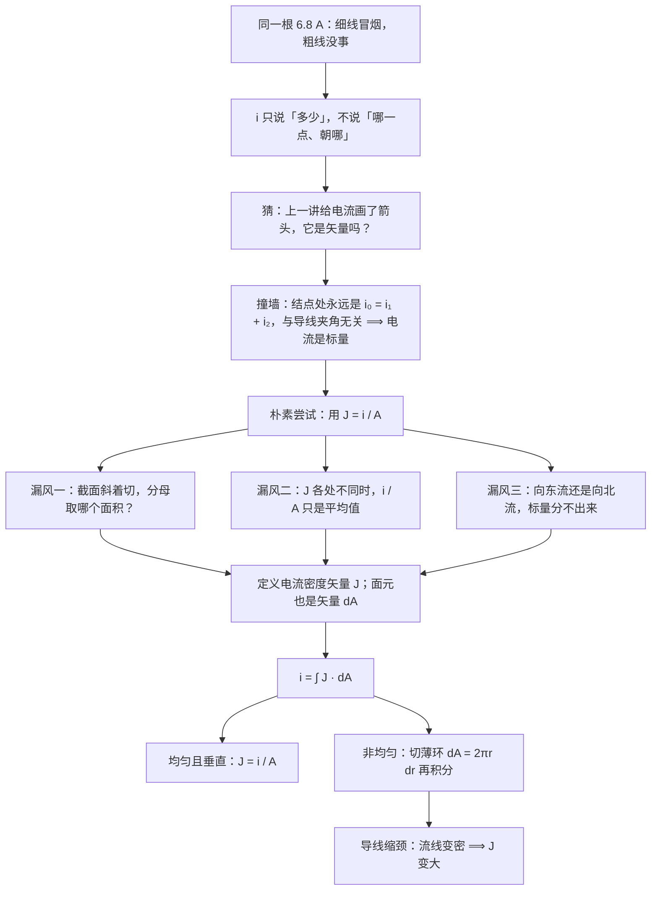

# C26.2 电流密度 Current Density

> [!abstract] 这一讲的任务
> 上一讲我们把电流算清楚了：$i=\dfrac{dq}{dt}$，单位安培。但它是**标量**——只回答"每秒过去多少库仑"，不回答"在哪一点、朝哪个方向、每平方米过去多少"。
> 可现实中同一个电流会有两种完全相反的结局：一根 0.5 mm² 的线跑 6.8 A 会冒烟，换成 4 mm² 就没事。**要预测结局，标量不够用。**
> 这一讲把电流升级成**矢量场**——电流密度 $\vec J$。它是 $i=\displaystyle\int\vec J\cdot d\vec A$ 的被积函数，也是下一讲电阻率 $\rho$ 的搭档。

> [!info] 怎么读这份讲义
> 第 1、2 节先撞两次墙，把"为什么非要升级成矢量"问出来——概念的来路比公式值钱，这也是本讲的重点。第 3、4 节给正式定义和通量关系，第 5 节把 $\vec J$ 画成流线，第 6–8 节是两道例题（第 8 节的不均匀密度最容易错）。第 9 节把 $J$ 接到发热和芯片供电上。
> 对应教材 §26-2（printed pp.748–751），其中教材的 Sample Problem 26.02 与课件例 2 是同一道题；教材该节的 Checkpoint 2 并入了第 3 节。
> 记号约定：**矢量一律带箭头**（$\vec J$、$d\vec A$），**大小用斜体**（$J$、$dA$）。这份讲义严格区分这两者，读的时候也请留意——考试丢分常丢在这个区分上。

---

## 0. 开场：同一根 6.8 A，一根冒烟一根没事

实验室那台 1.5 kW 的加热台要从配电箱拉一条线过来。你手上剩两卷线：一卷标着 0.5 mm²，一卷 4 mm²。设备功率定死了，工作电流就是

$$i=\frac{P}{U}=\frac{1500\ \mathrm W}{220\ \mathrm V}\approx 6.8\ \mathrm A.$$

先接细的那卷。半小时后线皮发烫，捏上去是软的，靠近接头的一段已经变色。换 4 mm² 那卷，同样跑一下午，一点事没有。

问题来了：**两根线上的电流读数都是 6.8 A**。用第 26.1 节的 $i=dq/dt$ 去算，两根线的答案一个数字都差不了。也就是说，"电流"这个数**根本区分不了会发生什么**。

那这两根线到底差在哪儿？粗线的截面积是细线的 8 倍。**同样多的电荷、同样快地过去，粗线里有更大的地方让它们摊开。** 挤不挤，才是决定烧不烧的那个量。

这一讲要做的，就是把"挤不挤"这件事写成一个物理量。它不是电流的修正项，而是一个**新量**——而且必须是个**矢量**。

---

## 1. 先撞一次墙：电流有箭头，但它不是矢量

> [!question] 停一下，先自己想想
> 上一讲我们给电流画了箭头（"正电荷流动的方向"）。画了箭头的东西，通常就是矢量。那电流是不是矢量？

这个猜测非常自然，而且它是对的一半：电流**确实需要带一个方向信息**。但"带方向"和"是矢量"是两件事。矢量要额外满足一条：**必须按平行四边形法则合成**。

那就拿这一条去验。取一个结点：一条导线里的电流 $i_0$ 分成两支，$i_1$、$i_2$。

- 如果电流是矢量，那么"合电流"应该像两个力一样做矢量加法。把两支导线在空间里摆成 90°，就该有 $i_0=\sqrt{i_1^2+i_2^2}$；摆成 60°，就该有 $i_0=\sqrt{i_1^2+i_2^2+2i_1i_2\cos60^\circ}$。
- 实际量出来是什么？**永远**是
  $$i_0=i_1+i_2,$$
  一根导线、两根导线、十根导线，摆 90° 还是 180°、弯成螺旋还是绕回原地，都是这个算术和。

这不是巧合，这是**电荷守恒**在结点上的直接后果——进来多少电荷，就必须出去多少电荷，跟这些导线在空间里怎么摆毫无关系。教材 Fig. 26-3 画的正是这件事：把三根导线在空间中重新取向，$i_0=i_1+i_2$ 照样成立。

> [!warning] 这一撞的结论
> 电流的箭头只表示**沿着导线的流向（sense）**，不是空间中的方向。它不参与矢量合成，所以**电流是标量**。（顺带一个更狠的判据：$i$ 的符号是相对于**你自己选的参考方向**定的，你把参考方向一倒过来，$i$ 立刻变号。矢量分量不会因为你自己换了个约定就整体变号。）

墙撞完了，收获是：**我们需要一个新量，它必须是一个真正的矢量。** 具体缺什么，看下一节。

---

## 2. 再撞一次墙：$i/A$ 看着够用，其实三个地方漏风

回到那两根线。既然 6.8 A 不够用，最顺手的补法就是"把电流除以面积"：

$$\text{细线：}\frac{6.8\ \mathrm A}{0.5\times10^{-6}\ \mathrm{m^2}}=1.36\times10^{7}\ \mathrm{A/m^2},\qquad
\text{粗线：}\frac{6.8\ \mathrm A}{4\times10^{-6}\ \mathrm{m^2}}=1.7\times10^{6}\ \mathrm{A/m^2}.$$

细线的数整整大 8 倍，方向对了。这就是**电流密度**的雏形，量纲也对：$\mathrm{A/m^2}$。

但别急着收工。这个"$i$ 除以面积"至少有三个地方站不住脚，每一个都逼着我们把定义改得更狠一点。

**漏风一：除的是哪个面积？**

把导线**斜着**切断，不是你想象中"正着切"那一刀。斜切出来的截面是个椭圆，面积比正截面大。可流过它的电流一点没变——还是那 6.8 A。于是 $i/A$ 算出来的数**凭白变小了**，好像电流变稀了。所以分母不能是"你切的那一刀的面积"，必须是**垂直于流动方向的面积**（也就是斜截面在垂直于流动方向的平面上的投影）。

**漏风二：$i/A$ 只是个平均值。**

例 2(b) 里会遇到这种情况：导线中心处电流密度小、靠外缘大，从内到外差 4 倍。这时候 $i/A$ 得到的是一个平均值 $7.5\times10^{5}\ \mathrm{A/m^2}$，而真实密度在 $3.0\times10^{5}$ 到 $1.2\times10^{6}$ 之间变化。**要用一个数描述"每一点的流动强度"，面积就必须缩到无穷小。**

**漏风三：它把方向整个丢了。**

同样 4 A，可以向右流，也可以向上流；同样 6.8 A，可以在铜里流，也可以在半导体里流。这两件事对磁场、对受力、对材料损伤**完全不同**，可标量 $i$ 连提都不提。这是因为 $i$ 天生是"通过某个面的总账"，而**方向是逐点才有的性质**。

> [!important] 三次漏风逼出同一句话
> 我们需要的不是"某个面上的总电流"，而是**空间每一点上的流动状态**：大小是"单位时间通过单位垂直面积的电荷量"，方向是"电荷往哪儿走"。
> 一个"逐点有大小、逐点有方向"的物理量，在物理里的标准名字就是**矢量场**。

---

## 3. 电流密度 $\vec J$ 的正式定义（课件 p.8）

> [!important] 定义
> **电流密度（current density）** 是一个矢量场，记为 $\vec J$。
>
> **方向**：与**运动正电荷的速度同向**；若载流子是负电荷，则与它们的速度**反向**。
>
> **大小**：单位时间通过**垂直于流动方向**的单位面积的电荷量，
> $$J=\frac{di}{dA},$$
> 其中 $dA$ 是垂直于流动方向的面元。SI 单位：安培每平方米（$\mathrm{A/m^2}$）。

课件把这两条并排画出来，正是为了让你看出"负电荷为什么要反号"：

![[C26-电流密度的方向约定.png]]

上面一行是正电荷：速度 $\vec v$ 朝右，$\vec J$ 朝右。下面一行是负电荷：速度 $\vec v$ 朝右，$\vec J$ 朝左。**为什么负电荷要反过来？** 因为电流这个概念从一开始定义的就不是"正电荷自己在走"，而是"电荷的**净输运**"：一个负电荷向左穿过某个面，和等量正电荷向右穿过同一个面，在物理上完全等价——它们产生的磁场一样、焦耳热一样、对材料的损伤一样。为了让 $\vec J$ 和上一讲的电流符号约定（"按正电荷的方向画箭头"）保持一致，负载流子就必须取反号。不取反号，下一节的 $i=\int\vec J\cdot d\vec A$ 会整体差一个负号。

课件的另一张图把大小关系和通量关系放在一起：

![[C26-电流密度的大小与通量关系.png]]

左边那句英文定义是本讲的骨架：$J = \dfrac{\text{current}}{\text{area normal to the velocity}}$——**分母特别注明"垂直于速度的面积"**，就是第 2 节"漏风一"的正式回答。右边两个黄框是同一件事的微分形式和积分形式：$J=\dfrac{di}{dA}$ 与 $i=\int J\cdot dA$。

> [!warning] 单位换算的坑
> $1\ \mathrm{A/m^2}=10^{-4}\ \mathrm{A/cm^2}$。工程文档爱用 $\mathrm{A/cm^2}$，于是"片上互连 $10^{6}\ \mathrm{A/cm^2}$"换成国际单位是 $10^{10}\ \mathrm{A/m^2}$——**差了 4 个数量级**。本讲例题里的 $2.0\times10^{5}\ \mathrm{A/m^2}$ 折合只有 $20\ \mathrm{A/cm^2}$，看着很小，其实是同一个量级体系下的正常导线值。

> [!question] 课堂追问：三个箭头各指哪边？
> 一根导线里的传导电子（负电荷）正在向**左**漂移。以下三个量各指向哪边：(a) 电流 $i$ 的方向，(b) 电流密度 $\vec J$，(c) 导线里的电场 $\vec E$？

先自己想，答案在第 5 节末尾回收。

---

## 4. 面元也是矢量：$i=\displaystyle\int\vec J\cdot d\vec A$（课件 p.8）

要让"方向"进入公式，就得让**面积也带方向**。做法是给每个面元配一个矢量：

$$d\vec A = dA\ \hat n,$$

$\hat n$ 是面元的单位法向。于是穿过这个面元的电流（一个标量）就是两者的点积：

$$di=\vec J\cdot d\vec A=J\,dA\cos\theta,$$

$\theta$ 是 $\vec J$ 与该面元法向的夹角。把它加起来，就得到本讲的主公式：

$$\boxed{\ i=\int \vec J\cdot d\vec A\ }$$

**这个式子是整讲的枢纽**：左边是你上一讲就会算的标量 $i$，右边是一个矢量场的面积分。它告诉你，电流是电流密度的**通量**——和第 23 章的电通量 $\Phi=\int\vec E\cdot d\vec A$ 是**同一个数学结构**，只是被积的场换了：$\vec E$ 说的是"每个库仑受多大力"，$\vec J$ 说的是"每平方米每秒过多少电荷"。

**两种最常用的退化情形：**

**（甲）$\vec J$ 均匀，且截面垂直于 $\vec J$。** 此时 $\theta=0$、$\cos\theta=1$，$J$ 可以提到积分号外：

$$i=\int J\,dA=J\!\int dA=JA\quad\Longrightarrow\quad J=\frac{i}{A}.$$

这就是第 2 节那个朴素尝试——**它没有错，它只是"均匀 + 垂直"这个特例**。例 1、例 2(a) 用的都是它。

**（乙）$\vec J$ 均匀，但截面斜着切。** 设你切出的截面积是 $A$，其法向与 $\vec J$ 的夹角是 $\theta$，则

$$i=JA\cos\theta.$$

注意这里的 $A\cos\theta$ 正是截面积在垂直于 $\vec J$ 的平面上的**投影**。所以"漏风一"的正解就是：**斜着切不影响电流，只影响你怎么把面积折算过去。**

> [!example] 手算一遍：斜截面到底少多少
> 设 $\vec J$ 在某段导体里均匀，$J=2.0\times10^{5}\ \mathrm{A/m^2}$，一个平面截面的面积 $A=5.0\times10^{-6}\ \mathrm{m^2}$，其法向与 $\vec J$ 成 $\theta=60^\circ$。
> $$i=JA\cos60^\circ=(2.0\times10^{5})(5.0\times10^{-6})(0.5)=0.50\ \mathrm A.$$
> 若这个面垂直于 $\vec J$，同一个面上的电流是 $1.0\ \mathrm A$。**同一片截面，转了个角度，穿过去的电流就减半**——因为沿流动方向看过去，它"挡住"的有效面积小了一半。

> [!warning] 三个高频易错点
> 1. **分母必须垂直于流动**，不是你随手切的那一刀的面积。判定方法：写成 $\vec J\cdot d\vec A$，让 $\cos\theta$ 自己出来。
> 2. **$\vec J$ 不均匀时绝不能拿边缘值乘面积**（例 2(b) 专门示范）。
> 3. **别把"$\vec J$ 的方向"和"截面法向"搞混**。$\vec J$ 是物理量，$\hat n$ 是你自己选的；选反了（$\theta>90^\circ$）$di$ 就是负的，那只是表示电荷从另一侧穿过去，不是物理变了。

---

## 5. 流线：把 $\vec J$ 场画出来（课件 p.9）

矢量场画不出来的话，人就没法对它产生直觉。第 22 章我们用电场线画 $\vec E$，这里用**流线（streamlines）**画 $\vec J$，规则一模一样：

![[C26-流线与电场线的类比.png]]

对照着看左右两栏，三条规则一一对应：

| | 电场线 | 流线 |
|---|---|---|
| 切线方向 | 给出 $\vec E$ 的方向 | 给出 $\vec J$ 的方向 |
| 疏密 | 垂直于电场线的单位面积上线条数 $\propto E$ | 垂直于流线的单位面积上线条数 $\propto J$ |
| 用途 | 看场的空间分布 | 看电流的空间分布 |

> [!warning] 疏密只是"记法"，不是公式
> "线条数正比于大小"是人画线时的约定，不是可以拿去算数的等式——你画 5 根还是 10 根都行。要数值就回到 $J=di/dA$。**别在考试里写"数了 7 根线所以 $J$ 是 7"**。

流线最有价值的地方，是让"导线缩颈"这件事一眼可见：

![[C26-导线缩颈处流线变密.png]]

导体从宽处过渡到窄处。**电流 $i$ 全程不变**（电荷守恒，每秒进去多少就必须出来多少），但流线被挤到更小的截面上，**间距变小 $\Longrightarrow$ 该处 $J$ 变大**。开头那两根线的差别，在这张图上就是"流线密度"的差别。

现在回收第 3 节那个追问：电子向左漂移——

- (a) **电流 $i$ 向右**。按正电荷约定，负电荷向左走等价于正电荷向右走。
- (b) **电流密度 $\vec J$ 向右**。定义就是"负载流子取反号"，与 $i$ 的约定必须一致。
- (c) **电场 $\vec E$ 也向右**。电子受的力是 $\vec F=-e\vec E$，力让它们往左漂，所以 $\vec E$ 只能朝右。

三个量全都朝右——这不是巧合：**在一个只有一种载流子的导体里，$i$、$\vec J$、$\vec E$ 三者永远同向**，尽管真正的搬运工（电子）朝反方向跑。这是最容易在考场上写反的一处。

---

## 6. 例题 1：同样 4 A，两种截面（课件 p.10）

> [!example] 例 1
> 每秒有 4 库仑电荷分别通过面积 $A_1=0.2\ \mathrm{m^2}$ 和 $A_2=0.4\ \mathrm{m^2}$ 的两个面，求两种情形下的电流密度。

![[C26-例题1同样电流两种截面.png]]

**第一步：先算电流。** 两个面都一样，因为 $i=dq/dt$：

$$i=\frac{4\ \mathrm C}{1\ \mathrm s}=4\ \mathrm A.$$

**第二步：密度。** 两个面都垂直于流动方向，用 $J=i/A$：

$$J_1=\frac{4}{0.2}=20\ \mathrm{A/m^2},\qquad J_2=\frac{4}{0.4}=10\ \mathrm{A/m^2}.$$

**结论**：同样的 $i$，面积翻倍，密度减半。这道题就是本讲的全文缩写——**$i$ 相同，不代表"流动状态"相同**。课件把两个面的图一大小并排放，要你看到的就是这个。

---

## 7. 例题 2(a)：只算外侧环形区域（课件 p.11）

> [!example] 例 2(a)
> 一根圆柱形导线半径 $R=2.0\ \mathrm{mm}$，截面上的电流密度**均匀**，$J=2.0\times10^{5}\ \mathrm{A/m^2}$。求径向距离从 $R/2$ 到 $R$ 之间的**外侧环状部分**流过的电流。

**关键判断：$J$ 均匀。** 所以可以直接用 $J=i/A$，即 $i=J\cdot(\text{这一部分的面积})$。但面积不是 $\pi R^2$——那是整个截面，题目只要外圈的环。

**第一步：环的面积。**

$$A_{\text{ring}}=\pi R^2-\pi\!\left(\frac R2\right)^2=\pi R^2\!\left(1-\frac14\right)=\frac34\pi R^2.$$

代数值（$R=2.0\ \mathrm{mm}=2.0\times10^{-3}\ \mathrm m$）：

$$\frac34\pi (2.0\times10^{-3})^2=\frac34\pi(4.0\times10^{-6})=9.4248\times10^{-6}\ \mathrm{m^2}.$$

**第二步：乘密度。**

$$i=JA_{\text{ring}}=(2.0\times10^{5})(9.4248\times10^{-6})=1.885\ \mathrm A\approx1.9\ \mathrm A.$$

写成符号式就是课件的答案：$i=\dfrac34\pi R^2J=1.9\ \mathrm A$。

> [!tip] 30 秒自检：把三块加起来
> 同一个截面劈成内圆盘和外环，电流必须能对上账：
> - 内圆盘：$J\pi(R/2)^2=2.0\times10^{5}\times3.1416\times10^{-6}=0.628\ \mathrm A$
> - 外环：$1.885\ \mathrm A$
> - 整个截面：$J\pi R^2=2.0\times10^{5}\times1.2566\times10^{-5}=2.513\ \mathrm A$
>
> $0.628+1.885=2.513$ ✓。**只要 $J$ 均匀，随便怎么切都能加回来**；这个自检在第 8 节会失效（那里不能按面积分块乘密度），这正是它值得先在这里做一遍的原因。

---

## 8. 例题 2(b)：密度随半径变，不能拿边缘值乘面积（课件 p.11）

> [!example] 例 2(b)
> 如果同一个截面上的电流密度随半径变化：$J=ar^2$，其中 $a=3.0\times10^{11}\ \mathrm{A/m^4}$（$r$ 以米计）。求**同一个外环区域**（$r$ 从 $R/2$ 到 $R$）流过的电流。

### 先看错误的做法，别急着积分

$J$ 不再均匀，但"密度乘面积"这个动作太顺手了，很多人会去做。做一次就知道为什么不行：

- 用**外边缘**的密度：$J(R)=aR^2=(3.0\times10^{11})(4.0\times10^{-6})=1.2\times10^{6}\ \mathrm{A/m^2}$，乘 $A_{\text{ring}}=9.4248\times10^{-6}\ \mathrm{m^2}$，得 $11.3\ \mathrm A$；
- 用**内边缘**的密度：$J(R/2)=aR^2/4=3.0\times10^{5}\ \mathrm{A/m^2}$，乘同一个面积，得 $2.83\ \mathrm A$。

真值是 $7.1\ \mathrm A$，**一个高 60%，一个只有 40%**。同一道题，同一个面积，因为"用哪个 $J$"就得到三个完全不同的答案——这说明"密度乘面积"在这里根本没有定义。它只在 $J$ 处处相同时才有意义（例 2(a) 恰好满足）。

### 正确做法：把环切成无穷薄的细环

几何直觉很直接：**在一个足够薄的环里，$J$ 可以近似看作常数**，于是"密度乘面积"在**那一个薄环上**重新成立。然后把所有薄环加起来——加起来就是积分。

设薄环半径 $r$、宽度 $dr$：

- 面积（周长 × 宽度）：$dA=2\pi r\,dr$
- 该环上的电流：$di=J(r)\,dA=ar^2\cdot2\pi r\,dr=2\pi a r^3\,dr$

这里 $J$ 和 $dA$ 的大小可以直乘，是因为 $\vec J$ 沿导线方向、面元法向也沿导线方向，**夹角为 0**：

$$\vec J\cdot d\vec A=J\,dA\cos0=J\,dA.$$

积分，下限 $R/2$、上限 $R$：

$$i=\int_{R/2}^{R}2\pi a r^3\,dr=2\pi a\left[\frac{r^4}{4}\right]_{R/2}^{R}=\frac{\pi a}{2}\left(R^4-\frac{R^4}{16}\right)=\frac{\pi a}{2}\cdot\frac{15}{16}R^4=\frac{15}{32}\pi aR^4.$$

### 代数值

$$R^4=(2.0\times10^{-3})^4=1.6\times10^{-11}\ \mathrm{m^4},$$

$$i=\frac{15}{32}\pi\,(3.0\times10^{11})(1.6\times10^{-11})=(0.46875)(\pi)(4.8)=2.25\pi=7.0686\ \mathrm A\approx7.1\ \mathrm A.$$

与课件答案 $7.1\ \mathrm A$ 一致。

> [!tip] 三个自检
> - **量纲**：$a$ 的单位必须是 $\mathrm{A/m^4}$（不是 $\mathrm{A/m^2}$），因为 $J=ar^2$ 里 $r^2$ 要补上两个长度量纲；乘完 $R^4$ 正好回到 $\mathrm A$ ✓
> - **位置**：等效平均密度 $=i/A_{\text{ring}}=7.0686/9.4248\times10^{-6}=7.5\times10^{5}\ \mathrm{A/m^2}$，落在内边缘 $3.0\times10^{5}$ 与外边缘 $1.2\times10^{6}$ 之间 ✓
> - **极值**：真值 $7.07\ \mathrm A$ 必定小于"按最大密度算"的 $11.3\ \mathrm A$，大于"按最小密度算"的 $2.83\ \mathrm A$ ✓ 积分结果落在包络里，说明没把上下限定反

> [!warning] 一个危险的巧合
> 这道题里"取两端密度的算术平均再乘面积"**恰好**给出正确答案：$\frac{3.0\times10^{5}+1.2\times10^{6}}{2}\times9.4248\times10^{-6}=7.07\ \mathrm A$。
> 这是 $J\propto r^2$ 这个特例的巧合（面积加权平均碰巧等于两端点的算术平均）。换成 $J\propto r^3$，同样的做法就差了一截（真实平均 $0.5167aR^3$，端点平均 $0.5625aR^3$）。
> **结论：非均匀分布没有"取个代表值乘面积"这种捷径，只能积分。** 如果你在考场上"猜"出了这个平均值，请当成运气，不要当成方法。

---

## 9. 回头看：$J$ 决定了哪里会烧

| | 电流 $i$ | 电流密度 $\vec J$ |
|---|---|---|
| 类型 | 标量 | 矢量（场） |
| 单位 | $\mathrm A$ | $\mathrm{A/m^2}$ |
| 回答的问题 | 每秒通过这个面多少电荷 | 每一点、朝某方向、每平方米每秒多少电荷 |
| 结点处 | 算术相加 $i_0=i_1+i_2$ | 矢量场，不能简单相加 |
| 与面积的关系 | —— | $i=\displaystyle\int\vec J\cdot d\vec A$ |
| 能否预测"烧不烧" | 不能 | 能 |

**为什么是 $J$ 而不是 $i$ 决定烧不烧？** 因为发热是**局部**的。用 $P=i^2R$、$R=\rho L/A$，一段长 $L$、截面 $A$ 的导体发热功率是 $i^2\rho L/A$，而它的体积是 $AL$，于是

$$\text{单位体积发热功率}=\frac{i^2\rho L/A}{AL}=\frac{i^2\rho}{A^2}=J^2\rho.$$

**$J$ 翻倍，单位体积发热翻四倍。** 开头那两根线：细线的 $J=1.36\times10^{7}\ \mathrm{A/m^2}$ 是粗线 $1.7\times10^{6}$ 的 8 倍，单位体积发热就是 64 倍——线皮当然先扛不住。

**与 AI 方向的关联（两个具体场景）：**

- **芯片供电网络（PDN）。** 一块 AI 加速卡的核心电压不到 1 V，却要供几百到上千安培。设计约束从来不是"总电流几百安"这么一句话，而是**每平方毫米多少安**：要用十几层铜、上千个焊球凸点，把 $J$ 摊到安全范围。家用电线的 $J$ 在 $10^{7}\ \mathrm{A/m^2}$ 量级，而片上铜互连能容忍到 $10^{9}$–$10^{10}\ \mathrm{A/m^2}$ 量级（铝互连的经典设计约束是 $\sim10^{9}\ \mathrm{A/m^2}$，见[剑桥器件课讲义](https://teaching19-20.eng.cam.ac.uk/system/files/P2B2007MB007.pdf)），高了就要靠缩短连线、加宽线宽来压。这正是"为什么 GPU 封装看起来那么复杂"的物理答案。
- **可靠性：电迁移（electromigration）。** 铜原子会被高速电子流"推着走"。$J$ 长期超过阈值，导线里就会长出空洞或小丘，最后断路。这是集成电路寿命的头号杀手之一，而它由 $J$ 而不是 $i$ 决定——**同样的电流，线越细越短命**。

**【拓展】** 把 $i=\int\vec J\cdot d\vec A$ 用在**一个封闭曲面**上，就能把"电荷守恒"写成微分形式：$\nabla\cdot\vec J=-\dfrac{\partial\rho}{\partial t}$（连续性方程）。它的意思是"某点电流密度往外散得越快，那点的电荷就掉得越快"——和结点处的 $i_0=i_1+i_2$ 是同一件事的两个尺度。这条式子在电磁学后半程（以及流体、扩散、甚至扩散模型的概率流）里会反复出现。

> [!abstract] 下一讲预告
> 到这里我们有了 $\vec J$：它说清了"哪里挤、往哪走"。但还有一个更基本的问题没答——**在给定的电场下，$\vec J$ 到底是多大？**
> 有些材料一加电场电荷就哗哗地走，有些几乎不动。下一讲我们引入**电阻率** $\rho$，把这件事写成本章最著名的那条关系：$\vec E=\rho\vec J$。而它为什么成立，要等我们把 $\vec J$ 拆到载流子层面（$J=ne v_d$）才看得清楚。

---

## 这一讲的三句话

1. **电流是标量，电流密度是矢量。** 电流的箭头只表示沿导线的流向，结点处永远算术相加（$i_0=i_1+i_2$，与导线在空间中怎么摆无关）；要描述"在某一点、朝某方向、每平方米每秒多少电荷"，必须升级成矢量场 $\vec J$。
2. **$\vec J$ 的方向**与运动**正**电荷速度同向、与**负**电荷速度反向（所以铜里电子往左跑，$\vec J$、$i$、$\vec E$ 全往右）；**大小** $J=\dfrac{di}{dA}$，分母是垂直于流动的面元。通量关系 $i=\displaystyle\int\vec J\cdot d\vec A$，均匀且垂直时退化成 $J=i/A$；截面斜了就要乘 $\cos\theta$。
3. **非均匀电场必须切薄环积分**：$dA=2\pi r\,dr$，$i=\int J(r)\,2\pi r\,dr$。任何"拿边缘值乘面积"的做法都会错（本讲例 2(b) 高 60% / 低 60%）；而 $J$ 才是决定哪里会烧的量，因为单位体积发热是 $J^2\rho$。

> [!important] 必背
> $$\vec J\ \text{的方向}=\text{正电荷速度方向},\qquad J=\frac{di}{dA},\qquad i=\int \vec J\cdot d\vec A$$
> $$\text{均匀且垂直}\Rightarrow J=\frac iA,\qquad \text{截面法向与}\ \vec J\ \text{成}\ \theta\Rightarrow i=JA\cos\theta$$
> $$\text{环状截面}\ i=J\!\left(\pi R^2-\pi r_{\text{内}}^2\right);\qquad \text{非均匀}\ J=ar^2\Rightarrow i=\int_{r_1}^{r_2}ar^2\,2\pi r\,dr$$

---

上一节 ← [[C26.1 电流]] ｜ 下一节 → [[C26.3 电阻与电阻率]]
索引 → [[电磁学 MOC]]
