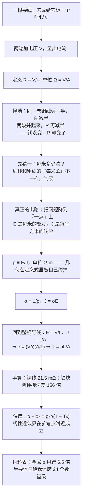

# C26.3 电阻与电阻率 Resistance and Resistivity

> [!abstract] 这一讲的任务
> 上一讲我们有了电流密度 $J$，知道电荷在导体内怎么"挤"着走。但还缺一个东西：**到底是什么在拦着它们**。
> 这一讲要造出两个量——**电阻 $R$（物体的性质）**和**电阻率 $\rho$（材料的性质）**，并且把这两者用一个公式接起来：$R=\rho L/A$。
> 造第二个量的过程比结果重要得多：**我们要先学会怎么把几何（长度、截面）从测得的电阻里剥出去，才有资格说"铜"怎么样。**

---

## 0. 开场：开发板掉电压的那根杜邦线

深夜调一块开发板。电机一转，板子就复位。你换了根更粗的杜邦线，复位消失。

于是你在笔记本上写下一句话：**"细线电阻大。"**

写完你自己就愣住了——细线和粗线都是铜。你真正想记的到底是"这根线的电阻"，还是"铜的电阻"？这两句话听起来差不多，其实完全不是一回事。前者是**某一根具体导线**的属性，后者是**铜这种材料**的属性。而你现在手上只有一个万用表，它只能量前者。

更麻烦的是，就算你只关心那根线，你也说不清它为什么是那个值：换长一点会变，换粗一点会变，绕成弹簧会变，把接头从线端一小块改成整端面压紧**也会变**。

所以这一讲要干的活，是从"万用表读数"这种**只属于某个物体**的量出发，造出一个**只属于材料**的量。这个量就是**电阻率 resistivity**。而造它的过程中会遇到一个必须讲透的坎：**几何和材料混在同一个数字里，你得先把几何剥出去。**

## 1. 电阻 Resistance：先把"物体的阻力"定义出来

先解决一半问题：一根给定的导体，怎么用一个数字概括它拦电荷的能力？

朴素的尝试是：**给它两端加电压，看电流有多大。** 电压是"推力"，电流是"成果"。推力一样而成果小，说明它更拦人。

于是很自然地想拿这两个量做个比值。但比值有两个方向：$V/i$ 还是 $i/V$？

> [!question] 停一下，先自己想想
> 为什么不用 $i/V$ 来定义"通畅程度"，或者干脆用 $\Delta V/\Delta i$（微分的斜率）来定义阻力？挑 $V/i$ 有什么好处？

答案是：**要的是"常数"。** 对绝大多数金属导体，在固定温度下把 $V$ 和 $i$ 一组组测下来，$V$ 和 $i$ 是**成正比**的——$V$ 加倍，$i$ 也就加倍。正比意味着比值 $V/i$ 不随工作点变，是一个**只由导体本身决定**的数，可以写进表格、可以进公式、可以拿两根线作比较。而 $\Delta V/\Delta i$ 只在"不成正比"的器件上才跟 $V/i$ 分道扬镳（二极管就是典型），那是下一节要专门处理的情形。

> [!important] 定义：电阻 Resistance
> 在导体的任意两点之间加电势差 $V$，量出通过它的电流 $i$，则这两点之间的**电阻**定义为
> $$R \equiv \frac{V}{i}$$
> 单位由定义式直接读出：$1\ \Omega = 1\ \mathrm{V/A}$，读作**欧姆 ohm**。
> 在电路图里，专门提供某个指定电阻的元件叫**电阻器 resistor**，符号是 $\longrightarrow\!\!\wedge\!\!\vee\!\!\wedge\!\!\longrightarrow$。

顺手把三个量的量纲关系记住：$R = V/i$ 是"每安培需要多少伏"，所以**电阻是电压与电流之间的汇率**。写开就是 $i = V/R$——同一个电压下，$R$ 越大，电流越小。直白得没什么可讲，但整章后面都在用这一句。

> [!warning] 易错点：$R$ 还取决于你怎么接
> $R$ 不是只由那块材料决定。**电势差施加的方式不同，同一个物体的电阻就不同。** 拿一根金属棒，把电极只压在两端中央的一小块面积上，量到的电阻，会比把电压均匀加在整个端面上时**大**。
> 原因马上就会露出来：电流在这种接法下会被挤到棒中间的一小束线上，等效截面变细、路径变长，$L/A$ 变大，$R$ 自然变大。
> 所以后面 $R = \rho L/A$ 这个式子里藏着一个前提：**电势差是均匀加在两个等势端面上的**。这不是吹毛求疵——第 4 节判断"器件是否遵守欧姆定律"时，靠的就是这种几何条件的可控性。

## 2. 撞墙：铜还是铜，可 $R$ 一直在变

这一节才是本讲的核心。我们手里已经有一个能测的量 $R$，现在想要一个能描述**材料**的量。

### 2.1 先看它为什么不行

拿同一卷纯铜漆包线，做四组测量（温度不变）：

| 样品 | 长度 | 直径 | 测得的 $R$ |
|---|---|---|---|
| A | 1.00 m | 1.00 mm | 21.5 mΩ |
| B | 2.00 m | 1.00 mm | 43.0 mΩ |
| C | 1.00 m | 0.50 mm | 86.1 mΩ |
| D | 2.00 m | 0.50 mm | 172 mΩ |

（这些数字下一节手算，先把它们当成实测值看。）

四根线，同一个材料，同一个温度，$R$ 却从 21.5 mΩ 一路涨到 172 mΩ——**差 8 倍**。你想给"铜"记一个数，记哪个？

### 2.2 先猜一：把长度除掉行不行

很自然会想：那就报"每米多少欧"。A 和 C 都是 1 m，得到

$$\text{A}: 21.5\ \mathrm{m\Omega/m},\qquad \text{C}: 86.1\ \mathrm{m\Omega/m}.$$

同一个材料，两个答案。因为**粗细还在里面**。

那就再猜一步：既然长度要除掉，截面要乘回来，试试 $R\cdot A/L$ 是不是常数。这一步的直觉是对的（下面马上验证），但它其实是在**猜公式**，不是**定义概念**——而且立刻会遇到麻烦：$A$ 是指横截面积、还是表面积？电流走的是"哪块面积"？非圆柱体怎么办？截面不均匀的导线怎么办？

> [!question] 课堂追问
> "每米欧"和"每平方米欧"都试过了，都不成功。**这是不是说明我们的思路从根上就是错的？**
> 我们一直想在"整根导线"这个层面上做除法。可常数恰恰不在这个层面上。

### 2.3 换个层面：把问题降到"一点"上去

问题的根源在于：**$R$ 是给整个物体算的一笔总账。** 一根长线和一个短线，总账当然不同——但材料本身在每一个局部点上做的，是**同一件事**。

那我们就别看整根线，去看材料内部的**某一个点**。在这个点上，有两个量：

- 电场强度 $\vec{E}$：这一点的**驱动强度**。它的单位是 V/m，也就是"每米多少伏"——**长度已经被它自己除掉了**。
- 电流密度 $\vec{J}$：这一点的**响应强度**。它的单位是 A/m²，也就是"每平方米多少安"——**面积已经被它自己除掉了**。

这两个量一比，分子里的长度、分母里的面积**全都不见了**。剩下的纯粹是材料对"驱动"的响应能力：

> [!important] 定义：电阻率 Resistivity 与电导率 Conductivity
> 在各向同性的电阻材料内部任一点，**电场强度**与**电流密度**之比定义为该材料的**电阻率 resistivity**，记作 $\rho$：
> $$\rho \equiv \frac{E}{J}\qquad\Longleftrightarrow\qquad \vec{E}=\rho\,\vec{J}$$
> **电导率 conductivity** $\sigma$ 是它的倒数：
> $$\sigma \equiv \frac{1}{\rho}\qquad\Longleftrightarrow\qquad \vec{J}=\sigma\,\vec{E}$$
> **只有各向同性材料**（各个方向电学性质相同）才有这种"标量成比例"的写法；各向异性晶体里 $\rho$ 得写成张量，那是固体物理的事。

这一步的漂亮之处值得停一下夸：**我们没有做任何除法、任何归一化，几何就自己消失了。** 因为我们把"驱动"和"响应"都换成了**强度量**（单位长度上的电压、单位面积上的电流），而强度量在定义时就已经把范围除掉了。

> [!question] 停一下，先自己想想
> $\rho \equiv E/J$ 这个定义里，有没有用到"导体是圆柱形"？有没有用到"截面均匀"？
> 答案：**都没有。** 它对导线内任意一点、对一块形状古怪的电阻体、对一根截面在变的线，都成立。这正是我们想要的性质——**材料的性质就该和物体的形状无关**。

### 2.4 $\rho$ 的单位是 $\Omega\cdot\mathrm{m}$，不是 $\Omega$

单位直接从定义式推出来，别背：

$$\frac{\text{unit}(E)}{\text{unit}(J)}=\frac{\mathrm{V/m}}{\mathrm{A/m^2}}=\frac{\mathrm{V}}{\mathrm{A}}\cdot\mathrm{m}=\Omega\cdot\mathrm{m}.$$

注意这个 $\mathrm{m}$ 是**一次方**。这一条马上有用。

> [!warning] 单位坑：ohm-meter 与 ohmmeter
> $\Omega\cdot\mathrm{m}$ 是**欧姆·米**，读作 ohm-meter，是**电阻率的单位**。
> ohmmeter 是**欧姆表**，一台**测电阻的仪器**。
> 中文里"欧姆米"和"欧姆表"只差一个字，考试和读文献时非常容易看串。**一个是单位，一个是仪器，毫无关系。**

## 3. 从 $R=\rho L/A$ 把整根导线接回来

现在我们有料材的量 $\rho$ 了。可是万用表量的是 $R$，电路计算要的也是 $R$。**得把几何装回去。**

好在这不难：几何之所以能装回来，是因为在一根均匀直导线里，$\vec{E}$ 和 $\vec{J}$ 都是常数，而它们与宏观量 $V$、$i$ 的关系我们上一讲已经建立好了。

设导线长 $L$、均匀横截面积 $A$，两端加电压 $V$（等势端面），通过电流 $i$。

**第一步，把 $V$ 换成本地电场。** 均匀电场里电势差等于场强乘距离：

$$E=\frac{V}{L}.$$

**第二步，把 $i$ 换成本地电流密度。** 电流均匀铺在整个横截面上：

$$J=\frac{i}{A}.$$

**第三步，代入 $\rho$ 的定义。**

$$\rho=\frac{E}{J}=\frac{V/L}{i/A}=\frac{V}{i}\cdot\frac{A}{L}.$$

**第四步，认出 $V/i$ 就是 $R$**，然后把 $A/L$ 挪到左边：

$$\rho\cdot\frac{L}{A}=R\qquad\Longrightarrow\qquad\boxed{R=\rho\frac{L}{A}}$$

整条推导只有一次代入和一次移项，但每一步都在做同一件事：**把宏观量翻译成局部量，算完再翻译回来。** 这个"宏观 ↔ 微观"的双语切换在电磁学里还会反复出现。

> [!important] 电阻公式（记结论，更要记前提）
> $$R=\rho\frac{L}{A}$$
> 成立条件：**均匀各向同性导体**、**横截面积处处相同**、**电势差加在两个等势端面上**（两端的接法要让电流密度在截面内均匀）。

把推导的四个量摆在一起看，$L$ 是电流要穿的**路程**、$A$ 是电流要穿的**门**，而 $\rho$ 是这两者都剥掉之后剩下的东西：

![[C26-均匀导体的电阻推导示意图.png]]

现在回头验证 2.2 节的"先猜"——把公式代进那四组样品，倍数关系对不对：

- $L$ 加倍（A→B）：$R$ 加倍，$21.5\to43.0\ \mathrm{m\Omega}$ ✓
- 直径减半，$A$ 变成 $1/4$（A→C）：$R$ 变成 4 倍，$21.5\to86.1\ \mathrm{m\Omega}$ ✓
- 两个都变（A→D）：$2\times4=8$ 倍，$21.5\to172\ \mathrm{m\Omega}$ ✓

猜对了。而且现在你能说清**为什么**正比于 $L$、反比于 $A$：前者是路径变长，后者是"并行的通道"变多。

> [!note] 为什么是 $\rho\propto L/A$ 而不是别的
> 逐条看这两个正反比，物理图像很直观：
> **$R\propto L$**：电荷从一端走到另一端，路上要挨的碰撞次数与路程成正比。路加倍，碰撞加倍，阻碍加倍。
> **$R\propto 1/A$**：把两根同样的线并起来用，等于给电荷多开一条道，总电流加倍，阻碍减半。$n$ 根并起来就是 $1/n$。
> 有了这两条，$\rho$ 唯一能出现的位置就只能是那个比例系数——它必须是**与 $L$、$A$ 都无关**的东西，否则方程两边量纲对不上。这也是为什么 $\rho$ 必然是**材料的**性质。

> [!warning] 最大的一个易错点：$A$ 是横截面积，不是表面积
> 电流是**穿过**截面的，不是**沿着表面**爬的，所以
> $$A=\pi r^2=\pi\left(\frac{d}{2}\right)^2\qquad\text{（圆柱导线）}$$
> **不是** $2\pi rL$（侧面积），也**不是** $4\pi r^2$（球的表面积，跟导线完全不沾边）。
> 顺带一个单位陷阱：题目常给 $\mathrm{mm^2}$ 或 $\mathrm{cm^2}$，一律换成 $\mathrm{m^2}$ 再代（$1\ \mathrm{mm^2}=10^{-6}\ \mathrm{m^2}$，$1\ \mathrm{cm^2}=10^{-4}\ \mathrm{m^2}$）。这里差一个 $10^4$，是最高频的低级失分点。

## 4. 手算：从材料表算出一根线的电阻

### 4.1 一根 1.00 m 的铜线，直径 1.00 mm

查表铜的 $\rho=1.69\times10^{-8}\ \Omega\cdot\mathrm{m}$（与 2.1 节表格中 A 组一致）。横截面积

$$A=\pi\left(\frac{d}{2}\right)^2=\pi\left(\frac{1.00\times10^{-3}}{2}\right)^2=\pi(5.00\times10^{-4})^2=7.854\times10^{-7}\ \mathrm{m^2}.$$

代入：

$$R=\rho\frac{L}{A}=\frac{(1.69\times10^{-8})(1.00)}{7.854\times10^{-7}}=2.15\times10^{-2}\ \Omega=21.5\ \mathrm{m\Omega}.$$

**这就是 2.1 节表格里 A 组那个数的来历。** 顺便得到一个特别有用的工程换算：**1 m 的 1 mm 铜线大约 21.5 mΩ**。记住这个锚点，以后估任何铜线都会快很多——直径减半就乘 4，所以 0.5 mm 的线是 86 mΩ/m。

再顺手算一下电导率，体会 $\sigma$ 的量级：

$$\sigma_{\text{Cu}}=\frac{1}{1.69\times10^{-8}}=5.92\times10^{7}\ (\Omega\cdot\mathrm{m})^{-1}.$$

> [!example] 例题：同一块铁，两种接法差 156 倍
> 一块长方体铁块，尺寸 $1.2\ \mathrm{cm}\times1.2\ \mathrm{cm}\times15\ \mathrm{cm}$，$\rho_{\text{Fe}}=9.68\times10^{-8}\ \Omega\cdot\mathrm{m}$。电压加在两块**平行**侧面之间，使这两面成为等势面。求两种接法下的电阻：
> **(1) 用两个正方形端面**（$1.2\ \mathrm{cm}\times1.2\ \mathrm{cm}$）
> **(2) 用两个长方形侧面**（$1.2\ \mathrm{cm}\times15\ \mathrm{cm}$）
>
> **解**：公式里的 $L$ 是**电流方向上的长度**，$A$ 是**电流穿过的那块面积**——这两个量必须跟着接法一起换，不能抄同一组。
>
> 接法 (1)：电流沿 15 cm 的长边走。
> $$L=0.15\ \mathrm{m},\quad A=(1.2\times10^{-2})^2=1.44\times10^{-4}\ \mathrm{m^2}$$
> $$R_1=\frac{(9.68\times10^{-8})(0.15)}{1.44\times10^{-4}}=1.01\times10^{-4}\ \Omega\approx100\ \mu\Omega$$
>
> 接法 (2)：电流沿 1.2 cm 的短边走。
> $$L=1.2\times10^{-2}\ \mathrm{m},\quad A=(1.2\times10^{-2})(15\times10^{-2})=1.80\times10^{-3}\ \mathrm{m^2}$$
> $$R_2=\frac{(9.68\times10^{-8})(1.2\times10^{-2})}{1.80\times10^{-3}}=6.45\times10^{-7}\ \Omega\approx0.65\ \mu\Omega$$
>
> **比值 $\dfrac{R_1}{R_2}=156$。** 同一块铁，同一卷材料，什么都没换，只换了个接线方向，电阻差 156 倍。
>
> **这个例题就是第 1 节那个警告的定量版**：$R$ 是"物体 + 接法"的性质，$\rho$ 才是"材料"的性质。只有当材料不变、几何变了而 $R$ 按 $L/A$ 变，$\rho$ 才能岿然不动。

> [!question] 课堂追问
> 上题里铁块的 $\rho$ 是 $9.68\times10^{-8}$，铜是 $1.69\times10^{-8}$。铁块接法 (2) 的电阻只有 $0.65\ \mu\Omega$，比 4.1 节那根 1 m 铜线的 $21.5\ \mathrm{m\Omega}$ 小了 3 万多倍。
> **那是不是说"铁比铜导电好"？**
> 不是。铁块只是**粗而短**——截面是 $18\ \mathrm{cm^2}$（铜线的约 2300 倍），长度只有 1.2 cm（铜线的 1/83）。材料的优劣只能看 $\rho$：**铜的 $\rho$ 比铁小 5.7 倍，铜赢。** 比较材料永远看 $\rho$，看 $R$ 没有意义。

## 5. 温度：$\rho$ 不是一个死数

### 5.1 一个每天都在发生的现象

白炽灯泡的灯丝是钨。用万用表在**冷态**量一只 100 W 灯泡，读数只有几十欧；可它接上 220 V 正常发光时，按 $R=V/i$ 反推出来的电阻是几百欧。

差了将近**十倍**。同一根灯丝，同一个几何，$R$ 变了——按第 4 节的说法，这意味着 $\rho$ 变了。**电阻率随温度变化。**

这件事一天到晚在发生：电吹风的电阻丝越热越费电、电机启动瞬间的涌流远大于稳态、芯片一跑起来时序就变。所以必须给 $\rho$ 补一个温度依赖。

### 5.2 线性近似

金属的 $\rho$–$T$ 曲线在一段相当宽的温度范围内**几乎是直的**。既然是直线，就可以用最省事的写法：取一个参考温度 $T_0$（通常取室温 $293\ \mathrm{K}$），记下那时的 $\rho_0$，然后假设

$$\rho-\rho_0=\rho_0\alpha(T-T_0),\qquad\text{即}\qquad \boxed{\rho=\rho_0\left[1+\alpha(T-T_0)\right]}$$

其中 $\alpha$ 叫**电阻率的温度系数 temperature coefficient of resistivity**。它其实就是"每升高 1 K，$\rho$ 相对变化多少"：

$$\alpha=\frac{1}{\rho_0}\frac{\Delta\rho}{\Delta T}.$$

> [!note] 用摄氏度还是开尔文？
> **都可以。** 式子里温度只以**差值** $T-T_0$ 出现，而摄氏度与开尔文的**度长完全一样**（$1\ \mathrm{K}=1\ ^\circ\mathrm{C}$），差值不变。
> 但**必须配套**：$T_0$ 和 $\rho_0$ 得取同一套温度下的值。表中数据标的是 $20\ ^\circ\mathrm{C}$，那么 $T_0=20\ ^\circ\mathrm{C}=293\ \mathrm{K}$，$\rho_0$ 就是表里那个数。用 $293\ \mathrm{K}$ 配表里的 $\rho_0$ 没有问题；用 $20\ ^\circ\mathrm{C}$ 配也一样。**混用才会出错**——比如把 $T=100\ ^\circ\mathrm{C}$ 代成 $100\ \mathrm{K}$ 去减 $293\ \mathrm{K}$，那就算了个 $-193$。

> [!important] $\alpha$ 的符号是有物理内容的
> $\alpha>0$：越热电阻率越大。**金属全是这一类**（表里那 8 种金属 $\alpha$ 都在 $10^{-3}\ \mathrm{K^{-1}}$ 量级）。
> $\alpha<0$：越热电阻率越小。**半导体是这一类**——纯硅的 $\alpha=-70\times10^{-3}\ \mathrm{K^{-1}}$，比金属大一个数量级还带负号。热敏电阻（NTC）就是靠这个工作的。
> $\alpha\approx0$：专门造出来不随温度变的合金，用来做标准电阻。

### 5.3 线性近似到底能用到哪里

这是本节最容易被跳过、也最该讲清楚的一条：**这个公式是"经验近似"，不是物理定律。**

**（1）它只在参考点附近的区间里好使。** $\alpha$ 是"为了让方程在选定区间内跟实验对得上"而挑出来的系数，换一段温区，$\alpha$ 就不一样了。所以拿 $293\ \mathrm{K}$ 拟合出来的 $\alpha$ 去外推到上千开，误差会很大。

**（2）外推会给出一个荒唐的结论。** 令 $\rho=0$：

$$T=T_0-\frac{1}{\alpha}=293.15-\frac{1}{4.3\times10^{-3}}\approx61\ \mathrm{K}.$$

公式说铜在约 61 K 时电阻率归零。**真实的铜不会。** 它会在低温下逐渐**趋平**，饱和到一个由杂质和晶格缺陷决定的**残余电阻率 residual resistivity**——降温并不能把散射机制全部关掉。

**（3）低温段曲线还带着明显的弯曲。** 真实的 $\rho$–$T$ 曲线在低温区是"先陡升、后趋平"，只有在室温附近一两百开的范围内才近似直线。

下面这张示意图把这三点一次画出来（纵轴单位 $10^{-8}\ \Omega\cdot\mathrm{m}$，曲线按德拜模型归一化到表里的 $\rho_0=1.69\times10^{-8}$，只是**示意**，不是实测数据）：

![[C26-铜电阻率随温度变化.png]]

看图上三件事：

- **中间那条黄色带（约 200–400 K）**：直线和真实曲线几乎重合——这才是 $\alpha$ 好使的区间，也正是室温工程的区间。
- **左端**：直线继续往下冲、在 61 K 触零；真实曲线却越来越平，趴在残余电阻上不动。
- **右端**：直线慢慢跑到真实曲线的上方——$\alpha$ 是室温附近拟合的，温度一高它就偏大了。

> [!warning] 用温度公式前先问自己"$\Delta T$ 有多大"
> $\Delta T$ 几十开（室温附近的常规工况）：放心用，误差百分之几。
> $\Delta T$ 上千开（灯丝、熔炉、电弧）：**不能用**，得查实测曲线或分段数据。
> 一个可操作的判断：$\Delta T$ 与 $1/\alpha$（铜约 233 K）同量级时，线性近似就开始明显失真了。

### 5.4 手算：三种材料的温度效应

**（a）铜线从 $20\ ^\circ\mathrm{C}$ 升到 $80\ ^\circ\mathrm{C}$**（$\Delta T=60\ \mathrm{K}$）：

$$\rho=\rho_0\left[1+\alpha\Delta T\right]=1.69\times10^{-8}\times\left[1+4.3\times10^{-3}\times60\right]=1.69\times10^{-8}\times1.258=2.13\times10^{-8}\ \Omega\cdot\mathrm{m}.$$

相对变化 **$+25.8\%$**。因为 $R\propto\rho$（几何不变），那根 1 m/1 mm 的铜线电阻从 $21.5\ \mathrm{m\Omega}$ 涨到 $21.5\times1.258=27.1\ \mathrm{m\Omega}$。

**仅仅 60 K，电阻就多了四分之一。** 这就是为什么芯片的时序签核必须按最坏高温做——互连线的电阻会随自热一起往上走。

**（b）锰铜 Manganin 同样升 $60\ \mathrm{K}$**（$\alpha=0.002\times10^{-3}=2\times10^{-6}\ \mathrm{K^{-1}}$）：

$$\text{相对变化}=2\times10^{-6}\times60=1.2\times10^{-4}=0.012\%.$$

同样的温升，铜变了 $25.8\%$，锰铜只变了 **$0.012\%$**——差了 2000 多倍。**锰铜就是为这件事造的**：用它做的电阻，阻值几乎不随温度漂移，所以标准电阻、精密分流器都用它。

**（c）钨丝从 $20\ ^\circ\mathrm{C}$ 升到 $2000\ ^\circ\mathrm{C}$**（$\Delta T\approx1980\ \mathrm{K}$，$\alpha_\mathrm{W}=4.5\times10^{-3}\ \mathrm{K^{-1}}$）：

$$\frac{\rho}{\rho_0}=1+4.5\times10^{-3}\times1980=1+8.91\approx\mathbf{9.9}.$$

冷态和热态差近 **10 倍**——白炽灯"开灯瞬间涌流是稳态的数倍"就是这么来的（冷态电阻小，$i=V/R$ 大）。但请注意：$\Delta T=1980\ \mathrm{K}$ 已经远超出线性近似的可靠区间，这个 9.9 只能当**数量级估计**，精确值要查钨的实测 $\rho$–$T$ 曲线。

### 5.5 温度效应的微观原因（先埋，下一讲回收）

为什么金属越热电阻率越大？用刚建立的 $\vec{J}=\sigma\vec{E}$ 还答不上来——$\rho$ 现在只是一个"测出来的数"。

下一讲会把它拆开：把金属里的传导电子看成一群在正离子实之间乱撞的自由粒子，加上电场后它们获得一个**漂移速度** $v_d=\dfrac{eE\tau}{m}$（$\tau$ 是**平均自由时间**，即两次碰撞之间的平均间隔），再由 $J=nev_d$ 一路推下去，得到

$$\rho=\frac{m}{ne^2\tau}.$$

一旦有了这个式子，温度效应就一目了然：**温度升高 → 离子实热振动加剧 → 电子被撞得更频繁 → $\tau$ 变小 → $\rho$ 变大。** 金属的 $\alpha>0$ 由此而来。

而且顺带解释了低温的"趋平"：$\tau$ 由两种散射共同决定——**晶格振动散射**（随温度下降而减弱）和**杂质/缺陷散射**（跟温度几乎无关）。温度降到足够低，前者消失，只剩后者，$\rho$ 就停在残余电阻上不再下降。

> [!note] 先记着，下一讲回来算
> $\rho=\dfrac{m}{ne^2\tau}$ 里的 $n$ 是**单位体积传导电子数**、$\tau$ 是**平均自由时间**。这一讲我们只用到"$\rho$ 是材料常数"这个结论；下一讲会用它去解释**为什么金属遵守欧姆定律**（因为 $\tau$ 几乎不随外场变），并算铜的 $\tau\approx2.5\times10^{-14}\ \mathrm{s}$、平均自由程约 40 nm。

## 6. 材料参数表：一张表看完整个电学世界

下表是 $20\ ^\circ\mathrm{C}$ 下常见材料的电阻率与温度系数。金属各行与第 14 页那张室温电阻率表逐行一致；半导体与绝缘体两段是同一张表被裁掉的后半部分，这里补全——**它们才是$\rho$跨度最惊人的地方。**

| 材料 Material | 电阻率 $\rho$（$\Omega\cdot\mathrm{m}$） | 温度系数 $\alpha$（$\mathrm{K^{-1}}$） |
|---|---|---|
| *典型金属 Typical Metals* | | |
| 银 Silver | $1.62\times10^{-8}$ | $4.1\times10^{-3}$ |
| 铜 Copper | $1.69\times10^{-8}$ | $4.3\times10^{-3}$ |
| 金 Gold | $2.35\times10^{-8}$ | $4.0\times10^{-3}$ |
| 铝 Aluminum | $2.75\times10^{-8}$ | $4.4\times10^{-3}$ |
| 锰铜 Manganin | $4.82\times10^{-8}$ | $0.002\times10^{-3}$ |
| 钨 Tungsten | $5.25\times10^{-8}$ | $4.5\times10^{-3}$ |
| 铁 Iron | $9.68\times10^{-8}$ | $6.5\times10^{-3}$ |
| 铂 Platinum | $10.6\times10^{-8}$ | $3.9\times10^{-3}$ |
| *典型半导体 Typical Semiconductors* | | |
| 硅 Silicon（纯） | $2.5\times10^{3}$ | $-70\times10^{-3}$ |
| 硅 Silicon（n 型） | $8.7\times10^{-4}$ | — |
| 硅 Silicon（p 型） | $2.8\times10^{3}$ | — |
| *典型绝缘体 Typical Insulators* | | |
| 玻璃 Glass | $10^{10}\sim10^{14}$ | — |
| 熔石英 Fused quartz | $>10^{16}$ | — |

**怎么读这张表：**

**（1）金属之间其实差得不多。** 最好的银 $1.62\times10^{-8}$ 到最差的铂 $10.6\times10^{-8}$，只差 **6.5 倍**。把所有金属放在一起，$\rho$ 都在 $10^{-8}\ \Omega\cdot\mathrm{m}$ 这个量级上晃。所以"金属都是良导体"是对的。

**（2）为什么导线用铜而不是银？** 银的 $\rho$ 只比铜小 $4\%$，价格却是铜的几十倍。铜是**性价比最优解**——这也是整个电力工业和芯片互连都用铜的原因。

**（3）每种金属的选用都有理由。**
- **铝**：$\rho$ 只比铜大 $63\%$，密度却只有铜的 $1/3$。按**重量**算，铝的导电效率反而更高——高压输电线用铝（钢芯铝绞线）就是算的这笔账。
- **钨**：$\rho$ 不算好，但熔点 $3410\ ^\circ\mathrm{C}$，是所有金属里最高的之一。灯丝要在白热下工作几千小时，除了钨没得选。它的 $\alpha$ 也大，正好贡献了"冷态电阻只有热态十分之一"这个现象。
- **铁**：$\rho$ 一般、$\alpha$ 最大（$6.5\times10^{-3}$），还便宜结实。所以钢筋、铁铬铝电热丝这类"要发热、要便宜"的场合用它。
- **铂**：$\rho$ 最大、贵，但化学上极稳定、$\alpha$ 线性度好，所以做**精密铂电阻温度计**（Pt100 之类）——用它的电阻随温度的变化反过来测温。
- **锰铜**：$\alpha\approx2\times10^{-6}$，比铜小三个数量级，专门做**标准电阻**和**精密电流分流器**。

**（4）跨过半导体和绝缘体，$\rho$ 横跨 24 个数量级。** 从银的 $1.62\times10^{-8}$ 到熔石英的 $>10^{16}$，中间隔了 $10^{24}$。这个跨度和"物质世界"里任何其他物理量的跨度比都不逊色。

**（5）$\alpha$ 的符号在这里翻了个面。** 纯硅的 $\alpha=-70\times10^{-3}\ \mathrm{K^{-1}}$，**负的**，绝对值还比任何金属大一个数量级。金属和半导体的电阻–温度行为**方向相反**，这不是笔误——原因完全不同（金属是散射变多，半导体是热激发出的载流子变多）。第 5 节说的"$\alpha<0$ 就是半导体"在这里得到印证。

**（6）掺杂能把 $\rho$ 改掉 6 个数量级。** 纯硅 $2.5\times10^{3}$，掺磷（n 型）后降到 $8.7\times10^{-4}$——**降了 6 个数量级**。而 p 型掺铝是 $2.8\times10^{3}$，几乎没变。这行数据背后就是整个半导体工业：**$\rho$ 不是老天定的，是能设计的。**

> [!warning] 这张表的一个残缺
> 表里"锰铜 Manganin"右上角挂了一个脚注标记 $\alpha$ 上标，但**课件上没有对应的脚注正文**。教材的原注是：*"一种专门设计成 $\alpha$ 值很小的合金"*——也就是 5.4(b) 算的那个 $0.012\%$ 的来历。
> 这不是笔误，是排版时脚注被裁掉了。用它的时候记得把这句话补上，否则 $\alpha=0.002\times10^{-3}$ 这个反常的小数字看起来像是打印错误。

## 7. 易错点汇总

> [!warning] 考前速扫
> 1. **面积是横截面积，不是表面积。** 圆柱导线 $A=\pi r^2$，不是 $2\pi rL$。电流"穿过"截面，不"沿着"表面。
> 2. **$R$ 与 $\rho$ 的区别是本节的全部意义。** $R$ 是**物体**（含接法）的性质，单位 $\Omega$；$\rho$ 是**材料**的性质，单位 $\Omega\cdot\mathrm{m}$；两者靠 $R=\rho L/A$ 相连。**把一根铜线拉长到 2 倍，$R$ 变大，$\rho$ 一点没变。**
> 3. **$\Omega\cdot\mathrm{m}$（欧姆·米，单位）$\ne$ ohmmeter（欧姆表，仪器）。**
> 4. **单位换算。** $\mathrm{mm^2}\to\mathrm{m^2}$ 是 $\times10^{-6}$，$\mathrm{cm^2}\to\mathrm{m^2}$ 是 $\times10^{-4}$。这里错一次就是 4~6 个数量级。
> 5. **$R=\rho L/A$ 有前提。** 均匀、各向同性、截面处处相同、电压加在**等势端面**上。接法一变（第 1 节的警告、第 4 节例题），公式的 $L$ 和 $A$ **要跟着一起换**。
> 6. **温度公式里 $T$ 用 $\mathrm{K}$ 或 $^\circ\mathrm{C}$ 都行，但 $T_0$ 与 $\rho_0$ 必须配套**，且只在参考点附近的区间有效。
> 7. **$\vec{J}=\sigma\vec{E}$ 只对各向同性材料成立**，而且 $\sigma$ 的倒数关系 $\sigma=1/\rho$ 是对**标量**说的。
> 8. **比较材料永远比 $\rho$，不要比 $R$。** 一个又粗又短的铁块，$R$ 可以比一根细长的铜线小几万倍，但铁的材料性质远不如铜。

## 8. 与 AI 硬件方向的关联

学到这里，你已经拿到了分析芯片互连问题的全部基本量。这些场景都会反复用到本节的两个式子 $R=\rho L/A$ 和 $\rho=\rho_0[1+\alpha\Delta T]$：

**（1）互连线的电阻与 RC 延迟。** 芯片里的铜互连线越做越细：线宽缩小使 $A$ 变小，$R=\rho L/A$ 直接上升。而线间电容几乎不变，于是 $RC$ 延迟恶化。这是先进制程里"互连延迟超过晶体管延迟"的根因——也是为什么工艺从铝互连换到铜（$\rho$ 小 39%），再往后又在接触孔和局部互连里换用钴、钌、钨（不是为了 $\rho$ 更小，而是为了在纳米尺度下抗电迁移、$\rho$ 的有效值更可控）。

**（2）电源分配网络的 IR drop。** 从封装焊球到 die 上的晶体管，电流要穿过一整套很细的铜走线。压降就是 $\Delta V=iR$，而 $R$ 由那些走线的 $L/A$ 决定。大电流 GPU（几百安培）上，几毫欧的路径电阻就能吃掉几十毫伏的电压裕度，所以高端封装要用厚铜、多层电源平面、大量并联通孔——**本质上是在拼命把 $A$ 做大、把 $L$ 做小。**

**（3）温度是"第二重打击"。** 芯片一自热，铜的 $\rho$ 按 $\alpha=4.3\times10^{-3}$ 往上走——**每升温 60 K，互连电阻增大约 26%**（5.4(a) 算过）。而功耗 $P=i^2R$ 又随 $R$ 增大，形成正反馈。所以时序签核必须按最坏高温角（worst-case hot corner）做，散热设计不只是"别烧了"，而是直接决定电路能不能跑在设计频率上。

**（4）为什么"温度传感器"能片上实现。** 反过来利用 5.4 的关系：测一段已知几何的导体的 $R$，就能反推 $T$。片上的热敏二极管/电阻测温、以及精密电流采样用的**分流电阻**，都建立在这一节。而做电流采样时，分流器必须用**锰铜**这类 $\alpha\approx0$ 的合金——否则环境温度一变，采样精度就没了（5.4(b)：铜会漂 25.8%，锰铜只漂 0.012%）。

**（5）从"线"到"结"的伏笔。** 本节处理的都是"均匀导体"，$R$ 与施加的电压无关，$\rho$ 是常数——这就是下一讲的**欧姆定律**。而一旦 $\rho$ 随 $E$ 变化（非欧姆器件），或者像半导体那样 $\rho$ 随温度反向变化，本节这套"几何剥离"的框架依然成立，只是 $\rho$ 不再是常数。**这就是本节真正的遗产：$\rho$ 把"材料"这件事从"几何"里干净地切了出来，后面无论材料多奇怪，我们都有地方安放它。**

---

## 这一讲的三句话

1. **$R$ 是物体的性质，$\rho$ 是材料的性质。** $R=V/i$ 只能告诉你"这根线"如何；要谈"铜"如何，必须先把长度和截面从测量结果里剥干净——$R=\rho L/A$ 就是剥离与装回的全过程。
2. **$\rho\equiv E/J$ 之所以干净，是因为 $E$ 和 $J$ 本身就是强度量。** $E$ 是"每米的电压"、$J$ 是"每平方米的电流"，几何在定义式里已经自己约掉了；这也解释了它为什么对形状毫无要求。
3. **温度通过 $\alpha$ 进入，而且这个线性公式只在参考点附近成立。** 金属 $\alpha>0$、半导体 $\alpha<0$，两者机制完全不同；线性外推会在 $61\ \mathrm{K}$ 给出"$\rho=0$"的假结论，真实材料会停在残余电阻上。

> [!important] 必背
> $$R\equiv\frac{V}{i},\qquad 1\ \Omega=1\ \mathrm{V/A}$$
> $$\rho\equiv\frac{E}{J},\qquad \vec{E}=\rho\vec{J},\qquad \sigma\equiv\frac{1}{\rho},\qquad \vec{J}=\sigma\vec{E},\qquad [\rho]=\Omega\cdot\mathrm{m}$$
> $$R=\rho\frac{L}{A}\qquad\text{（均匀各向同性导体，等势端面）}$$
> $$\rho-\rho_0=\rho_0\alpha(T-T_0)\qquad\text{（参考点附近近似）}$$
> 常用锚点：铜 $\rho=1.69\times10^{-8}\ \Omega\cdot\mathrm{m}$、$\alpha=4.3\times10^{-3}\ \mathrm{K^{-1}}$；**1 m 的 1 mm 铜线 $\approx21.5\ \mathrm{m\Omega}$**。

> [!tip] 常用数值速查
> | 量 | 数值 |
> |---|---|
> | 铜 $\rho$（$20\ ^\circ\mathrm{C}$） | $1.69\times10^{-8}\ \Omega\cdot\mathrm{m}$ |
> | 铜 $\sigma$ | $5.92\times10^{7}\ (\Omega\cdot\mathrm{m})^{-1}$ |
> | 铜 $\alpha$ | $4.3\times10^{-3}\ \mathrm{K^{-1}}$ |
> | 铜 $\rho\to0$ 的外推温度 | $\approx61\ \mathrm{K}$（**假结论**，仅供说明线性近似边界） |
> | 1 m / 1 mm 铜线 | $21.5\ \mathrm{m\Omega}$ |
> | 铝 / 钨 / 铁 / 铂 $\rho$ | $2.75,\,5.25,\,9.68,\,10.6\ (\times10^{-8}\ \Omega\cdot\mathrm{m})$ |
> | 锰铜 $\alpha$ | $0.002\times10^{-3}\ \mathrm{K^{-1}}$ |
> | 纯硅 $\alpha$ | $-70\times10^{-3}\ \mathrm{K^{-1}}$ |
> | 金属 $\rho$ 跨度 / 全表 $\rho$ 跨度 | $6.5$ 倍 / $10^{24}$ |

> [!abstract] 下一讲预告
> 我们这一讲默认了 $V$ 和 $i$ 成正比，才敢写 $R=V/i$ 并把它当成常数。可这件事**凭什么成立**？
> 把金属想成一屋子乱撞的电子，撞出来的平均自由时间 $\tau$ 只有在"漂移速度远小于热运动速度"时才与外场无关——正是这一点让 $\rho$ 成为常数。算下去会得到 $\rho=\dfrac{m}{ne^2\tau}$，铜的 $\tau\approx2.5\times10^{-14}\ \mathrm{s}$、平均自由程约 40 nm，比铜原子间距大 150 倍。
> 换句话说：**电子在撞上原子之前，要穿过 150 个原子的领地。** 下一讲见。

---

上一节 ← [[C26.2 电流密度]] ｜ 下一节 → [[C26.4 欧姆定律与微观导电机制]]
索引 → [[电磁学 MOC]]
