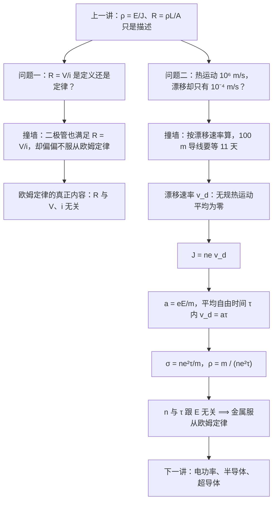

# C26.4 欧姆定律与微观导电机制 Ohm's Law and Microscopic Conduction

> [!abstract] 这一讲的任务
> 上一讲我们把「电阻」拆成了两层：电路里量到的 $R=V/i$，和材料参数 $\rho=E/J$，还拿到了 $R=\rho L/A$。但这两个式子都只是**描述**——它们告诉你「是这样」，没告诉你「为什么是这样」。
> 这一讲要交两份作业：第一，说清楚**欧姆定律到底多说了什么**（$R=V/i$ 只是定义，真正的内容是「$R$ 与 $V$、$i$ 无关」这个额外断言，所以拿二极管一比就露馅）；第二，钻进金属内部，用**漂移速率、平均自由时间、平均自由程**把 $\rho=\dfrac{m}{ne^2\tau}$ 推出来，顺便解释那个让人卡住的量级之谜：电子热运动明明有 $10^6\ \mathrm{m/s}$，漂移速率却只有 $10^{-4}\ \mathrm{m/s}$ 量级。

> [!info] 怎么读这份讲义
> 前半段（第 1–2 节）是概念辨析，后半段（第 3–6 节）是一条连续推导链，建议按顺序读。
> 第 5 节的手算把铜的每一个数字都算了一遍，包括课件和教材里那两个对不上的漂移速率——**先看推导再看数字，别反过来**。
> 课件 p.17、p.18 的中文批注（「电阻」「pn 结」「漂移速率」）在导出成 PDF/图片时丢了字，图上留下空缺和方框，正文按原文补齐。

---

## 0. 开场：按下开关的那一瞬间

晚上你按下台灯开关，灯亮了，中间没有可以察觉的延迟。

现在把两个数字摆在一起看。铜里传导电子的热运动速率大约是 $10^6\ \mathrm{m/s}$——比步枪子弹还快几十倍；而这个电子的**漂移速率**，按课件给的量级只有 $10^{-4}$ 到 $10^{-5}\ \mathrm{m/s}$。两者差了十个数量级。

于是同一个电子能推出两个互相矛盾的结论：

- 用热运动速率算，电子跑完一百米导线只要 $10^{-4}\ \mathrm{s}$，灯「瞬间亮」理所当然；
- 用漂移速率算，一百米要走上 $10^6\ \mathrm{s}$，也就是**十一天**。灯根本不该亮。

这两个数都是对的，错的是「灯亮 = 电子跑到了灯泡」这个默认前提。这一讲要把这件事拆开讲清楚：**搬运电荷的速度**和**信号传播的速度**是两回事，而「电场在导体里建立起来」才是你按下开关后真正发生的事。

第二个场景更小：桌上有一颗 LED，就是一只 pn 结二极管。你用万用表测它的电压和电流，然后老老实实算 $R=V/i$——会发现这个「电阻」随电压变，正向 1.5 V 以下几乎不通，反着接几乎没有电流。可是 $R=V/i$ 明明是上一讲刚学的公式，它怎么会失灵？

它其实没失灵，是我们把**定义**当成了**定律**。

这一讲就解决这两件事。第一件叫「欧姆定律到底多说了什么」，第二件叫「金属为什么服从它」。

---

## 1. 这一讲要交的三份作业（课件 p.16）

课件 p.16 把这一节的学习目标列成三条，这就是接下来的路线图：

1. **区分**服从欧姆定律的器件和不服从的器件；
2. 对导体里的传导电子，说清**平均自由时间 $\tau$**、有效速率 $v_{\rm eff}$ 与热运动（无规运动）三者的关系；
3. 会用**电阻率 $\rho$、传导电子数密度 $n$、平均自由时间 $\tau$** 之间的关系式。

同一页底下框了两个公式，一个宏观一个微观：

$$i=\frac{V}{R},\qquad J=\sigma E$$

左边那个是你在电路课里最熟的式子，右边那个是上一讲从 $\vec E=\rho\vec J$ 换了个写法（$\sigma=1/\rho$ 叫电导率 conductivity）。这两个式子中间隔着整整一个微观世界——**这一讲的任务就是把这条等号填上**：为什么 $J$ 与 $E$ 成正比（也就是 $\sigma$ 是与 $E$ 无关的常数），而不是正比于 $E^2$ 或者别的什么。

---

## 2. 撞墙点一：$R=V/i$ 只是定义，不是定律（课件 p.16–17）

> [!question] 停一下，先自己想想
> 给你一个黑盒子器件、一个可调电压源、一块电流表。你怎么判断这个器件「服不服从欧姆定律」？

最朴素的做法是：加一个电压 $V$，量一个电流 $i$，算 $R=V/i$；换个电压再算一次，看 $R$ 是不是同一个数。看起来 $R=V/i$ 就是欧姆定律本身。

这里就是第一堵墙：**$R=V/i$ 是你自己写下的定义式，它对任何两端器件都成立**，连二极管也成立。你测了 $V$、测了 $i$，然后定义它们的比值叫电阻——这一步不可能失败，所以它什么信息都没告诉你。

> [!important] 欧姆定律的真正内容
> - 一个**器件**服从欧姆定律 $\iff$ 它的电阻 $R=V/i$ **与所加电压的大小和极性无关**；
> - 一种**材料**服从欧姆定律 $\iff$ 它的电阻率 $\rho=E/J$ **与所加电场的大小和方向无关**。
>
> 换句话说，欧姆定律说的是 $i$–$V$ 曲线是一条**过原点的直线**：$R$ 是常数。而 $V=iR$ 只是一个记号约定，任何器件在任何一点都满足它。
>
> 教材特意提醒过这一点：这个断言只在某些情况下成立，但出于历史原因仍然叫「law」。

### 2.1 拿两种器件比一比

同一张图上画两条 $i$–$V$ 曲线，区别一眼就看出来：

- **电阻器**：$i$ 对 $V$ 是过原点的直线，正接反接对称，斜率处处相同。斜率就是 $i/V$，既然斜率不变，$R=V/i$ 就不变——它服从欧姆定律。
- **pn 结二极管**：正向电压小于约 $1.5\ \mathrm{V}$ 时几乎不通电流；过了这个阈值，电流随电压陡峭上升（近似指数）；反过来接，电流极小（反向饱和）。同一条曲线上取不同的点算 $R=V/i$，得到的是**不同的数**，而且正负电压下行为完全不对称。

所以判据不是「$R=V/i$ 成立吗」，而是「$R$ **跟你加多大电压、什么极性**有没有关系」。

![[C26-欧姆定律-电阻与二极管的伏安特性.png]]

还要分清两个层次。器件服从和材料服从不是一回事：同一根铜线，你把它拉长一倍，$R$ 变了，但 $\rho$ 一点没变。器件把材料的 $\rho$ 和几何（$R=\rho L/A$）揉在了一起，而欧姆定律的物理内容属于**材料**那一层——这也正是为什么接下来要从原子尺度去看。

### 2.2 手算：教材 Checkpoint 4

教材给了一张表，同一个电压下两个器件的电流不同，问你哪个不服从欧姆定律：

| 器件 1 的 $V$ (V) | 器件 1 的 $i$ (A) | 器件 2 的 $V$ (V) | 器件 2 的 $i$ (A) |
|---|---|---|---|
| 2.00 | 4.50 | 2.00 | 1.50 |
| 3.00 | 6.75 | 3.00 | 2.20 |
| 4.00 | 9.00 | 4.00 | 2.80 |

> [!example] 逐点算电阻
> 器件 1：$R_1=\dfrac{2.00}{4.50}=0.444\ \Omega$，$\dfrac{3.00}{6.75}=0.444\ \Omega$，$\dfrac{4.00}{9.00}=0.444\ \Omega$ ——三点完全一样。
>
> 器件 2：$R_2=\dfrac{2.00}{1.50}=1.333\ \Omega$，$\dfrac{3.00}{2.20}=1.364\ \Omega$，$\dfrac{4.00}{2.80}=1.429\ \Omega$ ——电压升一次，电阻涨一次。
>
> **结论：器件 2 不服从欧姆定律**（它的 $R$ 随 $V$ 单调上升，和二极管是同一类行为，只是没有阈值那么戏剧化）。

停一下，我们刚才干了什么。我们做的事情是：**不去问「公式对不对」，去问「常数对不对」**。这是这一节第一个思维方式，它会在第 6 节以另一种形式再出现一次——那时要问的是「$n$ 和 $\tau$ 是不是常数」。

---

## 3. 撞墙点二：$10^6\ \mathrm{m/s}$ 和 $10^{-4}\ \mathrm{m/s}$ 差了十个数量级（课件 p.18）

现在钻进金属内部。这一节的图像建立在**自由电子模型 free-electron model** 上，两条假设要先说清楚：

- 金属里的传导电子可以在整块材料里自由活动，像密闭容器里的气体分子；
- 电子**只与金属原子碰撞，电子之间不碰撞**（这是模型的关键简化。真实电子之间有库仑作用，但在这个层次的讨论里可以忽略）。

**没有电流时**：电子在做无规热运动，向各方向的机会均等，平均下来净位移为零——没有净运动，也就没有电流。

**有电流时**：电子**仍然**在乱撞，只是所有电子的运动叠加了一个极小的共同偏移，这个趋势叫**漂移 drift**；偏移的平均速度就是**漂移速率 drift speed $v_d$**（严格说是有方向的漂移速度 $\vec v_d$）。

![[C26-金属导电微观图像-随机运动与漂移速度.png]]

这张图上三个箭头的方向关系值得记一辈子：电场 $\vec E$ 指向左，电流 $I$ 也指向左（两者同向），而电子的漂移速度 $\vec v_d$ 指向右（与 $\vec E$ **反向**）。电子带负电，受力方向与电场相反——这一点在第 4 节推公式时还会再翻一次符号，到时候要小心别翻两次。

### 3.1 先猜：灯亮得快，是因为电子跑得快吗？

> [!question] 停一下，先自己想想
> 既然电子热运动速率有 $10^6\ \mathrm{m/s}$，那按下开关之后，是不是电子以这个速度冲过去，几微秒就到了灯泡？这样「瞬间亮」不是正好说得通吗？

这个猜测表面上没问题。算一下：$100\ \mathrm{m}$ 的导线，除以 $10^6\ \mathrm{m/s}$，得到 $10^{-4}\ \mathrm{s}$，确实快到察觉不出来。

但是这堵墙马上就来了：**如果我们按漂移速率重算一遍**，$100\ \mathrm{m}\div 10^{-4}\ \mathrm{m/s}=10^6\ \mathrm{s}\approx 11.6$ **天**。可灯是瞬间亮的。

矛盾出在哪？出在**你把两种速度混着用了**。

- 热运动是**无规**的。它向各个方向的平均值是零，所以它**对搬运电荷没有任何净贡献**。真正在把电荷从一端搬到另一端的是那个极小的漂移，$v_d\sim 10^{-4}\ \mathrm{m/s}$ 量级——这是对的。
- 那灯为什么瞬间亮？因为**「灯亮」不需要电子跑到灯泡**。你按下开关，改变的是导线上的电荷分布，这个扰动以电磁场的形式沿导线以接近光速传出去（真空中是 $c$，导线里还要除以折射率，仍是 $10^8\ \mathrm{m/s}$ 量级）。整条导线上的电子几乎**同时**被这个已经建立起来的电场推着，一起开始慢慢挪。灯丝里本来就有电子，电流一起来它就发热发光。

打个水管比方：水管本来就灌满了水，你一开水龙头，水立刻从另一头流出来——先流出来的是**原本就在管口的那部分水**，不是你刚灌进去的那一滴。导线里的电子就像已经塞满管子的「电荷气体」，你打开的只是阀门（电场）。

所以这两个速度各有各的用处：$v_{\rm eff}\sim 10^6\ \mathrm{m/s}$ 决定碰撞多频繁、平均自由程有多长（第 5 节要用它算 $\lambda$）；$v_d\sim 10^{-4}\ \mathrm{m/s}$ 决定单位时间能搬多少电荷（第 4 节要用它算电流密度）。**它们相差约 $2\times 10^{10}$ 倍，永远不要互相替代。**

顺带说清楚 $v_{\rm eff}$ 的来路：按经典物理，金属里的电子应该像气体分子一样服从麦克斯韦速率分布，平均速率随温度变化；但电子实际由量子规律支配。更接近量子真实的假设是：金属里的传导电子以**单一的有效速率 $v_{\rm eff}$ 运动，且这个速率基本上与温度无关**。铜的 $v_{\rm eff}\approx 1.6\times 10^6\ \mathrm{m/s}$。

---

## 4. 漂移速率怎么变成电流密度：$\vec J=ne\vec v_d$（课件 p.18）

现在把「漂移」这个模糊的说法变成可计算的量。

在导体里取一个垂直于电流方向的截面，面积 $A$。设传导电子的数密度是 $n$（单位体积多少个），每个电子的电荷量是 $e$（$1.602\times 10^{-19}\ \mathrm{C}$），所有电子都以漂移速率 $v_d$ 向同一侧慢慢挪。

**柱体法**：在时间 $\Delta t$ 内，只有那些距离截面不超过 $v_d\Delta t$、且在截面「上游」一侧的电子才来得及穿过它。这些电子填满一个长 $v_d\Delta t$、底面积 $A$ 的柱体，体积是 $A v_d\Delta t$；里面的电子数是 $n A v_d \Delta t$；它们带的总电荷是

$$\Delta q=neA v_d\Delta t .$$

电荷除以时间就是电流，$i=\Delta q/\Delta t=neAv_d$；再除以面积，得到**电流密度**

$$\boxed{\ \vec J=ne\vec v_d\ }$$

逐符号拆一遍：

- $n$：传导电子的**数密度**，单位 $\mathrm{m^{-3}}$。注意是传导电子，不是原子——铜里差不多一个原子贡献一个传导电子（$n\approx 8.5\times 10^{28}\ \mathrm{m^{-3}}$），但一般情况下两者不能混为一谈。
- $e$：只取**大小**（$1.602\times 10^{-19}\ \mathrm{C}$），不写负号；负号已经被 $v_d$ 的方向吸收了。
- $\vec v_d$：电子的漂移速度，方向与 $\vec E$ 相反。
- $ne$ 的乘积单位是 $\mathrm{C/m^3}$，就是**载流子电荷密度 carrier charge density**（课件 p.18 的原话）。

由此得到一条非常值得记住的方向约定：$\vec v_d$ 与 $\vec E$ 反向，但 $e$ 取正、$\vec v_d$ 又指回电子自己的方向，两次「负号」正好抵消，所以 $\vec J$ 与 $\vec E$ **同向**——电流方向 = 电场方向 = 正电荷会漂移的方向。

> [!warning] 易错点
> 把 $\vec J=-ne\vec v_d$ 和 $\vec J=ne\vec v_d$ 搞混，是这一节最常见的错。判别方法只有一个：$\vec J$ 与 $\vec E$ 同向是物理事实，符号怎么摆都要让这条成立。

---

## 5. 从一次碰撞到一次加速：$v_d=a\tau$（课件 p.19）

上一节的 $v_d$ 还是「已知的量」，现在把它算出来。

电场给电子一个加速度，由牛顿第二定律

$$a=\frac{F}{m}=\frac{eE}{m},$$

方向与 $\vec E$ 相反（$E$ 取大小）。如果电子能一直加速，它的速度会线性增长、电流会随时间变大——但这不是事实，因为**电子不停地撞原子**。

关键的物理图像是：**每碰一次，电子就把上一次的漂移速度「忘掉」**，从随机方向重新出发，然后被电场重新加速一点点。所以两次碰撞之间，它获得的是一个极小的、沿电场反方向的定向速度。

> [!important] 平均自由时间 mean free time
> $\tau$ = 连续两次碰撞之间的**平均时间**。它的倒数 $1/\tau$ 就是平均碰撞频率。于是

$$v_d=a\tau=\frac{eE\tau}{m}.$$

![[C26-电场中的电子路径-无场与有场对比.png]]

这张图把「加电场前后」的同一串碰撞事件画在一起：灰虚线是没有电场时从 $A$ 到 $B$ 的路径，一路上六次碰撞；绿线是同一个电子在电场中的路径，每一段都比原来多了一点弯曲，六段累积下来，终点从 $B$ 挪到了 $B'$——也就是说，电子一边乱撞一边**稳定地向右漂**。图里把漂移放大了：画的假设是 $v_d\approx 0.02v_{\rm eff}$，而真实比值约 $10^{-13}$，所以真实路径几乎和无场时重合，肉眼分不出来。

教材自己也点出了一个简化：两段碰撞之间电子做的是匀加速运动，真实路径应该是一小段**抛物线**，图里画成了直线。这不影响结论。

### 5.1 为什么是 $a\tau$ 而不是 $\frac12 a\tau$

这里有个很自然的疑问，值得花两分钟讲透，因为它正好检验你懂不懂 $\tau$ 的含义。

如果假设「每次自由飞行都恰好持续 $\tau$」，那电子在一个飞行段内从 $0$ 匀加速到 $a\tau$，这段的平均速度应该是 $\frac12a\tau$。但正确的答案里没有这个 $1/2$。原因在 $\tau$ 是**平均**时间，不是「每次都一样的时间」：

- 任取一个时刻看一个电子，它「距离上次碰撞过了多久」$t'$ 是随机分布的（碰撞是泊松过程，$t'$ 服从指数分布），而指数分布的平均值恰好是 $\tau$；
- 这个电子此刻的速度是 $at'$，所以全体电子的平均漂移速度是 $a\langle t'\rangle=a\tau$；
- 从位移角度算也一样：一段飞行 $t'$ 内的位移是 $\frac12 a t'^2$，平均位移是 $\frac12 a\langle t'^2\rangle$；指数分布满足 $\langle t'^2\rangle=2\tau^2$，于是平均位移 $=a\tau^2$，再除以平均时间 $\tau$，还是 $a\tau$。那个 $\frac12$ 正好被因子 $2$ 抵消掉了。

所以 $v_d=a\tau$ 不是笔误，它是「$\tau$ 是平均自由时间」这一条的直接结果。

---

## 6. 合起来就是欧姆定律：$\rho=\dfrac{m}{ne^2\tau}$（课件 p.19）

把前面两块拼上，链条只有三步：

$$J=nev_d,\qquad v_d=\frac{eE\tau}{m}\ \Longrightarrow\ J=\frac{ne^2\tau}{m}E .$$

把它和 $J=\sigma E$ 对比，立刻读出

$$\boxed{\ \sigma=\frac{ne^2\tau}{m}\ },\qquad \boxed{\ \rho=\frac{1}{\sigma}=\frac{m}{ne^2\tau}\ }$$

也可以换个更「器件物理」的写法：定义**迁移率 mobility** $\mu=\dfrac{e\tau}{m}$，那么 $v_d=\mu E$，而 $\sigma=ne\mu$。这个 $\mu$ 会在半导体、器件物理里反复出现（第 5 节手算里给铜算一个值）。

回头看一眼这一路都干了什么：上一讲 $\rho=E/J$ 是「测出来是什么就是什么」，这一讲把它变成了由**材料内部的两个数**决定——载流子有多密（$n$）、多久撞一次（$\tau$）。物理图像立起来之后，欧姆定律就从一条经验规则变成了一个可以追问的结论。

### 6.1 为什么金属服从欧姆定律

欧姆定律要求 $\rho$ 与 $E$ 无关，也就是 $\rho=\dfrac{m}{ne^2\tau}$ 的右边与 $E$ 无关。逐项检查：

- $m$、$e$ 是物理常数，与电场无关；
- $n$，单位体积的传导电子数，与外加电场无关（外加电场不会凭空造出或多消灭传导电子）；
- 只剩下 $\tau$。

那么 $\tau$ 与 $E$ 无关吗？是——理由是**漂移速率实在太小了**。$v_d$ 比 $v_{\rm eff}$ 小了十几个数量级，电场对「电子跑多快、隔多久撞一次」几乎没有影响，于是碰撞频率、从而 $\tau$ **基本上由温度和无序程度决定，与外加电场无关**。

> [!important] 课件 p.19 的结论（也就是这一讲的落点）
> 如果金属中电子的**数密度**和**平均自由时间**都与电场无关，那么金属就服从欧姆定律。

注意措辞：这是一个**自洽的近似**，不是恒等式。「$v_d\ll v_{\rm eff}$，所以电场不影响 $\tau$，所以 $\rho$ 是常数，所以 $v_d$ 与 $E$ 成正比」——这套推理是首尾互锁的，成立的前提是场不太强。

### 6.2 那什么时候不服从（回到 p.17 的二极管）

- **场太强时，什么材料都不服从。** 所有均匀材料（铜这样的导体、纯硅这样的半导体都算）在某个电场范围内都服从欧姆定律；电场过强就会偏离。金属里强场能把电子加热成「热载流子」，$\tau$ 开始依赖电场，$\rho$ 就不再是常数。
- **半导体里 $n$ 本身会变。** 二极管的 $i$–$V$ 不只是「非线性」，还强烈不对称：正偏时势垒降低、载流子被大量注入，反偏时几乎只有微弱的反向饱和电流。这里破坏欧姆定律的不是 $\tau$，而是 $n$ 随电压剧烈变化。这就把 p.17 看到的那条曲线解释完了。

---

## 7. 手算：把铜的数字全算一遍（课件 p.18–19，教材 p.758–759）

统一取铜的参数：$n=8.49\times 10^{28}\ \mathrm{m^{-3}}$，$\rho=1.69\times 10^{-8}\ \Omega\cdot\mathrm{m}$（教材 Table 26-1），$e=1.60\times 10^{-19}\ \mathrm{C}$（按教材的口径取三位），$m=9.11\times 10^{-31}\ \mathrm{kg}$，$v_{\rm eff}=1.6\times 10^{6}\ \mathrm{m/s}$。

### 7.1 先算 $ne$ 这个「载流子电荷密度」

$$ne=(8.49\times 10^{28})(1.60\times 10^{-19})=1.36\times 10^{10}\ \mathrm{C/m^3\ (A\cdot s/m^3)} .$$

单位读起来很别扭，但它的物理含义很直白：每立方米里装着的**可动电荷**有多少。

### 7.2 漂移速率到底是多少：课件与教材为什么对不上

由 $v_d=J/(ne)$：

| 电流密度 $J$ | 漂移速率 $v_d=J/(ne)$ |
|---|---|
| $10^6\ \mathrm{A/m^2}$（$=1\ \mathrm{A/mm^2}$） | $7.4\times 10^{-5}\ \mathrm{m/s}$ |
| $10^5\ \mathrm{A/m^2}$（$=0.1\ \mathrm{A/mm^2}$） | $7.4\times 10^{-6}\ \mathrm{m/s}$ |
| $6.8\times 10^3\ \mathrm{A/m^2}$（$=6.8\ \mathrm{mA/mm^2}$） | $5.0\times 10^{-7}\ \mathrm{m/s}$ |

于是课件和教材那两个数就都归位了：

- 课件写「$v_d\sim 10^{-4}$ 到 $10^{-5}\ \mathrm{m/s}$」，对应的是 $J$ 在 $10^6$ 到 $10^5\ \mathrm{A/m^2}$（也就是每平方毫米安培量级）这个区间；
- 教材写「典型金属导体的漂移速率约 $5\times 10^{-7}\ \mathrm{m/s}$」，反推 $J\approx 6.8\times 10^3\ \mathrm{A/m^2}$，比课件小了两个数量级。

**两者不矛盾**，只是各自假定了不同的电流密度。这也提醒一件事：$v_d$ 不是材料的固有参数，它随工作电流变化；材料固有的是 $n$ 和 $\tau$。

顺带核一下教材那句话：$v_d\approx 10^{-13}v_{\rm eff}$。取 $v_d=5\times 10^{-7}$ 时比值是 $3.1\times 10^{-13}$，与「约 $10^{-13}$」同量级，对得上。而 $v_{\rm eff}/v_d$ 在 $1\ \mathrm{A/mm^2}$ 下是 $2.2\times 10^{10}$——这就是第 3 节说的「十个数量级」。

### 7.3 平均自由时间 $\tau$ 与平均自由程 $\lambda$

由 $\rho=\dfrac{m}{ne^2\tau}$ 反解：

$$\tau=\frac{m}{ne^2\rho}=\frac{9.11\times 10^{-31}}{(8.49\times 10^{28})(1.60\times 10^{-19})^2(1.69\times 10^{-8})}=\frac{9.11\times 10^{-31}}{3.67\times 10^{-17}}=2.5\times 10^{-14}\ \mathrm{s}.$$

分母那个 $3.67\times 10^{-17}$ 的单位是 $\mathrm{kg/s}$（教材专门演示了这套单位换算），$\tau\approx 25\ \mathrm{fs}$。

**平均自由程 mean free path** $\lambda$ 是两次碰撞之间电子平均走过的距离，它就是「速率 × 时间」：

$$\lambda=v_{\rm eff}\tau=(1.6\times 10^6)(2.5\times 10^{-14})=4.0\times 10^{-8}\ \mathrm{m}=40\ \mathrm{nm}.$$

拿它和铜的原子间距比一比（铜是面心立方，晶格常数 $a=0.3615\ \mathrm{nm}$，最近邻间距 $a/\sqrt2=0.256\ \mathrm{nm}$）：

$$\frac{\lambda}{d}=\frac{40\ \mathrm{nm}}{0.256\ \mathrm{nm}}\approx 155 .$$

教材说「约为铜晶格最近邻间距的 150 倍」，复算通过。也就是说，一个传导电子平均要**穿过一百多个铜原子**才会被撞一次。

> [!warning] 易错点：$\lambda$ 里用的必须是热运动速率
> 写成 $\lambda=v_{\rm eff}\tau$，**不是** $\lambda=v_d\tau$。理由很简单：两次碰撞之间电子实际跑过的路程，由它的**总速度**决定，而总速度里热运动占绝对主导（漂移只贡献百万分之一的量级）。
> 不信代进去试试：误用 $v_d=7.4\times10^{-5}$ 会得到 $\lambda=1.9\times 10^{-18}\ \mathrm{m}$，比原子核还小七个数量级，荒谬得一眼可辨。
> 顺带把两个符号钉死：$\tau$ 是**时间**（单位 s），$\lambda$ 是**路程**（单位 m），$\lambda=v\tau$ 把它们连起来；$\tau$ 变大和 $\lambda$ 变大是同一件事的两面。

### 7.4 迁移率：一个顺手的副产品

$$\mu=\frac{v_d}{E}=\frac{e\tau}{m}=\frac{(1.60\times 10^{-19})(2.5\times 10^{-14})}{9.11\times 10^{-31}}=4.4\times 10^{-3}\ \mathrm{m^2/(V\cdot s)}=44\ \mathrm{cm^2/(V\cdot s)} .$$

自洽性检查：$\sigma=ne\mu=(1.36\times 10^{10})(4.4\times 10^{-3})=5.9\times 10^{7}\ \mathrm{S/m}$，取倒数 $1.69\times 10^{-8}\ \Omega\cdot\mathrm{m}$，和一开始代进去的铜电阻率分毫不差。**这说明我们这一整套关系式是内部一致的**——$\rho$、$\tau$、$\mu$ 三个数只要知道一个，另外两个就定了。

---

## 8. 易错点与前后联系

> [!warning] 这一节的坑，一次列清
> 1. **$v_d$ 是漂移，不是热运动。** 两者差约 $10^{10}$ 倍；算 $\lambda$、解释「为什么撞得那么频繁」用 $v_{\rm eff}$，算电流用 $v_d$。
> 2. **方向别翻两次。** $\vec J$ 与 $\vec E$ 同向；电子漂移 $\vec v_d$ 与 $\vec E$ 反向。写 $J=nev_d$ 时 $e$ 用正值。
> 3. **$\tau$ 与 $\lambda$ 不能混。** 一个是时间一个是路程，$\lambda=v\tau$。
> 4. **$\rho=\dfrac{m}{ne^2\tau}$ 里 $\tau$ 在分母：撞得越少（$\tau$ 越大），电阻率越低。** 别记反。
> 5. **$R=V/i$ 是定义，不是欧姆定律。** 定律的内容是「$R$ 与 $V$ 无关」，用二极管一比就知道区别。
> 6. **器件服从 ≠ 材料服从。** 一个是电路里量到的 $R$，一个是材料参数 $\rho$；几何一变 $R$ 就变，$\rho$ 不变。
> 7. **$n$ 是传导电子数密度。** 铜里它恰好接近原子数密度，但一般材料里两者不同（半导体里能差很多个数量级）。
> 8. **「$\tau$ 与 $E$ 无关」是近似。** 它成立的根据是 $v_d\ll v_{\rm eff}$，场一强就失效。

**前后联系**：上一讲（[[C26.3 电阻与电阻率]]）留下的 $\rho=E/J$、$R=\rho L/A$ 是宏观描述，这一讲给了它们微观根据。往下走，$\sigma=ne\mu$ 是半导体与器件物理的起点（下一讲 [[C26.5 电功率、半导体与超导体]] 会用 $\rho$ 讨论超导的「$\rho$ 突然变零」意味着什么）；再往后第 27 章起进入磁场，「载流子在磁场中受力偏转」用的还是这一讲的 $\vec v_d$。

**与 AI 方向的接口**：这一节推出的是**漂移-扩散模型 drift-diffusion model** 里的第一项。器件仿真（TCAD）里那条 $J=ne\mu E+eD\nabla n$ 的方程，左边第一项就是我们刚推的 $ne\mu E$，第二项是扩散，两边一凑才有 pn 结的 $i$–$V$ 曲线。另一头是**互连延迟**：片上导线的 $RC$ 延迟正比于 $\rho$。拿一根 $1\ \mathrm{mm}$ 长、截面 $100\ \mathrm{nm}\times 200\ \mathrm{nm}$ 的铜线算：$A=2\times 10^{-14}\ \mathrm{m^2}$，$R=\rho L/A=1.69\times 10^{-8}\times 10^{-3}/2\times 10^{-14}\approx 845\ \Omega$；若线电容约 $0.2\ \mathrm{pF}$，$RC\approx 0.17\ \mathrm{ns}$。这个数就是「为什么先进工艺要换低 $k$ 介质（压 $C$）、换铜以后的互连材料（压 $\rho$）、长线要打断加中继器」的由来。而 $\rho$ 的微观来源正是这一节的 $m/(ne^2\tau)$：线宽缩到纳米级以后，表面散射和晶界散射让有效 $\tau$ 变小，于是细线的 $\rho$ 反而上升——这就是互连的**尺寸效应**。

---

## 这一讲的三句话

> [!important] 三句话
> 1. **$R=V/i$ 只是定义。** 欧姆定律的真正内容是「$R$（或 $\rho=E/J$）与所加电压/电场无关」，二极管就是它的反例。
> 2. **电子的无规热运动对电流没有贡献。** 真正搬运电荷的是那个极小的漂移 $v_d\sim 10^{-4}\ \mathrm{m/s}$，而「灯瞬间亮」靠的是电场以近光速在导线中建立，不是电子跑过去。
> 3. **对撞出来的漂移做平均，就得到金属的欧姆定律：** $J=\dfrac{ne^2\tau}{m}E$，即 $\sigma=\dfrac{ne^2\tau}{m}$、$\rho=\dfrac{m}{ne^2\tau}$；金属服从欧姆定律，是因为 $n$ 与 $\tau$ 都与电场无关。

> [!tip] 这一讲的速查表
> | 名称 | 公式 | 备注 |
> |---|---|---|
> | 电流密度与漂移 | $\vec J=ne\vec v_d$ | $\vec J$ 与 $\vec E$ 同向 |
> | 电场中的加速度 | $a=\dfrac{eE}{m}$ | 方向与 $\vec E$ 相反 |
> | 漂移速率 | $v_d=a\tau=\dfrac{eE\tau}{m}$ | $\tau$ 为平均自由时间 |
> | 电导率 | $\sigma=ne\mu=\dfrac{ne^2\tau}{m}$ | $\mu=\dfrac{e\tau}{m}$ 为迁移率 |
> | 电阻率 | $\rho=\dfrac{E}{J}=\dfrac{m}{ne^2\tau}$ | 与 $E$ 无关 $\iff$ 服从欧姆定律 |
> | 平均自由程 | $\lambda=v_{\rm eff}\tau$ | 用热运动速率，不是 $v_d$ |
>
> 铜的一组数：$n=8.49\times10^{28}\ \mathrm{m^{-3}}$，$\rho=1.69\times10^{-8}\ \Omega\cdot\mathrm{m}$，$\tau\approx2.5\times10^{-14}\ \mathrm{s}$，$\lambda\approx40\ \mathrm{nm}$，$\mu\approx4.4\times10^{-3}\ \mathrm{m^2/(V\cdot s)}$。

下一讲预告：这一讲把 $\rho$ 的来历讲通了，可电子在电阻里一路磕磕碰碰，它损失的能量去哪了？还有，为什么有些材料加热反而更导电（半导体），有些材料冷到某个温度电阻突然变成**零**（超导体）？下一讲回答这些问题。

---

上一节 ← [[C26.3 电阻与电阻率]] ｜ 下一节 → [[C26.5 电功率、半导体与超导体]]
索引 → [[电磁学 MOC]]
