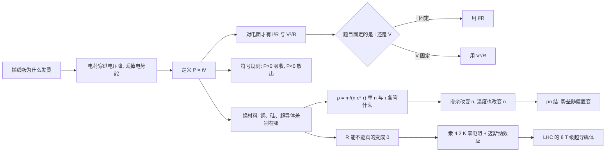

# C26.5 电功率、半导体与超导体 Electric Power, Semiconductors, and Superconductors

> [!abstract] 这一讲的任务
> 前面四节建立了 $i$、$\vec J$、$R$、$\rho$，但都只回答"电流有多大、电阻是多少"，没回答"电能以多快的速率被转走、转成了什么"。这一讲先把功率从一个电荷穿过电压降的过程里推出来，用它处理符号与器件；再换一个提问方式——同样是固体，为什么铜、硅、超导体三种材料的 $R$ 表现得完全不同——从而把三种材料放进同一张图里。

> [!info] 怎么读这份讲义
> 三块内容依次是：功率（$\S1$）、半导体（$\S2$）、超导体（$\S3$），中间用"$\rho$ 由什么决定"这条线串起来，读的时候留意这条线在哪里被提到。本章尚无课堂转写稿覆盖，教材 §26-5（printed pp.760–764）用于展开课件只有一行结论的地方；能带图像、迁移率复算与 LHC 的磁场估算都是补充推论，正文里已标明来路。
> 课件本身有三处需要点名的小问题，集中放在 $\S3.5$ 末尾的勘误里。

---

## 0. 开场：一个发烫的插线板

宿舍的插线板背面印着 250 V、10 A。你把一只 1500 W 的电热水壶插上去烧水，过了一会儿摸插头到插线板之间那一段线，温的。线没破、接头也没松，为什么热？

再算一笔：室友回来又插上一只 1200 W 的电吹风。

> [!question] 停一下，先自己想想
> 这两件电器同时开，插线板上的总电流是多少？10 A 的标称够不够？

$$i=\frac{P}{V}=\frac{1500+1200}{220}\ \mathrm A=12.27\ \mathrm A>10\ \mathrm A$$

超了。超了会怎样、热量又出在哪里，正是这一讲要回答的。

不过先别急着代公式。上一讲我们知道电流在导线里稳定流动、电荷并没有堆积，那"电被消耗掉"这句话到底消耗的是什么？这个问题不解决，"功率"就只是一个背下来的符号。

## 1. 电功率：电荷穿过电压降时丢掉了什么

### 1.1 一个朴素猜测，和它撞的墙

最顺口的说法是"电阻消耗电流"。顺着这个说法推：电流从电阻一端进去，被吃掉一部分，出来的应该变小。可是第 26.1 节讲过，在稳定电流的串联回路里，**同一时刻通过每一个截面的电荷量都相同**——进去多少出来多少，电流处处一样。电荷也没有消失，它守恒。

所以被消耗的既不是电流，也不是电荷。剩下唯一可能的是：**电荷携带的电势能**。

### 1.2 从能量守恒推出 $P=iV$

设一段器件两端 $a$、$b$，$a$ 端电位高。在 $dt$ 时间里通过的电荷量 $dq=i\,dt$。这段电荷从 $a$ 走到 $b$，跨过大小为 $V$ 的电压降，它的电势能减少

$$dU=dq\cdot V=i\,dt\cdot V .$$

能量守恒说：减少的电势能不会凭空消失，它必然同时被转成了另一种形式——电阻里变成内能，电动机里变成对外做的机械功，充电电池里变成化学能。这个"转移速率"就是**电功率 electric power**：

$$\boxed{P=\frac{dW}{dt}=V\frac{dq}{dt}=Vi}\qquad(\text{任何器件})$$

单位跟着量纲走：$1\ \mathrm{V\cdot A}=1\ \dfrac{\mathrm J}{\mathrm C}\cdot1\ \dfrac{\mathrm C}{\mathrm s}=1\ \dfrac{\mathrm J}{\mathrm s}=1\ \mathrm W$。

> [!important] 功率的第一个身份：转移速率
> $P=iV$ 描述的是**电能向其他形式转移的速率**，$i$ 是把多少电荷送过去，$V$ 是每单位电荷丢掉多少电势能。它既然只是"速率"，就对电阻、电动机、电容器、正在充电的电池一律成立——凡是"器件两端有电压降、又有电流穿过"的场合都算数。

顺带说一句电容器：交流电下电容器两端有电压、也有电流，$P=iV$ 照样成立，只是它的瞬时值一会儿正一会儿负，一个周期下来平均为零——能量被存进去又还回来，没有转成别的东西。所以"功率"和"耗散"不是同一件事，这是下一个要撞的墙。

### 1.3 只有电阻才有另外两种写法

对电阻，$V=iR$ 把三个量锁在一起，于是同一个 $P=iV$ 可以改写成两个不同的样子：

$$P=iV=i^2R=\frac{V^2}{R}\qquad(\text{仅对电阻})$$

$\boxed{P=i^2R}$ 与 $\boxed{P=V^2/R}$ 都是 $P=iV$ 加一条欧姆定律的代数变形，**不是两条新规律**。

### 1.4 撞墙：$i^2R$ 与 $V^2/R$ 不能随便换

现在来撞这一节最值钱的那堵墙。把同一个电阻的阻值加倍，它耗散的功率变成几倍？

第一个回答：$P=V^2/R$，$R$ 加倍，功率减半。
第二个回答：$P=i^2R$，$R$ 加倍，功率加倍。

两个答案都对——因为它们回答的是两个不同的问题。真正决定答案的不是用哪个公式，而是**哪个量在这道题里被别的东西钉住了**：

- **电压被钉住**（器件直接接在固定电压的电源/母线上，比如家用电器接 220 V）：用 $P=V^2/R$，$R$ 加倍则功率减半。
- **电流被钉住**（器件串联在恒流回路里，或"电源能提供多大电流"由别处决定）：用 $P=i^2R$，$R$ 加倍则功率加倍。

所以"功率与电阻成正比还是反比"是一句没有意义的话。**先问谁固定，再选公式。**

> [!example] 手算：电热水壶到底能烧多旺
> 标称 220 V、1500 W 的电热壶，额定电流和工作电阻分别是
> $$i=\frac PV=\frac{1500}{220}\ \mathrm A=6.82\ \mathrm A,\qquad R=\frac{V^2}{P}=\frac{220^2}{1500}\ \Omega=32.3\ \Omega .$$
> 如果电热丝断了一截、有效阻值掉到 $16.1\ \Omega$（仍接在 220 V 上），功率不是"变小"，而是 $P=220^2/16.1\ \mathrm W=3000\ \mathrm W$——功率翻倍，电流也翻倍到 13.6 A。这就是"电压固定时 $P$ 与 $R$ 成反比"的后果，也是为什么大功率电器同时开会跳闸。

### 1.5 功率的正负：先定参考方向，再谈符号

$P=iV$ 里的 $i$ 和 $V$ 都是有正负的量，所以功率会带符号。符号有意义的前提是**事先约定好参考方向**，约定换一下，符号就整体翻过来，物理不变。

**约定**：取一个二端器件，规定电流 $i$ **从 $a$ 端流入**、从 $b$ 端流出；同时令 $V=V_a-V_b$ 为 $a$ 端相对 $b$ 端的电位差。在这个约定下，$P=iV$ 就是**器件吸收的电功率**：

- $P>0$：器件净**吸收**电能，把电能转成热、机械功、化学能等；
- $P<0$：器件实际在**放出**电能，此刻它在当电源用。

两条推论值得背下来：

1. **对纯电阻，$P$ 恒为正。** 因为 $R>0$ 要求 $V$ 与 $i$ 同号，$P=iV=i^2R\ge 0$。这也解释了为什么电阻的功率习惯写成平方形式：平方从形式上就保证不会出现负号，电阻永远只吸收、不放出。
2. **对电池，符号跟着充放电走。** 取电流从电池的 $+$ 端流入为正：充电时电流确实从 $+$ 端流入，$P=iV>0$，电池吸收电能（转成化学能）；放电时电流从 $+$ 端流出，同一个约定下 $i<0$，于是 $P<0$，表示电池向外输出功率。

> [!warning] 易错点
> 不要写"电阻的功率是负的"。在器件吸收功率的约定下，电阻的 $P$ 永远为正；想让电阻出负功率，等于说它自己发电。
> 更常见的错是**电压极性定义与电流方向不配套**：把 $V$ 定义成 $V_b-V_a$ 却仍让 $i$ 从 $a$ 流入，符号会整体反号，于是"电源"和"负载"判反。做题时先把箭头和 $V$ 的下标写在图上，再代数。

### 1.6 回头看：电阻发热到底消耗了什么

微观上把刚才的结论再说一遍。电子在电阻里以**恒定的漂移速率**前进（$v_d$ 稳定），所以它的平均动能并不增加——电场对电子做功、给它加速，紧接着它就和晶格离子碰撞，把刚得到的能量交出去。一个电子"走完全程"时，动能没变，电势能少掉了 $eV$，这 $eV$ 通过一次次碰撞变成了晶格的热振动。

关键词是**不可逆**：机械能可以再变回电能（电动机加个发电机），但散进晶格的那份热振动再也收不回来。所以这部分功率叫**耗散 dissipation**，而不是"储存"。

> [!important] 停一下，我们刚才干了什么
> 我们用"电荷穿过电压降"这一个过程定义了 $P=iV$；又用一条欧姆定律派生出 $i^2R$ 与 $V^2/R$，并说清它们只在"谁固定"明确时才有意义；最后给 $P$ 装了符号规则。功率这一块到此完整。

### 1.7 教材的两个检验（Checkpoint 5 与 Sample Problem 26.06）

> [!question] Checkpoint 5（教材 printed p.761）
> 一个器件电阻为 $R$，两端加上电压 $V$ 时通过电流 $i$。把下面四种变化按"电阻上电能转成热能的速率改变量"从大到小排序：
> (a) $V$ 加倍，$R$ 不变；(b) $i$ 加倍，$R$ 不变；(c) $R$ 加倍，$V$ 不变；(d) $R$ 加倍，$i$ 不变。

逐项算（设原来耗散功率为 $P_0$，四种情形都从 $P_0$ 出发）：

| 情形 | 固定量 | 该用哪条 | 新功率 | 改变量 |
|---|---|---|---|---|
| (a) $V\to2V$，$R$ 不变 | $R$ | $P=V^2/R$ | $4P_0$ | $+3P_0$ |
| (b) $i\to2i$，$R$ 不变 | $R$ | $P=i^2R$ | $4P_0$ | $+3P_0$ |
| (c) $R\to2R$，$V$ 不变 | $V$ | $P=V^2/R$ | $P_0/2$ | $-P_0/2$ |
| (d) $R\to2R$，$i$ 不变 | $i$ | $P=i^2R$ | $2P_0$ | $+P_0$ |

排序：(a) 与 (b) 并列最大（各 $+3P_0$），其次 (d)（$+P_0$），最后 (c)（$-P_0/2$，注意它是**减小**）。
这道题的陷阱全在 (b) 与 (d)：同样是"电流加倍"，只有一个固定 $R$ 时才使功率变四倍；(c) 与 (d) 也是同一个阻值加倍，方向相反。分清"谁不变"，四个空就都对了。

> [!example] Sample Problem 26.06（教材 printed p.761，镍铬丝加热）
> 一段镍铬（Nichrome）加热丝，电阻 $R=72\ \Omega$，两端加 120 V。
> **情形 1**：直接接在全长上。$P=V^2/R=120^2/72\ \mathrm W=200\ \mathrm W$。
> **情形 2**：把丝从中间剪断，两段各接 120 V。每段电阻 $72/2=36\ \Omega$，各自耗散 $P'=120^2/36\ \mathrm W=400\ \mathrm W$，两段合计 $800\ \mathrm W$，正好是原来的 **4 倍**。
> 4 倍是怎么来的：电压固定时 $P\propto 1/R$，电阻减半功率加倍；但现在是**两段同时**在工作，再乘 2。等价地看成"总电阻变成 $18\ \Omega$"：$P=120^2/18\ \mathrm W=800\ \mathrm W$。
> 那为什么不能真这么干？总电流从 $120/72=1.67\ \mathrm A$ 涨到 $120/36=3.33\ \mathrm A$，**加倍**了。发热丝和供电回路都是按原电流选的，电流翻倍会烧断或触发保护——热量确实变四倍，代价是电流也翻倍。

---

到这里，功率这一块只用了两个已知量：电荷量和电压。接下来换一个提问方式——**同样一块固体，为什么有的 $R$ 小到 $10^{-8}$ 量级，有的大到 $10^{3}$ 量级？**

## 2. 半导体：同一块硅，掺一点杂质就完全变样

### 2.1 撞墙：两个数字先摆在桌上

把铜和纯硅放在一起比（教材 Table 26-2）：

| 性质 | 铜 Copper | 硅 Silicon |
|---|---|---|
| 材料类型 | 金属 Metal | 半导体 Semiconductor |
| 载流子数密度 $n$ / $\mathrm{m^{-3}}$ | $8.49\times10^{28}$ | $1\times10^{16}$ |
| 电阻率 $\rho$ / $\Omega\cdot\mathrm m$ | $1.69\times10^{-8}$ | $2.5\times10^{3}$ |
| 电阻率温度系数 $\alpha$ / $\mathrm{K^{-1}}$ | $+4.3\times10^{-3}$ | $-70\times10^{-3}$ |

两列一相除：$n$ 差 $8.49\times10^{12}$ 倍，$\rho$ 差 $1.48\times10^{11}$ 倍。纯硅的 $\rho$ 已经比铜大一千多亿倍，做电路时基本等于绝缘体。

【我的复算】用 $\sigma=ne\mu$ 反推，铜的迁移率约 $4.35\times10^{-3}\ \mathrm{m^2/(V\cdot s)}$，硅约 $0.25\ \mathrm{m^2/(V\cdot s)}$。硅这个数与实测的电子迁移率（约 $0.135$）差近一倍——教材表里 $n$ 与 $\rho$ 都是取整的代表值，而且模型用的是自由电子质量，不是硅的有效质量。**这两个数只当量级用，不要拿去反算 $\tau$。**

真正让人停下来的是：往这块"绝缘体"里掺进百万分之一量级的杂质，$\rho$ 能掉到 $8.7\times10^{-4}\ \Omega\cdot\mathrm m$（教材 Table 26-1，磷掺杂的 n 型硅），比纯硅小 $2.87\times10^{6}$ 倍。**同一块硅，掺一点杂质就完全变样。** 这不是提纯程度的差别，是机制换了。

### 2.2 载流子从哪来：n 型与 p 型

硅是四价元素：每个硅原子与四个邻居各共享一对价电子，成键完整时**没有可以自由跑动的电子**。这就是纯硅 $n$ 极小的原因。

掺杂 doping 就是把少量别的原子塞进晶格，替换掉一部分硅：

| 掺入 | 价电子数 | 多出/缺少 | 载流子 | 类型 |
|---|---|---|---|---|
| 磷 P、砷 As（五价） | 5 | 多一个电子，成键只用掉 4 个 | 自由**电子**（负电） | n 型 Negative type |
| 铝 Al、硼 B（三价） | 3 | 少一个电子，留下一个空位 | **空穴** hole（等效正电） | p 型 Positive type |

两点必须记住：

- **杂质原子自己被固定在晶格里，能移动的是它贡献的电子或空穴。** 所以掺入的是"固定的带电中心 + 可动的载流子"，不是掺进一堆自由电荷。
- **空穴不是"正电子"。** 它是价带里缺了一个电子的位置，邻近电子跳过来填补，空缺就等效地朝反方向移动。它的行为像一个带 $+e$ 的载流子，但本质是集体运动。

### 2.3 pn 结：接触形成电势差，连通形成电流

把一块 p 型硅和一块 n 型硅贴在一起。交界两侧的载流子浓度差极大，电子会向 p 区扩散、空穴向 n 区扩散，相遇后复合。复合的结果是：交界附近剩下**不能移动的离子**（p 侧留下负离子，n 侧留下正离子），载流子被消耗掉，形成一层**耗尽层 depletion region**，同时建立一个由 n 指向 p 的**内建电场**，也就是**势垒 barrier**（页面上写给这一步的话是"接触形成电势差"）。

这个势垒可被外加电压增减，这是 pn 结全部行为的来源：

- **正向偏置 forward bias**：电源正极接 p 区、负极接 n 区，外电场削弱内建电场，势垒降低，多数载流子能持续越过结区 → 电流显著。课件 p22 下图的接法就是正向：$+$ 端经电阻接到 p 型一侧，$-$ 端接到 n 型一侧，外电路里电子从 $-$ 端经 n 区、穿过结区进入 p 区，再从 p 侧的引线流出回到电源正极（图中左侧那条竖线一上一下画了"Current"和"Electron"两个箭头，正是同一条导线里电流向下、电子向上）。
- **反向偏置 reverse bias**：正极接 n、负极接 p，势垒被抬高，多数载流子过不去，只剩下极小的反向漏电流（未击穿时）。
- 这两步合起来就是页面上那句话："连通形成电流"。

由此回头看上一节留下的问题：**pn 结二极管不是欧姆器件**，因为它的"电阻"随外加电压的大小与极性剧烈变化，$i$–$V$ 曲线既不过原点、也不是直线。同一个物理量 $R$（按 $V/i$ 定义）在这里只是一个工作点上的比值，不再是一个常数。

![[C26-pn结接触形成势垒与正向导通.png]]

### 2.4 撞墙：为什么升温反而更容易导电

现在把温度加进去，事情更反直觉。

> [!question] 停一下，先自己想想
> 白炽灯刚开灯的瞬间，灯丝是冷的，电阻比正常工作时小，所以有一阵电流冲击。这说明**金属升温电阻变大**。
> 那加热一块纯硅，它的电阻是变大还是变小？

表里给了答案，而且符号很显眼：铜的 $\alpha=+4.3\times10^{-3}\ \mathrm{K^{-1}}$，硅的 $\alpha=-70\times10^{-3}\ \mathrm{K^{-1}}$。温度升高 1 K：

- 铜的电阻率只上升约 $0.43\%$；
- 纯硅的电阻率**下降约 $7\%$**——比铜的变化快一个量级以上，而且方向相反。

两句话把机制说清。回到上一节的微观公式 $\rho=\dfrac{m}{ne^2\tau}$，$n$ 管"有多少载流子"，$\tau$ 管"载流子能跑多久才撞一次"：

- **金属**：$n$ 很大而且几乎不随温度变。升温让晶格振动加剧、碰撞更频繁，$\tau$ **减小**，所以 $\rho$ **增大**。
- **半导体**：升温同样让 $\tau$ 减小，但热搅动还多送出一批电子越过能隙，$n$ **急剧增大**。$n$ 的暴涨压倒了 $\tau$ 的下降，所以 $\rho$ **减小**。

一句话总结：$\rho$ 由 $n$ 和 $\tau$ 两个因子共同决定，两者随温度的走向相反，**谁变得快谁说了算**。金属靠 $\tau$，半导体靠 $n$。

### 2.5 能带直觉：为什么 $n$ 会"暴涨"，掺杂又为什么这么灵

不需要新公式，只要一幅能带图（以下为教材 pp.762–763 说法的图像化补充）：

- **金属（铜）**：导带本来就部分填充，电子脚下处处是空位，只要一点点能量（电场给的就行）就能进入可运动状态。所以 $n$ 巨大，而且温度几乎改变不了它。
- **绝缘体（玻璃、石英）**：价带填满、导带空着，中间隔着很宽的禁带。室温下的热能量太小，跨不过去，所以没有载流子。
- **半导体（硅）**：结构上和绝缘体同类——价带满、导带空——但**禁带窄**（硅约 $1.1\ \mathrm{eV}$）。室温的热能量尺度 $kT$ 只有约 $0.026\ \mathrm{eV}$，单看平均值远远不够；可热运动是统计分布的，总有极少数电子能"抽到大奖"翻过禁带。所以 $n$ 很小，**但它是被温度指数式控制的**——温度一升，能翻过去的电子数猛增，这正是 $\alpha$ 又大又负的原因。
- **掺杂为什么这么灵**：杂质在禁带里塞进了很浅的能级（五价原子的多余电子、三价原子留下的空穴态），相当于把"翻过整个禁带"的门槛降成"抬一下脚"。于是 $10^{17}\ \mathrm{cm^{-3}}$ 量级的杂质就能把 $\rho$ 压低六个数量级——按上面的表，$10^{23}\ \mathrm{m^{-3}}=10^{17}\ \mathrm{cm^{-3}}$ 正是教材 Table 26-1 里两种掺杂硅的载流子浓度。

顺带解释了**热敏电阻 thermistor**：$\alpha$ 大而负的半导体正好把"温度变化"直接翻译成"电阻变化"，测温、限流、温度补偿都用它；而金属的 $\alpha$ 又小又正，只能做粗略的铂电阻温度计。

### 2.6 回头看：这一块的逻辑

半导体的全部价值在于**它能被控制**：掺杂决定 $n$ 的量级（且是人工可调的），温度与偏置决定 $n$ 的即时变化。有了这两把旋钮，同一块硅就能做成二极管、晶体管、CPU——这也正是课件 p22 那张"纯硅晶格 / n 型 / p 型 / 连成回路"四联图的用意。

---

半导体的故事是"把 $R$ 调小、把 $R$ 调活"。那么再往下问一句：**$R$ 能不能干脆等于零？**

## 3. 超导体：当电阻真的变成零

### 3.1 撞墙：$R=0$ 意味着什么

1911 年，荷兰物理学家昂内斯 Kamerlingh Onnes 发现：**汞的电阻率在温度低于约 4 K 时完全消失**。

注意"消失"这个词的分量。普通的良导体只是 $\rho$ 很小，但仍是有限值。只要 $R$ 不为零，要维持一个稳定电流就必须在两端保持一个有限电压 $V=iR$；一旦撤掉电压，电流会因为耗散而衰减。

$R=0$ 把这件事整个改掉：

- $V=iR=0$——**不需要电压就能维持电流**。欧姆定律在这里"失效"了：$R=V/i$ 在 $i\ne0$ 而 $V=0$ 时给出 $R=0$，这不是一个可用的电阻定义，而是一个新状态。
- 电流一旦建立就不衰减。超导环里感生出来的电流，**持续数年而观察不到任何衰减**。启动时确实需要力和能量来源，之后就不再需要。

所以超导不是"电阻特别小"，而是一个**新的物质状态**（宏观量子态）——这是本讲最需要扭过来的一个观念。

### 3.2 转变温度：不是渐变到零，是掉到零

汞的电阻–温度曲线（教材 Fig. 26-14）有两个特征：

1. 在转变点**以上**，它就是一条正常金属的曲线：温度降低、电阻缓慢变小。
2. 到了约 $4.2\ \mathrm K$，电阻在极窄的温区里**垂直掉到零**。图上标注的箭头写着 $<10^{-5}\ \Omega$：不是"变得很小"，而是四线法测不出任何可分辨的电阻。

这个温度叫**临界温度 $T_c$ critical temperature**。汞的公认值 $T_c=4.15\ \mathrm K$，课件文字写"低于约 4 K"、同页曲线横轴显示转变在 4.2 K 附近，两者都是这个值的取整说法，不算矛盾。

不同材料 $T_c$ 不同。真正的技术转折在 1986 年：陶瓷类（铜氧化物）超导体把 $T_c$ 推到了高得多的温区，超过了液氮的 77 K。课件右下角列的四种铜氧化物就是这一类：

$$\mathrm{HgBa_2CuO_{4+\delta}\ (Hg1201)},\quad \mathrm{YBa_2Cu_3O_{6+\delta}\ (YBCO)},\quad \mathrm{La_{2-x}Sr_xCuO_4\ (LSCO)},\quad \mathrm{Tl_2Ba_2CuO_{6+\delta}\ (Tl2201)}$$

> [!warning] 记号坑
> YBCO 更常见的写法是 $\mathrm{YBa_2Cu_3O_{7-\delta}}$，与这里的 $\mathrm{O_{6+\delta}}$ 描述的是同一族材料，但**两个 $\delta$ 的含义正好相反**：在 $\mathrm{O_{7-\delta}}$ 里 $\delta$ 是"缺掉的氧"，在 $\mathrm{O_{6+\delta}}$ 里 $\delta$ 是"多出来的氧"。看到 $\delta$ 先看清基准是 6 还是 7，否则会把缺氧样品当成富氧样品。

"高温"是相对 4 K 而言的：77 K 可以用**液氮**（便宜、易得），4.2 K 必须用**液氦**（贵、难维持）。这就是为什么 1986 年之后的超导应用突然变得现实。

页面上给这一块标了三个词：**零电阻、抗磁性、高温超导**。零电阻讲完，接着讲第二个——它才是超导区别于"理想导体"的关键。

![[C26-超导转变与电阻率骤降.png]]

### 3.3 迈斯纳效应：磁悬浮不是"磁通被冻结"

> [!question] 课堂追问：如果超导体只是"电阻为零"，一块磁铁能悬在它上面吗？

不能。只把材料看成"$\rho=0$ 的理想导体"，由法拉第定律，材料内部的磁通量会被**冻结**在它进入超导态那一刻的值上：先加磁场再降温，磁通留在里面；先降温再加磁场，磁通进不去。两种情况结果不同，取决于历史。

1933 年迈斯纳 Meissner 测到的却是另一回事：**先加场后降温，磁通照样被排出去。** 超导体总是主动把磁感线挤出体外，最终状态与历史无关——这叫**完全抗磁性**，也就是**迈斯纳效应 Meissner effect**。

- 机制：超导体表面自发出现一层**无损耗的屏蔽电流**，它产生的磁场恰好把外场抵消掉，使体内的 $B=0$。
- 结论：超导是一个**热力学相变**，零电阻只是它的一个伴随特征。这条区别几乎是超导部分的必考点。
- 现象：一块磁铁能稳定悬在超导体上方（课件 p24 右上那张照片：一块圆片状磁铁悬在液氮冷却的超导体上方）。磁铁自己的磁感线被"挤开"，排斥力正好托住它的重量。抗磁性 diamagnetism 说的就是这件事。
- 边界：外场不能无限大。超过**临界磁场 $H_c$**（以及临界电流密度 $J_c$），超导态被破坏，电阻恢复。

### 3.4 为什么超导能做磁体

现在把功率那一节请回来。

普通铜线圈做大磁体，电流 $i$ 一大，$P=i^2R$ 就压不住：铜线圈要有兆瓦级的水冷，电费几乎全花在发热上。所以常规电磁铁的场强有一个很硬的天花板——**铁磁材料在 2 T 量级就饱和了**，再往上加线圈电流，付出的是巨大的焦耳热。

超导线圈把这项损失直接抹掉：稳态时 $R=0$，所以 $i^2R=0$。**电流一旦建立，就不需要再消耗功率来维持它**，几千安培可以在没有电压降的情况下长期流动。于是：

- 可以产生远超 2 T 的磁场；
- 运行成本主要来自**低温制冷**，而不是焦耳热。

代价是超导磁体有三个必须同时守住的临界参数——**临界温度 $T_c$、临界磁场 $H_c$、临界电流密度 $J_c$**。任何一个被突破就发生**失超 quench**：材料瞬间回到有电阻状态，线圈里储存的巨大磁能在几毫秒内变成热，可能烧穿线圈。这是所有超导磁体工程的核心风险。

### 3.5 LHC：把超导用到极致的机器（课件 p.25–27）

> [!important] 一句话定位
> 大型强子对撞机 LHC 的束流是被**超导偶极磁体**强行按在 27 km 的环上跑的；磁体的线圈泡在液氦里，靠超导态摆脱焦耳热的天花板。这一节把三页照片里的设施名、用途与尺寸逐条整理成表——这些是课件明确给的知识点。

**为什么必须超导？先算磁场。** 质子动量 $p$ 与偏转它的磁场满足 $B\rho=p/q$，于是

$$B[\mathrm T]=3.336\times\frac{p\,[\mathrm{GeV}/c]}{\rho\,[\mathrm m]}.$$

按 LHC 的设计束流能量每束 $7\ \mathrm{TeV}=7000\ \mathrm{GeV}$ 估算（这个能量值不在课件里，是为了算磁场补上的）：

- 朴素地把整圈当半径 $R=\dfrac{27\,\mathrm{km}}{2\pi}=4297\ \mathrm m$ 的圆，得 $B=\dfrac{3.336\times7000}{4297}\ \mathrm T=5.4\ \mathrm T$——这已经是**下界**（真实弯曲半径更小，所需磁场更大）；
- 真实环由 8 段圆弧加长直线段构成，偶极磁体的设计弯曲半径取 $2804\ \mathrm m$，得 $B=\dfrac{3.336\times7000}{2804}\ \mathrm T=8.33\ \mathrm T$。

$5.4\ \mathrm T$ 就已经是铁磁材料饱和值（约 2 T）的两倍以上，8.33 T 更是只能靠超导线圈。**"LHC 需要超导"不是一句宣传语，是由 $B\rho=p/q$ 和一个 2 T 的物理上限逼出来的。**

**p.25：磁体本身。** 页面上给的总说明是"超导材料用于 LHC 的磁力约束环，液氦冷却线圈产生超导性"——液氦温度 4.2 K，正好在汞那种常规超导体的温区，铌钛（NbTi）线圈在这个温度下进入超导态。同一页下方是三张超导磁体实物照片，对应三类磁体：

| 磁体 | 英文 | 在环上的作用 |
|---|---|---|
| 磁偶极 | dipole | 产生横向磁场，把束流**弯**在环上（主磁场来源，8.33 T 那一段就是它） |
| 磁四极 | quadrupole | 把束流**聚焦**成细束，防止束流横向发散 |
| 磁六极 | sextupole | 校正色差与高阶像差，提高束流寿命与亮度 |

同一页上方两张照片是安装现场：左边是隧道里的磁体端面（墙上挂着"27 km"标牌，两侧是法国和瑞士国旗——这条环道横跨两国边界），右边是隧道里由蓝色低温恒温器首尾相接串成的磁体链。

**p.26：CERN 加速器复合体全图。** 这张图给的是"一台对撞机背后有一整条加速器产线"。逐条如下：

| 记号 | 英文全称 | 中文 | 课件给的年份与尺寸 | 作用 |
|---|---|---|---|---|
| LINAC | LINear ACcelerator | 直线加速器 | （图上分 LINAC 2 质子、LINAC 3 离子） | 加速链的起点，直线加速 |
| BOOSTER | PS Booster | （课件未给中文） | 1972，周长 157 m | 预加速，向 PS 注入 |
| PS | Proton Synchrotron | 质子同步加速器 | 1959，周长 628 m | 老牌同步加速器，向多条支线分束 |
| SPS | Super Proton Synchrotron | 超级质子同步加速器 | 1976，周长 7 km | 注入 LHC 的最后一级 |
| LHC | Large Hadron Collider | 大型强子对撞机 | 2008，周长 27 km | 主对撞环，质子与重离子对撞 |
| AD | Antiproton Decelerator | 课件写作"反质子探测器" | 1999，周长 182 m | 减速反质子，供反物质实验 |
| ISOLDE | Isotope Separator OnLine DEvice | 同位素分离在线装置 | 1969 | 产生并分离放射性同位素束 |
| n-ToF | Neutrons Time Of Flight | 中子飞行时间探测 | 2001 | 中子束，用飞行时间测中子截面 |
| LEIR | Low Energy Ion Ring | 低能离子环 | 2005，周长 78 m | 铅离子累积与加速，供 LHC 重离子运行 |
| HiRadMat | High-Radiation to Materials | （课件未给中文） | 2011 | 高辐照材料测试 |
| CTF3 | Clic Test Facility | （课件未给中文） | （图上未给年份） | 直线对撞机技术试验 |
| AWAKE | Advanced WAKEfield Experiment | （课件未给中文） | 2016 | 等离子体尾场加速实验 |

图上给了中文标注的只有 LHC、PS、SPS、AD、ISOLDE、N-TOF、LEIR、LINAC 八条（红色）和 ALICE、CMS 两条（蓝色）；LHCb、ATLAS、BOOSTER、HiRadMat、CTF3、AWAKE 在图上只有英文。图右侧的 North Area、East Area 是实验区，TT/TI 编号的是束流传输线。

**p.27：四个探测器。** 环上四个对撞点各挂一台探测器，尺寸如下（课件给的数字，逐条照录）：

| 探测器 | 英文全称 | 课件给的尺寸 | 主要任务 |
|---|---|---|---|
| CMS | Compact Muon Solenoid（紧凑型 μ 子螺线管） | 直径 15 m | 通用探测器，μ 子动量测量与希格斯等新粒子搜寻 |
| ALICE | A Large Ion Collider Experiment（大型离子对撞实验） | 长 26 m，直径 20 m | 重离子对撞，研究夸克–胶子等离子体 |
| LHCb | LHC beauty | 长 21 m，高 10 m，宽 13 m | 研究 b 夸克（B 介子），CP 破坏 |
| ATLAS | A Toroidal LHC ApparatuS | 长 46 m，直径 25 m | 通用探测器，与 CMS 互为独立验证 |

四台探测器加起来把 27 km 环上"看不见的物理"变成可读的电信号——而这些信号全部由半导体探测器与超导磁体产生，正好是本讲两块主角在同一个工程里的合体。

> [!warning] 勘误与不一致（三处，做题/复习时以课件数字为准）
> 1. **AD 的中文名。** 页面上写"反质子探测器"，而 AD 的全称是 Antiproton **Decelerator**（反质子**减速器**），不是 Detector。这是一个翻译错误。
> 2. **27 km 是取整。** LHC 环的实测周长是 26.659 km，课件统一写作 27 km。用 27 km 反推几何半径得 4297 m，与真实值差约 1.3%，对量级估算没有影响。
> 3. **ALICE 的"直径 20 m"。** 其余三台的尺寸都能与公开资料对上（CMS 15 m、ATLAS 46 m×25 m、LHCb 21 m×13 m×10 m），只有 ALICE 这一项的"直径 20 m"我没有找到可核对的来源，公开资料常见的是"长 26 m、高 16 m、宽 16 m"。**此处照实记录课件数字，并标记为待核。**
> 另有一处排版瑕疵：p.25 的三行红色标注（磁偶极/磁四极/磁六极）与那行总说明在导出 PDF 里不可见，文字只存在于 pptx 文本层——磁体与照片的对应关系由页面顺序和位置推断。

### 3.6 与 AI 方向的关联

- **GPU 供电与散热（$P=iV$、$P=i^2R$ 的直用）。** 一张 600 W 的加速卡，若走 12 V 母线，电流 $i=600/12=50\ \mathrm A$；改成 48 V 母线，电流降到 $12.5\ \mathrm A$。同一条 $1\ \mathrm{m\Omega}$ 的走线，焦耳损耗从 $i^2R=2.5\ \mathrm W$ 掉到 $0.156\ \mathrm W$——**电压提高 4 倍，$i^2R$ 损耗降到 $1/16$**。这就是服务器机架从 12 V 转向 48 V 母线的全部理由；插线板那笔账和它是同一道题。
- **互连功耗。** 片上长线的动态功耗与 $CV^2f$ 成正比，$V^2$ 项意味着降电压是最有效的省电手段，代价是噪声容限变小。而晶体管能不能做成开关，取决于掺杂控制的载流子浓度——$\S2$ 的 $n$ 就是它。
- **超导量子比特 superconducting qubit。** 约瑟夫森结必须在超导态下工作，量子比特泡在稀释制冷机里（约 10 mK）。零电阻与无耗散是它相干时间长的物理前提，而"临界电流/临界磁场"就是它的工作边界——$\S3.4$ 那三个临界参数在这里同样成立。
- **超导磁体的其他落点。** MRI、粒子加速器（本讲的 LHC）、以及聚变装置的高场线圈，都是"零电阻才能承担大电流"的直接后果。

## 这一讲的三句话

> [!important] 记住这三句
> 1. **器件吸收的功率是 $P=iV$，只有电阻才有 $P=i^2R=\dfrac{V^2}{R}$；用哪一条取决于题目钉住的是 $i$ 还是 $V$。** 符号规则：先约定电流流入端与 $V$ 的下标，$P>0$ 吸收、$P<0$ 放出，电阻的 $P$ 恒为正。
> 2. **$\rho=\dfrac{m}{ne^2\tau}$ 里，金属靠 $\tau$ 变、半导体靠 $n$ 变。** 温度升高时金属的 $\tau$ 减小（$\rho$ 升），半导体的 $n$ 暴涨并压过 $\tau$（$\rho$ 降）；掺杂则把 $n$ 直接调高好几个数量级。
> 3. **超导的 $R=0$ 让欧姆定律失效，也让大电流不再必然发热。** 汞在 4.2 K 的零电阻、迈斯纳效应（完全抗磁性），以及 $T_c$/$H_c$/$J_c$ 三个临界参数，共同支撑起 LHC 的 8 T 级磁体、MRI 与超导量子比特。

> [!tip] 速查表
> | 名称 | 关系或数值 |
> |---|---|
> | 电功率（任何器件） | $P=iV$ |
> | 电阻耗散 | $P=i^2R=\dfrac{V^2}{R}$ |
> | 功率单位 | $1\ \mathrm{V\cdot A}=1\ \mathrm{W}$ |
> | 铜 vs 硅：载流子密度 $n$ | $8.49\times10^{28}$ vs $1\times10^{16}\ \mathrm{m^{-3}}$（差 $8.49\times10^{12}$ 倍） |
> | 铜 vs 硅：电阻率 $\rho$ | $1.69\times10^{-8}$ vs $2.5\times10^{3}\ \Omega\cdot\mathrm m$（差 $1.48\times10^{11}$ 倍） |
> | 铜 vs 硅：温度系数 $\alpha$ | $+4.3\times10^{-3}$ vs $-70\times10^{-3}\ \mathrm{K^{-1}}$ |
> | 掺杂硅电阻率（教材 Table 26-1） | n 型 $8.7\times10^{-4}$、p 型 $2.8\times10^{-3}\ \Omega\cdot\mathrm m$（$n=10^{23}\ \mathrm{m^{-3}}$） |
> | 汞的临界温度 | $T_c\approx4.2\ \mathrm K$（课件文字"低于约 4 K"，公认 4.15 K） |
> | 制冷剂温度 | 液氮 77 K、液氦 4.2 K |
> | 常规磁体的场强上限 | 铁磁材料饱和约 2 T |
> | LHC | 2008 年，周长 27 km（实测 26.659 km）；偶极设计弯曲半径 2804 m |
> | 四个探测器尺寸 | CMS ⌀15 m；ALICE 长 26 m ⌀20 m；LHCb 21 m×13 m×10 m；ATLAS 长 46 m ⌀25 m |

> [!abstract] 下一讲预告
> 现在 $i$、$R$、$P$ 三者齐了。第 27 章把这些装进第一个真正的电路问题：单回路的电流怎么定？电源的电动势 emf 和端电压差在哪？能量在回路里怎么分配——以及"接上负载后端电压为什么会掉"。

---

上一节 ← [[C26.4 欧姆定律与微观导电机制]] ｜ 下一章 → 第 27 章 Circuits 电路（笔记尚未建立）
索引 → [[电磁学 MOC]]
