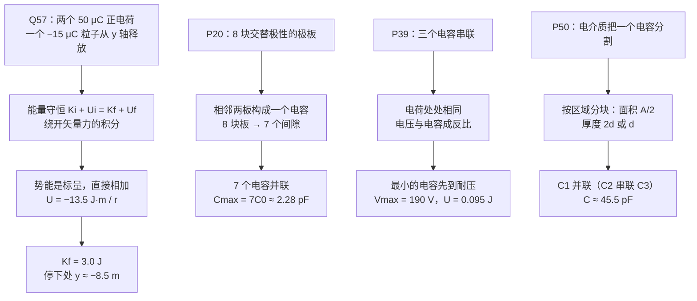

# C27.0 开篇回顾 第24、25章遗留习题 Leftover Problems from Chapters 24–25

> [!abstract] 这一讲的任务
> 第 27 章正式开讲之前，先用四页把第 24、25 章的遗留习题做完。它们看起来和电路无关，练的却是后面天天要用的三件事：**能量守恒**绕开矢量力（Q57）、**并联与串联**怎么算（P20、P39）、**电介质把一个电容切开**后怎么分区算（P50）。这四题做顺了，第 27 章的环路规则与结点规则就只是把同样的「加和」换个角度再做一遍。

> [!info] 怎么读这份讲义
> 本篇没有新概念，只有四道题。每道题先让你停下来猜一个结果，再完整走一遍解题链。两处课件数值与复算有出入（P20 的 $C_0$、P50 的 $C_2$），已在对应小节点明，不影响最终答案。

---

## 0. 开场：粒子在两个正电荷之间

在 $x$ 轴上，离原点左右各 $3.0\ \mathrm m$ 的地方，固定着两颗相同的电荷 $50\ \mu\mathrm C$。一颗 $-15\ \mu\mathrm C$ 的小粒子从 $y$ 轴正半轴上**静止**释放。它会往哪里走？会停在哪里？

> [!question] 停一下，先自己想想
> 粒子带负电，两侧是正电荷，它会被往两边拉。它会一直往下掉，还是会在某处停下、再折返？

答案：它会被两侧的正电荷「吸」向 $x$ 轴附近，一路沿 $y$ 轴下落，穿过原点之后继续往 $-y$ 方向走，直到动能耗尽停下，然后折返。整个过程是关于 $x=0$ 对称的一维往复运动。题目给了一个中间位置的动能（$y=4.0\ \mathrm m$ 处为 $1.2\ \mathrm J$），让我们用能量守恒把其余的全部算出来。

![[C27-开篇Q57图.png]]

---

## 1. 第24章 Q57：能量守恒把力变成路程

### 撞墙：直接用牛顿定律行不行？

粒子受到的合力方向随位置变化：$y$ 越大，两个电荷的合力方向越斜。要用 $F=ma$ 直接解，得到一个非线性的微分方程，中学数学的办法不够用。绕开它的钥匙是**能量守恒**：两个电荷的库仑力是保守力，只要没有摩擦之类的耗散，$K+U$ 始终不变。我们只需要知道**起点和终点**的能量，不需要知道中间每一刻的受力。

### 势能是标量，直接相加

粒子在 $(0,y)$ 处，到两颗 $50\ \mu\mathrm C$ 电荷的距离都是 $r=\sqrt{3^2+y^2}$。两颗电荷的势能是标量，直接相加即可，不用做矢量合成：

$$
U=2\cdot\frac{1}{4\pi\varepsilon_0}\cdot\frac{(50\ \mu\mathrm C)(-15\ \mu\mathrm C)}{r}
=-\frac{13.5\ \mathrm{J\cdot m}}{r}
$$

其中 $\dfrac{1}{4\pi\varepsilon_0}\approx 8.99\times10^9\ \mathrm{N\cdot m^2/C^2}$，分子 $2\times8.99\times10^9\times(-7.5\times10^{-10})\approx-13.5\ \mathrm{J\cdot m}$。

- 起点 $y=4.0\ \mathrm m$，$r=5.0\ \mathrm m$：$U_i=-\dfrac{13.5}{5.0}\approx-2.7\ \mathrm J$。
- 原点 $r=3.0\ \mathrm m$：$U_f=-\dfrac{13.5}{3.0}\approx-4.5\ \mathrm J$。

能量守恒给出

$$
K_i+U_i=K_f+U_f\ \Longrightarrow\ 1.2-2.7=K_f-4.5\ \Longrightarrow\ K_f=3.0\ \mathrm J
$$

所以粒子经过原点时动能是 $3.0\ \mathrm J$（比起点大，因为它离两个正电荷越来越近，势能降低，动能升高）。

> [!warning] 易错点
> 1. **势能是标量**：两颗电荷的势能直接相加，不要去算「合力」再写势能。
> 2. **负号的意思**：正负电荷之间的势能为负，表示被束缚；它不表示方向。
> 3. **距离别丢掉 $x$**：$r=\sqrt{x^2+y^2}$，$x=3.0\ \mathrm m$ 必须保留。

### （b）停在哪里

粒子停下时动能为零，此时势能就是总能量：

$$
U_s=K_i+U_i=1.2-2.7=-1.5\ \mathrm J
$$

由 $U_s=-\dfrac{13.5}{L_s}$ 得 $L_s=9.0\ \mathrm m$。这里的 $L_s$ 是粒子到每一颗 $50\ \mu\mathrm C$ 电荷的距离（两颗对称，距离相同）。于是

$$
y_s=-\sqrt{L_s^2-3.0^2}=-\sqrt{81-9}=-6\sqrt2\ \mathrm m\approx-8.5\ \mathrm m
$$

> [!question] 课堂追问：为什么答案是负的？
> 因为粒子是从 $y$ 轴正半轴下落的，穿过原点之后继续往 $y<0$ 的一侧走。那一侧同样被两个正电荷拉着，它会在 $y\approx-8.5\ \mathrm m$ 处停下，然后再被拉回来。$y$ 的正负只表示它在原点的哪一侧，大小 $8.5\ \mathrm m$ 才是「走了多远」。

---

## 2. 第25章 P20：多块极板，多个并联电容

题目：一个可变的「空气隙」电容器，共 $n=8$ 块极板，极性交替，每块面积 $A=1.25\ \mathrm{cm^2}$，相邻板之间的间距 $d=3.40\ \mathrm{mm}$。求它能达到的最大电容。

### 撞墙：8 块板，是不是 8 个电容？

不是。电容器是由**两块导体**和它们之间的介质构成的。8 块交替极性的板排成一排，相邻两板之间各构成一个平行板电容器。8 块板只有 $8-1=7$ 个间隙。

更关键的是它们怎么连：交替的板被连在一起，一组接到同一根导线，另一组接到另一根导线。这样每个间隙的两端都分别接在两根导线上，7 个间隙的电压相同，也就是**7 个电容并联**。

### 数值

单个间隙在极板完全重合时的电容为

$$
C_0=\varepsilon_0\frac{A}{d}=8.854\times10^{-12}\times\frac{1.25\times10^{-4}}{3.40\times10^{-3}}\approx3.25\times10^{-13}\ \mathrm F=0.325\ \mathrm{pF}
$$

并联相加：

$$
C_{\max}=(n-1)C_0=7\times0.325\ \mathrm{pF}\approx2.28\ \mathrm{pF}
$$

> [!note] 课件数值复算
> 课件上 $C_0$ 写的是 $0.326\ \mathrm{pF}$。按 $\varepsilon_0=8.854\times10^{-12}\ \mathrm{F/m}$ 复算得 $0.32549\ \mathrm{pF}$，按三位有效数字应为 $0.325\ \mathrm{pF}$。最终的 $2.28\ \mathrm{pF}$ 两种写法都得到，不受影响。

---

## 3. 第25章 P39：串联电容的电压与能量

题目：三个电容 $C_1=10.0\ \mu\mathrm F$、$C_2=20.0\ \mu\mathrm F$、$C_3=25.0\ \mu\mathrm F$ 串联在 $A$、$B$ 之间。每个电容的耐压都是 $100\ \mathrm V$。求 (a) $A$、$B$ 之间允许的最大电压，(b) 这一组最多能储存多少能量。

### 撞墙：三个 100 V 相加，是不是 300 V？

不是。串联时每个电容上的**电荷相同**，记为 $q$。电压 $V_i=q/C_i$，所以**电容越小，分到的电压越大**。$C_1$ 最小，它最先达到 $100\ \mathrm V$，也就是这一组的电荷上限：

$$
q_{\max}=C_1\times100\ \mathrm V=1.00\ \mathrm{mC}
$$

于是其余两个电容上的电压是

$$
V_2=\frac{q}{C_2}=\frac{1.00\times10^{-3}}{20\times10^{-6}}=50\ \mathrm V,\qquad
V_3=\frac{q}{C_3}=\frac{1.00\times10^{-3}}{25\times10^{-6}}=40\ \mathrm V
$$

(a) 总电压 $V_{AB}=100+50+40=190\ \mathrm V$。

> [!warning] 易错点
> 串联时总电压是**三段电压之和**，不是三个耐压之和。耐压由「最先击穿的那一个」决定，而那个总是**最小的电容**。这一点在第 27 章的 RC 与电路题里会反复出现。

### (b) 最多储存的能量

三个电容的能量之和：

$$
U=\tfrac12C_1V_1^2+\tfrac12C_2V_2^2+\tfrac12C_3V_3^2=0.050+0.025+0.020=0.095\ \mathrm J
$$

同样的结果也可以用等效电容检验：$\dfrac1{C_{eq}}=\dfrac1{10}+\dfrac1{20}+\dfrac1{25}\ (\mu\mathrm F^{-1})$，得 $C_{eq}\approx5.26\ \mu\mathrm F$，$U=\dfrac{q^2}{2C_{eq}}=\dfrac{(10^{-3})^2}{2\times5.26\times10^{-6}}\approx0.095\ \mathrm J$，两条路一致。

---

## 4. 第25章 P50：电介质把一个电容切开

题目：平行板电容器面积 $A=10.5\ \mathrm{cm^2}$，板间距 $2d=7.12\ \mathrm{mm}$。左半边的间隙整个充满 $\kappa_1=21.0$ 的介质（厚度 $2d$）；右半边的间隙上下分两层，上层 $\kappa_2=42.0$、下层 $\kappa_3=58.0$，每层厚度都是 $d$。求电容 $C$。

![[C27-开篇P50电介质图.png]]

### 撞墙：整体代一个公式行不行？

不行。介质不是均匀的，电容的几何与材料都不统一，$C=\kappa\varepsilon_0 A/d$ 只能用在整块介质上。正确做法是**切开**：把电容按区域分成几个小的平行板电容器，每一块的面积、厚度、介电常数都是统一的，然后再看它们之间怎么连。

切法有两个步骤。

1. **看切的方向**：左半边是整段间隙（厚度 $2d$），只有一层介质，是一个电容 $C_1$；右半边的间隙被**竖直分成两层**，电场要穿过上下两层，所以这两层是**串联**，各自面积都是 $A/2$。
2. **看连接**：左半边的 $C_1$ 与右半边的两层串联组合并联，因为它们接在同一对极板之间。

### 数值

$$
C_1=\kappa_1\varepsilon_0\frac{A/2}{2d}=21.0\times8.854\times10^{-12}\times\frac{5.25\times10^{-4}}{7.12\times10^{-3}}\approx13.7\ \mathrm{pF}
$$

$$
C_2=\kappa_2\varepsilon_0\frac{A/2}{d}=42.0\times8.854\times10^{-12}\times\frac{5.25\times10^{-4}}{3.56\times10^{-3}}\approx54.8\ \mathrm{pF}
$$

$$
C_3=\kappa_3\varepsilon_0\frac{A/2}{d}\approx75.7\ \mathrm{pF}
$$

$$
C=C_1+\frac{C_2C_3}{C_2+C_3}=13.7+\frac{54.8\times75.7}{54.8+75.7}\approx13.7+31.8=45.5\ \mathrm{pF}
$$

> [!note] 课件数值复算
> 课件上 $C_2$ 写的是 $54.9\ \mathrm{pF}$。按题目给的数值复算得 $54.84\ \mathrm{pF}$，取两位小数后为 $54.8\ \mathrm{pF}$，与课件差 $0.1\ \mathrm{pF}$，属于取整问题。代入后总电容仍是 $45.5\ \mathrm{pF}$，不受影响。

> [!warning] 易错点
> 切分后，**面积用 $A/2$，厚度用 $2d$ 或 $d$**，不要把整板的 $A$ 与 $2d$ 直接套上去。另外，右半边的两层是「上下」排列的，它们的电场方向是**同一条线**，所以应当串联，而不是并联。

---

## 这一讲的三句话

> [!important] 记住这三条
> 1. **能量守恒绕开了矢量力**：保守力场中 $K+U$ 不变，势能是标量，多个电荷的势能直接相加；Q57 的停止位置就是这样求出来的。
> 2. **并联同电压，串联同电荷**：并联的电容相加，串联的电容取倒数相加；串联时最小的电容先到达耐压上限。
> 3. **电介质切开就分区算**：每一块取自己的面积与厚度，先判断块与块之间的串并联，再组合。

> [!tip] 下一讲预告
> 上面的「同电压」「同电荷」已经是电路的雏形。第 27 章要把它们推广到**电路**：电容换成电阻和电动势，问题变成「每根导线里电流是多少」。下一节先回答一个根本问题：电源到底是什么，它为什么能让电荷一直绕圈？

---

上一章 ← [[C26.5 电功率、半导体与超导体]] ｜ 下一节 → [[C27.1 电动势与电源]]
索引 → [[电磁学 MOC]]
