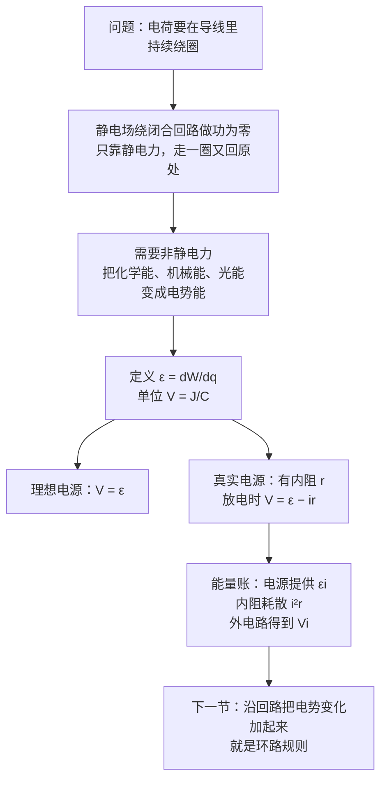

# C27.1 电动势与电源 Electromotive Force and Emf Devices

> [!abstract] 这一讲的任务
> 前面几章的电荷都是被电场推着走的，可电场本身不会让电荷**一直绕圈**：沿闭合回路走一周，静电场做的功是零。电路要能持续地转起来，就得有一个**电源**——把化学能、机械能或光能，变成「每单位电荷的能量」的器件。这一讲回答三件事：**为什么静电场不能代替电源？电动势到底是什么量？真实电池的端电压为什么总比电动势小？**

---

## 0. 开场：冬天早上启动汽车

冬天清晨，你拧钥匙启动汽车。启动机需要很大的电流，车灯明显变暗，启动机转得发沉。电池还是那一块电池，电动势没有变，为什么端电压一下子掉下去了？

> [!question] 停一下，先自己想想
> 如果电动势没变，端电压却降了，那么电池**内部**一定有什么东西在「吃」电压。猜一猜：是电池没电了，还是电池自己有一部分电压被消耗掉了？

答案是后者。电池内部同样有电阻，叫作**内阻** $r$。电流经过内阻时也会产生电压降 $ir$。启动机一下子拉出很大的电流 $i$，内阻上的电压降就跟着变大，外面看到的端电压 $V=\varepsilon-ir$ 就掉下来了。电动势本身一直没变，它只是「不能全部交给外面」。

---

## 1. 撞墙：只靠静电场，电荷能绕圈吗？

设想一个只有电阻和导线的环路，里面没有任何电源。导线两端的电荷在电场中从高电势往低电势走，走到电势最低的地方，电场就不再推它了，电荷停下来。换句话说，只有静电场时，电荷只能**一次性地**从高处滑到低处，不能源源不断地绕圈。

用数学说就是：静电场是**保守场**，沿任意闭合回路的电势变化之和为零，$\oint \vec E\cdot d\vec l=0$。绕一圈电场做的功是零，电荷就无法靠它持续绕圈。

> [!important] 静电力与非静电力
> 库仑力（静电力）是保守力，沿闭合回路做功为零。要让电荷一直绕圈，电路里必须有一个**非静电**的力，它在电源内部把正电荷从低电势端推向高电势端。这种装置就叫**电动势装置**（emf device），也叫电源。

这一点是整章的起点：后面所有的环路方程，都建立在「回路中有电源提供非静电能量」这个前提上。

---

## 2. 能源：谁在为电荷做功

电动势装置的定义是：**靠在内部做功，在端子之间维持电势差的器件**。它内部一定有能量来源，给电荷做功。常见的三类：

| 电动势装置 | 能量来源 | 说明 |
|---|---|---|
| 电池 Battery | 化学能 | 正负极材料发生化学反应，化学能转成电势能 |
| 发电机 Electric generator | 机械能 | 线圈在磁场中转动，机械能转成电能（电磁感应，第 30 章再正式讲） |
| 太阳能电池 Solar cell | 光能 | 光照产生电荷对，光能转成电势能 |

> [!note] 【拓展】教材对电池充放电的化学描述
> 教材（printed p.779）特别指出：电池放电时，化学能减少，能量从电池传给通过它的电荷；电池充电时，电流「逆着」电池的电动势方向流过，能量从电荷传回电池，一部分变成化学能，另一部分在内阻里以热的形式耗散。两种情形的能量流向相反，但都由同一个公式描述。

---

## 3. 电动势：每单位电荷获得的能量

电动势 $\varepsilon$ 的定义是：**电动势装置把单位正电荷，从它的低电势端移到高电势端时，所做的功**。

$$
\boxed{\varepsilon=\frac{dW}{dq}}\qquad \mathrm{[\varepsilon]=\frac{\text{焦耳}}{\text{库仑}}=\text{伏特 V}}
$$

这里 $dW$ 是电源对 $dq$ 电荷做的功。注意 $\varepsilon$ 的单位是伏特，它是**能量与电荷之比**，不是力，也不是「电势差」本身。

> [!warning] 易错点：电动势不是「力」
> 「电动势」这个名字很容易让人以为它是一种力。它不是力，而是每单位电荷获得的能量。判断的标准是单位：$\varepsilon$ 是 J/C，力是 N。只有断开电路时，$\varepsilon$ 才等于两端的电势差，那时候它才「看起来像」电压。

### 理想电源与真实电源

理想电源的内部没有任何阻碍，电荷通过它时不损失能量。它的两端电压总是等于电动势：

$$
V_{\text{端}}=\varepsilon
$$

真实电源有内阻 $r$，可以把它画成「理想电动势 $\varepsilon$ 串联一个电阻 $r$」。电流 $i$ 从电源的负极流向正极（放电方向）时，电流经过 $r$ 会产生电压降 $ir$，所以端电压是

$$
\boxed{V=\varepsilon-ir}
$$

逐段看一遍：从负极出发，穿过电源内部到正极，电势因为电动势**升高** $\varepsilon$，又因为内阻**降低** $ir$，净效果是 $V_+-V_-=\varepsilon-ir$。

![[C27-电动势装置与端电压.png]]

- 不接电路时 $i=0$，所以 $V=\varepsilon$（左图）。
- 接上电路后 $i>0$，所以 $V<\varepsilon$（右图）。

> [!question] 课堂追问：如果内阻为零，短路会怎样？
> 短路时外电阻近似为零，回路中只剩内阻 $r$，电流 $i=\varepsilon/r$。内阻越小，短路电流越大。真实电池的内阻有限，就是为了防止电流无限大。汽车电池的内阻很小，所以启动时的大电流能拉得很大，同时端电压的降落也很明显。

### 停一下：充电时端电压比电动势大

回到开场的问题。如果电流是**从正极流进电池**（充电），那么内阻上的电压降方向反过来，端电压变成 $V=\varepsilon+ir$，大于电动势。

> [!example] 教材 Checkpoint 3 的解答
> 一个 $12\ \mathrm V$、内阻 $2\ \Omega$ 的电池，电流方向不同，端电压与 $12\ \mathrm V$ 的大小关系如下。
> - (a) 电流从负极流向正极（放电）：$V=\varepsilon-ir<12\ \mathrm V$，**小于**。
> - (b) 电流从正极流向负极（充电）：$V=\varepsilon+ir>12\ \mathrm V$，**大于**。
> - (c) 电流为零：$V=12\ \mathrm V$，**等于**。

---

## 4. 能量的账：电源把能量给了谁

电源是能量的「发出者」。每秒钟，它给通过的电荷的能量是 $\varepsilon i$。这些能量去哪了？

- 一部分在内阻里以热的形式耗散：$P_r=i^2r$。
- 剩下的部分通过端子交给外电路：$P_{\text{外}}=Vi=\varepsilon i-i^2r$。

所以 $\varepsilon i$ 扣掉 $i^2r$，才是真正交出去的功率。这就是第 27 章能量计算的基本式。

### 一个多电源的回路：谁在放电，谁在充电

![[C27-能量转换回路.png]]

这是课件上一个综合的能量转换图。回路里有两个理想可充电电池 $A$（电动势 $\varepsilon_A$）和 $B$（电动势 $\varepsilon_B$），一个电动机（把电能变成机械能，把质量提起来）和一个电阻 $R$（把电能变成热）。已知 $\varepsilon_B>\varepsilon_A$。

我们来看每一部分的能量去向。

- **电流方向由电动势大的那个决定**：$\varepsilon_B$ 更大，所以电流顺着 $B$ 的方向流动，图中是顺时针。
- **电池 $B$ 在放电**：电流从它的负极流进、正极流出，化学能减少，它给出的功率为 $P_B=\varepsilon_B i$。
- **电池 $A$ 在充电**：电流从它的正极流进、负极流出，逆着它自己的电动势方向，化学能增加，它吸收的功率为 $P_A=\varepsilon_A i$。
- **电阻 $R$**：把 $i^2R$ 的电能变成热。
- **电动机**：把剩下的电能变成机械功，提起质量块。

能量守恒给出

$$
\varepsilon_B\,i=\varepsilon_A\,i+i^2R+P_{\text{电动机}}
$$

这就是一个回路的「能量账」。左边是电池 $B$ 送出的功率，右边是三笔去向：电池 $A$ 的化学能增量、电阻发热、电动机输出的机械功。

> [!question] 停一下：如果把 $A$ 与 $B$ 的大小对调会怎样？
> 如果 $\varepsilon_A>\varepsilon_B$，电流方向就反过来，$A$ 变成放电的一方，$B$ 变成充电的一方。**谁的电动势大，谁说了算。**

> [!warning] 易错点：充电与放电的判断
> 判断一个电池是在充电还是放电，不要看它「接在哪一边」，而要看**电流通过它时，是顺着它的电动势方向，还是逆着**。顺着 → 放电（化学能减少）；逆着 → 充电（化学能增加）。

---

## 这一讲的三句话

> [!important] 记住这三条
> 1. **静电场绕闭合回路做功为零**，电荷不能靠它一直绕圈；电路需要**非静电**的电动势装置。
> 2. **电动势是每单位电荷获得的能量**：$\varepsilon=dW/dq$，单位伏特。真实电源的端电压放电时为 $V=\varepsilon-ir$，断路时为 $V=\varepsilon$。
> 3. **能量账**：电源提供 $\varepsilon i$，内阻耗散 $i^2r$，外电路得到 $Vi$；回路中电流的方向由电动势较大的电源决定。

> [!tip] 下一讲预告
> 现在我们知道了电动势是什么，也知道了电源内部的电压降。下一节把它们**沿着一个闭合回路**加起来：从一点出发绕一圈回到原点，电势变化的总和必为零。这就是环路规则，它是解所有电路的第一把钥匙。

---

上一节 ← [[C27.0 开篇回顾 第24、25章遗留习题]] ｜ 下一节 → [[C27.2 单环路电路]]
索引 → [[电磁学 MOC]]
