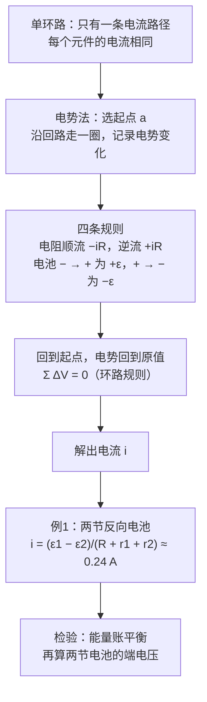

# C27.2 单环路电路 Single-Loop Circuits

> [!abstract] 这一讲的任务
> 只有一个环、一条电流路径的电路叫**单环路电路**。这种电路里每个元件的电流都相同，难点在于**电势**：各元件两端的电压互不相同，而我们要从电动势与电阻里反推出电流。这一讲引入一个只看「电势变化」的方法——沿环走一圈，电势变化之和为零——并用它解开一道两节电池反向串联的例题。

---

## 0. 开场：两节电池「拔河」

你手上有两节电池，一节电动势 $4.4\ \mathrm V$，一节 $2.1\ \mathrm V$。把它们串进一个回路，但两节电池的电动势方向**相反**，再接一个电阻。电流往哪边走？能不能直接套 $i=\varepsilon/R$？

> [!question] 停一下，先自己想想
> 两节电池方向相反，它们是「同向推」还是「反向推」？电流应该听谁的？

答案是：**反向推**。两个电动势相减，较大的那个决定电流方向，所以电流顺着大电动势的方向流。但光知道方向还不够，两节电池都有内阻，电阻也要算进分母。直接凑公式容易漏项，所以我们需要一个系统的方法。

---

## 1. 撞墙：为什么 $i=\varepsilon/R$ 不够用？

- 只有一节电池、一个电阻，且电池无内阻时，$i=\varepsilon/R$ 完全够用。
- 一旦出现两个以上的电动势、又有内阻，每个元件的符号和方向都不一样，凭直觉凑公式很容易漏掉一项。
- 所以我们需要一个**不靠直觉**的方法：沿回路走一圈，把每个元件造成的电势变化逐个写下来；回到起点时，电势必须回到原值。

---

## 2. 电势法：沿环走一圈

任选一个起点 $a$，设它的电势为 $V_a$。沿回路前进，每经过一个元件，就记下电势的变化。走回 $a$ 时，电势必须回到 $V_a$。

![[C27-单环路电势法.png]]

以只有一节电池 $\varepsilon$ 与电阻 $R$ 的最简单情形为例。从 $a$ 出发，先经过电池（从负极到正极），电势升高 $\varepsilon$；再经过电阻 $R$（顺着电流方向），电势降低 $iR$；回到 $a$：

$$
V_a+\varepsilon-iR=V_a\ \Longrightarrow\ \varepsilon-iR=0\ \Longrightarrow\ i=\frac{\varepsilon}{R}
$$

这一步恢复了我们熟悉的结果，但方法的价值在于：它对任何复杂的单环路都适用。

### 四条规则

沿回路走，只关心经过的是电阻还是电动势装置，以及走的方向：

| 经过的元件 | 走的方向 | 电势变化 |
|---|---|---|
| 电阻 $R$（电流 $i$） | 顺着电流 | $-iR$ |
| 电阻 $R$（电流 $i$） | 逆着电流 | $+iR$ |
| 理想电动势 $\varepsilon$ | 从负极到正极 | $+\varepsilon$ |
| 理想电动势 $\varepsilon$ | 从正极到负极 | $-\varepsilon$ |

真实电池的内阻 $r$ 可以当成一个单独的电阻来处理，按第一条规则写 $\pm ir$。

> [!important] 环路规则（基尔霍夫环路定则）
> 沿任意闭合回路走一圈，所有电势变化的代数和为零：
> $$\sum \Delta V=0$$
> 它成立的原因是电势是位置的单值函数：回到出发点，电势就必须回到原值。第 27.1 节已经说明，一个纯静电场不能让电荷绕圈，所以回路中必须有电动势装置提供能量，但它的电势变化在一圈之后仍然加起来为零。

> [!question] 停一下：沿相反方向走一圈，方程会变吗？
> 每一项都会变号，整个方程乘以 $-1$，解不变。关键是**全程只用同一套约定**：要么全都按你选的方向走，要么全都反过来，不能走一段换一段。

---

## 3. 例1：两节方向相反的电池

![[C27-例1两节电池回路.png]]

题目：$\varepsilon_1=4.4\ \mathrm V$，$r_1=2.3\ \Omega$；$\varepsilon_2=2.1\ \mathrm V$，$r_2=1.8\ \Omega$；$R=5.5\ \Omega$。求回路中的电流 $i$。

### 第一步：假设方向

电流方向任选。这里取图中的方向（顺时针）。如果猜错，算出来的 $i$ 就是负的，说明实际方向相反，这不是错误。教材的解法也是先看哪个电动势大：$\varepsilon_1>\varepsilon_2$，电池 1 决定方向，所以取顺时针。

### 第二步：列环路方程

从 $a$ 出发，**逆着电流方向**绕一圈（逆时针）。依次经过：

- $r_1$：逆着电流，$+ir_1$；
- $\varepsilon_1$：从正极到负极，$-\varepsilon_1$；
- $R$：逆着电流，$+iR$；
- $r_2$：逆着电流，$+ir_2$；
- $\varepsilon_2$：从负极到正极，$+\varepsilon_2$。

加起来：

$$
ir_1-\varepsilon_1+iR+\varepsilon_2+ir_2=0
$$

### 第三步：解出电流

$$
i=\frac{\varepsilon_1-\varepsilon_2}{R+r_1+r_2}=\frac{4.4-2.1}{5.5+2.3+1.8}=\frac{2.3}{9.6}\approx0.24\ \mathrm A
$$

结果是正的，说明假设的顺时针方向正确。

> [!note] 【拓展】教材 Sample Problem 27.01 的第 (b) 问
> 问题：电池 1 两端的电势差是多少？它的端电压为
> $$V_1=\varepsilon_1-ir_1=4.4-0.24\times2.3\approx3.85\ \mathrm V$$
> 这是放电的电池，端电压小于电动势。电池 2 正在被充电，它的端电压为 $V_2=\varepsilon_2+ir_2=2.1+0.24\times1.8\approx2.53\ \mathrm V$，比它的电动势大。

### 第四步：能量账检验

- 电池 1 放电，送出功率 $P_1=\varepsilon_1 i=4.4\times0.2396\approx1.05\ \mathrm W$；
- 电池 2 被充电，吸收功率 $P_2=\varepsilon_2 i=2.1\times0.2396\approx0.50\ \mathrm W$；
- 内阻与外电阻耗散 $i^2(r_1+R+r_2)=0.2396^2\times9.6\approx0.55\ \mathrm W$；
- 检验：$0.50+0.55=1.05\ \mathrm W$，与 $P_1$ 一致。

> [!question] 课堂追问：电池 2 为什么会被充电？
> 电流顺着电池 1 的方向流过电池 2，而电池 2 的电动势是反着的：电流从它的正极流进去，逆着它的电动势。这正是第 27.1 节说的「充电」。

> [!warning] 易错点
> 1. **内阻必须计入**：$r_1$、$r_2$ 就是分母的一部分，漏掉它们，电流会偏大。
> 2. **同一个环路里电流处处相同**：不要给每个元件写不同的 $i$。
> 3. **符号要自洽**：走的方向与电流方向的关系决定符号，选定之后整个回路都按这一套来。

> [!note] 教材 Checkpoint 1
> 教材 Checkpoint 1 要求比较单环路中 $a$、$b$、$c$ 三点的电流、电势与电势能大小，需要对照书上的图完成，本笔记不展开。
> 可以确定的一点是：单环路中**电流处处相同**，电势的高低由沿途的电池与电阻决定。

---

## 这一讲的三句话

> [!important] 记住这三条
> 1. **单环路的电流处处相同**，而电势沿环变化；用电势法沿环走一圈，回到起点时电势变化之和为零。
> 2. **四条规则**：顺流电阻 $-iR$，逆流 $+iR$；电池从负到正 $+\varepsilon$，从正到负 $-\varepsilon$。
> 3. **例1**：$i=(\varepsilon_1-\varepsilon_2)/(R+r_1+r_2)\approx0.24\ \mathrm A$，较大的电动势决定方向；能量账 $\varepsilon_1 i=\varepsilon_2 i+i^2(R+r_1+r_2)$ 可用来检验。

> [!tip] 下一讲预告
> 串联的电阻电流相同，这正是单环路。下一节把两个或三个电阻合并成一个**等效电阻**，把复杂的单环路化成一个 $i=\varepsilon/R_{eq}$。

---

上一节 ← [[C27.1 电动势与电源]] ｜ 下一节 → [[C27.3 电阻的串联与并联]]
索引 → [[电磁学 MOC]]
