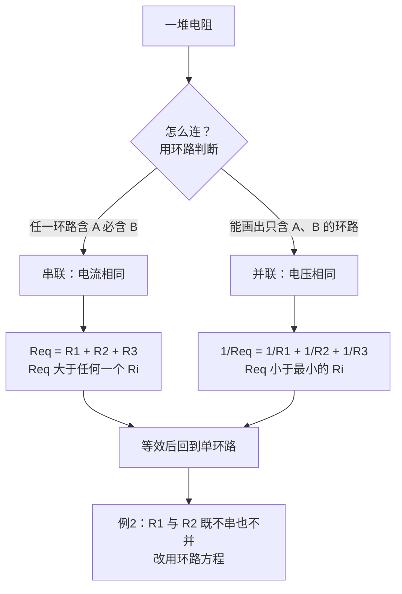

# C27.3 电阻的串联与并联 Resistances in Series and in Parallel

> [!abstract] 这一讲的任务
> 电路里经常有好几个电阻接在一起。只要能找到一个**等效电阻**，就能把它们换成一个电阻，整个电路就回到单环路。这一讲先把串联与并联的**定义**说清楚（不能靠外观判断），再推出两个等效公式，最后用一个例子说明：有些电阻既不串联也不并联，这时要回到上一节的方法。

---

## 0. 开场：圣诞彩灯与插座

一串圣诞彩灯，只要有一颗灯泡坏了，整串都不亮。可家里插座上的台灯和路由器，一个坏了，其他的照常亮。两种接法的区别在哪里？

> [!question] 停一下，先自己想想
> 在哪种接法里，电流「只有一条路」？在哪种接法里，每个用电器都「直接接在同一对电线之间」？

答案：彩灯是串联，电流只有一条路，经过每一颗灯泡，断开一处就全断。插座上的电器是并联，每个用电器直接接在同一对电压上，各走各的支路，互不影响。下面把这两种接法的**判据**说清楚，并算出等效电阻。

---

## 1. 撞墙：画得并排，就是并联吗？

图上两个电阻画得并排，不一定并联；画成一前一后，也不一定串联。我们需要一个**不看外观**的判据。

> [!important] 串联与并联的定义
> - **并联**：两个元件并联，当且仅当可以画出一个只包含这两个元件的环路。
> - **串联**：两个元件 $A$、$B$ 串联，当且仅当每一个包含 $A$ 的环路，都也包含 $B$。

用这两条判据检查：串联的元件之间没有分岔，任何环路经过 $A$ 时必然也经过 $B$；并联的元件之间存在一个「只属于它们两个」的小环路。

---

## 2. 串联：电流相同，电压分配

![[C27-串并联等效.png]]

三个电阻 $R_1$、$R_2$、$R_3$ 串联，同一个环路上电流 $i$ 处处相同。沿环走一圈（见 C27.2 的电势法），三段电压相加等于电池的电压 $V$：

$$
V=iR_1+iR_2+iR_3=i\,(R_1+R_2+R_3)
$$

与「一个等效电阻 $R_{eq}$ 两端电压为 $V=iR_{eq}$」比较，得

$$
\boxed{R_{eq}=R_1+R_2+R_3}
$$

> [!question] 停一下：串联的等效电阻会比最大的那个还大吗？
> 会。每串进一个电阻，总电阻都会增加，所以串联等效电阻**大于**其中任何一个。

串联时电压按电阻分配：$V_k=iR_k$，电阻越大，分到的电压越多。$n$ 个电阻串联时，$R_{eq}=\sum_{j=1}^{n}R_j$。

---

## 3. 并联：电压相同，电流分流

（上图右侧是三个电阻并联的情形：电压都是 $V$，总电流在结点处分开。）

并联的几个电阻，两端接在同一对结点之间，所以它们的**电压都是 $V$**。由结点规则（电荷守恒），总电流等于各支路电流之和：

$$
i=i_1+i_2+i_3=\frac{V}{R_1}+\frac{V}{R_2}+\frac{V}{R_3}
$$

与 $i=V/R_{eq}$ 比较，得

$$
\boxed{\frac{1}{R_{eq}}=\frac{1}{R_1}+\frac{1}{R_2}+\frac{1}{R_3}}
$$

> [!warning] 易错点：并联的等效电阻比最小的还小
> 并联的 $R_{eq}$ **小于**其中最小的那个电阻。两个相同的电阻 $R$ 并联，等效为 $R/2$。很多人会错误地把并联当成相加，那是串联的写法。

> [!question] 课堂追问：并联时为什么电压一样？
> 并联的每个元件都接在同一对结点之间。结点的电势是唯一的，电势差只取决于两端结点的位置，与走哪条路径无关。所以并联元件两端的电压相同。

---

## 4. 例2：有些电阻既不串也不并

![[C27-例2电路.png]]

题目：$R_1=10\ \Omega$ 与 $R_2=10\ \Omega$ 分别在上支路和中支路，中支路另有一个 $E_2=5.0\ \mathrm V$ 的电池，下方是 $E_1=10\ \mathrm V$ 的电池。(a) 判断 $R_1$、$R_2$ 是串联还是并联；(b) 求 $I_1$、$I_2$。

### (a) 判断

- **不并联**：找不到一个只包含 $R_1$、$R_2$ 的环路，因为任何环路里两者之间都隔着别的元件。
- **不串联**：存在包含 $R_1$ 却不包含 $R_2$ 的环路（例如只经过 $R_1$ 与下方 $E_1$ 的环路）。

所以答案是：**两者都不是**。

### (b) 求电流

把左右两侧的结点记为 $L$、$R$。三条支路都连在 $L$、$R$ 之间，我们沿每条支路从 $L$ 走到 $R$，量出 $V_L-V_R$：

- 下支路（只有 $E_1$，电流 $I$ 从 $R$ 流回 $L$）：电池把电流从 $R$ 推向 $L$，电势从 $R$ 升到 $L$，所以 $V_L-V_R=E_1=10\ \mathrm V$。
- 上支路（只有 $R_1$，电流 $I_1$ 从 $L$ 流向 $R$）：$V_L-V_R=I_1R_1=10\,I_1$。
- 中支路（$E_2$ 与 $R_2$，电流 $I_2$ 从 $L$ 流向 $R$，$E_2$ 把电流往回推）：$V_L-V_R=E_2+I_2R_2=5+10\,I_2$。

三条路径的 $V_L-V_R$ 必须相等，于是

$$
10\,I_1=10\ \Longrightarrow\ I_1=1.0\ \mathrm A,\qquad 5+10\,I_2=10\ \Longrightarrow\ I_2=0.5\ \mathrm A
$$

总电流由结点规则给出 $I=I_1+I_2=1.5\ \mathrm A$。

> [!warning] 易错点：$E_2$ 的方向从图上不好辨认
> 课件图中中支路电池的符号较小，极性难以看清。我们用答案反推它的方向：如果 $E_2$ 与 $I_2$ 同向，那么 $5+10\,I_2$ 应改成 $-5+10\,I_2$，得到的 $I_2$ 会是 $1.5\ \mathrm A$，与题目答案不符。因此在这一题里，$E_2$ 是把电流往回推的。

---

## 5. 【拓展】教材的两个练习

> [!note] 【拓展】教材 Checkpoint 4
> 两个相同的电阻接在电压为 $V$ 的电池上，分别串联和并联：
> - **串联**：两个电阻电流相同，都等于总电流 $i$；每个电阻的电压为 $V/2$。
> - **并联**：两个电阻电压相同，都是 $V$；每个电阻的电流为 $i/2$。

> [!note] 【拓展】教材 Sample Problem 27.02：串并混合
> 电池电动势 $\varepsilon=12\ \mathrm V$，$R_1=20\ \Omega$，$R_2=20\ \Omega$，$R_3=30\ \Omega$，$R_4=8.0\ \Omega$。$R_2$ 与 $R_3$ 有分岔，先并联：
> $$R_{23}=\frac{R_2R_3}{R_2+R_3}=\frac{20\times30}{50}=12\ \Omega$$
> 然后 $R_1$、$R_{23}$、$R_4$ 位于同一条通过电池的路径上，是串联的：
> $$i_{\text{电池}}=\frac{\varepsilon}{R_1+R_{23}+R_4}=\frac{12}{20+12+8}=0.30\ \mathrm A$$
> 并联段的电压 $V_{23}=0.30\times12=3.6\ \mathrm V$，因此 $i_2=3.6/20=0.18\ \mathrm A$，$i_3=3.6/30=0.12\ \mathrm A$，$i_2+i_3=0.30\ \mathrm A$，与电池电流一致。

> [!question] 停一下：为什么 $R_1$ 与 $R_2$ 不能直接合并？
> 因为 $R_1$ 所在的路径不分岔，而 $R_2$ 与 $R_3$ 在某个结点分流。只有满足并联判据的 $R_2$、$R_3$ 才能先合并成 $R_{23}$。这就是「先找串并联、再化简」的思路。

---

## 6. 【拓展】电流表与电压表：怎么接才不改变被测量

> [!note] 【拓展】教材 27-3 电流表与电压表
> 测电流的仪器叫**电流表**，要**串联**在被测支路里。它的内阻 $R_A$ 必须远小于电路中的其他电阻，否则它自己就会改变要测的电流。
> 测电势差的仪器叫**电压表**，要**并联**在被测元件两端。它的内阻 $R_V$ 必须远大于被并联元件的电阻，否则它分流，改变要测的电压。
> 同一个仪器做成「电流表 + 电压表 + 欧姆表」的组合，就是**万用表**。

用串并联公式检验一下：电压表与电阻 $R$ 并联，等效电阻 $R_{eq}=\dfrac{RR_V}{R+R_V}$，当 $R_V\gg R$ 时 $R_{eq}\approx R$，电路基本不受影响；电流表与 $R$ 串联，总电阻为 $R+R_A$，当 $R_A\ll R$ 时同样几乎不变。

---

## 这一讲的三句话

> [!important] 记住这三条
> 1. **串并联看环路，不看外观**：串联是任一环路含 $A$ 必含 $B$；并联是能画出只含 $A$、$B$ 的环路。
> 2. **串联**电流相同，$R_{eq}=\sum R_k$，比任何一个都大；**并联**电压相同，$\dfrac1{R_{eq}}=\sum\dfrac1{R_k}$，比最小的还小。
> 3. **既不串也不并**：先合并能合并的部分，化为单环路；合并不了的，就用上一节的环路方程。

> [!tip] 下一讲预告
> 当电路里有多个结点、多个环路，串并联就不够用了。下一节引入**结点规则**，与环路规则合在一起，列出一组方程，解出每条支路的电流。

---

上一节 ← [[C27.2 单环路电路]] ｜ 下一节 → [[C27.4 多回路电路]]
索引 → [[电磁学 MOC]]
