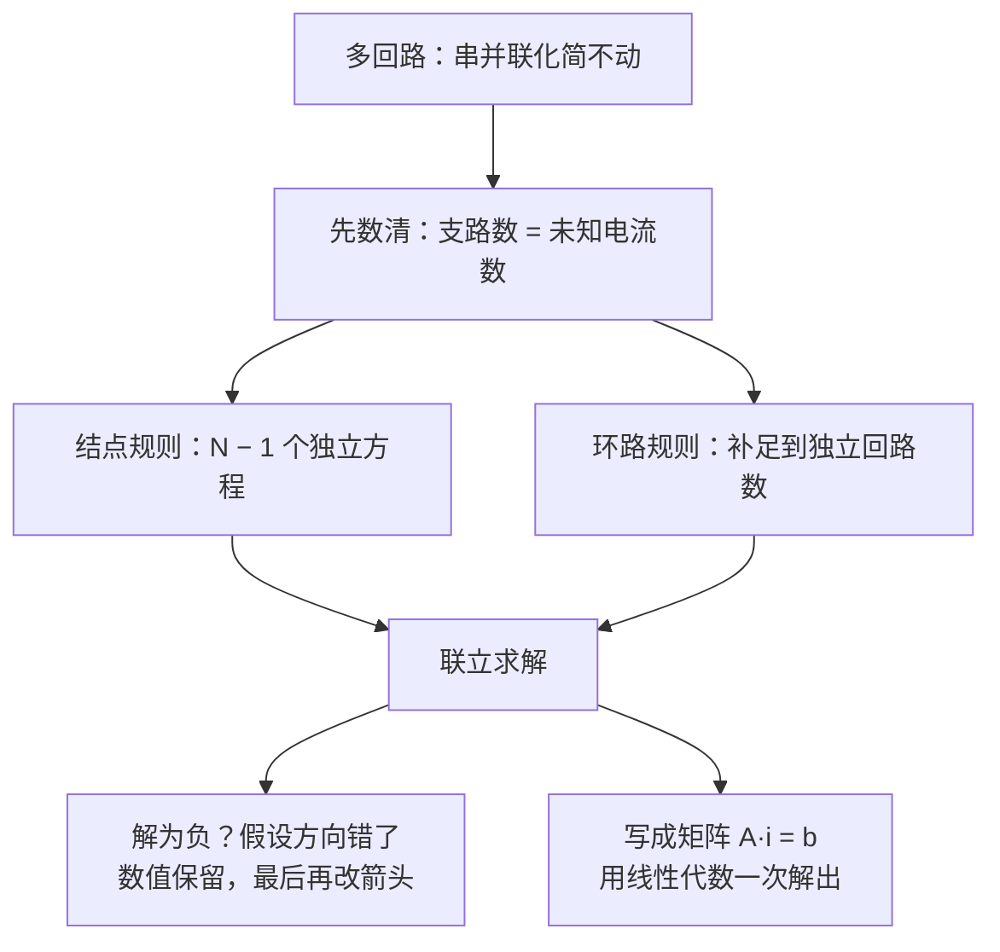

# C27.4 多回路电路 Multiloop Circuits

> [!abstract] 这一讲的任务
> 当电路既不能靠串并联化简，也不是一个单环路时，就进入**多回路电路**。这一讲把两条基本规则合在一起：**结点规则**（电荷守恒）与**环路规则**（电势单值）。它们能列出与未知电流数目一样多的独立方程，解出每条支路的电流。这种「列方程、解方程」的思路，也是后面所有复杂电路分析的骨架。



---

## 0. 开场：板子上的一张「网」

一块电源板上装着三个电源、五个电阻，它们接成一张网。你要算每根线里的电流，好决定导线粗细和保险丝规格。串联、并联都化简不动，怎么办？

> [!question] 停一下，先自己想想
> 网里有没有任何两个电阻，严格地串联或严格地并联？如果没有，你觉得至少要列几个方程，才能解出所有支路的电流？

答案：没有。两个电阻之间总有分岔。未知电流有几条支路就有几个未知数，所以需要同样多个**独立**方程。下面就是怎么找到它们。

![[C27-多回路支路.png]]

---

## 1. 撞墙：为什么不能用单环路的方法？

单环路方法每次只对一个环路列一个方程。若有三条支路（三个未知电流），单靠一个环路方程不够定解。直觉上「多列几个环路方程就行」，但它们不一定独立：有的环路方程，可以由别的环路方程加减得到，对解没有新信息。所以我们要先搞清楚**独立方程**的数目，再动手列。

---

## 2. 基本概念：结点与支路

- **结点（junction）**：三条或更多导线的交汇点。
- **支路（branch）**：两个结点之间的一段路径，中间没有分岔。
- 同一条支路上，**电流处处相同**：支路内部没有分岔，电荷不会在中途积累。

图中有 2 个结点（$a$、$b$）和 3 条支路：左支路（$R_1$、$\varepsilon_1$、$R_5$），中支路（$R_2$、$\varepsilon_2$），右支路（$R_3$、$\varepsilon_3$、$R_4$）。

---

## 3. 结点规则：电荷守恒

> [!important] 基尔霍夫结点定则
> 流入任一结点的电流之和，等于流出该结点的电流之和：
> $$\sum i_{\text{入}}=\sum i_{\text{出}}$$
> 它来自稳恒电流的电荷守恒：结点不能积累电荷。

对结点 $a$：电流 $i_3$ 流入，$i_1$、$i_2$ 流出，于是

$$
i_3=i_1+i_2
$$

对结点 $b$，同样的三条支路电流，方向相反，写出来的方程正好是 $i_1+i_2=i_3$，与 $a$ 的方程是同一个式子。

> [!question] 停一下：$N$ 个结点能写出几个独立的结点方程？
> 答案是 $N-1$ 个。第 $N$ 个结点的方程可以由其余结点的方程相加得到，因为每条支路的电流对两端结点各贡献一次，符号相反，加起来正好抵消。本图 $N=2$，所以只有 1 个独立结点方程。

---

## 4. 环路规则：两个独立的回路

图中的两个回路分别是：

- **回路 1**：从 $a$ 出发，沿左支路向下，经过 $R_1$、$\varepsilon_1$、$R_5$ 到 $b$，再沿中支路向上经过 $\varepsilon_2$、$R_2$ 回到 $a$。
- **回路 2**：从 $a$ 出发，沿中支路向下，经过 $R_2$、$\varepsilon_2$ 到 $b$，再沿右支路向上经过 $R_4$、$\varepsilon_3$、$R_3$ 回到 $a$。

按照 C27.2 的四条规则（顺流电阻 $-iR$，逆流 $+iR$；电池从负到正 $+\varepsilon$，从正到负 $-\varepsilon$）逐项写下来：

$$
\text{回路 1：}\qquad -i_1R_1-\varepsilon_1-i_1R_5+\varepsilon_2+i_2R_2=0
$$

$$
\text{回路 2：}\qquad -i_2R_2-\varepsilon_2-i_3R_4+\varepsilon_3-i_3R_3=0
$$

> [!warning] 易错点：逐项对照走向，不要凭印象写符号
> 每一项的符号只由「你走的方向」与「电流方向」，以及「电池的正负极」决定。若回路 1 的走向是顺时针，而回路 2 的走向是逆时针，两个方程就要分别按各自的走向来写。写完一项就对照一次图，比事后检查省时间。

### 为什么选这两个回路？

任意两个独立回路都可以。所谓「独立」，就是第二个回路里至少有一条支路是第一个回路里没有的（或者说，不能由第一个回路的方程线性组合得到）。本图中，左支路只属于回路 1，右支路只属于回路 2，中支路两个回路共用，所以它们是独立的。第三个回路（左、右两侧的外环）的方程，可由这两个相加得到。

---

## 5. 解方程：一个数值例子

教材 Sample Problem 27.04 用的正是这类结构的电路（三个理想电池、五个电阻）。教材正文给出的已知数为 $\varepsilon_1=3.0\ \mathrm V$、$\varepsilon_2=6.0\ \mathrm V$、$R_1=2.0\ \Omega$、$R_2=4.0\ \Omega$，图 27-13 上的其余标注本笔记未抄录。代入之后，两个环路方程化为

$$
4.0\,i_1+8.0\,i_2=0 \qquad (\text{回路 1})
$$

$$
8.0\,i_1+4.0\,i_2=-3.0\ \mathrm V \qquad (\text{回路 2})
$$

写成矩阵形式，就是一组线性方程：

$$
\begin{pmatrix}4.0 & 8.0\\ 8.0 & 4.0\end{pmatrix}
\begin{pmatrix}i_1\\ i_2\end{pmatrix}
=
\begin{pmatrix}0\\ -3.0\end{pmatrix}
$$

解得 $i_1=-0.50\ \mathrm A$，$i_2=+0.25\ \mathrm A$，再由结点规则 $i_3=i_1+i_2=-0.25\ \mathrm A$。

> [!note] 【拓展】这个解的符号怎么读
> 教材的做法是：先假设一组方向，把三个电流都解出来。负号说明假设的方向**错了**，数值大小没问题。这里 $i_2$ 为正，方向正确；$i_1$ 与 $i_3$ 为负，实际方向与图中箭头相反。最后一步才把 $i_1$、$i_3$ 的箭头改过来：
> $$i_1=0.50\ \mathrm A,\qquad i_2=0.25\ \mathrm A,\qquad i_3=0.25\ \mathrm A\ \ (\text{方向与图中相反})$$
> 教材特别提醒：**改方向要放在最后一步**，中途改了方向，后面的代入就会全部出错。

用 Python 可以直接验证这组解（这是一个 $2\times2$ 线性方程组）：

```python
import numpy as np

A = np.array([[4.0, 8.0],
              [8.0, 4.0]])      # 系数，单位 Ω
b = np.array([0.0, -3.0])       # 右端，单位 V
print(np.linalg.solve(A, b))    # 输出 [-0.5, 0.25]，即 i1 = -0.50 A，i2 = +0.25 A
```

> [!question] 课堂追问：这和神经网络有什么相似之处？
> 多回路方程本质上是一个线性方程组 $A\mathbf i=\mathbf b$：未知数是各支路电流，系数由电阻决定，右边由电动势决定。它与解一层线性变换的方式完全相同。只是这里的系数来自欧姆定律与基尔霍夫规则，而不是训练出来的参数。

---

## 6. 自检：未知数与方程的数目

| 量 | 数目（本图） |
|---|---|
| 支路数 = 未知电流数 | 3 |
| 独立结点方程 = $N-1$ | 1 |
| 独立环路方程 = 支路数 $-(N-1)$ | 2 |
| 合计 | 3 = 未知数 |

> [!tip] 一个数数的方法
> 对于平面网络，独立环路数等于支路数减去结点数再加一。这与「网孔数」一致。数清楚了，就知道需要列几个方程，不会漏，也不会多列出一个不独立的。

> [!warning] 易错点
> 1. **每条支路只给一个未知电流**：同一支路不要给两个不同的电流符号。
> 2. **回路走向要固定**：一旦选定，就把它贯穿到底。
> 3. **解为负不是算错**：保留数值，最后才改箭头。
> 4. **不要列重复的环路**：第三个回路的方程与前两个线性相关，列进去只会让方程组奇异。

---

## 这一讲的三句话

> [!important] 记住这三条
> 1. **支路电流数 = 未知数个数**：用结点规则列 $N-1$ 个方程，再用独立回路的环路规则补足。
> 2. **每个方程都要对照图写**：电流方向、回路走向、电池正负极，三者决定每一项的符号。
> 3. **解出负值是方向假设错了**：数值照常保留，最后一步再改箭头。

> [!tip] 下一讲预告
> 上面的电流都是稳恒的。下一节换一个角度：电容器接进电路以后，电流随时间变化，我们要用**微分方程**来描述 RC 电路的充电与放电，并引出时间常数 $\tau=RC$。

---

上一节 ← [[C27.3 电阻的串联与并联]] ｜ 下一节 → [[C27.5 RC电路]]
索引 → [[电磁学 MOC]]
