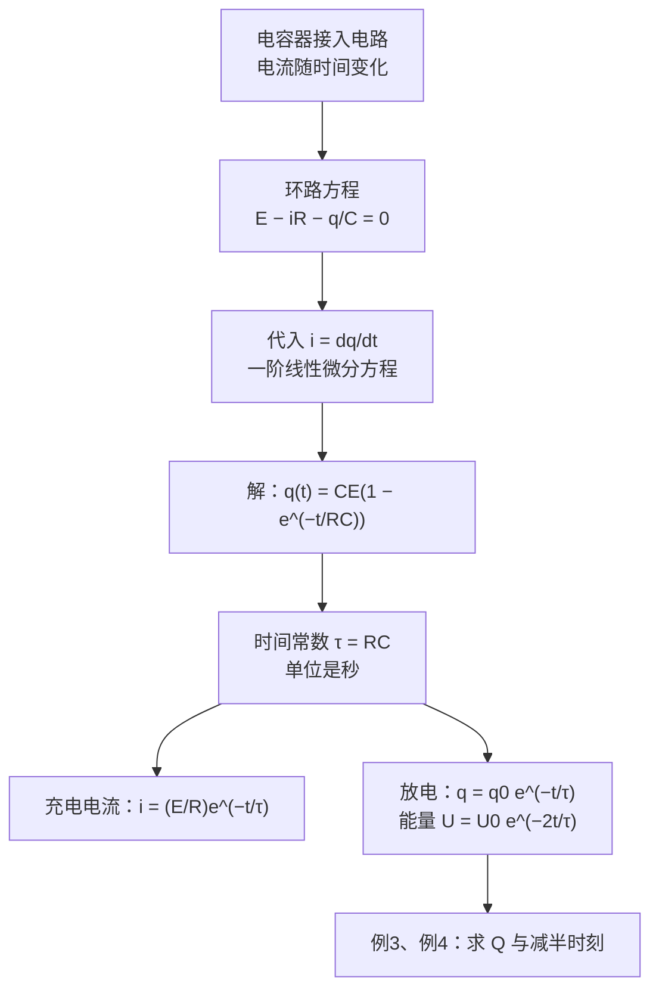

# C27.5 RC 电路 RC Circuits

> [!abstract] 这一讲的任务
> 前面所有电路都是稳态：电流不随时间变化。电容器接进电路以后，它两端的电压随电荷增加而升高，电流就跟着变小。于是电流和电荷都随时间变化，我们要用**微分方程**来描述它。这一讲从环路方程列出微分方程，解出指数规律，引入**时间常数** $\tau=RC$，再用两道例题把充电、放电与能量减半的时刻算清楚。

---

## 0. 开场：赛车进站

赛车停稳时，车身与路面之间积累了一份静电，像一个电容器的两块极板。它要通过轮胎慢慢泄放。如果此时有一台导体（比如加油机）靠得太近，车身上残余的能量可能突然变成火花。问题是：这份能量要多久才会降到安全线以下？

> [!question] 停一下，先自己想想
> 轮胎的电阻越大，车身的电荷泄放得越快还是越慢？你觉得泄放的快慢与哪些量有关？

答案：电阻越大，泄放越慢。泄放的快慢既取决于电阻，也取决于电容器的大小：电容越大，储存的电荷越多，要放的时间也越长。下面我们就用 $RC$ 把这个直觉写成公式。

---

## 1. 撞墙：接上电池，电流一直是 $E/R$ 吗？

一开始电容器不带电，两端电压为零，回路中只有电阻，电流最大，等于 $E/R$。随着充电，电容器上的电荷 $q$ 增加，它两端的电压 $q/C$ 增加，与电池的电压方向相反，使回路中的净电压减小，电流随之减小。

电流不是常数，所以不能像上一讲那样直接写 $V=iR$ 就完事。我们必须把「电容器的电压随电荷变化」这件事写进环路方程里。

---

## 2. 列方程：充电回路

![[C27-RC充电电路.png]]

开关接到 $a$ 时，电池、电阻、电容器构成一个回路。沿回路走一圈：

- 经过电池，从负到正，$+E$；
- 经过电阻，顺着充电电流，$-iR$；
- 经过电容器，从正极板到负极板，电势下降 $q/C$。

$$
E-iR-\frac{q}{C}=0
$$

电流是电荷对时间的变化率，$i=\dfrac{dq}{dt}$，代入得

$$
E-R\frac{dq}{dt}-\frac{q}{C}=0\ \Longrightarrow\ \frac{dq}{dt}+\frac{q}{RC}=\frac{E}{R}
$$

> [!question] 停一下：列这个方程前，要先知道什么？
> 三件事：电容器两端的电压是 $q/C$；电流是电荷随时间的变化率 $i=dq/dt$；电池的电动势 $E$ 是常数。第一条决定了方程中电容的位置，第二条让方程含有导数，第三条让它成为线性方程。

---

## 3. 解微分方程：充电的 $q(t)$ 与 $i(t)$

我们用分离变量法解它。把含 $q$ 的项移到一边：

$$
\frac{dq}{CE-q}=\frac{dt}{RC}
$$

两边积分，得 $-\ln(CE-q)=\dfrac{t}{RC}+\text{常数}$，即 $CE-q=Ke^{-t/RC}$。由初始条件 $q(0)=0$ 得 $K=CE$，于是

$$
\boxed{q(t)=CE\left(1-e^{-t/RC}\right)}
$$

电流是电荷的变化率：

$$
\boxed{i(t)=\frac{dq}{dt}=\frac{E}{R}\,e^{-t/RC}}
$$

课件上的写法 $q(t)=a_1e^{-t/RC}+a_2$，代入初始条件 $q(0)=0$、$q(\infty)=CE$，得 $a_2=CE$、$a_1=-CE$，与上式完全一致。

| 时刻 $t$ | $e^{-t/RC}$ | $q(t)$ | $i(t)$ |
|---|---|---|---|
| $0$ | $1$ | $0$ | $E/R$（最大） |
| $RC$ | $\approx0.368$ | $0.632\,CE$ | $0.368\,E/R$ |
| $\infty$ | $0$ | $CE$ | $0$ |

![[C27-RC充放电曲线.png]]

> [!question] 停一下：稳态时电容器相当于什么？
> $t\to\infty$ 时，$q=CE$，电容器两端电压 $q/C=E$，与电池电压相等，电流为零。所以稳态时电容器**相当于断路**。反过来，刚接通的瞬间 $q=0$，电容器两端电压为零，相当于**短路**，此时电流最大，为 $E/R$。

---

## 4. 时间常数 $\tau=RC$

$RC$ 的量纲是秒。验证：$R$ 的单位是 $\mathrm V/\mathrm A$，$C$ 的单位是 $\mathrm C/\mathrm V$，二者相乘得 $\dfrac{\mathrm V}{\mathrm A}\cdot\dfrac{\mathrm C}{\mathrm V}=\dfrac{\mathrm C}{\mathrm A}=\mathrm s$。

所以 $\tau=RC$ 叫作**时间常数**，它决定充电或放电的快慢：

- 经过一个 $\tau$，电荷达到最终值的 $63.2\%$；
- 经过 $5\tau$，电荷已超过最终值的 $99\%$；
- 电流在一个 $\tau$ 内降到初值的 $36.8\%$。

> [!warning] 易错点：$\tau$ 由 $R$ 与 $C$ 共同决定
> 同一个电容，电阻加倍，充电时间就加倍；同一个电阻，电容加倍，充电时间也加倍。不要只记电阻或只记电容。

---

## 5. 放电：开关接到 $b$

![[C27-RC放电电路.png]]

开关接到 $b$ 后，电池断开，电容器通过电阻放电。回路中没有电动势，环路方程为

$$
\frac{q}{C}+iR=0\ \Longrightarrow\ \frac{q}{C}+R\frac{dq}{dt}=0
$$

解得

$$
\boxed{q(t)=q_0\,e^{-t/RC}}\qquad
\boxed{i(t)=-\frac{q_0}{RC}\,e^{-t/RC}}
$$

电荷与电流都以同一个时间常数衰减。电流前面的负号要说清楚：我们把正方向取为**充电时**的电流方向，放电时电流从电容器的正极板流出，与之相反，所以是负的。大小 $|i|=\dfrac{q_0}{RC}e^{-t/RC}$ 才是「电流多大」。

### 能量的衰减

电容器储存的能量为 $U=\dfrac{q^2}{2C}$。代入放电的 $q(t)$：

$$
U(t)=\frac{q_0^2}{2C}e^{-2t/RC}=U_0\,e^{-2t/RC}
$$

能量衰减的指数是电荷的**两倍**。能量在放电过程中被电阻以热的形式耗散掉。

> [!question] 课堂追问：为什么能量衰减得更快？
> 因为能量正比于电荷的平方，而电荷本身是按 $e^{-t/RC}$ 衰减的，平方之后就是 $e^{-2t/RC}$。所以能量在同样的时间内降得比电荷更多。

---

## 6. 例3：开关断开后，电容器上还有多少电荷？

![[C27-例3电路.png]]

题目：开关闭合很久后再断开。断开后 $0.060\ \mathrm{ms}$ 时，电容器上的电荷 $Q$ 是多少？已知 $E=24\ \mathrm V$，$R=4.0\ \Omega$，$C=15\ \mu\mathrm F$。图中上方的电阻是 $2R$。

### 第一步：断开之前（稳态）

开关闭合很久，电容器充电完毕，支路中没有电流。电流只经过上方的 $2R$ 和右侧的 $R$：

$$
i=\frac{E}{2R+R}=\frac{24}{12}=2.0\ \mathrm A
$$

电容器与右侧的 $R$ 并联，所以它两端的电压就是 $R$ 上的电压：

$$
V_C=iR=2.0\times4.0=8.0\ \mathrm V
$$

于是初始电荷为

$$
q_0=CV_C=15\times10^{-6}\times8.0=0.12\ \mathrm{mC}
$$

### 第二步：断开之后（放电）

断开后，电池与 $2R$ 脱离回路，电容器只能通过右侧的 $R$ 放电，时间常数为

$$
\tau=RC=4.0\times15\times10^{-6}=6.0\times10^{-5}\ \mathrm s=0.060\ \mathrm{ms}
$$

### 第三步：$t=\tau$ 时的电荷

$$
Q=q_0e^{-t/RC}=q_0e^{-1}=0.12\times0.368\approx0.044\ \mathrm{mC}
$$

> [!warning] 易错点
> 1. **初始电压不是 $E$**：稳态时电容器两端的电压由 $2R$ 与 $R$ 分压决定，这里是 $8.0\ \mathrm V$。
> 2. **放电的 $\tau$ 只看放电回路的电阻**：这里是右侧的 $R$，不是 $2R$，因为电池断开后 $2R$ 已不在回路里。

---

## 7. 例4：电荷减半与能量减半的时刻

题目：放电时，用 $\tau$ 表示 (a) 电荷减为初值一半的时刻；(b) 能量减为初值一半的时刻。

**(a) 电荷减半**：令 $\tfrac12q_0=q_0e^{-t/RC}$，得 $e^{-t/RC}=\tfrac12$，两边取对数：

$$
t=\ln 2\cdot RC\approx0.69\,\tau
$$

**(b) 能量减半**：令 $\tfrac12U_0=U_0e^{-2t/RC}$，得 $\dfrac{2t}{RC}=\ln 2$，所以

$$
t=\frac{\ln 2}{2}RC\approx0.35\,\tau
$$

> [!question] 课堂追问：为什么能量减半比电荷减半早？
> 因为 $U\propto q^2$。电荷只需减到 $1/\sqrt2\approx0.71$ 倍，能量就已经减半。代入检验：在 $t=0.35\tau$ 时，$q=q_0e^{-0.35}\approx0.71\,q_0$，正好 $1/\sqrt2$ 倍。所以能量的「减半时间」比电荷短，$0.35\tau<0.69\tau$。

---

## 8. 【拓展】教材 Sample Problem 27.05：赛车泄放的数值

> [!note] 【拓展】教材 Sample Problem 27.05
> 数据：车身与地之间的电容 $C=500\ \mathrm{pF}$，车停下时的电压 $V_0=30\ \mathrm{kV}$。每只轮胎的电阻 $100\ \mathrm{G\Omega}$，四只轮胎在车身与路面之间相当于并联，总电阻 $R=\dfrac{100}{4}=25\ \mathrm{G\Omega}$。火花能量超过 $U_{\text{fire}}=50\ \mathrm{mJ}$ 时会点燃燃油。
>
> 1. 时间常数：$RC=25\times10^{9}\times500\times10^{-12}=12.5\ \mathrm{ms}$。
> 2. 初始能量：$U_0=\tfrac12CV_0^2=\tfrac12\times500\times10^{-12}\times(3\times10^{4})^2=225\ \mathrm{mJ}$。
> 3. 令 $U=U_0e^{-2t/RC}=U_{\text{fire}}$，得
> $$t=\frac{RC}{2}\ln\frac{U_0}{U_{\text{fire}}}=6.25\ \mathrm{ms}\times\ln4.5\approx9.4\ \mathrm{ms}$$
>
> 车停下约 $9.4\ \mathrm{ms}$ 之后，残余能量才降到安全线以下。

> [!question] 停一下：这道题为什么用能量而不用电压判断？
> 火花的能量由 $U=\tfrac12CV^2$ 决定，它与电压的平方成正比。电压阈值与能量阈值给出的时间并不相同，题目规定的安全线是**能量**，所以我们用 $U$ 来算。

---

## 9. 【拓展】专业关联（面向 AI 方向）

- **显卡的去耦电容**：负载突然增大时，供电网络上的电容先放电补充电压，之后再由电源充电。这一过程就是 RC 过程，时间常数决定电压恢复得有多快。这只是定性的类比，具体数值要以硬件设计为准。
- **指数衰减的学习率**：某些学习率调度采用 $\eta_t\propto e^{-t/\tau}$ 的形式，它与电容放电的数学形式相同，都是一阶线性衰减。这是形式上的相同，不代表物理上的等同。

---

## 这一讲的三句话

> [!important] 记住这三条
> 1. **电容器接入电路，电流与电荷随时间变化**：环路方程 $E-iR-q/C=0$（$i=dq/dt$）是一阶线性微分方程。
> 2. **充电** $q=CE(1-e^{-t/RC})$，$i=(E/R)e^{-t/RC}$；**放电** $q=q_0e^{-t/RC}$，$U=U_0e^{-2t/RC}$；时间常数 $\tau=RC$，单位秒。
> 3. **放电时只看放电回路的电阻**；电荷减半的时间是 $\ln2\cdot\tau\approx0.69\tau$，能量减半的时间是 $\tfrac{\ln2}{2}\tau\approx0.35\tau$。

> [!tip] 下一讲预告
> 第 27 章到这里结束。第 28 章换一个角度：电流不仅通过电阻、给电容充电，还会在空间中产生磁场，运动的电荷与导线也会受到磁力。第 28 章的笔记从 [[C28.1 磁体与磁场的定义]] 开始。

---

上一节 ← [[C27.4 多回路电路]] ｜ 下一章 → [[C28.1 磁体与磁场的定义]]
索引 → [[电磁学 MOC]]
