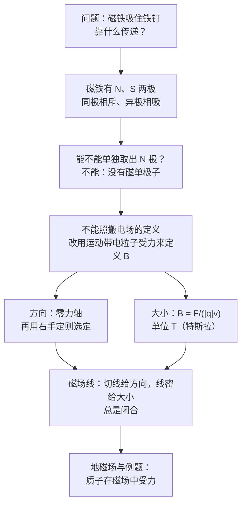

# C28.1 磁体与磁场的定义 Magnets and the Definition of B

> [!abstract] 这一讲的任务
> 第 21–27 章里，电场是用「放一个试探电荷，测它受的力」来定义的。磁场能不能照搬？磁铁有 N、S 两极，那就拿一个「磁荷」去测？答案是**不行**：自然界里找不到单独的磁荷。这一讲要回答：**没有磁荷，磁场怎么定义？** 答案是改用**运动的带电粒子**做试探物，由它受到的磁力反推出磁场的方向和大小。

> [!info] 怎么读这份讲义
> 正文中的「例 N」指 Chapter 28 幻灯片里的第 N 个例题，「第 N 页」是幻灯片页码；「SP」是教材的 Sample Problem，「Checkpoint」是教材的随堂思考题。
> 标有 **（拓展）** 或 **【拓展】** 的内容，是**课堂上没有讲到、由教材延伸补充**的部分。复习时可先掌握未标注的主干内容，行有余力再看拓展部分。

---

## 0. 开场：指南针为什么会转

把一枚指南针平放在桌上，它的一端总是指向北方。拿一块磁铁靠近，指南针会偏；把两块磁铁凑近，有时吸、有时斥。它们之间什么都没有接触，这些力靠什么传递？

> [!question] 停一下，先自己想想
> 电场的定义是 $\vec E=\vec F/q_0$：在某点放一个试探电荷，测它受的力。想给磁场下同样的定义，你会去找什么样的「试探物」？

## 1. 撞墙：磁铁的两极能不能分开

最直接的想法是：把磁铁的 N 极拿出来当作「磁荷」，测它受的力，就像测电荷那样。

试一下。把一根条形磁铁折断，两段仍然各有 N、S 两极。再断、再断，每一小段都是一根完整的小磁铁，两端各有一个极。**无论切得多细，都找不到孤立的 N 极或 S 极。**

这不是实验技术的限制，而是磁学的基本事实：**自然界没有磁荷，也没有磁单极子（magnetic monopole）**。电荷可以单独存在，磁极却总是成对出现。

> [!warning] 易错点：磁铁的「极」不是磁荷
> N、S 两极只是描述磁体外部效果的说法。一根磁铁是一个**磁偶极子**（C28.6 会回到这一点），两极不能像正负电荷那样被分开。

撞墙的结论：**磁场不能像电场那样用磁荷来定义，必须换一个试探物。**

## 2. 换一个试探物：运动的带电粒子

既然静止的磁荷不存在，就换成**运动的带电粒子**。它既会在磁场中受力，自身也会产生磁场（电子带有内禀磁场，多个磁场的矢量和给出净磁场，见 Chapter 28 第 5 页）。我们只用它的受力来定义磁场。

设想在磁场中某点放一个电荷量为 $q$、速度为 $\vec v$ 的粒子。实验发现三件事：

1. 粒子受到的力 $\vec F_B$ 的大小与 $|q|$、$v$ 成正比，并且与速度方向有关；
2. 当速度沿某一条直线方向时，力**恰好为零**。这条直线叫**零力轴**（zero-force axis）；
3. 当速度与零力轴垂直时，力**最大**。

这三条就是定义磁场的原材料。

> [!important] 磁感应强度的方向
> 磁场 $\vec B$ 的方向**沿零力轴**。零力轴有两个方向，再用右手定则（第 3 节）选定其中一个。

> [!important] 磁感应强度的大小
> 当速度与磁场垂直时磁力最大，记为 $F_{B,\max}$，磁感应强度的大小定义为
> $$B=\frac{F_{B,\max}}{|q|\,v}$$

有了方向与大小，就可以写出一般的磁力公式。设速度 $\vec v$ 与磁场 $\vec B$ 的夹角为 $\varphi$，则

$$\vec F_B=q\,\vec v\times\vec B,\qquad |\vec F_B|=|q|\,vB\sin\varphi$$

由这个式子可以直接读出几条性质：

- $\vec F_B$ **同时垂直于** $\vec v$ 和 $\vec B$（Chapter 28 第 9 页）。
- $\varphi=0^\circ$ 或 $180^\circ$（速度与磁场平行）时，$\vec F_B=0$。
- $\varphi=90^\circ$ 时磁力最大：$|\vec F_B|=|q|vB$。
- **磁力不做功**。因为 $\vec F_B\perp\vec v$，$dW=\vec F_B\cdot\vec v\,dt=0$。所以磁力只改变速度的方向，**不改变速率与动能**（学习目标第 4 条）。

> [!question] 停一下：磁力不做功，它怎么能让粒子拐弯？
> 动能不变、速率不变，但方向在变。方向变化需要加速度，而加速度来自合力。磁力始终与速度垂直，它只能把速度「拐」过去，不能把它「推」快。下一讲就用这一点推出圆周运动。

## 3. 右手定则：力的方向怎么找

磁力的方向由叉乘 $\vec v\times\vec B$ 决定。右手四指从 $\vec v$ 转向 $\vec B$（取小于 $180^\circ$ 的角），拇指方向就是 $\vec v\times\vec B$。

- 对**正电荷**：$\vec F_B$ 与 $\vec v\times\vec B$ 同向；
- 对**负电荷**：$\vec F_B$ 与 $\vec v\times\vec B$ 反向。

![[C28-右手定则.png]]

图中 (a)–(c) 是手势的分步演示，(d) 是正电荷受力，(e) 是负电荷受力。

## 4. 单位与数量级

- SI 单位是**特斯拉 T**。由 $B=F/(|q|v)$ 得 $1\ \mathrm T=1\ \mathrm{N/(A\cdot m)}$。
- 常用单位是**高斯 G**，$1\ \mathrm G=10^{-4}\ \mathrm T$（Chapter 28 第 10 页）。

> [!note] 【拓展】教材 Table 28-1：几种磁场的数量级
> | 位置 | 磁场大小 |
> |---|---|
> | 中子星表面 | $10^{8}\ \mathrm T$ |
> | 大电磁铁旁 | $1.5\ \mathrm T$ |
> | 小磁条旁 | $10^{-2}\ \mathrm T$（即 100 G） |
> | 地球表面 | $\sim10^{-4}\ \mathrm T$（约 0.5 G） |
> | 星际空间 | $10^{-10}\ \mathrm T$ |
> | 磁屏蔽室内的最小值 | $10^{-14}\ \mathrm T$ |

## 5. 磁场线：把看不见的场画出来

磁场线有三条规则（Chapter 28 第 11 页）：

1. 曲线上任一点的切线方向，就是该点 $\vec B$ 的方向；
2. 垂直于磁场线的单位面积上穿过的线数，正比于 $B$ 的大小：线密处磁场强；
3. 所有磁场线都是**闭合曲线**。

第 3 条是关键。电场线从正电荷出发、到负电荷终止，因为有电荷作为起点与终点。磁场线没有起点，也没有终点，只能自己绕回来。这正是「没有磁单极子」在图上的样子。

> [!question] 课堂追问：条形磁铁外部的磁场线从哪一端出来？
> 在磁铁**外部**，磁场线从 N 极出发、从 S 极进入；在磁铁**内部**，它从 S 极回到 N 极，形成闭合回路。磁铁两端的线最密，所以那里的磁作用最强。

## 6. 地磁场：指南针为什么指北

地球本身是一块巨大的磁体（Chapter 28 第 12–13 页）。

- 指南针磁针的 N 极指向**地理北极**附近。磁学约定是异名磁极相吸，所以那一带的地磁场极性实际上是 **S**。我们习惯把那里叫作「地磁北极」，两个名字指的是同一个点。
- 地磁极并不固定。第 13 页说，地磁北极正在加拿大与俄罗斯之间移动，地磁南极则从南极大陆向外漂移。
- 地磁场有倾角。在北半球，磁场线斜向地下、指向北方；在南半球，斜向地面上方、指向南方。倾角 $\delta$ 指磁场与水平面的夹角。

这一点在下面的例 1 中会直接用到。

## 7. 例 1：地磁场中的质子

质子速率 $v=1.0\times10^{6}\ \mathrm{m/s}$，地磁场大小 $0.55\ \mathrm G$，质子**向东**运动，求它受的磁力。

**大小**：$\varphi=90^\circ$，

$$F_B=|q|vB=(1.60\times10^{-19})(1.0\times10^{6})(0.55\times10^{-4})=8.8\times10^{-18}\ \mathrm N$$

**方向**：原幻灯片在这里留空（Direction?），下面补全。取 $x$ 轴向东、$y$ 轴向北、$z$ 轴向上。北半球的地磁场为

$$\vec B=B(\cos\delta\,\hat y-\sin\delta\,\hat z)$$

质子速度 $\vec v=v\hat x$，于是

$$\vec v\times\vec B=vB\,(\sin\delta\,\hat y+\cos\delta\,\hat z)$$

所以磁力指向**北方并斜向上**，它与水平面的夹角为 $90^\circ-\delta$。北半球倾角约 $60^\circ$ 时，夹角约为 $30^\circ$。

> [!note] 【拓展】补全方向的理由
> 水平方向的那部分磁场（$B\cos\delta$）给出竖直向上的力，竖直向下的那部分磁场（$B\sin\delta$）给出指向北方的力。两者合成就是上面的方向。

> [!question] 停一下：如果质子向西运动，力朝哪？
> 速度反向，叉乘反向，磁力也反向：**指向南方并斜向下**。

> [!note] 数量级感受
> 磁力只有 $8.8\times10^{-18}\ \mathrm N$，很小。但质子质量只有 $1.67\times10^{-27}\ \mathrm{kg}$，加速度可达 $5.3\times10^{9}\ \mathrm{m/s^2}$，约为重力加速度的 $5\times10^{8}$ 倍。

## 8. 例 2：竖直磁场中的质子

均匀磁场 $B=1.2\ \mathrm{mT}$ 竖直向上。动能 $K=5.3\ \mathrm{MeV}$ 的质子水平地由南向北射入。求 (a) 磁力，(b) 加速度。

**先求速率**。把动能换成焦耳：$5.3\times10^{6}\times1.60\times10^{-19}=8.5\times10^{-13}\ \mathrm J$，再由 $K=\tfrac12 mv^2$：

$$v=\sqrt{\frac{2K}{m}}=\sqrt{\frac{2\times8.5\times10^{-13}}{1.67\times10^{-27}}}\approx3.2\times10^{7}\ \mathrm{m/s}$$

此时 $v/c\approx0.1$，动能只占静止能量的 0.6%，用非相对论公式的误差在 1% 以内。

**(a) 磁力**：$\vec v$ 向北、$\vec B$ 向上，$\vec v\times\vec B$ 指向东，所以力向东。大小为

$$F_B=|q|vB=(1.60\times10^{-19})(3.2\times10^{7})(1.2\times10^{-3})\approx6.1\times10^{-15}\ \mathrm N$$

> [!warning] 原题数值错误：(a) 写作 $8.4\times10^{-17}\ \mathrm N$
> 按上式复算，(a) 应为 $6.1\times10^{-15}\ \mathrm N$，原题给的数值小了约 73 倍。(b) 的 $3.7\times10^{12}\ \mathrm{m/s^2}$ 与正确的 (a) 一致，所以问题只在 (a) 的数字，方法本身没有问题。教材 Sample Problem 28.01 给出的也是 $6.1\times10^{-15}\ \mathrm N$。

**(b) 加速度**：

$$a=\frac{F_B}{m}=\frac{6.1\times10^{-15}}{1.67\times10^{-27}}\approx3.7\times10^{12}\ \mathrm{m/s^2}$$

> [!question] 停一下：磁力那么小，加速度为什么那么大？
> 质子质量只有 $1.67\times10^{-27}\ \mathrm{kg}$，同样的力作用在它身上，加速度就大得多。这说明「力小」不等于「运动几乎不变」：对质量极小的粒子，磁力足以显著地改变它的运动。

> [!note] 【拓展】教材 Sample Problem 28.01 的同一情形
> 教材用的就是这道题，并给出了方向：质子被磁力偏向**东**方（教材图 28-6）。教材还说明，如果粒子带负电，磁力方向反过来，向西。

## 9. 【拓展】教材 Checkpoint 1：三种情形的磁力方向

图中三幅小图的坐标轴都是 $x$（向右）、$y$（向上）、$z$（斜向左下，即指向纸外）。

- **(a)** 正电荷，速度 $\vec v$ 向左（$-\hat x$），磁场 $\vec B$ 向下（$-\hat y$）：
  $\vec v\times\vec B=(-\hat x)\times(-\hat y)\,vB=vB\,\hat z$。正电荷，所以 $\vec F_B$ **指向纸外**。
- **(b)** 负电荷，速度 $\vec v$ 向下（$-\hat y$），磁场 $\vec B$ 指向纸内（$-\hat z$）：
  $\vec v\times\vec B=(-\hat y)\times(-\hat z)\,vB=vB\,\hat x$。负电荷，所以 $\vec F_B$ **向左**（$-\hat x$）。
- **(c)** 负电荷，速度 $\vec v$ 向下，磁场 $\vec B$ 向上：两者平行，$\vec F_B=0$。

> [!tip] 【拓展】速记方法
> 先算 $\vec v\times\vec B$ 的方向，再看电荷正负：正电荷照做，负电荷反过来。

## 这一讲的三句话

> [!important] 记住这三条
> 1. **磁场不能用磁荷来定义**：自然界没有磁单极子，磁极成对出现。磁场改用运动带电粒子的受力来定义：方向沿零力轴，大小 $B=F_{B,\max}/(|q|v)$，单位特斯拉。
> 2. **磁力公式** $\vec F_B=q\vec v\times\vec B$：大小 $|q|vB\sin\varphi$，方向由右手定则定，始终垂直于 $\vec v$。所以磁力不做功，只改变速度方向。
> 3. **磁场线**切线给方向、线密给大小，**总是闭合**。地磁场的倾角与指南针的指向，都是这套规律在地球上的表现。

> [!tip] 下一讲预告
> 磁力始终垂直于速度，它只能让粒子拐弯。下一讲就用牛顿第二定律推出：一个带电粒子在均匀磁场中、速度与磁场垂直时，它沿什么样的轨道运动？周期为什么与速率无关？这正是回旋加速器的物理基础。

---

上一章 ← [[C27.5 RC电路]] ｜ 下一节 → [[C28.2 带电粒子的圆周运动]]
索引 → [[电磁学 MOC]]
