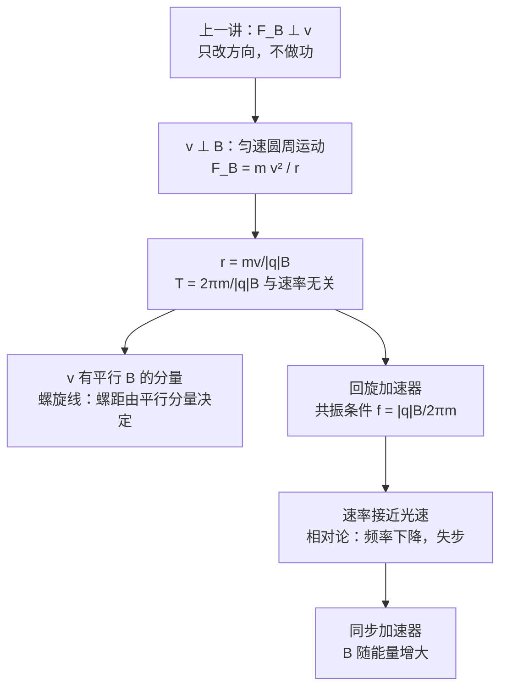

# C28.2 带电粒子的圆周运动 Circular Motion of a Charged Particle

> [!abstract] 这一讲的任务
> 上一讲说，磁力始终与速度垂直，所以它只改变方向、不改变速率。那么带电粒子在磁场中究竟怎么运动？这一讲回答三个问题：速度与磁场垂直时，轨道是什么形状，半径和周期由什么决定；速度还有平行磁场的分量时，轨道怎样变化；回旋加速器又怎样利用这些规律，把粒子加速到几十 MeV。

> [!info] 怎么读这份讲义
> 正文中的「例 N」指 Chapter 28 幻灯片里的第 N 个例题，「第 N 页」是幻灯片页码；「SP」是教材的 Sample Problem，「Checkpoint」是教材的随堂思考题。
> 标有 **（拓展）** 或 **【拓展】** 的内容，是**课堂上没有讲到、由教材延伸补充**的部分。复习时可先掌握未标注的主干内容，行有余力再看拓展部分。

---

## 0. 开场：一个越转越快的质子

想象一台回旋加速器。质子从中心出发，在两个半圆形的金属盒（D 形盒）之间跳动：每次经过窄缝，就被电场推一把；然后在盒内的磁场中拐一个半圆，再回到窄缝。质子一圈比一圈转得快，轨道越来越大，但每一圈花的时间似乎没有变化。它因此能被一直推下去，直到达到所需的能量。

这里面有两个问题：轨道的半径为什么会随速率变大？那个「每圈时间不变」从哪里来？

> [!question] 停一下，先自己想想
> 如果磁力的方向始终垂直于速度，大小也不变，粒子的轨道会是什么形状？猜一猜：圆、直线，还是螺旋？

## 1. 撞墙：只知道「往一侧拐」还不够

直觉上，磁场会把粒子往一侧推。可这只说了方向，没说**拐多快、拐多远**。要算清楚，就要用牛顿第二定律。

速度 $\vec v\perp\vec B$ 时，磁力大小为 $|q|vB$，方向始终垂直于速度、指向轨道的圆心。于是

$$|q|vB=\frac{mv^2}{r}$$

解得**半径**

$$r=\frac{mv}{|q|B}$$

一圈的时间（周期）为

$$T=\frac{2\pi r}{v}=\frac{2\pi m}{|q|B}$$

频率与角频率分别是 $f=\dfrac1T=\dfrac{|q|B}{2\pi m}$，$\omega=2\pi f=\dfrac{|q|B}{m}$。

> [!important] 圆周运动的三个结论
> - 半径 $r=\dfrac{mv}{|q|B}$：**速率越大，圆越大**。
> - 周期 $T=\dfrac{2\pi m}{|q|B}$：**与速率无关**。代入之后 $v$ 消掉了，只剩 $m/|q|$ 与 $B$。
> - 对同样的 $m/|q|$ 而言，在同一磁场中所有粒子的 $T$、$f$、$\omega$ 都相同。

> [!question] 停一下：周期与速率无关，有什么用？
> 如果每一圈的时间都一样，那么只要在固定的时刻给粒子一个电场「踢」，它就每圈都能被踢到，不会掉队。回旋加速器正是靠这一点工作（第 4 节）。

**例 3**：质子在半径 $14\ \mathrm{cm}$ 的圆轨道上运动，磁场 $0.35\ \mathrm T$，求速率。

$$v=\frac{|q|Br}{m}=\frac{(1.60\times10^{-19})(0.35)(0.14)}{1.67\times10^{-27}}\approx4.7\times10^{6}\ \mathrm{m/s}$$

## 2. 例 4：同速的电子与质子

**例 4**：电子和质子以相同速率射入同一均匀磁场。哪个走小圈？各自的绕行方向如何？

- 半径 $r=mv/(|q|B)$。速率、$|q|$、$B$ 都相同，所以半径正比于质量。质子质量 $1.67\times10^{-27}\ \mathrm{kg}$ 是电子质量 $9.1\times10^{-31}\ \mathrm{kg}$ 的约 1833 倍，**电子走小圈**。
- 绕行方向由 $\vec F_B=q\vec v\times\vec B$ 决定。当 $\vec B$ 指向纸内时，正电荷逆时针、负电荷顺时针，所以**电子顺时针、质子逆时针**。原题的答案与此一致，说明原题中的 $\vec B$ 指向纸内。

> [!question] 停一下：如果把 $\vec B$ 翻过来，结论怎么变？
> 绕行方向全部反过来：电子变成逆时针，质子变成顺时针。哪个圈小不变，因为半径只与质量、速率、$|q|$ 和 $B$ 的大小有关，与 $B$ 的方向无关。

> [!note] 【拓展】教材 Checkpoint 3：同一问题
> 教材给出的图中，两个圆同速，$\vec B$ 指向纸内。答案与例 4 完全相同：电子（质量小）走小圈，且沿顺时针方向运动。

## 3. 螺旋线：速度有平行磁场的分量

如果速度 $\vec v$ 与磁场 $\vec B$ 成 $\varphi$ 角，就把它分解成两部分：

- 平行于磁场的分量 $v_\parallel=v\cos\varphi$：磁力为零，它保持不变；
- 垂直于磁场的分量 $v_\perp=v\sin\varphi$：负责圆周运动。

两者合起来就是螺旋线：沿磁场方向匀速前进，同时在垂直方向绕圈。

- **半径**由垂直分量决定：$r=\dfrac{mv_\perp}{|q|B}$。
- **螺距** $p$（沿磁场方向转一圈前进的距离）由平行分量决定：
$$p=v_\parallel T=(v\cos\varphi)\,\frac{2\pi m}{|q|B}$$

> [!warning] 译文笔误：「平行和垂直电场」应为「磁场」
> 原页（Chapter 28 第 18 页）的中文小字写作「速度分量分别平行和垂直电场」。螺旋线的分解是相对**磁场** $\vec B$ 进行的（教材原文是 parallel to the magnetic field），所以这里应为「磁场」。

![[C28-螺旋轨迹.png]]

（图为一个电子的螺旋线，$\vec B$ 沿 $+z$。紫色是垂直分量，决定半径；橙色是平行分量，决定螺距。）

> [!question] 停一下：为什么平行分量不被磁场改变？
> 磁力 $q\vec v\times\vec B$ 只与速度中垂直于 $\vec B$ 的部分有关。平行于 $\vec B$ 的那一部分，与 $\vec B$ 叉乘后为零，所以不受力。

**例 5**：动能 $22.5\ \mathrm{eV}$ 的电子进入磁场 $B=0.455\ \mathrm{mT}$ 的区域，速度与磁场成 $65.5^\circ$。求它的螺距。

1. 速率：$v=\sqrt{2K/m}=\sqrt{\dfrac{2\times22.5\times1.60\times10^{-19}}{9.11\times10^{-31}}}\approx2.81\times10^{6}\ \mathrm{m/s}$。
2. 周期：$T=\dfrac{2\pi m}{|q|B}=\dfrac{2\pi\times9.11\times10^{-31}}{(1.60\times10^{-19})(4.55\times10^{-4})}\approx7.85\times10^{-8}\ \mathrm s$。
3. 螺距：$p=(v\cos65.5^\circ)\,T=(2.81\times10^{6})(0.415)(7.85\times10^{-8})\approx9.16\times10^{-2}\ \mathrm m$。

> [!warning] 原题数值末位：$9.17\ \mathrm{cm}$ 应为 $9.16\ \mathrm{cm}$
> 按上式复算，螺距为 $9.160\ \mathrm{cm}$，四舍五入为 9.16 cm。教材 Sample Problem 28.03 也写 9.16 cm。原题的 9.17 cm 是末位进位的小误差，不影响方法。

> [!note] 【拓展】教材 Sample Problem 28.03
> 教材的题目与例 5 相同，给出的中间结果是 $v=2.81\times10^{6}\ \mathrm{m/s}$，并以 $p=(v\cos\varphi)\,2\pi m/(|q|B)$ 计算。本节的三步与之一致。

> [!note] 【拓展】磁瓶：非均匀磁场中的螺旋线
> 如果磁场两端比中间强，螺旋线上的粒子会在两端被「反射」，来回往复，像被关在瓶子里（教材图 28-11c，magnetic bottle）。这说明螺旋运动的粒子可以被磁场约束住。

## 4. 回旋加速器：磁场弯曲轨道，电场一次次推

回旋加速器由两个半圆形的金属盒（D 形盒，dee）组成，之间有一条窄缝。窄缝处加交变电压；盒内没有电场，只有磁场，粒子在其中绕半圆。

要让粒子每一圈都被「推」到，就要求交变电压的频率等于粒子的回旋频率。这就是**共振条件**：

$$f_{\text{osc}}=f=\frac{|q|B}{2\pi m}$$

因为 $T$ 与速率无关，只要这个条件满足，粒子每次经过窄缝时，电场正好是加速方向。

粒子最终达到的动能，由它的最大回旋半径 $R$ 决定。由 $v=|q|BR/m$，

$$K=\tfrac12 mv^2=\frac{(|q|BR)^2}{2m}$$

> [!note] 【拓展】教材 Sample Problem 28.05：氘核
> 氘核的质量 $m=3.34\times10^{-27}\ \mathrm{kg}$（约为质子的两倍），振荡频率 $12\ \mathrm{MHz}$，D 形盒半径 $R=53\ \mathrm{cm}$。
> - (a) 由共振条件，$B=\dfrac{2\pi mf}{|q|}=\dfrac{2\pi(3.34\times10^{-27})(12\times10^{6})}{1.60\times10^{-19}}\approx1.57\ \mathrm T$。
> - (b) 动能 $K=\dfrac{(|q|BR)^2}{2m}\approx16.6\ \mathrm{MeV}$，教材取 $17\ \mathrm{MeV}$。
> - 若改为加速质子、频率不变，磁场要减半（质子质量为氘核的一半）。

> [!note] 【拓展】教材 Sample Problem 28.04：质谱仪
> 离子质量 $m$、电荷 $q$，先由电势差 $V$ 加速，从静止获得速度 $v$：$qV=\tfrac12mv^2$。随后进入垂直于速度的均匀磁场，做半圆运动，落在距入口 $x$ 处。半圆直径就是 $x$，所以 $r=x/2$，又 $r=mv/(qB)$。消去 $v$：
> $$m=\frac{qB^2r^2}{2V}=\frac{qB^2x^2}{8V}$$
> 代入 $B=0.080\ \mathrm T$、$V=1000.0\ \mathrm V$、$x=1.6254\ \mathrm m$、$q=1.6022\times10^{-19}\ \mathrm C$：$m\approx3.39\times10^{-25}\ \mathrm{kg}\approx204\ \mathrm u$。质谱仪用同样的思路，把不同质量的离子按落点分开。

## 5. 相对论的限制与同步加速器

回旋加速器有一个隐含的假设：粒子的回旋频率与速率无关。这只在速率远小于光速时成立。质子的动能超过约 $50\ \mathrm{MeV}$、速率超过光速的约 10% 时，相对论效应明显：质量增大，回旋频率下降，粒子渐渐与固定频率的振荡器失步，能量不再增加。

另一个难题是造价。要把质子加速到 $500\ \mathrm{GeV}$，用固定磁场的回旋加速器，磁铁得覆盖约 $4\times10^{6}\ \mathrm{m^2}$ 的极面。

**同步加速器**（synchrotron）同时解决了这两个问题：磁场 $B$ 与振荡频率 $f_{\text{osc}}$ 都随时间调节，使粒子的回旋频率始终与振荡器同步。粒子沿圆形轨道（而不是螺旋线）运动，磁铁只需沿圆环分布。

> [!note] 【拓展】数量级估算
> 对 $500\ \mathrm{GeV}$ 的质子，$pc\approx500\ \mathrm{GeV}$，在 $1.5\ \mathrm T$ 的磁场中，轨道半径为
> $$r=\frac{p}{|q|B}\approx\frac{500\times10^{9}}{3.0\times10^{8}\times1.5}\ \mathrm m\approx1.1\times10^{3}\ \mathrm m$$
> 所以同步加速器的轨道半径是公里量级。

> [!question] 停一下：如果回旋加速器的磁场只增不减，会发生什么？
> 磁场增强，回旋频率就增大，而振荡器的频率没变，粒子渐渐跟不上。同步加速器的设计，就是让两者同时随能量变化，始终保持同步。

Chapter 28 第 23 页列出了两个实验设施的照片：瑞士 PSI 的回旋加速器，英国 Diamond 的同步加速器。这里只记住它们分属两类加速器，不展开结构。

## 这一讲的三句话

> [!important] 记住这三条
> 1. **速度与磁场垂直**时粒子做匀速圆周运动：$r=mv/|q|B$（与速率成正比），$T=2\pi m/|q|B$（与速率无关）。
> 2. **速度有平行磁场的分量**时轨迹是螺旋线：半径由垂直分量决定，螺距 $p=v_\parallel T$ 由平行分量决定。
> 3. **回旋加速器**靠 $T$ 与速率无关实现共振加速，$f_{\text{osc}}=|q|B/2\pi m$；相对论使频率下降后，**同步加速器**让磁场随能量增大。

> [!tip] 下一讲预告
> 上一讲的磁力作用在单个粒子上。下一讲把电场和磁场放在一起：两者互相垂直时，粒子受力为 $\vec F=q(\vec E+\vec v\times\vec B)$。汤姆孙用这个组合测出电子的荷质比，霍尔用它测出载流子的密度。

---

上一节 ← [[C28.1 磁体与磁场的定义]] ｜ 下一节 → [[C28.3 正交场与霍尔效应]]
索引 → [[电磁学 MOC]]
