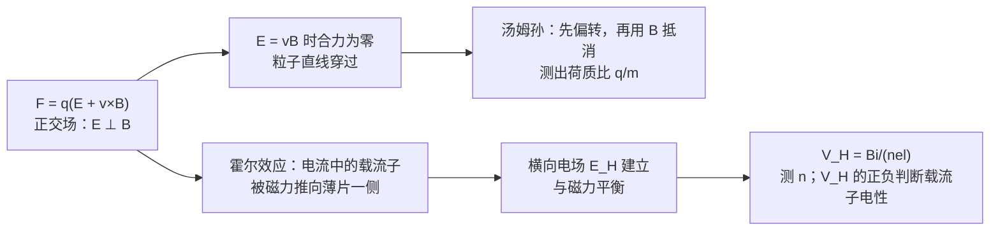

# C28.3 正交场与霍尔效应 Crossed Fields and the Hall Effect

> [!abstract] 这一讲的任务
> 前两讲只有磁场单独作用于粒子。这一讲把**电场与磁场垂直地放在一起**（正交场），粒子受力变成 $\vec F=q(\vec E+\vec v\times\vec B)$。汤姆孙用这一组合测出了电子的荷质比；霍尔用它判断载流子的电性，并测出载流子的密度。

> [!info] 怎么读这份讲义
> 正文中的「例 N」指 Chapter 28 幻灯片里的第 N 个例题，「第 N 页」是幻灯片页码；「SP」是教材的 Sample Problem，「Checkpoint」是教材的随堂思考题。
> 标有 **（拓展）** 或 **【拓展】** 的内容，是**课堂上没有讲到、由教材延伸补充**的部分。复习时可先掌握未标注的主干内容，行有余力再看拓展部分。

---

## 0. 开场：阴极射线是什么

19 世纪末，人们已经能在真空管里看到一束从阴极飞向阳极的射线，叫作阴极射线。它是一种波，还是一束带电粒子？如果它带电，就该被电场偏转。那么偏转量能告诉我们什么？

> [!question] 停一下，先自己想想
> 如果只用电场来偏转射线，你能同时得到它的速率和荷质比（$q/m$）吗？

## 1. 撞墙：一次测量，两个未知数

只加电场时，偏转量 $y$ 与 $q$、$m$、$v$、$E$ 都有关。一次测量只能给出一个数，而速率 $v$ 与荷质比 $q/m$ 都未知。这是一个解不出来的方程。

解法：再加一个磁场，让两者的效果互相抵消，直接得到速率。电场与磁场正交（互相垂直）时，粒子受力为

$$\vec F=q(\vec E+\vec v\times\vec B)$$

### 1.1 合力为零：$E=vB$

如果电场力与磁场力**大小相等、方向相反**，合力为零，粒子沿直线运动。两个力大小相等时：

$$|q|E=|q|vB\quad\Longrightarrow\quad v=\frac{E}{B}$$

不论粒子的质量和电荷多大，只要速度恰好是 $E/B$，它就直线通过。这是正交场中最重要的一个结论。

> [!question] 停一下：如果粒子速度比 $E/B$ 大，它会往哪边偏？
> 速度增大，磁力随之增大，磁力占优，粒子向磁力方向偏。若速度小于 $E/B$，电场力占优，粒子向电场力方向偏。

## 2. 汤姆孙的三步实验（Chapter 28 第 26–27 页）

阴极射线管里，阴极加热后发射电子，电子经加速电压加速，穿过小孔形成一束细的电子流，打在荧光屏上形成亮点。在电子束的路径上放两块平行的偏转板，板长为 $L$。

1. **$E=0$，$B=0$**：电子束不偏转，亮点在屏幕中心。
2. **只加 $E$，$B=0$**：电子束向一侧偏转，屏上亮点移开，偏转量为 $y$。电子在板间的时间 $t=L/v$，加速度 $a=|q|E/m$，所以
$$y=\tfrac12at^2=\frac{|q|EL^2}{2mv^2}$$
3. **再加 $B$，并调到电场力与磁力平衡**：亮点回到屏幕中心，即偏转量为零，此时 $v=E/B$。

把第 3 步的 $v=E/B$ 代回第 2 步的 $y$：

$$y=\frac{|q|L^2B^2}{2mE}\quad\Longrightarrow\quad\boxed{\frac{|q|}{m}=\frac{2yE}{L^2B^2}}$$

这样，只用测得的 $y$、$E$、$B$、$L$，就得到了荷质比，而且不需要预先知道速率。

> [!question] 停一下：第 3 步「亮点回到中心」与「偏转量为零」是什么关系？
> 它们是同一件事：偏转量为零，就是净力为零，也就是 $E=vB$。

## 3. 霍尔效应：电子被推到一侧

1879 年，霍尔（Edwin Hall）发现：把一块通电的金属薄片放进磁场，它的两侧会出现电势差。这就是霍尔效应。

设薄片中电流 $i$ 沿 $x$ 方向流动，磁场 $\vec B$ 垂直于薄片（指向纸内）。电子以漂移速度 $v_d$ 逆着电流方向运动（图中蓝色箭头）。

![[C28-霍尔效应.png]]

（左图是载流子为电子的情形，右图是载流子为正电荷的情形。）

过程分三步：

1. 每个载流子都受磁力 $\vec F_B=q\vec v_d\times\vec B$，被推向薄片的一侧（图中的上侧）。
2. 载流子在上侧堆积。电子堆积使上表面带负电、下表面带正电，于是薄片内部出现横向电场 $E_H$，方向由下指向上。
3. 这个电场对电子的电场力朝下，与磁力方向相反。堆积的电荷越多，$E_H$ 越大，直到电场力与磁力平衡：
$$eE_H=ev_dB\quad\Longrightarrow\quad E_H=v_dB$$

设薄片宽度为 $d$，两侧的**霍尔电势差**为

$$V_H=E_Hd=v_dBd$$

再用电流把 $v_d$ 换掉。设 $n$ 为载流子数密度，薄片厚度为 $\ell$，截面积 $A=d\ell$，则 $i=nev_dA$，于是 $v_d=\dfrac{i}{ne\,d\,\ell}$，代入得

$$\boxed{V_H=\frac{Bi}{ne\ell}}\qquad\Longrightarrow\qquad n=\frac{Bi}{eV_H\ell}$$

所以只要测出 $B$、$i$、$\ell$ 和 $V_H$，就能求出载流子数密度 $n$。

> [!question] 停一下：如果载流子是正电荷，上表面会带什么电？
> 正电荷也被磁力推向上侧，所以上表面带正电，下表面带负电，电势高低与电子情形**正好相反**。因此，测出 $V_H$ 的正负，就能判断载流子是正还是负。

> [!note] 【拓展】霍尔效应测漂移速度
> 教材还给出一种测漂移速度的办法：机械地拖动金属薄片，让它以与电子漂移方向相反的速度运动，调节薄片速度，直到霍尔电势差为零。此时电子相对实验室的速度为零，薄片速度的大小就等于电子的漂移速度。教材指出，电子的漂移速度约为厘米每小时的量级。

## 4. 【拓展】教材 Sample Problem 28.02：运动的金属方块

边长 $d=1.5\ \mathrm{cm}$ 的金属立方体，以 $4.0\ \mathrm{m/s}$ 沿 $+y$ 方向运动，穿过 $B=0.050\ \mathrm T$ 的磁场（沿 $+z$）。

- **哪一面电势低？** 导体中的电子受力 $-e\vec v\times\vec B$。其中 $\vec v\times\vec B=v\hat y\times B\hat z=vB\hat x$，所以电子被推向 $-x$ 面。该面带负电，**电势较低**；$+x$ 面电势较高。
- **电势差**：$V=vBd=(4.0)(0.050)(0.015)=3.0\times10^{-3}\ \mathrm V=3.0\ \mathrm{mV}$。

这与霍尔效应是同一个机制：导体在磁场中运动，内部的电荷被磁力推到两侧，建立电势差。教材还提到，如果一根导线从卫星上垂下来，在地磁场中运动，也会产生这样的电势差，并可以用来帮助卫星调整轨道。

## 5. 【拓展】教材 Checkpoint 2：四个速度方向

图中粒子带正电，电场 $\vec E$ 指向纸外，磁场 $\vec B$ 指向左。四个速度方向分别为 1（向左）、2（向上）、3（向右）、4（向下）。坐标取 $x$ 向右、$y$ 向上、$z$ 指向纸外，则 $\vec E=E\hat z$，$\vec B=-B\hat x$。

- **方向 1、3**：速度与 $\vec B$ 平行，磁力为零。净力为 $q\vec E$，大小 $qE$。
- **方向 2**（向上）：$\vec v\times\vec B=vB\hat z$，与 $\vec E$ 同向。净力大小为 $q(E+vB)$，**最大**。
- **方向 4**（向下）：$\vec v\times\vec B=-vB\hat z$，与 $\vec E$ 反向。净力大小为 $q|E-vB|$。

所以：

- **(a)** 净力大小的排序为 $2>1=3$。
- **(b)** 只有方向 4 **可能**使净力为零，条件是 $v=E/B$。这正是 1.1 节的速度选择条件。

## 这一讲的三句话

> [!important] 记住这三条
> 1. **正交场**中粒子受力 $\vec F=q(\vec E+\vec v\times\vec B)$；当 $E=vB$ 时合力为零，粒子直线通过。
> 2. **汤姆孙**：先只加 $E$ 测偏转量 $y$，再加 $B$ 把偏转抵消，得到 $v=E/B$，于是 $\dfrac{|q|}{m}=\dfrac{2yE}{L^2B^2}$。
> 3. **霍尔效应**：载流子被磁力推到一侧，建立横向电场，平衡时 $V_H=Bi/(ne\ell)$。由 $V_H$ 可求 $n$，由 $V_H$ 的正负可判断载流子电性。

> [!tip] 下一讲预告
> 霍尔效应里的漂移电子，是一大群电子共同的行为。把它们受到的磁力加在一起，就是通电导线受的力。下一讲从单个运动电荷的磁力出发，推出 $\vec F=i\vec L\times\vec B$。

---

上一节 ← [[C28.2 带电粒子的圆周运动]] ｜ 下一节 → [[C28.4 磁场对载流导线的力]]
索引 → [[电磁学 MOC]]
