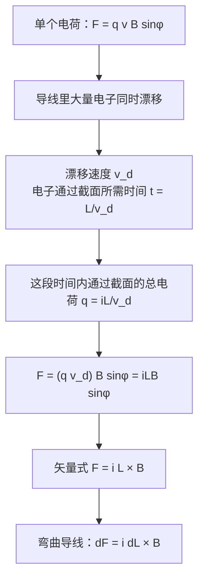

# C28.4 磁场对载流导线的力 Magnetic Force on a Current-Carrying Wire

> [!abstract] 这一讲的任务
> 电动机、扬声器、磁悬浮都要靠通电导线在磁场中受力。上一讲我们已经知道单个运动电荷受的力。这一讲要回答：**一根装着大量电子的导线，整体受到的力，怎样用电流 $i$、导线长度 $L$ 和磁场 $\vec B$ 表示？**

> [!info] 怎么读这份讲义
> 正文中的「例 N」指 Chapter 28 幻灯片里的第 N 个例题，「第 N 页」是幻灯片页码；「SP」是教材的 Sample Problem，「Checkpoint」是教材的随堂思考题。
> 标有 **（拓展）** 或 **【拓展】** 的内容，是**课堂上没有讲到、由教材延伸补充**的部分。复习时可先掌握未标注的主干内容，行有余力再看拓展部分。

---

## 0. 开场：用磁场托住一根铜线

假设你要用磁场把一根水平的铜导线托在空中，抵消它的重力。这根导线每米质量 $46.6\ \mathrm g$，通过 $28\ \mathrm A$ 的电流。需要多强的磁场？方向怎么放？

> [!question] 停一下，先自己想想
> 导线里的每个电子都受磁力，整根导线受的力，是把每个电子的力直接加起来吗？如果是，就要知道有多少个电子、它们各自的速度，这显然不现实。有没有办法绕开「数电子」这一步？

## 1. 撞墙：电子太多，没法逐个加

单个运动电荷受力 $F=|q|vB\sin\varphi$，这没错。可导线里的电子数量极其庞大，而且它们以**漂移速度** $v_d$ 缓慢前进（教材提到，约为厘米每小时的量级）。逐个数、逐个求和，做不到。

绕开的办法是**不数电子，改用电流**。电流 $i$ 就是单位时间内穿过截面的电荷量。

取导线上长 $L$ 的一段。电子以速度 $v_d$ 穿过某截面，所需时间为 $t=L/v_d$。这段时间内，穿过该截面的总电荷是

$$q=it=\frac{iL}{v_d}$$

这些电荷都以速度 $v_d$ 沿导线运动，它们受到的磁力之和为

$$F_B=(q\,v_d)\,B\sin\varphi=\frac{iL}{v_d}\cdot v_d\cdot B\sin\varphi=iLB\sin\varphi$$

其中 $\varphi$ 是导线方向（电流方向）与 $\vec B$ 的夹角。$v_d$ 在计算中消掉了：**我们只需要电流，不需要漂移速度的大小。**

> [!note] 【拓展】同一结论的另一种算法：数载流子
> 设载流子数密度为 $n$，长 $L$、截面积 $A$ 的一段导线里，载流子总数为 $nAL$，每个受力 $|e|v_dB\sin\varphi$。总力为
> $$nAL\cdot|e|v_dB\sin\varphi=(n|e|v_dA)\,LB\sin\varphi=iLB\sin\varphi$$
> 与前面的结果完全一致。

## 2. 矢量式：$\vec F_B=i\vec L\times\vec B$

引入**长度矢量** $\vec L$：大小为导线长度，方向沿电流方向。于是

$$\vec F_B=i\,\vec L\times\vec B$$

大小为 $F_B=iLB\sin\varphi$，方向由右手定则确定：四指沿电流方向（$\vec L$），弯向 $\vec B$，拇指方向即 $\vec F_B$。

> [!question] 停一下：导线里的电子带负电，它们的运动方向与电流相反。$i\vec L\times\vec B$ 会不会算反？
> 不会。$i\vec L$ 的方向是按**电流**定义的，也就是正电荷运动的方向。负电荷沿相反方向运动，等效于正电荷沿电流方向运动，两者受的磁力相同。这正是电流方向约定的好处。

这个式子带来两个推论：

- **只有与磁场垂直的那部分导线才受力**。在均匀磁场中，弯曲导线受的力由它两端连线的长度矢量 $\vec L$ 决定：$\vec L\times\vec B$ 自动只保留与 $\vec B$ 垂直的分量。
- **非均匀磁场或弯曲导线**：把导线分成很多小段，每段 $d\vec F_B=i\,d\vec L\times\vec B$，再对整根导线积分。

**例 6**：$22\ \mathrm A$ 的电流由东向西流过一段 $36\ \mathrm m$ 长的导线。该处地磁场水平，由南向北，大小 $0.50\times10^{-4}\ \mathrm T$。求导线受的力。

- 大小：$F_B=iLB\sin90^\circ=(22)(36)(0.50\times10^{-4})=3.96\times10^{-2}\ \mathrm N\approx4.0\times10^{-2}\ \mathrm N$。
- 方向：$\vec L$ 向西，$\vec B$ 向北，$\vec L\times\vec B$ 竖直**向下**。

> [!question] 停一下：一段 36 m 的导线、22 A 的电流，受力只有 0.04 N。这说明什么？
> 地磁场很弱（约 $10^{-4}\ \mathrm T$），只能靠大电流、长导线才能感受到磁力。实验室里的电磁铁能产生大得多的磁场，磁力也就显著得多。

## 3. 例 7：用磁场托住铜线

**例 7**：一根水平的铜导线通过 $28\ \mathrm A$ 的电流，线密度 $\lambda=46.6\ \mathrm g/\mathrm m$。求能托住它的最小磁场的大小和方向。

要使磁力与重力平衡，$iLB\sin\varphi=mg$。两边除以 $L$，得 $iB\sin\varphi=\lambda g$。要让 $B$ 最小，需要 $\sin\varphi$ 最大，即导线与 $\vec B$ 垂直，$\sin\varphi=1$：

$$B_{\min}=\frac{\lambda g}{i}=\frac{(46.6\times10^{-3})(9.8)}{28}\approx1.6\times10^{-2}\ \mathrm T$$

这大约是地表磁场（$10^{-4}\ \mathrm T$）的 160 倍。

**方向**：磁力必须竖直向上，且 $\vec B\perp$ 导线。原题没有给出电流的方向，下面按教材（图 28-17）的设定补全：电流垂直纸面向外，此时 $\vec B$ 应**水平向右**。验证一下：$\vec L$ 指向纸外（取 $\hat z$），$\vec B$ 指向右（取 $\hat x$），则 $\vec L\times\vec B=LB\,\hat z\times\hat x=LB\,\hat y$，即竖直向上。

> [!note] 【拓展】教材 Sample Problem 28.06
> 教材的题目与例 7 相同，并明确给出了方向：水平向右、与导线垂直。它也指出，这个磁场约为地磁场的 160 倍。

## 4. 【拓展】教材 Checkpoint 4：最大受力时磁场的方向

图中导线沿 $x$ 轴放置，电流 $i$ 指向 $-x$（向左）。磁力 $\vec F_B$ 沿 $+z$ 方向（图中指向左下方，即 $z$ 轴正向）。问：要使磁力最大，磁场应指向哪里？

设 $\vec B=B_y\hat y+B_z\hat z$，$\vec L=-L\hat x$。则

$$i\vec L\times\vec B=-iL\,\hat x\times(B_y\hat y+B_z\hat z)=iL\,(B_z\hat y-B_y\hat z)$$

- 磁力最大，要求 $\vec B\perp\vec L$，即 $B_x=0$。这一条已经满足。
- 力沿 $+\hat z$，且没有 $\hat y$ 分量，所以 $B_z=0$，并且 $-iLB_y>0$，即 $B_y<0$。

因此 $\vec B$ 沿 $-\hat y$，即**竖直向下**。

## 这一讲的三句话

> [!important] 记住这三条
> 1. 把单个载流子的磁力乘以载流子总数，即用电流代替：$F_B=iLB\sin\varphi$，漂移速度消掉了。
> 2. 矢量式 $\vec F_B=i\vec L\times\vec B$，$\vec L$ 沿电流方向；弯曲导线用 $d\vec F_B=i\,d\vec L\times\vec B$ 积分。
> 3. 要悬空托住导线，需要 $\vec B\perp$ 导线，此时 $B_{\min}=\lambda g/i$。

> [!tip] 下一讲预告
> 通电导线的磁力，是它的一段在磁场中受到的合力。如果导线绕成一个线圈，各边的力会互相抵消，剩下的是**力矩**。下一讲就用这个思路推出线圈的力矩公式，它是电动机转起来的根本原因。

---

上一节 ← [[C28.3 正交场与霍尔效应]] ｜ 下一节 → [[C28.5 载流线圈的磁力矩]]
索引 → [[电磁学 MOC]]
