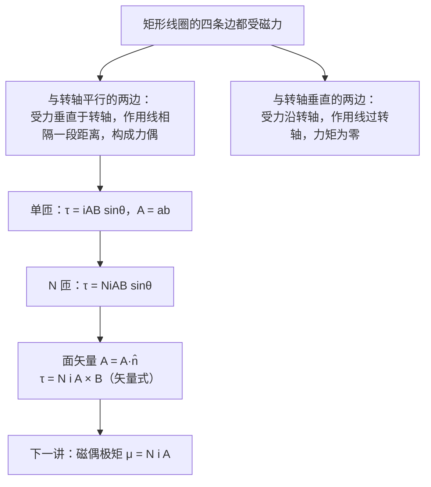

# C28.5 载流线圈的磁力矩 Torque on a Current Loop

> [!abstract] 这一讲的任务
> 电动机转起来，靠的不是线圈受到的「总合力」，而是各边受力产生的**力矩**。这一讲要回答两件事：一个通电的矩形线圈放在均匀磁场中，受到多大的力矩，它会转到什么位置；以及为什么**合力为零，力矩却可以不为零**。

> [!info] 怎么读这份讲义
> 正文中的「例 N」指 Chapter 28 幻灯片里的第 N 个例题，「第 N 页」是幻灯片页码；「SP」是教材的 Sample Problem，「Checkpoint」是教材的随堂思考题。
> 标有 **（拓展）** 或 **【拓展】** 的内容，是**课堂上没有讲到、由教材延伸补充**的部分。复习时可先掌握未标注的主干内容，行有余力再看拓展部分。

---

## 0. 开场：电风扇为什么会转

电风扇、洗衣机、电动车的电机，靠的都是通电线圈在磁场中转动。把一个矩形线圈放进磁场，通电之后，它会转到什么位置？会停在哪里？

> [!question] 停一下，先自己想想
> 线圈的四条边都受到磁力。如果把四个力加起来，合力为零，线圈是不是就不会转了？

## 1. 撞墙：合力为零，却能转

先算合力。线圈两条长边的电流方向相反，受力方向也相反，大小相等，互相抵消；两条短边同样如此。**合力为零。**

可是线圈确实会转。问题出在「合力」之外：两条长边的受力作用线**不重合**，它们相隔一段距离，构成一对**力偶**（couple）。力偶的合力为零，合力矩却不为零。

这就是本节的第一个结论：**合力为零 ≠ 合力矩为零**。

> [!warning] 易错点：力矩要看作用线
> 判断力矩时，不能只看力的大小和方向，还要看它的**作用线**离转轴多远。作用线过转轴的力，无论多大，力矩都是零。

## 2. 推导：力偶的力矩

设线圈的长边长为 $a$，它与转轴**平行**；两条长边之间的距离为 $b$；线圈面积 $A=ab$。磁场 $\vec B$ 与转轴垂直，线圈平面的法线 $\hat n$ 与 $\vec B$ 成 $\theta$ 角。

**(1) 长边的受力**。长边中的电流与 $\vec B$ 垂直，所以每条长边受力大小为

$$F_a=iaB$$

两条长边的电流方向相反，受力方向也相反。

**(2) 短边的受力**。短边长 $b$，与转轴垂直。它受的力沿转轴方向，而且两条短边的力作用线都过转轴，所以对力矩没有贡献。

**(3) 力矩的臂**。每条长边的受力，其作用线到转轴的垂直距离为 $\dfrac b2\sin\theta$。（把线圈放在 $xy$ 平面内、转轴沿 $y$ 方向，就可以直接算出这个距离。）

两条长边的力矩同向相加：

$$\tau=2\times\frac b2\sin\theta\times iaB=iabB\sin\theta=iAB\sin\theta$$

> [!note] 【拓展】为什么 $\theta$ 指的是法线与 $\vec B$ 的夹角
> 力矩里的 $\sin\theta$ 来自力的方向与线圈平面的相对位置。取 $\theta$ 为法线与 $\vec B$ 的夹角：$\theta=0$ 时线圈平面与 $\vec B$ 垂直，力矩为零；$\theta=90^\circ$ 时线圈平面与 $\vec B$ 平行，力矩最大。

## 3. 从一匝到 $N$ 匝：面矢量

线圈有 $N$ 匝时，每一匝都受到相同的力矩，所以

$$\tau=NiAB\sin\theta$$

把它写成矢量形式，需要引入**面矢量**（area vector）$\vec A=A\,\hat n$：大小为线圈面积，方向由右手定则确定（四指沿电流方向绕行，拇指方向为 $\hat n$）。于是

$$\vec\tau=Ni\,\vec A\times\vec B$$

大小 $|\vec\tau|=NiAB\sin\theta$。方向使法线 $\hat n$ 转向 $\vec B$：线圈倾向于转到法线与磁场同向的位置。

> [!question] 停一下：$\theta=0$ 处于什么状态？它稳定吗？
> $\theta=0$ 时力矩为零，线圈处于平衡。若稍微偏离一点，力矩会把它拉回 $\theta=0$，所以这个位置是**稳定**的。下一节会把这一点用能量的语言重新说一遍。

## 4. 例 8：一个 10 匝线圈

**例 8**：线圈有 10 匝，每匝半径 $0.500\ \mathrm m$，线圈与磁场成 $30^\circ$ 角放置。磁场 $0.50\ \mathrm T$，电流 $2.0\ \mathrm A$。求力矩的大小。

$$\tau=NiAB\sin\theta=(10)(2.0)\,\pi(0.500)^2\,(0.50)\sin30^\circ\approx3.9\ \mathrm N\cdot\mathrm m$$

> [!warning] 角度的读法
> 原题文字写的是「与磁场成 30°」，但图中标出的 30° 是**法线**与 $\vec B$ 的夹角，所以取 $\sin30^\circ=0.5$，得 3.9 N·m。如果按线圈**平面**与 $\vec B$ 成 30° 理解，则法线与磁场成 60°，结果变为 $6.8\ \mathrm N\cdot\mathrm m$。两种读法相差一倍，题目应当写清楚。

## 5. 【拓展】电动机的原理

一个线圈在磁场中受到的力矩，会把它转到 $\theta=0$ 的位置并停在那里。要让线圈持续地转下去，电动机需要每半圈改变一次电流方向（换向器的作用），使力矩的方向始终保持一致。教材（图 28-18）用一个单匝线圈讲解这一原理。

## 这一讲的三句话

> [!important] 记住这三条
> 1. **合力为零不等于力矩为零**：两条长边的受力作用线不重合，构成力偶。
> 2. **单匝矩形线圈**：$\tau=iAB\sin\theta$，$\theta$ 为法线 $\hat n$ 与 $\vec B$ 的夹角；$N$ 匝则乘以 $N$。
> 3. **矢量式** $\vec\tau=Ni\vec A\times\vec B$，$\vec A=A\hat n$ 由右手定则确定；力矩使法线趋向 $\vec B$。

> [!tip] 下一讲预告
> 线圈的力矩只依赖一个组合 $Ni\vec A$。给它起个名字，叫磁偶极矩 $\vec\mu$，就能用同一套公式描述小磁针、地球和电子，并算出磁场中的取向能。

---

上一节 ← [[C28.4 磁场对载流导线的力]] ｜ 下一节 → [[C28.6 磁偶极矩]]
索引 → [[电磁学 MOC]]
